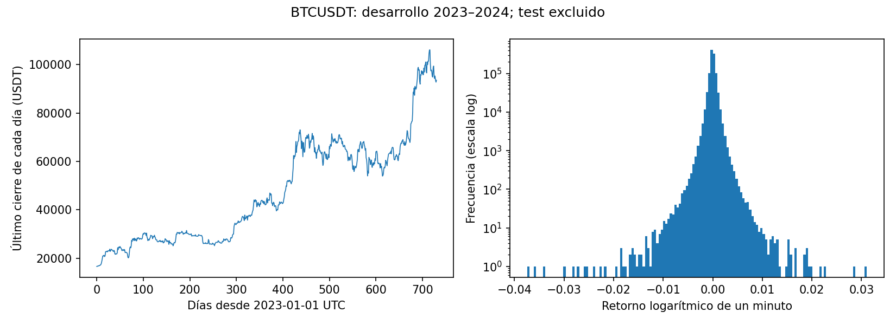

# 2. Análisis Exploratorio de Datos (EDA) Mejorado

El EDA de este proyecto debe ser reproducible y orientar decisiones de modelado, preprocesamiento y validación. Cada resultado deberá acompañarse de una interpretación técnica y una decisión justificable.

```{important}
Esta sección establece el protocolo de análisis. Se ejecutó una auditoría inicial de precios y retornos de desarrollo, descrita en §2.3. El EDA de la variable objetivo, las pruebas de desplazamiento y la congelación del test siguen pendientes. La fuente, el horizonte y la frecuencia deben concretarse según la sección 1 antes de construir las etiquetas.
```

## 2.1. EDA general

### 2.1.1. Análisis de la variable objetivo

El objetivo propuesto es continuo: la dispersión de retornos futuros definida en §1.3. No corresponde calcular desbalance de clases ni entropía de clases, porque no se ha definido una clasificación.

Se producirán histogramas y funciones de distribución empírica del objetivo, con conteos, proporción de ceros, cuantiles, media, mediana, desviación estándar, asimetría y curtosis. Se especificará la convención de curtosis y se contrastarán escalas lineal y logarítmica cuando sea apropiado. Las colas se examinarán sin eliminar automáticamente episodios de volatilidad elevada.

**Decisión que informa:** comprobar si MSE concentra el ajuste en episodios extremos y contrastar, únicamente en desarrollo, pérdidas robustas o una transformación del objetivo. Una transformación logarítmica requiere resolver explícitamente los ceros y estimar sus parámetros solo con entrenamiento; las métricas finales se calculan en la escala original. No se convertirán intervalos de alta volatilidad en clases para justificar resampling.

### 2.1.2. Calidad del dataset

| Comprobación | Evidencia que debe generarse | Implicación técnica |
|---|---|---|
| Faltantes | Conteos por columna y periodo; minutos ausentes respecto a la cuadrícula temporal; duración y agrupación de huecos | Determinar qué ventanas pueden construirse sin confundir retornos de diferente duración |
| Mecanismo de ausencia | Relación de los huecos con horario, actividad y variables observables; documentación de incidencias del proveedor | Discutir compatibilidad con MCAR, MAR o MNAR como hipótesis; los conteos por sí solos no identifican el mecanismo |
| Corrupción e inconsistencias | Errores de lectura, timestamps inválidos, cierres no positivos y, si hay OHLC, comprobaciones de orden y coherencia | Separar errores verificables de eventos de mercado; registrar cada corrección |
| Duplicados | Filas idénticas y timestamps repetidos con precios iguales o contradictorios | Resolver según procedencia antes de crear ventanas; no eliminar precios repetidos legítimos en instantes diferentes |
| Casi duplicados y fuga | Intervalos y ventanas compartidos entre particiones; coincidencias de archivos por hash | Evitar que etiquetas futuras entren en entrenamiento; conservar el uso legítimo de historia ya observable |
| Ruido de etiqueta | Inspección de intervalos seleccionados de desarrollo, trazabilidad del cálculo y sensibilidad a errores de precios | Evaluar la fiabilidad del proxy; no afirmar acuerdo entre anotadores porque el etiquetado es automático |

No se imputarán precios ni se eliminarán extremos por defecto. Cada política deberá justificarse y ajustarse dentro del entrenamiento de cada fold. Los intervalos cuya etiqueta no pueda calcularse con la frecuencia aprobada se identificarán antes del modelado.

### 2.1.3. Sesgos y desplazamientos de distribución

El alcance de un solo activo, un par y un proveedor limita la representación del mercado. Se documentarán cobertura temporal, moneda de cotización, exchange y periodos de baja actividad o cambios de mercado; todavía no se conocen esos atributos del dataset.

Se examinarán cambios de distribución de retornos y volatilidad por periodos de desarrollo, su autocorrelación y posibles cambios de régimen. Los horarios o índices temporales pueden actuar como proxies de régimen: su asociación con el objetivo no demuestra causalidad ni estabilidad predictiva.

Para comparar folds de entrenamiento y validación se mostrarán distribuciones, diferencias de cuantiles y tamaños de efecto. Una prueba de dos muestras o un clasificador adversarial deberá respetar la dependencia temporal mediante bloques y evaluación cronológica; no se aplicarán valores p basados en independencia de filas solapadas. La longitud de bloque y sus análisis de sensibilidad deben fijarse usando desarrollo.

**Decisión que informa:** elegir ventanas de entrenamiento, escalamiento y validación que representen el uso previsto, sin mezclar aleatoriamente periodos. El desplazamiento observado se reporta y no se elimina artificialmente haciendo coincidir distribuciones.

### 2.1.4. Partición del dataset

Se conserva el calendario de §1.6: historia inicial en 2023, validación forward chaining en 2024, ajuste final con datos elegibles de 2023–2024 y test desde el 1 de enero de 2025 hasta el 31 de agosto de 2026. Se informarán 2025 y 2026 por separado.

Las proporciones y cantidades reales se calcularán después de adquirir y auditar los datos; no se impondrá un reparto aleatorio 80/20. La partición cronológica es determinista y no necesita semilla de barajado. Las operaciones estocásticas que se incorporen sí deberán registrar sus semillas.

Todo el intervalo futuro de una etiqueta debe pertenecer a su etapa. En cada origen de validación solo se entrenará con etiquetas ya conocidas. El contexto histórico anterior a validación o test puede usarse si estaba disponible en el momento del pronóstico. Escalamiento, imputación y selección de hiperparámetros se ajustan sin consultar el test.

Las distribuciones de entrenamiento y validación se contrastarán durante desarrollo. La inspección del test y su comparación con desarrollo se reservan para la evaluación final, una vez congelado el protocolo; no se usarán para cambiar modelos o preprocesamiento. Así se compatibiliza el diagnóstico entre particiones con la prohibición de consultar el test durante el ajuste.

### 2.1.5. Congelación del conjunto de prueba

Se conservarán archivos brutos inmutables con SHA-256, fuente, fecha de adquisición, periodo y versión. El manifiesto de test incluirá identificadores temporales, límites, esquema, reglas de elegibilidad, parámetros de construcción del objetivo y hashes de los archivos derivados. Un hash permite detectar cambios, pero no demuestra por sí solo ausencia de consulta ni calidad de los datos.

El pipeline de desarrollo no cargará los archivos de test. La evaluación definitiva verificará los hashes antes de leerlos y registrará la versión de código y del protocolo utilizado. Cualquier cambio posterior deberá declararse como una nueva versión del experimento.

## 2.2. Evidencias necesarias para completar la sección

| Producto reproducible | Estado |
|---|---|
| Fuente, términos de uso, archivo y manifiesto de adquisición | Artefacto BTCUSDT y hash identificados; licencia y adquisición de brutos pendientes |
| Frecuencia, horizonte, ventana de entrada y cadencia definidos | Pendiente |
| Código o notebook de auditoría y EDA de desarrollo | Auditoría inicial ejecutada; ver §2.3 |
| Tablas, figuras e interpretación vinculadas a decisiones | Precios y retornos ejecutados; objetivo y desplazamiento pendientes |
| Recuentos y límites exactos de particiones y folds | Pendiente de datos |
| Manifiesto y hashes del test congelado | Pendiente de adquisición |

Esta sección cubre los requisitos generales mostrados en las imágenes. No sustituye los requisitos específicos para series de tiempo de la guía completa ni presenta el EDA como terminado.


## 2.3. Auditoría ejecutada sobre la fuente indicada

### 2.3.1. Procedencia y alcance

El usuario indicó el [proyecto de Machine Learning](https://jassan-bit.github.io/MachineLearning_202630/) como referencia del dataset. Se consultó su repositorio en el commit `b449f988d53a6591ff32412a2abd6625231f5081` y se verificó el SHA-256 del archivo `data/processed/minute_2023_2025/BTCUSDT.npy` contra `results/minute_2023_2025/data_manifest.json`:

```text
a18c60c8622442e7cb11d80f03d25600840548773fc136fc1d772ce27bd0a32d
```

Su código identifica Binance Spot, par BTCUSDT, archivos mensuales de velas de un minuto y una cuadrícula UTC. Se verificó la integridad del artefacto procesado frente al manifiesto; no se volvieron a descargar los archivos brutos ni se verificó independientemente su procedencia o licencia. No se redistribuye el archivo de precios en este repositorio.

La auditoría utiliza únicamente el tramo 2023–2024. El hash identifica el archivo completo, pero no se inspeccionaron los valores de test de 2025. El artefacto termina antes de 2026: **no cubre el calendario completo hasta agosto de 2026**.

### 2.3.2. Resultados de precios y retornos

| Comprobación | Resultado medido en desarrollo |
|---|---:|
| Posiciones de la cuadrícula de un minuto | 1.052.640 |
| Precios finitos y positivos | 1.052.559 |
| Precios no finitos | 81 |
| Precios finitos no positivos | 0 |
| Retornos entre minutos adyacentes válidos | 1.052.557 |
| Media del retorno logarítmico | 0,00000165149 |
| Desviación estándar poblacional del retorno | 0,000673562 |
| Asimetría por momentos | −0,72609 |
| Exceso de curtosis por momentos | 84,74746 |
| Cuantil 1 % del retorno | −0,00184986 |
| Mediana del retorno | 0 |
| Cuantil 99 % del retorno | 0,00185783 |



Los retornos son adimensionales, sin multiplicar por 100 ni anualizar. La desviación estándar de esta tabla describe todos los retornos válidos de desarrollo; **no es una etiqueta de volatilidad futura**. El gráfico de precios toma el último minuto de cada día y no reemplaza la auditoría de días completos.

**Interpretación y decisiones:** los 81 valores no finitos impiden utilizar algunas ventanas y no se rellenaron. Los retornos solo se calcularon entre minutos adyacentes válidos, sin saltar huecos. La elevada curtosis describe colas pesadas y justifica examinar errores por regímenes y alternativas robustas en validación; no demuestra qué modelo o pérdida ganará ni justifica eliminar extremos. El mecanismo de ausencia, los duplicados de origen y la corrección de timestamps requieren inspeccionar los archivos brutos: el array procesado no conserva esas evidencias.

### 2.3.3. Reproducción y decisiones abiertas

El script `scripts/eda_bitcoin_development.py` verifica el hash antes de analizar exclusivamente desarrollo. Genera `results/eda_development/audit.json` y la figura de esta sección.

```bash
python -m pip install -r requirements-eda.txt
python scripts/eda_bitcoin_development.py /ruta/a/BTCUSDT.npy
```

El archivo se obtiene del repositorio de referencia en el commit indicado; su hash debe coincidir. No se atribuyen a este proyecto los resultados de modelos del proyecto anterior.

La configuración `experiment_minute.json` de Machine Learning usa entradas de un minuto, orígenes diarios, retornos objetivo diarios, ventanas de volatilidad de 7, 14, 21 y 28 días, escala 100 y siete salidas futuras. Esto **no equivale** a la etiqueta de §1.3. Antes de producir histogramas del objetivo y comparar particiones se debe fijar si se mantiene la formulación de Deep Learning o se adopta explícitamente otra. Tampoco puede considerarse el test de 2025 completamente desconocido a nivel de investigación si sus resultados ya fueron examinados en el proyecto anterior; esa limitación deberá declararse.
