# 2. Análisis Exploratorio de Datos (EDA)

El análisis se ejecutó con los archivos oficiales de **Binance Spot BTCUSDT**, utilizando **entrenamiento de 2023** y **validación de 2024**. La frecuencia de adquisición es un minuto; la configuración de modelado es **diaria, con cierre UTC**, entradas de **7, 14, 21 o 28 días** y horizonte principal de **un día**.

```{important}
Este capítulo ya contiene resultados, tablas y gráficas reproducibles. El análisis abarca calidad, precios, retornos, cuatro ventanas candidatas de volatilidad, relaciones y estructura temporal. No se han entrenado los tres modelos ni calculado métricas de predicción o BDS de sus residuos. El EDA no abre archivos de test de 2025–2026.
```

Se distinguen las ventanas de entrada $D$ de las ventanas de volatilidad $n$: ambas se exploran en 7, 14, 21 y 28 **días**, pero tienen funciones diferentes. No se selecciona un ganador a partir de estos gráficos. La escala de cálculo usa retornos logarítmicos sin anualizar; las figuras que muestran porcentajes multiplican por 100 y lo indican en sus ejes.

## 2.1. EDA general

### 2.1.1. Análisis de la variable objetivo

Se calculó la desviación estándar poblacional móvil (`ddof=0`) de los retornos **diarios**, con ventanas $n=7,14,21,28$. El valor asociado a un día de resultado solo se conoce al cerrar ese día. Para pronosticarlo, las entradas deben terminar en el día anterior; la indexación formal de §1.3 mantiene esta disponibilidad. No se confundió volatilidad intradía con el objetivo diario.

La tabla usa entrenamiento 2023. Los valores están en unidades de retorno logarítmico, sin multiplicar por 100. Los recuentos difieren por la historia requerida y el día incompleto; no son cantidades de ventanas de entrenamiento ya materializadas.

| Ventana de volatilidad | Días con etiqueta en 2023 | Media | Mediana | Asimetría | Exceso de curtosis |
|---|---:|---:|---:|---:|---:|
| 7 días | 350 | 0.0187967 | 0.0175672 | 0.802448 | 0.496498 |
| 14 días | 336 | 0.0204667 | 0.020095 | 0.682997 | 0.838178 |
| 21 días | 322 | 0.0208984 | 0.0218149 | 0.323809 | 0.603734 |
| 28 días | 308 | 0.0209757 | 0.0218574 | 0.14949 | 0.357873 |

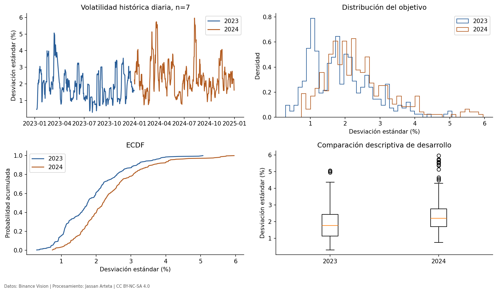

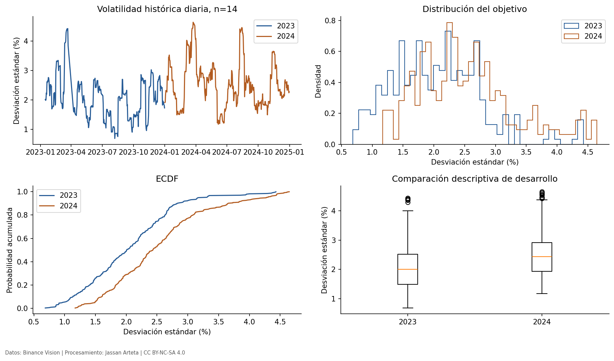

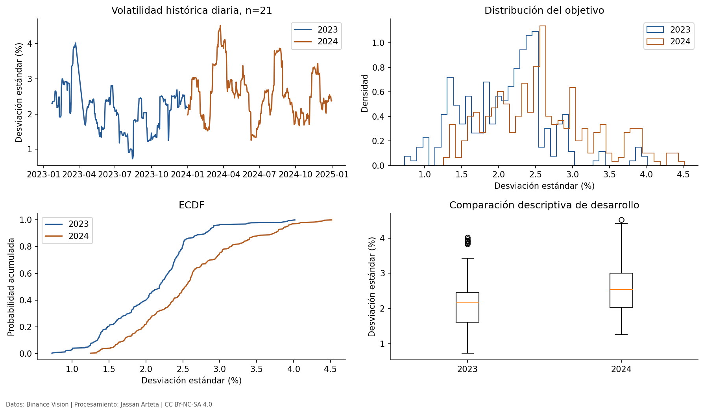

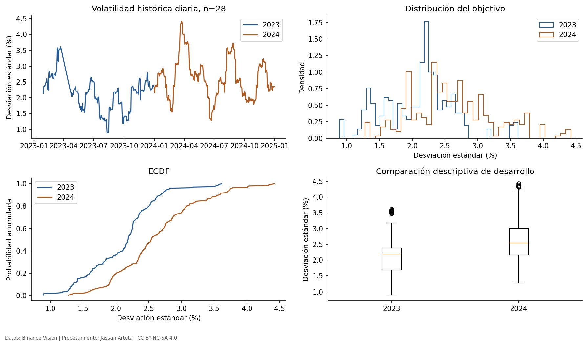

La ventana de siete días presenta mayor variación temporal; aumentar la ventana suaviza la medida, pero cambia el objetivo y no demuestra que un modelo pronostique mejor. No aparecen etiquetas cero en estos derivados de desarrollo. Esto no garantiza que nunca aparezcan: la política de MAPE debe registrarse antes de test.

- **Decisión de preprocesamiento:** conservar las cuatro definiciones separadas y requerir retornos diarios consecutivos; no rellenar las etiquetas afectadas por huecos.
- **Impacto en la arquitectura:** cada combinación de entrada y objetivo debe identificar sus dimensiones; las cuatro ventanas no se mezclan como si fueran la misma etiqueta.
- **Riesgos identificados:** solapamiento de etiquetas, confusión entre ventana y horizonte y selección de una definición por desempeño de test. Los gráficos no prueban superioridad predictiva.

### 2.1.2. Calidad del dataset

El EDA abrió exclusivamente los **24 ZIP mensuales de 2023–2024**, verificando primero sus hashes. La cuadrícula tiene 1.052.640 minutos esperados y los archivos contienen 1.052.560 filas. No se detectaron valores no finitos en las doce columnas, precios OHLC no positivos, incoherencias OHLC ni volúmenes o conteos negativos en esas filas.

El **24/03/2023** faltan 80 minutos de apertura, desde **12:40 hasta 13:59 UTC**, inclusive. La fila con apertura **12:39 UTC** tiene un cierre temporal que no coincide con el fin esperado de la vela. Se conserva en el bruto y se marca no elegible para este análisis. Así hay 81 posiciones sin cierre elegible, no 81 filas ausentes del archivo.

La agregación diaria requiere 1.440 minutos elegibles: hay **364 días completos en 2023** y **366 en 2024**. Los retornos diarios no se calculan atravesando el día incompleto.

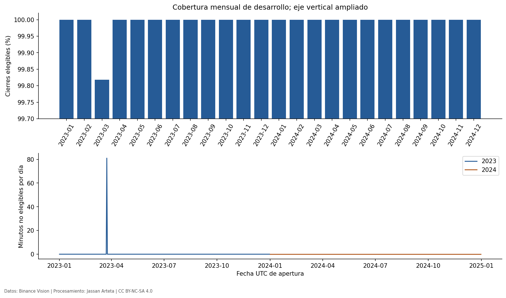

La concentración del hueco en un episodio temporal está observada, pero no basta para identificar MCAR, MAR o MNAR. Su causa necesita documentación del proveedor; no se atribuye una causa concreta sin evidencia. Los precios repetidos en minutos distintos no se tratan como duplicados erróneos.

- **Decisión de preprocesamiento:** brutos inmutables; excluir de los derivados los días incompletos, sin interpolación; verificar continuidad al formar retornos y ventanas.
- **Impacto en la arquitectura:** las entradas diarias deben ser secuencias completas de longitud fija, con calendario y exclusiones comunes para todos los modelos.
- **Riesgos identificados:** rellenar con futuro, crear retornos a través de huecos o confundir 80 filas ausentes con 81 cierres no elegibles. La auditoría no mide todo el ruido económico de los precios.

### 2.1.3. Sesgos, relaciones y desplazamientos de distribución

El alcance contiene un activo, un exchange y una cotización en USDT. No representa todos los mercados de Bitcoin ni se interpreta USDT como idéntico a USD. La comparación 2023–2024 es de desarrollo; no se exploró el test para ajustar decisiones.

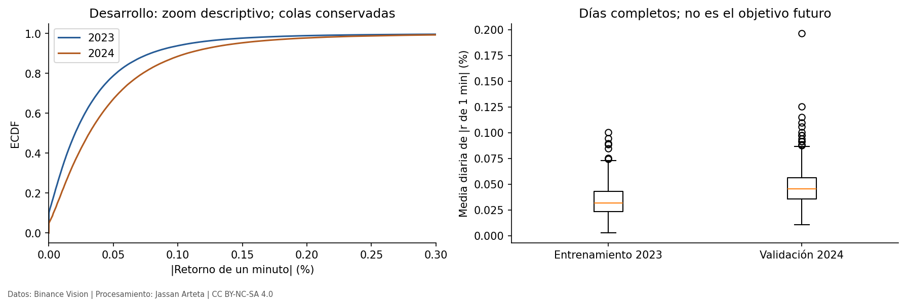

La figura compara una ECDF y la media diaria de magnitudes de retornos de un minuto, **no el objetivo de volatilidad futura**. Un bootstrap móvil de 2.000 réplicas, semilla 42 y bloques de 7 y 14 días estima el cambio de esa media entre validación y entrenamiento:

| Bloque | Diferencia 2024 − 2023 | Intervalo percentil 95 % |
|---|---:|---|
| 7 días | 0.000137639 | [8.99012e-05, 0.000183894] |
| 14 días | 0.000137639 | [7.83572e-05, 0.000192761] |

Es un diagnóstico condicionado a la estabilidad y representatividad de bloques; no es una prueba general de igualdad de distribuciones. Se conserva la posición de días incompletos y se omiten sus valores al promediar. Los bloques exploratorios no fijan todavía la unidad inferencial del benchmark.

#### 2.1.3.1. Correlaciones con objetivos del día siguiente

Las matrices se calcularon **solo con 2023**, alineando OHLCV del día anterior con la volatilidad del día de resultado, sin usar el OHLCV de ese mismo día como predictor. Se usan los casos completos comunes a las cuatro ventanas.

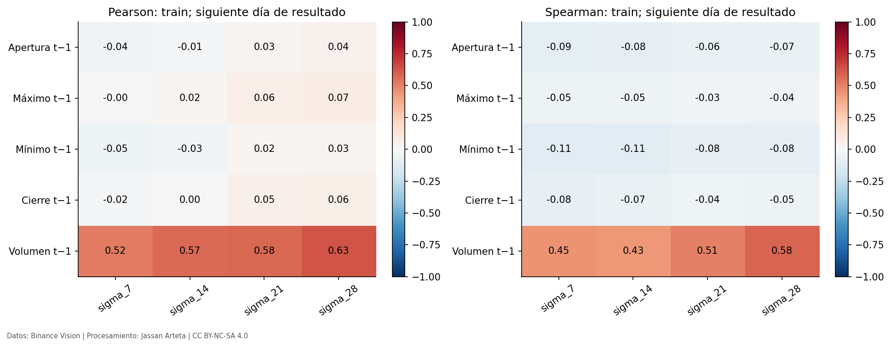

Las relaciones son descriptivas. Los niveles OHLC comparten una gran parte de su información y las volatilidades móviles comparten retornos; una correlación no demuestra causalidad ni mejora respecto a persistencia.

#### 2.1.3.2. Exploración multivariada

PCA se ajustó únicamente con los OHLCV diarios completos de **2023**, estandarizados con media y desviación de ese entrenamiento. Los días de 2024 solo se proyectaron con esos parámetros.

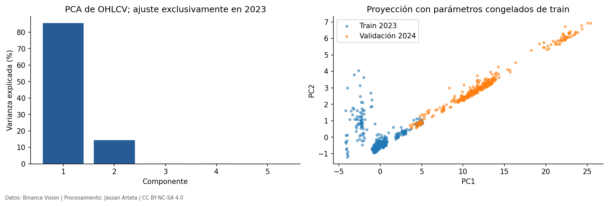

Los dos primeros componentes explican **99.78 %** de la varianza estandarizada de entrenamiento. Esto evidencia redundancia de los niveles OHLC, pero no acredita utilidad predictiva ni autoriza por sí solo descartar variables. PCA no se ha seleccionado como transformación del modelo.

- **Decisión de preprocesamiento:** si se adopta escalado o reducción, reajustarlos dentro del entrenamiento de cada fold; no igualar artificialmente distribuciones entre años.
- **Impacto en la arquitectura:** comparar representaciones diarias con dimensiones explícitas, evitando añadir complejidad solo por colinealidad o drift descriptivo.
- **Riesgos identificados:** correlaciones espurias de niveles, ventanas objetivo solapadas, PCA ajustado globalmente y consultas de test para seleccionar atributos. No se han ejecutado aún información mutua ni VIF; no se presentan como productos completados.

### 2.1.4. Partición del dataset

Se mantiene entrenamiento inicial 2023, validación forward chaining en 2024, ajuste final con desarrollo y test previsto 2025–agosto de 2026. Septiembre–octubre de 2026 se adquirieron, pero no se asignan automáticamente al test.

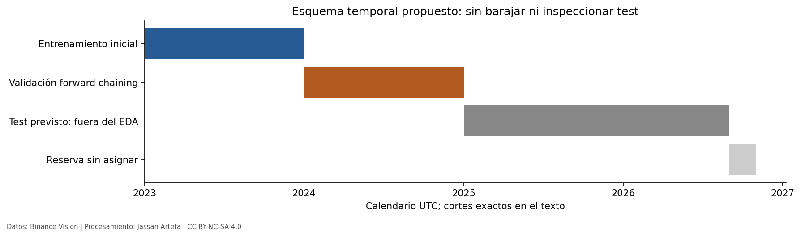

El diagrama representa el calendario: no acredita que los folds de entrenamiento ya estén implementados. Los 364/366 días elegibles de desarrollo no equivalen a cantidades finales de muestras; estas dependen de entrada, ventana de volatilidad y continuidad. La división cronológica no necesita semilla de barajado; el bootstrap exploratorio registra su semilla.

- **Decisión de preprocesamiento:** materializar orígenes, exclusiones y proporciones para cada configuración; ajustar transformaciones solo con etiquetas ya observadas.
- **Impacto en la arquitectura:** los modelos deben evaluarse con el mismo calendario y muestras comparables dentro de cada configuración.
- **Riesgos identificados:** etiquetas que crucen cortes, confundir días con muestras y elegir el tamaño de entrada usando test.

### 2.1.5. Congelación del conjunto de prueba

Los ZIP tienen hashes de adquisición, pero aún no se ha congelado el **test supervisado**: faltan manifiesto de orígenes y etiquetas y reglas finales de ventanas. El script del EDA filtra los archivos antes de abrirlos y registra `test_archives_opened: 0`.

- **Decisión de preprocesamiento:** congelar código, reglas y manifiesto de muestras antes de evaluar test; verificar después los hashes.
- **Impacto en la arquitectura:** comparar modelos y decisiones ya fijados, sin adaptar arquitecturas al resultado de test.
- **Riesgos identificados:** asumir que un hash demuestra ausencia de consulta o que descargar equivale a evaluar. La congelación del benchmark permanece pendiente.

## 2.2. EDA específico: series de tiempo

Se aplica el bloque B del Entregable 1. Las observaciones de modelado son **diarias**; los diagnósticos horarios y de minuto se muestran como complementos con unidades explícitas.

### 2.2.1. Visualización, descomposición y cambios de régimen

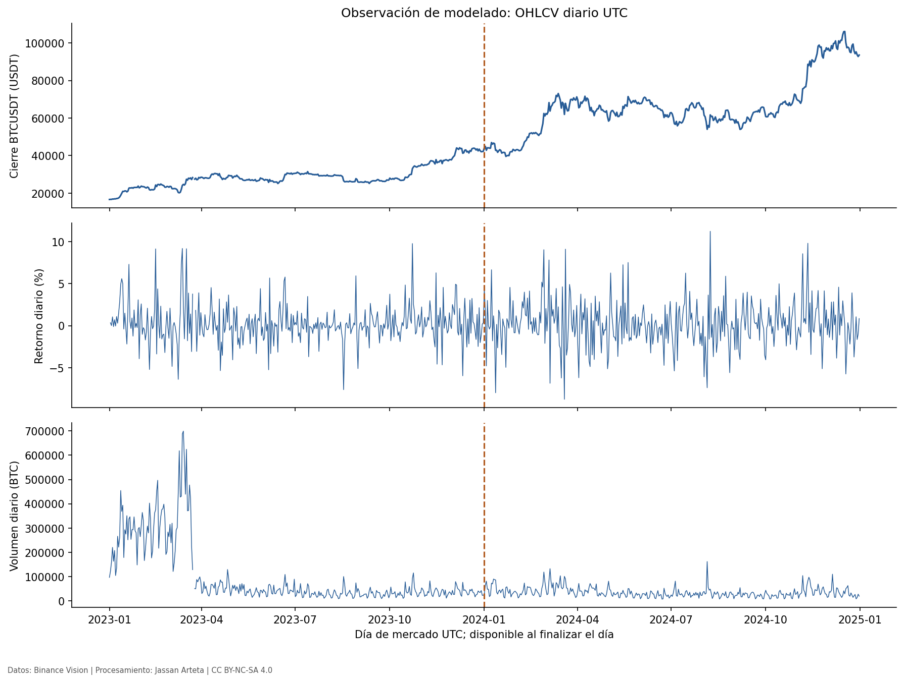
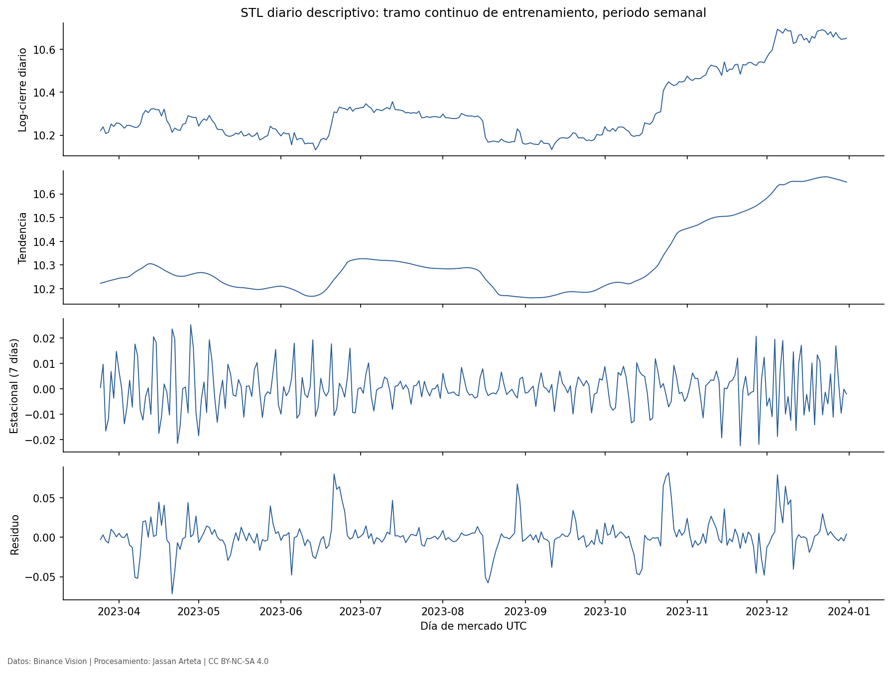

La descomposición STL usa el mayor tramo diario continuo de entrenamiento, **25/03/2023–31/12/2023**, con periodo semanal de siete días y ajuste robusto. Es exploratoria: imponer un periodo en STL no demuestra que exista estacionalidad significativa ni habilita usar su suavizado centrado como característica causal.

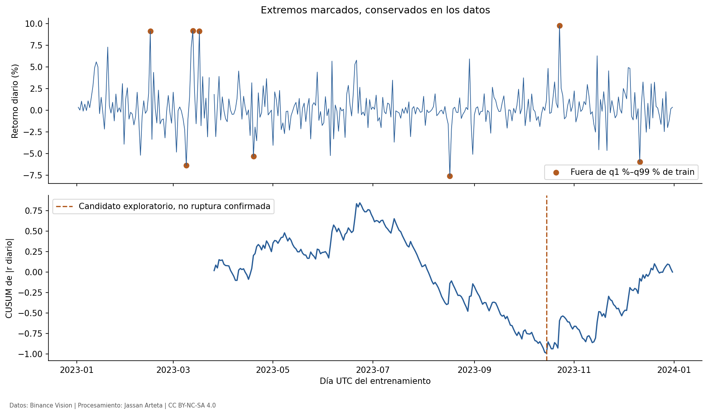

El máximo absoluto de un CUSUM estandarizado sobre magnitudes de retornos diarios, excluyendo 28 días en cada extremo del tramo, señala **2023-10-15** como candidato exploratorio. No se ejecutó una prueba de significación para confirmar una ruptura; tampoco se atribuye una causa de mercado sin documentación.

- **Decisión de preprocesamiento:** mantener escalas diferenciadas, continuidad y transformaciones causales; no usar STL centrado como predictor.
- **Impacto en la arquitectura:** contrastar las cuatro longitudes diarias confirmadas mediante validación, sin elegir una por una ruptura identificada retrospectivamente.
- **Riesgos identificados:** cambio de régimen retrospectivo, agregaciones mal etiquetadas e interpretación de patrones visuales como evidencia de capacidad predictiva.

### 2.2.2. Estacionariedad: ADF y KPSS

Las pruebas principales se ejecutaron en los mayores tramos **diarios continuos de entrenamiento**. ADF usa constante y siete rezagos fijos, sin selección automática; KPSS usa constante y rezagos automáticos. Se interpreta conjuntamente a nivel exploratorio de 0,05, sin corrección por multiplicidad.

| Serie diaria | N | p ADF | p KPSS | Interpretación conjunta |
|---|---:|---:|---:|---|
| log_close_daily | 282 | 0.945954 | <0,01 | Compatible con no estacionariedad |
| return_daily | 281 | 2.75372e-07 | >0,10 | Compatible con estacionariedad |
| abs_return_daily | 281 | 1.17163e-06 | >0,10 | Compatible con estacionariedad |
| sigma_7 | 275 | 0.00242274 | >0,10 | Compatible con estacionariedad |
| sigma_14 | 268 | 0.00138616 | >0,10 | Compatible con estacionariedad |
| sigma_21 | 261 | 0.0633405 | >0,10 | Inconcluso: ninguna rechaza |
| sigma_28 | 254 | 0.219837 | >0,10 | Inconcluso: ninguna rechaza |

Los extremos tabulados de KPSS se informan como desigualdades, no como p-values exactos. Los resultados son específicos del tramo y la especificación: la compatibilidad de retornos con estacionariedad no garantiza estabilidad futura; las ventanas 21/28 producen resultados inconclusos bajo estas pruebas. Los periodos exactos y rezagos efectivos están en los CSV de resultados.

- **Decisión de preprocesamiento:** justificar transformaciones y escalado desde entrenamiento; no diferenciar automáticamente todas las series para forzar un resultado.
- **Impacto en la arquitectura:** usar representaciones con significado temporal claro y evaluar su estabilidad dentro de los folds.
- **Riesgos identificados:** pruebas repetidas sin control, confundir no rechazo con prueba de verdad y trasladar propiedades de precios a volatilidad.

### 2.2.3. Dependencia temporal y elección de rezagos

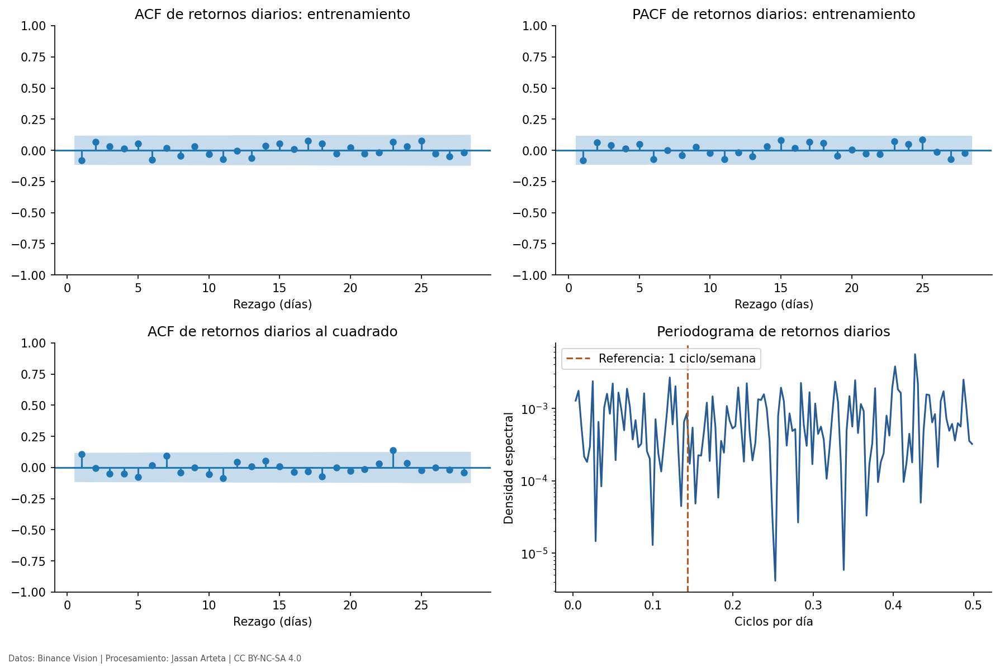

Se usó el tramo continuo de retornos diarios **26/03/2023–31/12/2023**, con 281 observaciones. ACF y PACF muestran 28 rezagos; sus bandas al 95 % son aproximadas, no correcciones simultáneas por todos los rezagos. El periodograma incluye una referencia semanal, sin declarar un pico significativo por inspección visual.

| Diagnóstico diario | Especificación | Estadístico | p-value exploratorio |
|---|---|---:|---:|
| ARCH-LM | Media constante; 7 rezagos | 7.90557 | 0.340994 |
| Wald con covarianza HAC | Términos cuadrático y cúbico del retorno de un día de rezago; HAC 7 | 7.95233 | 0.0187574 |

ARCH-LM no rechaza bajo esta especificación diaria; esto no prueba ausencia de heterocedasticidad. El Wald detecta asociación polinómica bajo su modelo y supuestos HAC, no toda forma de no linealidad ni rentabilidad predictiva. Ambos son exploratorios, con muestra limitada y sin ajuste por multiplicidad. No son pruebas sobre residuos de una red todavía no entrenada.

Como contraste de escala se ejecutaron los diagnósticos sobre datos de un minuto y agregados horarios:

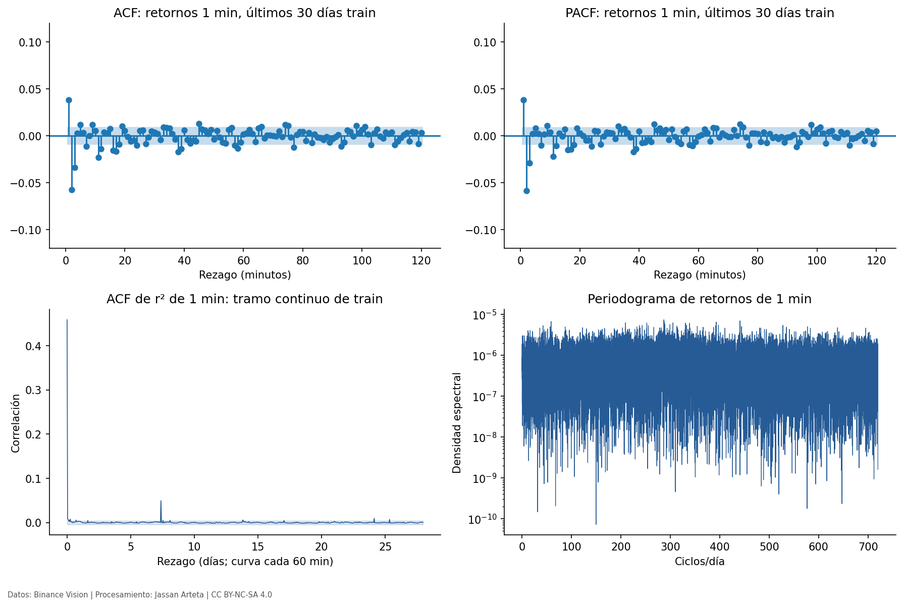
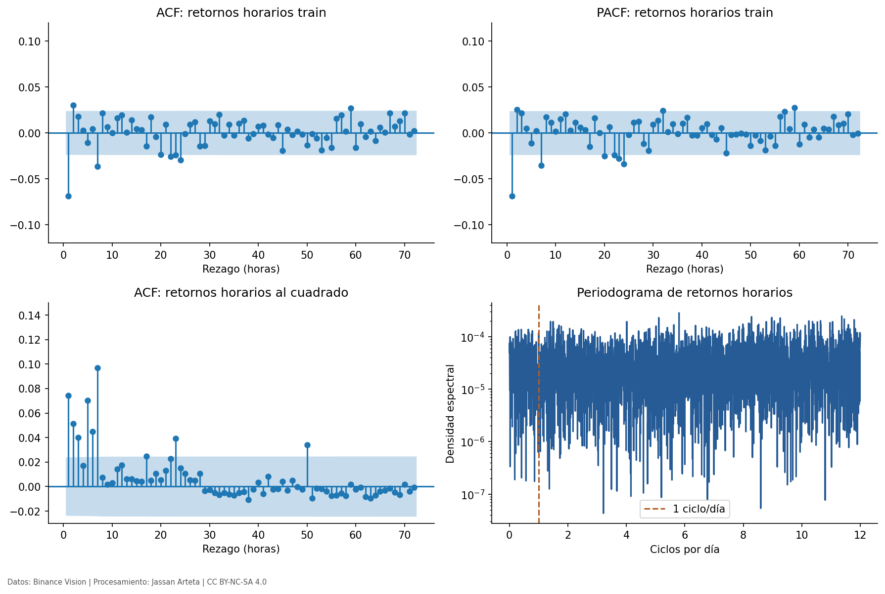

La ACF/PACF de un minuto usa los últimos 30 días de entrenamiento; la ACF de cuadrados hasta 28 días usa el mayor tramo continuo de entrenamiento y se representa cada 60 minutos. No se unen observaciones a ambos lados de huecos. Las pruebas horarias no se presentan como evidencia intercambiable con las diarias.

- **Decisión de preprocesamiento:** mantener como candidatas las entradas de 7/14/21/28 días; elegir por validación y registrar sensibilidad, sin seleccionar rezagos por test.
- **Impacto en la arquitectura:** las ventanas diarias fijan pasos temporales de MLP, recurrentes o convolucionales; la familia final depende de literatura y evaluación, no de una correlación aislada.
- **Riesgos identificados:** dependencia de etiquetas móviles, bandas aproximadas, múltiples pruebas y confusión de frecuencias.

### 2.2.4. Frecuencia, granularidad y faltantes

La auditoría distingue 80 minutos ausentes del CSV y un minuto con cierre temporal no elegible. Ninguno se interpola. Se agregan OHLCV por días UTC completos; un retorno diario que necesite un día inválido permanece ausente. El par único no requiere un modelo global entre activos.

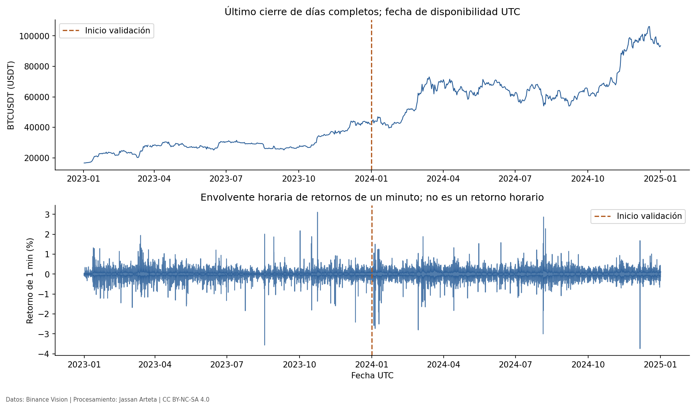

La envolvente representa extremos horarios de retornos de un minuto para visualizar todos los episodios; no son retornos horarios. La etiqueta temporal de un cierre agregado indica cuándo se vuelve observable.

- **Decisión de preprocesamiento:** construir secuencias sobre una cuadrícula diaria regular y rechazar ventanas afectadas por días incompletos.
- **Impacto en la arquitectura:** los modelos reciben D pasos diarios; no 1.440 pasos por día salvo un experimento distinto expresamente declarado.
- **Riesgos identificados:** confundir la fecha de apertura con disponibilidad del cierre, unidades ms/us y retornos calculados atravesando huecos.

### 2.2.5. Outliers y anomalías

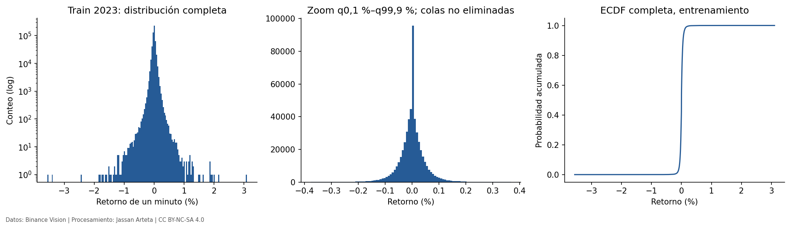

En los retornos de un minuto de entrenamiento, la asimetría es **-0.674028** y el exceso de curtosis **132.006**. No se presupone una distribución normal. El zoom de la figura no elimina colas del dataset. Para retornos diarios, el criterio exploratorio fuera de q1 %–q99 % de entrenamiento marca **8 días de 2023** y **15 de 2024** con umbrales fijos de train; no se eliminó ninguno por ser extremo.

- **Decisión de preprocesamiento:** distinguir errores verificables de eventos reales y conservar extremos. No se aplica clipping ni se cambia la pérdida sin validación.
- **Impacto en la arquitectura:** controlar estabilidad de entrenamiento y comparar pérdidas/métricas bajo el mismo protocolo; las colas no justifican automáticamente mayor complejidad.
- **Riesgos identificados:** borrar episodios de interés y elegir umbrales con información futura. El impacto sobre error de pronóstico y la causa de eventos quedan pendientes de modelos y evidencia adicional.

### 2.2.6. Horizonte, estrategia de pronóstico y validación

Las entradas confirmadas son 7/14/21/28 días de historia; el horizonte principal es un día. Se exploraron cuatro definiciones de volatilidad histórica, sin confundirlas con la longitud de entrada. Cualquier horizonte adicional al principal debe registrarse antes del entrenamiento y de la evaluación.

La implementación de folds y el entrenamiento de los tres modelos siguen pendientes. `timeseries-cv` puede asistir con ventanas, pero no sustituye los controles de fechas, observabilidad y continuidad. El BDS exigido para residuos del primer horizonte solo procede después de generar predicciones fuera de entrenamiento.

- **Decisión de preprocesamiento:** fijar las configuraciones de objetivos y orígenes, producir manifiestos de muestras y ajustar transformaciones solo con pasado.
- **Impacto en la arquitectura:** entrada diaria con dimensión explícita; salida principal escalar no negativa; cualquier salida adicional debe registrarse.
- **Riesgos identificados:** leakage por etiqueta conocida, transformaciones globales y supuestos de independencia entre volatilidades solapadas.

## 2.3. Adquisición directa desde Binance Spot

### 2.3.1. Fuente y alcance

El dataset se adquirió directamente de Binance Spot y se preparó un derivado de desarrollo para este Entregable 1. No se utilizarán repositorios intermediarios, archivos procesados ajenos ni resultados de otros proyectos.

La fuente del proyecto es **Binance Spot**, par **BTCUSDT**, mediante los [archivos públicos oficiales](https://data.binance.vision/?prefix=data/spot/monthly/klines/BTCUSDT/1m/). Se utilizarán velas de un minuto y el precio de cierre; USDT es la moneda de cotización. La documentación técnica está en [Binance Public Data](https://github.com/binance/binance-public-data).

El patrón de adquisición es:

```text
https://data.binance.vision/data/spot/monthly/klines/BTCUSDT/1m/BTCUSDT-1m-AAAA-MM.zip
https://data.binance.vision/data/spot/monthly/klines/BTCUSDT/1m/BTCUSDT-1m-AAAA-MM.zip.CHECKSUM
```

Se descargaron los archivos y sus checksums directamente del proveedor, se verificó SHA-256 antes de procesarlos y se registraron URL, fecha de adquisición, tamaño, hash, esquema y unidades temporales. No se asumirá que todos los archivos usan la misma unidad de timestamp: se verificará la documentación y cada periodo, incluida la transición a microsegundos.

El calendario objetivo sigue siendo desarrollo 2023–2024 y test 2025–agosto de 2026. La cobertura real se comprobará con los archivos adquiridos. El test se conservará por separado y no se explorará para elegir preprocesamiento o hiperparámetros.

### 2.3.2. Estado de adquisición y resultados

**Adquisición directa completada para el rango solicitado:** del **1 de enero de 2023, 00:00 UTC**, al **30 de octubre de 2026, 23:59 UTC** (apertura de la última vela). Se conservaron los ZIP y checksums oficiales, sin imputación ni modificación de sus filas.

| Control de adquisición | Resultado verificado |
|---|---:|
| Archivos mensuales, enero de 2023–septiembre de 2026 | 45 |
| Archivos diarios, 1–30 de octubre de 2026 | 30 |
| Total de ZIP con SHA-256 correcto | 75 de 75 |
| Tamaño total de esos ZIP | 97.442.605 bytes |
| Filas CSV brutas | 2.014.480 |
| Minutos esperados en el calendario solicitado | 2.014.560 |
| Minutos ausentes en los archivos verificados | 80 |
| Timestamps de apertura duplicados, fuera de rango o desalineados | 0 |
| Timestamps de cierre que no coinciden con el fin esperado de vela | 1 |

Los 80 minutos ausentes y el cierre inesperado pertenecen a marzo de 2023. La verificación de integridad **no significa que los datos no tengan huecos o anomalías**. Se conservarán para su análisis posterior; estos controles no validan precios ni ejecutan el EDA del objetivo.

El [manifiesto de adquisición](../_static/data/binance_spot_BTCUSDT_1m_20230101_20261030.json) registra URLs, SHA-256, bytes, fechas de verificación, unidades y conteos por archivo. El script reproducible es `scripts/download_binance_spot.py`, documentado en `data/README.md`. Los brutos están en `/workspace/binance-spot-data/`, fuera del repositorio y del sitio público.

Los archivos históricos respondieron HTTP 200. La API respondió HTTP 451 por restricción de ubicación; no se utilizó para adquirir los datos. Las particiones previstas en §1.6 se mantienen: disponer de septiembre–octubre de 2026 no asigna automáticamente esos meses al test.

El EDA de desarrollo de este capítulo se ejecutó sobre los 24 archivos mensuales de 2023–2024, verificados otra vez antes de leerlos. No se abrieron ZIP de 2025–2026 para generar las figuras.

### 2.3.3. Condiciones para ejecutar el EDA

1. Acceso a archivos oficiales y verificación TLS: comprobados. La API no es necesaria.
2. Conservar la versión de las condiciones aplicables a la adquisición y comprobar cualquier designación específica del dataset; las condiciones consultadas se resumen en §2.3.4.
3. Adquisición y checksums del rango solicitado: completados; brutos y manifiesto conservados. Derivados diarios de desarrollo y EDA ejecutados; ventanas finales por modelo y benchmark pendientes.
4. Auditar timestamps, unidades, duplicados, huecos, cierres y coherencia OHLC antes de crear retornos.
5. Fijar horizonte, frecuencia de los retornos objetivo, longitud de entrada y cadencia conforme al Entregable 1.
6. Ejecutar el EDA general y el específico de series de tiempo; vincular cada resultado a una decisión de modelado o validación.


### 2.3.4. Condiciones de uso y atribución

Se consultaron los [Binance Vision Dataset Terms oficiales](https://github.com/binance/binance-public-data/blob/master/TERMS_AND_CONDITIONS.md) el **2 de noviembre de 2026**. El documento declara **versión 1.0**, con última actualización **26 de agosto de 2026**. Esta consulta verifica la documentación disponible; no demuestra que los datos se hayan descargado.

| Cláusula | Condición declarada por el proveedor | Aplicación al proyecto |
|---|---|---|
| 3.1–3.4 | CC BY-NC-SA 4.0, salvo designación específica; uso comercial requiere un acuerdo separado | Investigación académica no comercial; comprobar condiciones específicas y conservar la versión aplicable |
| 4.1 y 4.5 | Contempla investigación académica y proyectos educativos abiertos no monetizados; atribución y misma licencia para obras derivadas redistribuidas | Identificar Binance Vision como fuente y documentar transformaciones; incorporar el aviso de licencia aplicable al publicar derivados |
| 2.4 y 5 | Las condiciones abarcan datos derivados, gráficos, modelos e indicadores; puede haber derechos de terceros | Revisar las condiciones del contenido concreto antes de redistribuirlo; no atribuir una licencia global a materiales ajenos |
| 7 | Respetar límites y protocolos de descarga | Usar archivos oficiales y no eludir restricciones de acceso |
| 8 y 10 | No implicar respaldo de Binance; datos sin garantías de integridad o exactitud | Declarar autoría independiente y auditar calidad y cobertura |

La atribución de los futuros productos derivados identificará **Binance Vision — Binance Spot, BTCUSDT**, enlazará la fuente y las condiciones, indicará los cambios realizados y la licencia aplicable. Los materiales del curso y artículos citados conservan sus propios derechos.

Los términos se conservarán con fecha y hash al adquirir los datos. Su revisión no sustituye los checksums de cada archivo de mercado, que se verificaron individualmente durante la adquisición. El repositorio oficial permite consultar documentación, mientras los ZIP se sirven desde `data.binance.vision`.


## 2.4. Reproducibilidad y estado de cierre

### 2.4.1. Código y productos

Se ejecutó `scripts/eda_binance_development.py` usando los ZIP oficiales. El script comprueba hashes, restringe la apertura de datos a 2023–2024, audita columnas y continuidad y genera tablas, JSON y figuras. Los resultados están en `results/eda_development/`; las imágenes están en `book/_static/eda/`. Se pueden descargar el [resumen de resultados](../_static/eda/results/summary.json), las [pruebas de estacionariedad diarias](../_static/eda/results/stationarity_daily.csv) y los [OHLCV diarios de desarrollo](../_static/eda/results/daily_market_development.csv).

```bash
cd /workspace/DeepLearning_202630
python3.12 -m venv /workspace/.venvs/deeplearning-eda
/workspace/.venvs/deeplearning-eda/bin/python -m pip install -r requirements-eda.lock.txt
OPENBLAS_NUM_THREADS=2 OMP_NUM_THREADS=2 /workspace/.venvs/deeplearning-eda/bin/python scripts/eda_binance_development.py
```

Los archivos raw deben existir bajo `/workspace/binance-spot-data/`, reproducibles con el descargador documentado en `data/README.md`. El build del libro incluye las figuras guardadas; no vuelve a ejecutar automáticamente el EDA.

Los datos y derivados se atribuyen a **Binance Vision / Binance Spot**; procesamiento y gráficas por **Jassan Arteta**. Se documentan las transformaciones y se comparten los derivados publicados bajo [CC BY-NC-SA 4.0](https://creativecommons.org/licenses/by-nc-sa/4.0/) y las condiciones aplicables del proveedor. Esto no altera los derechos de materiales del curso o artículos citados.

### 2.4.2. Evidencias y pendientes

| Producto | Estado real |
|---|---|
| Adquisición directa y SHA-256 | 75 ZIP oficiales verificados |
| Calidad de precios y OHLCV de desarrollo | Ejecutada; un día incompleto excluido de derivados |
| Modelado diario y entradas 7/14/21/28 días | Documentados según aclaraciones recibidas |
| Distribuciones de cuatro ventanas de volatilidad diaria | Ejecutadas sobre desarrollo |
| Figuras de series, huecos, correlaciones, PCA y estructura temporal | Generadas y enlazadas en este capítulo |
| ADF/KPSS, ARCH y diagnóstico polinómico | Ejecutados con especificaciones y límites declarados |
| Disponibilidad temporal y ausencia de consulta de test en este script | Restricción verificada; cero ZIP de test abiertos |
| Selección de covariables, transformaciones y ventana ganadora | Pendiente de validación y protocolo final |
| Información mutua, VIF y efecto de anomalías sobre error de modelos | No ejecutados |
| Folds, manifiesto de muestras supervisadas y test congelado | Pendientes |
| Modelos, predicciones y MAPE/MAE/RMSE/MSE/MASE/BDS | Pendientes de entrenamiento y evaluación |

Las gráficas publicadas son evidencia de EDA de desarrollo. No acreditan que la revisión bibliográfica, los modelos ni el Entregable 1 completo estén terminados.
