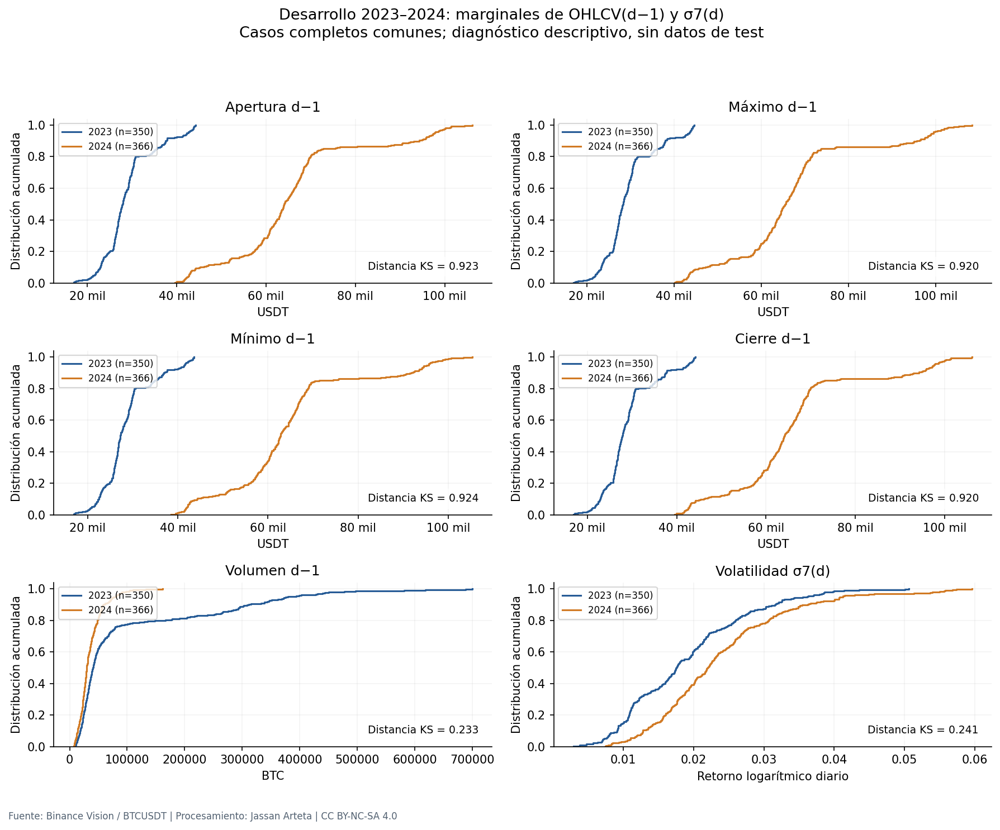
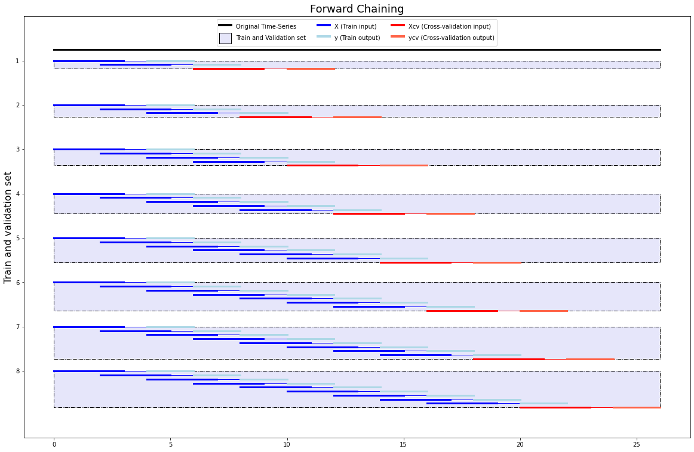
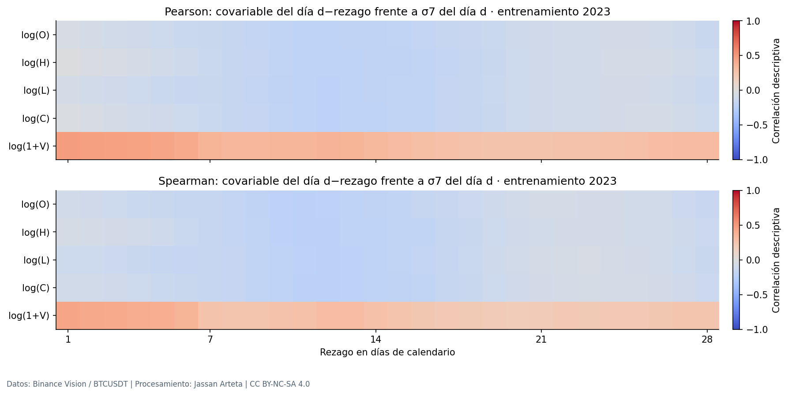
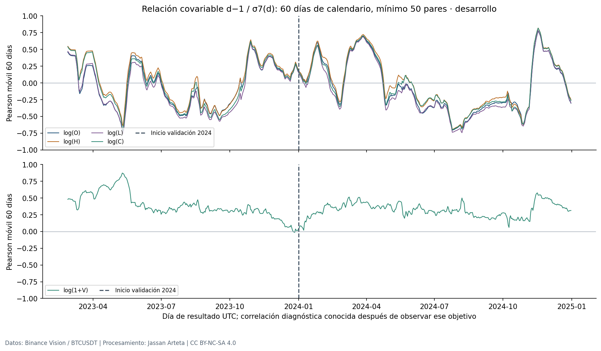

# 2. Análisis Exploratorio de Datos (EDA)

El análisis se ejecutó con los archivos oficiales de **Binance Spot BTCUSDT**, utilizando **entrenamiento de 2023** y **validación de 2024**. La frecuencia de adquisición es un minuto; la configuración de modelado es **diaria, con cierre UTC**, entradas de **7, 14, 21 o 28 días** y horizonte principal de **un día**. La clasificación documental actual es **tipo 4, regresión temporal**, conforme a la ruta 6.4 de la guía: las redes reciben covariables OHLCV pasadas, sin rezagos explícitos de la volatilidad objetivo. El objetivo principal es la volatilidad de siete retornos diarios; las ventanas 14/21/28 se conservan como sensibilidad de su definición.

Se distinguen las ventanas de entrada $D$ de las ventanas de volatilidad $n$: ambas se exploran en 7, 14, 21 y 28 **días**, pero tienen funciones diferentes. No se selecciona un ganador a partir de estos gráficos. La escala de cálculo usa retornos logarítmicos sin anualizar; las figuras que muestran porcentajes multiplican por 100 y lo indican en sus ejes.

La métrica principal y el criterio operativo ya fijados en §1.4 son **RMSE** y una mejora relativa mínima del **5 % frente a persistencia**. Las decisiones del EDA preparan esa evaluación; el desempeño de las redes se medirá en la etapa experimental posterior.

## 2.1. EDA general

La revisión de este bloque se recoge punto por punto en el {download}`informe de EDA general <../_static/e1/revision_eda_general_20261103.md>` y su [matriz JSON](../_static/e1/revision_eda_general_20261103.json). Los criterios de clasificación se adaptan al objetivo continuo y los diagnósticos estadísticos se distinguen de la evaluación de modelos.

### 2.1.1. Análisis de la variable objetivo

Se calculó la desviación estándar poblacional móvil (`ddof=0`) de los retornos **diarios**, con ventanas $n=7,14,21,28$. El valor asociado a un día de resultado solo se conoce al cerrar ese día. Para pronosticarlo, las entradas deben terminar en el día anterior; la indexación formal de §1.3 mantiene esta disponibilidad. No se confundió volatilidad intradía con el objetivo diario.

La tabla usa entrenamiento 2023. Los valores están en unidades de retorno logarítmico, sin multiplicar por 100. Los recuentos difieren por la historia requerida y el día incompleto; no son cantidades de ventanas de entrenamiento ya materializadas.

| Ventana de volatilidad | Días con etiqueta en 2023 | Media | Mediana | Asimetría | Exceso de curtosis |
|---|---:|---:|---:|---:|---:|
| 7 días | 350 | 0.0187967 | 0.0175672 | 0.802448 | 0.496498 |
| 14 días | 336 | 0.0204667 | 0.020095 | 0.682997 | 0.838178 |
| 21 días | 322 | 0.0208984 | 0.0218149 | 0.323809 | 0.603734 |
| 28 días | 308 | 0.0209757 | 0.0218574 | 0.14949 | 0.357873 |


El complemento de EDA general cuantifica el objetivo principal en ambos periodos de desarrollo. Los valores siguientes conservan la escala original de retorno logarítmico:

| Periodo | Etiquetas válidas n=7 | Media | Desviación poblacional | Mediana | Percentil 95 | Percentil 99 |
|---|---:|---:|---:|---:|---:|---:|
| 2023 | 350 | 0,018797 | 0,008890 | 0,017567 | 0,036130 | 0,042511 |
| 2024 | 366 | 0,023661 | 0,009767 | 0,021989 | 0,041092 | 0,056175 |

La asimetría y el exceso de curtosis de n=7 pasan de **0,802 y 0,496 en 2023** a **1,180 y 1,843 en 2024**. Se observa mayor concentración empírica en la cola derecha de validación; estos momentos no demuestran por sí solos una ley de colas extremas. Como regla descriptiva se calcula únicamente con 2023 el límite superior $Q_{0,75}+1{,}5\,IQR=0{,}04370768$: lo superan **3/350 días de 2023 (0,86 %)** y **14/366 de 2024 (3,83 %)**. No se eliminan ni se recortan esas etiquetas por rebasar el umbral.


El [perfil completo de objetivos](../_static/eda_general_quality/target_profiles.csv) incluye las ocho combinaciones año–ventana, sus cuantiles, ceros y marcas IQR con referencia fija de entrenamiento. Una etiqueta grande no es automáticamente un error del proveedor ni un residuo grande de un modelo. Se conserva **MSE/RMSE** como diseño aceptado; ponderaciones, Huber o transformaciones del objetivo no se introducen por inspección de estas gráficas.

La ventana de siete días presenta mayor variación temporal; aumentar la ventana suaviza la medida, pero cambia el objetivo y no demuestra que un modelo pronostique mejor. No aparecen etiquetas cero en estos derivados de desarrollo. Esto no garantiza que nunca aparezcan: se mantiene la política de MAPE ya fijada en §1.4, con etiquetas positivas, cobertura declarada y sin epsilon arbitrario. Al ser un objetivo continuo, los recuentos de clases, la entropía de clases y el balance entre clases de la guía no son aplicables.

- **Decisión de preprocesamiento:** conservar las cuatro definiciones separadas y requerir retornos diarios consecutivos; no rellenar las etiquetas afectadas por huecos ni eliminar automáticamente los valores que superan el umbral IQR.
- **Impacto en la arquitectura:** cada combinación de entrada y objetivo debe identificar sus dimensiones y conservar una salida escalar no negativa; la cola observada no fija por sí sola la profundidad o el ancho de la red. Las cuatro ventanas no se mezclan como si fueran la misma etiqueta.
- **Riesgos identificados:** solapamiento de etiquetas, confusión entre ventana y horizonte y selección de una definición por desempeño de test. Los gráficos no prueban superioridad predictiva.

### 2.1.2. Calidad del dataset

El EDA abrió exclusivamente los **24 ZIP mensuales de 2023–2024**, verificando primero sus hashes. La cuadrícula tiene 1.052.640 minutos esperados y los archivos contienen 1.052.560 filas. No se detectaron valores no finitos en las doce columnas, precios OHLC no positivos, incoherencias OHLC ni volúmenes o conteos negativos en esas filas.

El **24/03/2023** faltan 80 minutos de apertura, desde **12:40 hasta 13:59 UTC**, inclusive. La fila con apertura **12:39 UTC** tiene un cierre temporal que no coincide con el fin esperado de la vela. Se conserva en el bruto y se marca no elegible para este análisis. Así hay 81 posiciones sin cierre elegible, no 81 filas ausentes del archivo.

La agregación diaria requiere 1.440 minutos elegibles: hay **364 días completos en 2023** y **366 en 2024**. El **24/03/2023 permanece excluido**, conforme a la decisión vigente; los retornos diarios y las ventanas no se calculan atravesando ese día. La posición de la fecha se conserva en el calendario.

Se verificaron la unicidad y el orden de los timestamps de apertura. Dos minutos con el mismo precio no se consideran por ello registros duplicados. Las etiquetas se calculan automáticamente con cierres válidos; no requieren acuerdo entre anotadores. La auditoría detecta inconsistencias temporales, pero no estima de forma independiente el error de los precios del proveedor ni el ruido de la volatilidad como aproximación a la incertidumbre del mercado.

La auditoría de los derivados diarios complementa los controles de los archivos originales:

| Control diario | 2023 | 2024 | Interpretación |
|---|---:|---:|---|
| Días de calendario | 365 | 366 | Cuadrícula conservada |
| Días OHLCV completos | 364 | 366 | Un día excluido en 2023 |
| Retornos diarios válidos | 362 | 366 | En 2023 faltan el retorno inicial y los dos que dependen del cierre excluido |
| Etiquetas válidas n=7 | 350 | 366 | Incluyen calentamiento y propagación del hueco a la ventana |
| Claves de fecha duplicadas | 0 | 0 | Un registro por día UTC |
| Filas con OHLCV completo idéntico repetido | 0 | 0 | Comprobación de valores; su repetición no justificaría por sí sola borrado |
| Incoherencias OHLC, precios no positivos o volumen negativo | 0 | 0 | Sobre los días completos observados |

Para verificar el etiquetado automático se reconstruyeron independientemente las **2.924 posiciones año–día–ventana**, usando cierres y aritmética por fechas, sin reutilizar el cálculo móvil de pandas. Se obtuvieron **2.780 etiquetas válidas**, **cero discrepancias de elegibilidad** y una diferencia numérica máxima de **1,027×10⁻¹⁵** frente a los CSV existentes. Esta comprobación detectaría desalineación, retornos a través de huecos o errores de cálculo; no mide el error de los precios de Binance ni el ruido económico del proxy de volatilidad.

El cierre ausente invalida los retornos del 24 y 25 de marzo. Los primeros objetivos nuevamente válidos son el **01/04, 08/04, 15/04 y 22/04/2023** para n=7/14/21/28, respectivamente. La historia de entrada también importa: para n=7, antes del embargo, los orígenes elegibles de 2023 son **350, 336, 322 y 308** para D=7/14/21/28; en 2024 son 366 por cada D. Son máscaras de datos, diferentes de las muestras permitidas para ajustar en cada fold.


Se conservan las [máscaras diarias](../_static/eda_general_quality/calendar_masks.csv), los [controles de calidad por año](../_static/eda_general_quality/quality_by_year.csv), la [reconstrucción de etiquetas](../_static/eda_general_quality/label_reconstruction.csv) y la [elegibilidad por ventana](../_static/eda_general_quality/window_eligibility.csv). El [registro de faltantes](../_static/eda_general_quality/missingness_evidence.json) distingue el episodio intradiario, el día excluido y su propagación; el mecanismo MCAR/MAR/MNAR permanece no identificado con esta fuente y este único episodio. La ausencia de acuerdo entre anotadores no es un defecto aplicable a etiquetas calculadas automáticamente; la incertidumbre externa del proveedor y del proxy permanece sin estimación independiente.


La barra de marzo de 2023 representa **44.559 cierres elegibles de 44.640 esperados: 99,82 %**. El eje vertical comienza en 99,70 % y amplía la diferencia frente a los meses completos. La gráfica conserva el hueco original como evidencia de calidad, aunque el día afectado se excluya del modelado.

La concentración del hueco en un episodio temporal está observada, pero no basta para identificar MCAR, MAR o MNAR. Su causa necesita documentación del proveedor; no se atribuye una causa concreta sin evidencia. Los precios repetidos en minutos distintos no se tratan como duplicados erróneos.

- **Decisión de preprocesamiento:** brutos inmutables; excluir de los derivados los días incompletos, sin interpolación; verificar continuidad al formar retornos y ventanas.
- **Impacto en la arquitectura:** las entradas diarias deben ser secuencias completas de longitud fija, con calendario y exclusiones comunes para todos los modelos.
- **Riesgos identificados:** rellenar con futuro, crear retornos a través de huecos o confundir 80 filas ausentes con 81 cierres no elegibles. La auditoría no mide todo el ruido económico de los precios.

### 2.1.3. Sesgos, relaciones y desplazamientos de distribución

El alcance contiene un activo, un exchange y una cotización en USDT. No representa todos los mercados de Bitcoin ni se interpreta USDT como idéntico a USD. La comparación 2023–2024 es de desarrollo; no se exploró el test para ajustar decisiones.


La figura compara una ECDF y la media diaria de magnitudes de retornos de un minuto. Esta magnitud es un diagnóstico histórico distinto del objetivo diario de volatilidad. Un bootstrap móvil de 2.000 réplicas, semilla 42 y bloques de 7 y 14 días estima el cambio de esa media entre validación y entrenamiento:

| Bloque | Diferencia 2024 − 2023 | Intervalo percentil 95 % |
|---|---:|---|
| 7 días | 0.000137639 | [8.99012e-05, 0.000183894] |
| 14 días | 0.000137639 | [7.83572e-05, 0.000192761] |

Es un diagnóstico condicionado a la estabilidad y representatividad de bloques; no es una prueba general de igualdad de distribuciones. Se conserva la posición de días incompletos y se omiten sus valores al promediar. Los bloques exploratorios no fijan la unidad inferencial del benchmark. El contraste de las cinco covariables y del objetivo principal se presenta por separado en §2.1.3.3.

- **Decisión de preprocesamiento:** conservar el calendario y no igualar artificialmente los años; este diagnóstico de magnitudes intradiarias no transforma las etiquetas diarias.
- **Impacto en la arquitectura:** exigir evaluación cronológica de modelos compactos antes de aumentar capacidad; una diferencia de actividad entre años no demuestra que una arquitectura concreta la aproveche.
- **Riesgos identificados:** tratar días dependientes como i.i.d., confundir el proxy intradiario con el objetivo y transferir estos bloques al benchmark sin justificarlo.

#### 2.1.3.1. Correlaciones con objetivos del día siguiente

Las matrices se calcularon **solo con 2023**, alineando OHLCV del día anterior con la volatilidad del día de resultado, sin usar el OHLCV de ese mismo día como predictor. Se usan los casos completos comunes a las cuatro ventanas.


Las relaciones son descriptivas. Los niveles OHLC comparten una gran parte de su información y las volatilidades móviles comparten retornos; una correlación no demuestra causalidad ni mejora respecto a persistencia.

- **Decisión de preprocesamiento:** mantener los desfases causales y contrastar las relaciones en el tiempo; no eliminar covariables ni añadir rezagos del objetivo por una correlación aislada.
- **Impacto en la arquitectura:** conservar las cinco entradas acordadas y comprobar regularización con el mismo conjunto de información, sin equiparar cuatro precios correlacionados a cuatro señales independientes.
- **Riesgos identificados:** asociación espuria con niveles de precio, información del retorno aún desconocido y confusión entre relación descriptiva y capacidad predictiva.

#### 2.1.3.2. Exploración multivariada

PCA se ajustó únicamente con los OHLCV diarios completos de **2023**, estandarizados con media y desviación de ese entrenamiento. Los días de 2024 solo se proyectaron con esos parámetros.


Los dos primeros componentes explican **99.78 %** de la varianza estandarizada de entrenamiento. Esto evidencia redundancia de los niveles OHLC, pero no acredita utilidad predictiva ni autoriza por sí solo descartar variables. PCA no se ha seleccionado como transformación del modelo.

- **Decisión de preprocesamiento:** si se adopta escalado o reducción, reajustarlos dentro del entrenamiento de cada fold; no igualar artificialmente distribuciones entre años.
- **Impacto en la arquitectura:** comparar representaciones diarias con dimensiones explícitas, evitando añadir complejidad solo por colinealidad o drift descriptivo.
- **Riesgos identificados:** correlaciones espurias de niveles, ventanas objetivo solapadas, PCA ajustado globalmente y consultas de test para seleccionar atributos. No se han ejecutado aún información mutua ni VIF; no se presentan como productos completados.

#### 2.1.3.3. Desplazamiento de covariables y objetivo principal

La comparación utiliza un **perfil causal de un día de rezago**: OHLCV de $d-1$ y volatilidad de siete retornos del día $d$. Las seis variables comparten **350 casos completos en 2023 y 366 en 2024**; se conserva la cuadrícula de 731 días y sus posiciones ausentes. Este perfil no equivale a la distribución conjunta de todas las ventanas D ni a un conjunto de predicciones de modelos.

Se calcula la distancia marginal de Kolmogórov–Smirnov $D_{\mathrm{KS}}=\sup_x|F_{2023}(x)-F_{2024}(x)|$. Para tener una referencia temporal exploratoria se usan bloques calendarios completos de **14 y 28 días**, **2.000 permutaciones por longitud** y **semilla 42**. Solo se intercambian bloques plenamente observados, conservando cuántos pertenecen a cada periodo. Las colas anuales de uno y dos días y los bloques que contienen ausencias permanecen fijos; no se imputan ni se comprimen fechas. Cada permutación conserva los tamaños 350/366.

| Variable del perfil causal | Mediana 2023 | Mediana 2024 | Distancia KS | Referencia ajustada Holm, bloque 14 días | Referencia ajustada Holm, bloque 28 días |
|---|---:|---:|---:|---:|---:|
| Apertura de d−1 (USDT) | 27808,42 | 64062,61 | 0,923 | 0,0060 | 0,0060 |
| Máximo de d−1 (USDT) | 28313,21 | 65548,07 | 0,920 | 0,0060 | 0,0060 |
| Mínimo de d−1 (USDT) | 27247,50 | 62768,57 | 0,924 | 0,0060 | 0,0060 |
| Cierre de d−1 (USDT) | 27808,42 | 64115,77 | 0,920 | 0,0060 | 0,0060 |
| Volumen de d−1 (BTC) | 40446,80 | 29716,60 | 0,233 | 0,0855 | 0,2174 |
| Volatilidad n=7 del día d | 0,017567 | 0,021989 | 0,241 | 0,0620 | 0,0940 |

La referencia Monte Carlo se calcula como $p_{\mathrm{MC}}=(1+\#\{D_r^*\ge D_{\mathrm{obs}}\})/(2000+1)$; se aplica **Holm a la familia conjunta de doce contrastes** —seis variables por dos longitudes— con nivel 0,05. No se usan los p-values i.i.d. habituales de KS para tratar estos días como independientes. La permutación solo construye una referencia del EDA: la partición cronológica real permanece intacta.

La hipótesis de referencia es **intercambiabilidad de los bloques completos entre años, condicionada a las partes fijas**. Con bloques de 14 días hay 23 bloques de entrenamiento y 26 de validación permutables; con 28 días, 10 y 13. Permanecen fijos 28/350 o 70/350 valores de entrenamiento, respectivamente, y 2/366 de validación. Cambiar de 14 a 28 días también cambia el conjunto permutable; la comparación no aísla exclusivamente la longitud del bloque. Tendencias, cambios de régimen y dependencia entre bloques impiden presentar estos resultados como inferencia exacta o confirmatoria; Holm corrige multiplicidad, no la calibración temporal.



Los niveles OHLC muestran una separación marginal amplia, con distancias KS de 0,920–0,924 y referencia ajustada aproximada 0,0060 para ambas longitudes. La mediana del cierre previo pasa de 27.808,43 a 64.115,77 USDT. El volumen y el objetivo también presentan diferencias descriptivas, pero sus referencias ajustadas superan 0,05; **no rechazar ese escenario no demuestra igualdad ni ausencia de desplazamiento**. En particular, el aumento observado de la mediana o de la cola de volatilidad no equivale a una ruptura confirmada bajo cualquier diseño temporal.

El [perfil descriptivo por periodo](../_static/eda_general_shift/descriptive_by_period.csv), las [distancias y tamaños de diferencia](../_static/eda_general_shift/marginal_distribution_differences.csv), los [contrastes condicionales](../_static/eda_general_shift/conditional_block_permutation.csv), los [bloques y sus máscaras](../_static/eda_general_shift/calendar_blocks.csv) y el [resumen reproducible](../_static/eda_general_shift/summary.json) conservan los resultados y supuestos. No se abrió test para hacer estas comparaciones.

- **Decisión de preprocesamiento:** ajustar escalas solo con el pasado permitido, preservar los regímenes en la evaluación cronológica y no transformar validación para hacerla coincidir artificialmente con entrenamiento. Estos bloques no fijan la longitud de remuestreo del benchmark.
- **Impacto en la arquitectura:** exigir comparación con referencias simples y evaluación temporal antes de atribuir una mejora a mayor capacidad; una diferencia entre distribuciones no selecciona una red ni autoriza cambiar las cinco covariables.
- **Riesgos identificados:** no estacionariedad, bloques no independientes, interpretación causal de un cambio marginal y selección de variables, pérdidas o ventanas por los p-values. La revisión cubre seis marginales del perfil lag1, no igualdad conjunta ni todos los rezagos D.

### 2.1.4. Partición del dataset

Se mantiene entrenamiento inicial 2023, validación forward chaining en 2024, ajuste final con desarrollo y test previsto 2025–agosto de 2026. Septiembre–octubre de 2026 se adquirieron, pero no se asignan automáticamente al test.

Las proporciones siguientes usan **1.339 días de calendario asignados** al protocolo, del 01/01/2023 al 31/08/2026. No son proporciones de ventanas supervisadas ni de filas de un minuto:

| Función del periodo | Fechas UTC | Días de calendario | Porcentaje del calendario asignado | Regla y semilla de partición |
|---|---|---:|---:|---|
| Historia inicial de ajuste | 01/01/2023–31/12/2023 | 365 | 27,26 % | Cronológica y determinista; semilla no aplicable |
| Orígenes de validación | 01/01/2024–31/12/2024 | 366 | 27,33 % | Origen móvil y embargo D; semilla no aplicable |
| Reserva de prueba | 01/01/2025–31/08/2026 | 608 | 45,41 % | Periodo reservado; semilla no aplicable |
| Total asignado | 01/01/2023–31/08/2026 | 1.339 | 100 % | Sin barajar fechas |

Los 60 días adquiridos entre el 01/09/2026 y el 30/10/2026 quedan fuera de este denominador y de las etapas definidas. El ajuste final previsto utiliza desarrollo 2023–2024, por lo que no es una cuarta partición independiente. Dentro de la validación, la historia de ajuste puede crecer con el pasado permitido; el número efectivo de muestras depende de D, n, el embargo y las exclusiones. Las semillas de los remuestreos exploratorios se registran por separado y no sustituyen una semilla de división.



**Figura:** ejemplo oficial de `split_train_val_forwardChaining`, extraído sin modificar del [notebook de timeseries-cv](https://github.com/DidierRLopes/timeseries-cv/blob/8e9137c2774e92a6d7a80446e4022c27ca1b7991/example.ipynb). Proyecto de DidierRLopes, desarrollado con coautoría de Filipe R. Ramos. Se conserva su [licencia MIT y aviso de copyright](../_static/licenses/timeseries-cv-LICENSE.txt). La figura representa la serie sintética `0,…,26`, con entrada 4, salida 3 y salto 2; sus ocho filas son folds del ejemplo, no años ni resultados de Bitcoin.

```python
import numpy as np
from tsxv.splitTrainVal import split_train_val_forwardChaining

timeSeries = np.arange(27)
X, y, Xcv, ycv = split_train_val_forwardChaining(
    timeSeries, numInputs=4, numOutputs=3, numJumps=2
)
```

La versión publicada **0.1.5** usa la firma `sequence, numInputs, numOutputs, numJumps`. Los nombres `n_steps_input`, `n_steps_forecast` y `n_steps_jump` del README no coinciden con esa firma y generan `TypeError` en esa versión. La llamada anterior y su equivalente posicional `(timeSeries, 4, 3, 2)` fueron ejecutadas y verificadas. `X`, `y`, `Xcv` e `ycv` son diccionarios por fold, no un único arreglo global.

**Aplicación a BTCUSDT:** se ejecutó esa función sobre índices del calendario diario de desarrollo, con entradas de **7/14/21/28 días**, salida de **un día** y salto de **un día**. Las entradas se mapean a OHLCV y las salidas a volatilidad por separado: pasar OHLCV directamente a la función produciría salidas OHLCV, no la etiqueta de volatilidad del proyecto.

Se conservaron los folds cuyo día de resultado cae en **2024**, se excluyeron ventanas con valores no elegibles y se comprobó que todas las etiquetas de entrenamiento estaban disponibles antes del pronóstico de validación. Hay **366 folds por configuración**, para las 16 combinaciones de ventana de entrada y ventana de volatilidad: **5.856 filas de configuración-fold** en el manifiesto. Son índices de preparación, no 5.856 días independientes ni modelos entrenados. Las cuatro configuraciones con $n=7$ corresponden al objetivo principal; las doce restantes corresponden a sensibilidad de la definición del objetivo.

En la revisión del **03/11/2026** se hizo explícita y se aplicó la convención de embargo de la ruta 6.4: para evaluar el día $t$, se omiten del ajuste los **$D$ días de resultado completos $[t-D,t-1]$**. Una muestra de ajuste con día de resultado $u$ debe cumplir **$u\le t-D-1$**, además de los controles de disponibilidad y calidad. La distancia mínima entre su día de resultado y el de validación es, por tanto, $D+1$ días. El máximo rezago de las covariables de $X_t=(z_{t-D},\ldots,z_{t-1})$ es $D$.

La versión 2 del manifiesto corrige la frontera anterior $u=t-D$, que omitía solo $D-1$ días de resultado interiores. La regeneración conservó los **5.856 orígenes de configuración-fold** y eliminó una muestra de ajuste por fila; no modificó OHLCV, etiquetas, figuras ni datos de test. Para el objetivo principal, los índices actuales contienen:

| Historia de entrada $D$ | Folds de validación de 2024 | Mínimo de muestras de ajuste | Máximo de muestras de ajuste |
|---|---:|---:|---:|
| 7 días | 366 | 343 | 708 |
| 14 días | 366 | 322 | 687 |
| 21 días | 366 | 301 | 666 |
| 28 días | 366 | 280 | 645 |

Son recuentos de índices elegibles para $n=7$, no corridas de entrenamiento. El resumen descargable conserva los recuentos de las dieciséis configuraciones. El SHA-256 del CSV corregido es `d46153075ce18231f24ff43b6f80dba555003b963dc5d1c4bd4d8ade90148571`.

El embargo de covariables no implica independencia de las etiquetas móviles. El manifiesto registra **2.196 filas de seis configuraciones de sensibilidad con $n>D+1$** donde la última etiqueta de ajuste y la de validación comparten retornos. Esa dependencia debe conservarse en el diseño de inferencia posterior; los folds no se contarán como réplicas independientes.

El código es `scripts/prepare_forward_chaining.py`. Se publican el [resumen y verificación del ejemplo](../_static/cv_forward_chaining/summary.json) y el [manifiesto de folds](../_static/cv_forward_chaining/folds.csv), con fechas, cantidades de muestras y hashes de los índices de entrenamiento. El entrenamiento es creciente e incluye únicamente historia permitida; no se abren archivos de test. La división no necesita semilla de barajado.

- **Decisión de preprocesamiento:** utilizar los índices corregidos de la versión 2, con embargo explícito de $D$ días y soportes de etiqueta registrados; ajustar transformaciones solo con el entrenamiento permitido de cada fold y conservar esos controles en la ejecución posterior.
- **Impacto en la arquitectura:** los modelos deben evaluarse con el mismo calendario y muestras comparables dentro de cada configuración.
- **Riesgos identificados:** etiquetas que crucen cortes, confundir días con muestras y elegir el tamaño de entrada usando test.

### 2.1.5. Congelación del conjunto de prueba

Los ZIP tienen hashes de adquisición. En la revisión del **03/11/2026** se conservó además el [manifiesto de reserva de test bruto](../_static/data/test_raw_reserve_20250101_20260831.json), que identifica **20 ZIP mensuales** para 01/01/2025–31/08/2026: **608 días de calendario y 875.520 filas reportadas por el manifiesto de adquisición**. La reserva se construyó seleccionando metadatos existentes, sin abrir los ZIP de test. Su SHA-256 es `d2eb4e84fff85ee957e6b02890cead3cec37fd593ec2a8db487dbe137d2d3a10`.

Esta reserva fija la identidad de los archivos brutos; aún no se ha congelado el **test supervisado**, para el que faltan el manifiesto de orígenes y etiquetas y las reglas finales de ventanas. Los recuentos anteriores no son cantidades de muestras elegibles. El script del EDA filtra los archivos antes de abrirlos y registra `test_archives_opened: 0`.

- **Decisión de preprocesamiento:** congelar código, reglas y manifiesto de muestras antes de evaluar test; verificar después los hashes.
- **Impacto en la arquitectura:** comparar modelos y decisiones ya fijados, sin adaptar arquitecturas al resultado de test.
- **Riesgos identificados:** asumir que un hash demuestra ausencia de consulta o que descargar equivale a evaluar. La congelación del benchmark permanece pendiente.

## 2.2. Diagnósticos temporales complementarios

Se conservan los diagnósticos del bloque B de la guía como complementos pertinentes para dependencia temporal. La correspondencia específica con el **bloque C de regresión temporal** se desarrolla en §2.5. Las observaciones de modelado son **diarias**; los diagnósticos horarios y de minuto mantienen sus unidades explícitas. Esta reclasificación documental no cambia los datos, el reloj de predicción ni la política de exclusión.

### 2.2.1. Visualización, descomposición y cambios de régimen


La descomposición STL usa el mayor tramo diario continuo de entrenamiento, **25/03/2023–31/12/2023**, con periodo semanal de siete días y ajuste robusto. Es exploratoria: imponer un periodo en STL no demuestra que exista estacionalidad significativa ni habilita usar su suavizado centrado como característica causal.


El máximo absoluto de un CUSUM estandarizado sobre magnitudes de retornos diarios, excluyendo 28 días en cada extremo del tramo, señala **2023-10-15** como candidato exploratorio. No se ejecutó una prueba de significación para confirmar una ruptura; tampoco se atribuye una causa de mercado sin documentación.

- **Decisión de preprocesamiento:** mantener escalas diferenciadas, continuidad y transformaciones causales; no usar STL centrado como predictor.
- **Impacto en la arquitectura:** contrastar las cuatro longitudes diarias confirmadas mediante validación, sin elegir una por una ruptura identificada retrospectivamente.
- **Riesgos identificados:** cambio de régimen retrospectivo, agregaciones mal etiquetadas e interpretación de patrones visuales como evidencia de capacidad predictiva.

### 2.2.2. Estacionariedad: ADF y KPSS

Las pruebas principales se ejecutaron en los mayores tramos **diarios continuos de entrenamiento**. ADF usa constante y siete rezagos fijos, sin selección automática; KPSS usa constante y rezagos automáticos. Se interpreta conjuntamente a nivel exploratorio de 0,05, sin corrección por multiplicidad.

| Serie diaria | N | p ADF | p KPSS | Interpretación conjunta |
|---|---:|---:|---:|---|
| log_close_daily | 282 | 0.945954 | <0,01 | Compatible con no estacionariedad |
| return_daily | 281 | 2.75372e-07 | >0,10 | Compatible con estacionariedad |
| abs_return_daily | 281 | 1.17163e-06 | >0,10 | Compatible con estacionariedad |
| sigma_7 | 275 | 0.00242274 | >0,10 | Compatible con estacionariedad |
| sigma_14 | 268 | 0.00138616 | >0,10 | Compatible con estacionariedad |
| sigma_21 | 261 | 0.0633405 | >0,10 | Inconcluso: ninguna rechaza |
| sigma_28 | 254 | 0.219837 | >0,10 | Inconcluso: ninguna rechaza |

Los extremos tabulados de KPSS se informan como desigualdades, no como p-values exactos. Los resultados son específicos del tramo y la especificación: la compatibilidad de retornos con estacionariedad no garantiza estabilidad futura; las ventanas 21/28 producen resultados inconclusos bajo estas pruebas. Los periodos exactos y rezagos efectivos están en los CSV de resultados.

- **Decisión de preprocesamiento:** justificar transformaciones y escalado desde entrenamiento; no diferenciar automáticamente todas las series para forzar un resultado.
- **Impacto en la arquitectura:** usar representaciones con significado temporal claro y evaluar su estabilidad dentro de los folds.
- **Riesgos identificados:** pruebas repetidas sin control, confundir no rechazo con prueba de verdad y trasladar propiedades de precios a volatilidad.

### 2.2.3. Dependencia temporal y elección de rezagos


Se usó el tramo continuo de retornos diarios **26/03/2023–31/12/2023**, con 281 observaciones. ACF y PACF muestran 28 rezagos; sus bandas al 95 % son aproximadas, no correcciones simultáneas por todos los rezagos. El periodograma incluye una referencia semanal, sin declarar un pico significativo por inspección visual.

| Diagnóstico diario | Especificación | Estadístico | p-value exploratorio |
|---|---|---:|---:|
| ARCH-LM | Media constante; 7 rezagos | 7.90557 | 0.340994 |
| Wald con covarianza HAC | Términos cuadrático y cúbico del retorno de un día de rezago; HAC 7 | 7.95233 | 0.0187574 |

ARCH-LM no rechaza bajo esta especificación diaria; esto no prueba ausencia de heterocedasticidad. El Wald detecta asociación polinómica bajo su modelo y supuestos HAC, no toda forma de no linealidad ni rentabilidad predictiva. Ambos son exploratorios, con muestra limitada y sin ajuste por multiplicidad. No son pruebas sobre residuos de una red todavía no entrenada.

Como contraste de escala se ejecutaron los diagnósticos sobre datos de un minuto y agregados horarios:


La ACF/PACF de un minuto usa los últimos 30 días de entrenamiento; la ACF de cuadrados hasta 28 días usa el mayor tramo continuo de entrenamiento y se representa cada 60 minutos. No se unen observaciones a ambos lados de huecos. Las pruebas horarias no se presentan como evidencia intercambiable con las diarias.

- **Decisión de preprocesamiento:** mantener como candidatas las entradas de 7/14/21/28 días; elegir por validación y registrar sensibilidad, sin seleccionar rezagos por test.
- **Impacto en la arquitectura:** las ventanas diarias fijan pasos temporales de MLP, recurrentes o convolucionales; la familia final depende de literatura y evaluación, no de una correlación aislada.
- **Riesgos identificados:** dependencia de etiquetas móviles, bandas aproximadas, múltiples pruebas y confusión de frecuencias.

### 2.2.4. Frecuencia, granularidad y faltantes

La auditoría distingue 80 minutos ausentes del CSV y un minuto con cierre temporal no elegible. Ninguno se interpola. Se agregan OHLCV por días UTC completos; un retorno diario que necesite un día inválido permanece ausente. El par único no requiere un modelo global entre activos.


La envolvente representa extremos horarios de retornos de un minuto para visualizar todos los episodios; no son retornos horarios. La etiqueta temporal de un cierre agregado indica cuándo se vuelve observable.

- **Decisión de preprocesamiento:** construir secuencias sobre una cuadrícula diaria regular y rechazar ventanas afectadas por días incompletos.
- **Impacto en la arquitectura:** los modelos reciben D pasos diarios; no 1.440 pasos por día salvo un experimento distinto expresamente declarado.
- **Riesgos identificados:** confundir la fecha de apertura con disponibilidad del cierre, unidades ms/us y retornos calculados atravesando huecos.

### 2.2.5. Outliers y anomalías


En los retornos de un minuto de entrenamiento, la asimetría es **-0.674028** y el exceso de curtosis **132.006**. No se presupone una distribución normal. El zoom de la figura no elimina colas del dataset. Para retornos diarios, el criterio exploratorio fuera de q1 %–q99 % de entrenamiento marca **8 días de 2023** y **15 de 2024** con umbrales fijos de train; no se eliminó ninguno por ser extremo.

- **Decisión de preprocesamiento:** distinguir errores verificables de eventos reales y conservar extremos. No se aplica clipping ni se cambia la pérdida sin validación.
- **Impacto en la arquitectura:** controlar estabilidad de entrenamiento y comparar pérdidas/métricas bajo el mismo protocolo; las colas no justifican automáticamente mayor complejidad.
- **Riesgos identificados:** borrar episodios de interés y elegir umbrales con información futura. El impacto sobre error de pronóstico y la causa de eventos quedan pendientes de modelos y evidencia adicional.

### 2.2.6. Horizonte, estrategia de pronóstico y validación

Las entradas confirmadas son 7/14/21/28 días de historia; el horizonte principal es un día. Se exploraron cuatro definiciones de volatilidad histórica, sin confundirlas con la longitud de entrada. Cualquier horizonte adicional al principal debe registrarse antes del entrenamiento y de la evaluación.

Los folds se materializaron con `timeseries-cv` 0.1.5 y controles explícitos de fechas, observabilidad y continuidad. El entrenamiento de los tres modelos sigue pendiente. La función no garantiza por sí sola ausencia de fuga para cualquier combinación de longitudes: los controles de disponibilidad se aplican antes de admitir cada muestra y la convención del embargo se declara en §2.1.4. El BDS solicitado por el material específico para residuos del primer horizonte es un diagnóstico complementario; solo procede después de generar predicciones fuera de entrenamiento y no reemplaza el análisis de autocorrelación de residuos exigido en la ruta 6.4.

- **Decisión de preprocesamiento:** fijar las configuraciones de objetivos y orígenes, producir manifiestos de muestras y ajustar transformaciones solo con pasado.
- **Impacto en la arquitectura:** entrada diaria con dimensión explícita; salida principal escalar no negativa; cualquier salida adicional debe registrarse.
- **Riesgos identificados:** leakage por etiqueta conocida, transformaciones globales y supuestos de independencia entre volatilidades solapadas.

## 2.3. Adquisición directa desde Binance Spot

### 2.3.1. Fuente y alcance

El dataset se adquirió directamente de Binance Spot y se preparó un derivado de desarrollo para este Entregable 1. No se usaron repositorios intermediarios, archivos procesados ajenos ni resultados de otros proyectos para construir los datos de mercado.

La fuente del proyecto es **Binance Spot**, par **BTCUSDT**, mediante los [archivos públicos oficiales](https://data.binance.vision/?prefix=data/spot/monthly/klines/BTCUSDT/1m/). Se adquirieron velas de un minuto; los cierres se usaron para calcular retornos y etiquetas, y OHLCV se agregó a días UTC. USDT es la moneda de cotización. La documentación técnica está en [Binance Public Data](https://github.com/binance/binance-public-data).

El patrón de adquisición es:

```text
https://data.binance.vision/data/spot/monthly/klines/BTCUSDT/1m/BTCUSDT-1m-AAAA-MM.zip
https://data.binance.vision/data/spot/monthly/klines/BTCUSDT/1m/BTCUSDT-1m-AAAA-MM.zip.CHECKSUM
```

Se descargaron los archivos y sus checksums directamente del proveedor, se verificó SHA-256 antes de procesarlos y se registraron URL, fecha de adquisición, tamaño, hash, esquema y unidades temporales. La auditoría distinguió timestamps en milisegundos antes de 2025 y microsegundos desde 2025; los archivos brutos permanecen intactos.

El calendario objetivo sigue siendo desarrollo 2023–2024 y test 2025–agosto de 2026. La cobertura de adquisición está verificada en §2.3.2; la cobertura elegible del desarrollo se detalla en §2.1.2. El test se conserva por separado y no se explora para elegir preprocesamiento o hiperparámetros.

### 2.3.2. Estado de adquisición y resultados

**Adquisición directa completada para el rango solicitado:** del **1 de enero de 2023, 00:00 UTC**, al **30 de octubre de 2026, 23:59 UTC** (apertura de la última vela). Se conservaron los ZIP y checksums oficiales, sin imputación ni modificación de sus filas.

| Control de adquisición | Resultado verificado |
|---|---:|
| Archivos mensuales, enero de 2023–septiembre de 2026 | 45 |
| Archivos diarios, 1–30 de octubre de 2026 | 30 |
| Total de ZIP con SHA-256 correcto | 75 de 75 |
| Tamaño total de esos ZIP | 97.442.605 bytes |
| Filas CSV brutas | 2.014.480 |
| Minutos esperados en el calendario solicitado | 2.014.560 |
| Minutos ausentes en los archivos verificados | 80 |
| Timestamps de apertura duplicados, fuera de rango o desalineados | 0 |
| Timestamps de cierre que no coinciden con el fin esperado de vela | 1 |

Los 80 minutos ausentes y el cierre inesperado pertenecen a marzo de 2023. La verificación de integridad no garantiza continuidad ni exactitud de precios. Ambos hallazgos se conservaron en la auditoría y motivan la exclusión del día en los derivados. Los controles de adquisición se distinguen de la validación de precios y del EDA de desarrollo ya documentados en §§2.1–2.2.

El [manifiesto de adquisición](../_static/data/binance_spot_BTCUSDT_1m_20230101_20261030.json) registra URLs, SHA-256, bytes, fechas de verificación, unidades y conteos por archivo. El script reproducible es `scripts/download_binance_spot.py`, documentado en `data/README.md`. Los brutos están en `/workspace/binance-spot-data/`, fuera del repositorio y del sitio público.

Los archivos históricos respondieron HTTP 200. La API respondió HTTP 451 por restricción de ubicación; no se utilizó para adquirir los datos. Las particiones previstas en §1.6 se mantienen: disponer de septiembre–octubre de 2026 no asigna automáticamente esos meses al test.

El EDA de desarrollo de este capítulo se ejecutó sobre los 24 archivos mensuales de 2023–2024, verificados otra vez antes de leerlos. No se abrieron ZIP de 2025–2026 para generar las figuras.

### 2.3.3. Estado de las condiciones de preparación

1. Acceso a archivos oficiales y verificación TLS: comprobados. La API no es necesaria.
2. Conservar la versión de las condiciones aplicables a la adquisición y comprobar cualquier designación específica del dataset; las condiciones consultadas se resumen en §2.3.4.
3. Adquisición y checksums del rango solicitado: completados; brutos y manifiesto conservados. Derivados diarios de desarrollo y EDA ejecutados; ventanas finales por modelo y benchmark pendientes.
4. Timestamps, unidades, unicidad, huecos, cierres y coherencia OHLC auditados antes de crear los retornos de desarrollo; estos controles deberán mantenerse en la preparación posterior.
5. Cerrar las configuraciones y reglas definitivas de entrenamiento, conservando el modelado diario, horizonte principal de un día y ventanas candidatas ya documentadas.
6. EDA general y diagnósticos temporales ejecutados; la correspondencia del bloque C para regresión temporal y su relación con las decisiones se documenta en §2.5.


### 2.3.4. Condiciones de uso y atribución

La consulta de los [Binance Vision Dataset Terms oficiales](https://github.com/binance/binance-public-data/blob/master/TERMS_AND_CONDITIONS.md) registrada el **2 de noviembre de 2026** se complementó con una **copia conservada en la revisión del 03/11/2026**. El documento declara **versión 1.0**, con última actualización **26 de agosto de 2026**. Se publican la {download}`copia de los términos <../_static/data_source/TERMS_AND_CONDITIONS.md>` y su [registro de procedencia](../_static/data_source/terms_snapshot.json); el SHA-256 de la copia es `99c4921dbe023cd68c1a447775707d621453cc78aec6ac0bfe2e6c06a5114ee0`. Esta fecha corresponde a la conservación de las condiciones, no a la adquisición original de los ZIP.

| Cláusula | Condición declarada por el proveedor | Aplicación al proyecto |
|---|---|---|
| 3.1–3.4 | CC BY-NC-SA 4.0, salvo designación específica; uso comercial requiere un acuerdo separado | Investigación académica no comercial; comprobar condiciones específicas y conservar la versión aplicable |
| 4.1 y 4.5 | Contempla investigación académica y proyectos educativos abiertos no monetizados; atribución y misma licencia para obras derivadas redistribuidas | Identificar Binance Vision como fuente y documentar transformaciones; incorporar el aviso de licencia aplicable al publicar derivados |
| 2.4 y 5 | Las condiciones abarcan datos derivados, gráficos, modelos e indicadores; puede haber derechos de terceros | Revisar las condiciones del contenido concreto antes de redistribuirlo; no atribuir una licencia global a materiales ajenos |
| 7 | Respetar límites y protocolos de descarga | Usar archivos oficiales y no eludir restricciones de acceso |
| 8 y 10 | No implicar respaldo de Binance; datos sin garantías de integridad o exactitud | Declarar autoría independiente y auditar calidad y cobertura |

La atribución de los futuros productos derivados identificará **Binance Vision — Binance Spot, BTCUSDT**, enlazará la fuente y las condiciones, indicará los cambios realizados y la licencia aplicable. Los materiales del curso y artículos citados conservan sus propios derechos.

La copia fechada permite revisar las condiciones conservadas para esta versión del proyecto. Su revisión no sustituye los checksums de cada archivo de mercado, que se verificaron individualmente durante la adquisición. El repositorio oficial permite consultar documentación, mientras los ZIP se sirven desde `data.binance.vision`.


## 2.4. Reproducibilidad y estado de cierre

### 2.4.1. Código y productos

Se ejecutó `scripts/eda_binance_development.py` usando los ZIP oficiales. El script comprueba hashes, restringe la apertura de datos a 2023–2024, audita columnas y continuidad y genera tablas, JSON y figuras. Los resultados están en `results/eda_development/`; las imágenes están en `book/_static/eda/`. Se pueden descargar el [resumen de resultados](../_static/eda/results/summary.json), las [pruebas de estacionariedad diarias](../_static/eda/results/stationarity_daily.csv) y los [OHLCV diarios de desarrollo](../_static/eda/results/daily_market_development.csv).

```bash
cd /workspace/DeepLearning_202630
python3.12 -m venv /workspace/.venvs/deeplearning-eda
/workspace/.venvs/deeplearning-eda/bin/python -m pip install -r requirements-eda.lock.txt
OPENBLAS_NUM_THREADS=2 OMP_NUM_THREADS=2 /workspace/.venvs/deeplearning-eda/bin/python scripts/eda_binance_development.py
```

Los archivos raw deben existir bajo `/workspace/binance-spot-data/`, reproducibles con el descargador documentado en `data/README.md`. El build del libro incluye las figuras guardadas; no vuelve a ejecutar automáticamente el EDA.

Los datos y derivados se atribuyen a **Binance Vision / Binance Spot**; procesamiento y gráficas del EDA por **Jassan Arteta**. La figura oficial de `timeseries-cv` tiene su propia atribución y licencia MIT, indicadas en §2.1.4. Se documentan las transformaciones y se comparten los derivados publicados bajo [CC BY-NC-SA 4.0](https://creativecommons.org/licenses/by-nc-sa/4.0/) y las condiciones aplicables del proveedor. Esto no altera los derechos de la figura de `timeseries-cv`, los materiales del curso o los artículos citados.


Para reproducir los folds, se utiliza un entorno independiente: `timeseries-cv` 0.1.5 requiere NumPy menor que 2, mientras el EDA conserva su entorno ya verificado.

```bash
python3.12 -m venv /workspace/.venvs/timeseries-cv
/workspace/.venvs/timeseries-cv/bin/python -m pip install -r requirements-cv.txt
/workspace/.venvs/timeseries-cv/bin/python scripts/prepare_forward_chaining.py
```

El ejemplo oficial 4/3/2 es ilustrativo; no cambia el horizonte principal de Bitcoin a tres días. El script puede recuperar la misma figura desde el notebook oficial fijado a un commit usando `--refresh-illustration`, y verifica su SHA-256.

La ampliación del EDA general utiliza exclusivamente los CSV diarios ya existentes, con hashes verificados; no vuelve a abrir ZIP ni ajusta modelos:

```bash
/workspace/.venvs/deeplearning-eda/bin/python scripts/eda_general_quality.py
/workspace/.venvs/deeplearning-eda/bin/python scripts/eda_general_shift.py
```

El primer script genera perfiles de objetivos, calidad, máscaras y reconstrucción independiente de etiquetas en `results/eda_general_quality/`. El segundo genera el perfil causal, distancias marginales y referencia de permutación por bloques en `results/eda_general_shift/`. Se conservan sus [controles y límites de calidad](../_static/eda_general_quality/summary.json) y [método de desplazamiento](../_static/eda_general_shift/summary.json), con software, semillas cuando aplican y fuentes. Ambos registran **cero modelos ajustados y cero archivos de test abiertos**. Los resultados numéricos de estos diagnósticos no sustituyen predicciones fuera de entrenamiento ni el análisis de residuos del benchmark.

### 2.4.2. Evidencias y pendientes

| Producto | Estado real |
|---|---|
| Adquisición directa y SHA-256 | 75 ZIP oficiales verificados |
| Calidad de precios y OHLCV de desarrollo | Ejecutada; un día incompleto excluido de derivados |
| Modelado diario y entradas 7/14/21/28 días | Documentados según aclaraciones recibidas |
| Distribuciones de cuatro ventanas de volatilidad diaria | Ocho perfiles año–ventana, cuantiles, colas e IQR de referencia 2023 ejecutados |
| Figuras de series, huecos, correlaciones, PCA y estructura temporal | Generadas y enlazadas; ampliadas con cola empírica, máscaras y seis ECDF causales |
| Consistencia del etiquetado | 2.924 posiciones comprobadas; 2.780 válidas reconstruidas y cero discrepancias de elegibilidad; no mide ruido externo |
| Desplazamiento de covariables y objetivo | Seis marginales del perfil causal; referencia condicional por bloques 14/28 y Holm sobre doce contrastes; alcance exploratorio |
| ADF/KPSS, ARCH y diagnóstico polinómico | Ejecutados con especificaciones y límites declarados |
| Disponibilidad temporal y ausencia de consulta de test en este script | Restricción verificada; cero ZIP de test abiertos |
| Covariables, transformaciones y selección de configuración | Cinco covariables OHLCV conservadas; escalado y selección entre historias pendientes del protocolo final |
| Información mutua, VIF y efecto de anomalías sobre error de modelos | No ejecutados |
| Folds de validación 2024 | Versión 2 materializada: 366 por configuración; embargo de $D$ días aplicado y solapamiento de retornos de etiquetas registrado |
| Reserva de test bruto | Manifiesto de 20 ZIP y su hash conservados; sin apertura de test en esta revisión |
| Test supervisado congelado y entrenamiento | Pendientes; la reserva bruta no acredita elegibilidad de muestras ni evaluación |
| Modelos, predicciones y MAPE/MAE/RMSE/MSE/MASE/BDS | Pendientes de entrenamiento y evaluación |

Las gráficas publicadas son evidencia de EDA de desarrollo. El estado de la revisión bibliográfica se documenta por separado en el capítulo 3. El diagnóstico de residuos, la congelación supervisada de test y el protocolo experimental definitivo siguen pendientes; las gráficas no sustituyen esos productos.

## 2.5. EDA descriptivo de covariables para regresión temporal

Esta sección cubre los componentes descriptivos del **bloque C de regresión temporal** mediante los **CSV de desarrollo 2023–2024 ya existentes**. Se conserva la cuadrícula de 731 días, el día incompleto del 24/03/2023 permanece ausente y no se imputan valores ni se recuperan observaciones mediante otra fuente. Este complemento no ajusta un modelo, no ejecuta contrastes de hipótesis y no abre archivos de test. El diagnóstico de residuos de una referencia aún falta para completar ese bloque; el entrenamiento, ese diagnóstico y la comparación experimental se reservan a E2 en el alcance operativo indicado por el usuario.

### 2.5.1. Frecuencia, desfases y disponibilidad

Cada fila OHLCV resume un día UTC. Apertura, máximo, mínimo, cierre y volumen del día completo se consideran disponibles **al comenzar el día siguiente**. Para un resultado del día $d$, la red utiliza días hasta $d-1$; el objetivo $\sigma_7(d)$ incorpora el retorno de $d$ y solo se conoce al terminarlo. Esta notación de día de resultado corresponde a $Y_t=\sigma_{t+1}$ en la convención de §1.3.

| Elemento | Momento de disponibilidad | Uso admisible al inicio de $d$ |
|---|---|---|
| OHLCV completo de $d-1$ | Inicio UTC de $d$ | Entrada conocida |
| OHLCV completo de $d$ | Inicio UTC de $d+1$ | No admisible como entrada del pronóstico de $d$ |
| Covariable de $d-k$, con $k\ge1$ | Inicio UTC de $d-k+1$ | Pasado observable |
| Volatilidad que incluye el retorno de $d$ | Inicio UTC de $d+1$ | Etiqueta futura, no entrada |

La irregularidad intradiaria ya documentada —80 minutos ausentes y una fila con cierre temporal no elegible— se traduce en un día OHLCV excluido bajo la política estricta. Conservar su posición evita convertir dos fechas no consecutivas en un retorno diario o en un rezago de un día. El patrón observado no identifica por sí solo un mecanismo MCAR, MAR o MNAR.

### 2.5.2. Relaciones covariables–objetivo con rezagos

Se calcularon Pearson y Spearman entre $\log(O)$, $\log(H)$, $\log(L)$, $\log(C)$ o $\log(1+V)$ del día $d-k$ y el objetivo principal del día $d$, para **$k=1,\ldots,28$ días de calendario**, utilizando únicamente 2023. Son transformaciones descriptivas fijas, sin un scaler estimado. No constituyen una selección de variables ni del tamaño de entrada.



La tabla contiene **140 combinaciones de covariable y rezago**, con entre 328 y 350 pares válidos por combinación. Las diferencias de cobertura se conservan en lugar de comprimir fechas o imputar. Para el rezago de un día, el perfil es:

| Covariable del día anterior | Pares 2023 | Pearson 2023 | Spearman 2023 | Pares 2024 | Pearson 2024 | Spearman 2024 |
|---|---:|---:|---:|---:|---:|---:|
| $\log(O)$ | 350 | -0,0489 | -0,0886 | 366 | 0,0415 | 0,0247 |
| $\log(H)$ | 350 | -0,0102 | -0,0563 | 366 | 0,0689 | 0,0600 |
| $\log(L)$ | 350 | -0,0651 | -0,1148 | 366 | 0,0198 | -0,0184 |
| $\log(C)$ | 350 | -0,0304 | -0,0810 | 366 | 0,0499 | 0,0343 |
| $\log(1+V)$ | 350 | 0,4694 | 0,4326 | 366 | 0,3730 | 0,3723 |

En este perfil, las asociaciones lineales y de rango de los niveles de precio son pequeñas y cambian de signo entre años; el volumen presenta una asociación positiva mayor. Son **descripciones del desarrollo**, sin contraste de igualdad entre años ni causalidad. Los niveles de precios pueden generar correlaciones espurias; además, el objetivo móvil comparte retornos con su historia. Una asociación con ese objetivo no demuestra capacidad de pronosticar su componente aún desconocido.

### 2.5.3. Relación móvil y posibles cambios descriptivos

Se calculó la correlación de Pearson entre cada covariable de $d-1$ y $\sigma_7(d)$ en ventanas retrospectivas de **60 días de calendario**, con al menos **50 pares válidos**. Se muestran 2023 y 2024 como desarrollo; las posiciones ausentes permanecen en la cuadrícula. Cuatro curvas de precio casi coincidentes reflejan su fuerte relación entre sí, no cuatro fuentes independientes de evidencia.



La trayectoria describe cómo cambia la asociación observada dentro del desarrollo. Las ventanas consecutivas se solapan y no son réplicas independientes. No se atribuyen rupturas significativas ni causas de mercado por inspección de la gráfica. La correlación del día $d$ se conoce **después de observar su objetivo**: es un diagnóstico retrospectivo y no una característica predictiva disponible sin desplazamiento en el origen de ese mismo día.

El diagnóstico de residuos de una regresión de referencia requiere ajustar un modelo. La ruta 6.4 propone una **regresión lineal regularizada con las mismas covariables rezagadas**; su autocorrelación residual permitiría valorar si hacen falta rezagos del objetivo y, con ellos, una reclasificación como series de tiempo. Ese componente del bloque C permanece para E2 en el alcance operativo solicitado; no se presenta como ejecutado a partir de estas correlaciones.

### 2.5.4. Reproducibilidad, decisiones y límites

El script `scripts/eda_covariates_documental.py` reutiliza únicamente `daily_market_development.csv` y `daily_volatility_development.csv`. Verifica la cuadrícula UTC completa de 2023–2024, tres alineaciones por fecha y rezago calculadas de forma independiente y la preservación del hueco al desplazar covariables. Sus resultados y hashes están en `results/eda_covariates_documental/`.

```bash
/workspace/.venvs/deeplearning-eda/bin/python scripts/eda_covariates_documental.py
```

Se publican las [correlaciones por rezago](../_static/eda_doc/lagged_correlations_train.csv), las [correlaciones móviles](../_static/eda_doc/rolling_60d_correlations_development.csv), sus [conteos de pares](../_static/eda_doc/rolling_60d_pair_counts.csv), el [perfil 2023–2024](../_static/eda_doc/relationship_profiles_2023_2024.csv) y el [resumen con controles y límites](../_static/eda_doc/summary.json).

- **Decisión de preprocesamiento:** conservar el calendario, las ausencias y la disponibilidad causal de OHLCV; mantener las cinco covariables acordadas sin escoger un subconjunto por estas gráficas.
- **Impacto en la arquitectura:** conservar una entrada $D\times5$ para las historias confirmadas y el mismo objetivo de siete retornos diarios. Las correlaciones no fijan el ancho, la profundidad, el rezago ganador ni un modelo superior.
- **Riesgos identificados:** correlaciones espurias de niveles, objetivo y ventanas solapados, selección retrospectiva por inspección, fechas comprimidas y uso indebido de una correlación diagnóstica como predictor contemporáneo. No se extraen conclusiones de test ni resultados de entrenamiento.

### 2.5.5. Correspondencia con los requisitos del EDA

| Requisito aplicable de la guía | Evidencia actual | Estado y límite |
|---|---|---|
| Distribución y colas del objetivo continuo | §2.1.1, ocho perfiles año–ventana, cuantiles, figuras y umbral IQR fijado en 2023 | Ejecutado en desarrollo; balance, entropía y recuentos de clases no aplican |
| Calidad, duplicados y faltantes | Unicidad temporal, auditoría OHLCV, máscaras y propagación del hueco a retornos/etiquetas/ventanas | Caracterización ejecutada; 80 minutos ausentes y un cierre no elegible. MCAR/MAR/MNAR no identificable con esta evidencia |
| Ruido de etiqueta | Reconstrucción independiente de 2.924 posiciones; 2.780 etiquetas válidas y cero discrepancias de elegibilidad | Consistencia numérica verificada; error del proveedor y del proxy no estimado de forma independiente. Acuerdo entre anotadores no aplica |
| Desplazamiento entre particiones | Seis distancias KS y doce contrastes condicionales por bloques/Holm para OHLCV previo y σ7, más diagnósticos complementarios | Exploratorio bajo intercambiabilidad de bloques; cubre seis marginales lag1, no igualdad conjunta, todos los rezagos D ni test |
| Proporciones y semilla de partición | 365/366/608 días sobre 1.339 asignados; 27,26/27,33/45,41 % | División cronológica determinista; semilla no aplicable, distinta de las semillas de remuestreo |
| Partición cronológica con embargo | Manifiesto versión 2: $D$ días de resultado omitidos y $u\le t-D-1$ | Aplicado a los 5.856 índices; no implica independencia de etiquetas solapadas ni entrenamiento ejecutado |
| Frecuencia, desfases y disponibilidad de covariables | §2.5.1 y controles de alineación causal | Documentados para OHLCV diario y horizonte de un día |
| Relaciones con rezagos de covariables | 140 combinaciones Pearson/Spearman, con rezagos de 1 a 28 días en 2023 | Descriptivo ejecutado; no selecciona una ventana por desempeño |
| Relaciones variables en el tiempo | Correlaciones retrospectivas de 60 días y al menos 50 pares | Descriptivo ejecutado; sin declaración de ruptura significativa |
| Autocorrelación de residuos de una referencia | Regresión lineal regularizada prevista con las mismas covariables rezagadas | Pendiente de ajuste y predicciones fuera de entrenamiento en E2, según el alcance operativo solicitado |
| Escalado solo con el pasado | PCA exploratorio ajustado en 2023 y regla de ajuste por entrenamiento de cada fold | Regla fijada; las transformaciones del entrenamiento de redes aún no se han ejecutado |
| Congelación del test | Manifiesto de reserva de 20 ZIP con hashes y ausencia de apertura de test en los scripts de EDA | Reserva bruta documentada; falta el manifiesto supervisado final con orígenes, etiquetas y exclusiones |

Esta correspondencia mantiene separados los análisis ejecutados, las decisiones metodológicas y los productos todavía pendientes. En particular, los diagnósticos de retornos de §2.2 no sustituyen el diagnóstico de residuos que exige el bloque C para revisar si la formulación necesita historia del objetivo.
