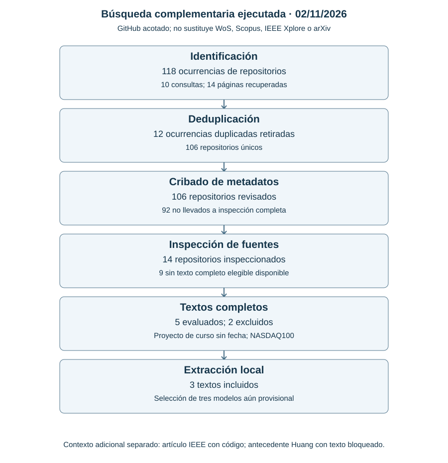
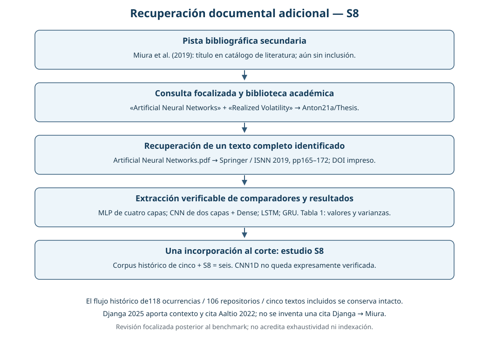
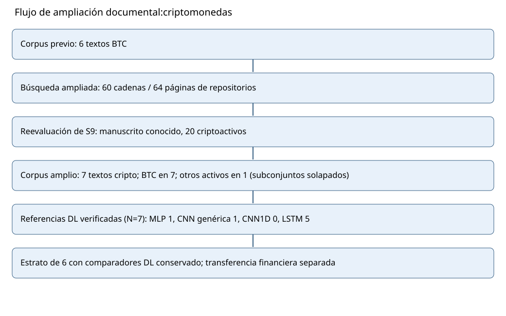
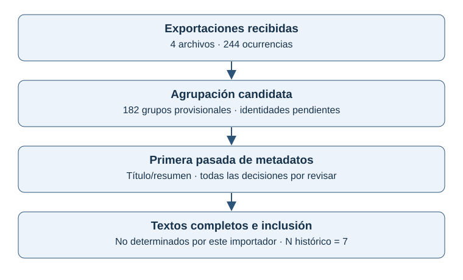
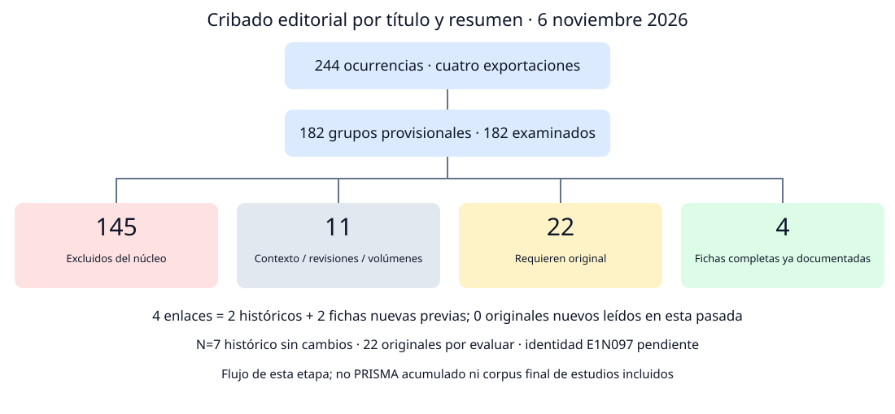

# 3. Revisión del Estado del Arte y Extracción de los Tres Modelos Base

**Comparación principal y antecedentes.** E1 compara **GRU H32, LSTM H32 y MLP H16** en D7 sobre las **608 fechas del 01/01/2025–31/08/2026**. La {ref}`reejecución registrada de 608 fechas <remediation-608-e1>` ajusta de nuevo las tres familias con cuatro candidatos comunes de LR–dropout, piloto propio y repeticiones dimensionadas. Las anchuras se conservan; el presupuesto original de diez semillas y el {ref}`estudio de 60 fechas <final-core-mlp-e1>` con otras recetas y 465 semillas permanecen como evidencia histórica y complementaria. TCN conserva sus resultados complementarios. La selección bibliográfica y experimental sucede después de conocer esos estudios y el calendario evaluado, con alcance exploratorio.

La revisión debe identificar exactamente tres modelos DL básicos usados como referencias comparativas en la literatura del problema. El experimento propio sigue en Bitcoin y distingue evidencia cripto de transferencia financiera. La {ref}`ampliación gratuita de §3.12 <free-model-expansion-e1>` incorpora **13 obras seleccionadas —siete bajo la búsqueda TCN y seis bajo MLP—, de las cuales diez son identidades nuevas**: la bibliografía canónica pasa de 60 a **70 referencias**. La {ref}`conciliación acumulada de §3.13 <homogeneous-expansion-e1>` actualiza acceso, roles, calidad y frecuencias sin sumar registros por cuota de arquitectura. La decisión de {ref}`§3.14 <core-selection-e1>` adopta las tres mayores frecuencias del estrato con reporte suficiente: **LSTM 10/10, MLP 4/10 y GRU 2/10**. MLP pasa al núcleo seleccionado; TCN queda como comparación complementaria. Las recetas de la reejecución y los registros históricos se identifican en los capítulos 4 y 5; el capítulo 11 documenta el nuevo protocolo de 608 fechas y el capítulo 10 conserva el complemento de septiembre–octubre de 2026.

El corte anterior de la {ref}`síntesis homogénea de §3.10 <homogeneous-selection-e1>` concilió **47 identidades, 26 originales primarios leídos, 12 experimentos del constructo, diez con referencias extraíbles y ocho elegibles por reporte**. Esas unidades y cifras permanecen como evidencia histórica. El corte histórico del **05/11/2026** reúne **40 referencias** y un corpus aplicado de **siete textos completos**: seis estudios previos de BTC y S9, un estudio de veinte criptomonedas que también incluye BTC. Por tanto, el subconjunto que incluye BTC tiene siete estudios y uno de ellos incluye otras criptomonedas; son categorías superpuestas, no dos grupos que se suman. S8 verifica MLP, CNN, LSTM y GRU como comparadores independientes {cite:p}`miura2019`; S9 incorpora LSTM como propuesta, con su papel separado {cite:p}`djanga2025commonality`. En ese corte, T1/T2/T3 figuraban como transferencia financiera: un original editorial completo, código primario y una identidad de publicación, respectivamente; no aumentaban el denominador cripto. §3.8 actualiza después la lectura de T3, conservando su estrato financiero.

**Antecedente GRU–LSTM–TCN.** Akbiyik et al. (2023), Tabla 2, comparan estas tres familias como referencias independientes para volatilidad de Bitcoin {cite:p}`akbiyik2023`; Miura, Pichl y Kaizoji (2019), Tabla 1, aportan otra comparación publicada de GRU y LSTM {cite:p}`miura2019`. En el corte de siete estudios las frecuencias estrictas eran GRU 3/7, LSTM 5/7 y TCN 1/7. Sus redes propias de fase I tenían 3.777, 5.025 y 4.289 parámetros; son adaptaciones de E1 y no los ganadores de los artículos. Los registros de GRU y LSTM originales forman parte de la comparación histórica con MLP; los resultados TCN permanecen como complemento con su identidad original.

La decisión anterior de publicar GRU–LSTM–TCN se tomó **después del benchmark histórico y de revisar el experimento privado GRU–LSTM–TCN**. No se presenta como una selección bibliográfica anterior a esas ejecuciones ni como confirmación sobre un calendario nuevo. El protocolo privado había fijado las recetas antes de sus propios ajustes; esa congelación y la decisión posterior de publicación son hechos distintos. El [expediente de aquella selección](../_static/literature_e1/gru_lstm_tcn_selection_20261105/selection.json), su [tabla](../_static/literature_e1/gru_lstm_tcn_selection_20261105/selection.csv) y la {download}`justificación <../_static/literature_e1/gru_lstm_tcn_selection_20261105/README.md>` conservan evidencia, criterios y límites.

Las extracciones conservan todas las familias usadas por los autores. **MLP ahora integra el núcleo vigente junto con LSTM y GRU**; CNN y TCN conservan sus roles documentales y TCN sus resultados complementarios históricos. Bucci, HARNet y DeepVol se conservan como transferencia financiera, con los niveles de acceso documentados en cada corte y la actualización de DeepVol en §3.8 {cite:p}`bucci2020realized,reisenhofer2022harnet,morenopino2024deepvol`; no añaden estudios al denominador cripto ni se necesitan para completar la evidencia TCN de S1.

La revisión del **03/11/2026** corrigió motivos de cribado, recuperó dos textos adicionales y completó la extracción de los hiperparámetros ganadores de S1, que sí aparecen en su apéndice. Se conservan los cortes anteriores y se explicitan fuentes grises, parámetros desconocidos y límites de las métricas. Aquella revisión documental del 03/11/2026 no entrenó redes ni consultó test; la ejecución posterior de desarrollo se registra por separado.

La lectura previa de S8 se realizó el **04/11/2026, hora de Bogotá**, con registros UTC del 05/11, después del benchmark histórico ya examinado. Su publicación de 2019 precede a esos experimentos, pero su recuperación no se reescribe como fundamento de decisiones experimentales previas. La terna vigente se registra como una decisión posterior y diferente; su respaldo se distingue de las fechas de publicación, recuperación y ejecución.

El problema propio es **regresión temporal, tipo 4, ruta 6.4**: OHLCV rezagadas sin historia explícita de la volatilidad objetivo. Las tareas de las fuentes no coinciden automáticamente con ese contrato. El expediente de selección vigente y las tres fichas implementadas se desarrollan en §§3.2–3.4; los registros de etapas anteriores permanecen en el historial versionado del repositorio.

La estrategia inicial utilizó **búsqueda web pública y verificación posterior de procedencia e indexación**. El **06/11/2026** se incorporan cuatro exportaciones nativas de WoS/Scopus y una primera pasada de cribado; su procedencia, deduplicación y lecturas originales se desarrollan en {ref}`ampliacion-nativa-e1`. Los registros de las fases previas se conservan. La [ampliación cripto del 05/11/2026](../_static/literature_e1/crypto_extension_20261105/search_log.json) documenta consultas, fuentes, accesos y reevaluación de S9; el manuscrito era una pista conocida y no se presenta como descubrimiento enteramente nuevo. Su original se leyó para incorporarlo bajo el alcance ampliado. La [ampliación financiera previa](../_static/literature_e1/journal_update_20261105/search_and_access_log.json) sigue distinguiendo T1/T2/T3. Esas etapas históricas no acreditaban búsquedas nativas. La ampliación del 06/11 aporta registros individuales de WoS/Scopus; no acredita por sí sola cobertura completa, consulta de IEEE Xplore o cuartiles Q1. Los catálogos de 35, 36, 39 y 40 referencias se conservan como cortes fechados; el catálogo de 40 corresponde al 05/11.

La numeración mantiene los seis incisos de búsqueda (§3.1.1–3.1.6). La identificación de modelos (§3.2) separa procedimiento, criterios, síntesis, equivalencia, arquitecturas incompletas y familias orientativas. Cada ficha de §3.3 presenta los nueve campos de la guía; §3.4 distingue comparación, validez, brecha de desempeño y brecha de investigación.

## 3.1. Estrategia de Búsqueda (Obligatoria)

**Estado y alcance actuales.** La {ref}`bitácora de §3.11 <current-native-execution-e1>` acredita consultas de WoS, Scopus e IEEE Xplore con cadenas, fechas confirmadas y totales documentados. Los incisos siguientes conservan el descubrimiento histórico y sus límites; no reconstruyen sesiones antiguas. La ampliación web gratuita de §§3.12–3.13 tiene consultas y procedencia propias y no se presenta como otra consulta nativa ni como cribado exhaustivo de los 620 grupos recuperados en la ronda de §3.11.

### 3.1.1. Cadena de búsqueda

**Cronología.** Los apartados siguientes preservan las búsquedas de descubrimiento realizadas hasta el 05/11. La recepción nativa de WoS/Scopus del 06/11, sus límites de cobertura y la nueva extracción se presentan en {ref}`ampliacion-nativa-e1`; no se reescriben los registros de las etapas previas.

#### 3.1.1.1. Pregunta y unidades de búsqueda

La pregunta inicial fue qué arquitecturas DL sencillas se utilizan como comparadores independientes para pronosticar volatilidad de Bitcoin. La ampliación documentada extiende esa pregunta a cualquier criptomoneda, conservando el experimento propio de BTC. Primero se localizan documentos, repositorios de autores y recursos públicos; después se comprueba identidad, publicación y posible indexación. **Descubrimiento web, documento científico y familia de arquitectura son unidades distintas.**

#### 3.1.1.2. Cadenas de descubrimiento ejecutadas

Las consultas se ejecutaron en el buscador web público de GitHub, con `in:readme`, primera página y relevancia predeterminada. No se utilizó Google ni se presenta este recorrido acotado como una búsqueda exhaustiva de Internet o una consulta interna en WoS/Scopus. Las cuatro cadenas de descubrimiento fueron:

| ID | Cadena literal ejecutada | Total mostrado por GitHub | Registros recuperados |
|---|---|---:|---:|
| W1 | `bitcoin volatility forecasting in:readme` | 4577 | 10 |
| W2 | `bitcoin realized volatility neural in:readme` | 245 | 10 |
| W3 | `bitcoin realised volatility neural in:readme` | 45 | 10 |
| W4 | `"bitcoin volatility" arxiv in:readme` | 10 | 10 |

#### 3.1.1.3. Consultas dirigidas y antecedentes

Hubo además cuatro consultas de títulos/identificadores y cuatro de recursos de indexación. Las **doce cadenas**, URLs, fecha/hora, página y hashes de respuesta están en la [bitácora pública](../_static/literature_e1/public_web_verification_20261103/search_log.json). Se recuperaron 40 ocurrencias de repositorios y 36 repositorios distintos en el descubrimiento; esas cifras no son artículos, estudios incluidos ni frecuencias de arquitecturas. No se suman los totales del índice de consultas solapadas.

Las 24 cadenas nativas preparadas anteriormente se conservan como [antecedente no ejecutado](../_static/literature_e1/academic_search_20261103/query_plan.json). El método aplicado en esta fase es recuperación pública más comprobación posterior; no se cambia retrospectivamente el nombre del motor o sus campos para simular una búsqueda dentro de las bases.

La etapa previa de recuperación de S8 está documentada en el {download}`informe complementario <../_static/literature_e1/recovery_20261105/README.md>` y la [procedencia primaria de S8](../_static/literature_e1/recovery_20261105/primary_source.json). Incluye las cadenas y fuentes efectivamente recuperadas, sus fechas y hashes. Sus resultados de descubrimiento no se suman a las consultas anteriores como si fueran artículos distintos; aquella etapa incorporó solo S8 al corpus científico.

**Ampliación cripto del 05/11/2026.** Se conserva esta cadena semilla conceptual, separada de las consultas nativas de cada plataforma:

```text
(bitcoin OR ethereum OR litecoin OR ripple OR solana OR dogecoin OR cryptocurrency) AND (volatility OR realized variance OR realized volatility) AND (deep learning OR MLP OR feedforward neural network OR CNN OR Conv1D OR LSTM OR GRU)
```

Las consultas públicas ejecutadas incluyeron, literalmente, `cryptocurrency volatility forecasting in:readme neural` y `ethereum volatility forecasting in:readme`. La [bitácora actual](../_static/literature_e1/crypto_extension_20261105/search_log.json) conserva todas las variantes, URL, página, fecha, respuesta y hash; la cadena semilla no se presenta como búsqueda enviada a WoS/Scopus. Se registraron **60 cadenas, 64 solicitudes de páginas, 59 respuestas exitosas, 501 ocurrencias y 379 repositorios únicos devueltos** en tres líneas de búsqueda. Son repositorios descubiertos, no artículos incluidos; no se suman los totales estimados por el índice ni los conteos de etapas anteriores.

### 3.1.2. Fuentes consultadas y verificación de procedencia e indexación

**WoS y Scopus son índices**, IEEE Xplore es una biblioteca digital y arXiv un repositorio de preprints. Un documento puede estar asociado a varias fuentes a la vez. Se verifica por separado: identidad del trabajo; publicación o identificador; presencia de la revista en un listado; registro individual del artículo; y cuartil del año/categoría. Un DOI, el nombre de una editorial o un resultado web no prueban todos esos niveles.

#### 3.1.2.1. Documentos y enlaces públicos comprobados

| Trabajo | Fuente pública comprobada | Hallazgo | Alcance de la comprobación |
|---|---|---|---|
| Akbiyik et al. (2023) | [PDF de autores](https://github.com/meakbiyik/ask-who-not-what/blob/bcc0e4e89213da2ca3ed968574aa2d08cee39c44/paper.pdf), portada | arXiv **2110.14317v2**, DOI 10.1145/3539597.3570387 y ACM WSDM 2023 | Identidad e identificador corroborados en copia pública de autores; registro arXiv en vivo no consultado. |
| Herremans y Low (2025) | [README de autores](https://github.com/dorienh/bitcoin_synthesizer/blob/8570f4e8bdcfe1dd609e5f094d3d5b0059a810dc/README.md#L3-L7) | IEEE Access 13, 117788–117807; [registro Xplore 11058926](https://ieeexplore.ieee.org/document/11058926/) | Enlace de registro declarado por autores; la página de Xplore no se abrió. |
| Guo et al. (2018) | [README de autores](https://github.com/weilai0980/mixture_models_crypto/blob/7aeaf66bb4438d022ae0cf2af2ffec317a8d068f/README.md#L7-L15) | IEEE ICDM 2018, pp. 989–994 | Publicación declarada por autores; registro Xplore específico no corroborado en el material nuevo. |
| Miura, Pichl y Kaizoji (2019) | [Capítulo maquetado de Springer, copia conservada en un repositorio académico](https://raw.githubusercontent.com/Anton21a/Thesis/8bc3aa3c96fd214b34b914d2057f4339f2c8ed1e/ML%20articles/Artificial%20Neural%20Networks.pdf) | *Advances in Neural Networks—ISNN 2019*, LNCS 11554, pp. 165–172; DOI impreso **10.1007/978-3-030-22796-8_18** | Texto completo y Tabla 1 leídos y verificados; identidad de la publicación acreditada por el PDF. No se abrió el registro oficial del artículo en índices ni se comprobó Q1. |

#### 3.1.2.2. Revistas: coincidencias en copias públicas de listas WoS/Scopus

Se inspeccionó [wosaide/wosaide-journal-lists](https://github.com/wosaide/wosaide-journal-lists/tree/4d0b1a32915b04180c37e6f697a7da04a6f05de6), repositorio independiente que declara copias WoS de agosto de 2026 y Scopus de julio de 2026. No está avalado por sus proveedores. Los títulos e ISSN de estas cinco revistas coinciden en ambas listas:

| Referencia | Revista declarada e ISSN | Colección WoS en la copia de 2026 | SourceID y cobertura Scopus declarada |
|---|---|---|---|
| Huang et al. (2024) | Journal of International Financial Markets, Institutions and Money · ISSN 1042-4431 | SSCI | 17531 · 1997-2026 |
| Barjašić y Antulov-Fantulin (2021) | Frontiers in Physics · ISSN 2296-424X | SCIE | 21100831025 · 2013-2026 |
| Katsiampa (2017) | Economics Letters · ISSN 0165-1765 | SSCI | 28490 · 1978-2026 |
| Dyhrberg (2016) | Finance Research Letters · ISSN 1544-6123 | SSCI | 15519 · 2004-2026 |
| Herremans y Low (2025) | IEEE Access · ISSN 2169-3536 | SCIE | 21100374601 · 2013-2026 |

Esta es **evidencia secundaria de revista**. No confirma el registro individual de cada artículo, la cobertura histórica WoS del año editorial ni un cuartil Q1. Las fuentes de tipo congreso de Akbiyik/Guo no se evalúan con esta lista limitada a revistas; su ausencia allí no significa que no estén indexadas. Las fuentes grises tampoco se declaran no indexadas por falta de prueba.

La ampliación incorpora dos revistas adicionales, cotejadas por **título e ISSN en las mismas copias fijadas**. En T1 la portada editorial acredita Oxford University Press, revista y DOI; en T3 el CV primario del autor acredita la referencia y su enlace DOI. El cotejo de los índices sigue siendo secundario:

| Revista nueva | Editorial e ISSN | WoS en la copia de 2026 | Scopus en la copia de 2026 |
|---|---|---|---|
| Journal of Financial Econometrics | Oxford University Press · 1479-8409 | SSCI | 145695 · 2005–2026 |
| Quantitative Finance | Taylor & Francis · 1469-7688 | SSCI y SCIE | 16062 · 2001–2026 |

Las [filas exactas y su procedencia](../_static/literature_e1/journal_update_20261105/journal_index_matches.json) y su [CSV](../_static/literature_e1/journal_update_20261105/journal_index_matches.csv) permiten repetir el cotejo de las siete revistas. **Publicación, texto leído, código de autores, indexación de revista e indexación individual no son equivalentes.** Elsevier es una editorial; WoS y Scopus son índices. La ampliación tampoco asigna cuartiles.

Los [candidatos editoriales pendientes](../_static/literature_e1/journal_update_20261105/editorial_candidates.json) conservan Huang et al. (2024), D’Amato et al. (2022) y Wang et al. (2023), vinculados bibliográficamente a revistas Elsevier. Sus originales y comparadores no se dan por leídos. PreBit, de Expert Systems with Applications, tiene evidencia primaria de autores de CNN para movimientos extremos del precio: permanece fuera de la regresión de volatilidad continua. No se cambia el denominador de estudios por encontrar un DOI o un título editorial.

La [matriz de las once referencias aplicadas](../_static/literature_e1/public_web_verification_20261103/document_platform_matrix.json) conserva estados por documento; los [extractos de filas, ISSN, cobertura y fuentes](../_static/literature_e1/public_web_verification_20261103/secondary_journal_evidence.json) identifican URLs fijadas, commits y hashes. La [procedencia documental](../_static/literature_e1/public_web_verification_20261103/publication_provenance.json) recoge los identificadores y las asociaciones rechazadas. El {download}`informe de verificación <../_static/literature_e1/public_web_verification_20261103/report.md>` permite revisar el recorrido completo.

#### 3.1.2.3. Control de identidad

Un mirror atribuía a Herremans un PDF y el ID arXiv:2211.00759; al leer la portada se comprobó que era otro trabajo, de Reijnen y colaboradores. Se descartó esa asociación. La pista secundaria 2211.08281 permanece sin corroboración oficial. La concordancia de título, autores, DOI y portada prevalece sobre el nombre de un archivo o una etiqueta del buscador.

(tabla-referencias-e1)=
#### 3.1.2.4. Catálogo histórico del 05/11/2026: 40 referencias

Las tablas conservan las 39 entradas del corte anterior y añaden una referencia cripto, S9. El [catálogo histórico de 40 referencias](../_static/literature_e1/crypto_extension_20261105/references_access_40.json) conserva procedencia y nivel de acceso. El corte bibliográfico de §3.7 del **06/11/2026** contiene **50 entradas**: las 42 del cierre de §3.6.3 y ocho incorporadas en aquella actualización. La ampliación posterior de §3.8 conserva esas entradas y añade referencias con acceso y función diferenciados. Sus objetivos, papeles y niveles de acceso se estratifican; el número de referencias no modifica el corpus histórico de siete estudios. Los catálogos de [39](../_static/literature_e1/journal_update_20261105/references_access_39.json) y [36](../_static/literature_e1/recovery_20261105/references_access_36.json) permanecen como antecedentes; no se modifican sus fechas ni se atribuyen lecturas nuevas a entradas anteriores.

El catálogo reúne **40 referencias: trece aplicaciones a Bitcoin u otras criptomonedas, ocho fundamentos de redes neuronales, dieciséis referencias de volatilidad, diagnóstico y evaluación, y tres respaldos metodológicos financieros**. Siete son estudios cripto completos incluidos; la cantidad de citas no equivale a ese denominador. Las pistas sin original y la evidencia solo de código o identidad se conservan por separado.

El **enlace bibliográfico** identifica el trabajo, su DOI, su preprint o el registro donde se documentó la referencia. La columna **Fuente y evidencia consultada** indica qué material se utilizó realmente: texto completo de autores, código, documentación o una referencia localizada en otra bibliografía. Un DOI registrado no acredita su resolución directa ni la lectura del artículo original. Los manuscritos de Zeri y Gao conservan las precisiones sobre revisión por pares y año editorial en los perfiles fuente archivados y la matriz de estudios.

##### 3.1.2.4.1. Aplicaciones a Bitcoin y otras criptomonedas (13 referencias)

| Referencia citada | Documento y enlace bibliográfico | Fuente y evidencia consultada | Aporte al proyecto |
|---|---|---|---|
| {cite:p}`huang2024` | *Forecasting Bitcoin volatility using machine learning techniques* · [DOI registrado](https://doi.org/10.1016/j.intfin.2024.102064) | [Antecedente del proyecto](https://pure-oai.bham.ac.uk/ws/portalfiles/portal/246755355/1-s2.0-S1042443124001306-main.pdf): Antecedente bibliográfico previo; nueva lectura no acreditada. | Antecedente de aprendizaje automático para volatilidad de Bitcoin. |
| {cite:p}`akbiyik2023` | *Ask “Who”, Not “What”: Bitcoin Volatility Forecasting with Twitter Data* · [DOI registrado](https://doi.org/10.1145/3539597.3570387) | [Artículo y código de autores](https://github.com/meakbiyik/ask-who-not-what/blob/bcc0e4e89213da2ca3ed968574aa2d08cee39c44/paper.pdf): Texto completo y código de autores consultados. | Comparadores LSTM, GRU y TCN para volatilidad del día siguiente. |
| {cite:p}`guo2018` | *Bitcoin Volatility Forecasting with a Glimpse into Buy and Sell Orders* · [DOI registrado](https://doi.org/10.1109/ICDM.2018.00123) | [Repositorio de autores](https://github.com/weilai0980/mixture_models_crypto/blob/7aeaf66bb4438d022ae0cf2af2ffec317a8d068f/README.md): README y código inspeccionados; original no leído. | Información de órdenes de compra y venta como covariables alternativas. |
| {cite:p}`barjasic2021` | *Time-Varying Volatility in Bitcoin Market and Information Flow at Minute-Level Frequency* · [Registro en fuente consultada](https://raw.githubusercontent.com/meakbiyik/ask-who-not-what/bcc0e4e89213da2ca3ed968574aa2d08cee39c44/paper.pdf) | [Bibliografía de Akbiyik et al.](https://raw.githubusercontent.com/meakbiyik/ask-who-not-what/bcc0e4e89213da2ca3ed968574aa2d08cee39c44/paper.pdf): Referencia localizada en otra bibliografía; original no leído. | Relación entre volatilidad e información a frecuencia de minutos. |
| {cite:p}`katsiampa2017` | *Volatility estimation for Bitcoin: A comparison of GARCH models* · [Registro en fuente consultada](https://raw.githubusercontent.com/meakbiyik/ask-who-not-what/bcc0e4e89213da2ca3ed968574aa2d08cee39c44/paper.pdf) | [Bibliografía de Akbiyik et al.](https://raw.githubusercontent.com/meakbiyik/ask-who-not-what/bcc0e4e89213da2ca3ed968574aa2d08cee39c44/paper.pdf): Referencia localizada en otra bibliografía; original no leído. | Contexto de comparación econométrica mediante variantes GARCH. |
| {cite:p}`dyhrberg2016` | *Bitcoin, gold and the dollar – A GARCH volatility analysis* · [Registro en fuente consultada](https://raw.githubusercontent.com/ga0m1/bitcoin-volatility-models/f19551ca4cca768354eb7e2b7c1dd5c912bd0d41/M2259.docx) | [Bibliografía de Gao et al.](https://raw.githubusercontent.com/ga0m1/bitcoin-volatility-models/f19551ca4cca768354eb7e2b7c1dd5c912bd0d41/M2259.docx): Referencia localizada en otra bibliografía; original no leído. | Contexto de varianza condicional de Bitcoin, oro y dólar. |
| {cite:p}`herremans2025` | *Forecasting Bitcoin Volatility Spikes From Whale Transactions and CryptoQuant Data Using Synthesizer Transformer Models* · [Enlace bibliográfico](https://ieeexplore.ieee.org/document/11058926/) | [README y código de autores](https://raw.githubusercontent.com/dorienh/bitcoin_synthesizer/8570f4e8bdcfe1dd609e5f094d3d5b0059a810dc/README.md): Resumen, README y código de autores; original no leído. | Antecedente de atención con datos de ballenas y actividad on-chain. |
| {cite:p}`zeri2026` | *Forecasting High-Frequency Bitcoin Volatility: Neural Networks, Market Microstructure and On-Chain Data* · [Manuscrito](https://github.com/tommasozeri/Forecasting-High-Frequency-Bitcoin-Volatility-Neural-Networks/blob/d69f951f2ced7273bdc4c3e5a8a4cb220c2ee5ce/paper_en/manuscript.tex) | [Manuscrito y notebook del autor](https://github.com/tommasozeri/Forecasting-High-Frequency-Bitcoin-Volatility-Neural-Networks/blob/d69f951f2ced7273bdc4c3e5a8a4cb220c2ee5ce/paper_en/manuscript.tex): Texto completo y código; manuscrito sin revisión por pares acreditada. | Fuente aplicada de encoder Transformer; evidencia de literatura gris. |
| {cite:p}`gao2023` | *Comparing the Predictive Power of Five Models on Bitcoin Volatility* · [Manuscrito](https://github.com/ga0m1/bitcoin-volatility-models/blob/f19551ca4cca768354eb7e2b7c1dd5c912bd0d41/M2259.docx) | [Manuscrito y notebook de autores](https://github.com/ga0m1/bitcoin-volatility-models/blob/f19551ca4cca768354eb7e2b7c1dd5c912bd0d41/M2259.docx): Manuscrito y código consultados; año editorial pendiente de corroborar. | Fuente de una LSTM pequeña; objetivo y protocolo distintos del proyecto. |
| {cite:p}`wangnd` | *A comparative analysis of volatility predictions via EGARCH, Transformer and hybrid EGARCH-Transformer models: changes in forecasting ability after introducing sentiment factors* · [Documento de autores](https://github.com/cathyw111/bitcoin-volatility-forecasting/blob/61feeec81d695e19eac9c819be41d704e6279547/research-draft.pdf) | [Texto completo y procedencia](https://github.com/cathyw111/bitcoin-volatility-forecasting/blob/61feeec81d695e19eac9c819be41d704e6279547/research-draft.pdf): Texto completo de literatura gris; sin fecha editorial, DOI o revisión por pares acreditados. | Transformer puro con OHLCV diario como comparador de EGARCH e híbridos; arquitectura y resultados publicados en el borrador, con inconsistencias de evaluación explícitas. |
| {cite:p}`alakhouch2026` | *Bitcoin Volatility Forecasting: Econometric and Machine Learning Approaches Applied to Daily Price Data (July 2010–February 2024)* · [Documento de autores](https://github.com/idrissalk/Bitcoin-Volatility-Forecasting/blob/a98099e4125e1f80a094a46889d97bc31abfe30b/Repport/Asset-volatility-Forecasting.pdf) | [Texto completo y procedencia](https://github.com/idrissalk/Bitcoin-Volatility-Forecasting/blob/a98099e4125e1f80a094a46889d97bc31abfe30b/Repport/Asset-volatility-Forecasting.pdf): Informe académico y código consultados; sin DOI, revista o revisión por pares acreditados. | LSTM apilada como comparador de GARCH, RF y XGBoost para volatilidad diaria; aporta evidencia de uso con riesgos de fuga y discrepancias entre informe y código. |
| {cite:p}`miura2019` | *Artificial Neural Networks for Realized Volatility Prediction in Cryptocurrency Time Series* · [DOI impreso](https://doi.org/10.1007/978-3-030-22796-8_18) | [Capítulo completo, pp. 165–172](https://raw.githubusercontent.com/Anton21a/Thesis/8bc3aa3c96fd214b34b914d2057f4339f2c8ed1e/ML%20articles/Artificial%20Neural%20Networks.pdf): portada y Tabla 1 verificadas en la copia del capítulo publicado; no se acredita consulta del índice o resolución en vivo del DOI. | S8: MLP de cuatro capas y CNN de dos capas más Dense como comparadores independientes de RV de Bitcoin; parámetros y dimensión CNN parcialmente no reportados. |
| {cite:p}`djanga2025commonality` | *Cryptocurrency Volatility Forecasting with Applications in Trading* · manuscrito fechado 26/01/2025, sin DOI/revista verificados | [Original y extracción S9](../_static/literature_e1/crypto_extension_20261105/S9_extraction.json): veinte pares cripto, incluido BTC; LSTM propuesta y cabeza MLP interna, sin comparador MLP/CNN independiente verificado. |

##### 3.1.2.4.2. Fundamentos de redes neuronales (8 referencias)

| Referencia citada | Documento y enlace bibliográfico | Fuente y evidencia consultada | Aporte al proyecto |
|---|---|---|---|
| {cite:p}`cybenko1989` | *Approximation by superpositions of a sigmoidal function* · [DOI registrado](https://doi.org/10.1007/BF02551274) | [D2L: bibliografía y MLP](https://raw.githubusercontent.com/d2l-ai/d2l-en/master/d2l.bib): Metadatos y explicación en fuente secundaria; lectura del original no acreditada. | Capacidad de aproximación de redes; sin garantía de generalización. |
| {cite:p}`goodfellow2016` | *Deep learning* · [Sitio del libro](https://www.deeplearningbook.org/) | [Bibliografía de D2L](https://raw.githubusercontent.com/d2l-ai/d2l-en/master/d2l.bib): Metadatos y explicación en fuente secundaria; lectura del original no acreditada. | Fundamentos de arquitecturas, regularización y optimización. |
| {cite:p}`hochreiter1997` | *Long short-term memory* · [DOI registrado](https://doi.org/10.1162/neco.1997.9.8.1735) | [D2L: bibliografía y LSTM](https://raw.githubusercontent.com/d2l-ai/d2l-en/master/d2l.bib): Metadatos y explicación en fuente secundaria; lectura del original no acreditada. | Memoria recurrente y compuertas de la arquitectura LSTM. |
| {cite:p}`cho2014` | *Learning phrase representations using RNN encoder–decoder for statistical machine translation* · [Ficha del preprint](https://arxiv.org/abs/1406.1078) | [D2L: bibliografía y GRU](https://raw.githubusercontent.com/d2l-ai/d2l-en/master/d2l.bib): Metadatos y explicación en fuente secundaria; lectura del original no acreditada. | Antecedente de GRU y codificador–decodificador recurrente. |
| {cite:p}`lecun1998` | *Gradient-based learning applied to document recognition* · [DOI registrado](https://doi.org/10.1109/5.726791) | [D2L y bibliografía académica](https://raw.githubusercontent.com/d2l-ai/d2l-en/master/d2l.bib): Metadatos y explicación en fuente secundaria; lectura del original no acreditada. | Convolución y pesos compartidos como fundamento arquitectónico. |
| {cite:p}`bai2018` | *An empirical evaluation of generic convolutional and recurrent networks for sequence modeling* · [Ficha del preprint](https://arxiv.org/abs/1803.01271) | [README de autores de TCN](https://raw.githubusercontent.com/locuslab/TCN/master/README.md): README y cita de autores; original no leído. | TCN y comparación general de convolución frente a recurrencia. |
| {cite:p}`kingma2014` | *Adam: A method for stochastic optimization* · [Ficha del preprint](https://arxiv.org/abs/1412.6980) | [D2L: bibliografía y Adam](https://raw.githubusercontent.com/d2l-ai/d2l-en/master/d2l.bib): Metadatos y explicación en fuente secundaria; lectura del original no acreditada. | Optimización adaptativa mediante estimaciones de momentos. |
| {cite:p}`vaswani2017` | *Attention is all you need* · [Ficha del preprint](https://arxiv.org/abs/1706.03762) | [Bibliografía de D2L](https://raw.githubusercontent.com/d2l-ai/d2l-en/master/d2l.bib): Metadatos en bibliografía de D2L; original no leído. | Fundamento de atención y de la arquitectura Transformer. |

##### 3.1.2.4.3. Fundamentos de volatilidad, diagnóstico y evaluación (16 referencias)

| Referencia citada | Documento y enlace bibliográfico | Fuente y evidencia consultada | Aporte al proyecto |
|---|---|---|---|
| {cite:p}`engle1982` | *Autoregressive Conditional Heteroscedasticity with Estimates of the Variance of United Kingdom Inflation* · [Registro en fuente consultada](https://raw.githubusercontent.com/cran/tseries/0.10-54/man/garch.Rd) | [Documentación de tseries](https://raw.githubusercontent.com/cran/tseries/0.10-54/man/garch.Rd): Metadatos y documentación metodológica; original no leído. | Varianza condicional cambiante en el tiempo mediante ARCH. |
| {cite:p}`bollerslev1986` | *Generalized Autoregressive Conditional Heteroskedasticity* · [Registro en fuente consultada](https://raw.githubusercontent.com/cran/tseries/0.10-54/man/garch.Rd) | [Documentación de tseries](https://raw.githubusercontent.com/cran/tseries/0.10-54/man/garch.Rd): Metadatos y documentación metodológica; original no leído. | Referencia econométrica de heterocedasticidad condicional GARCH. |
| {cite:p}`andersen2003` | *Modeling and Forecasting Realized Volatility* · [Registro en fuente consultada](https://raw.githubusercontent.com/meakbiyik/ask-who-not-what/bcc0e4e89213da2ca3ed968574aa2d08cee39c44/paper.pdf) | [Bibliografía de Akbiyik et al.](https://raw.githubusercontent.com/meakbiyik/ask-who-not-what/bcc0e4e89213da2ca3ed968574aa2d08cee39c44/paper.pdf): Metadatos y documentación metodológica; original no leído. | Definición de volatilidad realizada y diferencia frente al objetivo diario. |
| {cite:p}`corsi2009` | *A Simple Approximate Long-Memory Model of Realized Volatility* · [Registro en fuente consultada](https://raw.githubusercontent.com/cran/highfrequency/master/man/HARmodel.Rd) | [Documentación de highfrequency](https://raw.githubusercontent.com/cran/highfrequency/master/man/HARmodel.Rd): Metadatos y documentación metodológica; original no leído. | Componentes históricos de volatilidad a distintas escalas (HAR-RV). |
| {cite:p}`diebold1995` | *Comparing Predictive Accuracy* · [Registro en fuente consultada](https://raw.githubusercontent.com/robjhyndman/forecast/master/man/dm.test.Rd) | [Documentación de forecast](https://raw.githubusercontent.com/robjhyndman/forecast/master/man/dm.test.Rd): Metadatos y documentación metodológica; original no leído. | Comparación predictiva mediante diferencias de pérdidas. |
| {cite:p}`harvey1997` | *Testing the Equality of Prediction Mean Squared Errors* · [Registro en fuente consultada](https://raw.githubusercontent.com/robjhyndman/forecast/master/man/dm.test.Rd) | [Documentación de forecast](https://raw.githubusercontent.com/robjhyndman/forecast/master/man/dm.test.Rd): Metadatos y documentación metodológica; original no leído. | Corrección de muestra pequeña para comparación predictiva. |
| {cite:p}`hyndman2006` | *Another Look at Measures of Forecast Accuracy* · [Registro en fuente consultada](https://raw.githubusercontent.com/robjhyndman/forecast/master/R/errors.R) | [Código y documentación de forecast](https://raw.githubusercontent.com/robjhyndman/forecast/master/R/errors.R): Metadatos y documentación metodológica; original no leído. | MASE y cautelas de las métricas porcentuales de error. |
| {cite:p}`bergmeir2018` | *A Note on the Validity of Cross-Validation for Evaluating Autoregressive Time Series Prediction* · [Registro en fuente consultada](https://raw.githubusercontent.com/robjhyndman/forecast/master/man/CVar.Rd) | [Documentación de forecast](https://raw.githubusercontent.com/robjhyndman/forecast/master/man/CVar.Rd): Metadatos y documentación metodológica; original no leído. | Condiciones de validez de la validación cruzada temporal. |
| {cite:p}`holm1979` | *A Simple Sequentially Rejective Multiple Test Procedure* · [Registro en fuente consultada](https://raw.githubusercontent.com/wch/r-source/R-4-4-branch/src/library/stats/man/p.adjust.Rd) | [Documentación de R: p.adjust](https://raw.githubusercontent.com/wch/r-source/R-4-4-branch/src/library/stats/man/p.adjust.Rd): Metadatos y documentación metodológica; original no leído. | Corrección de comparaciones múltiples para una familia de contrastes. |
| {cite:p}`kunsch1989` | *The Jackknife and the Bootstrap for General Stationary Observations* · [Registro en fuente consultada](https://raw.githubusercontent.com/cran/boot/master/man/tsboot.Rd) | [Documentación de boot: tsboot](https://raw.githubusercontent.com/cran/boot/master/man/tsboot.Rd): Metadatos y documentación metodológica; original no leído. | Remuestreo de observaciones dependientes mediante bloques. |
| {cite:p}`politis1994` | *The Stationary Bootstrap* · [Registro en fuente consultada](https://raw.githubusercontent.com/cran/boot/master/man/tsboot.Rd) | [Documentación de boot: tsboot](https://raw.githubusercontent.com/cran/boot/master/man/tsboot.Rd): Metadatos y documentación metodológica; original no leído. | Bootstrap estacionario con longitud aleatoria de bloques. |
| {cite:p}`haddaway2022` | *PRISMA2020: An R Package and Shiny App for Producing PRISMA 2020-Compliant Flow Diagrams, with Interactivity for Optimised Digital Transparency and Open Synthesis* · [DOI registrado](https://doi.org/10.1002/cl2.1230) | [README de PRISMA2020](https://raw.githubusercontent.com/prisma-flowdiagram/PRISMA2020/master/README.md): README y cita de autores; original no leído. | Trazabilidad del flujo de búsqueda y selección bibliográfica. |
| {cite:p}`dickey1979` | *Distribution of the estimators for autoregressive time series with a unit root* · [Registro en fuente consultada](https://raw.githubusercontent.com/JimVaranelli/DFGLS/main/README.md) | [Documentación de implementación](https://raw.githubusercontent.com/JimVaranelli/DFGLS/main/README.md): Metadatos y documentación metodológica; original no leído. | Diagnóstico de raíz unitaria en series temporales. |
| {cite:p}`kwiatkowski1992` | *Testing the null hypothesis of stationarity against the alternative of a unit root* · [Registro en fuente consultada](https://raw.githubusercontent.com/cran/tseries/0.10-58/man/kpss.test.Rd) | [Documentación de tseries: KPSS](https://raw.githubusercontent.com/cran/tseries/0.10-58/man/kpss.test.Rd): Metadatos y documentación metodológica; original no leído. | Contraste de estacionariedad complementario al de raíz unitaria. |
| {cite:p}`ljung1978` | *On a measure of lack of fit in time series models* · [DOI registrado](https://doi.org/10.2307/2335207) | [Documentación de R: Box.test](https://raw.githubusercontent.com/wch/r-source/R-4-4-branch/src/library/stats/man/box.test.Rd): Metadatos y documentación metodológica; original no leído. | Diagnóstico de autocorrelación residual a rezagos declarados. |
| {cite:p}`broock1996` | *A test for independence based on the correlation dimension* · [DOI registrado](https://doi.org/10.1080/07474939608800353) | [Código de statsmodels: BDS](https://raw.githubusercontent.com/statsmodels/statsmodels/main/statsmodels/tsa/_bds.py): Metadatos y documentación metodológica; original no leído. | Contraste i.i.d.; el rechazo no identifica por sí solo no linealidad. |

**Respaldo metodológico adicional, separado del corpus Bitcoin:**

| Referencia | Evidencia consultada | Aporte y límite |
|---|---|---|
| {cite:p}`bucci2020realized` · Journal of Financial Econometrics · [DOI](https://doi.org/10.1093/jjfinec/nbaa008) | Artículo editorial completo, pp. 502–531; estructura y Tablas 2–5 verificadas | FNN/FNNX independientes de una capa oculta para volatilidad mensual del S&P 500. Respalda el papel de una MLP básica, sin replicar el objetivo o la receta de E1. |
| {cite:p}`reisenhofer2022harnet` · HARNet | Código primario de autores, versión fijada; original y revista pendientes | Verifica Conv1D causal, kernels, dilataciones y un preset financiero. No acredita métricas del artículo ni una CNN independiente en Bitcoin. |
| {cite:p}`morenopino2024deepvol` · Quantitative Finance · [DOI](https://doi.org/10.1080/14697688.2024.2387222) | CV primario del autor con referencia y enlace DOI | Acreditaba identidad de publicación en el corte del 05/11; el original, sus parámetros y métricas estaban pendientes. §3.8 incorpora su lectura posterior. |

El catálogo vigente se descarga en [CSV](../_static/literature_e1/crypto_extension_20261105/references_access_40.csv), [JSON](../_static/literature_e1/crypto_extension_20261105/references_access_40.json) y [BibTeX](../_static/literature_e1/crypto_extension_20261105/references_access_40.bib). Los cortes anteriores de [39](../_static/literature_e1/journal_update_20261105/references_access_39.csv), [36](../_static/literature_e1/recovery_20261105/references_access_36.csv) y [35](../_static/literature_e1/references_access_35.csv) se conservan. Las citas completas están en la [bibliografía del libro](referencias.md).

**Recuperación dirigida posterior a la auditoría del 04/11/2026.** Se ejecutó otra etapa de descubrimiento público, separada del flujo original: **13 cadenas literales, 18 páginas y 113 ocurrencias en 92 repositorios únicos**; se inspeccionaron nueve raíces/README y siete archivos de código/notebook sin ejecutarlos. El [registro de consultas](../_static/literature_e1/recovery_audit_20261104/search_log.json) y la [evaluación de candidatos](../_static/literature_e1/recovery_audit_20261104/candidate_assessment.csv) documentan este recorrido. No se suman estas ocurrencias al PRISMA original sin una deduplicación conjunta: son dos etapas con denominadores propios.

En aquella recuperación se verificaron pistas de una CNN1D independiente y una MLP TS-only, pero **no se obtuvo un manuscrito científico completo nuevo**: su resultado histórico fue 35 referencias, cinco textos y 0/5 para MLP/CNN1D simple. La [matriz de siete fuentes](../_static/literature_e1/recovery_audit_20261104/dataset_comparability.csv) y el {download}`informe de esa etapa <../_static/literature_e1/recovery_audit_20261104/report.md>` conservan ese alcance. La inclusión posterior de S8 es otra recuperación primaria, no una reinterpretación de esos README ni prueba de que sus fuentes tengan el mismo dataset/σ7 del proyecto.

### 3.1.3. Periodo de búsqueda

El intervalo preferente se actualiza a **01/01/2019–05/11/2026**, conservando los cierres previos del 03/11 y 04/11. S8 tiene fecha editorial impresa de 2019 y S9 fecha de manuscrito de 2025; sus fechas de recuperación no cambian esas identidades. Las consultas web no aplicaron un filtro verificable de año editorial: se comprueba durante la identificación. Un commit no sustituye el año del documento. Guo (2018), Katsiampa (2017) y Dyhrberg (2016) conservan su papel de antecedentes/contexto.

El snapshot de un listado de revistas de 2026 es distinto del año de un artículo y de su cuartil. La fecha impresa de una versión arXiv tampoco sustituye al año de la publicación posterior; por ejemplo, Akbiyik tiene una versión pública de 2022 y referencia ACM 2023. Los manuscritos sin fecha editorial acreditada siguen identificados como tales y requieren sensibilidad.

### 3.1.4. Criterios de inclusión y exclusión

Los criterios siguientes se hicieron explícitos al revisar el corpus; no se presentan como prerregistrados antes de las búsquedas del 02/11/2026.

| Dimensión | Evidencia necesaria para extraer un estudio | Tratamiento cuando falta o no corresponde |
|---|---|---|
| Pertinencia | Pronóstico continuo de volatilidad o varianza de cualquier criptomoneda; identificar activos, mercado, frecuencia y horizonte | Precio, dirección o trading sin pronóstico de volatilidad quedan fuera del corpus aplicado. Otros mercados financieros se separan como transferencia metodológica; una descripción ambigua permanece pendiente. |
| Uso empírico y papel del modelo DL | Texto completo con DL usado para el pronóstico y papel identificable: referencia, propuesta o componente interno | La inclusión amplia y la frecuencia de referencias son decisiones distintas. Solo un comparador DL independiente verificado suma a la frecuencia estricta; una cabeza o clase no invocada no acredita una referencia independiente. |
| Resultados verificables | Métrica, valor, escala y tabla/sección de origen; identificar a qué modelo pertenece cada cifra | Si no se recupera una cifra DL identificable no se la inventa ni se reasigna desde un ganador clásico. La presencia DL puede documentarse con su papel, sin incrementar automáticamente la frecuencia estricta de referencias. |
| Arquitectura y protocolo | Tipo de arquitectura, papel, objetivo, partición y evaluación identificables con límites explícitos | Separar falta de evidencia del comparador, hiperparámetros no reportados y configuración ganadora desconocida. No completar una receta por preferencia; conservar lo desconocido y la búsqueda requerida por E2. |
| Identidad y publicación | Autoría, título y documento localizable; fecha declarada o desconocida de forma explícita; DOI si existe | Código o README sin texto suficiente es contexto. Un informe o borrador no se excluye solo por su género; la literatura gris se identifica y no acredita revisión por pares |
| Periodo | Preferencia 01/01/2019–05/11/2026, conservando los cortes previos | Los anteriores se justifican como antecedentes; los sin fecha no acreditan recencia. El año del manuscrito de S9 no acredita publicación editorial o revisión por pares. |

Se distinguen pertinencia, recuperabilidad y calidad. Que un texto esté incluido para extracción exploratoria no certifica su validez ni basta para sostener que respalda uno de los tres modelos básicos definitivos. La preferencia Q1 requiere verificar índice, revista, año y categoría; no se deduce de que exista un DOI o un repositorio, ni se traslada automáticamente a congresos.

Un estudio cuenta como máximo una vez por familia y papel verificados. Preprint, artículo, código y variantes del mismo trabajo se deduplican por identidad. Las dos MLP de S8 cuentan una vez; su CNN genérica no se convierte en Conv1D. S9 cuenta como **un estudio de veinte activos**, con LSTM propuesta y cabeza MLP interna: no aporta una referencia MLP/CNN/LSTM simple adicional al conteo estricto. Las 40 citas, los siete textos cripto y los tres respaldos financieros son unidades distintas. T1/T2/T3 no entran en el denominador cripto.

Para el nuevo flujo académico se normalizarán DOI; se agruparán identificadores arXiv sin versión y vínculos preprint–artículo comprobados; cuando falten identificadores se revisarán título, autores y año. Las coincidencias ambiguas se resolverán conservando el motivo. Esta deduplicación documental no se presenta como ejecutada mientras no existan exportaciones. La literatura gris se identifica y requiere sensibilidad; no se transforma en evidencia revisada por pares.

Para la verificación posterior se registra evidencia primaria de autores/documento, evidencia secundaria de recursos públicos y estado pendiente por separado. Una correspondencia de revista/ISSN no basta para incluir el artículo en un corpus DL: todavía deben comprobarse objetivo, comparador, arquitectura, protocolo y resultados. Los repositorios nuevos de código o tesis se mantienen como pistas de recuperación hasta resolver identidad y posibles duplicados; no se excluyen por su género ni se incluyen por su descripción.

### 3.1.5. Trazabilidad del proceso

#### 3.1.5.1. Fase pública del 03/11/2026, corte histórico

Las doce consultas devolvieron respuestas de búsqueda verificables. Sus unidades y funciones se conservan separadas:

| Función | Consultas | Ocurrencias recuperadas | Repositorios distintos dentro de esa función |
|---|---:|---:|---:|
| Descubrimiento de documentos | 4 | 40 | 36 |
| Recuperación dirigida de títulos/identificadores | 4 | 7 | 7 |
| Localización de recursos de indexación | 4 | 20 | 20 |

Las 67 ocurrencias de las tres funciones contienen repeticiones y no son 67 artículos. Se recuperó una sola página por cadena; la relevancia del motor y los límites de recuperación sesgan el descubrimiento. El [registro de resultados](../_static/literature_e1/public_web_verification_20261103/discovery_records.json) y el [resumen de la fase](../_static/literature_e1/public_web_verification_20261103/flow_summary.json) permiten reconstruir los conteos sin mezclarlos con el historial anterior.

En esa fase se inspeccionaron además cinco README de candidatos, con [URLs fijadas, hashes y líneas pertinentes](../_static/literature_e1/public_web_verification_20261103/candidate_sources.json). Se mantuvo entonces el corte de cinco textos y 81 cifras de autores. **La incorporación posterior de S8 requirió lectura completa y extracción verificable**, documentadas aparte; no se cuentan como estudios los repositorios adicionales sin ese respaldo.

Los intentos directos anteriores y sus cuatro fallos de acceso se conservan únicamente como [antecedente](../_static/literature_e1/academic_search_20261103/access_attempts.json); no se confunden con esta búsqueda pública ejecutada. El recorrido actual se realizó con recursos abiertos y sin sesiones de acceso a las cuatro plataformas.

#### 3.1.5.2. Consultas complementarias históricas de GitHub

El [registro histórico de consultas complementarias](../_static/literature_e1/search_log.json) conserva URL, campo, página, fecha con zona horaria, respuesta y hash. La tabla siguiente se reconstruyó desde ese registro; no es una nueva búsqueda. Todos sus intentos corresponden al **02/11/2026**; las horas de cada intento se conservan en el [resumen por cadena](../_static/literature_e1/query_summary_20261103.csv).

| ID | Consulta literal | Intentos / páginas recuperadas | Ocurrencias recuperadas | Repositorios distintos dentro de la consulta | Estimación del índice |
|---|---|---:|---:|---:|---:|
| G1 | `bitcoin volatility forecasting` | 3 / 3 | 30 | 30 | 148 |
| G2 | `cryptocurrency volatility deep learning` | 2 / 2 | 20 | 20 | 33 |
| G3 | `bitcoin realized volatility neural` | 2 / 2 | 1 | 1 | 1 |
| G4 | `bitcoin volatility MLP in:readme` | 1 / 1 | 10 | 10 | 241 |
| G5 | `bitcoin volatility feedforward in:readme` | 1 / 1 | 10 | 10 | 103 |
| G6 | `bitcoin volatility paper in:description` | 1 / 1 | 7 | 7 | 7 |
| G7 | `"bitcoin volatility" "neural network" in:readme` | 2 / 1 | 10 | 10 | 45 |
| G8 | `"realized volatility" "MLP" "Bitcoin" in:readme` | 2 / 1 | 10 | 10 | 24 |
| G9 | `"volatility" "ANN" "bitcoin" in:readme` | 2 / 1 | 10 | 10 | 192 |
| G10 | `"bitcoin volatility" "CNN" in:readme` | 2 / 1 | 10 | 10 | 21 |

La estimación del índice es la cifra mostrada por GitHub en las páginas recuperadas. **No se suman esas estimaciones**: las consultas se solapan. Las 118 ocurrencias efectivamente recuperadas se deduplican a 106 repositorios. Hubo cuatro intentos limitados por el servidor y sus reintentos están en el registro; no son cuatro cadenas adicionales. G3 incluye una segunda página vacía: cuenta como respuesta recuperada, no como un registro nuevo.

El orden fue la relevancia predeterminada y los límites variaron entre una y tres páginas por cadena. No se aplicó un filtro verificable por fecha de publicación, revisión por pares o cuartil. Las consultas dirigidas a MLP/ANN/CNN y las búsquedas truncadas por página introducen sesgo de descubrimiento; por ello, sus resultados no estiman prevalencia de arquitecturas en la literatura.

La [procedencia](../_static/literature_e1/provenance.json) registra la importación de comprobantes previos y distingue la fecha original de búsqueda de la revisión del 03/11/2026. Las comprobaciones de Guo y Herremans se documentan aparte. La recuperación dirigida de seis registros del 03/11/2026 amplía las inspecciones y los textos evaluados, pero no las cadenas ni las ocurrencias iniciales. Ninguna clase de código se convierte automáticamente en comparador publicado.

#### 3.1.5.3. Flujo histórico y recuperación dirigida

La identificación original corresponde al **02/11/2026**; la ampliación del **03/11/2026** recupera seis repositorios ya presentes en esos registros, sin ejecutar cadenas nuevas.



| Etapa | Corte 02/11/2026 | Corte acumulado 03/11/2026 | Unidad y límite |
|---|---:|---:|---|
| Ocurrencias recuperadas | 118 | 118 | Registros de repositorios en diez cadenas; no artículos |
| Ocurrencias duplicadas retiradas | 12 | 12 | Mismo repositorio recuperado varias veces |
| Repositorios distintos | 106 | 106 | No se añadieron registros de búsqueda |
| Repositorios inspeccionados | 14 | 20 | Seis recuperaciones dirigidas documentadas |
| Repositorios sin inspección | 92 | 86 | No equivalen a artículos completos excluidos |
| Textos completos evaluados | 5 | 7 | Dos documentos adicionales: S6 y S7 |
| Textos completos excluidos | 2 | 2 | Identidad/fecha insuficientes y estudio de NASDAQ100; el género «curso» no excluye por sí mismo |
| Textos completos incluidos | 3 | 5 | S1, S2, S5, S6 y S7; corpus exploratorio ampliado |
| Fuentes temáticas con texto completo pendiente | 2 | 2 | S3/S4 como contexto, sin frecuencia adicional |

Se reconcilian **118−12=106**, **20+86=106** y **7=5+2**. En la revisión local se corrigieron los motivos de los 92 registros inicialmente no inspeccionados: algunos sí mencionaban DL y volatilidad, por lo que no podían descartarse como ausencia de DL o como precio únicamente. Diecisiete quedaron marcados para recuperación; seis se inspeccionaron después y **once continúan pendientes sin inspección**. Los cuatro repositorios nuevos que no aportaron un documento identificable se conservan como contexto de software, sin inventar artículos ni frecuencias.

Se preservan el [cribado original](../_static/literature_e1/screening_20261102_original.csv), el [cribado de aquel corte](../_static/literature_e1/screening.csv), la [corrección de motivos](../_static/literature_e1/screening_revision_20261103.json) y la [etapa de recuperación](../_static/literature_e1/screening_recovery_stage_20261103.json). Los [manifiestos de recuperación](../_static/literature_e1/directed_recovery_20261103/source_manifest.json) identifican URL fijada, commit, fecha y hash. El corte anterior de matrices y flujo permanece en `history_20261102/`. No se suman diapositivas, código y borrador del mismo trabajo como estudios distintos.

**Inclusión exploratoria posterior a la búsqueda.** S6 —Wang y colaboradores— es un borrador de cinco autores sin fecha de publicación acreditada; su commit de 2026 solo fecha la versión disponible. S7 —Alakhouch Idriss— es un informe académico fechado el 02/06/2026. Se retienen bajo los mismos criterios básicos que permitieron incluir literatura gris en S2 y evidencia con limitaciones en S5: objetivo, identidad, comparador, protocolo y resultados extraíbles. No se excluyen por ser borrador o informe ni se presentan como evidencia indexada, Q1 o revisada por pares. Sus riesgos severos exigen mostrar sensibilidad **sin S6/S7**, con el corpus previo S1/S2/S5, y **sin documentos de fecha no acreditada**. Incorporarlos amplía el corpus, pero no cierra la selección definitiva de los tres modelos básicos.

El cribado fue asistido por Codex para el autor responsable, Jassan Arteta. No se acredita segundo revisor humano, consenso previo ni acuerdo entre revisores; las decisiones y dudas quedan registradas con su evidencia y fecha. El flujo comunica una revisión complementaria, no exhaustividad PRISMA ni consultas en las bases que permanecen sin búsqueda acreditada.

La frase histórica «sin ejecutar cadenas nuevas» describe aquella recuperación de seis repositorios. La búsqueda pública actual es otra fase: no se suman sus repositorios a este flujo ni se añaden estudios sin deduplicación documental y extracción verificables.

La incorporación histórica S8 se muestra en un flujo complementario, separado del anterior:



**Recuperación editorial y metodológica del 05/11/2026.** El [registro de aquella etapa](../_static/literature_e1/journal_update_20261105/search_and_access_log.json) conserva las búsquedas focalizadas, fuentes, fechas y hashes. Su resultado verificable es **un artículo completo nuevo sobre volatilidad financiera (T1), un código primario de autores (T2) y una identidad editorial acreditada en CV (T3)**. No se suman como tres artículos leídos ni como aplicaciones adicionales a Bitcoin. Los originales Elsevier que no pudieron recuperarse siguen pendientes; el fallo de acceso no significa que no existan ni que carezcan de indexación. No se suman repositorios, citas y textos completos como si fueran registros independientes de PRISMA.

La [procedencia primaria](../_static/literature_e1/recovery_20261105/primary_source.json) permite identificar la pista, la copia completa, sus hashes y la decisión. El paso de cinco a seis es una actualización del corpus incluido; **no convierte los 106 repositorios anteriores ni los nuevos candidatos de software en artículos científicos ni construye un PRISMA acumulado sin deduplicación conjunta**.

**Ampliación a todas las criptomonedas, posterior al benchmark.** La [bitácora nueva](../_static/literature_e1/crypto_extension_20261105/search_log.json), el [cribado](../_static/literature_e1/crypto_extension_20261105/screening.csv) y el [resumen](../_static/literature_e1/crypto_extension_20261105/summary.json) documentan la incorporación de S9. La matriz normaliza diez registros: siete estudios cripto más T1/T2/T3 en sus estratos separados. Los seis textos previos mantienen sus identidades; S9 era una pista conocida que se reevaluó bajo el alcance ampliado. No se multiplica el número de estudios por sus veinte activos ni se suman consultas solapadas como un PRISMA acumulado.



### 3.1.6. Evaluación de la calidad de los estudios

La evaluación usa dimensiones y ubicaciones de evidencia, sin una puntuación agregada arbitraria. Distingue lo declarado por el texto, lo comprobado en el código de autor y lo no recuperado; no certifica ausencia de fuga ni reproducción de resultados.

| Estudio | Arquitectura y protocolo | Repetición e inferencia | Riesgos y alcance |
|---|---|---|---|
| S1. Akbiyik et al. | Comparadores, entradas, tuning y código documentados | Veinte corridas y dispersión en Tabla 2 | Test de 48 días; verificar familia de contrastes y multiplicidad; inicializaciones no son mercados independientes |
| S2. Zeri | Declara escalado solo con entrenamiento, purga y embargo; redes y referencias no reciben igual historia | Tres semillas con predicciones promediadas y DM | Literatura gris; no confundir promedio de predicciones con dispersión entre corridas ni atribuir toda ganancia a arquitectura |
| S5. Gao et al. | LSTM pequeña y densa lineal descritas en notebook; año editorial externo pendiente | No se acreditan varias semillas ni intervalos | Fechas y objetivo desplazado requieren crítica; posible cruce de cortes sin purga explícita; Dense(1) sin capa oculta no es MLP no lineal |
| S6. Wang et al. (s. f.) | Transformer OHLCV independiente y nueve variantes; dos capas, d_model=32, cuatro cabezas; ancho FFN/readout no reportados | Una semilla declarada; DM expresamente no ejecutado | Fuente bruta/proxy y cohortes sin reconciliar; afirmación de mejor MAE contradice Tabla4; RMSE/R² no concuerdan bajo una cohorte común convencional; sin año de publicación ni código de entrenamiento |
| S7. Alakhouch Idriss (2026) | LSTM64→LSTM32→Dense16→Dense1 declarada; doce atributos en PDF frente a ocho en código | Sin varias semillas o dispersión acreditadas | Aparente fuga al ajustar escaladores antes del split; objetivo30 días/anualizado distinto; recuentos y early stopping del informe/código no reconciliados |
| S8. Miura, Pichl y Kaizoji (2019) | Capítulo publicado identificable; MLP/CNN independientes, pero sin anchos, kernels, optimizador o dimensión CNN suficientes para réplica | Declara CV temporal de diez folds/100 corridas y test con 30 inicializaciones; Tabla 1 informa varianzas | No publica fechas de cortes, tamaños train/test o purga; historias de entrada diferentes entre modelos. RV de tres horas y precio Bitstamp difieren de σ7/OHLCV diario. No se acredita indexación o Q1. |
| S9. Djanga, Cucuringu y Zhang (2025) | Manuscrito completo sobre veinte criptoactivos; LSTM propuesta en UAM y cabeza MLP opcional, sin configuración ganadora identificada | Reajuste diario, validación interna 80/20 y DM reportado; semillas/DE/IC neuronales no acreditados | RV de 30 minutos en rejilla de cinco minutos y trayectoria del día siguiente; fronteras de winsorización/clustering no plenamente descritas; selección por resultados OOS y etiqueta repetida CAM,1w en la columna 1m. Sin DOI/revista/indexación verificados. |

Se conserva la [valoración por dimensión](../_static/literature_e1/quality_assessment.csv) y su [JSON](../_static/literature_e1/quality_assessment.json). Ausencia de descripción no equivale a ausencia del defecto; una prueba publicada tampoco garantiza calibración, comparabilidad o control de multiplicidad. Los detalles y la repercusión sobre la selección se desarrollan en §§3.2–3.4.

La [evaluación complementaria de S8](../_static/literature_e1/recovery_20261105/quality_assessment.json) añade estos desconocidos sin sobrescribir la valoración histórica de S1–S7. Se distingue existencia de un comparador independiente, que sí se verifica, de reproducibilidad exacta, que sigue incompleta.

La consulta de una base devuelve registros; la inclusión exige recuperar y valorar documentos. Para la nueva búsqueda se mantendrá la evaluación de arquitectura/comparador, protocolo, partición y fuga aparente, repeticiones, dispersión e inferencia. Indexación y cuartil se comprobarán por fuente, revista, año y categoría: no se deducen de un DOI ni se atribuyen automáticamente a congresos o preprints.

La verificación de procedencia añadida en esta fase no avala la calidad experimental. Un identificador correcto o una revista presente en una lista no sustituyen revisión de fugas, particiones, repeticiones, dispersión y comparabilidad. El cuartil Q1 permanece pendiente de evidencia específica por índice, año y categoría; no se deduce de las coincidencias secundarias de 2026.

## 3.2. Identificación de los tres modelos base de Deep Learning

El corte histórico del **05/11/2026** contiene **siete textos completos cripto: S1, S2, S5, S6, S7, S8 y S9**. Todos incluyen BTC; S9 incluye también diecinueve pares adicionales. S1 y S8 tienen identidad de publicación en sus documentos; S2/S5/S6/S7/S9 mantienen su género gris o publicación editorial pendiente, sin atribuir indexación. La inclusión permite extraer lo reportado y su papel; no certifica validez, equivalencia de contratos o que cada estudio añada una referencia básica independiente.

### 3.2.1. Procedimiento de extracción

La guía exige recurrencia, sencillez, reproducibilidad y tres modelos no redundantes. La siguiente regla de revisión documental se registró **después** de inspeccionar las fuentes; no se presenta como un protocolo preregistrado:

1. **Revisar los comparadores de cada estudio incluido.** Exigir un texto identificable que muestre el uso independiente del modelo DL; separar propuestas avanzadas, híbridos, componentes internos y modelos lineales.
2. **Registrar la configuración por variante.** Extraer entrada, salida, tipo de arquitectura, profundidad, ancho, regularización, pérdida, optimización, entrenamiento y localización. Un campo no reportado permanece desconocido; no se completa por preferencia.
3. **Construir la tabla de frecuencias.** Contar un estudio por familia utilizada como referencia independiente, conservando sus variantes. La recurrencia de una familia no acredita el uso de una configuración concreta en todos esos estudios.
4. **Ordenar los candidatos por frecuencia y complejidad.** Comparar profundidad y parámetros con sus hipótesis, mostrando tanto el tamaño de origen como una representación común p=5, q=1. No utilizar RMSE de tareas distintas como desempate.
5. **Seleccionar exactamente tres modelos cuando la evidencia lo permita.** Justificar conjuntamente recurrencia, sencillez, reproducibilidad y suficiencia de fuentes. Para acreditar el cierre bibliográfico deben justificarse tres arquitecturas con respaldo; si falta evidencia, mantener esa acreditación pendiente sin omitir un candidato por preferencia. La ejecución propia autorizada no completa por sí sola ese requisito.
6. **Verificar sesgo inductivo y no redundancia del trío.** Explicar qué diferencias de representación son relevantes para el problema. Si los tres candidatos no satisfacen conjuntamente los criterios, ampliar la evidencia y conservar el cierre pendiente. Cuando falta una arquitectura concreta, la guía remite al procedimiento de §3.2.5 y a la búsqueda del Entregable 2; una adaptación propia registrada no se convierte en una configuración publicada.

#### 3.2.1.1. Frecuencias, variantes y sensibilidad del corpus

La unidad es **un estudio por familia empleada como referencia independiente**. Dos variantes de una MLP, una cabeza densa interna o varias inicializaciones no crean estudios nuevos. La frecuencia es descriptiva del corpus recuperado, sin estimar prevalencia en todos los índices.

| Familia como referencia independiente | Estudios verificados | Corpus cripto formal, N=7 | Estrato con referencias DL extraíbles, N=6 | Distinción necesaria |
|---|---|---:|---:|---|
| LSTM, incluyendo BiLSTM | S1, S2, S5, S7, S8 | 5/7 | 5/6 | S1/S5/S7 son unidireccionales; S2 es BiLSTM y S8 no precisa dirección. S9 usa LSTM como propuesta. |
| GRU | S1, S2, S8 | 3/7 | 3/6 | Alternativa recurrente; no idéntica a LSTM |
| Encoder Transformer | S2, S6 | 2/7 | 2/6 | Dos fuentes grises; no equivalen a una configuración mínima |
| TCN | S1 | 1/7 | 1/6 | Separada de CNN genérica, CNN1D simple y D-TCN propuesta |
| MLP independiente no lineal | S8 | 1/7 | 1/6 | Dos variantes de S8 cuentan una vez; Dense1 de S5 y la cabeza opcional de S9 no cuentan |
| CNN independiente, dimensión no reportada | S8 | 1/7 | 1/6 | Dos capas más Dense; no se infiere Conv1D |
| CNN1D simple explícitamente identificada | Ninguno verificado | 0/7 | 0/6 | Falta de verificación positiva en este corte, sin afirmar inexistencia universal |

Las [frecuencias del corte histórico del 05/11](../_static/literature_e1/crypto_extension_20261105/family_frequencies.csv) distinguen **referencias independientes** y **presencia empírica**. Al añadir la LSTM propuesta de S9, la presencia de la familia LSTM es **6/7**, pero su frecuencia estricta como referencia permanece **5/7**. El estrato de seis estudios con referencias DL extraíbles conserva los numeradores previos y 1/6 para MLP/CNN; no se presenta como todo el corpus. Los siete estudios incluyen BTC; solo S9 incorpora otras criptomonedas, con solapamiento entre categorías.

El [corte previo de seis](../_static/literature_e1/recovery_20261105/family_frequencies.csv), su [decisión fechada](../_static/literature_e1/recovery_20261105/selection_update.json) y las [frecuencias de cinco textos](../_static/literature_e1/family_frequencies.csv) conservan sus denominadores originales. S9 se incluye por pertinencia y lectura completa aunque no aumente MLP/CNN: no se condiciona su inclusión a favorecer el trío implementado. Las diferencias de calidad y publicación se mantienen en la matriz y sus estratos; no se usan para borrar silenciosamente un estudio incluido.

La clase MLP localizada en el código de Guo y los componentes `dense` de Synthesizer no aumentan frecuencias sin comprobar su papel en un texto completo. La nueva frecuencia MLP procede de la **Tabla 1 de S8**, no de aquella clase ni de los experimentos propios.

#### 3.2.1.2. Complejidad de las configuraciones documentadas

La corrección del apéndice C de S1 cambia la valoración de complejidad: sus ganadores **sí están publicados**. La tabla muestra cálculos de capas descritas, sin instanciar redes:

| Configuración de autor usada como ejemplo | Profundidad/ancho identificados | Parámetros con la tarea de origen | Parámetros derivados con p=5, q=1 |
|---|---|---:|---:|
| LSTM S5 | Una capa, H=20 y cabeza lineal | 1.781 | 2.101, un sesgo por compuerta |
| LSTM S1 | Una capa, H=261; Tabla 5 | 299.724 | 279.010, un sesgo por compuerta |
| GRU S1 | Una capa, H=43; Tabla 5 | 10.158 con dos sesgos | 6.494 con dos sesgos |
| TCN S1 | Seis niveles, F=287, k=5, base de dilatación 4; Tabla 6 | 4.563.396, condicionado al bloque de dos convoluciones y un stack | 4.542.924 bajo las mismas hipótesis |
| SELF-ATT S2 | Dos encoder, d=48, FF=96, cuatro cabezas y M=96 posiciones | 49.249 | 47.521, conservando M=96 |
| MLP S8 | Cuatro capas, variantes dropout/BN; anchos y activaciones no reportados | No calculable de forma exacta | No calculable sin inventar anchos o interpretación de capas |
| CNN S8 | Dos capas más Dense; dimensión, canales y kernel no reportados | No calculable de forma exacta | La dimensión desconocida se conserva como dato de esa fuente; no determina la TCN propia |

Los [escenarios analíticos](../_static/literature_e1/model_complexity_review_20261103.csv) documentan fórmulas, sesgos, proyecciones y supuestos. El script `scripts/audit_literature_models.py` reproduce las frecuencias y conteos del corte histórico de cinco textos leyendo aquella extracción; no ejecuta frameworks, entrenamiento ni datos de mercado. El corte previo de seis textos conserva su propia tabla y manifiesto. S6 no permite un total exacto porque faltan ancho feedforward y detalles de la cabeza/posiciones. En S7 se conservan por separado las hipótesis de 12 atributos del PDF y 8 del código.

Los conteos comunes controlan dimensiones de entrada/salida, pero no igualan capacidad, datos o cómputo. GRU tiene menos pesos que la LSTM H261 de S1, mientras la LSTM H20 de S5 es menor que esa GRU. La TCN ganadora no es una CNN1D pequeña: su campo receptivo condicional es 10.921 frente a 96 pasos observados. Reducirla a otra red sería una adaptación que debe justificarse, no una réplica del ganador.

#### 3.2.1.3. Estado de la selección

(seleccion-diversidad-d7)=
(seleccion-gru-lstm-tcn)=
**Núcleo principal vigente: LSTM, MLP y GRU.** La {ref}`síntesis de §3.13 <homogeneous-expansion-e1>` proporciona las frecuencias del estrato con reporte suficiente: **10/10, 4/10 y 2/10**, respectivamente. TCN, RNN simple y encoder registran 1/10. La selección actual toma las tres primeras familias; no existe empate en el límite entre la tercera y la cuarta. La {ref}`decisión de §3.14 <core-selection-e1>` vincula esa recurrencia con arquitecturas de una capa, diferencias de sesgo e información común D7. La elección del cuadro principal es posterior a conocer los resultados de 608 y 60 fechas; se conserva ese carácter exploratorio.

| Familia del núcleo | Frecuencia vigente | Receta D7 seleccionada en la reejecución | Parámetros |
|---|---:|---|---:|
| LSTM | 10/10 | Una capa unidireccional H=32; LR 0,003; dropout 0,0 | 5.025 |
| MLP | 4/10 | Flatten(7×5) → Dense16/ReLU → dropout 0,1 → Dense1/Softplus; LR 0,003 | 593 |
| GRU | 2/10 | Una capa unidireccional H=32; LR 0,003; dropout 0,1 | 3.777 |

Estas recetas proceden de la HPO nueva sobre enero–octubre de 2024: la misma cuadrícula de cuatro combinaciones LR–dropout, dos semillas comunes y diez folds por familia. GRU H32-c03 tiene la menor RMSE CV de selección y queda como baseline antes del piloto. La {ref}`ejecución de 608 fechas <remediation-608-e1>` utiliza nuevas semillas y ajustes y conserva los vectores diarios privados de las tres familias. El registro original 4101–4110 mantiene su HPO desigual y sus diez repeticiones sin piloto; el {ref}`complemento de 60 fechas <final-core-mlp-e1>` mantiene LSTM H16, MLP H32 y GRU H16 con sus propios resultados.

**Tabla histórica de fase I.** La tabla siguiente conserva GRU–LSTM–TCN, sus frecuencias N7 y recetas originales. Es un antecedente y no la selección vigente.

| Modelo propio | Respaldo directo y frecuencia estricta | Mecanismo y configuración registrada | Parámetros / learning rate |
|---|---|---|---|
| GRU | S1, S2 y S8: **3/7**; S1 y S8 tienen publicación identificada en el original | Una capa unidireccional H=32; dos compuertas, estado oculto integrado y lectura del último estado | **3.777 / 0,003** |
| LSTM | S1, S2, S5, S7 y S8: **5/7**; la variante unidireccional está explícita en S1/S5/S7 | Una capa unidireccional H=32; tres compuertas y estado de celda separado; lectura del último estado | **5.025 / 0,003** |
| TCN | S1: **1/7**, Tabla 2; no se acredita uso ampliamente recurrente | Tres bloques residuales, dos Conv1D causales por bloque, H=16, k=3, dilataciones 1/2/4 y lectura de la última posición | **4.289 / 0,001** |

Las tres reciben **(B,D,5), D∈{7,14,21,28}**, producen una salida escalar Softplus y comparten objetivo σ7/h=1, información, particiones y controles de entrenamiento. Los conteos no dependen de D con estos anchos fijos. La TCN tiene campo receptivo de **29 posiciones**: cubre las cuatro ventanas, incluida la de 28 días; las posiciones anteriores al comienzo de la ventana son relleno izquierdo, no observaciones adicionales. La especificación TCN incluye causalidad, dilatación, conexiones residuales y lectura de la última posición temporal; esos elementos definen la red que se evalúa.

GRU y LSTM comparten recurrencia, pero sus estados y actualizaciones son distintos. GRU usa compuertas de actualización y reinicio; LSTM usa entrada, olvido y salida, además de una memoria de celda separada. Compararlas con H=32 controla ancho, no iguala capacidad: sus parámetros difieren. La TCN aporta filtros temporales compartidos y rutas residuales sin estado recurrente. Estas diferencias justifican un contraste, sin garantizar que produzcan errores distintos o mejoras predictivas.

La configuración ganadora de TCN en S1 tiene seis niveles, 287 filtros y k=5; **no es nuestra TCN compacta**. S8 tampoco define las recetas H32 del proyecto. La arquitectura propia se documenta en las [especificaciones públicas](../_static/gru_lstm_tcn_20261105/model_specs.json). El [resumen de ejecución](../_static/gru_lstm_tcn_20261105/summary.json) y la [selección por CV](../_static/gru_lstm_tcn_20261105/selected_by_cv.json) pertenecen al experimento propio, no a los autores citados.

La decisión de publicar la fase I sucede al benchmark histórico y a la inspección del experimento privado. El protocolo de ese experimento fijó las recetas antes de sus nuevos ajustes, con diez semillas y las cuatro historias, sobre el calendario de desarrollo 2024 ya observado. No hubo una nueva búsqueda de anchos o learning rates: GRU heredó H/LR recurrentes y TCN H/LR convolucionales. Se informa el rendimiento de estas recetas, no la superioridad de cada familia óptimamente ajustada ni una selección prospectiva independiente.

Los [registros originales de procedencia](https://github.com/jassan-bit/DeepLearning_202630/tree/main/experiments/gru_lstm_tcn_20261105/original_registration) se conservan en el archivo fuente del repositorio, fuera de los recursos experimentales presentados en este capítulo. La selección de aquel expediente fue posterior y no se atribuye retroactivamente a esos registros. El [expediente histórico](../_static/literature_e1/gru_lstm_tcn_selection_20261105/selection.json) documenta GRU–LSTM–TCN sin cambiar la matriz de siete estudios ni sus frecuencias; el núcleo LSTM–MLP–GRU tiene un registro separado en §3.14.

#### 3.2.1.4. Comparación imparcial de candidatos y regla de reconsideración

La siguiente matriz conserva la evaluación del corte N7 con el mismo criterio: evidencia de uso independiente, especificación recuperada, capacidad y sesgo inductivo. Las ampliaciones posteriores están en §§3.10–3.13; la decisión vigente está en {ref}`§3.14 <core-selection-e1>`. Es una **síntesis posterior** de las fuentes disponibles, sin nuevos entrenamientos ni una regla de selección anterior al benchmark. El [expediente de síntesis](../_static/literature_e1/selection_synthesis_20261106/summary.json), la {download}`matriz completa <../_static/literature_e1/selection_synthesis_20261106/decision_matrix.csv>` y su [manifiesto](../_static/literature_e1/selection_synthesis_20261106/manifest.json) permiten revisar el razonamiento y sus fuentes.

| Candidato | Evidencia independiente y capacidad conocida | Aporte y objeción aplicados al problema | Decisión condicionada y qué la cambiaría |
|---|---|---|---|
| **GRU** | S1/S2/S8, **3/7**. Una capa propia: 3.777 parámetros en fase I; 1.121 en fase II. | Representa recurrencia con dos compuertas y estado integrado. A igual ancho tiene menos pesos que LSTM; eso no prueba menor error ni igual capacidad. | Se conserva por recurrencia y por aislar una parametrización recurrente. Se reconsideraría si el objetivo prioritario fuera ampliar familias y el corpus adjudicado respaldara mejor otra referencia simple. |
| **LSTM** | S1/S2/S5/S7/S8, **5/7**. Una capa propia: 5.025 parámetros en fase I; 1.489 en fase II. | Mayor recurrencia del corte; celda separada permite contrastar la actualización de memoria. Comparte secuencialidad y compuertas con GRU y reduce la amplitud de sesgos cubierta por tres puestos. | Se conserva como referencia recurrente más frecuente. Podría sustituirse una de las dos recurrentes en un estudio futuro orientado a diversidad; no se elige cuál usando el test actual. |
| **TCN** | S1, **1/7**. Tres bloques propios: 4.289 parámetros en fase I; 1.185 en fase II. CVI aporta evidencia externa estratificada, no otro caso σ7. | Contrasta recurrencia con filtros causales dilatados y rutas residuales. Su estructura no es más simple por definición que una CNN convencional o MLP. | Se conserva por comparación directa de S1 y contraste convolucional explícito. La adjudicación actual conserva una ocurrencia en el constructo realizado/histórico; el alcance limitado no se transforma en prevalencia amplia. |
| **MLP** | S8, **1/7**. Cuatro capas; anchos insuficientemente especificados para un total exacto. Cabezas internas de S9/CVI no incrementan frecuencia. | Vectorizar la ventana conserva el orden por posiciones; no necesita recurrencia para ser una referencia válida. Aporta un sesgo más diferente del de GRU que una segunda recurrente. | Alternativa legítima: §3.10 confirma además dos comparadores publicados y una receta propia histórica de **593 parámetros**, con búsqueda declarada antes de sus ajustes. La especificación incompleta de S8 no permite descartar la familia; su evaluación histórica no se relabela como fase II. |
| **RNN sencilla** | Sin comparador independiente verificado en los siete textos del corte histórico del 05/11. No se le atribuye una receta de autor ausente. | Permitiría aislar el efecto de las compuertas y puede ser menor a igual ancho. Su sencillez teórica no acredita uso en este problema ni ausencia universal de publicaciones. | Candidata pendiente de respaldo aplicado. Se incorporaría a la decisión si un original elegible documenta ese papel y una configuración recuperable. |
| **CNN genérica** | S8, **1/7**; dos capas más Dense, sin dimensión, canales y kernels suficientes. CNN1D simple explícita: **0/7**. | Localidad y pesos compartidos son pertinentes. Causalidad, dimensión y campo receptivo requieren una receta concreta; no se deducen del nombre CNN. | Alternativa legítima a TCN. Un original que especifique una CNN temporal básica puede favorecerla por simplicidad. No se penaliza su familia por la descripción incompleta de una sola fuente. |
| **Encoder Transformer** | S2/S6, **2/7**, más que TCN. S2 permite un conteo común condicional de 47.521 parámetros; S6 queda incompleto. | Atención y posiciones aportan otro sesgo. Sus fuentes grises y recetas disponibles limitan respaldo y comparación; un encoder más pequeño sigue siendo posible. Con D7, el costo cuadrático de atención no basta para declararlo inviable. | Se prioriza aquí el comparador convolucional directo de S1 y las recetas compactas registradas. Se reconsideraría ante originales mejor especificados y un balance favorable de frecuencia, capacidad y calidad. |

**Alcance de la no redundancia.** En `SingleLayerGRU.forward` y `SingleLayerLSTM.forward` el encoder recibe únicamente la ventana y no se transporta un estado entre fechas: cada evaluación parte del estado inicial predeterminado. Por ello, en fase II ambas redes disponen de **las mismas siete observaciones**, y la memoria de celda LSTM no incorpora historia anterior a D7. El contraste identifica diferencias de parametrización y actualización dentro de una familia amplia, no una ventaja demostrada de memoria de largo plazo ni independencia de sus errores. El piloto y los contrastes propios evalúan diferencias bajo este contrato; no sustituyen el respaldo bibliográfico de diversidad.

**Evolución de la decisión.** El corte N7 producía LSTM–GRU–Transformer al ordenar únicamente por frecuencia. La adjudicación acumulada vigente ordena **LSTM–MLP–GRU** en el estrato con reporte suficiente. La selección actual adopta ese resultado y concreta una MLP de una capa oculta, junto con GRU/LSTM de una capa recurrente. La elección anterior GRU–LSTM–TCN se conserva como antecedente del contraste entre celdas recurrentes y filtros causales; sus resultados no se borran ni se atribuyen a MLP. Una selección por amplitud de macrofamilias podría favorecer otro trío, pero la guía exige sesgos distintos y no exactamente tres macrofamilias. La comparación principal vuelve a ajustar las anchuras GRU32/LSTM32/MLP16 con búsqueda común y piloto propio; los registros originales compatibles y la ejecución de 60 fechas conservan protocolo, recetas y calendario propios.

La elección histórica GRU–LSTM–TCN se documenta como **comparación operativa de células recurrentes y filtros causales**, posterior a su benchmark. La adjudicación homogénea y el contraste conjunto de recurrencia, sencillez y sesgo se completan en §3.10; esa documentación conserva el intercambio frente a MLP y no certifica una terna óptima o única. Ni la autorización para publicar ni el ranking de una reserva ya observada justifican ese cierre. Las posibles revisiones afectan una decisión futura documentada; no cambian retrospectivamente la terna, las recetas o los resultados de las fases I y II.

### 3.2.2. Criterios que debe cumplir cada modelo base

| Criterio | LSTM | MLP | GRU |
|---|---|---|---|
| Uso como referencia del problema | 10/10 en el estrato cripto con reporte suficiente | 4/10; Dudek, Brauneis, García-Medina y Korkusuz | 2/10; Akbiyik y la fuente gris S2, con su nivel de publicación explícito |
| Arquitectura simple y trazable | Una capa recurrente unidireccional y cabeza escalar | Una capa oculta no lineal y cabeza escalar; fuentes cripto y transferencia ReLU de Zhang | Una capa recurrente unidireccional y cabeza escalar |
| Sesgo inductivo | Celda aditiva separada y compuertas de entrada/olvido/salida | Mezcla no lineal de posiciones rezagadas con pesos específicos; sin recurrencia | Transición recurrente compartida con reinicio/actualización, sin celda separada |
| Comparabilidad | D7, cinco OHLCV, σ7/h1 y reglas comunes | Misma información; aplanar no añade variables ni días | Misma información; el estado se reinicia en cada ventana |
| Capacidad y selección originales | H32, 5.025 parámetros; búsqueda anterior | H16, 593 parámetros; búsqueda anterior | H32, 3.777 parámetros; configuración heredada de LSTM |

Las fuentes acreditan el uso comparativo y el tipo de plantilla; no convierten las adaptaciones propias en réplicas exactas de cada artículo. Los tres candidatos seleccionados tienen las mayores frecuencias verificadas de este corpus y se concretan con profundidad mínima no lineal dentro de sus plantillas. La misma entrada no iguala capacidad, coste ni esfuerzo de búsqueda: la MLP principal tiene 593 parámetros frente a 3.777 de GRU y 5.025 de LSTM. La {ref}`selección documentada <core-selection-e1>` distingue los criterios bibliográficos del rendimiento observado.

### 3.2.3. Producto obligatorio: síntesis de los estudios incluidos

| Referencia | Problema | Dataset | Modelos DL | Métricas | Valores |
|---|---|---|---|---|---|
| S1. Akbiyik et al. (2023), Tabla 2 {cite:p}`akbiyik2023` | RV del día siguiente agregada de 96 retornos intradiarios | Bitcoin a 15 minutos y Twitter | LSTM, GRU y TCN; D-TCN es la propuesta avanzada | RMSE; media ± DE de veinte corridas | LSTM 2,37±0,19; GRU 4,23±5,61; TCN 2,58±0,07 |
| S2. Zeri (2026), Run B {cite:p}`zeri2026` | Log-RV futura de 30 minutos | BTCUSDT perpetuo, Crypto Lake | GRU, BiLSTM y encoder Transformer SELF-ATT | R² frente a media train y QLIKE | SELF-ATT 0,600/0,562; BiLSTM 0,586/0,582; GRU 0,582/0,564, respectivamente |
| S5. Gao et al. (manuscrito 2023), Tabla 4 {cite:p}`gao2023` | Medida móvil de 30 días desplazada siete días | Yahoo BTC-USD diario | LSTM de una capa y H=20; la densa lineal es contexto | RMSE y RMSPE | LSTM 0,074071 y 0,406084, respectivamente |
| S6. Wang et al. (s. f.), Tabla 4 {cite:p}`wangnd` | Volatilidad diaria denominada RV, sin fórmula suficiente para equipararla a σ7 | Bitcoin diario | Transformer OHLCV independiente; EGARCH–Transformer es híbrido | RMSE, MAE, QLIKE y R² del Modelo 1 | 1,4738; 0,4369; 0,4369; −0,7347, respectivamente, transcritos tal como aparecen |
| S7. Alakhouch Idriss (2026), Tabla 4.5 {cite:p}`alakhouch2026` | Medida futura de 30 días anualizada en el código | Bitcoin diario | LSTM 64→32 con cabeza Dense16→1; no una MLP independiente | RMSE, MAE y MAPE | 0,0358; 0,0254; 13,5 %, respectivamente |
| S8. Miura, Pichl y Kaizoji (2019), Tabla 1, p. 171 {cite:p}`miura2019` | Predicción de RV a partir de RV pasada; agregación de tres horas, horizonte numérico no precisado | Bitstamp BTCUSD minuto vía Kaggle; corpus 2012–2018 | MLP de cuatro capas (dropout/BN), CNN de dos capas + Dense, LSTM y GRU independientes | RMSE de test; varianzas reportadas por separado | MLP-dropout 0,0022067; MLP-BN 0,0021952; CNN 0,0021817; LSTM 0,0021960; GRU 0,0021778 |
| S9. Djanga, Cucuringu y Zhang (2025), Tabla 2, p. 19/PDF20 {cite:p}`djanga2025commonality` | RV intradiaria y trayectoria del día siguiente; suma de retornos cuadrados | Veinte pares USDT de Binance vía tardis.dev, enero de 2021–junio de 2023; segmento Spot/futuros no precisado | LSTM propuesta UAM y cabeza MLP opcional; sin MLP/CNN independientes verificados | QLIKE de seis ganadores HAR/LightGBM; sin fila LSTM numérica separada recuperada | 1,11; 0,75; 0,76; 0,57; 0,80; 0,84, cada uno con su segmento/modelo en la extracción; no son métricas LSTM |

**Límites de interpretación.** Los siete estudios mantienen sus advertencias: S1 usa RV×100 y otro objetivo; S2 promedia predicciones y usa R² frente a media train; S5 informa validación escalada; S6 conserva inconsistencias de métricas/particiones; S7 presenta escalado global y discrepancias entre informe/código. **S8 añade otro objetivo e historia de información:** RV es la suma de retornos logarítmicos minuto al cuadrado en intervalos de 180 minutos, sin raíz, frente a la desviación centrada de siete retornos diarios de E1. Las entradas son rezagos de RV, no OHLCV diario. **S9 aporta una tarea intradiaria multiactivo distinta y valores de ganadores HAR/LightGBM, sin una fila LSTM numérica separada recuperada.** Sus métricas no se ordenan con las de los otros estudios ni con RMSE de nuestro benchmark.

La [síntesis vigente](../_static/literature_e1/crypto_extension_20261105/study_synthesis.csv) incluye siete estudios cripto y la [matriz normalizada CSV](../_static/literature_e1/crypto_extension_20261105/evidence_matrix.csv), también [en JSON](../_static/literature_e1/crypto_extension_20261105/evidence_matrix.json), separa los siete de T1/T2/T3. El [catálogo de 40 citas](../_static/literature_e1/crypto_extension_20261105/references_access_40.csv) es otro producto. La [síntesis de seis](../_static/literature_e1/recovery_20261105/synthesis_six_columns.csv), la de cinco y el catálogo de 39 quedan como cortes históricos.

La [matriz histórica de aquel corte](../_static/literature_e1/evidence_matrix.csv) conserva problema, dataset, arquitectura, resultados y localización. El [registro de métricas](../_static/literature_e1/reported_metrics.csv) distingue los 42 valores del corte original y los 39 transcritos de S6/S7: **81 valores de autores**, no 81 resultados independientes ni experimentos propios. No se corrigen silenciosamente cifras impresas inconsistentes ni se trasladan a la escala de E1.

**S9: papel y valores recuperados.** La [extracción primaria](../_static/literature_e1/crypto_extension_20261105/S9_extraction.json) identifica el manuscrito fechado el 26/01/2025, sus veinte pares y el RV de 30 minutos representado en rejilla de cinco minutos. Los autores describen una trayectoria intradiaria del día siguiente; las fórmulas y el horizonte deben reconciliarse antes de replicar. La LSTM se usa como técnica propuesta UAM. Su búsqueda permite H=8/16/32 y una a cinco capas, con cabeza densa opcional; la arquitectura ganadora no quedó identificada. Esa cabeza no es un MLP independiente. El código de autor no se ejecutó.

| Segmento de S9 | Ganador rotulado por autores | QLIKE, Tabla 2 |
|---|---|---:|
| L_train=1w | AR(CAM,1w,LightGBM) | 1,11 |
| L_train=1m | AR(CAM,1w,LightGBM), etiqueta repetida tal como está impresa | 0,75 |
| L_train=6m | HAR_EQ(CAM,6m,VIXM) | 0,76 |
| Régimen de volatilidad baja | AR(UAM,1m,LightGBM) | 0,57 |
| Régimen normal | HAR(UAM,1m,LightGBM) | 0,80 |
| Régimen alto | HAR_EQ(CAM,6m,VIXM) | 0,84 |

Son cifras de **ganadores clásicos/árboles, no de LSTM**, transcritas en el [registro actual de métricas](../_static/literature_e1/crypto_extension_20261105/reported_metrics.csv). Se conserva la inconsistencia de la etiqueta 1w bajo la columna 1m. No se asignan valores desde gráficos o bases de resultados no consultadas. La selección por desempeño OOS, la falta de repeticiones/IC neuronales y la descripción incompleta de todas las fronteras de winsorización y clustering limitan la inferencia; no se trasladan mejoras de trading al benchmark académico propio.

**Transcripción verificable de S8, Tabla 1, p. 171.** El artículo declara diez folds temporales/100 corridas y 30 inicializaciones en test; no proporciona fechas train/test, purga o tamaños suficientes para reconstruir exactamente el protocolo. Las varianzas impresas no se presentan como DE:

| Modelo de S8 | Longitud de entrada | MSE de test | Varianza reportada de MSE | RMSE de test | Varianza reportada de RMSE |
|---|---:|---:|---:|---:|---:|
| MLP cuatro capas, dropout | 10 | 4,8704×10⁻⁶ | 1,3311×10⁻¹⁴ | 2,2067×10⁻³ | 6,8202×10⁻¹⁰ |
| MLP cuatro capas, BN | 10 | 4,8212×10⁻⁶ | 4,9997×10⁻¹⁴ | 2,1952×10⁻³ | 2,5325×10⁻⁹ |
| LSTM dos capas + Dense | 12 | 4,8233×10⁻⁶ | 2,0082×10⁻¹⁴ | 2,1960×10⁻³ | 1,0293×10⁻⁹ |
| GRU una capa + dos Dense | 5 | 4,7433×10⁻⁶ | 8,8148×10⁻¹⁵ | 2,1778×10⁻³ | 4,5781×10⁻¹⁰ |
| CNN dos capas + Dense | 6 | 4,7605×10⁻⁶ | 1,2904×10⁻¹⁴ | 2,1817×10⁻³ | 6,7603×10⁻¹⁰ |
| Ridge, referencia clásica | 6 | 4,6667×10⁻⁶ | No reportada | 2,1603×10⁻³ | No reportada |

La [Tabla 1 completa](../_static/literature_e1/recovery_20261105/miura_table1.csv) conserva también HARRV, SVM y los valores de CV. Ridge obtiene menor RMSE puntual de test que las redes; GRU tiene la menor MSE de CV entre los modelos comparados. No se deduce superioridad estadística de esas medias ni se convierte la longitud de entrada en horizonte. La [procedencia](../_static/literature_e1/recovery_20261105/primary_source.json) identifica el PDF y su hash; aquí se publican extracción y enlace, no se redistribuye el capítulo completo.

S3 —Herremans y Low— y S4 —Huang et al.— siguen como fuentes identificadas con texto completo pendiente. El código de autores de S3 no aumenta la frecuencia hasta verificar en el artículo qué redes se compararon. Las nuevas inspecciones de repositorios sin documento identificable también permanecen fuera del denominador.

### 3.2.4. Equivalencia funcional con referencias clásicas

Para una salida continua, **SVR lineal** es el ejemplo clásico pertinente de la guía. Equivalencia funcional significa establecer una referencia de capacidad controlada; no igualdad de funciones, supuestos o errores:

| Referencia | Representación y capacidad | Papel |
|---|---|---|
| SVR lineal / Ridge | Función afín regularizada sobre covariables vectorizadas | Contexto clásico; no ocupa un puesto DL |
| GRU | Recurrencia no lineal con reinicio y actualización de un estado oculto | Referencia DL independiente y compacta |
| LSTM | Recurrencia con tres compuertas y memoria de celda separada | Referencia DL independiente con distinta parametrización |
| MLP | Una capa oculta no lineal sobre OHLCV rezagadas aplanadas | Referencia DL independiente feedforward, con pesos específicos por posición |

Comparar las redes exige información disponible, objetivo, partición, preprocesamiento y evaluación comunes. No exige que sus mecanismos internos coincidan. Los Ridge del bloque C siguen como diagnósticos del EDA; las métricas e incertidumbre de fase I permanecen en el capítulo 5 y su [registro histórico de selección por CV](../_static/gru_lstm_tcn_20261105/selected_by_cv.json); el baseline principal **GRU H32/D7**, sobre las 608 fechas originales, se identifica en el {ref}`capítulo 5 <benchmark-core-actual-e1>`. El {ref}`capítulo 10 <final-core-mlp-e1>` conserva GRU H16 y las otras recetas del complemento de 60 fechas.

### 3.2.5. Arquitecturas no especificadas y búsqueda posterior

La guía remite a la búsqueda de arquitectura del **Entregable 2, sección 14** cuando el estudio no define una receta concreta. Un campo no reportado se mantiene desconocido; no se rellena con parámetros de este proyecto. El procedimiento posterior de E2 se documenta en su propio libro; no se atribuye retrospectivamente a las recetas de E1.

S1 sí publica ganadores GRU/LSTM/TCN en su apéndice; su complejidad figura en §3.2.1.2. Adoptar H32 en las recurrentes y una TCN H16 de tres bloques es una **adaptación compacta**, no la reconstrucción de un dato ausente ni una réplica de aquellos ganadores. Las especificaciones y fórmulas propias permiten reproducir lo implementado sin atribuir esa receta a los artículos.

S8 deja anchos, activaciones y otros detalles sin reportar; la dirección de su LSTM no se precisa y su CNN no tiene dimensión acreditada. Esas lagunas pertenecen a la extracción de S8 y se conservan. La terna vigente ya no depende de convertir esa CNN en Conv1D. Para TCN, el límite bibliográfico principal es su **única referencia independiente del corte histórico de siete estudios**, no una supuesta falta de dimensión de la arquitectura de S1.

La fase I no ejecutó HPO nuevo: mantuvo H32/LR0,003 para LSTM, los transfirió a GRU y usó H16/LR0,001 para la TCN compacta, comparando D=7/14/21/28 y diez semillas. Su protocolo se congeló antes de esos ajustes; el desarrollo 2024 y el test histórico ya habían sido observados en etapas previas. Esto permite una comparación exploratoria de recetas fijas, sin presentarla como validación anidada o confirmación en mercado nuevo. La fase II D7 realiza después una búsqueda de ocho candidatos por familia, con el mismo presupuesto y reglas, documentada en {ref}`§9.3 <planned-hpo>`. No modifica el papel ni las frecuencias de las fuentes bibliográficas.

La [documentación original del procedimiento](https://github.com/jassan-bit/DeepLearning_202630/tree/main/experiments/gru_lstm_tcn_20261105/original_registration) se conserva en el archivo fuente; no se presenta como una búsqueda nueva de arquitecturas para esta terna. El [adaptador público](https://github.com/jassan-bit/DeepLearning_202630/blob/main/scripts/run_gru_lstm_tcn.py) se preparó después de la ejecución privada para facilitar reproducción. No es el archivo que produjo retrospectivamente sus pesos; la procedencia del export conserva los hashes de los archivos originales y la diferencia de versiones.

### 3.2.6. Familias de arquitecturas orientativas por tipo de problema

Las siguientes familias son una orientación de la guía, no resultados de frecuencia ni una selección automática. La elección final debe proceder de la literatura del problema y cumplir los criterios anteriores. El contrato actual usa covariables OHLCV temporales y una salida continua escalar:

| Tipo de problema | Familias orientativas | Aplicabilidad al proyecto y motivo |
|---|---|---|
| Clasificación y regresión tabular | MLP superficial, MLP profundo regularizado y red residual tabular | No es la ruta principal; la cronología condiciona la partición. S8 acredita MLP aplicada a RV autorregresiva, no convierte el contrato propio en tabular i.i.d. |
| Series de tiempo | MLP sobre rezagos, RNN simple, LSTM o GRU de una capa, CNN 1D/TCN poco profunda | Sus diagnósticos temporales son pertinentes. No se adopta como ruta principal porque el contrato actual construye rezagos de covariables, sin usar rezagos explícitos de la variable objetivo. |
| Regresión temporal | MLP sobre covariables rezagadas, LSTM o GRU sobre sus secuencias y CNN 1D poco profunda | Es la ruta aplicable. El núcleo LSTM–MLP–GRU usa la misma información OHLCV D7; TCN se conserva como comparación complementaria histórica. |
| Regresión espacial | MLP con coordenadas y variables, MLP con embeddings posicionales y CNN sobre rejilla de vecindad | No aplica: no hay posiciones geográficas ni unidades espaciales que definan vecindad. |
| Regresión espacio-temporal | LSTM o GRU global sobre ventanas, ConvLSTM y convolución sobre grafo o rejilla poco profunda | No aplica: existe orden temporal, pero no múltiples ubicaciones ni una estructura espacial del objetivo. |
| Clasificación de imágenes | CNN poco profunda estilo LeNet/VGG reducida, CNN pequeña con normalización por lotes y ResNet de baja profundidad | No aplica: el contrato no recibe imágenes ni predice clases visuales. |
| Segmentación de imágenes | FCN sencilla, codificador–decodificador convolucional básico y U-Net reducida | No aplica: no hay máscaras ni etiquetas por píxel. |
| Clasificación de texto | MLP sobre embeddings promediados (tipo fastText con red), CNN de texto y LSTM o GRU uni/bidireccional de una capa | No aplica: el contrato propio no incluye un corpus textual de entrada. El uso de Twitter por S1 es contexto bibliográfico. |
| Etiquetado secuencial | LSTM o GRU bidireccional con clasificación por token, la misma con CRF y CNN dilatada | No aplica: no se asigna una etiqueta a cada token o elemento de entrada. |
| Aprendizaje secuencia a secuencia | Codificador–decodificador GRU o LSTM, la misma arquitectura con atención aditiva y codificador–decodificador convolucional sencillo | No aplica: la salida del proyecto es una volatilidad escalar, no una secuencia destino. |

Un encoder no convierte por sí solo el problema en secuencia a secuencia; una convolución temporal tampoco implica imágenes. Las orientaciones no aplicables se conservan con su justificación y no añaden experimentos ni puestos al trío.

## 3.3. Fichas técnicas del núcleo y antecedente TCN

Las fichas de la fase I corresponden a **GRU, LSTM y TCN**; los anchos y dropout seleccionados para fase II D7 se detallan en el [capítulo 9](09_estudio_planificado.md). Cada una conserva los nueve incisos: referencias, arquitectura, descripción técnica, problema, dataset, métricas, fortalezas, limitaciones y complejidad. La evidencia publicada respalda familias y papeles comparativos; las recetas pequeñas y los resultados propios se identifican por separado.

El contrato común usa **D∈{7,14,21,28} días × cinco canales OHLCV**, σ7 poblacional de retornos logarítmicos (`ddof=0`, sin anualización), salida escalar y horizonte h=1. D cambia la historia de entrada, no los siete retornos que definen el objetivo. Las entradas terminan antes del día objetivo y no añaden rezagos explícitos de σ7. El OHLC se expresa respecto al último cierre observable de la ventana; al volumen se aplica `log1p`. Los escaladores X/Y se ajustan solo al entrenamiento permitido y se invierten las salidas antes de evaluar.

La CV comprende doce bloques mensuales de 2024, embargo D, parada interna cronológica y reajuste de una red nueva con el número de épocas seleccionado. Se usan diez semillas 4101–4110 por modelo e historia: **120 trayectorias y 1.440 segmentos modelo–fold**, con dos ajustes por segmento. Las tres redes emplean AdamW, dropout 0,1, weight decay 0,0001, batch 32, clipping de norma 1, máximo interno de 100 épocas y paciencia 12. El [resumen propio](../_static/gru_lstm_tcn_20261105/summary.json) conserva el resultado de la ejecución; los [modelos públicos](https://github.com/jassan-bit/DeepLearning_202630/blob/main/scripts/dl_models_gru_lstm_tcn.py) son una adaptación portable preparada después de la ejecución privada, cuya procedencia se registra por separado.

**Lectura por versión.** Las fichas GRU/LSTM que siguen conservan las especificaciones y métricas originales H32, identificadas como fase I; TCN conserva su ficha complementaria. La reejecución principal mantiene H32 pero selecciona dropout 0 en LSTM, según §3.14 y el {ref}`capítulo 11 <remediation-608-e1>`. La ficha MLP de §3.3.5 distingue la H16 actual de sus métricas originales. El {ref}`capítulo 10 <final-core-mlp-e1>` conserva las recetas del complemento de 60 fechas.

### 3.3.1. GRU unidireccional

#### 3.3.1.1. Referencias completas y papel comparativo

**Aplicaciones directas.** Akbiyik, M. E., Erkul, M., Kämpf, K., Vasiliauskaite, V. y Antulov-Fantulin, N. (2023), *Ask “Who”, Not “What”: Bitcoin Volatility Forecasting with Twitter Data*, ACM WSDM, DOI [10.1145/3539597.3570387](https://doi.org/10.1145/3539597.3570387), Tabla 2 {cite:p}`akbiyik2023`. Miura, R., Pichl, L. y Kaizoji, T. (2019), *Artificial Neural Networks for Realized Volatility Prediction in Cryptocurrency Time Series*, ISNN, LNCS 11554, pp. 165–172, DOI [10.1007/978-3-030-22796-8_18](https://doi.org/10.1007/978-3-030-22796-8_18), Tabla 1 {cite:p}`miura2019`. Ambos originales contienen GRU independiente; S2 añade un tercer estudio con el estrato de procedencia ya declarado. Frecuencia estricta: **3/7**.

**Fundamento.** Cho et al. (2014), *Learning Phrase Representations Using RNN Encoder–Decoder for Statistical Machine Translation*, prepublicación arXiv:1406.1078 {cite:p}`cho2014`. Es fundamento del mecanismo, no un experimento financiero ni un artículo original nuevo leído en esta etapa.

#### 3.3.1.2. Tipo de arquitectura

Una capa GRU unidireccional de **32 unidades**, estado inicial nulo, dropout 0,1 sobre el último estado y cabeza lineal escalar con Softplus. No incluye atención, bidireccionalidad, otra capa recurrente o estado persistente entre ventanas.

#### 3.3.1.3. Descripción técnica

GRU tiene **dos compuertas**, actualización z y reinicio r, y una proyección candidata n. Para xⱼ∈R⁵ y hⱼ∈R³², la convención de PyTorch puede escribirse:

$$
r_j=\sigma(W_rx_j+b_{ir}+U_rh_{j-1}+b_{hr}),\quad
z_j=\sigma(W_zx_j+b_{iz}+U_zh_{j-1}+b_{hz}),
$$

$$
n_j=\tanh\!\left(W_nx_j+b_{in}+r_j\odot(U_nh_{j-1}+b_{hn})\right),\quad
h_j=(1-z_j)\odot n_j+z_j\odot h_{j-1}.
$$

Flujo: **(B,D,5) → GRU32 → último estado (B,32) → dropout → Dense1/Softplus → (B)**. La memoria está integrada en h; no existe un estado de celda separado c. Hay tres proyecciones parametrizadas, pero n no es una tercera compuerta. Se minimiza MSE de Y escalada con **learning rate 0,003**.

#### 3.3.1.4. Tipo de problema que aborda

Regresión temporal de la siguiente σ7 a partir de covariables OHLCV observables: tipo 4, ruta 6.4, h=1. La recurrencia modela orden dentro de la ventana, sin añadir historia explícita de volatilidad.

#### 3.3.1.5. Dataset y unidad de observación

Binance Spot BTCUSDT, velas de un minuto agregadas a días UTC. Cada ejemplo es una ventana de D días y una etiqueta diaria; no se rellenan huecos ni se unen días separados por ellos. Los doce bloques de 2024 comparten cohortes crecientes, reglas causales y diez semillas con las otras dos redes. Es el dataset propio, distinto de Twitter/RV intradiaria de S1 y de RV de tres horas de S8.

#### 3.3.1.6. Métricas y valores

**Autores:** S1, Tabla 2, reporta RMSE **4,23 ± 5,61** en veinte corridas y escala RV×100. S8, Tabla 1, reporta RMSE de test **0,0021778**, con entrada GRU de cinco observaciones de su RV. No son métricas del contrato σ7/OHLCV ni un intervalo de confianza común.

**Proyecto, fase I:** RMSE anual de CV por trayectoria es la métrica primaria; MAE, MSE, R², MAPE y MASE son secundarias. Las medias/DE entre semillas, resultados por historia y configuración seleccionada están en el [resumen histórico](../_static/gru_lstm_tcn_20261105/summary.json), la [selección por CV](../_static/gru_lstm_tcn_20261105/selected_by_cv.json) y el capítulo 5. Para la historia seleccionada de **D=7**, la RMSE de CV es **0,00515457 ± 0,00016156** (media ± DE muestral de diez semillas), en unidades propias de σ7.

#### 3.3.1.7. Fortalezas

Representa dependencias ordenadas con parámetros compartidos y usa menos pesos que la LSTM propia con H=32. Cuenta con dos originales publicados directos y tres referencias en el corpus total. Su menor parametrización facilita un contraste de capacidad controlada, sin garantizar menor error o menor tiempo de entrenamiento.

#### 3.3.1.8. Limitaciones

El cómputo recurrente depende del paso anterior. Comparte un solo estado para actualización y salida, a diferencia de la celda LSTM; no se deduce que eso sea siempre mejor o peor. La receta H32 no es una réplica de S1/S8. Las diez semillas describen variabilidad de ajuste sobre las mismas fechas y el desarrollo ya observado; no son diez mercados independientes.

#### 3.3.1.9. Complejidad computacional

Con tres proyecciones, dos sesgos por proyección y cabeza escalar:

$$
P_{\mathrm{GRU}}=3H(p+H+2)+(H+1)=3\cdot32(5+32+2)+33=3\,777.
$$

Costo dominante por ventana O(3DH(p+H)); activaciones O(DH). Aumentar D incrementa cómputo, no el número de pesos de esta receta. Los tiempos medidos corresponden al entorno de la ejecución y no se extrapolan a latencia de producción.

### 3.3.2. LSTM unidireccional

#### 3.3.2.1. Referencias completas y papel comparativo

Akbiyik et al. (2023), *Ask “Who”, Not “What”*, ACM WSDM, DOI [10.1145/3539597.3570387](https://doi.org/10.1145/3539597.3570387), Tabla 2, y Miura, Pichl y Kaizoji (2019), *Artificial Neural Networks for Realized Volatility Prediction in Cryptocurrency Time Series*, ISNN, LNCS 11554, pp. 165–172, DOI [10.1007/978-3-030-22796-8_18](https://doi.org/10.1007/978-3-030-22796-8_18), Tabla 1, usan LSTM independiente {cite:p}`akbiyik2023,miura2019`. La familia alcanza **5/7** al incluir S2/S5/S7; la variante unidireccional está explícita en S1/S5/S7, **3/7**. No se borra la heterogeneidad de esas fuentes.

El fundamento es Hochreiter, S. y Schmidhuber, J. (1997), *Long Short-Term Memory*, *Neural Computation* 9(8), 1735–1780, DOI [10.1162/neco.1997.9.8.1735](https://doi.org/10.1162/neco.1997.9.8.1735) {cite:p}`hochreiter1997`.

#### 3.3.2.2. Tipo de arquitectura

Una capa LSTM unidireccional de **32 unidades**, estados iniciales nulos, dropout 0,1 sobre el último estado oculto y cabeza lineal escalar con Softplus. No utiliza atención, bidireccionalidad ni otra capa recurrente.

#### 3.3.2.3. Descripción técnica

LSTM tiene **tres compuertas** —entrada i, olvido f y salida o—, una transformación candidata g y un **estado de celda c separado de h**:

$$
(i_j,f_j,o_j)=\sigma(W_{i,f,o}x_j+U_{i,f,o}h_{j-1}+b_{i,f,o}),\quad
g_j=\tanh(W_gx_j+U_gh_{j-1}+b_g),
$$

$$
c_j=f_j\odot c_{j-1}+i_j\odot g_j,\qquad h_j=o_j\odot\tanh(c_j).
$$

Flujo: **(B,D,5) → LSTM32 → último estado h (B,32) → dropout → Dense1/Softplus → (B)**. Cada b en la notación resume dos vectores de sesgo PyTorch, contados por separado. Se minimiza MSE de Y escalada con **learning rate 0,003**. La distinción entre c y h permite contrastar una memoria separada con el estado integrado de GRU; no prueba superioridad funcional.

#### 3.3.2.4. Tipo de problema que aborda

La misma regresión temporal σ7/h=1 con OHLCV rezagadas. El estado solo recorre cada ventana; no se conserva entre ejemplos ni se actualizan pesos con la etiqueta del día pronosticado.

#### 3.3.2.5. Dataset y unidad de observación

Binance Spot BTCUSDT diario UTC, D=7/14/21/28 y cinco canales. Comparte las doce validaciones mensuales de 2024, cohortes, embargo D, transformación causal y diez semillas con GRU/TCN. El calendario ya observado mantiene el carácter exploratorio de esta evaluación.

#### 3.3.2.6. Métricas y valores

**Autores:** S1, Tabla 2, informa RMSE **2,37 ± 0,19** en veinte corridas, en escala RV×100. S8, Tabla 1, informa RMSE de test **0,0021960** con entrada LSTM de doce observaciones de su RV. Se mantienen sus tareas y escalas originales.

**Proyecto:** RMSE es primaria; MAE, MSE, R², MAPE y MASE complementan el análisis en escala original. El [resumen propio](../_static/gru_lstm_tcn_20261105/summary.json) y el capítulo 5 presentan todas las historias y semillas. Los resultados se identifican por ejecución y no se mezclan con cifras de autores. Para la historia seleccionada de **D=7**, la RMSE de CV es **0,00633541 ± 0,00018701** (media ± DE muestral de diez semillas), en unidades propias de σ7.

#### 3.3.2.7. Fortalezas

Tiene la mayor frecuencia familiar recuperada de la terna y antecedentes de referencia independientes. Comparte parámetros entre posiciones y conserva número de pesos al variar D. Su celda separada permite examinar otra forma de memoria recurrente bajo el mismo contrato.

#### 3.3.2.8. Limitaciones

Es la mayor de las tres recetas por parámetros y mantiene dependencia secuencial. Más compuertas no garantizan aprender memoria útil para volatilidad. El antecedente S1 tiene otro objetivo e información y S8 otra historia de entrada; tampoco las fuentes grises añaden automáticamente evidencia de igual calidad. La comparación propia sigue siendo exploratoria en un calendario ya conocido.

#### 3.3.2.9. Complejidad computacional

Con cuatro proyecciones, dos sesgos por proyección y cabeza escalar:

$$
P_{\mathrm{LSTM}}=4H(p+H+2)+(H+1)=4\cdot32(5+32+2)+33=5\,025.
$$

Costo dominante O(4DH(p+H)); activaciones O(DH). El ancho común H32 no iguala los parámetros con GRU ni el tiempo real, que también depende de épocas y ejecución.

### 3.3.3. TCN complementaria histórica causal dilatada residual

#### 3.3.3.1. Referencias completas y papel comparativo

Akbiyik, M. E., Erkul, M., Kämpf, K., Vasiliauskaite, V. y Antulov-Fantulin, N. (2023), *Ask “Who”, Not “What”: Bitcoin Volatility Forecasting with Twitter Data*, ACM WSDM, DOI [10.1145/3539597.3570387](https://doi.org/10.1145/3539597.3570387), Tabla 2, presenta **TCN como comparador independiente**; D-TCN es la propuesta avanzada {cite:p}`akbiyik2023`. Es una referencia directa de volatilidad de Bitcoin, **1/7** del corpus, sin amplia recurrencia demostrada.

Bai, S., Kolter, J. Z. y Koltun, V. (2018), *An Empirical Evaluation of Generic Convolutional and Recurrent Networks for Sequence Modeling*, arXiv:1803.01271, es fundamento general de TCN; el registro conserva acceso a README/cita de autores y no afirma nueva lectura completa ni revisión por pares de ese preprint {cite:p}`bai2018`.

#### 3.3.3.2. Tipo de arquitectura

TCN de **tres bloques residuales**, dos Conv1D causales por bloque, 16 canales, kernel 3, stride 1 y dilataciones de bloque **1, 2 y 4**. Cada convolución lleva ReLU y dropout 0,1; hay proyección residual 1×1 cuando cambian los canales. La salida toma la **última posición temporal**, seguida de dropout, cabeza escalar y Softplus. No usa pooling global, atención o normalización temporal.

#### 3.3.3.3. Descripción técnica

Flujo: **(B,D,5) → transposición (B,5,D) → bloques residuales d=1/2/4 → último paso (B,16) → dropout → Dense1/Softplus → (B)**. Cada convolución de dilatación d rellena solo a la izquierda con (k−1)d ceros y mantiene longitud D. La salida en j depende únicamente de posiciones ≤j de la ventana. Las conexiones residuales suman identidad o proyección de canales a la rama de dos convoluciones y aplican ReLU a esa suma.

Con dos convoluciones por bloque, el campo receptivo máximo es:

$$
R=1+2(k-1)(1+2+4)=1+2\cdot2\cdot7=29.
$$

R=29 cubre D=7/14/21/28; para D28 hay como máximo **28 observaciones reales**, y el soporte restante es padding anterior a la ventana. La lectura final recoge dependencias causales a varias escalas en la última posición temporal. Se minimiza MSE de Y escalada con **learning rate 0,001**. La receta es propia, no la TCN de seis niveles/F287/k5 ganadora de S1.

#### 3.3.3.4. Tipo de problema que aborda

Regresión temporal σ7/h=1 con las mismas covariables rezagadas. Las convoluciones se aplican al eje de días; no implican imágenes, ubicaciones o una tarea de secuencia a secuencia.

#### 3.3.3.5. Dataset y unidad de observación

Binance Spot BTCUSDT diario UTC, ventana D×5 y salida escalar. Comparte ejemplos, cohortes, calendario, diez semillas y reglas de preprocesamiento con GRU/LSTM. La causalidad se establece respecto a las posiciones de la ventana y al reloj de disponibilidad de sus OHLCV; no basta por sí sola para garantizar toda la validez del pipeline.

#### 3.3.3.6. Métricas y valores

**Autores:** S1, Tabla 2, reporta para su TCN independiente RMSE **2,58 ± 0,07** en veinte corridas, en escala RV×100. No se atribuye ese valor a nuestra TCN compacta. Las variantes D-TCN y su comparación se conservan en §3.4.3.

**Proyecto:** RMSE anual por trayectoria es primaria, con MAE, MSE, R², MAPE y MASE secundarias. El [resumen histórico](../_static/gru_lstm_tcn_20261105/summary.json), la [selección por CV](../_static/gru_lstm_tcn_20261105/selected_by_cv.json) y el capítulo 5 presentan resultados propios. Para la historia seleccionada de **D=7**, la RMSE de CV es **0,00581961 ± 0,00025622** (media ± DE muestral de diez semillas), en unidades propias de σ7.

#### 3.3.3.7. Fortalezas

Aporta filtros causales compartidos, conexiones residuales y un campo receptivo multiescala explícito. Permite procesar posiciones de una capa en paralelo sin mantener un estado recurrente. Tiene 4.289 parámetros y cubre las cuatro historias con la misma arquitectura; ello acredita capacidad pequeña y fija, sin demostrar mejor precisión o menor costo real.

#### 3.3.3.8. Limitaciones

Su respaldo estricto es **un estudio recuperado**. La capacidad pequeña exige alejarse de la configuración ganadora de S1 y evaluar esa adaptación. El campo receptivo finito y el padding cambian el soporte efectivo con D. Las conexiones residuales y dilataciones no eliminan errores de preprocesamiento, selección o dependencia estadística. No se afirma que TCN sea ampliamente frecuente o que una CNN dimensionalmente no especificada de S8 constituya otra ocurrencia TCN.

#### 3.3.3.9. Complejidad computacional

Con p=5, H=16 y k=3, las seis convoluciones incluyen sesgos, la primera conexión residual proyecta 5→16 y la cabeza tiene 17 parámetros:

$$
P_{\mathrm{TCN}}=H(pk+1)+5H(Hk+1)+H(p+1)+(H+1)
=256+3\,920+96+17=4\,289.
$$

Costo dominante O(Dk(pH+5H²)), más proyección residual y cabeza; activaciones O(6DH). D modifica cómputo y soporte, no el número de pesos de esta receta. No se deduce eficiencia de producción a partir del paralelismo teórico o solo de los parámetros.

### 3.3.4. Cobertura histórica de las tres fichas originales

| Campo | GRU | LSTM | TCN |
|---|---|---|---|
| Comparador directo publicado | S1 y S8 | S1 y S8 | S1 |
| Frecuencia estricta, N=7 | 3/7 | 5/7, incluyendo BiLSTM | 1/7 |
| Memoria / soporte | Estado integrado, dos compuertas | Estado oculto y celda separados, tres compuertas | Filtros causales dilatados y residuales; R=29 |
| Receta propia | Una capa H32 | Una capa H32 | Tres bloques / seis Conv1D H16, k3, d1/2/4 |
| Lectura | Último estado | Último estado oculto | Última posición temporal |
| Parámetros | 3.777 | 5.025 | 4.289 |
| Límite bibliográfico principal del corte 05/11 | Transferencia de tarea y receta | Familia heterogénea y transferencia de tarea | Solo una referencia independiente en ese corte |

Los nueve campos están desarrollados para las tres redes originales de esa tabla. Las fuentes prueban el uso comparativo de las familias y conservan desconocidos; la ejecución propia acredita estas configuraciones concretas. Ninguno de esos hechos garantiza generalización, validación prospectiva o mínima complejidad global.

### 3.3.5. MLP de una capa oculta, incorporada al núcleo

#### 3.3.5.1. Referencias completas y papel comparativo

El estrato cripto con reporte suficiente verifica MLP autónoma en **cuatro de diez experimentos**: Dudek et al., Brauneis y Sahiner, García-Medina y Aguayo-Moreno, y Korkusuz y Sahiner {cite:p}`Dudek2024VolatilityComparative,Brauneis2026VolatilityHorserace,E1Search_MLP01,E1Search_MLP02`. Los dos primeros describen una capa oculta; García-Medina documenta una capa de diez neuronas; Korkusuz incluye una/dos capas y anchuras 32/64/128 en su búsqueda. Zhang et al. aporta una variante ReLU de una capa como transferencia financiera, sin aumentar el numerador cripto {cite:p}`E1Search_MLP04`.

#### 3.3.5.2. Tipo de arquitectura

Red feedforward con una capa oculta ReLU, seguida de una cabeza lineal escalar y Softplus. La entrada D7 de cinco OHLCV se aplana en 35 valores. La receta original usa **H16, dropout 0,1 y learning rate 0,001: 593 parámetros**. Sus resultados existen en las ejecuciones del 04/11. La HPO común de la reejecución conserva H16 y selecciona **LR 0,003 y dropout 0,1**, con los mismos 593 parámetros. La búsqueda posterior de anchuras 32/128 seleccionó H32, dropout 0,1 y LR 0,003 —1.185 parámetros— para el estudio complementario de 60 fechas.

#### 3.3.5.3. Descripción técnica

Para $X\in\mathbb{R}^{7\times5}$, la plantilla propia es

$$
\hat{\sigma}_{7,t+1}=\operatorname{Softplus}\left(w_2^\top\operatorname{Dropout}\!\left(\operatorname{ReLU}(W_1\operatorname{vec}(X)+b_1)\right)+b_2\right).
$$

La mezcla no lineal usa pesos específicos por posición de la ventana. Carece de estado recurrente y de pesos de transición compartidos temporalmente. La variante ReLU y la cabeza positiva son adaptaciones explícitas al pipeline de E1; no se atribuyen a todos los autores ni se presentan como réplica de un ganador publicado.

#### 3.3.5.4. Tipo de problema

Regresión temporal sobre covariables OHLCV rezagadas: objetivo diario σ7 poblacional de retornos logarítmicos, sin anualizar, horizonte de un día y salida escalar. Es la misma tarea del núcleo recurrente, con una representación feedforward de sus covariables.

#### 3.3.5.5. Dataset y unidad de observación

Una muestra es una ventana diaria D7 y su objetivo posterior, sobre el calendario BTCUSDT del proyecto. Se mantienen disponibilidad causal, embargo, ausencia de imputación y transformaciones ajustadas únicamente en entrenamiento permitido. La comparación original verifica las mismas particiones, transformaciones y semillas 4101–4110 que las recurrentes: CV 2024 de 366 fechas y test de 608 fechas. La reejecución tiene HPO enero–octubre de 2024 —305 fechas—, piloto noviembre–diciembre de 2024 y semillas nuevas; conserva el calendario histórico de 608 fechas con sus propios vectores diarios. El {ref}`capítulo 10 <final-core-mlp-e1>` conserva el calendario complementario de 60 fechas.

#### 3.3.5.6. Métricas y procedencia

La **MLP H16/LR 0,003 de la reejecución** obtiene RMSE test **0,0052281 ± 0,0005411** y R² **0,7179984 ± 0,0600608**, sobre 608 fechas y 309 semillas nuevas. Las [seis métricas e IC](../_static/e1_608_remediation_20261107/metric_summary.csv), sus [costes](../_static/e1_608_remediation_20261107/cost_summary.csv) y el {ref}`benchmark actual <benchmark-core-actual-e1>` identifican ese ajuste. Persistencia tiene menor RMSE y mayor R²; GRU–MLP no rechaza en t/Holm-3 ni DM/Holm-6, sin establecer equivalencia. Sus vectores diarios se conservaron privadamente para DM, bootstrap y diagnósticos residuales.

La MLP H16 original tiene **RMSE CV 0,0060491 ± 0,0002780** y **RMSE test 0,0047932 ± 0,0003988**, con **R² test 0,7640118 ± 0,0421752** sobre las 608 fechas. Las seis métricas, semillas e intervalos originales están en el {ref}`benchmark histórico <benchmark-core-historico-e1>` y su [fuente auditada](../_static/e1_historical_core_20261107/source_manifest.json). Son resultados originales ya ejecutados; no se atribuyen al ajuste nuevo H16/LR 0,003. El {ref}`complemento del capítulo 10 <final-core-mlp-e1>` conserva la búsqueda H32 y su propio desarrollo, piloto y evaluación; sus métricas no se atribuyen a H16. Los errores de los artículos tienen otras unidades y horizontes y no se trasladan a E1.

#### 3.3.5.7. Fortalezas

Ofrece una referencia no recurrente de baja profundidad, mezcla directamente las 35 covariables observables y permite comprobar cuánto aporta modelar la secuencia mediante una transición recurrente. Su arquitectura y conteo de parámetros son explícitos; esta función comparativa no presupone que obtenga menor error.

#### 3.3.5.8. Limitaciones

La longitud de entrada es fija y los pesos dependen de la posición de cada rezago; no impone el mismo patrón de compartición temporal que las recurrentes. Una capa no garantiza ausencia de sobreajuste ni menor error. La selección se realiza después de resultados históricos ya conocidos; las comparaciones sobre esa reserva conservan el carácter exploratorio de la actualización.

#### 3.3.5.9. Complejidad computacional

Con $q=1$, $p=5$ y $D=7$, la cuenta es

$$
P_{\mathrm{MLP}}=(Dp)H+H+H+1=H(Dp+2)+1=37H+1.
$$

La receta principal H16 tiene **593 parámetros**. Los candidatos H32/H128 del complemento tienen **1.185/4.737 parámetros**; allí se seleccionó H32. El coste dominante por ventana es $O(DpH+H)$ y el almacenamiento de activaciones, $O(Dp+H)$. Cambiar D modifica el tamaño de la primera matriz de esta MLP; no se reutiliza el conteo D7 para otras entradas. Los tiempos medidos pertenecen a la ejecución y no se deducen de esta fórmula.

## 3.4. Comparación crítica de los modelos y de la evidencia

**Comparación histórica.** Esta sección conserva el benchmark GRU–LSTM–TCN de fase I bajo σ7/h1 y CV comunes. Sus métricas permanecen ligadas a esas redes, recetas y fechas. La comparación principal **GRU H32–LSTM H32–MLP H16**, sobre las 608 fechas originales, se documenta en el {ref}`capítulo 5 <benchmark-core-actual-e1>`. El {ref}`capítulo 10 <final-core-mlp-e1>` conserva las recetas diferentes del complemento de 60 fechas; no se intercambian modelos o periodos dentro de las tablas anteriores.

### 3.4.1. Comparación estructurada entre los tres modelos base

#### 3.4.1.1. Desempeño de CV y comparabilidad

El estudio propio usa las cuatro historias D=7/14/21/28, cinco canales y diez semillas. Cada RMSE anual se calcula reuniendo las 366 fechas de una trayectoria antes de resumir media/DE entre semillas. No es la RMSE de un ensemble ni una media de R² mensuales. Se publican todas las configuraciones en el [resumen histórico](../_static/gru_lstm_tcn_20261105/summary.json) y el baseline seleccionado por CV en el [registro histórico](../_static/gru_lstm_tcn_20261105/selected_by_cv.json); el capítulo 5 presenta métricas, contrastes y evaluación propia.

La mejor historia por familia en ese registro es D7:

| Familia propia | Historia seleccionada por CV | RMSE anual 2024, media ± DE de diez semillas | Parámetros |
|---|---:|---:|---:|
| GRU | 7 | 0,00515457 ± 0,00016156 | 3.777 |
| LSTM | 7 | 0,00633541 ± 0,00018701 | 5.025 |
| TCN | 7 | 0,00581961 ± 0,00025622 | 4.289 |

En fase I, **GRU D7** fue el baseline neuronal elegido por media de RMSE de CV. La tabla resume las recetas seleccionadas; las doce combinaciones modelo–historia siguen en el registro y no se descartan las de mayor error. Estas cifras son propias y no se comparan numéricamente con RV×100 o RV de tres horas de los autores.

Las recetas se fijaron antes de los ajustes privados y la decisión de publicar esta terna fue posterior a sus resultados. La comparación sigue siendo **exploratoria sobre desarrollo ya observado**, sin convertir la congelación interna en una selección global prospectiva. Las tablas de esta sección corresponden únicamente a las tres redes de fase I. Los RMSE de distintos artículos tampoco forman un ranking común con el contrato propio.

#### 3.4.1.2. Robustez y evidencia disponible

Las tres redes comparten historias, fechas, semillas y reglas de entrenamiento. Las diez inicializaciones permiten describir variabilidad de ajuste condicionada al mismo mercado; no son diez muestras independientes de mercados. Los contrastes, correcciones e intervalos deben leerse con la unidad de análisis y el calendario que realmente emplean. La selección pública posterior a revisar el experimento privado impide tratar esas mismas métricas como confirmación independiente de la decisión.

El respaldo estricto es GRU 3/7, LSTM familiar 5/7 y TCN 1/7. S9 eleva la presencia LSTM a 6/7 al incluir una propuesta, sin cambiar su frecuencia como referencia. No se verificaron en este ciclo otros activos, proveedores o perturbaciones controladas. Menor RMSE, cierta estabilidad por mes o un campo receptivo suficiente no acreditan robustez universal.

#### 3.4.1.3. Escalabilidad y simplicidad

| Receta propia | Parámetros | Costo dominante por ventana | Diferencia relevante |
|---|---:|---|---|
| GRU H32 | 3.777 | O(3DH(p+H)) | Dos compuertas y un estado integrado; dependencia secuencial |
| LSTM H32 | 5.025 | O(4DH(p+H)) | Tres compuertas y memoria separada; dependencia secuencial |
| TCN H16, seis Conv1D | 4.289 | O(Dk(pH+5H²)) | Causalidad, dilatación, residuales y paralelismo por posición |

Los parámetros son independientes de D en estas recetas; el costo de procesar ventanas aumenta con D. El ancho común de las recurrentes no iguala capacidad y el mismo número de corridas no optimiza por igual las familias. Los tiempos propios dependen de épocas, CPU y concurrencia; se consultan en el registro vigente y no se toman del benchmark antiguo ni de los artículos. No se atribuyen estos conteos a S1/S8.

### 3.4.2. Análisis de validez de los estudios revisados

La evaluación distingue amenazas internas, externas, de constructo y de conclusión estadística. Son riesgos documentales con evidencia y desconocidos; no resultados de una reproducción ejecutada:

| Dimensión de validez | Evidencia o riesgo identificado | Consecuencia para la interpretación |
|---|---|---|
| Interna | Riesgos de fuga y selección: objetivo futuro sin purga identificada en S5, escalado global en S7 y cortes/selección de EGARCH no reconciliados en S6 | No atribuir diferencias solo a la arquitectura ni asumir ausencia de fuga por disponer de código. |
| Externa | Un activo, fuentes y frecuencias distintas; S1 limita su test a 48 días | No está demostrada la generalización a Binance Spot diario ni a otros regímenes o mercados. |
| De constructo | Distintas definiciones de RV, log-RV, desplazamiento, anualización, escala e información disponible | RMSE, MAE y R² de estudios diferentes no forman un ranking común ni miden necesariamente el objetivo de E1. |
| De conclusión estadística | Inicializaciones con observaciones de test compartidas, promedios de predicciones, una semilla o ausencia de dispersión, según la fuente | Diferenciar variabilidad del entrenamiento, muestreo temporal, tamaño del efecto, precisión y familia de contrastes. |
| Procedencia editorial | Literatura gris, año editorial desconocido y coincidencias secundarias de revista en listas de 2026 | La procedencia no certifica el protocolo experimental ni el registro individual, el cuartil o la cobertura del año de publicación. |

Las veinte inicializaciones de S1 no son veinte mercados independientes y su test de 48 días limita la generalización. La selección por una métrica y los contrastes unilaterales requieren una familia de hipótesis explícita. En S5, el objetivo desplazado usa información posterior a la fila sin una purga identificada en el corte: se registra riesgo aparente, sin afirmar una reproducción que no se ejecutó.

En S2, las redes usan ventanas de 24/48 barras mientras ciertas referencias ven solo la última barra; la ganancia no aísla exclusivamente no linealidad. Sus tres predicciones promediadas tampoco aportan una desviación entre métricas de semillas. En S6, la fecha de una versión del repositorio no prueba año editorial; las incongruencias de la tabla no deben corregirse suponiendo una fórmula alternativa. En S7, la función DM del código compara otros modelos y no trata adecuadamente la dependencia temporal del objetivo móvil; no valida por sí sola la LSTM ni las cifras del informe.

S8 utiliza entradas de longitudes distintas —MLP10, LSTM12, GRU5 y CNN6—, por lo que su comparación mezcla información y arquitectura. Declara diez folds temporales y 30 inicializaciones de test, pero no fechas, purga o un presupuesto comparable de búsqueda. Los pesos iniciales no crean nuevas trayectorias de mercado. Sus varianzas reportadas no completan por sí solas una comparación pareada, intervalos de confianza o multiplicidad. La copia publicada permite identificar el estudio, sin certificar su protocolo ni su transferibilidad a OHLCV diario.

Se conserva la evaluación por dimensión, con evidencia y desconocidos, sin una puntuación inventada. Disponer de código no certifica ausencia de fuga, y un artículo incluido con riesgo alto no constituye respaldo suficiente para adoptar su configuración o su desempeño como baseline.

### 3.4.3. Brecha entre propuestas avanzadas y modelos base

**Brecha cuantificada entre una propuesta avanzada y su referencia.** S1, Tabla 4 (PDF p. 8), permite examinar las cuatro variantes D-TCN con un único grupo de información social, manteniendo también las que empeoran:

| Modelo de S1 | RMSE media ± DE | Reducción relativa puntual de RMSE frente a TCN | MAE | MAPE |
|---|---:|---:|---:|---:|
| TCN de una rama | 2,58 ± 0,07 | Referencia | 1,63 | 0,23 |
| D-TCN User | 2,36 ± 0,05 | 8,53 % | 1,44 | 0,20 |
| D-TCN Tweet | 2,45 ± 0,09 | 5,04 % | 1,59 | 0,21 |
| D-TCN VADER | 2,70 ± 0,09 | −4,65 % | 1,72 | 0,26 |
| D-TCN Count | 3,27 ± 0,47 | −26,74 % | 1,97 | 0,32 |

La reducción se deriva como `100·(RMSE_TCN−RMSE_variante)/RMSE_TCN` a partir de medias redondeadas de autores; un valor negativo indica empeoramiento. Es una transformación descriptiva, sin nuevo experimento, intervalo ni contraste pareado. D-TCN usa cuarenta reinicios frente a los veinte del comparador; la fila TCN de Tabla 4 repite los resultados base. Cambian conjuntamente arquitectura e información social y no se repite una búsqueda independiente para cada variante. Las brechas no aíslan el efecto de complejidad ni calibran el margen del 5 % adoptado para E1 frente a persistencia.

**Contrapunto de S8.** Su Tabla 1 no presenta una propuesta avanzada que supere a todos los básicos: Ridge obtiene RMSE de test 0,0021603, frente a 0,0021778–0,0022067 de las redes, aunque GRU es la mejor por MSE de CV. El artículo es evidencia de uso comparativo de MLP/CNN/LSTM/GRU, no de superioridad universal DL ni de un margen avanzado transferible a E1. Estas cifras pertenecen exclusivamente a su tarea RV de tres horas.

### 3.4.4. Brecha verificable y proyección

S1 **ya compara conjuntamente GRU, LSTM y TCN para volatilidad de Bitcoin**. Por tanto, la terna no constituye una combinación bibliográficamente inédita. S8 aporta otra comparación publicada GRU/LSTM. La diferencia verificable del proyecto está en su contrato —OHLCV diario de Binance Spot, σ7 centrada, h=1, cuatro historias y recetas compactas—, no en inventar esas familias o afirmar ausencia universal de trabajos equivalentes.

El corpus de siete textos no identifica la misma combinación exacta de contrato, proveedores, recetas y evaluación. Esta es una **limitación de cobertura**, sin demostrar novedad mundial. En ese corte la cobertura TCN es una referencia independiente. El nuevo comparador para CVI de {ref}`ampliacion-nativa-e1` se registra en un estrato diferente; la recurrencia específica para σ7 no se deduce sumando ambos objetivos. Su receta pequeña se evalúa como adaptación, sin convertir la dimensión desconocida de la CNN de S8 en una laguna de la TCN actual.

El baseline neuronal vigente se identifica en el [registro seleccionado por CV](../_static/gru_lstm_tcn_20261105/selected_by_cv.json). Los [registros originales](https://github.com/jassan-bit/DeepLearning_202630/tree/main/experiments/gru_lstm_tcn_20261105/original_registration) permanecen en el archivo fuente del repositorio. La selección actual se toma tras literatura y revisión del experimento privado, con sus límites de selección exploratoria; no se atribuye retroactivamente a la documentación anterior. Ninguna mejora observada cambia esa cronología ni convierte brechas de autores en una mejora propia demostrada sobre un mercado nuevo.

### 3.4.5. Correspondencia y estado de cierre

| Requisito de la guía | Evidencia de esta revisión | Estado y límite |
|---|---|---|
| Cadenas completas, fechas y resultados actuales | Doce búsquedas de la fase pública previa con respuestas/hashes, recuperación complementaria de S8 y ampliación cripto del 05/11/2026: 60 cadenas, 64 solicitudes de páginas, 59 respuestas exitosas, 501 ocurrencias y 379 repositorios únicos; extracción de S9 verificada | Los conteos de páginas/repositorios son descubrimiento, no artículos; las etapas no se suman como un PRISMA acumulado ni consultas nativas de bases. |
| Historial complementario conservado | Diez consultas G1–G10 del 02/11/2026, intentos, páginas, 118 ocurrencias y 106 repositorios distintos; comprobantes de acceso posteriores separados | Se preserva como corte histórico, sin sumarlo al flujo público actual ni tratar los cuatro fallos directos como cobertura científica |
| Procedencia WoS/Scopus y publicaciones IEEE/arXiv | Cuatro exportaciones nativas recibidas el 06/11: 244 ocurrencias; identificación y huellas en el [manifiesto](../_static/literature_e1/native_search_20261106/source_manifest.json). Se conservan los antecedentes secundarios de revista. | Los archivos acreditan registros recibidos; cadena, filtros y cobertura global deben documentarse separadamente. IEEE/arXiv no quedan cubiertos automáticamente por hallar publicaciones de esas editoriales o repositorios. |
| Inclusión, exclusión, flujo y responsable | Cortes históricos de cinco/seis conservados; [flujo actual](../_static/literature_e1/crypto_extension_20261105/flow.svg), cribado y extracción de S9 completan siete estudios cripto | Un estudio multiactivo cuenta una vez; sin exhaustividad, consulta nativa de índices o segundo revisor humano acreditados. |
| Matriz y evaluación de calidad | Diez registros normalizados: siete cripto más T1/T2/T3; extracción de S9 y errata HARNet | S1/S8 tienen identidad de publicación; S2/S5/S6/S7/S9 mantienen su estrato gris o editorial pendiente. No se acredita validez, artículo indexado o réplica exacta. |
| Frecuencia y complejidad | Variantes, frecuencias ampliadas/sensibilidades, ganadores de S1 y conteos analíticos reproducibles | Corregido; no demuestra mínima complejidad global ni uso frecuente en todos los índices |
| Exactamente tres modelos básicos y diferencias de mecanismo | GRU–LSTM–TCN, con S1 como comparación directa publicada y S8 como apoyo adicional GRU/LSTM | Frecuencias 3/7, 5/7 y 1/7: TCN no acredita amplia recurrencia. Selección pública posterior al benchmark y al experimento privado; no se presenta como prospectiva. |
| Fichas técnicas del trío implementado | Nueve campos para GRU/LSTM/TCN; mecanismos, soporte y conteos 3.777/5.025/4.289 explícitos | Adaptaciones propias, no recetas exactas de S1/S8; R=29 frente a D≤28, con padding izquierdo. |
| Comparación crítica y brecha | Comparación propia GRU/LSTM/TCN y brecha avanzada/base de S1 separadas; las cifras de autores se conservan | No se mezclan tareas ni se declara novedad de la terna: S1 ya la compara. Evaluación exploratoria sobre calendario conocido. |
| Experimentos y baseline medido | Ejecución GRU/LSTM/TCN de cuatro historias: 120 trayectorias, 1.440 segmentos y 2.880 ajustes de CV; baseline en registro vigente | Diez semillas por receta/historia; publicación posterior a revisar el experimento privado. La procedencia distingue código original y adaptador público posterior. |

La fase actual sigue la búsqueda pública y la comprobación posterior de procedencia descritas en §3.1. Las siete coincidencias secundarias corresponden a *Journal of International Financial Markets, Institutions and Money*, *Frontiers in Physics*, *Economics Letters*, *Finance Research Letters*, *IEEE Access*, *Journal of Financial Econometrics* y *Quantitative Finance*. No sustituyen la verificación individual de los artículos ni certifican Q1. Las listas inspeccionadas no permiten juzgar actas de congresos: la ausencia de WSDM/ICDM en ellas no prueba falta de indexación.

Los comprobantes históricos, las [frecuencias previas de seis](../_static/literature_e1/recovery_20261105/family_frequencies.csv) y los catálogos anteriores conservan su contenido. La [matriz actual](../_static/literature_e1/crypto_extension_20261105/evidence_matrix.json), el [flujo](../_static/literature_e1/crypto_extension_20261105/flow.svg) y la [extracción de S9](../_static/literature_e1/crypto_extension_20261105/S9_extraction.json) documentan el paso a siete estudios cripto. Las cifras de cada etapa se mantienen separadas; no se reetiquetan como resultados propios ni como un PRISMA exhaustivo acumulado.

## 3.5. Fundamentos bibliográficos y contexto de la revisión

### 3.5.1. Búsqueda documental efectuada y alcance de las citas

La consulta del **2 de noviembre de 2026** incorporó treinta referencias: siete sobre Bitcoin, siete de fundamentos de redes neuronales y dieciséis de volatilidad, diagnóstico y evaluación. Se consultaron repositorios públicos de autores, documentación de software académico y bibliografías de artículos y libros. Para cada entrada se conservan el enlace consultado, los campos corroborados y el nivel de acceso en el [registro de verificación](../_static/bibliografia/verification_30.csv) y el [catálogo detallado](../_static/bibliografia/references_30.json).

El catálogo histórico del 05/11 conserva las 39 referencias anteriores y añade S9: **40 referencias** en §3.1.2.4 y su [CSV](../_static/literature_e1/crypto_extension_20261105/references_access_40.csv). Los cortes de 35/cinco textos, 36/seis textos y 39/seis textos más transferencia permanecen fechados; §§3.6–3.7 añaden referencias y revisiones posteriores. La ampliación documental a siete textos fue posterior al benchmark y no ejecutó entrenamientos. La decisión posterior de publicar GRU–LSTM–TCN y su ejecución privada se identifican por separado en §3.2.1.3; no se atribuyen a la ampliación búsquedas nativas de índices.

En la consulta del **02/11/2026**, la red del entorno bloqueó el acceso directo a Crossref y arXiv. Por ello no se afirma haber consultado entonces sus interfaces ni leído treinta originales completos; las recuperaciones posteriores tienen comprobantes separados. La entrada de Huang y colaboradores conserva su verificación previa; su acceso directo actual también está limitado. Las verificaciones nuevas de las otras referencias proceden de las fuentes accesibles indicadas en el registro. Una referencia identificada en otra bibliografía se distingue de un artículo original leído.

Los trabajos anteriores a 2019 se incluyen como fundamentos y antecedentes expresamente justificados. No se cuentan automáticamente como estudios recientes elegibles para calcular frecuencia de modelos base. Los registros de acceso a metadatos tampoco sustituyen el flujo complementario documentado en §3.1.

### 3.5.2. Antecedentes de volatilidad de Bitcoin

Katsiampa estudia la estimación de volatilidad de Bitcoin mediante especificaciones GARCH, mientras Dyhrberg relaciona su análisis de volatilidad con oro y dólar {cite:p}`katsiampa2017,dyhrberg2016`. Estos antecedentes justifican contrastar las redes con referencias financieras y delimitar la variable que se estima; no demuestran por sí solos qué arquitectura neuronal debe seleccionarse.

Los estudios asociados a órdenes de compra y venta, información de Twitter y flujos de información a frecuencia de minuto plantean conjuntos de información diferentes {cite:p}`guo2018,akbiyik2023,barjasic2021`. Sus títulos, datos documentados y referencias permiten reconocer líneas de investigación pertinentes, pero no autorizan atribuir a OHLCV diario mejoras obtenidas con otras señales. El artículo de Akbiyik y colaboradores se recuperó como copia de autores; para parte de los antecedentes se corroboraron metadatos en sus bibliografías y no se declara lectura del original.

Miura, Pichl y Kaizoji aportan ahora un **benchmark publicado de MLP, CNN, LSTM y GRU independientes para RV de Bitcoin** {cite:p}`miura2019`. La comparación de su Tabla 1 es directamente pertinente a familias neuronales para volatilidad; el cambio de proveedor, agregación, objetivo e información impide trasladar sus valores al experimento propio. Su CNN no tiene dimensión reportada y las cuatro capas MLP de S8 conservan su definición y detalles ausentes; la MLP del núcleo actual se fundamenta también en otras referencias más simples y no replica esa receta incompleta. Las recetas GRU/LSTM H32 tampoco se deducen de esos detalles.

Huang y colaboradores aportan un antecedente de pronóstico de volatilidad con técnicas de aprendizaje automático. Herremans y Low se centran en picos de volatilidad e información de transacciones de grandes tenedores y CryptoQuant mediante modelos Synthesizer Transformer {cite:p}`huang2024,herremans2025`. Pronosticar picos, una medida realizada intradiaria o el siguiente valor de una desviación móvil diaria constituye tareas diferentes. La pertinencia temática no acredita igualdad de objetivo, datos, horizonte o protocolo.

### 3.5.3. Definiciones de volatilidad y referencias financieras

ARCH formaliza varianza condicional cambiante y GARCH amplía esa estructura incorporando dinámica de la varianza {cite:p}`engle1982,bollerslev1986`. Son fundamentos econométricos y referencias de contexto; no ocupan los puestos reservados a modelos de Deep Learning.

La literatura de volatilidad realizada y de modelos HAR estudia construcciones y dependencias a distintas escalas {cite:p}`andersen2003,corsi2009`. Es necesario conservar la distinción entre varianza condicional, volatilidad realizada construida con alta frecuencia y desviación estándar móvil de retornos diarios. La medida definida en este proyecto no se convierte en cualquiera de las anteriores por compartir la palabra «volatilidad». Cambiar ventana, frecuencia o anualización también cambia la escala de las métricas.

### 3.5.4. Fundamentos de las fichas implementadas y sus antecedentes

El resultado de aproximación de redes feedforward y la exposición general de aprendizaje profundo fundamentan el uso de MLP como familia candidata {cite:p}`cybenko1989,goodfellow2016`. La capacidad de aproximar funciones no garantiza generalización ni acredita que una MLP sea una referencia frecuente para Bitcoin. En aquel corte MLP permanecía como antecedente. La decisión vigente de §3.14 la incorpora al núcleo principal mediante una capa H16 de 593 parámetros. La reejecución usa HPO común y piloto propio; sus resultados de 608 fechas y el registro original H16 permanecen identificados en el capítulo 5.

LSTM emplea tres compuertas y un estado de celda separado; GRU usa actualización y reinicio con un estado integrado. El trabajo de Cho y colaboradores documenta una arquitectura recurrente con compuertas en un codificador–decodificador {cite:p}`hochreiter1997,cho2014`. Estos fundamentos permiten describir LSTM y GRU y discutir sus diferencias de parametrización. El artículo de Cho procede de traducción automática: no se presenta como un experimento de volatilidad financiera.

Las redes convolucionales de reconocimiento documental y la comparación genérica de modelos convolucionales y recurrentes para secuencias sustentan mecanismos de filtros locales y dependencias temporales {cite:p}`lecun1998,bai2018`. Una CNN de imágenes, una CNN1D simple y una TCN no son arquitecturas idénticas. La TCN propia añade causalidad, dilataciones y conexiones residuales con lectura final; su apoyo aplicado directo procede de S1. Ese fundamento no acredita una réplica exacta, una amplia recurrencia de TCN o un ranking transferible a BTCUSDT.

Adam aporta un procedimiento de optimización que debe separarse de la arquitectura y de su evidencia de desempeño {cite:p}`kingma2014`. Se cita aquí la prepublicación identificada de 2014; no se cambia silenciosamente al año de una versión de conferencia. El optimizador, la capacidad y el presupuesto de búsqueda deben describirse al comparar estudios, sin deducir superioridad de una familia solo por emplearlos.

### 3.5.5. Diagnóstico temporal e interpretación del EDA

Dickey–Fuller y KPSS utilizan hipótesis nulas diferentes: raíz unitaria y estacionariedad, respectivamente {cite:p}`dickey1979,kwiatkowski1992`. Esto respalda su lectura conjunta. Un resultado no significativo no confirma su hipótesis nula, y el conflicto entre diagnósticos requiere revisar especificación, muestra y posibles cambios de régimen.

Ljung–Box examina autocorrelación y BDS evalúa una hipótesis de independencia e idéntica distribución mediante la dimensión de correlación {cite:p}`ljung1978,broock1996`. Rechazar BDS no identifica de forma exclusiva no linealidad aprovechable. Tampoco un diagnóstico aplicado a retornos sustituye un análisis de residuos de modelos. Estas referencias fundamentan la interpretación metodológica del EDA y la evaluación prevista, sin aportar resultados experimentales propios.

### 3.5.6. Métricas, validación e incertidumbre

Hyndman y Koehler analizan medidas de precisión y fundamentan el uso de errores escalados como MASE {cite:p}`hyndman2006`. Una comparación reproducible debe declarar unidades, agregación, referencia ingenua y tratamiento de denominadores nulos. MAPE cerca de cero, RMSE y métricas escaladas no responden exactamente a la misma pregunta.

La validez de la validación cruzada para predicción autorregresiva depende de los supuestos y de la estructura de dependencia {cite:p}`bergmeir2018`. Esta referencia no se interpreta como autorización general para barajar series financieras. La comparación de estudios debe comprobar el reloj de disponibilidad de entradas, etiquetas y transformaciones.

Diebold–Mariano estudia diferencias de precisión predictiva mediante pérdidas, y Harvey, Leybourne y Newbold proponen una modificación para muestras pequeñas {cite:p}`diebold1995,harvey1997`. La corrección no resuelve automáticamente selección adaptativa, no estacionariedad o cualquier dependencia. Estas condiciones deben conservarse al interpretar resultados publicados y la evaluación propia de §5.

El bootstrap por bloques para observaciones estacionarias y el stationary bootstrap proporcionan procedimientos de remuestreo para datos dependientes {cite:p}`kunsch1989,politis1994`. Son métodos diferentes: bloques de longitud fija y bloques de longitud aleatoria no deben presentarse como una implementación idéntica. Se necesita justificar longitud, unidad y supuestos; disponer de muchas fechas no basta para tratarlas como réplicas independientes.

Holm aporta un procedimiento secuencial para comparaciones múltiples {cite:p}`holm1979`. La familia de hipótesis debe declararse con las métricas, ventanas y contrastes que sustenten afirmaciones; añadir referencias no elimina ese requisito. Citar el procedimiento no sustituye los resultados propios ni las familias de contrastes documentadas en §5.

### 3.5.7. Trazabilidad de búsqueda y conclusión de la revisión

La herramienta descrita por Haddaway y colaboradores facilita producir diagramas de flujo PRISMA 2020 {cite:p}`haddaway2022`. Se cita como apoyo para documentar el proceso, sin atribuirle la declaración original ni afirmar cumplimiento de una revisión sistemática solo por dibujar un flujo. Los conteos de búsquedas, duplicados y exclusiones deben corresponder a registros reales.

El corte del **05/11**, con **40 referencias**, **siete estudios cripto completos** y tres respaldos metodológicos, separa cita, lectura y papel del modelo. La ampliación del 06/11 se evalúa por separado en {ref}`ampliacion-nativa-e1`. Todos los estudios cripto incluyen BTC y uno incluye otras diecinueve criptomonedas; las categorías se solapan. La terna principal de aquel corte era **GRU–LSTM–TCN**, con frecuencias estrictas **3/7, 5/7 y 1/7**. MLP 1/7, CNN genérica 1/7 y CNN1D simple 0/7 permanecen como datos de la extracción, sin alterar la matriz; la presencia LSTM 6/7 incorpora la propuesta S9. TCN tiene respaldo directo de S1, con amplia recurrencia no acreditada. La selección para publicación es posterior al benchmark y a revisar el experimento privado, no una decisión preregistrada de la revisión. No se cuentan cabezas internas, código solo o identidad editorial como nuevas referencias independientes. La ampliación no demuestra recurrencia amplia, indexación individual o superioridad de las recetas propias. S9 añade cobertura y límites explícitos; la errata HARNet corrige una inferencia de fuga sin certificar validez global. T1/T2/T3 siguen separados; en ese corte del 05/11 los originales pendientes de HARNet y DeepVol no se presentaban como leídos. La actualización posterior de acceso a DeepVol se registra en §3.8.

**Búsqueda de recetas propias en la fase II.** El [capítulo 9](09_estudio_planificado.md) reúne el diseño público previo, la rejilla equitativa de ocho candidatos por familia, el piloto de 60 días, el cálculo de R y los resultados sobre el 01/09–30/10/2026. Esa fase mantiene n=7/h=1 y covariables OHLCV, con D7 fijo. Los resultados de fase I y sus limitaciones permanecen identificados; la potencia planificada entre semillas no representa potencia temporal ni confirma otros mercados.

(ampliacion-nativa-e1)=
## 3.6. Ampliación nativa y lectura crítica del 06/11/2026

### 3.6.1. Recepción de WoS y Scopus

La ampliación integra cuatro archivos aportados por el autor después de las búsquedas guiadas en Web of Science y Scopus. La ingesta lee los originales, identifica sus registros y genera metadatos públicos derivados; no publica los archivos de exportación completos, resúmenes, emails o direcciones. El [manifiesto de fuentes](../_static/literature_e1/native_search_20261106/source_manifest.json) conserva nombre, tamaño, SHA-256 y conteos. El {download}`procedimiento reproducible <../_static/literature_e1/native_search_20261106/README.md>` identifica los límites de la recepción y los comandos de ingesta y verificación.

| Fuente recibida | Identificador del archivo | Familia confirmada por el autor | Ocurrencias recibidas |
|---|---|---|---:|
| Web of Science | `savedrecs (3).txt` | TCN | 8 |
| Web of Science | `savedrecs (4).txt` | GRU/LSTM | 59 |
| Scopus | CSV `export_4a31d458…220747…csv` | TCN | 19 |
| Scopus | CSV `export_694623e0…220948…csv` | GRU/LSTM | 158 |
| **Total** | **Cuatro exportaciones** | **Filtro declarado: 2019–2026** | **244** |

Estas cantidades son registros recibidos, no el universo de resultados de las bases. Las exportaciones no incorporan por sí solas toda la cadena, filtros, rangos ni hora de búsqueda. El autor confirmó el 06/11 que los archivos de ocho y 19 registros corresponden a la búsqueda TCN, y los de 59 y 158 a GRU/LSTM, con filtro de publicación 2019–2026. Esa confirmación se registra como procedencia declarada por el autor; no acredita las cadenas literales, totales globales, rangos u horas que no se conservaron. Las consultas sugeridas durante la asistencia no se convierten automáticamente en cadenas exactas ejecutadas. La fecha del nombre de un CSV identifica su exportación y no demuestra la hora de ejecución de la consulta.

El material previo de E2 acredita otras recepciones WoS/Scopus. No se suman sus 7.833 grupos a esta ampliación como si fueran conjuntos disjuntos o estudios elegibles nuevos. El objeto de esta etapa es incorporar y examinar las cuatro exportaciones específicas de E1; un flujo global acumulado exige reconciliar todas las ocurrencias de las etapas anteriores. Encontrar un artículo IEEE en Scopus tampoco acredita una búsqueda dentro de IEEE Xplore.

#### 3.6.1.1. Bitácora de evidencia recuperada, declarada y pendiente

La {download}`bitácora consolidada de evidencia de búsqueda <../_static/literature_e1/selection_synthesis_20261106/search_evidence_ledger.csv>` separa los siguientes estados. Esta distinción evita atribuir a un archivo metadatos que no contiene o reconstruir como ejecutada una consulta sugerida.

| Etapa | Estado y respaldo disponible | Qué falta para reproducir la recuperación |
|---|---|---|
| Descubrimiento web histórico | **Recuperado:** cadenas, URL, respuestas y hashes en las bitácoras fijadas | Su alcance es acotado; no acredita búsquedas internas de índices. |
| Cuatro exportaciones WoS/Scopus | **Recibido y comprobable:** 244 ocurrencias, campos y hashes de los archivos | Cadena literal, fecha/hora de consulta, total mostrado y rango exportado para cada búsqueda. |
| Familia TCN o GRU/LSTM y filtro 2019–2026 | **Declarado por el autor:** confirmación conservada en el registro de contexto | Evidencia de interfaz o historial que corrobore todos los parámetros. No se requiere repetir la confirmación ya aportada. |
| Consulta IEEE Xplore | **Pendiente de evidencia:** se conocen publicaciones IEEE, pero no un resultado de búsqueda nativa recuperado | Historial válido o exportación, cadena, fecha y total, incluso si fuera cero. |
| Intento IEEE Xplore del 06/11 | **Acceso fallido:** la herramienta web devolvió `Internal Error` al abrir la URL de búsqueda dirigida | No se recibieron registros ni total. No es consulta acreditada ni evidencia de cero resultados. |
| Plan de 24 cadenas nativas | **Propuesto, no ejecutado en aquel registro:** se conserva el plan histórico | Su existencia no completa cadenas literales de consultas efectivamente realizadas. |

El intento fallido IEEE utilizó una URL con los grupos conceptuales `(bitcoin OR ethereum OR cryptocurrenc*)`, `(volatil* OR "realized variance")` y `(GRU OR LSTM OR "temporal convolutional")`. Se registra únicamente como intento de acceso posterior; no se validó su sintaxis en la plataforma ni se obtuvo un universo de resultados. Resolver el acceso o recuperar el historial original sigue siendo una necesidad de evidencia externa.

### 3.6.2. Deduplicación y primera pasada

La [tabla de registros](../_static/literature_e1/native_search_20261106/records.csv), las [ocurrencias](../_static/literature_e1/native_search_20261106/occurrences.csv) y las [decisiones de deduplicación](../_static/literature_e1/native_search_20261106/deduplication.csv) permiten reconstruir el paso de **244 ocurrencias a 182 grupos bibliográficos provisionales**. Se enlazan DOI normalizados y títulos normalizados; los grupos por título sin identificador suficiente conservan su incertidumbre. Dos EID diferentes con el mismo título y años distintos no se declaran definitivamente una sola publicación sin verificar su identidad.



El [cribado](../_static/literature_e1/native_search_20261106/screening.csv) aplica reglas explícitas al título y resumen de cada grupo. Sus decisiones son de primera pasada: candidato de volatilidad, contexto de precio/retorno/clasificación/riesgo o revisión manual. La [cola de revisión](../_static/literature_e1/native_search_20261106/review_queue.csv) prioriza los originales a comprobar. Ninguna recomendación automática equivale a una exclusión editorial definitiva o a lectura del texto completo. El [resumen de la ingesta](../_static/literature_e1/native_search_20261106/summary.json) conserva los conteos por estado.

La primera pasada ordena **18 grupos en prioridad alta, 141 en media y 23 en contextual**. Sus categorías son ocho títulos de cripto/volatilidad, diez de volatilidad con objetivo ambiguo, 108 de precio/retorno/riesgo, 33 con señales de resumen por verificar, 16 de cripto con alcance incierto y siete revisiones. Estas categorías describen reglas de priorización, no el resultado de elegibilidad final. Las fichas de §3.6.3 enlazan cinco grupos por sus identificadores `E1N…`; dos disponen ahora de lectura completa en estratos distintos.

El criterio de pertinencia exige que la variable realmente pronosticada sea volatilidad o una medida explícita de riesgo relacionada, con el estrato de objetivo identificado. Que un resumen describa un mercado como «volátil» no convierte la predicción de su precio en pronóstico de volatilidad. Se separan volatilidad realizada, σ7 móvil, volatilidad implícita/CVI, regímenes discretos, retorno, precio y riesgo empresarial. Los registros con año nominal 2027 requieren comprobar fecha efectiva y publicación anticipada antes de decidir elegibilidad; no se inventa Early Access ni se excluyen automáticamente por el año de volumen.

### 3.6.3. Dos originales nuevos y sus límites

Las [fichas primarias](../_static/literature_e1/primary_reviews_20261106/evidence_matrix.json), su [tabla CSV](../_static/literature_e1/primary_reviews_20261106/evidence_matrix.csv), las [métricas extraídas](../_static/literature_e1/primary_reviews_20261106/metrics.csv) y el [manifiesto de acceso](../_static/literature_e1/primary_reviews_20261106/source_manifest.json) documentan los originales consultados y la ubicación de la evidencia. Los dos textos completos nuevos se registran en estratos separados del corpus histórico de siete estudios; los otros candidatos no adquieren esa condición por disponer de resumen o DOI.

| Original nuevo | Objetivo y papel de los modelos | Aporte a E1 | Límite de transferencia y calidad |
|---|---|---|---|
| Nguyen, Crane y Bezbradica (2023), *Cryptocurrency Volatility Index: An Efficient Way to Predict the Future CVI* {cite:p}`nguyen2023cvi` | Predicción del CVI del día siguiente. §4.3 y Tabla 2 comparan LSTM y una configuración TCN frente a AT-LSTM-MLP. La TCN sustituye el bloque LSTM y conserva parámetros compartidos; MLP es parte de la propuesta, no un comparador autónomo. | Añade evidencia primaria de una alternativa convolucional como comparación de volatilidad implícita cripto, con configuración y dispersión reportadas. | CVI no es σ7 ni volatilidad realizada exclusiva de BTC. §4.2 utiliza el error de test para elegir la pérdida; por ello se registra riesgo de selección con evaluación. La capacidad de las recetas también difiere. No demuestra superioridad general ni comparación homogénea con nuestro RMSE. |
| Zahid, Iqbal y Koutmos (2022), *Forecasting Bitcoin Volatility Using Hybrid GARCH Models with Machine Learning* {cite:p}`zahid2022hybrid` | Compara GARCH combinado con LSTM, GRU y BiLSTM; las filas de resultados corresponden a híbridos. | Contextualiza la complementariedad de supuestos econométricos y redes y obliga a distinguir componente de modelo de referencia independiente. | No se cuentan sus componentes como tres baselines autónomos. El insumo y la definición operativa de volatilidad requieren atención; se conservan las cifras por tabla y las discrepancias internas del original. El reporte de mejores configuraciones no acredita repeticiones independientes ni selección sin exposición. |

Esta lectura aporta análisis crítico, no una certificación de validez de los estudios. Las referencias canónicas pasan de **40 a 42**, mediante dos entradas añadidas al final de `book/references.bib`; el [fragmento de las dos nuevas referencias](../_static/literature_e1/primary_reviews_20261106/references.bib) se verifica por manifiesto. Los catálogos de 40 referencias y los hashes de la extracción anterior permanecen intactos como evidencia histórica.

En ese primer corte, PSO–GRU, Direct Neuro y CryptoMamba conservaban acceso por resumen o fragmentos primarios. La recuperación posterior de §3.7 completa la lectura de la versión aceptada de CryptoMamba; en aquel corte PSO–GRU y Direct Neuro seguían pendientes. §3.8 incorpora después el original de PSO–GRU suministrado por el usuario y distingue lectura de elegibilidad. Los trabajos de precio, dirección o regímenes discretos pueden servir como contexto, pero no añaden automáticamente frecuencias para la regresión de σ7.

### 3.6.4. Consecuencias para la selección de modelos

La evidencia histórica de siete estudios mantiene **GRU 3/7, LSTM 5/7 y TCN 1/7**. El comparador TCN de CVI se añade al estrato de volatilidad implícita; el estudio híbrido GARCH se añade al de componentes híbridos. No se publica un cociente 2/9 como si las nueve fuentes tuvieran el mismo objetivo y el mismo papel arquitectónico. Miura y Akbiyik recuperados de nuevo por bases son los mismos estudios ya incluidos, sin una segunda contribución a la frecuencia.

La inclusión conjunta de GRU y LSTM se justifica como contraste de mecanismos recurrentes —estado único con actualización/reinicio frente a celda y estado separados con compuertas de entrada, olvido y salida—, con la limitación explícita de pertenecer a una misma familia amplia. TCN aporta localidad, dilatación y recorrido convolucional causal. Esas diferencias no demuestran por sí solas que sean los tres modelos más simples y recurrentes del problema. La selección debe considerar también MLP, RNN sencilla y CNN cuando los originales las usen como referencias independientes, preservando sus frecuencias, profundidad y capacidad conocidas; un MLP interno no completa ese requisito.

El nuevo respaldo de TCN fortalece su pertinencia como comparador en volatilidad cripto con objetivos diferenciados. No convierte una receta de CVI en réplica de nuestra TCN ni resuelve automáticamente la diversidad de la terna o su recurrencia específica para σ7. Se mantienen las recetas y resultados experimentales de las dos fases y su cronología; esta ampliación documental no selecciona otro baseline usando el test conocido.

### 3.6.5. Cierre documental y trabajo pendiente

| Requisito de la guía | Evidencia incorporada | Pendiente real |
|---|---|---|
| Consultar WoS y Scopus | Cuatro exportaciones identificadas por hash, 244 ocurrencias recibidas | Familias de consulta y filtro 2019–2026 confirmados por el autor; completar cadenas literales, totales y rangos todavía no acreditados. No confundir recepción con cobertura exhaustiva. |
| Cribado y deduplicación trazables | 182 grupos provisionales, primera pasada automática preservada y adjudicación título/resumen en §3.6.6 | Textos completos de los candidatos pendientes, identidad de duplicados ambiguos y reconciliación acumulada con las etapas anteriores. |
| Extraer modelos de los originales | Dos lecturas del primer complemento del 06/11 (§3.6.3), seguidas de la recuperación diferenciada de §3.7 | Recuperar y evaluar los candidatos pertinentes aún no leídos íntegramente. |
| Justificar exactamente tres bases simples | Matriz de siete familias en §3.2.1.4, corte histórico preservado, nuevo comparador TCN/CVI y separación de híbridos | Reevaluar el balance de recurrencia, simplicidad y diversidad con el corpus elegible cerrado; no buscar solo confirmación de la terna. |
| IEEE Xplore | Publicaciones IEEE identificadas en índices y antecedentes de acceso | Consulta en la biblioteca y bitácora/exportación verificables; un resultado vacío también debe conservarse si la búsqueda fue válida. |
| Diagrama de selección | Flujo de recepción y primera pasada explícitamente provisional | Un PRISMA acumulado solo puede cerrarse con conteos de elegibilidad y exclusiones finales respaldados. |

La guía no fija una cantidad mágica de citas que sustituya estas comprobaciones. La siguiente decisión es editorial: leer los candidatos pertinentes, registrar inclusión/exclusión, actualizar la extracción y reevaluar el respaldo de la terna. Una nueva búsqueda dirigida se justifica cuando quede un vacío específico de objetivo, arquitectura o cobertura. Los experimentos y sus métricas no cambian al ampliar la bibliografía.

### 3.6.6. Adjudicación editorial de título y resumen

Tras la primera pasada, **Codex realizó una revisión asistida de título y resumen de los 182 grupos**, con decisión y motivo individual. Se identifica como una revisión por un único responsable asistido, pendiente de validación humana; no se atribuye una segunda revisión independiente ni lectura íntegra a esta etapa. Las {download}`decisiones editoriales <../_static/literature_e1/editorial_screening_20261106/decisions.csv>`, el [resumen](../_static/literature_e1/editorial_screening_20261106/summary.json), la {download}`revisión de identidad <../_static/literature_e1/editorial_screening_20261106/identity_review.csv>` y su [manifiesto](../_static/literature_e1/editorial_screening_20261106/manifest.json) constituyen el estado posterior; el archivo `native_search_20261106/screening.csv` conserva intacta la primera clasificación automática.

El núcleo operacional de esta etapa es **pronóstico numérico de volatilidad cripto**, con RV y CVI conservados en estratos separados. Los trabajos de precio, retorno o dirección se excluyen de ese núcleo y pueden conservar utilidad contextual. Esta adjudicación no vuelve a evaluar la elegibilidad de cada miembro del N=7 histórico ni demuestra homogeneidad de sus criterios con los de esta etapa; reconciliar criterios y registros sigue siendo parte del cierre acumulado.

| Resultado de la revisión título/resumen | Grupos | Alcance de la decisión |
|---|---:|---|
| Excluidos del núcleo por tarea o dominio | **145** | Motivo individual: predicción de precio/retorno/dirección, riesgo sin el objetivo pertinente u otro dominio. No se afirma ausencia de toda utilidad contextual. |
| Contexto, revisiones o volúmenes | **11** | No añaden un experimento primario de referencia a la frecuencia de modelos; pueden orientar recuperación o discusión. |
| Requieren original para decidir | **22** | El título/resumen no basta para comprobar objetivo, comparador autónomo y protocolo. Se conserva la incertidumbre. |
| Lectura completa ya documentada y enlazada | **4** | E1N037=S8, E1N038=S1, E1N073=CVI y E1N111=GARCH–DL. Son identidades recuperadas, no cuatro inclusiones nuevas homogéneas. |
| **Total revisado** | **182** | **No equivale al número de estudios incluidos.** |



Los dos primeros originales enlazados ya pertenecen al corpus N=7. CVI y GARCH–DL mantienen los estratos de objetivo y papel establecidos en §3.6.3. Por tanto, esta reconciliación no suma 4 al corpus histórico, no cambia sus frecuencias y no presenta nueve comparadores de σ7 equivalentes. Las cinco ocurrencias con año nominal 2027 quedan sujetas a fecha efectiva; ninguna exclusión se decide únicamente por ese año.

El cotejo editorial de los cuatro grupos enlazados inicialmente solo por título acepta **E1N011, E1N094 y E1N150** por concordancia de autor, revista, año, volumen/número y páginas. **E1N097** conserva un conflicto de identidad entre EID/años que requiere fuente primaria. Se documenta la evidencia de cada decisión sin sobrescribir el agrupamiento provisional original ni sumar otra vez sus ocurrencias.

La cola de esta etapa contenía **E1N007, 053, 057, 074, 075, 080, 091, 118, 120, 121, 124, 129, 133, 138, 142, 152, 163, 169, 170, 173, 175 y 177**. La recuperación de §3.7 revisa los 22 casos y deja 17 decisiones pendientes. El diagrama preserva el corte de título/resumen; el flujo acumulado entre todas las etapas y la elegibilidad final siguen abiertos.

(recuperacion-publica-e1)=
## 3.7. Recuperación pública y contraste de la selección del 06/11/2026

**Corte histórico de esta etapa.** Los accesos, las 17 decisiones pendientes y las 50 entradas que siguen corresponden al cierre del 06/11/2026 en América/Bogotá. §3.8 registra las lecturas y decisiones posteriores sin sobrescribir este corte.

### 3.7.1. Método, unidades y resultado de acceso

Esta etapa buscó originales y evidencia contraria o favorable a GRU–LSTM–TCN mediante títulos, DOI, editoriales, repositorios institucionales y copias públicas de autores. Las fechas de consulta corresponden al **06/11/2026 en América/Bogotá**, con registros UTC del 07/11. Se cotejaron identidad, objetivo realmente pronosticado, papel autónomo o híbrido, arquitectura y protocolo. Se conservaron denegaciones y campos desconocidos; una ficha de acceso no sustituye una lectura. La revisión es asistida y de una sola pasada, con las reservas ya indicadas en §3.6.6.

El [resumen consolidado](../_static/literature_e1/internet_closure_20261106/summary.json), las {download}`decisiones de los 22 casos <../_static/literature_e1/internet_closure_20261106/decisions.csv>`, las [fichas con localizadores](../_static/literature_e1/internet_closure_20261106/reviews.json), la [matriz de evidencia de modelos](../_static/literature_e1/internet_closure_20261106/model_evidence.csv) y el {download}`procedimiento <../_static/literature_e1/internet_closure_20261106/README.md>` permiten comprobar cada conclusión. Sus [huellas y alcance](../_static/literature_e1/internet_closure_20261106/manifest.json) distinguen esta actualización del cribado congelado. No se redistribuyen originales ni resúmenes exportados.

| Nivel alcanzado en la cola nativa | Casos | Consecuencia |
|---|---:|---|
| Original completo editorial o de autor leído | **4**: E1N053, 075, 118 y 163 | Leer no implica incluir: objetivo, comparadores y protocolo se juzgan por separado. |
| Transcripción pública completa | **1**: E1N091 | Método evaluado en esa copia; no se acredita lectura del PDF editorial. |
| Método primario parcial suficiente para resolver objetivo | **1**: E1N170 | Salida explícita de precio; exclusión temática sin declarar lectura íntegra. |
| Sin original completo recuperado | **16** | Permanecen pendientes; acceso restringido no es motivo de exclusión. |
| **Total de casos revisados** | **22** | **Cinco decisiones estrictas cerradas y 17 pendientes; cero inclusiones nativas nuevas.** |

E1N118 forma parte de las cuatro lecturas completas y también de las 17 decisiones pendientes: falta confirmar la salida final en suplemento/código. Las cuatro evidencias complementarias `E1X001–004`, examinadas fuera de esa cola, tampoco reducen sus pendientes. El denominador histórico **N=7** y sus frecuencias permanecen intactos.

### 3.7.2. Qué aportan los originales recuperados

| Grupo y fuente | Evidencia revisada y decisión |
|---|---|
| **E1N053**, Mukhanov et al. {cite:p}`Mukhanov2026VolatilityComparison` | Original CEUR completo. Incluye una fila TCN, pero la operacionalización del objetivo y la receta no bastan para el núcleo metodológico estricto. Se conserva como comparación contextual y se cierra su exclusión estricta. |
| **E1N075**, Zhao et al. {cite:p}`Zhao2026CryptoMambaSSM` | Manuscrito aceptado de autor completo, incluidas tablas y apéndices. Verifica GRU/LSTM independientes; las reservas de proxy, horizonte, receta y consistencia impiden incorporarlo al núcleo estricto. Su convolución interna con SSM no cuenta como TCN autónoma. |
| **E1N091**, *Early Prediction of Cryptocurrency Price Decline* | Transcripción completa de un espejo público: definición de etiqueta y arquitectura/protocolo insuficientes para la comparación estricta. Se excluye por especificación, manteniendo el nivel de fuente visible en la ficha. |
| **E1N118**, Nokar et al. {cite:p}`nokar2026multitarget` | Original editorial completo. La lista de candidatos incluye `Future_vwvol`, pero los diagnósticos finales corresponden a PD, BB-Zscore y VaR; la tabla de regresión agrega salidas. Verifica comparadores LSTM/TCN, sin probar que esa tabla evalúe volatilidad continua por separado. Pendiente de suplemento; no añade frecuencia estricta. |
| **E1N163**, Gou y Sohaib {cite:p}`gou2025riskmamba` | Original completo: GRU/LSTM son filas independientes y TCN es componente interno. La respuesta, horizonte y particiones de *Cryptocurrency Market* quedan insuficientemente definidos. Se excluye del núcleo por objetivo/protocolo, conservando contexto. |
| **E1N170**, Lee {cite:p}`lee2025tft` | Método y experimento primarios confirman precio de cierre del día siguiente. La volatilidad interviene en señales y evaluación de estrategia; se cierra la exclusión por tarea. La revisión de secciones no se etiqueta como lectura íntegra. |

Las 17 decisiones pendientes corresponden a **E1N007, 057, 074, 080, 118, 120, 121, 124, 129, 133, 138, 142, 152, 169, 173, 175 y 177**. En particular, un resultado de precio de GRU no se reasigna a volatilidad por aparecer ambos términos en un resumen. Los métodos inaccesibles conservan sus incógnitas.

### 3.7.3. Evidencia complementaria y equivalencia arquitectónica

| Hallazgo fuera de los 22 casos | Estado y uso permitido en la síntesis |
|---|---|
| **E1X001**, [Brauneis y Sahiner, *Crypto Volatility Forecasting: Mounting a HAR, Sentiment, and Machine Learning Horserace*](https://link.springer.com/article/10.1007/s10690-024-09510-6) | Texto principal primario revisado parcialmente, sin extraer tablas/receta completas. RV a seis horas y comparadores HAR/MLP/LSTM; se conserva como contraste entre alternativas, sin métricas ni frecuencia estricta nueva. |
| **E1X002**, Acevedo-Prins y Velásquez {cite:p}`AcevedoPrins2026ArchLstm` | Secciones primarias indexadas y código enlazado por autores: TCN y LSTM independientes para una proxy diaria de varianza. Artículo/tablas completos y release coincidente pendientes. Aporta evidencia complementaria de implementación, sin inclusión estricta. |
| **E1X003**, Zhou et al. {cite:p}`Zhou2025EmgnnVolatility` | Original editorial completo para RV diaria de futuros Bitcoin y horizontes diferenciados. LSTM es comparador autónomo; la convolución temporal de EMGNN es un componente de la propuesta. Se incorpora al estrato complementario de RV diaria, sin sumar GRU ni TCN autónomas. |
| **E1X004**, [Ferraro, tesis *Forecasting realized volatility through traditional time series and machine learning models*](https://unitesi.unive.it/handle/20.500.14247/26283) | Ficha institucional indexada; archivo no disponible. Anuncia LSTM/TCN para cinco criptomonedas, pero independencia, receta y resultados no se verificaron. Permanece como pista pendiente, sin contarse como estudio leído. |

El código primario de E1X002 identifica **cuatro bloques residuales, dos Conv1D por bloque y dilataciones 1/2/4/8**, con kernel predeterminado 3 y una cabeza de salida distinta. La TCN del E1 utiliza tres bloques. Se comparte la familia causal dilatada residual, pero **no se ha replicado esa arquitectura ni su receta**. El repositorio está fijado al commit `9c8aef3506b1e676f181c5af5b1db7f1834212fb`; su partición y la descrita en el artículo necesitan conciliación. No se ejecutó ese código para reproducir resultados editoriales.

Las métricas de CVI, proxy de varianza diaria, RV intradiaria, futuros Bitcoin y σ7 futura se conservan en sus propios estratos. Ni los niveles de error ni las tablas multisalida se agregan como si midieran la misma respuesta. La bibliografía añade siete fuentes de investigación con acceso diferenciado y el respaldo metodológico de justificación del tamaño de muestra de Lakens {cite:p}`lakens2022samplesize`: **42 entradas previas + 8 nuevas = 50**. Esa referencia metodológica no prescribe un umbral financiero universal del 5 %.

### 3.7.4. Respaldo conjunto de recurrencia, simplicidad y diversidad

Los parámetros dependen de la receta: las configuraciones históricas de este capítulo y las [recetas finales seleccionadas](../_static/gru_lstm_tcn_planned_20261105/selected_recipes.json) del capítulo 9 tienen anchuras diferentes. Se conservan ambos recuentos para evaluar capacidad sin confundir etapas.

| Modelo | Recurrencia verificada | Simplicidad de la receta propia | Diversidad y límite de la selección |
|---|---|---|---|
| **GRU** | **3/7** en el corte histórico; Miura y Akbiyik aportan comparaciones independientes. CryptoMamba aporta contexto intradía con reservas, sin incrementar ese cociente. | **1.121 parámetros** en la receta final D7; **3.777** en la histórica. Capacidad comprobada en la implementación propia. | Estado recurrente único con compuertas de actualización/reinicio. Su comparación con LSTM contrasta mecanismos dentro de la misma familia amplia. |
| **LSTM** | **5/7** históricos; E1X003 amplía evidencia independiente de RV diaria en otro estrato. | **1.489 parámetros** en la receta final D7; **5.025** en la histórica. Su tamaño se compara bajo el mismo contrato experimental. | Celda y estado separados; también se contrastó su evidencia frente a alternativas no recurrentes, como MLP/CNN y modelos de grafo. |
| **TCN** | **1/7** histórico. CVI aporta otro estrato; E1X002 añade código primario y E1N118 una comparación multisalida aún pendiente de objetivo. | **1.185 parámetros** en la receta final D7; **4.289** en la histórica. Arquitectura causal dilatada residual explícita. | Aporta procesamiento convolucional, localidad y dilatación sin recurrencia. Su presencia está acreditada, pero la mayor recurrencia bibliográfica de esta terna no está demostrada. |

La selección conjunta resulta defendible como comparación controlada de dos mecanismos recurrentes y una alternativa convolucional de capacidad acotada. La evidencia de cada criterio procede de fuentes distintas: **recurrencia** de los comparadores documentados en fuentes identificadas y su papel; **simplicidad** de las recetas propias y sus parámetros; **diversidad** de mecanismos de modelado. Esto no establece que sean los tres modelos más frecuentes ni universalmente más simples. MLP, RNN sencilla y CNN conservan su lugar en la matriz de alternativas de §3.2; la recuperación también conserva hallazgos desfavorables y exclusiones. Cerrar los candidatos pendientes puede cambiar el balance de evidencia.

### 3.7.5. Trazabilidad nativa: avance comprobado y límite pendiente

La [recuperación de historial](../_static/literature_e1/search_recovery_20261106/summary.json), su {download}`bitácora de intentos <../_static/literature_e1/search_recovery_20261106/search_log.json>` y el {download}`procedimiento <../_static/literature_e1/search_recovery_20261106/README.md>` conservan **cuatro intentos bloqueados** en WoS público, WoS institucional, Scopus e IEEE Xplore. No se recuperaron páginas de resultados nativos ni historial adicional: **los totales de búsqueda son desconocidos**, no cero. La apertura fallida de una URL tampoco acredita ejecución de su cadena.

Se verificaron otra vez las cuatro exportaciones recibidas: sus hashes y **244 ocurrencias/182 grupos** coinciden con el corte anterior. Las familias y el periodo 2019–2026 siguen respaldados por la confirmación del autor. El [plan nuevo de doce cadenas](../_static/literature_e1/search_recovery_20261106/query_plan.csv) cubre una general y tres familiares por plataforma; permanece **propuesto y no ejecutado**, separado del plan histórico de 24. Las [comprobaciones de fechas editoriales](../_static/literature_e1/search_recovery_20261106/publication_dates.json) resuelven dos capítulos de año nominal 2027 publicados anticipadamente en 2026, sin reconstruir filtros originales.

En este corte todavía faltaban cadenas, fechas y totales nativos y no se había acreditado una consulta efectiva de IEEE Xplore. La ronda posterior de §3.11 aporta evidencia de ejecución de las tres bases, con la procedencia de cada campo y sin reconstruir esas sesiones antiguas. Los originales contrastados y decisiones de este corte conservan su fecha. La hora exacta, las ediciones y los rangos son metadatos auxiliares; la guía pide expresamente cadena, fecha y número de resultados.

(sustitucion-acceso-e1)=
## 3.8. Sustitución del respaldo documental por fuentes accesibles, corte del 07/11/2026 UTC

### 3.8.1. Solicitud, recuperación y unidades de conteo

El usuario suministró tres PDF y solicitó cubrir con artículos similares o relacionados, accesibles sin pago, el respaldo de los originales restantes que no había podido obtener. Esta ampliación se fecha el **07/11/2026 UTC, todavía 06/11/2026 en América/Bogotá**, después de los experimentos y de la búsqueda de §3.7. La sustitución se realiza **por función de evidencia** —objetivo, comparador autónomo, arquitectura o protocolo—, sin exigir una correspondencia de catorce documentos antiguos con catorce nuevos. Se conserva el historial y se registra qué apoyo se consigue y qué vacío permanece.

El [protocolo de esta ampliación](../_static/literature_e1/open_access_replacement_20261107/protocol.json) parte de **17 decisiones pendientes**: dos originales no recuperados antes, **E1N057 y E1N138**, llegan ahora completos; **E1N118** ya había sido leído y se vuelve a examinar con el PDF suministrado y la cuestión del suplemento; **14 originales siguen sin recuperarse**. Son E1N007, E1N074, E1N080, E1N120, E1N121, E1N124, E1N129, E1N133, E1N142, E1N152, E1N169, E1N173, E1N175 y E1N177. Se conservan como **informes no recuperados al corte solicitado**, sin borrar los grupos del registro ni excluir por calidad textos que no se han leído. El acceso de pago de esos documentos es información del usuario; no se afirma haber comprobado un muro de pago en cada editorial.

Las búsquedas públicas nuevas se separan del historial nativo y no reconstruyen consultas en WoS, Scopus o IEEE Xplore. Se cotejan título, autores, DOI o versión; se leen los originales accesibles y se extraen objetivo, horizonte, papel de cada red, arquitectura, evaluación y métricas con localizadores. Una versión de autor y el artículo correspondiente cuentan una sola vez. Acceso sin pago, licencia de reutilización y calidad metodológica se evalúan por separado: recibir un PDF completo tampoco acredita acceso abierto. Los comprobantes públicos conservan solo metadatos, hashes y análisis derivados, sin PDF, texto íntegro, resúmenes nativos o contactos.

### 3.8.2. Qué resuelven los tres originales suministrados

| Original y estado de lectura | Aporte comprobado | Decisión al corte y límite |
|---|---|---|
| **E1N057**, Poudel et al. (2023), 19 páginas {cite:p}`Poudel2023CryptocurrencyPriceVolatility` | Table 2, p. 652, compara LSTM, Bi-LSTM y GRU autónomos; no hay TCN. GRU informa 800 épocas y lote 50. Fig. 18, p. 656, sí presenta series de volatilidad realizada con distintas ventanas. | **Contexto; exclusión del núcleo estricto.** P. 646 declara `Change %` como objetivo, se denomina volatilidad al índice Google Trends 0–100 y las figuras DL muestran precio de cierre. No se verifica que las cifras de Table 2 correspondan a RV o σ7. Faltan capas, unidades, ventana y optimización de las bases; p. 645 describe diez folds aleatorios. |
| **E1N138**, Tang et al. (volumen 2024, publicación en línea 2023), 23 páginas {cite:p}`Tang2024PSOGRU` | RV diaria de Bitcoin definida mediante suma de retornos porcentuales intradía cuadrados, muestreo de cinco minutos; comparadores autónomos GRU/LSTM y propuesta PSO–GRU, con horizontes 1/2/5 y veinte ejecuciones neuronales declaradas. | **Contexto; exclusión del núcleo estricto.** Las recetas de las bases GRU/LSTM no quedan descritas y no se delimita el ajuste del escalador, la selección de variables o la validación de PSO. Los parámetros de PSO–GRU no se transfieren a sus comparadores. No aporta TCN. |
| **E1N118**, Nokar et al. (2026), PDF suministrado con portada y artículo completo {cite:p}`nokar2026multitarget` | Confirma LSTM/TCN independientes en una comparación multisalida; `Future_vwvol` figura entre candidatos. Fig. 5, p. 20, y Fig. 8, p. 25, identifican finalmente PD, BB-Zscore y VaR. | **Contexto; se cierra la exclusión del núcleo porque el objetivo final de volatilidad no queda demostrado en el original.** La Table 6 agrega salidas y no traza una evaluación final de `Future_vwvol`. El suplemento anunciado no se recuperó; una futura evidencia que cambie esa conclusión permitiría reabrirla. La decisión no se basa en el inacceso al suplemento. |

Las fichas de [Poudel](../_static/literature_e1/open_access_replacement_20261107/part_upload_pricevol/review.json), [PSO–GRU](../_static/literature_e1/open_access_replacement_20261107/part_upload_psogru/review.json) y [Nokar](../_static/literature_e1/open_access_replacement_20261107/part_upload_multitarget/review.json) contienen las extracciones y sus localizadores. Los tres originales fueron aportados por el usuario; la forma de acceso no determina su licencia. Poudel y PSO–GRU no tienen acceso abierto acreditado; Nokar sí declara CC BY 4.0 en la primera página. E1N118 no constituye una segunda lectura original contable ni una nueva referencia bibliográfica.

La lectura completa permite comprobar resultados, sin reproducirlos. En Poudel, Table 2 da RMSPE GRU **0,0418**, frente a **0,0535** de LSTM, pero TARCH tiene menor MSE/RMSE y VAR menor MAE; no hay superioridad de GRU en todas las métricas ni contraste estadístico. El valor GRU **0,0468** de p. 642 se conserva como discrepancia. En PSO–GRU, Table 5, p. 2024, informa MAE medio **10,129** para la propuesta, **11,189** para GRU y **11,677** para LSTM; los veinte entrenamientos no resuelven por sí solos la selección ni las inconsistencias verificadas en otras celdas. Son escalas y objetivos propios de esos artículos, sin un ranking conjunto con E1.

En Nokar, la ecuación 23, p. 10, incluye una raíz y define una media cuadrática ponderada de retornos con ventana de tres observaciones, pese a una descripción verbal discordante. Eso no acredita que sea la respuesta final evaluada. También se conserva el riesgo temporal de Chikou: la ecuación 15, p. 9, usa un cierre futuro y la variable figura entre las entradas seleccionadas, sin inspección de su implementación. Se distingue esta alerta documental de una fuga demostrada por ejecución.

Las dos nuevas recuperaciones y la resolución de E1N118 cierran tres decisiones antes pendientes. **En la cola nativa de 22 casos quedan ocho decisiones estrictas cerradas, catorce informes no recuperados y cero inclusiones estrictas nuevas**; se preservan las cinco decisiones del corte anterior. Esta aritmética corresponde solo a aquella cola: no mezcla las fuentes complementarias ni modifica el **N=7 histórico** o sus frecuencias **GRU 3/7, LSTM 5/7 y TCN 1/7**.

### 3.8.3. Fuentes accesibles organizadas por el respaldo que aportan

La recuperación complementaria aporta originales públicos y actualiza dos fuentes conocidas, sin asignarles el papel de los catorce informes ausentes. Las [fichas recurrentes](../_static/literature_e1/open_access_replacement_20261107/part_open_recurrent/reviews.json) y [convolucionales](../_static/literature_e1/open_access_replacement_20261107/part_open_tcn/reviews.json) separan versión leída, licencia, objetivo, modelos y reservas. Las cifras proceden de los autores; no se entrenaron sus redes ni se cotejaron sus resultados ejecutando código. Los enlaces «Texto completo» abren directamente las versiones consultadas, con el alcance de lectura indicado para cada fuente.

| Fuente y acceso comprobado | Objetivo y evaluación | Respaldo que cubre | Reserva que permanece |
|---|---|---|---|
| **Tang, Rosenbaum y Zhou (2024)**, arXiv:2311.04727v2 completo, licencia arXiv no exclusiva {cite:p}`Tang2024RoughVolatility` · [Texto completo](https://arxiv.org/html/2311.04727v2) | Raíz de retornos simples intradía cuadrados, datos Binance de cinco minutos; 213 criptomonedas, h=1 día. Entrenamiento 2020–2021 y prueba enero–junio de 2022. | **LSTM autónoma pequeña:** una capa con dos unidades para historia de volatilidad o cuatro al añadir retornos, Dense(1), SiLU y Adam 0,001; ventanas 7/30 (§3.2). Da un ejemplo concreto de capacidad reducida fuera del experimento propio. | Faltan épocas, lote y diseño preciso de validación. Se promedian diez predicciones: es un ensemble, sin diez evaluaciones independientes. Las figuras no se digitalizan para inventar puntuaciones; la versión editorial no se presume idéntica al preprint. |
| **Dudek et al. (2024)**, PDF editorial completo de la web de un coautor, sin licencia abierta de reutilización verificada {cite:p}`Dudek2024VolatilityComparative` · [Texto completo](https://piotr.fiszeder.prac.umk.pl/Dudek_Fiszeder_Kobus_Orzeszko_ASC.pdf) | Varianza realizada diaria y semanal, Kraken, BTC/ETH/LTC/XMR; prueba 2019–2021 y ventana móvil de entrenamiento de 23 meses. | **MLP y LSTM autónomas como alternativas:** MLP de una capa oculta y LSTM con salida lineal; comparación con HAR y otras referencias. También aporta evidencia contraria a privilegiar recurrentes. | No publica anchos seleccionados ni entrenamiento suficiente para réplica exacta. En BTC, MLP tiene menor MSE y HAR menor MAE que LSTM en las tablas pertinentes; el resultado depende de la métrica. |
| **Brauneis y Sahiner**, volumen 2026, en línea 2024, original editorial completo CC BY 4.0 {cite:p}`Brauneis2026VolatilityHorserace` · [Texto completo](https://link.springer.com/article/10.1007/s10690-024-09510-6) | Varianza realizada de seis horas, muestreo de cinco minutos, ocho criptomonedas; 1.169 observaciones iniciales y 292 pronósticos móviles de un paso. | **Actualiza E1X001**, antes parcial: confirma MLP/LSTM autónomas y distingue CNN–BiLSTM híbrida. Amplía la comparación frente a HAR y boosting. | No da la configuración neuronal seleccionada completa. En BTC sin sentimiento, HAR tiene menor MAE/RMSE que LSTM y MLP; QLIKE y algunas afirmaciones de inferencia requieren cautela por discrepancias internas. No es una segunda identidad documental ni una tarea σ7. |
| **Lei, Zhang y Song (2021)**, original completo CC BY 4.0 {cite:p}`lei2021volatilitytcn` · [Texto completo](https://pdfs.semanticscholar.org/1b82/b28c49e99e9a216708516dc5d99eca0e5578.pdf) | Varianza realizada del índice Shanghai Securities Composite, muestreo de cinco minutos; h=1 y robustez a 2/5 pasos. | **TCN autónoma causal, dilatada y residual**, con/sin predictor Baidu; LSTM también es comparador. Table 6, p. 11: 11 filtros, kernel 2, ventana 20, Adam, MSE, lote 84 y 50 épocas. Es respaldo arquitectónico en renta variable. | No demuestra frecuencia cripto ni profundidad mínima. §3.3.2 selecciona la ventana por error de test; se conserva ese uso de evaluación para selección. Las entradas y algunas cifras entre tablas necesitan conciliación. |
| **Linde (2022)**, tesis institucional completa de Aalborg, sin licencia de reutilización verificada {cite:p}`linde2022harstyle` · [Texto completo](https://projekter.aau.dk/projekter/files/484145663/thesis.pdf) | Volatilidad realizada diaria de BTC/ETH/ADA/BNB, con raíz de retornos intradía cuadrados; h=1, partición aproximadamente 70/30 temporal. | **Fuente gris de convolución causal dilatada y MLP:** DCCNN de cinco bloques y ventana 32; Table 5.7 informa 1.110–2.194 pesos. ANN de ocho capas, 5.537–5.545 pesos. | No equiparar DCCNN a la TCN residual de E1 ni la ANN a una MLP superficial. No se verifica validación independiente; HAR se reestima y las redes permanecen fijas. No es HARNet de Reisenhofer et al. |
| **Moreno-Pino y Zohren (2024), DeepVol**, arXiv:2210.04797v3 completo, licencia arXiv no exclusiva {cite:p}`morenopino2024deepvol` · [Texto completo](https://arxiv.org/pdf/2210.04797v3) | Varianza realizada diaria de acciones NASDAQ-100; h=1, validación octubre–diciembre de 2020 y test enero–septiembre de 2021. | **Actualiza T3**, antes identificado por su publicación: MLP/LSTM autónomas y propuesta de convoluciones causales dilatadas residuales con atención Bahdanau. Selección y parada mediante validación; MCS al 5%. | Es transferencia entre acciones; su modelo con atención no constituye TCN simple de referencia. No añade un artículo a T3 ni una frecuencia cripto. Código y repetición independiente de entrenamiento no se dan por verificados. |
| **Hortúa y Mora-Valencia**, volumen 2025, en línea 2024, cuerpo HTML editorial CC BY 4.0; tablas numéricas no recuperadas {cite:p}`hortua2025vixbayesian` · [Texto completo](https://link.springer.com/article/10.1007/s41060-024-00562-5) | VIX diario, índice de volatilidad implícita; horizontes 1/5/10 días, 2.500 observaciones y separación cronológica 80/10/10. | **Contraste cualitativo del papel arquitectónico:** aunque usa el rótulo TCN, §3.4 conecta después una LSTM de 64 unidades. Evita clasificar el híbrido como TCN autónoma. | Sin extracción cuantitativa completa ni inclusión como comparador TCN simple. VIX no equivale a RV cripto; versiones bayesianas y calibración añaden complejidad. |

Dos originales adicionales se conservan con una función limitada. **Sun, Tang y Jiang (2025)**, original editorial CC BY-NC 4.0, compara GRU/LSTM autónomas con variantes VMD; confirma presencia de esas familias, pero no especifica suficientemente la construcción de RV, partición, recetas o causalidad de la descomposición. Las incongruencias MSE/RMSE y de la prueba DM impiden usar sus cifras como respaldo cuantitativo firme {cite:p}`Sun2025VMDGRU` · [Texto completo](https://journals.sagepub.com/doi/pdf/10.3233/FAIA250121?download=true). **Dudek, Orzeszko y Fiszeder (2025)**, preprint CC BY-NC-ND 4.0, convierte pronósticos puntuales en cuantiles y reutiliza las predicciones base de Dudek et al. (2024): no es una réplica independiente ni una receta LSTM nueva. Sus cincuenta ajustes de QRF no son cincuenta semillas LSTM; CRPS y pérdidas de intervalos se mantienen en el estrato probabilístico {cite:p}`Dudek2025ProbabilisticVolatility` · [Texto completo](https://arxiv.org/html/2508.15922v1).

El balance incluye resultados que contradicen una superioridad neuronal general. En Dudek et al. (2024), BTC diario, Table 2 da MSE×10⁴ de **0,191 HAR**, **0,186 MLP** y **0,207 LSTM**; Table 3 da MAE×10² de **0,102**, **0,103** y **0,114**, respectivamente. En Brauneis y Sahiner, Table 4, BTC sin sentimiento, RMSE es **0,0070 HAR**, **0,0095 LSTM** y **0,0102 MLP**. En Linde, Table 5.12, BTC, MSE es **0,000341 lnHAR** frente a **0,000558 HAR–DCCNN**. Son comparaciones dentro de cada estudio; no se agregan entre escalas o mercados, no se digitalizan gráficos y no se inventan anchos, intervalos o repeticiones omitidos.

Tampoco se elevan accesos fallidos a lecturas completas. **E1X002** conserva secciones primarias parciales y código de autores; el artículo completo no se recuperó pese a nuevos intentos. La tesis de **Ferraro, E1X004**, sigue sin archivo accesible. Permanecen como pistas y no cuentan como alternativas de texto completo recuperado. El nuevo acceso a T3 y E1X001 sí sustituye sus niveles previos de evidencia, conservando sus identidades y el historial anterior.

### 3.8.4. Consecuencias para la terna y alcance del cierre

El respaldo accesible permite discutir los tres mecanismos con mayor precisión, pero sus aportes son distintos. **LSTM** cuenta ahora con un ejemplo primario de una sola capa y dos/cuatro unidades en volatilidad cripto; las épocas y el lote siguen desconocidos. **GRU** tiene nuevos comparadores autónomos confirmados en los originales de PSO–GRU y VMD–GRU, que se retienen como contexto por sus limitaciones de especificación. **TCN** tiene respaldo autónomo residual adicional en renta variable; Linde aporta DCCNN cripto, DeepVol una propuesta con atención y Hortúa un híbrido TCN–LSTM, sin convertir estas tres arquitecturas en nuevos comparadores TCN simples de σ7.

**MLP y HAR conservan un papel sustantivo en el contraste.** Los resultados de Dudek, Brauneis y Linde impiden presentar la recuperación como confirmación unilateral de GRU–LSTM–TCN. La terna implementada sigue siendo una elección exploratoria entre dos mecanismos recurrentes y uno convolucional, de capacidad propia controlada; esta etapa no demuestra que sean los tres modelos más frecuentes, mínimos o universalmente superiores. Las recetas incompletas se registran como tales y se someten a la regla de búsqueda de arquitectura de la guía §3.2, sin completarlas por preferencia ni atribuir una adaptación propia al autor.

Este corte no calculó una frecuencia acumulada sumando preprints, variantes, artículos relacionados o estratos distintos al **N=7 histórico**. La adjudicación posterior de §3.10 reconcilia identidades y elegibilidad con criterios homogéneos; los 182 grupos nativos tampoco se convierten en un corpus incluido por añadir citas accesibles. Esta sustitución documental no cambia la terna, los datos, las particiones, las recetas, las predicciones ni las métricas propias de las fases I y II. En aquel corte seguían pendientes las consultas nativas; §3.11 acredita después ejecuciones reales de las tres bases. Encontrar artículos con DOI IEEE por otra vía no había satisfecho ese requisito.

La bibliografía canónica pasa de **50 a 60 entradas**: se conservan las cincuenta identidades previas y se añaden diez entradas, deduplicadas por DOI o identidad cuando no existe DOI. Nokar no se duplica; DeepVol conserva su clave y actualiza únicamente el enlace y la nota de acceso. Dudek et al. (2024) ya figuraba en el expediente de E2 y Brauneis/Sahiner ya era E1X001: añadirlos a esta bibliografía no los convierte en descubrimientos documentales nuevos. El número de citas no es el número de estudios elegibles, recetas reproducibles o réplicas independientes.

(provisional-native-log-e1)=
## 3.9. Bitácora provisional para completar cuando haya evidencia nativa

Se prepara el **07/11/2026 UTC** una bitácora provisional para completar y actualizar la trazabilidad. Usa **06/11/2026 como referencia documental**, sin atribuir esa fecha a consultas cuya ejecución no está acreditada. En Scopus corresponde a la fecha literal del nombre de los CSV, con zona horaria desconocida; en WoS, al contexto de recepción y confirmación del autor. Ninguna de estas referencias demuestra la fecha de ejecución nativa.

Las cifras siguientes son **cotas inferiores del universo que contenía los registros únicos de cada exportación**. No son totales observados en la interfaz ni estimaciones puntuales del tamaño de la búsqueda. Las familias y el filtro **2019–2026** fueron confirmados por el autor; las cadenas originales siguen desconocidas.

| Base y familia | Registros exportados | Cota provisional | Cadena original | Propuesta para repetir, abreviada |
|---|---:|---:|---|---|
| WoS · TCN | 8 | ≥8 | Desconocida | `TS=(B AND F_TCN)`; filtro 2019–2026 |
| WoS · GRU/LSTM | 59 | ≥59 | Desconocida | `TS=(B AND F_R)`; filtro 2019–2026 |
| Scopus · TCN | 19 | ≥19 | Desconocida | `TITLE-ABS-KEY(B AND F_TCN)`; `PUBYEAR > 2018 AND PUBYEAR < 2027` |
| Scopus · GRU/LSTM | 158 | ≥158 | Desconocida | `TITLE-ABS-KEY(B AND F_R)`; `PUBYEAR > 2018 AND PUBYEAR < 2027` |
| IEEE Xplore · plan | Pendiente | **Sin base** | Consulta no acreditada | `B AND (F_TCN OR F_R)` en All Metadata; filtro 2019–2026 |

La notación abreviada usa **B** para criptomonedas y volatilidad (`bitcoin`, `ethereum`, `cryptocurrency/cryptocurrencies`, `volatility`, `realized/realised variance`); **F_TCN** para TCN, temporal convolutional network(s) y causal convolution; y **F_R** para GRU/gated recurrent unit(s) o LSTM/long short-term memory. El {download}`CSV de preparación <../_static/literature_e1/provisional_native_log_20261107/provisional_log.csv>` conserva las cadenas propuestas completas, separadas de las originales desconocidas. Son propuestas para una nueva sesión, no reconstrucciones de consultas anteriores. IEEE no tiene base para asignarle una cota: **pendiente no significa cero**.

El {download}`procedimiento y límites <../_static/literature_e1/provisional_native_log_20261107/README.md>` y el [resumen provisional](../_static/literature_e1/provisional_native_log_20261107/summary.json) mantienen sin verificar (`null`) la cadena literal, el total y la fecha nativa. Las cotas pertenecen solo a esta preparación provisional, fuera de PRISMA y de los totales nativos verificados. Permanecen **244 ocurrencias, 182 grupos y N=7 histórico**, con frecuencias **GRU 3/7, LSTM 5/7 y TCN 1/7**. Esta preparación no acreditaba la consulta de IEEE. La bitácora real de §3.11 aporta después las tres consultas con su propia fecha y alcance.

La siguiente sección incorpora la evidencia de una ronda nueva. Las versiones anteriores conservan su fecha y estado; las consultas nuevas no se retrofechan como recuperación del historial original.

(homogeneous-selection-e1)=
## 3.10. Síntesis homogénea y decisión conjunta de los modelos base

**Corte consolidado anterior.** Esta sección conserva la conciliación de 47 obras y sus denominadores N12/N10/N8. La ampliación dirigida posterior y los recuentos acumulados vigentes se presentan en {ref}`§3.12 <free-model-expansion-e1>` y {ref}`§3.13 <homogeneous-expansion-e1>`.

**Actualización del 07/11/2026 UTC.** Se aplica una misma regla a los originales históricos y a las lecturas recuperadas después. El {download}`expediente completo <../_static/literature_e1/homogeneous_synthesis_20261107/README.md>`, la {download}`matriz de decisiones <../_static/literature_e1/homogeneous_synthesis_20261107/adjudications.csv>` y el [resumen verificable](../_static/literature_e1/homogeneous_synthesis_20261107/summary.json) sustituyen la necesidad anterior de consolidar esas fichas. Esta revisión es posterior a los experimentos y no reconstruye una selección bibliográfica prospectiva.

### 3.10.1. Unidad de evidencia, elegibilidad y denominadores

El registro documental contiene **47 obras identificadas, de las cuales 26 tienen lectura de fuente primaria y una tiene solo transcripción espejo completa**. Las demás conservan niveles de acceso parcial, código o original no obtenido; no se contabilizan como textos completos. La identidad se deduplica por DOI o título–autor–versión. La publicación y su preprint son una obra con la versión leída explícita. DeepVol mantiene la identidad T3; Dudek et al. (2025) conserva su documento pero no suma otro experimento, porque reutiliza las predicciones de 2024.

El problema común es **pronosticar una magnitud futura continua de volatilidad cripto realizada o histórica**, sin exigir el mismo exchange, intervalo, transformación, OHLCV o σ7 de E1. La fórmula o variable operativa debe ser identificable. Hay **12 experimentos independientes** bajo ese constructo, **diez con al menos una referencia neuronal autónoma extraíble**. N10 es el registro descriptivo de familias: no equivale a diez inclusiones que cumplan íntegramente §3.1. Aplicando además la suficiencia de descripción de referencias y protocolo quedan **ocho experimentos en el estrato de reporte elegible**. Las fuentes S9 y Linde permanecen en N12: sus modelos propios están documentados, pero no se atribuye un papel de base simple que no quedó verificado. La ausencia de una ocurrencia positiva no prueba ausencia global de la familia.

La volatilidad implícita CVI, clasificación de estados, precio, retorno firmado, riesgo/VaR y transferencias de acciones se mantienen en estratos distintos. Una cabeza Dense, componente de atención o convolución interna no suma una familia autónoma. DCCNN, CNN genérica y TCN residual no se intercambian por el nombre. No se pondera por número de activos, variantes, semillas o métricas.

Los **14 informes nativos no recuperados al corte** conservan su motivo de acceso y su lugar en el flujo, sin exclusión por calidad no evaluada. Es un cierre de recuperación al corte y una limitación de cobertura, **no catorce compras o lecturas obligatorias pendientes**. El estrato de **17 registros parciales/no obtenidos** del universo ampliado de 47 es otra unidad documental, no una nueva cola de 17 tareas ni la totalidad de registros sin lectura primaria: también hay código y otros niveles de acceso. El corte histórico N7 y los 182 grupos del cribado conservan sus cifras; tampoco se convierte a todos esos grupos en estudios incluidos.

### 3.10.2. Frecuencias comparables y sensibilidad

Se cuenta una familia una vez por experimento independiente **cuando su papel de comparador autónomo está verificado**. La {download}`tabla completa de estratos <../_static/literature_e1/homogeneous_synthesis_20261107/frequencies.csv>` conserva los identificadores que sostienen cada numerador.

| Familia | Referencias extraíbles N=10 | Todo el constructo N=12 | Reporte elegible §3.1, N=8 | Lectura de la evidencia |
|---|---:|---:|---:|---|
| **LSTM** | **10/10** | **10/12** | **8/8** | Mayor recurrencia observada; variantes y limitaciones de cada estudio permanecen identificadas. |
| **GRU** | **4/10** | **4/12** | **2/8** | Segundo numerador principal, con S1/S2/S8 y PSO–GRU; el reporte de las dos últimas referencias limita la sensibilidad estricta. |
| **MLP** | **3/10** | **3/12** | **2/8** | S8, Dudek y Brauneis aportan bases autónomas; las dos últimas describen una capa oculta. |
| **TCN** | **1/10** | **1/12** | **1/8** | Referencia directa de S1; no se presenta como uso ampliamente recurrente. |
| CNN genérica | 1/10 | 1/12 | 0/8 | S8 no especifica suficientemente su dimensionalidad; no prueba CNN1D causal. |
| Encoder Transformer | 1/10 | 1/12 | 1/8 | S2 es literatura gris; S6 conserva objetivo no reconciliado fuera del núcleo. |

El estrato **N8 elegible por reporte según §3.1** aplica simétricamente la suficiencia de descripción de referencia/protocolo: excluye **juntas S8 y PSO–GRU**. Un ancho final ausente no elimina automáticamente Dudek, Brauneis o Tang–Rosenbaum–Zhou cuando estructura y protocolo permiten evaluar el candidato; la receta parcial exige completar la búsqueda de arquitectura antes de nuevos ajustes. S7 permanece con sus conflictos de dimensión y escalado: contar su referencia no valida sus puntuaciones ni certifica ausencia de fuga.

En las **siete publicaciones identificadas** de N12, LSTM aparece siete veces, GRU y MLP tres, y TCN/CNN una; las **cinco fuentes grises** aportan LSTM tres, GRU una y encoder una. Incluir los cuatro objetivos cripto declarados pero no reconciliados cambia el denominador a N16 —LSTM 12, GRU 6, MLP 3, encoder 3 y TCN 1—, sin volverlos el núcleo confirmado. Añadir CVI al problema continuo produce N13 y TCN 2, manteniendo MLP 3. Las sensibilidades de desviación/log-desviación y varianza tienen N6 cada una; no se adopta ahora una escala como filtro para eliminar MLP. Son frecuencias documentales observadas, no prevalencia global ni votos de superioridad.

### 3.10.3. Simplicidad de las recetas y diferencias de sesgo inductivo

La guía §3.2 exige que los tres modelos **difieran en el sesgo inductivo**; no exige literalmente tres macrofamilias ni fija una distancia numérica entre arquitecturas. El [expediente de mecanismos](../_static/literature_e1/homogeneous_synthesis_20261107/part_mechanisms/mechanisms.json) contrasta las funciones por pares, conservando tanto diferencias como estructura compartida.

| Modelo final | Receta propia D7, cinco entradas y salida escalar | Parámetros | Sesgo y diferencia funcional |
|---|---|---:|---|
| **GRU** | Una capa H=16, dropout 0,1; cabeza escalar | **1.121** | Transición recurrente compartida por posición; reset del candidato e interpolación actualización–estado. No tiene celda o compuerta de salida separada. |
| **LSTM** | Una capa H=16, dropout 0; cabeza escalar | **1.489** | Recurrencia con celda aditiva separada; entrada y olvido controlan escritura/retención, mientras salida controla emisión. Comparte con GRU secuencialidad y compuertas dependientes de la entrada. |
| **TCN** | Tres bloques residuales, seis convoluciones k=3/F=8, dilataciones 1/2/4, dropout 0 | **1.185** | Composición feedforward de filtros causales y sumas residuales, sin transición de estado recurrente; comparte filtros temporalmente. |

Con dos vectores de sesgo PyTorch, las cuentas son $P_{GRU}=3H(p+H+2)+H+1$ y $P_{LSTM}=4H(p+H+2)+H+1$. Para la TCN de tres bloques con dos convoluciones y una proyección inicial, $P_{TCN}=5kF^2+(kp+p+8)F+1$. Dropout, ReLU y Softplus no añaden parámetros. El compilador verifica sus desgloses contra los catálogos finales; los tamaños históricos de fase I permanecen 3.777/5.025/4.289.

GRU y LSTM parten de estado inicial nulo en cada ventana: **ninguna transporta memoria anterior a D7**. La celda separada modifica el mecanismo dentro de esos siete días. TCN tiene campo receptivo teórico 29, pero solo siete observaciones reales y relleno izquierdo. Estas diferencias sustentan un contraste funcional, sin demostrar independencia de errores, complementariedad predictiva o superioridad de una familia.

Las recetas publicadas y las propias son niveles distintos. S1 compara LSTM H261, GRU H43 y TCN F287/seis niveles; no son las redes 16/16/8 de E1. S2 permite derivar 49.249 parámetros para su encoder original, con supuestos explícitos; no es una receta mínima de atención. Comparar sus 49.249 con los 1.185 de la TCN propia sería asimétrico. Faltan anchos finales en varias bases publicadas MLP/LSTM; se conserva el valor desconocido, sin completarlo con defaults o tratarlo como complejidad alta.

**MLP es un contraejemplo real a una exclusión por receta o simplicidad.** Además de Dudek y Brauneis, existe una MLP propia histórica D7/5→Flatten→Dense16/ReLU→dropout 0,1→Dense1/Softplus: **593 parámetros**, $16(7\cdot5+2)+1$. Su protocolo del 04/11/2026 declara el grid H=16/32, LR 0,001/0,003 y dos semillas antes de sus ajustes. No se la descarta por falta de plantilla ni por no pertenecer a los tres modelos ya entrenados en la fase vigente. Su menor número de pesos tampoco acredita mejor pronóstico; las recetas, presupuestos y cohortes de cada fase conservan su procedencia.

### 3.10.4. Decisión conjunta, alternativas y alcance de cumplimiento

| Aspecto de §3.2 | Evidencia consolidada | Decisión y alcance |
|---|---|---|
| Uso comparativo en el problema | Referencias autónomas y denominadores auditables: LSTM 10, GRU 4, MLP 3 y TCN 1 en la extracción descriptiva N10; **LSTM 8, GRU 2, MLP 2 y TCN 1 en el estrato de reporte elegible N8**. | LSTM/GRU tienen mayor recurrencia; TCN tiene pertinencia directa pero respaldo escaso. La frecuencia sola favorecería **LSTM–GRU–MLP**. |
| Complejidad controlada | Recetas finales explícitas y cuentas verificadas; una MLP histórica de 593 es menor que las tres. | La terna actual es compacta, sin afirmar mínima complejidad de todas las familias ni descartar atención por costo cuadrático bajo D7. |
| Diferencias de sesgo | Interpolación recurrente GRU, celda/emisión LSTM y filtros causales TCN, bajo información común. | Se justifica un contraste entre mecanismos. Dos puestos comparten recurrencia; la amplitud de familias sería mayor con MLP–LSTM–TCN. |
| Comparabilidad experimental | Misma información D7/σ7/h1, partición, presupuesto HPO y controles en el estudio final registrado. | El benchmark informa ese contraste concreto; las métricas de una MLP histórica no se convierten en resultados de la reserva final ni de 465 semillas. |

**Se conserva GRU–LSTM–TCN como terna del estudio registrado y realizado**, con la prioridad explícita de contrastar dos reglas de estado recurrente y una representación de filtros causales. Esa prioridad documental es posterior al experimento, sin usar el ranking de la reserva conocida para escoger una sustitución. La lectura homogénea y la comparación de frecuencia, complejidad y sesgo quedan entregadas. La conclusión es un **intercambio justificado y revisable**, no una demostración de que la terna sea la más frecuente, mínima o única.

LSTM–GRU–MLP es la alternativa de mayor recurrencia; MLP–LSTM–TCN privilegia amplitud de familias; una terna con atención introduce otro sesgo con respaldo más limitado y recetas no mínimas. No hay una relación cuantificada de diversidad que permita afirmar dominancia global entre esas opciones. La guía no define tal óptimo ni un mínimo obligatorio de artículos TCN, pero el uso poco recurrente de TCN sigue siendo una limitación científica que un evaluador puede ponderar. El equivalente de regresión logística/SVR en la guía es su **función de referencia controlada**, no igualdad formal de clases funcionales.

### 3.10.5. Verificación y trazabilidad

`python scripts/build_e1_homogeneous_synthesis.py --check` recompone y verifica los **25 estratos**, las 47 identidades, dependencias, numeradores, lectura de originales, cinco hashes de entradas históricas y las sumas de parámetros. Las [comprobaciones](../_static/literature_e1/homogeneous_synthesis_20261107/validation.json) no ejecutan búsquedas, entrenamiento ni agregación de métricas externas; seis pruebas de integridad detectan duplicados, reutilización de experimentos, votos de componentes y aplicación asimétrica de la sensibilidad. El [manifiesto público](../_static/literature_e1/homogeneous_synthesis_20261107/manifest.json) limita la publicación a metadatos revisados. Se conserva la adjudicación por un agente con revisión crítica de mecanismos por otro, sin inventar doble cribado humano o acuerdo interevaluador.


(current-native-execution-e1)=
## 3.11. Bitácora de consultas nativas acreditadas

El autor ejecutó una ronda nueva desde las plataformas e hizo llegar sus consultas, capturas y exportaciones. El {download}`registro de ejecución <../_static/literature_e1/native_execution_20261107/README.md>` separa evidencia visual presenciada en la conversación, cadenas comunicadas por el autor y contenido verificable de los archivos. Las capturas sin archivo local conservado no reciben un hash inventado. Tampoco se atribuye el horario del nombre de un exportado a la hora exacta de búsqueda.

### 3.11.1. Cadenas, fecha, alcance y resultados

| Plataforma y campo | Fecha y procedencia | Alcance documentado | Resultados nativos | Registros recibidos |
|---|---|---|---:|---:|
| Web of Science Core Collection, Topic (`TS`) | **06/11/2026**, confirmado por el autor, hora de Colombia | Cadena general sin cláusula anual. El archivo contiene 2017–2026: cuatro registros de 2017–2018. No se acredita un filtro efectivo 2019–2026. | **271**, visibles en la captura | **271**; 271 UT distintos |
| Scopus, Article title/Abstract/Keywords | **06/11/2026**, confirmado por el autor, hora de Colombia | `PUBYEAR > 2018 AND PUBYEAR < 2027`; 2019–2026 también en los años exportados. | **538**, visibles en la captura | **538**; 538 EID distintos |
| IEEE Xplore, All Metadata | **06/11/2026**, confirmado por el autor, hora de Colombia | Captura con **Open Access Only** e intervalo **2018–2026**. Es una restricción de acceso que limita cobertura. | **32**, encabezado nativo transcrito por el autor | **25** de la primera página; siete resultados sin exportar |

**Web of Science — cadena comunicada:**

```text
TS=((bitcoin OR ethereum OR cryptocurrency OR cryptocurrencies) AND (volatility OR "realized variance" OR "realised variance") AND ("deep learning" OR "neural network" OR "neural networks"))
```

**Scopus — cadena comunicada:**

```text
TITLE-ABS-KEY ( bitcoin OR ethereum OR cryptocurrency OR cryptocurrencies ) AND TITLE-ABS-KEY ( volatility OR "realized variance" OR "realised variance" ) AND TITLE-ABS-KEY ( "deep learning" OR "neural network" OR "neural networks" ) AND PUBYEAR > 2018 AND PUBYEAR < 2027
```

**IEEE Xplore — cadena nativa transcrita:**

```text
("All Metadata":bitcoin OR ethereum OR cryptocurrency OR cryptocurrencies) AND ("All Metadata":volatility OR "realized variance" OR "realised variance") AND ("All Metadata":"deep learning" OR "neural network" OR "neural networks")
```

Las diferencias de campo, intervalo y acceso impiden interpretar los tres totales como medidas directamente comparables de cobertura. Esta ejecución permite repetir las cadenas con sus restricciones documentadas. Los campos auxiliares no acreditados —por ejemplo, ediciones exactas de WoS, hora de búsqueda o rangos ordinales de exportación— conservan valor desconocido, sin completarse por promedio.

### 3.11.2. Flujo de recuperación y relación con la síntesis

| Etapa de esta ronda | Número | Interpretación |
|---|---:|---|
| Resultados nativos identificados | **841** | 271 + 538 + 32; contienen solapamientos entre bases |
| Ocurrencias exportadas | **834** | 271 + 538 + 25; siete resultados IEEE sin exportar |
| Unidades después de DOI/ID exacto | **630** | Agrupación por identificadores; no determina elegibilidad |
| Grupos candidatos con enlaces adicionales por título | **620** | Diez enlaces provisionales en ocho grupos; requieren cautela de identidad |
| Ocurrencias al reunir ronda e historial | **1.078** | 834 nuevas + 244 históricas; no son artículos únicos |
| Grupos provisionales de la unión | **676** | 126 grupos históricos solapan por ID exacto, 56 siguen sólo en el historial y 494 son nuevos |

Esta ronda es una **auditoría de ejecución y recuperación**, posterior a la selección experimental. No se afirma haber leído ni evaluado para inclusión los 620 grupos de esta ronda. El flujo de cribado de los 182 grupos históricos y la {ref}`conciliación de 47 obras <homogeneous-selection-e1>` conservan sus propios conteos de evaluación, acceso, calidad y elegibilidad. Los 12 experimentos del constructo y diez con referencias extraíbles proceden de esa conciliación; **no son 12 inclusiones derivadas de un cribado completo de esta nueva ronda**.

Quedan acreditadas las consultas efectivas y documentados los totales, cadenas y fechas con su procedencia. Esto sustituye la carencia anterior de una bitácora de ejecución actual de las tres bases. La revisión no se declara exhaustiva ni sistemáticamente cerrada por recibir archivos: la exportación parcial de IEEE, su restricción a acceso abierto y las identidades provisionales son límites de cobertura, separados de las lecturas ya verificadas. No se inventan las consultas originales, no se borran informes no obtenidos y no se suman coincidencias como estudios independientes.


(free-model-expansion-e1)=
## 3.12. Ampliación gratuita sobre TCN y MLP

La búsqueda web complementaria del **07/11/2026, hora de Colombia**, responde a una búsqueda dirigida de siete trabajos sobre TCN y seis sobre MLP. Se seleccionaron **13 obras distintas**, con autores, DOI y ruta gratuita, de las cuales **diez son referencias nuevas**. Akbiyik, Nguyen y Lei ya estaban en el catálogo y no se añaden como tres estudios nuevos. El {download}`expediente de lectura y acceso <../_static/literature_e1/free_model_expansion_20261107/README.md>`, sus {download}`referencias normalizadas <../_static/literature_e1/free_model_expansion_20261107/references.csv>` y el {download}`BibTeX de la ronda <../_static/literature_e1/free_model_expansion_20261107/references.bib>` permiten revisar cada identidad y versión.

La cuota **7/6 es un objetivo de recuperación**, no una frecuencia observada de uso en la literatura ni un criterio de elegibilidad. Una obra puede evaluar varias familias y se cuenta una sola vez por experimento independiente. Los artículos de bolsa, divisas o materias primas aportan transferencia financiera; los índices CVI/VIX representan volatilidad implícita. Esos trabajos no se convierten en nuevas comparaciones de volatilidad realizada de Bitcoin por contener TCN o MLP.

### 3.12.1. Siete fuentes recuperadas bajo TCN

Los enlaces del título llevan al texto gratuito editorial o a una versión de autor. El DOI identifica la obra publicada o, cuando corresponde, el preprint. Una ruta gratuita de lectura no implica autorización para redistribuir el PDF.

| Autores y año | Obra y acceso gratuito | DOI | Papel de TCN y pertinencia |
|---|---|---|---|
| **Akbiyik et al. (2023)**, ya catalogado | [Ask “Who”, Not “What”: Bitcoin Volatility Forecasting with Twitter Data](https://arxiv.org/pdf/2110.14317) {cite:p}`akbiyik2023` | [10.1145/3539597.3570387](https://doi.org/10.1145/3539597.3570387) | Comparador TCN autónomo para volatilidad realizada de Bitcoin; D-TCN es la propuesta avanzada. No suma otra identidad. |
| **Nguyen, Crane y Bezbradica (2023)**, ya catalogado | [Cryptocurrency Volatility Index: An Efficient Way to Predict the Future CVI](https://link.springer.com/chapter/10.1007/978-3-031-26438-2_28) {cite:p}`nguyen2023cvi` | [10.1007/978-3-031-26438-2_28](https://doi.org/10.1007/978-3-031-26438-2_28) | Comparador que sustituye el bloque LSTM por TCN, conservando otros elementos del modelo original. CVI es volatilidad implícita; estrato distinto de σ7. |
| **Lei, Zhang y Song (2021)**, ya catalogado | [Volatility Forecasting for High-Frequency Financial Data Based on Web Search Index and Deep Learning Model](https://pdfs.semanticscholar.org/1b82/b28c49e99e9a216708516dc5d99eca0e5578.pdf) {cite:p}`lei2021volatilitytcn` | [10.3390/math9040320](https://doi.org/10.3390/math9040320) | TCN autónoma con y sin indicadores de atención del inversor; volatilidad realizada del índice de Shanghái. Transferencia financiera. |
| **Shin y Shin (2023)** | [Forecasting volatility index by temporal convolutional neural network](https://pdf.medrang.co.kr/KJAS/2023/036/KJAS036-02-129.pdf) {cite:p}`E1Search_TCN04` | [10.5351/KJAS.2023.36.2.129](https://doi.org/10.5351/KJAS.2023.36.2.129) | TCN causal autónoma para VIX/VXD/VXN, comparada con LSTM y GRU. Arquitectura y resultados en Tablas 3–4, pp.133–135. Texto en coreano, con título y resumen en inglés. |
| **Vo (2025)** | [Stock Market Volatility Forecasting: Exploring the Power of Deep Learning](https://www.mdpi.com/2674-1032/4/4/61) {cite:p}`E1Search_TCN05` | [10.3390/fintech4040061](https://doi.org/10.3390/fintech4040061) | TCN autónoma frente a TiDE, LSTM, DeepAR, Transformer y HAR para volatilidad realizada de índices estadounidenses. Se verificaron tablas indexadas del editor; lectura íntegra del PDF no acreditada. |
| **Ge et al. (2023)** | [Comparing Deep Learning Models for the Task of Volatility Prediction Using Multivariate Data](https://arxiv.org/pdf/2306.12446) {cite:p}`E1Search_TCN06` | [10.48550/arXiv.2306.12446](https://doi.org/10.48550/arXiv.2306.12446) | **Preprint** con TCN estándar y variantes, además de MLP; cinco activos financieros. Pronostica desviación histórica futura e índices implícitos, no RV intradiaria de cripto. |
| **Agal (2026)** | [A hybrid deep learning framework for volatility prediction in financial markets](https://www.nature.com/articles/s41598-026-70301-2) {cite:p}`E1Search_TCN07` | [10.1038/s41598-026-70301-2](https://doi.org/10.1038/s41598-026-70301-2) | FinAnalyzeNet integra TCN, BiLSTM y atención. La mención de un comparador TCN no aporta aquí una receta o fila numérica independiente recuperada; se conserva como propuesta híbrida, sin voto de TCN básica autónoma. |

Shin documenta un stack con dilataciones 1/2/4 y la configuración de cada índice, lo que permite extraer una receta causal bajo su problema. Vo aporta hiperparámetros y resultados TCN en tablas indexadas, pero no se acredita aquí una topología completa ni lectura íntegra del original; su evidencia conserva ese límite. No se atribuyen estas recetas a las redes de E1 ni se equiparan ancho, contexto o parámetros entre entradas diferentes. Ge publica un espacio de búsqueda; se distingue de una configuración ganadora. El {download}`registro de lecturas <../_static/literature_e1/free_model_expansion_20261107/readings.json>` conserva localizadores y valores desconocidos.

### 3.12.2. Seis fuentes recuperadas bajo MLP

| Autores y año | Obra y acceso gratuito | DOI | Papel de MLP y pertinencia |
|---|---|---|---|
| **García-Medina y Aguayo-Moreno (2024; online 2023)** | [LSTM–GARCH Hybrid Model for the Prediction of Volatility in Cryptocurrency Portfolios](https://pmc.ncbi.nlm.nih.gov/articles/PMC10013303/) {cite:p}`E1Search_MLP01` | [10.1007/s10614-023-10373-8](https://doi.org/10.1007/s10614-023-10373-8) | MLP autónoma E8, separada de los híbridos. Varianza intrahoraria de criptomonedas; una capa oculta de diez neuronas y predicción multihorizonte. Tablas 4 y 6–7. |
| **Korkusuz y Sahiner (2025)** | [Coin impact on cross-crypto realized volatility and dynamic cryptocurrency volatility connectedness](https://link.springer.com/content/pdf/10.1186/s40854-025-00881-x.pdf) {cite:p}`E1Search_MLP02` | [10.1186/s40854-025-00881-x](https://doi.org/10.1186/s40854-025-00881-x) | MLP autónoma para varianza realizada diaria de BTC/ETH/LTC/XRP. Tabla 1 documenta búsqueda; Tablas 4–7 resultados separados. Cuatro monedas no suman cuatro experimentos. |
| **Lensky y Hao (2024)** | [Learning to Predict Short-Term Volatility with Order Flow Image Representation](https://arxiv.org/pdf/2304.02472v2) {cite:p}`E1Search_MLP03` | [10.1109/CAI59869.2024.00154](https://doi.org/10.1109/CAI59869.2024.00154) | Publicación IEEE CAI 2024, pp.817–822; versión de autor gratuita. MLP independiente sobre características agregadas de BTC/USDT, para volatilidad de los siguientes 60 segundos. La receta MLP conserva insuficiencias de detalle. |
| **Zhang et al. (2024; online 2023)** | [Volatility Forecasting with Machine Learning and Intraday Commonality](https://arxiv.org/pdf/2202.08962) {cite:p}`E1Search_MLP04` | [10.1093/jjfinec/nbad005](https://doi.org/10.1093/jjfinec/nbad005) | MLP autónoma ReLU; variantes de una, dos y tres capas ocultas. Varianza realizada de acciones estadounidenses; transferencia financiera. §5.1.6, Tabla 3 y Apéndice B. |
| **Christensen, Siggaard y Veliyev (2023)** | [A Machine Learning Approach to Volatility Forecasting](https://pure.au.dk/ws/files/414118629/A_machine_learning_approach_to_volatility_forecasting_2023_AM.pdf) {cite:p}`E1Search_MLP05` | [10.1093/jjfinec/nbac020](https://doi.org/10.1093/jjfinec/nbac020) | Redes feedforward NN1–NN4 para varianza realizada de acciones del DJIA. NN1 tiene una capa oculta de dos neuronas y LeakyReLU; §2.5. Transferencia financiera. |
| **Sahiner, McMillan y Kambouroudis (2023)** | [Do artificial neural networks provide improved volatility forecasts: Evidence from Asian markets](https://link.springer.com/content/pdf/10.1007/s12197-023-09629-8.pdf) {cite:p}`E1Search_MLP06` | [10.1007/s12197-023-09629-8](https://doi.org/10.1007/s12197-023-09629-8) | MLP autónoma para varianza condicional de diez mercados asiáticos. Se distinguen fórmula ilustrativa e implementación; §3.2.1, §3.3 y Tabla 3. No es RV intradiaria. |

La versión IEEE de Lensky y Hao y su preprint arXiv:2304.02472 describen una obra, no dos estudios. La publicación de Christensen usa el DOI `nbac020`; `nbac032` identifica su corrección. Las versiones de autor de Zhang y Christensen tampoco se suman a sus publicaciones como experimentos nuevos. La bibliografía distingue el año del volumen de la fecha inicial online en García-Medina y Zhang.

### 3.12.3. Qué cambia la ampliación

La ampliación aporta **nuevos antecedentes TCN con comparadores y recetas en mercados financieros**, además de **tres comparaciones cripto nuevas recuperadas bajo MLP**. También revisa las otras familias presentes en cada experimento: una búsqueda nominal por MLP no convierte sus fuentes en votos exclusivos de MLP. Los modelos propios de E1 mantienen información, arquitectura, hiperparámetros, semillas y resultados; esta ronda es documental y posterior.

El acceso se describe por fuente. Doce obras tienen identidad de publicación de revista o congreso y Ge permanece como preprint; esa identidad no sustituye una evaluación de calidad. Vo se conserva como **lectura primaria parcial por texto indexado**, dado que la descarga automatizada devolvió HTTP 429. Las fuentes completas, variantes de autor, recetas insuficientes y propuestas híbridas tienen estados separados. El [resumen de la etapa](../_static/literature_e1/free_model_expansion_20261107/summary.json) y su [manifiesto](../_static/literature_e1/free_model_expansion_20261107/manifest.json) permiten comprobar el alcance sin redistribuir los artículos.

Los 13 trabajos se obtuvieron en una búsqueda web dirigida, distinta de las consultas nativas de §3.11. No modifican sus 841 resultados identificados, 834 exportados, 620 grupos de la ronda o 676 grupos provisionales acumulados. Tampoco cierran por sí solos el cribado de todos esos grupos. La síntesis siguiente utiliza la misma unidad de experimento y las mismas reglas de acceso, papel autónomo y suficiencia de reporte que el corte anterior.


(homogeneous-expansion-e1)=
## 3.13. Síntesis acumulada después de la ampliación gratuita

El {download}`expediente acumulado <../_static/literature_e1/homogeneous_expansion_20261107/README.md>` reúne las adjudicaciones del corte anterior con las diez identidades nuevas, conservando sus versiones. Hay **57 obras identificadas**, con **35 originales primarios leídos y una transcripción espejo completa**; las demás mantienen niveles de acceso parcial, código o texto no obtenido. Vo no se convierte en original completo por disponer de extractos indexados. Los 14 informes nativos no recuperados siguen con disposición al corte y motivo documentado; no pasan a una nueva cola de catorce compras obligatorias.

### 3.13.1. Unidad y denominadores vigentes

| Unidad actual | Recuento | Alcance |
|---|---:|---|
| Obras identificadas y conciliadas | **57** | 47 previas + diez nuevas; los tres antecedentes ya catalogados no se duplican |
| Experimentos independientes del constructo cripto realizado/histórico | **15** | Doce previos + García-Medina, Korkusuz y Lensky; activos, horizontes y escalas identificados |
| Extracción descriptiva con referencias autónomas verificadas | **13** | Trece experimentos con al menos una base extraíble; reporte no necesariamente suficiente |
| Estrato elegible por suficiencia de reporte | **10** | Diez experimentos con descripción de referencia/protocolo suficiente según la regla aplicada a todos |

**El N10 actual es el estrato elegible por reporte; el N10 anterior de §3.10 era la extracción descriptiva de otro corte.** Comparten el número diez y tienen composición diferente. Los anteriores N12/N10/N8 permanecen intactos en su expediente fechado. El [resumen acumulado](../_static/literature_e1/homogeneous_expansion_20261107/summary.json) documenta ambos cortes y sus relaciones.

Una familia se cuenta una vez por experimento cuando su papel autónomo está positivamente verificado. Se revisaron todas las familias de los tres originales cripto nuevos: García-Medina añade MLP/LSTM; Korkusuz añade MLP/LSTM y otras redes autónomas; Lensky añade MLP/LSTM/CNN. No se limita la extracción a la palabra que motivó encontrar el artículo. Varias monedas, semillas, variantes, métricas o versiones de autor no suman experimentos independientes.

### 3.13.2. Frecuencias actuales, con reporte y alcance separados

| Familia | Elegibles por reporte, **N=10** | Extracción descriptiva, **N=13** | Todo el constructo, **N=15** |
|---|---:|---:|---:|
| **LSTM** | **10/10** | **13/13** | **13/15** |
| **MLP** | **4/10** | **6/13** | **6/15** |
| **GRU** | **2/10** | **4/13** | **4/15** |
| **TCN** | **1/10** | **1/13** | **1/15** |
| Encoder Transformer | 1/10 | 1/13 | 1/15 |
| RNN simple | 1/10 | 1/13 | 1/15 |
| CNN genérica | 0/10 | 2/13 | 2/15 |

Estas cifras describen ocurrencias positivas en el corpus conciliado, no prevalencia global, importancia económica o superioridad predictiva. El expediente conserva también RBFN, GFN y MFN de Korkusuz como familias neuronales separadas, sin renombrarlas MLP ni asumir que toda ANN satisface automáticamente la categoría de modelo DL base de la guía.

El filtro de reporte excluye simétricamente **Miura/S8, PSO–GRU/E1N138 y Lensky/E1F-M03**: en ellos se reconoce la familia autónoma, pero faltan detalles suficientes de arquitectura o protocolo para el estrato estricto. Lensky no se excluye por ser un preprint: su publicación IEEE de 2024 está verificada; el límite corresponde a su receta. Tampoco se exige que todas las fuentes compartan σ7, D7, exchange o covariables de E1. Las condiciones de repetición, partición, estadística y posibles fugas se registran como dimensiones de calidad separadas de la frecuencia; una aparición no valida sus puntuaciones.

La evidencia financiera se mantiene aparte: el estrato de fuentes primarias financieras contiene **diez experimentos independientes**, con **tres ocurrencias autónomas verificadas de TCN: Lei, Shin y Ge**. Este denominador financiero es distinto del N10 cripto elegible por reporte. **Shin y Ge** añaden comparadores TCN autónomos en índices o activos financieros; **Vo** aporta evidencia primaria parcial por tablas indexadas. **Agal** aporta una propuesta híbrida. Estos resultados refuerzan la documentación de TCN como arquitectura útil de referencia o componente, conservando los roles distintos; no elevan el numerador cripto de TCN a siete. Los trabajos financieros nuevos sobre MLP tampoco aumentan el numerador cripto de esa familia.

### 3.13.3. Decisión posterior y límites de interpretación

El expediente acumulado conservó inicialmente la terna GRU–LSTM–TCN y mostró que el orden por frecuencia era **LSTM–MLP–GRU**. Ese estado documental permanece en su versión histórica. La decisión posterior de {ref}`§3.14 <core-selection-e1>` adopta ahora ese orden para el núcleo vigente y conserva TCN como comparación complementaria, sin modificar los numeradores, lecturas ni métricas antiguas.

Las frecuencias justifican los tres puestos dentro del corpus evaluado; los detalles de sencillez, adaptación y sesgo se concretan en el nuevo registro. La ampliación no demuestra prevalencia global, mínimos universales o superioridad predictiva. El menor número de parámetros corresponde a una receta e información determinadas; las nuevas puntuaciones no se deducen de las frecuencias bibliográficas.

La búsqueda dirigida por arquitectura amplía una colección de evidencia y tiene sesgo de recuperación por diseño. Aplicar una regla común de adjudicación permite comparar las ocurrencias dentro del corpus; no convierte una cuota de fuentes en un muestreo exhaustivo de la literatura. Los {download}`controles de conciliación <../_static/literature_e1/homogeneous_expansion_20261107/validation.json>` comprueban identidades, independencia, roles, denominadores y preservación de los cortes históricos. El [manifiesto público](../_static/literature_e1/homogeneous_expansion_20261107/manifest.json) limita la distribución a metadatos revisados. No se agregan errores de activos u objetivos distintos ni se modifican los resultados experimentales de E1.


(core-selection-e1)=
## 3.14. Selección vigente: LSTM–MLP–GRU

La actualización solicitada por el autor el **07/11/2026, hora de Colombia**, adopta **LSTM, MLP y GRU como los tres modelos principales de E1**. TCN conserva su evidencia y resultados anteriores como comparación complementaria. El {download}`registro de selección <../_static/literature_e1/core_selection_20261107/README.md>` toma las frecuencias verificadas del corte de §3.13, sin modificar sus adjudicaciones ni los cortes precedentes. La elección bibliográfica y la designación posterior de la comparación principal son decisiones explícitas tras conocer ambos resultados: D7 original de 608 fechas y complemento de 60 fechas. Ninguna se presenta como selección prospectiva independiente.

### 3.14.1. Recurrencia y regla de selección

| Orden por frecuencia | Familia seleccionada | Estudios con referencia autónoma y reporte suficiente | Fuentes que sostienen la ocurrencia |
|---|---|---:|---|
| 1 | **LSTM** | **10/10** | S1, S2, S5, S7, Brauneis, E1X003, Tang–Rosenbaum–Zhou, Dudek, García-Medina y Korkusuz |
| 2 | **MLP** | **4/10** | Dudek, Brauneis, García-Medina y Korkusuz |
| 3 | **GRU** | **2/10** | S1/Akbiyik y S2, con su condición de fuente gris identificada |

La [tabla verificable de candidatos](../_static/literature_e1/core_selection_20261107/ranking.csv) conserva también TCN, RNN simple y encoder, cada uno con 1/10. No hay empate entre el tercer y cuarto puesto; la selección no requiere una ponderación hecha para favorecer una familia. Las ANN contextuales que no quedaron certificadas como candidatas DL no se convierten automáticamente en puestos del ranking. Las frecuencias pertenecen al corpus recuperado, con su búsqueda dirigida y sus límites de calidad; no estiman prevalencia global.

### 3.14.2. Arquitecturas básicas y adaptación de capacidad

Las familias elegidas se concretan con **una capa oculta MLP** y **una capa recurrente unidireccional GRU/LSTM**, más sus cabezas escalares. La MLP de una capa está documentada en Dudek, Brauneis y García-Medina; el espacio de Korkusuz contiene una capa y anchuras 32/64/128 {cite:p}`Dudek2024VolatilityComparative,Brauneis2026VolatilityHorserace,E1Search_MLP01,E1Search_MLP02`. La variante ReLU de una capa está comprobada en el Apéndice B de Zhang como transferencia financiera {cite:p}`E1Search_MLP04`. Akbiyik aporta referencias recurrentes explícitas, sin convertir sus anchos ganadores en valores obligatorios del proyecto {cite:p}`akbiyik2023`.

La **reejecución principal de 608 fechas** conserva las anchuras **MLP H16 —593 parámetros—, GRU H32 —3.777— y LSTM H32 —5.025—** y aplica exactamente cuatro candidatos LR={0,001; 0,003} × dropout={0; 0,1} a cada familia. Las semillas 16101–16102 y los diez folds de enero–octubre de 2024 —305 fechas— son comunes: **24 trayectorias, 240 bloques y 480 etapas de ajuste**. No se busca ancho. La HPO cerró el **08/11/2026 a las 01:13:53,949566 UTC** con las siguientes recetas.

| Familia principal | Candidato | Anchura | LR | Dropout | Parámetros | RMSE CV de selección, media de dos semillas |
|---|---|---:|---:|---:|---:|---:|
| GRU | c03 | 32 | 0,003 | 0,1 | 3.777 | 0,0049967687 |
| LSTM | c02 | 32 | 0,003 | 0,0 | 5.025 | 0,0063976042 |
| MLP | c03 | 16 | 0,003 | 0,1 | 593 | 0,0058237466 |

**GRU H32/D7-c03** es el baseline de la ejecución nueva, seleccionado por desarrollo antes del piloto. La puntuación reúne primero las fechas de cada semilla y después promedia sus RMSE; no promedia RMSE mensuales. Las capacidades y costes siguen siendo diferentes. La MLP H16/LR 0,001 y LSTM H32/dropout 0,1 permanecen como recetas originales históricas; el presupuesto común nuevo no se les atribuye retrospectivamente.

**Búsqueda del complemento de 60 fechas.** Las anchuras MLP 32/128 y recurrentes 16/32 del [expediente de candidatos](../_static/literature_e1/core_selection_20261107/parameter_candidates.csv) corresponden al estudio de 60 fechas. Son una adaptación al contrato OHLCV/D7 y no una réplica exacta de autores.

El plan común consideró dos anchuras, tasas 0,001/0,003 y dropout 0/0,1: **ocho candidatos por familia**, con dos semillas y diez bloques de desarrollo. La HPO cerró el **07/11/2026 a las 18:55:10 de Colombia** y su [registro inmutable de selección](https://github.com/jassan-bit/DeepLearning_202630/blob/593b4ec943dc0f7e257d348f3145e71810f665e4/experiments/e1_core_mlp_extension_20261107/planning/selection.json) identifica las recetas siguientes.

| Familia | Candidato seleccionado | Anchura | Learning rate | Dropout | Parámetros | RMSE de desarrollo, media ± DE entre dos semillas |
|---|---|---:|---:|---:|---:|---:|
| LSTM | c02 | 16 | 0,003 | 0 | 1.489 | 0,00626389 ± 0,00021402 |
| MLP | c03 | 32 | 0,003 | 0,1 | 1.185 | 0,00527943 ± 0,00003534 |
| GRU | c03 | 16 | 0,003 | 0,1 | 1.121 | 0,00513620 ± 0,00003068 |

La media y la DE muestral se calculan sobre los RMSE agregados de las semillas 6101–6102, cada una con 305 días de desarrollo. **GRU16 es el baseline de este complemento, seleccionado por desarrollo**. Estas puntuaciones justifican sus recetas; la evaluación definitiva del complemento se documenta en el capítulo 10. El expediente documental de selección conserva sus candidatos y campos previos al ajuste, mientras el registro experimental acredita la selección observada. **La MLP H16/LR 0,003 de 593 parámetros es la receta de la reejecución de 608 fechas; la H16/LR 0,001 pertenece al registro original y la MLP H32 de 1.185 al complemento de 60 fechas.** Se conservan ambas ejecuciones y su procedencia.

### 3.14.3. Diferencias de sesgo con información común

**MLP** aprende combinaciones no lineales con pesos específicos para cada posición y covariable de la ventana; no tiene estado recurrente ni comparte una transición entre los siete pasos. **GRU** aplica una transición temporal compartida, con compuertas de reinicio y actualización sobre un vector de estado. **LSTM** mantiene además una celda aditiva separada y compuertas de escritura, retención y emisión. Estas funciones ofrecen diferencias de sesgo relevantes sin exigir tres macrofamilias distintas.

Las tres familias reciben exactamente siete días observados. El estado de GRU/LSTM se reinicia por ventana; no se atribuye memoria anterior a D7. MLP no recibe rezagos adicionales al aplanar la entrada. Las diferencias estructurales justifican una comparación, sin demostrar a priori errores independientes, complementariedad predictiva o superioridad de una red.

### 3.14.4. Ejecución y cronología propias

El [código y diseño de la reejecución](https://github.com/jassan-bit/DeepLearning_202630/commit/98e0cbcf4bb09dba863289261677dd6e7534d259) se verificaron públicamente el **08/11/2026 a las 01:08:27 UTC**; el registro de las **01:09:05 UTC** precede a sus ajustes. La HPO común cerró antes del piloto de diez semillas nuevas por familia, **17101–17110**, sobre el 01/11–30/12/2024. La regla de dimensionamiento es **R=máximo(30, R requerido por los tres pares)**, con α*=0,05/3, potencia marginal 0,80, cota superior simultánea del 80 % de la DE pareada y δ=0,00025772842664981106. El piloto cerró el **08/11/2026 a las 01:15:04,929154 UTC**; el plan posterior obtuvo **R requerido=R final=309**, con semillas **18101–18409** y 927 redes definitivas. La [publicación del plan](https://github.com/jassan-bit/DeepLearning_202630/commit/0f5f5eaeb7131b1413a062cb0cce104a88f3ddf3) se verificó a las **01:17:26 UTC**, antes de esos ajustes. No se transfieren las 465 repeticiones del complemento.

La {ref}`ejecución nueva <remediation-608-e1>` cerró **927 redes, 1.854 etapas definitivas y 563.616 pronósticos** sobre las mismas 608 fechas, con semillas 18101–18409. El [resumen de ejecución](../_static/e1_608_remediation_20261107/summary.json), las [curvas observadas](../_static/e1_608_remediation_20261107/learning_curves.png) y la [cronología](../_static/e1_608_remediation_20261107/chronology.json) conservan su identidad: pesos congelados a las 01:28:08 UTC, primera lectura de precios originales a las 01:28:33 UTC y análisis cerrado a las 01:29:29 UTC del 08/11/2026. Los vectores diarios de las tres familias permanecen privados y sustentan su inferencia temporal. La {ref}`comparación original <benchmark-core-historico-e1>` conserva sus diez semillas sin piloto; el {ref}`capítulo 10 <final-core-mlp-e1>` conserva el otro estudio, cuyo código/diseño se publicó en `91acdeae1efd92f098ff2ce9a32f90c5b0a4b98a`, con R requerido=331 y piso aplicado R=465. Sus recetas y puntuaciones permanecen separadas. La selección documental de este apartado y su compilador no entrenan redes; los {download}`insumos y hashes <../_static/literature_e1/core_selection_20261107/inputs.json>` fijan sus fuentes previas.

La publicación anterior a los ajustes nuevos acredita su orden experimental, sin volver desconocidas las 608 fechas ni la evaluación de sesenta días ya observadas. Todas conservan alcance histórico exploratorio respecto de la selección y el modelado. TCN mantiene sus resultados anteriores; las nuevas HPO, curvas, dimensionamiento y pruebas temporales no se atribuyen a sus archivos históricos.

`python scripts/build_e1_core_selection.py --check` comprueba el ranking, la elegibilidad de las ocurrencias, los parámetros y la preservación de los insumos históricos. Las [validaciones](../_static/literature_e1/core_selection_20261107/validation.json), el [resumen](../_static/literature_e1/core_selection_20261107/summary.json) y el [manifiesto público](../_static/literature_e1/core_selection_20261107/manifest.json) conservan esa evidencia. El cierre de la elección bibliográfica corresponde a las tres mayores frecuencias, plantillas sencillas y sesgos justificados dentro del corpus evaluado; no sustituye la comprobación de ejecución ni las limitaciones estadísticas del experimento.
