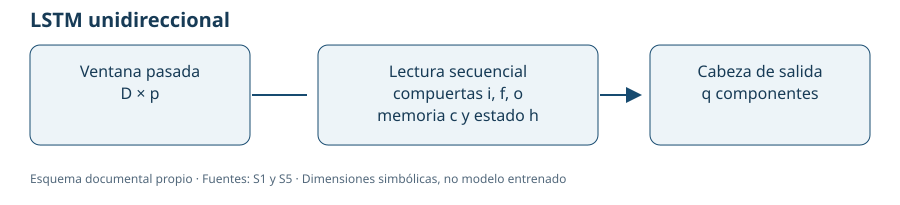
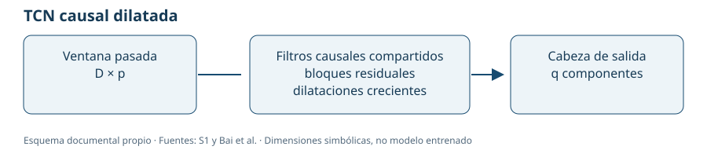
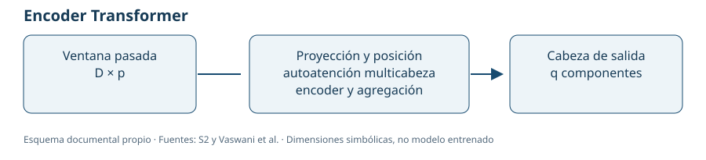

# 3. Revisión del Estado del Arte y Selección Documental de Modelos

Este capítulo presenta una revisión complementaria trazable y una **selección documental de trabajo: LSTM, TCN y encoder Transformer**. La elección identifica memoria recurrente, convolución temporal y atención, respectivamente. Su validez se limita al corpus accesible y a la regla explícita de diversidad; no demuestra que sean las tres arquitecturas de menor complejidad o mayor frecuencia de toda la literatura.

## 3.1. Búsqueda, cribado y calidad de la evidencia

### 3.1.1. Estrategia y consultas registradas

Se emplearon términos de activo, objetivo y arquitectura. La cadena de referencia para las bases académicas es:

```text
("Bitcoin" OR "BTC")
AND ("volatility forecasting" OR "volatility prediction" OR "realized volatility")
AND ("deep learning" OR "neural network" OR "neural networks")
```

La vía efectivamente ejecutada fue una búsqueda complementaria en repositorios públicos de autores, por título, problema y modelos, con orden de relevancia y límites de páginas registrados. El [registro exacto de consultas](../_static/literature_e1/search_log.json) conserva las diez consultas originales, sus intentos, fechas, páginas y resultados. Las consultas dirigidas a MLP/ANN/CNN se separan de las generales: no constituyen una estimación neutral de prevalencia.

Los registros proceden de búsquedas reales del **2 de noviembre de 2026** y se incorporaron conservando su fecha y hashes. La [procedencia](../_static/literature_e1/provenance.json) distingue recuperar registros previos de ejecutar una nueva búsqueda. Se añadieron [comprobaciones dirigidas de fuentes primarias](../_static/literature_e1/primary_check.json) para Guo y Herremans, sin sumar las estimaciones de sus buscadores al flujo inicial ni contar una clase de código como un comparador publicado.

### 3.1.2. Fuentes, periodo y acceso

La tabla separa la **modalidad de acceso de cada fuente**, la **conexión comprobada desde el entorno de trabajo** y la **evidencia bibliográfica recuperada**. Una restricción de esta red no demuestra que el portal esté caído o que todos sus documentos requieran pago.

| Fuente y acceso oficial | Modalidad y ruta de acceso | Comprobación del 02/11/2026 | Consulta y evidencia acreditadas |
|---|---|---|---|
| [GitHub: búsqueda de repositorios](https://github.com/search?q=bitcoin+volatility+forecasting&type=repositories&p=1) | Repositorios públicos; documentos y código según disponibilidad y licencia del autor | HTTP 200 en la nueva comprobación | Búsquedas y lectura de fuentes ejecutadas previamente; consultas, URLs por commit y hashes conservados. Vía complementaria, distinta de un índice bibliográfico |
| [Web of Science: búsqueda básica](https://www.webofscience.com/wos/woscc/basic-search) | Acceso a la base normalmente mediante suscripción institucional, desde el portal de la biblioteca y su autenticación autorizada | Conexión rechazada por el túnel de la red de trabajo (403); no se llegó a comprobar una sesión institucional | Consulta bibliográfica pendiente; conteo no disponible. Identificar un registro tampoco acredita acceso al texto editorial |
| [Scopus: búsqueda de documentos](https://www.scopus.com/search/form.uri?display=basic) | Acceso a la base mediante suscripción institucional; las funciones públicas limitadas no equivalen a una sesión de búsqueda completa | Conexión rechazada por el túnel (403); acceso institucional no comprobado | Consulta bibliográfica pendiente; conteo no disponible. Se requiere conservar la exportación de la consulta ejecutada |
| [IEEE Xplore: búsqueda prevista](https://ieeexplore.ieee.org/search/searchresult.jsp?queryText=bitcoin%20volatility%20deep%20learning) | Búsqueda y metadatos públicos; texto completo abierto o mediante suscripción según el artículo | Conexión directa rechazada por el túnel (403) | Búsqueda directa pendiente. Para S3 se recuperaron código y resumen de autores por GitHub; no su texto completo |
| [arXiv: búsqueda prevista](https://arxiv.org/search/?query=bitcoin+volatility&searchtype=all) | Búsqueda, metadatos y preprints de acceso público; no requiere suscripción institucional | Conexión rechazada por el túnel (403), pese a ser una fuente abierta | Consulta directa pendiente. Un preprint se identifica como tal y no se presupone revisión por pares |
| [Birmingham: PDF de Huang y colaboradores](https://pure-oai.bham.ac.uk/ws/portalfiles/portal/246755355/1-s2.0-S1042443124001306-main.pdf) | Enlace a un documento del repositorio institucional; debe comprobarse su disponibilidad y versión | Descarga rechazada por el túnel (403); PDF no recuperado en esta comprobación | Se conserva el antecedente bibliográfico S4. Es una recuperación documental prevista, no una base consultada ni un estudio añadido al denominador |

Los intentos originales se conservan en el [registro histórico de acceso](../_static/literature_e1/access_checks.json). La [nueva comprobación fechada](../_static/literature_e1/access_checks_20261102_update.json) registra URL, hora, respuesta y nivel del fallo; en los cinco accesos restringidos el 403 procede del túnel, antes de obtener una respuesta del portal. Las [rutas y consultas preparadas en CSV](../_static/literature_e1/access_routes.csv) permiten continuar el trabajo sin sustituir los intentos fallidos por búsquedas ejecutadas o por cero resultados.

**Periodo y filtros.** El intervalo preferente es del 01/01/2019 al 02/11/2026, fecha de búsqueda y verificación. Los fundamentos anteriores se justifican aparte. Los filtros se registrarán tal como los permita cada interfaz, junto con cualquier restricción de idioma o tipo documental; no se atribuyen filtros aplicados a una consulta que no pudo ejecutarse. No se asignan cuartiles sin verificarlos por año, categoría y sistema.

**Consultas preparadas para el acceso institucional.** En Web of Science se propone el campo de tema `TS`; en Scopus, título, resumen y palabras clave mediante `TITLE-ABS-KEY`. Las cadenas conservan los mismos conceptos de §3.1.1:

```text
Web of Science:
TS=((Bitcoin OR BTC) AND ("volatility forecasting" OR "volatility prediction" OR "realized volatility") AND ("deep learning" OR "neural network" OR "neural networks"))

Scopus:
TITLE-ABS-KEY((Bitcoin OR BTC) AND ("volatility forecasting" OR "volatility prediction" OR "realized volatility") AND ("deep learning" OR "neural network" OR "neural networks"))
```

Estas cadenas están **preparadas y pendientes de ejecución**; su sintaxis final se comprobará en la interfaz disponible. Al ejecutar cada consulta se conservarán fecha, base y colección, cadena final, campos, filtros, número de resultados, límite de exportación y archivo exportado con identificadores bibliográficos. Los registros nuevos se deduplicarán antes de actualizar el cribado. Abrir un portal, recuperar metadatos y leer un texto completo se registrarán como acciones diferentes. Esta actualización de accesos mantiene los conteos del flujo existente.

### 3.1.3. Criterios de inclusión y unidad de conteo

Se incluyeron textos completos identificables sobre volatilidad de Bitcoin con objetivo, comparadores y resultados suficientes para extraer evidencia. Se excluyeron trabajos de precio sin objetivo de volatilidad, estudios de otros activos no comparables y documentos sin identidad o protocolo suficientes. Un trabajo puede ser pertinente y a la vez tener limitaciones importantes de calidad: incluirlo no certifica su validez.

Un estudio cuenta como máximo una vez por familia; se conservan las variantes y no se duplican preprint, artículo y código del mismo trabajo. Los textos generales sobre redes y los métodos estadísticos no aumentan el denominador de estudios aplicados. Las treinta referencias iniciales del libro y el corpus de extracción cumplen funciones distintas.

### 3.1.4. Flujo real de selección


| Etapa | Conteo | Interpretación |
|---|---:|---|
| Ocurrencias recuperadas | 118 | Registros de repositorio en las consultas, no artículos |
| Ocurrencias duplicadas retiradas | 12 | Mismo repositorio recuperado más de una vez |
| Repositorios únicos cribados por metadatos | 106 | Unidad de descubrimiento |
| Repositorios inspeccionados | 14 | 92 no se priorizaron; no equivale a descartar 92 artículos completos |
| Textos completos evaluados | 5 | Cambio explícito de unidad: documentos científicos |
| Textos completos excluidos | 2 | Proyecto de curso sin identidad/fecha suficiente y estudio sobre NASDAQ100 |
| Textos completos incluidos | 3 | S1, S2 y S5; denominador de frecuencia igual a tres |
| Fuentes temáticas con texto completo pendiente | 2 | S3 y S4, contexto; no se añaden al denominador |

Los conteos se reconcilian: 118−12=106, 14+92=106 y 5=3+2. Se conservan [registros recuperados](../_static/literature_e1/discovery_records.json), [decisiones de cribado](../_static/literature_e1/screening.csv) y el [manifiesto de fuentes](../_static/literature_e1/source_manifest.json). Los 106 repositorios no se presentan como 106 artículos. El diagrama comunica una búsqueda complementaria; no acredita exhaustividad PRISMA ni cobertura de las bases bloqueadas.

El cribado fue asistido por Codex para el autor responsable, Jassan Arteta. No se acredita un segundo revisor humano independiente; las dudas y limitaciones se conservan para revisión académica.

### 3.1.5. Evaluación de calidad por estudio

| Estudio | Arquitectura y protocolo | Incertidumbre e inferencia | Riesgos y alcance |
|---|---|---|---|
| S1. Akbiyik et al. (2023) | Comparadores, entradas, tuning y código documentados | Veinte corridas; dispersión en Tabla 2 | Solo 48 días de test; contrastes unilaterales y multiplicidad requieren crítica |
| S2. Zeri (2026) | Declara escalado train-only, purga, embargo y arquitectura | Tres semillas; promedia predicciones y reporta DM | Manuscrito sin revisión por pares acreditada; datos licenciados; redes usan ventanas y referencias lineales solo última barra |
| S5. Gao et al. (manuscrito 2023) | LSTM20 y red densa reproducibles mediante notebook | No se acreditan varias semillas ni IC | Fechas inconsistentes; objetivo desplazado puede cruzar particiones sin purga explícita; densa lineal no es MLP profunda |

La [valoración por dimensión](../_static/literature_e1/quality_assessment.csv) usa documentado/parcial/no documentado/no aplicable con ubicaciones de evidencia. No hay puntuación agregada inventada. La ausencia de descripción de fuga no prueba su ausencia, ni una prueba estadística publicada garantiza que resulte adecuada.

## 3.2. Extracción, frecuencia y selección de tres familias

### 3.2.1. Matriz de extracción de los estudios incluidos

| Estudio y fuente | Dataset y objetivo | Comparadores DL verificados | Métricas y valores publicados | Límite de comparación |
|---|---|---|---|---|
| S1. Akbiyik et al. (2023), Tabla 2 {cite:p}`akbiyik2023` | Bitcoin cada 15 minutos y Twitter; RV del día siguiente agregada de 96 retornos | LSTM, GRU y TCN; D-TCN es la propuesta novedosa | LSTM RMSE 2,37±0,19; TCN 2,58±0,07; GRU 4,23±5,61; veinte corridas | RV×100, frecuencia, entradas y periodo distintos del proyecto |
| S2. Zeri (2026), Run B {cite:p}`zeri2026` | BTCUSDT perpetuo de Binance Futures, Crypto Lake; log-RV futura de 30 minutos | GRU, BiLSTM y encoder Transformer | SELF-ATT R² respecto a media train 0,600 y QLIKE 0,562; BiLSTM 0,586/0,582; GRU 0,582/0,564 | Predicciones promediadas entre tres semillas; no es el R² estándar ni el objetivo diario Spot |
| S5. Gao et al. (manuscrito 2023), Tabla 4 {cite:p}`gao2023` | Yahoo BTC-USD diario; medida móvil de 30 días desplazada siete días | LSTM de una capa y veinte unidades; fully-connected lineal solo contexto | LSTM RMSE 0,074071 y RMSPE 0,406084; densa lineal RMSE 0,072557 | Escalado y evaluación de validación; sin dispersión entre semillas |

La [matriz completa](../_static/literature_e1/evidence_matrix.csv) conserva problema, dataset, modelos, métricas, valores y localización en la fuente. Las [42 métricas extraídas](../_static/literature_e1/reported_metrics.csv) se identifican como publicadas por los autores, con `own_experiment=False`. No se recalcularon ni se presentan como resultados de este proyecto.

S3 —Herremans y Low— dispone de código y resumen de autores, pero no de texto completo recuperado; S4 —Huang y colaboradores— conserva el antecedente ya citado y el acceso pendiente. Ambos figuran en [fuentes identificadas](../_static/literature_e1/studies.json), sin sumar frecuencias no verificadas.

### 3.2.2. Frecuencia y variantes

| Familia | Estudios incluidos | Frecuencia | Distinción necesaria |
|---|---|---:|---|
| LSTM, incluyendo BiLSTM | S1, S2, S5 | 3/3 | La variante unidireccional específica aparece en S1 y S5: 2/3 |
| GRU | S1, S2 | 2/3 | Memoria recurrente con compuertas, afín pero no idéntica a LSTM |
| TCN | S1 | 1/3 | Convolución causal dilatada; no equivale a una CNN1D simple |
| Encoder Transformer | S2 | 1/3 | Un manuscrito sin revisión por pares acreditada |
| MLP independiente no lineal | Ninguno acreditado | 0/3 | La densa de S5 es lineal; una clase disponible en Guo no acredita uso publicado |
| CNN1D simple independiente | Ninguno acreditado como tal | 0/3 | No se fusiona arbitrariamente con TCN o CNN–LSTM |

Las [frecuencias descargables](../_static/literature_e1/family_frequencies.csv) describen estos tres textos completos, no toda la literatura. La nueva inspección de Guo identificó una clase MLP con ReLU, pero no su invocación como comparador en los scripts revisados ni una tabla del artículo; por eso no se aumenta su conteo. En Herremans, nombres como `dense` pertenecen a Synthesizer Transformer y no prueban una MLP autónoma.

### 3.2.3. Regla y selección documental

La regla aplicada es: comprobar uso comparativo en una fuente identificada; separar modelos lineales y variantes; priorizar tres mecanismos no redundantes; preferir recurrencia y reproducibilidad dentro de cada mecanismo; distinguir complejidad analítica de costo medido. La regla se registra después de inspeccionar el corpus: no se presenta como un prerregistro anterior a esa inspección.

| Identificador | Familia elegida | Justificación documental | Condición antes de implementar en E2 |
|---|---|---|---|
| M1 | LSTM unidireccional | Familia recurrente más observada; S5 aporta una arquitectura pequeña identificable | Adaptar entradas/salida sin trasladar cifras ni confundir LSTM con BiLSTM |
| M2 | TCN causal dilatada | Filtros locales compartidos y contexto multiescala; comparador separado de D-TCN en S1 | Fijar ancho, kernel, normalización y versión; el ganador no está recuperado |
| M3 | Encoder Transformer | Atención entre posiciones; tercer mecanismo distinto en S2 | Validar suficiencia académica de una fuente gris y cerrar su configuración compacta |

Se eligen **LSTM, TCN y encoder Transformer** como familias de trabajo para el análisis documental. GRU se excluye del trío para evitar dos mecanismos recurrentes con compuertas; no porque sea menos útil ni menos frecuente. De hecho, GRU tiene mayor frecuencia que TCN y Transformer. La regla prioriza diversidad frente a frecuencia pura y deja visible ese compromiso.

La selección no demuestra mínima complejidad absoluta: el Transformer de S2 tiene más parámetros que la LSTM pequeña de S5. TCN y atención solo tienen un estudio de respaldo cada una en este corpus. Si el criterio académico exige exclusivamente fuentes revisadas por pares o tres modelos mínimos en sentido estricto, esa parte del cierre sigue condicionada a ampliar evidencia. El [registro de selección](../_static/literature_e1/selection_evidence.json) conserva los criterios y las limitaciones. No se impone una MLP o CNN1D sin evidencia solo para completar tres nombres.

### 3.2.4. Papel de las referencias clásicas

La analogía con regresión lineal o SVR lineal es de propósito comparativo: referencias reproducibles frente a mayor complejidad. No se afirma igualdad de capacidad matemática entre redes y modelos lineales. Persistencia, GARCH y otros clásicos aportan contexto, pero no ocupan los tres puestos DL. La comparación propia se ejecutará únicamente en la etapa experimental autorizada para E2.


## 3.3. Fichas documentales de las tres familias seleccionadas

Las tres familias siguientes representan memoria recurrente, convolución causal y atención. Su selección es **documental y acotada al corpus recuperado**, no una demostración de que sean las tres arquitecturas más simples de toda la literatura ni un resultado experimental propio. Se distinguen: arquitectura reportada por la fuente, cálculo analítico derivado de su descripción y adaptación que necesitaría el proyecto. No se ejecutó código de Deep Learning, no se calcularon predicciones y no se procesaron datos de mercado.

La frecuencia 3/3 corresponde a la **familia LSTM** e incluye la BiLSTM de S2. La variante unidireccional concreta está documentada en S1 y S5, 2/3. TCN y Transformer encoder aparecen en un texto cada uno. El Transformer depende de un manuscrito sin revisión por pares acreditada. La selección requiere revisar estas limitaciones al ampliar las fuentes; una referencia general de una arquitectura no cuenta como un nuevo estudio aplicado de Bitcoin.

El contrato del proyecto conserva cinco covariables OHLCV diarias, entradas de D=7/14/21/28 días, volatilidad histórica de n=7 retornos diarios y horizonte h=1. Al inicio de t se conoce información hasta t−1 y se pronostica Y_t=σ_(t+1), que incorpora r_t. Este objetivo no es volatilidad realizada de siete días enteramente futuros. Ninguna de las tres fuentes utiliza exactamente este contrato.

### 3.3.1. LSTM unidireccional

Base aplicada: {cite:p}`akbiyik2023,gao2023`; fundamento de arquitectura: {cite:p}`hochreiter1997`.

#### Referencias y papel comparativo

**S1.** Akbiyik, M. E., Erkul, M., Kämpf, K., Vasiliauskaite, V. y Antulov-Fantulin, N. (2023). *Ask “Who”, Not “What”: Bitcoin Volatility Forecasting with Twitter Data*. WSDM 2023. DOI: [10.1145/3539597.3570387](https://doi.org/10.1145/3539597.3570387). El artículo compara LSTM, GRU y TCN antes de proponer D-TCN. La LSTM es un comparador y no el modelo novedoso del trabajo. Evidencia: PDF pp. 4–6, §§5.2–5.4, Fig. 1 y Tabla 2; código `scripts/hpo.py`, líneas 151–235.

**S5.** Gao, M., Li, Q. y Tao, Z. *Comparing the Predictive Power of Five Models on Bitcoin Volatility*. Manuscrito de 2023 y código del primer autor; referencia editorial declarada a Springer, *Learning and Analytics in Intelligent Systems*, vol. 32, pp. 473–486, DOI declarado [10.1007/978-3-031-38074-7_41](https://doi.org/10.1007/978-3-031-38074-7_41). Año editorial externo pendiente de corroboración; no se infiere de la fecha del DOCX. El texto compara media, random walk, GARCH, una red densa lineal y LSTM. La arquitectura sencilla de una capa y veinte unidades está descrita en Tabla 4 y en la celda 111 del [notebook fijado](https://github.com/ga0m1/bitcoin-volatility-models/blob/f19551ca4cca768354eb7e2b7c1dd5c912bd0d41/BTC_USD.ipynb).

#### Arquitecturas efectivamente descritas

S5 utiliza catorce observaciones de volatilidad como entrada, una LSTM de veinte unidades y una salida Dense(1). No incorpora una segunda capa recurrente. El notebook compila con MSE y Adam, batch 64, máximo 200 épocas, paciencia 20 y restauración de pesos elegidos según `val_rmspe`. El callback de checkpoint monitoriza `loss`, un criterio distinto: esta diferencia debe conservarse al interpretar el procedimiento y no se sustituye por un protocolo supuesto. No se reportan varias semillas ni dispersión entre corridas.

S1 utiliza un día de 96 retornos de quince minutos como entrada y produce 96 retornos del día siguiente mediante una cabeza densa. Su búsqueda varía unidades recurrentes entre 32 y 512, dropout entre 0 y 0,5, learning rate entre 10⁻⁷ y 10⁻², weight decay entre 10⁻⁹ y 10⁻² y ε entre 10⁻² y 10⁻¹. Usa AdamW y pérdida cuadrática ε-insensible, 250 configuraciones por red, treinta épocas y veinte corridas para la comparación. El espacio de búsqueda no identifica por sí solo la configuración ganadora.

#### Ecuaciones, flujo y sesgo inductivo

Para x_j∈R^p, h_j,c_j∈R^H y activación logística s:

$$
i_j=s(W_ix_j+U_ih_{j-1}+b_i),\quad
f_j=s(W_fx_j+U_fh_{j-1}+b_f),\quad
o_j=s(W_ox_j+U_oh_{j-1}+b_o),
$$

$$
g_j=\tanh(W_gx_j+U_gh_{j-1}+b_g),\quad
c_j=f_j\odot c_{j-1}+i_j\odot g_j,\quad
h_j=o_j\odot\tanh(c_j),\quad
\widehat y=W_yh_D+b_y.
$$

```text
Ventana histórica D × p
       ↓ lectura secuencial con parámetros compartidos
LSTM: compuertas i/f/o + memoria c + estado h
       ↓ último estado H
Cabeza densa H → q
```



Las compuertas controlan el almacenamiento y olvido del estado; su memoria ofrece un mecanismo diferente al de filtros locales o atención directa. Esto no garantiza aprender dependencias largas en una muestra pequeña ni acredita superioridad predictiva. El orden de los datos y la disponibilidad de las entradas siguen siendo parte del contrato causal.

#### Parámetros y costo analítico

Una LSTM con un vector de sesgo por compuerta y cabeza de q salidas tiene:

$$
P_{\mathrm{LSTM}}=4H(p+H+1)+Hq+q.
$$

En una implementación con dos vectores de sesgo por compuerta, como la parametrización de `torch.nn.LSTM`, la expresión es:

$$
P_{\mathrm{LSTM,2bias}}=4H(p+H+2)+Hq+q.
$$

Para la configuración de S5, p=1,H=20,q=1, la primera expresión da **1.781 parámetros**, cálculo analítico de las capas descritas y no un total reportado por el artículo. Una adaptación con p=5,H=20,q=1 daría **2.101** con un sesgo o **2.181** con dos. Estos últimos conteos son hipótesis de adaptación, no tamaños de un modelo del proyecto ya implementado. Cambiar D altera la longitud del cómputo, pero no el número de pesos de una LSTM con salida tomada del último estado.

Por ventana, el costo dominante de inferencia es O(D·H(p+H)+Hq). Un minibatch de B ventanas multiplica ese costo por B; la retropropagación mantiene el mismo orden, con mayor constante y almacenamiento de estados O(BDH). La recurrencia impone dependencia secuencial entre pasos. No se infiere tiempo real ni consumo de GPU a partir de esta expresión.

#### Resultados publicados y límites de comparabilidad

| Fuente y evaluación | Resultado publicado | Dispersión y escala |
|---|---|---|
| S1, Tabla 2, test de 48 días | LSTM RMSE 2,37; MAE 1,70; MAPE 0,30; MSLE 0,09 | DE 0,19 / 0,26 / 0,08 / 0,01, respectivamente, entre veinte corridas; RV = 100·sqrt(sum(r_15min²)); MAPE como fracción |
| S5, Tabla 4, comparación de validación | LSTM(20) RMSE 0,074071; RMSPE 0,406084 | Sin dispersión entre semillas; comparación sobre valores escalados y objetivo de treinta días desplazado siete días |

No se ordenan estos RMSE como si midieran el mismo problema. S1 predice retornos intradiarios y después agrega volatilidad; S5 emplea volatilidad pasada como entrada y no centra los retornos al construir su medida. En el proyecto se propone OHLCV diario y desviación poblacional centrada de siete retornos. La pérdida MSE propuesta para el proyecto coincide nominalmente con S5, pero no con la pérdida ε-insensible de S1; que una pérdida comparta nombre tampoco iguala escalas y objetivos.

**Fortalezas:** comparador recurrente reconocido en dos fuentes unidireccionales, arquitectura pequeña completamente identificable en S5 y número de parámetros independiente de D. **Límites:** S5 contiene fechas inconsistentes y carece de repeticiones e inferencia; S1 dispone de veinte corridas, pero solo 48 días de test. La variante, transformación, activación de salida y configuración propia deben distinguirse de la réplica de cada fuente. No se atribuye a las fuentes una salida `softplus`: sus cabezas descritas son lineales.

### 3.3.2. TCN: convolución temporal causal y dilatada

Base aplicada: {cite:p}`akbiyik2023`; fundamento de familia: {cite:p}`bai2018`.

#### Referencias y papel comparativo

S1 documenta una **TCN única** como comparador de LSTM, GRU, AR-RV y GARCH. Luego propone una **D-TCN de dos ramas**, una para retornos y otra para señales de Twitter. La ficha selecciona la TCN comparativa, no la D-TCN novedosa. La base conceptual de convoluciones causales y dilatadas está descrita por Bai, Kolter y Koltun (2018), referencia de fundamentos del libro; ese trabajo genérico no se cuenta como otro estudio de Bitcoin.

Fuentes: S1, Fig. 1, §§5.2–5.4 y Tabla 2; [hpo.py por commit](https://github.com/meakbiyik/ask-who-not-what/blob/bcc0e4e89213da2ca3ed968574aa2d08cee39c44/scripts/hpo.py), líneas 151–235. `dtcn.py` corresponde a la extensión propuesta y no debe utilizarse como si describiera la base de una sola rama.

#### Arquitectura y entrenamiento publicados

El código invoca `TCN` de `keras-tcn` con seis niveles de dilatación `(a⁰,a¹,a²,a³,a⁴,a⁵)`, a∈{2,3,4}, kernel k∈{2,…,6}, canales F∈{32,…,512}, dropout en [0,0,5], skip connections activadas o no y alternativas de normalización batch/weight/layer/ninguna. Después se aplica Dense(96) y reshape a 96×1 retornos futuros. Entrada fuente: 96×1 retornos observados. El artículo compara modelos con información financiera de precios antes de introducir las ramas de Twitter.

La selección utiliza 250 configuraciones, treinta épocas por configuración, AdamW y pérdida cuadrática ε-insensible sobre retornos. Los rangos de learning rate, weight decay y ε son los mismos de la ficha LSTM. Los veinte reinicios de la comparación final se evalúan después de agregar los 96 retornos predichos a RV diaria. El repositorio leído no conserva los hiperparámetros ganadores ni una versión fijada de `keras-tcn`: **no se reporta un único ancho/kernel/normalización final como si se conociera**.

#### Ecuaciones y diagrama

Para una convolución causal con dilatación d_b:

$$
u_{j,f}=b_f+\sum_{i=0}^{k-1}\sum_{c=1}^{C_{in}}W_{i,c,f}\,x_{j-d_b i,c}.
$$

Solo intervienen índices anteriores o iguales a j; el padding es a la izquierda. En un bloque residual representativo de dos convoluciones:

$$
H^{(b)}=\phi\!\left(F_b(H^{(b-1)})+S_b(H^{(b-1)})\right),
$$

donde F_b representa convoluciones, activaciones, dropout y la normalización que se declare, y S_b es identidad o proyección 1×1 para igualar canales. La representación temporal final alimenta la cabeza densa.

```text
Ventana pasada D × p
       ↓ convoluciones 1D causales
Bloques residuales con dilataciones crecientes
       ↓ representación temporal F
Cabeza densa F → q
```



El sesgo inductivo es localidad temporal con pesos compartidos y contexto ampliado mediante dilataciones. Se diferencia de almacenar una memoria recurrente y de relacionar todas las posiciones mediante atención. Atender una ventana pasada no elimina el requisito de que las variables originales y sus transformaciones fueran observables en cada origen.

#### Parámetros, profundidad y complejidad: hipótesis explícitas

La evidencia directa fija **seis niveles de dilatación**. El número de convoluciones por bloque depende de la implementación residual de la biblioteca. El esquema habitual de dos convoluciones por bloque daría doce convoluciones, pero este conteo **no aparece como total textual del artículo ni sustituye la versión ausente de la dependencia**.

Una convolución con sesgo aporta k·C_in·C_out+C_out parámetros. Para J bloques de dos convoluciones, ancho constante F, p≠F, una sola proyección residual inicial p→F, sin normalización entrenable y una cabeza F→q, se deriva:

$$
P_{\mathrm{TCN}}=(k+1)pF+(2J-1)kF^2+(2J+1)F+Fq+q.
$$

El campo receptivo de ese esquema es:

$$
R=1+2(k-1)\sum_{b=0}^{J-1}d_b.
$$

Ejemplo **analítico dentro del espacio descrito**, no configuración ganadora: J=6,F=32,k=2,p=1,q=96, sin normalización entrenable, da 26.208 parámetros y R=127 para dilataciones 1/2/4/8/16/32. Una adaptación p=5,q=1 bajo esas mismas hipótesis daría 23.457 parámetros. La normalización, otros stacks o una estructura residual distinta cambian el conteo. No se presentan estos valores como observados en un entrenamiento.

El costo dominante por ventana es O(D·Σ_l k_l C_(l−1)C_l+Fq), aproximadamente O(DJkF²) en la parte de ancho constante. Para minibatch B, se multiplica por B. El entrenamiento añade almacenamiento de activaciones y retropropagación del mismo orden. Las operaciones pueden paralelizarse dentro de la ventana; esto no demuestra menor latencia real que LSTM. Si D es de 7–28 días, un campo receptivo formal mayor que D no crea historia observada adicional: parte del contexto correspondería a padding.

#### Resultados publicados, fortalezas y limitaciones

S1, Tabla 2, informa **TCN RMSE 2,58±0,07; MAE 1,63±0,06; MAPE 0,23±0,01; MSLE 0,11±0,01**, veinte corridas, test de 48 días y la misma escala RV de la ficha LSTM. En ese estudio, TCN tiene mejor MAPE/MAE que LSTM, mientras LSTM tiene menor RMSE/MSLE. El orden depende de la métrica; no se comunica un ganador universal. Los contrastes del artículo son unilaterales respecto a AR-RV y no implican automáticamente un contraste directo entre las redes ni control de toda la multiplicidad.

**Fortalezas:** comparador separado de la propuesta híbrida, filtros compartidos y contexto multiescala con cálculo paralelo. **Límites:** frecuencia 1/3 en el corpus, parámetros finales no recuperados, dependencia sin versión fijada y test corto. La fuente respalda TCN y no acredita una CNN1D de una sola capa como réplica exacta. «Base comparativa» no significa mínima profundidad absoluta.

Para el proyecto, pasar de retornos intradiarios a cinco OHLCV diarios y de 96 salidas a una volatilidad escalar sería una adaptación. Su profundidad, dilataciones, normalización y salida deben registrarse antes de implementar en E2. Si falta detalle de arquitectura, corresponde consultar el protocolo de E2 §14 citado por la guía; esta ficha no inventa sus reglas.

### 3.3.3. Transformer encoder compacto, comparador SELF-ATT



Base aplicada: {cite:p}`zeri2026`; fundamento de atención: {cite:p}`vaswani2017`.

#### Referencia, estado y papel experimental

**S2.** Zeri, T. (octubre de 2026). *Forecasting High-Frequency Bitcoin Volatility: Neural Networks, Market Microstructure and On-Chain Data*. Manuscrito público de investigador independiente, sin DOI ni revisión por pares acreditados. [Fuente TeX fijada](https://github.com/tommasozeri/Forecasting-High-Frequency-Bitcoin-Volatility-Neural-Networks/blob/d69f951f2ced7273bdc4c3e5a8a4cb220c2ee5ce/paper_en/manuscript.tex), §§Models/Training, líneas 179–189, tabla de resultados y apéndice, líneas 395–409. Arquitectura leída en celda 21 del notebook `modelli_btc_hf.ipynb`, mismo commit.

SELF-ATT es uno de los tres comparadores neuronales genéricos —junto a GRU y BiLSTM— del estudio; la contribución se centra en pipeline, comparación y ablación de atributos, no en declarar una nueva arquitectura de atención. Su uso está respaldado por **un manuscrito del corpus**, no por recurrencia acreditada en toda la literatura. Es compacto frente a grandes Transformers, pero tiene más parámetros que la LSTM simple de S5; no se le atribuye mínima complejidad absoluta.

#### Arquitectura y protocolo documentados

Run B utiliza 48 barras de cinco minutos y 41 atributos de Binance Futures BTCUSDT perpetuo mediante Crypto Lake. El objetivo es log-RV de los siguientes treinta minutos, seis barras, a partir del precio medio del libro de órdenes; no es desviación móvil diaria de siete retornos. Hay 31.524 predicciones de test, correspondientes al 13/09–31/12/2025. La tabla publica métricas de predicciones promediadas entre tres semillas, no media y desviación de tres métricas.

La arquitectura contiene proyección lineal F→d, posiciones aprendidas de longitud máxima M, dos bloques encoder pre-LayerNorm y cuatro cabezas. Cada bloque incluye atención multihead, dos conexiones residuales y feedforward de ancho 2d. El código no especifica la activación del encoder, por lo que usa ReLU por defecto; la cabeza sí usa GELU. La cabeza concatena último token y media de tokens y aplica dropout→Dense(2d,d)→GELU→Dense(d,1).

La configuración elegida reportada para SELF-ATT en Run B es d=48, dropout 0,21, learning rate 3·10⁻⁴, weight decay 1,4·10⁻³, ruido de entrada 0,12 y ventana L=48. El código conserva M=96 posiciones, aunque la ventana elegida sea menor. La pérdida es MSE sobre el objetivo log-RV estandarizado, según la línea 119 del manuscrito y `loss_fn` en la celda 23. Se declara AdamW, batch 512, máximo cuarenta épocas, paciencia seis, clipping 1 y semillas 42/43/44; cada red recibe veinte trials de búsqueda. Las predicciones finales se promedian entre semillas antes del cálculo de métricas.

#### Ecuaciones, flujo y causalidad

$$
H^{(0)}=XW_{in}+b_{in}+P,\qquad
\mathrm{Attention}(Q,K,V)=\mathrm{softmax}\!\left(\frac{QK^\top}{\sqrt{d_k}}\right)V.
$$

Con d=48 y cuatro cabezas, d_k=12 por cabeza. Esta notación desagrega el espacio de atención; el manuscrito usa un símbolo d genérico. Los bloques son pre-LN con suma residual tras atención y tras feedforward. La salida usa:

$$
z=\left[H^{(2)}_L;\,\frac1L\sum_{j=1}^{L}H^{(2)}_j\right],\qquad
\widehat y=w_2^\top\operatorname{GELU}\!\left(W_1\operatorname{Dropout}(z)+b_1\right)+b_2.
$$

```text
Ventana histórica L × F
       ↓ proyección a d + posiciones aprendidas
Encoder pre-LN ×2: atención 4 cabezas → residual → FF(2d) → residual
       ↓ concatenar último token y media
Dropout → Dense(2d,d) → GELU → Dense(d,1)
```

El sesgo inductivo permite relacionar posiciones distantes mediante atención dependiente del contenido, sin recurrencia ni una vecindad local fija. El encoder se llama sin máscara causal: es compatible con pronóstico si toda su ventana está disponible antes del origen. Atender posiciones posteriores dentro de una ventana enteramente pasada no implica por sí solo utilizar el futuro. La construcción causal de cada atributo debe verificarse por separado.

#### Complejidad y número de parámetros derivado

Para feedforward m=2d, F atributos y M posiciones aprendidas, cada bloque encoder aporta:

$$
P_{encoder}=4d^2+2dm+9d+m=8d^2+11d.
$$

La proyección aporta (F+1)d; posiciones, Md; y cabeza, 2d²+2d+1. Para dos bloques:

$$
P_{\mathrm{SELF-ATT}}=18d^2+(F+M+25)d+1.
$$

F=41,M=96,d=48 da **49.249 parámetros**: 2.016 de proyección, 4.608 de posiciones, 37.920 de encoder y 4.705 de cabeza. Es un cálculo analítico de capas leídas, **no un total reportado por el manuscrito ni una medición por instanciación**. Cambiar F a cinco o modificar el máximo de posiciones cambia el conteo; no se presenta 49.249 como el tamaño del futuro modelo OHLCV del proyecto.

El costo por bloque y minibatch B es O(B(L²d+Ld²)), más proyección O(BLFd) y cabeza O(Bd²). El almacenamiento de atención es cuadrático en L por cabeza. La retropropagación conserva el orden con mayor constante. Estas expresiones no prueban eficiencia ni escalabilidad medida frente a otras redes.

#### Valores publicados y crítica

| Modelo de S2, Run B | R² respecto a media train | R² respecto a media test | QLIKE | Spearman |
|---|---:|---:|---:|---:|
| SELF-ATT | 0,600 | 0,566 | 0,562 | 0,749 |
| BiLSTM | 0,586 | 0,550 | 0,582 | 0,742 |
| GRU | 0,582 | 0,546 | 0,564 | 0,743 |
| HAR | 0,508 | 0,466 | 0,773 | 0,676 |

El manuscrito reporta DM de SELF-ATT frente a HAR de 19,7, p unilateral <10⁻¹⁵ y HAC de cinco rezagos por solapamiento. No es un contraste directo SELF-ATT contra BiLSTM ni una prueba ejecutada por este proyecto. R² respecto a media train no equivale al R² convencional respecto a media test. No hay en esa tabla desviación ni IC entre las tres semillas: se evalúa su promedio de predicciones.

**Fortalezas:** mecanismo distinto, encoder/cabeza descritos y configuración acotada; relaciones directas entre posiciones de la ventana. **Límites:** una sola fuente sin revisión acreditada, datos licenciados, una ventana de evaluación, costo cuadrático, y resultados no reproducidos aquí. Además, las redes utilizan 24–48 barras mientras los referentes lineal y LightGBM usan solo la última: la comparación no aísla completamente arquitectura de historia informativa. El desglose de atributos de libro tiene una discrepancia de enumeración; se conserva F=41 como dimensión declarada, con esa salvedad.

La fuente tiene salida lineal para log-RV estandarizado. Adaptarla a OHLCV diario y volatilidad no negativa requiere un contrato propio; añadir `softplus` o reducir capas no sería una descripción de la arquitectura publicada. No se fijan esas modificaciones a partir de cifras de otro objetivo.

### 3.3.4. Comparación documental y cobertura de las fichas

| Dimensión | LSTM | TCN | Transformer encoder |
|---|---|---|---|
| Mecanismo | Estado recurrente y memoria con compuertas | Filtros causales compartidos y dilatados | Atención por contenido entre tokens de la ventana |
| Fuente de arquitectura | S5 concreta; S1 comparativa | S1 comparativa y espacio de búsqueda | S2 concreta, manuscrito sin peer review |
| Frecuencia del corpus | Familia3/3; unidireccional2/3 | 1/3 | 1/3 |
| Profundidad identificada | S5 una capa, H20 | Seis niveles; convoluciones por bloque dependen de biblioteca no fijada | Dos encoder, cuatro cabezas |
| Parámetros fuente | 1.781 derivados para S5 | Ganador no reportado; fórmula con hipótesis explícitas | 49.249 derivados para Run B |
| Datos/objetivo idénticos a E1 | No | No | No |
| Configuración OHLCV propia congelada | No; adaptación distinguida | No; falta variante y protocolo aplicable | No; cambio de frecuencia, dimensión y salida distinguido |

Las fichas completan evidencia, ecuaciones, diagramas, resultados publicados y análisis de complejidad. No completan una búsqueda de hiperparámetros propia ni convierten una fuente en treinta estudios. La diversidad de las familias es defendible; la afirmación de ser las tres referencias de mínima complejidad y mayor recurrencia debe limitarse a la regla y al corpus, y revisarse si se amplían las fuentes. Si el criterio académico exige exclusivamente estudios revisados por pares, el uso de S2 y, por tanto, la selección de tres familias quedan abiertos.


## 3.4. Comparación crítica de las familias seleccionadas

### 3.4.1. Desempeño publicado y comparabilidad

S1 permite una comparación dentro de su protocolo: LSTM tiene RMSE puntual menor que TCN, mientras TCN tiene MAE puntual menor. El tuning de S1 selecciona por MAPE y no convierte cualquiera de esos órdenes en una superioridad universal. S5 aporta una LSTM pequeña y resultados de validación en otra escala; no se mezclan sus valores con los de S1. El SELF-ATT de S2 se evalúa en un objetivo y mercado diferentes; su R² y QLIKE no pueden convertirse en un ranking contra las RMSE de S1/S5.

El proyecto trabaja con cinco covariables diarias de Binance Spot, desviación poblacional centrada de siete retornos y horizonte de un día. S1 agrega retornos intradiarios; S2 estudia un perpetuo y log-RV de treinta minutos; S5 usa una ventana de treinta días desplazada siete. Ninguna cifra publicada es un resultado propio ni acredita el desempeño futuro de estas familias bajo nuestro contrato.

### 3.4.2. Robustez, calidad y fuentes de sesgo

| Dimensión | LSTM | TCN | Encoder Transformer |
|---|---|---|---|
| Respaldo aplicado del corpus | S1/S5 unidireccional; S2 solo variante BiLSTM | S1 | S2, manuscrito gris |
| Variabilidad publicada | S1: veinte corridas; S5: no reportada | S1: veinte corridas | S2: tres semillas cuyas predicciones se promedian |
| Evidencia de robustez | Limitada a los periodos y protocolos descritos | Test de S1 de solo 48 días | Ablación en S2, pero datos licenciados y un periodo de test |
| Riesgo específico | En S5, posible cruce de etiquetas futuras en frontera sin purga explícita | Versión y configuración ganadora no recuperadas | Historia de entrada mayor que referencias de última barra; no aísla solo no linealidad |
| Conclusión permitida | Comparador recurrente documentado | Comparador convolucional temporal documentado | Comparador de atención documentado con evidencia más débil |

No se certifica la ausencia de fuga en un artículo por disponer de código. En S5, el objetivo desplazado usa retornos posteriores a la fecha de la fila y no se identificó una purga explícita en el corte por fechas: se registra riesgo aparente, sin atribuir una reproducción que no se ejecutó. En S2, las redes reciben ventanas de 24/48 barras y algunas referencias solo la última barra; una diferencia no aísla exclusivamente el aporte de no linealidad.

### 3.4.3. Escalabilidad y simplicidad

Las fichas separan complejidad asintótica, parámetros derivados y mediciones. La LSTM depende secuencialmente de D; TCN paraleliza filtros, con campo receptivo determinado por kernel y dilatación; la atención completa incorpora un término cuadrático en D. El número de parámetros no equivale a tiempo ni memoria medidos. D=7/14/21/28 y cinco covariables no autorizan transferir tamaños o costos de ventanas de 96 retornos o de 41 atributos intradiarios.

No se ha medido tiempo, GPU, memoria ni precisión de estas tres familias en el proyecto. Los ejemplos numéricos de las fichas son cálculos analíticos explícitos o valores de autores. El ajuste de variantes compactas y la comparación empírica pertenecen a E2.

### 3.4.4. Brecha verificable y proyección

**Brecha delimitada al corpus:** ninguno de los tres textos completos incluidos compara LSTM, TCN y encoder Transformer con el mismo OHLCV diario de Binance Spot, objetivo poblacional de siete retornos diarios, horizonte de un día y protocolo temporal común con incertidumbre y multiplicidad justificadas. La afirmación se comprueba en la matriz y no demuestra una ausencia universal ni originalidad mundial.

Resolver esa brecha permitiría evaluar si los mecanismos de memoria, filtros y atención aportan mejoras bajo el mismo conjunto de información y presupuesto. No promete que alguna red supere persistencia ni que una arquitectura avanzada justifique su complejidad. La propuesta futura conserva métrica RMSE, mejora operativa relativa del 5 % y separación entre selección de desarrollo y evaluación reservada.

### 3.4.5. Estado de cierre documental

| Producto de E1 | Estado y límite |
|---|---|
| Búsqueda trazable y flujo | Completados para la vía complementaria; bases académicas bloqueadas |
| Matriz de estudios, resultados y calidad | Tres textos completos con evidencia y valores publicados |
| Frecuencias y regla | Calculadas sobre ese corpus, con variantes y compromiso diversidad/frecuencia |
| Tres fichas técnicas | Completadas con ecuaciones, diagramas y complejidad; configuración propia aún no congelada |
| Comparación crítica y brecha | Formuladas con límites de comparabilidad y calidad |
| Selección de familias | LSTM, TCN y encoder Transformer, condicionada a cobertura y suficiencia académica |
| Experimentos y baseline medido | Fuera de esta intervención documental; reservados a E2 por instrucción del usuario |


## 3.5. Fundamentos bibliográficos y contexto de la revisión

### 3.5.1. Búsqueda documental efectuada y alcance de las citas

La consulta del **2 de noviembre de 2026** incorporó treinta referencias: siete sobre Bitcoin, siete de fundamentos de redes neuronales y dieciséis de volatilidad, diagnóstico y evaluación. Se consultaron repositorios públicos de autores, documentación de software académico y bibliografías de artículos y libros. Para cada entrada se conservan el enlace consultado, los campos corroborados y el nivel de acceso en el [registro de verificación](../_static/bibliografia/verification_30.csv) y el [catálogo detallado](../_static/bibliografia/references_30.json).

La red del entorno bloqueó el acceso directo a Crossref y arXiv. Por ello no se afirma haber consultado sus interfaces ni leído treinta originales completos. La entrada de Huang y colaboradores conserva su verificación previa; su acceso directo actual también está limitado. Las verificaciones nuevas de las otras referencias proceden de las fuentes accesibles indicadas en el registro. Una referencia identificada en otra bibliografía se distingue de un artículo original leído.

Los trabajos anteriores a 2019 se incluyen como fundamentos y antecedentes expresamente justificados. No se cuentan automáticamente como estudios recientes elegibles para calcular frecuencia de modelos base. Los registros de acceso a metadatos tampoco sustituyen el flujo complementario documentado en §3.1.

### 3.5.2. Antecedentes de volatilidad de Bitcoin

Katsiampa estudia la estimación de volatilidad de Bitcoin mediante especificaciones GARCH, mientras Dyhrberg relaciona su análisis de volatilidad con oro y dólar {cite:p}`katsiampa2017,dyhrberg2016`. Estos antecedentes justifican contrastar las redes con referencias financieras y delimitar la variable que se estima; no demuestran por sí solos qué arquitectura neuronal debe seleccionarse.

Los estudios asociados a órdenes de compra y venta, información de Twitter y flujos de información a frecuencia de minuto plantean conjuntos de información diferentes {cite:p}`guo2018,akbiyik2023,barjasic2021`. Sus títulos, datos documentados y referencias permiten reconocer líneas de investigación pertinentes, pero no autorizan atribuir a OHLCV diario mejoras obtenidas con otras señales. El artículo de Akbiyik y colaboradores se recuperó como copia de autores; para parte de los antecedentes se corroboraron metadatos en sus bibliografías y no se declara lectura del original.

Huang y colaboradores aportan un antecedente de pronóstico de volatilidad con técnicas de aprendizaje automático. Herremans y Low se centran en picos de volatilidad e información de transacciones de grandes tenedores y CryptoQuant mediante modelos Synthesizer Transformer {cite:p}`huang2024,herremans2025`. Pronosticar picos, una medida realizada intradiaria o el siguiente valor de una desviación móvil diaria constituye tareas diferentes. La pertinencia temática no acredita igualdad de objetivo, datos, horizonte o protocolo.

### 3.5.3. Definiciones de volatilidad y referencias financieras

ARCH formaliza varianza condicional cambiante y GARCH amplía esa estructura incorporando dinámica de la varianza {cite:p}`engle1982,bollerslev1986`. Son fundamentos econométricos y referencias de contexto; no ocupan los puestos reservados a modelos de Deep Learning.

La literatura de volatilidad realizada y de modelos HAR estudia construcciones y dependencias a distintas escalas {cite:p}`andersen2003,corsi2009`. Es necesario conservar la distinción entre varianza condicional, volatilidad realizada construida con alta frecuencia y desviación estándar móvil de retornos diarios. La medida definida en este proyecto no se convierte en cualquiera de las anteriores por compartir la palabra «volatilidad». Cambiar ventana, frecuencia o anualización también cambia la escala de las métricas.

### 3.5.4. Fundamentos de las familias neuronales candidatas

El resultado de aproximación de redes feedforward y la exposición general de aprendizaje profundo fundamentan el uso de MLP como familia candidata {cite:p}`cybenko1989,goodfellow2016`. La capacidad de aproximar funciones no garantiza generalización ni acredita que una MLP sea una referencia frecuente para Bitcoin. Esa frecuencia requiere evidencia en estudios aplicados incluidos.

LSTM introduce un mecanismo de memoria con compuertas; el trabajo de Cho y colaboradores documenta una arquitectura recurrente con compuertas en un codificador–decodificador {cite:p}`hochreiter1997,cho2014`. Estos fundamentos permiten describir LSTM y GRU y discutir sus diferencias de parametrización. El artículo de Cho procede de traducción automática: no se presenta como un experimento de volatilidad financiera.

Las redes convolucionales de reconocimiento documental y la comparación genérica de modelos convolucionales y recurrentes para secuencias sustentan mecanismos de filtros locales y dependencias temporales {cite:p}`lecun1998,bai2018`. Una CNN de imágenes, una CNN1D simple y una TCN no son arquitecturas idénticas. Su parentesco permite formular candidatos, pero no afirmar una réplica exacta ni trasladar un ranking a BTCUSDT.

Adam aporta un procedimiento de optimización que debe separarse de la arquitectura y de su evidencia de desempeño {cite:p}`kingma2014`. Se cita aquí la prepublicación identificada de 2014; no se cambia silenciosamente al año de una versión de conferencia. El optimizador, la capacidad y el presupuesto de búsqueda deben describirse al comparar estudios, sin deducir superioridad de una familia solo por emplearlos.

### 3.5.5. Diagnóstico temporal e interpretación del EDA

Dickey–Fuller y KPSS utilizan hipótesis nulas diferentes: raíz unitaria y estacionariedad, respectivamente {cite:p}`dickey1979,kwiatkowski1992`. Esto respalda su lectura conjunta. Un resultado no significativo no confirma su hipótesis nula, y el conflicto entre diagnósticos requiere revisar especificación, muestra y posibles cambios de régimen.

Ljung–Box examina autocorrelación y BDS evalúa una hipótesis de independencia e idéntica distribución mediante la dimensión de correlación {cite:p}`ljung1978,broock1996`. Rechazar BDS no identifica de forma exclusiva no linealidad aprovechable. Tampoco un diagnóstico aplicado a retornos sustituye un análisis de residuos de modelos. Estas referencias fundamentan la interpretación metodológica del EDA y la evaluación prevista, sin aportar resultados experimentales propios.

### 3.5.6. Métricas, validación e incertidumbre

Hyndman y Koehler analizan medidas de precisión y fundamentan el uso de errores escalados como MASE {cite:p}`hyndman2006`. Una comparación reproducible debe declarar unidades, agregación, referencia ingenua y tratamiento de denominadores nulos. MAPE cerca de cero, RMSE y métricas escaladas no responden exactamente a la misma pregunta.

La validez de la validación cruzada para predicción autorregresiva depende de los supuestos y de la estructura de dependencia {cite:p}`bergmeir2018`. Esta referencia no se interpreta como autorización general para barajar series financieras. La comparación de estudios debe comprobar el reloj de disponibilidad de entradas, etiquetas y transformaciones.

Diebold–Mariano estudia diferencias de precisión predictiva mediante pérdidas, y Harvey, Leybourne y Newbold proponen una modificación para muestras pequeñas {cite:p}`diebold1995,harvey1997`. La corrección no resuelve automáticamente selección adaptativa, no estacionariedad o cualquier dependencia. Estas condiciones deben conservarse al interpretar resultados publicados y al formular el protocolo posterior.

El bootstrap por bloques para observaciones estacionarias y el stationary bootstrap proporcionan procedimientos de remuestreo para datos dependientes {cite:p}`kunsch1989,politis1994`. Son métodos diferentes: bloques de longitud fija y bloques de longitud aleatoria no deben presentarse como una implementación idéntica. Se necesita justificar longitud, unidad y supuestos; disponer de muchas fechas no basta para tratarlas como réplicas independientes.

Holm aporta un procedimiento secuencial para comparaciones múltiples {cite:p}`holm1979`. La familia de hipótesis debe declararse con las métricas, ventanas y contrastes que sustenten afirmaciones; añadir referencias no elimina ese requisito. Este punto forma parte de la revisión del diseño y no constituye una ejecución de contrastes de modelos.

### 3.5.7. Trazabilidad de búsqueda y conclusión de la revisión

La herramienta descrita por Haddaway y colaboradores facilita producir diagramas de flujo PRISMA 2020 {cite:p}`haddaway2022`. Se cita como apoyo para documentar el proceso, sin atribuirle la declaración original ni afirmar cumplimiento de una revisión sistemática solo por dibujar un flujo. Los conteos de búsquedas, duplicados y exclusiones deben corresponder a registros reales.

Las treinta referencias amplían el soporte documental del Entregable 1 y permiten distinguir problema financiero, arquitectura y método de evaluación. **No son treinta experimentos ni treinta estudios elegibles de baselines de Bitcoin.** Los textos de fundamentos no se suman a una frecuencia de uso en el problema aplicado. La selección definitiva de tres arquitecturas requiere completar las fichas de los estudios pertinentes y su comparación bajo criterios explícitos; no se fuerza un trío a partir de una lista bibliográfica.
