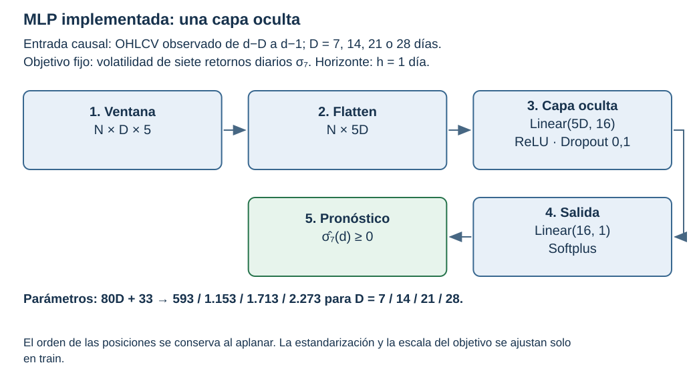
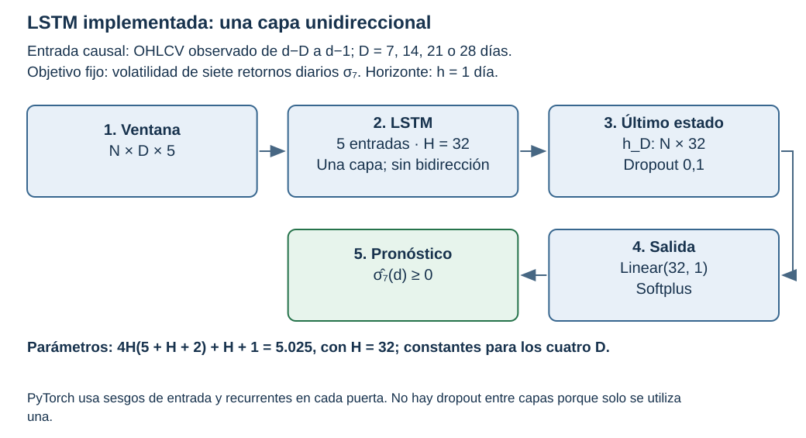
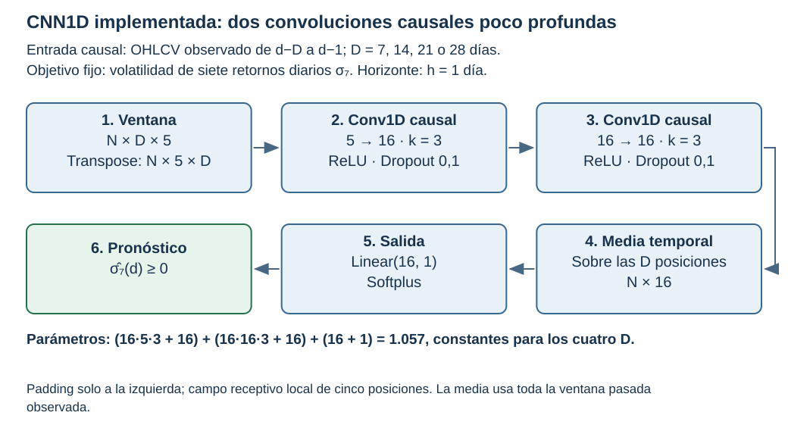
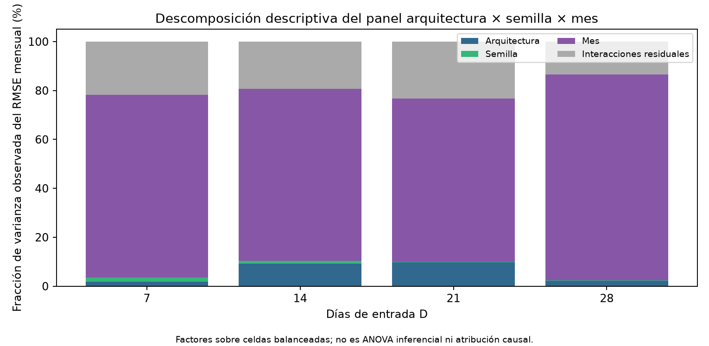
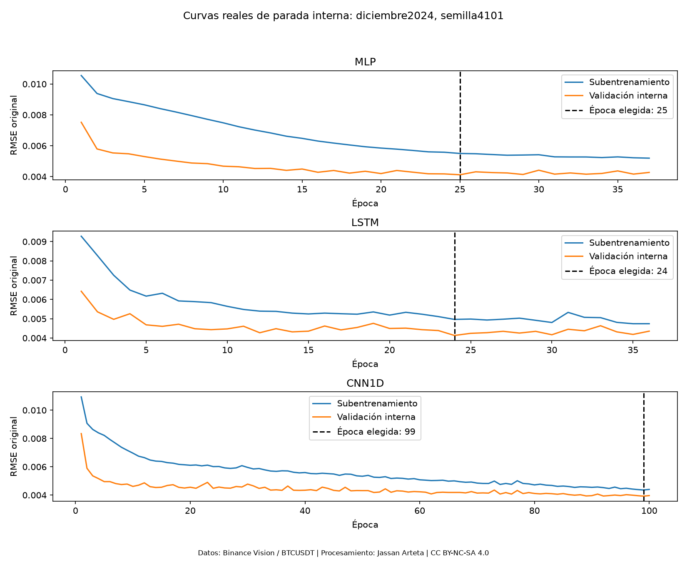
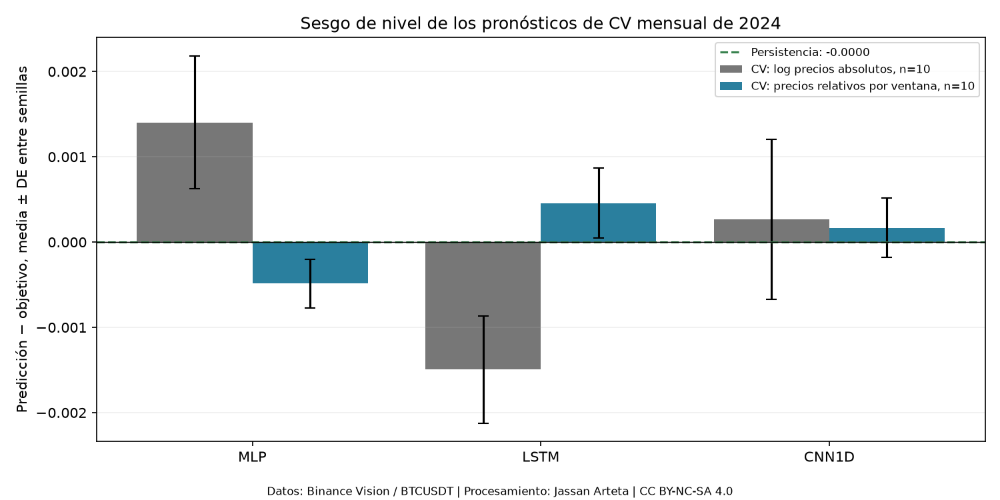
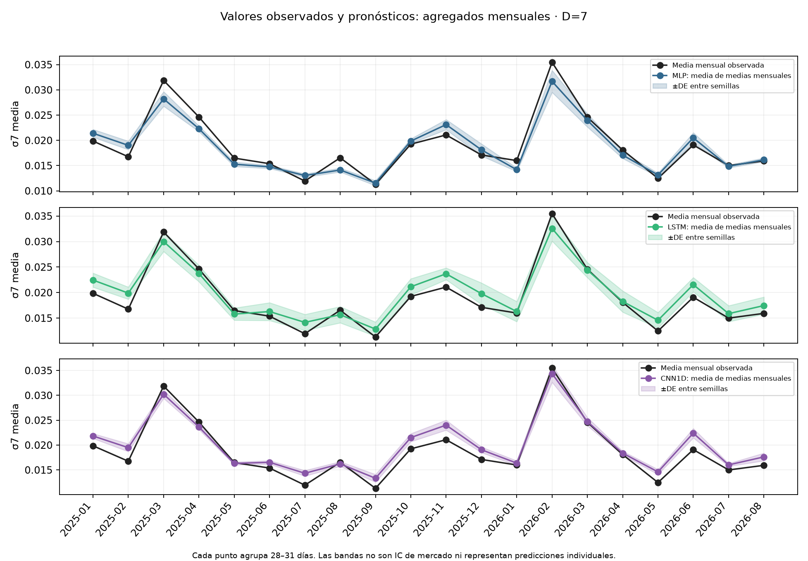
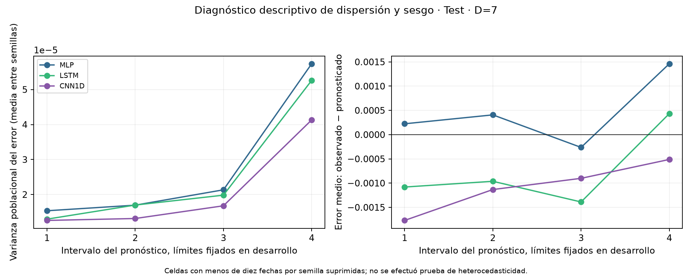

# 4. Implementación y evaluación: diseño y estado de ejecución

Se completó la ampliación de **MLP, LSTM y CNN1D** a entradas de **7, 14, 21 y 28 días**, utilizando la validación forward chaining de `timeseries-cv`, proyecto de DidierRLopes con coautoría de Filipe R. Ramos. La frecuencia original de adquisición es un minuto; las entradas efectivas de las redes son **OHLCV diario**.

La comparación vigente utiliza **D=7,14,21,28**, objetivo **n=7** y horizonte **h=1 diario**, con representación `relative_window` y diez semillas por combinación. La elección de historia/modelo se cerró con CV de 2024 antes de abrir test. El [cierre previo](../_static/filipe_multihistory_20261104/freeze.json) conserva las decisiones, fuentes y hashes.

La CV primaria reúne **120 trayectorias, 1.440 segmentos modelo–mes y 2.880 ajustes**: D7 reutiliza 30 trayectorias relativas ya guardadas; D14/21/28 añaden 90. Son **43.920 predicciones de 2024**. El control `absolute_log` pertenece al estudio inicial D7 y no se amplió a las otras entradas.

Después del cierre se realizaron **120 ajustes finales** con desarrollo permitido de 2023–2024 y pesos fijos durante el test **01/01/2025–31/08/2026**. Cada corrida produjo 608 predicciones elegibles; septiembre–octubre de 2026 no se incorporó. Los veinte meses del test son intervalos de reporte, no nuevos ajustes ni folds de entrenamiento.

La selección con desarrollo ya examinado sigue siendo exploratoria y no es una búsqueda anidada. El test mide el procedimiento cerrado; después de consultarlo no queda como reserva desconocida para diseñar otro modelo. La revisión posterior incorpora respaldo aplicado independiente de MLP y CNN en Miura et al. (2019), sin reescribir la selección como a priori. Su CNN no declara dimensionalidad y las recetas propias no son réplicas; el piloto prospectivo y el dimensionamiento definitivo siguen pendientes.

La auditoría se completa con tablas anuales, variabilidad, segmentos y diagnósticos finales calculados desde los resultados guardados; su registro está en el [protocolo del complemento](../_static/e1_audit_improvements_20261104/protocol.json), [resumen inferencial](../_static/e1_audit_improvements_20261104/inference/summary.json) y [resumen descriptivo](../_static/e1_audit_improvements_20261104/descriptive/summary.json). El complemento se registró **después de inspeccionar el test**, antes de estos cálculos. Es un análisis **post-hoc/exploratorio** de las predicciones guardadas de las tres configuraciones **D7 elegidas con CV**, más persistencia determinista. No es una confirmación prospectiva, no cambia la selección MLP/D7 y no ejecuta nuevos pronósticos ni entrenamientos.

## 4.1. Diseño Experimental

### 4.1.1. Definición clara de:

#### 4.1.1.1. Variables de entrada: representación y dimensiones

La unidad es un **día UTC de BTCUSDT**, agregado de velas oficiales de un minuto. Las cinco covariables son apertura, máximo, mínimo, cierre y volumen. Para el resultado del día d, las entradas abarcan d−D,…,d−1, con **D∈{7,14,21,28}**.

El tensor es $X\in\mathbb R^{N\times D\times5}$; la MLP aplana 35, 70, 105 o 140 valores. Todas las familias reciben la misma información para un D dado, sin rezagos explícitos del objetivo. Las ventanas conservan el calendario, sin imputar ni atravesar el día incompleto 24/03/2023.

#### 4.1.1.2. Variable objetivo y horizonte de predicción

El objetivo permanece fijo: **desviación estándar poblacional de siete retornos logarítmicos diarios**, $\sigma_7$, `ddof=0`, sin anualizar. El horizonte es **h=1 día**. Cambiar D no cambia el número n=7 de retornos del objetivo; las sensibilidades n=14/21/28 son tareas diferentes y no se entrenaron aquí.

Al inicio del día d se emite $\widehat y_d=f_\theta(z_{d-D},\ldots,z_{d-1})$; $y_d=\sigma_7(d)$ se conoce al cierre de ese día e incorpora su retorno todavía desconocido. Las fechas de origen y disponibilidad quedan registradas. La salida Softplus es positiva; la pérdida es MSE sobre Y dividida por la media positiva del entrenamiento, sin centrar. Las métricas se calculan tras invertir esa escala. **RMSE es primaria**; MAE, MSE, R², MAPE y MASE son secundarias.

### 4.1.2. División del dataset

#### 4.1.2.1. Entrenamiento, validación y prueba

| Etapa | Calendario UTC | Aplicación |
|---|---|---|
| Historia inicial | 2023 | Primer entrenamiento admitido de cada D |
| Validación forward | 2024 | Doce bloques mensuales; entrenamiento creciente y purga D |
| Cierre y ajuste final | Desarrollo 2023–2024 | Historia elegida con CV; épocas fijadas antes de test y reajuste final con embargo D |
| Test final | 01/01/2025–31/08/2026 | Evaluado una vez por checkpoint final sobre la cohorte común registrada |

Los **365/366/608 días** suman 1.339 días: **27,26 %/27,33 %/45,41 %**. Son porcentajes del calendario elegido; el método de Filipe no impone esas proporciones. El entrenamiento crece en 2024 y las proporciones no son tamaños efectivos de cada fold.

La [reserva original](../_static/data/test_raw_reserve_20250101_20260831.json) conserva la identidad de los veinte ZIP. El nuevo registro de test documenta su apertura posterior al cierre y la cohorte supervisada efectiva. Se mantienen excluidos septiembre–octubre de 2026.

#### 4.1.2.2. Esquema de validación y selección de hiperparámetros

Se ejecutó la función real `tsxv.splitTrainVal.split_train_val_forwardChaining(np.arange(731),D,1,1)` de **timeseries-cv 0.1.5**, en el entorno separado con NumPy 1.26.4, para cada D. Se agrupan los orígenes diarios de 2024 en **doce meses**, tomando los candidatos de entrenamiento del primer origen de cada mes. Los filtros de calidad y purga se aplican sobre los índices reales de la biblioteca, que utiliza el entrenador.

La **sección 6.4 de la guía E1, página 29, exige embargo igual al máximo rezago de las covariables**. Por eso, en este proyecto se usa embargo D: 7, 14, 21 o 28 días. Es una regla del protocolo exigida por la guía, no una proporción o separación impuesta automáticamente por la API de Filipe. Para el comienzo mensual t se admiten resultados **u≤t−D−1**. Con inicio interno v=t−90, el subentrenamiento admite u≤v−D−1 y la validación interna abarca v,…,t−D−1. Quedan **83, 76, 69 y 62 etiquetas internas** para D=7,14,21,28 cuando no hay faltantes. Los cortes excluyen las ventanas no elegibles.

Los tamaños efectivos registrados son:

| D | N train en enero | N interno en enero | N validación interna | N train en diciembre |
|---:|---:|---:|---:|---:|
| 7 | 343 | 253 | 83 | 678 |
| 14 | 322 | 232 | 76 | 657 |
| 21 | 301 | 211 | 69 | 636 |
| 28 | 280 | 190 | 62 | 615 |

Las diferencias reflejan soporte de la ventana, purga y día incompleto; no se eligen porcentajes aleatorios de filas.

Cada mes ejecuta selección interna de duración y un reajuste nuevo; durante ese mes sus pesos quedan fijos, con entradas actualizadas hasta d−1. El horizonte sigue siendo un día. El test final utiliza otro ajuste cerrado de desarrollo, sin reajustes mensuales con sus etiquetas. La selección del baseline es **MLP, D=7, `relative_window`**, por menor RMSE media de CV, con desempate por D menor y después número de parámetros. No se eligió por el test.

### 4.1.3. Definición de pipeline

#### 4.1.3.1. Preprocesamiento y construcción de datos

La ejecución ampliada utiliza únicamente la representación principal **`relative_window`**: logaritmos de OHLC relativos al último cierre observado de la propia ventana, y log1p(volumen). Las medias y desviaciones por canal se ajustan sobre todas las posiciones de las ventanas del entrenamiento permitido; Y se divide por su media positiva, sin centrar.

Cada ajuste interno y reajuste mensual tiene escaladores propios. El ajuste final calcula otros escaladores usando solo desarrollo admitido, que permanecen fijos durante test. Las transformaciones no estiman parámetros con la validación externa ni con test. Una desviación nula se sustituye por uno y se registra.

El control inicial D7 `absolute_log` se conserva como análisis contextual, con días únicos para estandarizar. Su comparación cambia representación y ponderación del escalado; no demuestra un efecto causal aislado de dividir precios.

#### 4.1.3.2. Entrenamiento y parada temprana

Cada segmento mensual de CV realiza **dos ajustes nuevos**: selección de duración mediante validación interna pasada y reajuste desde otra inicialización con todo el entrenamiento permitido por esa duración. Una trayectoria D–modelo–semilla encadena doce segmentos y **24 ajustes**; no hay warm start.

Para test, la duración de cada una de las **120 corridas finales** se fijó con la mejor época interna del bloque de diciembre de 2024 de su D, familia y semilla. Después se entrenó de nuevo con desarrollo permitido hasta el corte con embargo D. Los pesos y escaladores finales se firmaron **antes de abrir el test**. No se eligieron épocas, semillas o modelos a partir de sus resultados.

#### 4.1.3.3. Evaluación y agregación de métricas

Las predicciones conservadas localmente identifican D, familia, semilla, fecha de resultado, origen, disponibilidad, y observado/predicho. En CV se agrupan las 366 fechas por trayectoria; en test se agrupa la cohorte común del periodo completo. Para cualquier conjunto de N fechas:

$$
\mathrm{RMSE}_{D,m,s}=\sqrt{\frac1N\sum_d(y_d-\widehat y_{D,m,s,d})^2}.
$$

R² se calcula con la media y sumas de cuadrados del mismo periodo agrupado. Luego se resume cada métrica entre las diez semillas. No se puntúa un ensemble ni se promedian R² mensuales para obtener el R² global. Las métricas por mes y su dispersión se publican como diagnóstico adicional; no convierten meses en réplicas independientes.

### 4.1.4. Piloto

**Alcance histórico D7/2024:** la calibración del suplemento inicial se conserva a continuación y no acredita potencia para las nuevas entradas o el test.

El [registro histórico de piloto](https://github.com/jassan-bit/DeepLearning_202630/blob/main/results/dl_benchmark_20261104/pilot_summary.json) conserva cinco semillas por familia y cálculos de dispersión y dimensionamiento de otro procedimiento. Ese antecedente existe, pero no acredita por transferencia automática un piloto del forward chaining relativo vigente.

No se ejecutó un **piloto prospectivo previo para dimensionar las repeticiones de esta CV**. Las diez semillas por modelo y variante fueron un presupuesto exploratorio. Su dispersión ya observada puede calibrar escenarios de una evaluación futura, pero no convierte las corridas existentes en un piloto registrado antes de entrenar.

El suplemento estadístico utiliza las diez diferencias de RMSE red–persistencia para calcular **sensibilidad de planificación retrospectiva y condicional al calendario**. Se declara α de planificación 0,05/12, objetivo hipotético de potencia 0,80 y margen de referencia 5 % del RMSE anual de persistencia. No se calcula potencia con el efecto observado ni se acredita suficiencia de las diez semillas.

Para una planificación prospectiva se requerirá un piloto bajo los folds, representación, ajuste y estimando que efectivamente se evaluarán. La dispersión estimada con diez recorridos es incierta. Para una métrica por semilla $m_s$ se conservan:

$$
\bar m=\frac1R\sum_s m_s,\qquad
s_m=\sqrt{\frac{\sum_s(m_s-\bar m)^2}{R-1}},\qquad
\mathrm{CV}=\frac{s_m}{\bar m}.
$$

Ni los doce bloques mensuales, ni los dos ajustes internos, ni las fechas constituyen semillas o mercados independientes. La [sensibilidad de diseño](../_static/filipe_statistics_20261104/design_sensitivity.csv) identifica su estimando y carácter retrospectivo.

### 4.1.5. Diferencia mínima de interés

El benchmark ya evaluado conserva su criterio histórico de **5 % de reducción relativa de RMSE frente a persistencia**. No se cambia para reinterpretar favorablemente los resultados del test.

Para **futuros modelos del benchmark académico**, se define ahora una regla operativa explícita: reducción relativa de RMSE **superior al 5 % frente a MLP/D7 y frente a persistencia**, sobre las mismas fechas de una nueva evaluación independiente. MLP/D7 conserva su selección previa por CV. El 5 % es una convención académica transparente, coherente con el criterio anterior y examinada con sensibilidades de 1/2,5/5/10 %; no afirma rentabilidad o utilidad financiera.

La [política académica](../_static/e1_audit_improvements_20261104/academic_margin_policy.json) se registra después de observar el test actual, antes de entrenar o evaluar una propuesta avanzada. **No es un margen declarado a priori para las corridas ya realizadas.** Para referencia j, la diferencia por semilla centrada en la frontera práctica es:

$$
D_{j,s}=0{,}95\,m_{j,s}-m_{A,s},\qquad j\in\{\mathrm{MLP/D7},\mathrm{persistencia}\}.
$$

El estimando relativo es una **razón de medias de RMSE por semilla**, $Q_j=1-\mathbb E[m_A]/\mathbb E[m_j]$. Como la referencia tiene media positiva, $Q_j>0{,}05$ equivale a $\mathbb E[0{,}95m_j-m_A]>0$. No se sustituye por $\mathbb E[1-m_{A,s}/m_{j,s}]$, que es otro estimando cuando la referencia neuronal varía entre semillas. Para persistencia determinista coinciden.

Una mejora superior al 5 % exige diferencia media positiva frente a **ambas** referencias, con incertidumbre y multiplicidad declaradas; dos promedios favorables no bastan. La planificación de §5.3.4 usa alternativas por encima de esa frontera. Su dispersión real y el R definitivo quedan sujetos a un piloto prospectivo del procedimiento futuro.

### 4.1.6. Tamaño de muestra

Se mantienen **diez semillas por D y familia**, 4101–4110: 120 trayectorias de CV primaria y 120 corridas finales, sin elegir ni descartar semillas según su error. Cada combinación tiene R=10, no R=120 ni R=1.440.

La ampliación de D no constituye un piloto prospectivo ni demuestra potencia 0,80. La sensibilidad MDE₀ y el R orientativo del suplemento inicial D7 siguen siendo calibraciones retrospectivas para ese estimando y calendario, con α de planificación 0,05/12. No se extrapolan a las nuevas entradas o al test. Un dimensionamiento definitivo requiere su propio piloto, margen y alternativa.

En una ejecución futura, el tamaño calculado por una aproximación de potencia no sustituye el mínimo de la guía: **R de ejecución ≥ max(5, R calculado)**, o **max(6, R calculado)** si se emplean pruebas por rangos. Las diez semillas actuales superan ese mínimo numérico, sin que ello certifique potencia 0,80.

### 4.1.7. Diferencia mínima detectable

**Alcance histórico D7/2024:** la calibración del suplemento inicial se conserva a continuación y no acredita potencia para las nuevas entradas o el test.

Se calcula una **MDE₀ orientativa por dispersión retrospectiva** para R=10, detección frente a cero y potencia objetivo hipotética 0,80:

$$
\mathrm{MDE}_0(R)=\frac{(z_{1-\alpha_{\rm plan}/2}+z_{0{,}80})\widehat\sigma_d}{\sqrt R},\qquad
\alpha_{\rm plan}=0{,}05/12.
$$

El denominador se refiere a pares de inicializaciones condicionados al mismo calendario. La MDE no utiliza el efecto medio observado para calcular una supuesta potencia alcanzada. Tampoco es el contraste de superar la frontera académica del 5 % de una propuesta avanzada: la regla futura ya está definida, pero su varianza pareada real requiere un piloto propio.

| Red relativa − persistencia | DE de diferencia RMSE | MDE₀ orientativa, R=10 | δ de referencia frente a cero | R orientativo normal |
|---|---:|---:|---:|---:|
| MLP | 0,000277963 | 0,000325833 | 0,000239448 | 19 |
| LSTM | 0,000187010 | 0,000219216 | 0,000239448 | 9 |
| CNN1D | 0,000337292 | 0,000395379 | 0,000239448 | 28 |

El escenario de LSTM arroja R orientativo 9 y los de MLP/CNN1D 19/28; que un número sea menor o mayor que diez no certifica potencia alcanzada: se usó una aproximación normal y una dispersión estimada con pocas semillas. Los [escenarios](../_static/filipe_statistics_20261104/design_sensitivity.csv) separan la MDE₀, el margen de referencia y el R orientativo. Son información de planificación futura, no un piloto anterior a la CV ni evidencia de potencia real 0,80. El dimensionamiento prospectivo sigue pendiente. La planificación condicional para demostrar una ganancia superior al 5 % frente a ambas referencias se publica separada en §5.3.4.

### 4.1.8. Relación con el Entregable 2

La implementación entrega las cuatro entradas, CV efectiva, BDS por fold y evaluación final con configuración cerrada. El test de 2025–agosto de 2026 ya fue consultado; sus predicciones se reutilizan para tablas y diagnósticos sin ejecutar nuevos pronósticos ni entrenamientos.

La política para un modelo avanzado queda **definida en contexto académico**: superar el 5 % frente a MLP/D7 y persistencia en una evaluación nueva. Se conservan sensibilidades y planificación condicional, sin certificar potencia lograda. El respaldo aplicado de las familias MLP y CNN ya cuenta con una fuente primaria, con recurrencia limitada y configuración incompleta. Permanecen pendientes el piloto prospectivo y el dimensionamiento definitivo. TOST/ROPE y su banda solo serán necesarios si se quiere afirmar equivalencia.

### 4.1.9. Registro

#### 4.1.9.1. Preregistro fechado y trazabilidad

El [protocolo ampliado](../_static/filipe_multihistory_20261104/protocol.json) registra entradas, objetivo, semillas, purgas, reglas de selección y análisis. El [cierre](../_static/filipe_multihistory_20261104/freeze.json) fija el baseline, las 120 configuraciones/épocas finales y hashes de código y fuentes **antes de la primera lectura del test**. Los manifiestos de modelos y eventos conservan el orden ajuste final → firma de pesos → apertura de test → puntuación.

El D7 reutilizado conserva su firma original; el suplemento de [D7 inicial](../_static/filipe_statistics_20261104/protocol.json) conserva su fecha y alcance. El desarrollo ya había sido examinado, por lo que la CV no se presenta como validación anidada confirmatoria. El cierre permite comprobar que test no seleccionó el procedimiento evaluado.

El [registro del complemento de auditoría](../_static/e1_audit_improvements_20261104/protocol.json) es posterior a observar las métricas de test y previo a sus nuevos cálculos. No se presenta como preregistro del entrenamiento o del test original. Se conservan separados la selección previa, la evaluación ya cerrada y este análisis adicional.

#### 4.1.9.2. Estado del diseño y del piloto

| Producto | Estado |
|---|---|
| CV real de Filipe | Cuatro D, doce bloques mensuales de 2024, diez semillas por familia |
| Entrada y objetivo | D=7/14/21/28; n=7 fijo; h=1 diario; cinco covariables |
| Cierre previo | Baseline y épocas finales elegidos con desarrollo, código/fuentes firmados |
| Ajuste final y test | 120 ajustes finales; 608 fechas de test por corrida, sin reajustes con test |
| BDS por fold | Todas las semillas y D; resultados definidos/indefinidos registrados |
| Piloto y potencia | Prospectivo y dimensionamiento definitivo pendientes |
| Literatura aplicada | Miura et al. (2019) acredita MLP y CNN independientes; dimensionalidad CNN no reportada, recurrencia de una fuente y recetas propias como adaptaciones |
| Otras tareas | Objetivos n≠7 y ruido simulado no ejecutados |

## 4.2. Implementación de los Tres Modelos Base

Se implementaron **MLP, LSTM unidireccional y CNN1D causal de dos capas** para las cuatro historias de entrada. La ampliación mantiene `relative_window` y los hiperparámetros de familia; no añade GRU, TCN, atención o rezagos del objetivo. Miura et al. (2019) aporta comparadores MLP, LSTM y CNN independientes para volatilidad de Bitcoin; las configuraciones ejecutadas son adaptaciones propias y no réplicas exactas. La dimensionalidad de la CNN fuente no está reportada. Esta incorporación bibliográfica posterior no modifica los entrenamientos ni la selección ya congelada.

### 4.2.1. Implementación de los tres modelos base

Las tres redes reciben D días de las mismas cinco covariables y producen un escalar positivo. Las configuraciones fijadas con desarrollo son:

| Modelo | Arquitectura implementada | H seleccionado |
|---|---|---:|
| MLP | Flatten → Linear(5D,H) → ReLU → Dropout(0,1) → Linear(H,1) → Softplus | 16 |
| LSTM | Una capa unidireccional → último estado oculto → Dropout(0,1) → Linear(H,1) → Softplus | 32 |
| CNN1D | Conv causal k=3, 5→H → ReLU/Dropout → Conv causal k=3, H→H → ReLU/Dropout → media temporal → Linear(H,1) → Softplus | 16 |

CNN1D usa padding solo a la izquierda; carece de dilatación, conexiones residuales y atención. El dropout es 0,1 después de cada convolución. LSTM usa los dos vectores de sesgo por puerta de PyTorch. Son implementaciones del proyecto; las ecuaciones y configuraciones de artículos de §3.3 se conservan con su atribución original.

Los diagramas corresponden al código implementado, con D variable y objetivo n=7 fijo:

### 4.2.2. Entrenamiento con el mismo pipeline, partición y semillas

#### 4.2.2.1. Pipeline, partición e información comunes

| Componente | Condición común |
|---|---|
| Datos | Misma fuente OHLCV diaria y calendario externo para cada comparación |
| Objetivo | σ7, población, sin anualizar, horizonte de un día |
| Entradas | D=7/14/21/28; cinco canales idénticos entre familias para cada D |
| CV | Doce bloques de Filipe; purga D externa/interna; mismas fechas de validación |
| Representación | `relative_window`, escaladores propios del entrenamiento permitido |
| Ajuste | Mismo método interno, límites y criterio; hiperparámetros de familia fijos |
| Repeticiones | Diez semillas comunes, sin selección por error |
| Test | Cohorte común, pesos y escaladores firmados, sin actualización usando sus etiquetas |

Las historias de entrenamiento elegibles pueden diferir entre D por purga e inicio; se conservan sus índices. Todas las familias de un mismo D comparten exactamente esas muestras. Persistencia es una referencia determinista y utiliza la última σ7 conocida.

#### 4.2.2.2. Semillas, reinicios y reproducibilidad

Las semillas base son **4101–4110** en los cuatro D y las tres familias. En CV cada mes utiliza `base_seed + monthordinal*100000`; el reajuste añade 10000000 y el generador de lotes añade 17 a la semilla de su etapa. Los reajustes finales usan las semillas firmadas en el cierre y el mismo procedimiento de inicialización documentado.

Cada etapa inicializa pesos nuevos, con escaladores train propios y sin warm start. Barajar ventanas del entrenamiento permitido no cambia su construcción ni mezcla fechas entre conjuntos. Emparejar la semilla entre arquitecturas no produce pesos iguales ni garantiza reducción de varianza.

### 4.2.3. Definición de hiperparámetros

Los hiperparámetros se fijaron con información de desarrollo y permanecen iguales en los cuatro D y todos los folds. En esta CV no se ejecutó otra búsqueda de arquitecturas o hiperparámetros.

| Campo | Valor ejecutado |
|---|---|
| Historia de entrada | D=7/14/21/28; objetivo n=7 fijo, h=1 |
| MLP | H=16; learning rate 0,001 |
| LSTM | H=32; learning rate 0,003 |
| CNN1D | H=16; learning rate 0,001 |
| Planificador | Ninguno |
| Batch size | 32 |
| Optimizador | AdamW |
| Regularización | Dropout 0,1; weight decay 0,0001 |
| Pérdida | MSE en Y dividida por media positiva train |
| Salida | Softplus |
| Gradiente | Clipping de norma 1 |
| Épocas máximas | 100 en ajuste interno |
| Parada | Mínima MSE de validación interna, patience=12, min_delta=0,00001 |

#### 4.2.3.1. Learning rate y planificador

Se usó AdamW **sin planificador**, con learning rate 0,001 en MLP/CNN1D y 0,003 en LSTM. Esos valores se fijaron usando desarrollo, incluido enero–junio de 2024, y no se reseleccionan por mes o por semilla. La exposición de esa selección impide presentar esta CV como una evaluación anidada independiente.

#### 4.2.3.2. Número de capas y unidades

MLP tiene una capa oculta de 16 unidades, LSTM una capa recurrente unidireccional de 32 y CNN1D dos capas convolucionales k=3 de 16 canales. La profundidad y anchura permanecen fijas al cambiar D. En MLP aumenta el tamaño de la primera capa; LSTM y CNN1D comparten pesos a través de posiciones y conservan su conteo. Son configuraciones propias del proyecto.

#### 4.2.3.3. Batch size

Se utilizó **batch size=32** en los ajustes de las tres familias y las cuatro historias. No se buscó otro tamaño de lote. El agrupamiento para la inferencia es un detalle de ejecución registrado; no altera el origen ni la información permitida de cada pronóstico. El score final no se repite para medir latencia.

#### 4.2.3.4. Optimizador, regularización y función de pérdida

Se usó AdamW con weight decay=0,0001, dropout=0,1 y clipping de norma de gradiente=1. La ubicación del dropout se especifica en §4.2.1. La pérdida es MSE de $Y/\bar Y_{\mathrm{train}}$, con $\bar Y_{\mathrm{train}}>0$ y sin centrar: su término de datos equivale a la MSE original dividida por una constante positiva dentro de cada ajuste. No se entrenó con log(Y).

Los escaladores de X e Y se estiman de nuevo con el entrenamiento admitido de cada etapa; no con su validación. Softplus es la decisión propia para positividad. La inversión de la escala de Y precede a toda métrica publicada.

### 4.2.4. Estrategia de entrenamiento

#### 4.2.4.1. Número máximo de épocas

El ajuste interno de cada fold permite hasta **100 épocas**, CPU/float32. El reajuste mensual nuevo ejecuta exactamente la mejor época interna. El reajuste final utiliza la duración fijada con diciembre de 2024 de esa combinación, sin early stopping con test y sin cambiar el máximo después de observarlo.

Se completó la trazabilidad de esa regla usando solo registros de parada ya guardados:

| D | Red | Mediana de época en toda la CV | Mediana de diciembre | Rango de diciembre |
|---|---|---|---|---|
| 7 | MLP | 86,0 | 52,5 | 17–99 |
| 7 | LSTM | 28,0 | 19,0 | 7–30 |
| 7 | CNN1D | 85,5 | 81,5 | 24–99 |
| 14 | MLP | 67,5 | 53,0 | 17–68 |
| 14 | LSTM | 20,0 | 16,0 | 4–32 |
| 14 | CNN1D | 11,5 | 19,0 | 7–77 |
| 21 | MLP | 51,5 | 44,5 | 6–81 |
| 21 | LSTM | 14,0 | 13,0 | 3–36 |
| 21 | CNN1D | 5,0 | 3,5 | 1–23 |
| 28 | MLP | 41,0 | 7,5 | 3–10 |
| 28 | LSTM | 12,5 | 3,0 | 1–30 |
| 28 | CNN1D | 5,0 | 2,5 | 1–34 |

El [resumen de duración](../_static/e1_audit_improvements_20261104/traceability/epoch_policy_summary.csv) y el [desglose mensual](../_static/e1_audit_improvements_20261104/traceability/epoch_summary_by_month.csv) muestran variación entre meses y semillas. CNN1D/D28 tiene mediana de diciembre 2,5, frente a 81,5 en D7. Es una descripción de las épocas seleccionadas, **no prueba de que otra duración habría mejorado el test**. La regla original se conserva. Si se estudia otra política, se definirá con desarrollo y se evaluará en una versión independiente.

#### 4.2.4.2. Early stopping y validación interna

La selección interna minimiza la MSE escalada, con `patience=12` y `min_delta=1e-5`. Se guarda la mejor época, se descartan los pesos internos y se reajusta una red nueva por esa duración.

El inicio interno se sitúa noventa días de calendario antes del comienzo mensual. Las purgas D dejan **83/76/69/62 etiquetas** para D=7/14/21/28 en los bloques completos. La validación externa del mes no selecciona su duración. El ajuste final utiliza las épocas ya cerradas; no genera una nueva validación sobre las etiquetas de test.

### 4.2.5. Registro

| Unidad de la CV primaria | Cantidad | Procedencia |
|---|---:|---|
| Trayectorias | 120 | 4 entradas × 3 familias × 10 semillas |
| Segmentos modelo–mes | 1.440 | Doce por trayectoria |
| Ajustes CV | 2.880 | Interno y reajuste por segmento |
| Predicciones CV | 43.920 | 366 por trayectoria |
| Trayectorias D7 reutilizadas | 30 | 360 segmentos, 720 ajustes y 10.980 predicciones ya guardadas |
| Trayectorias D14/21/28 nuevas | 90 | 1.080 segmentos, 2.160 ajustes y 32.940 predicciones |
| Ajustes finales | 120 | Un modelo final de desarrollo por D–familia–semilla |

El control absoluto del experimento inicial D7 no se suma a la CV primaria ampliada ni se presenta como corrido para los otros D. Los logs y manifiestos distinguen reutilización, entrenamiento nuevo y evaluación final.

#### 4.2.5.1. Curvas de entrenamiento y validación

Los segmentos de CV conservan curvas internas y de reajuste. Cada curva se interpreta con su entrenamiento, validación interna, escala y D. No representa pérdida del mes externo ni del test. Los ajustes finales conservan sus curvas de entrenamiento por la duración cerrada; no hay una curva de validación de test utilizada para parar.

El ejemplo inicial D7 de diciembre/semilla 4101 se conserva en §4.4.9.4 con su alcance explícito. Las demás curvas quedan en los artefactos reproducibles, sin escoger la mejor semilla o el mes de menor error.

#### 4.2.5.2. Número de parámetros

Para cinco covariables, las expresiones son $(5D+1)H+(H+1)$ en MLP, $4H(5+H+2)+(H+1)$ en LSTM y $(15H+H)+(3H^2+H)+(H+1)$ en CNN1D. Todos los pesos son entrenables:

| D | MLP (H=16) | LSTM (H=32) | CNN1D (H=16) |
|---:|---:|---:|---:|
| 7 | 593 | 5.025 | 1.057 |
| 14 | 1.153 | 5.025 | 1.057 |
| 21 | 1.713 | 5.025 | 1.057 |
| 28 | 2.273 | 5.025 | 1.057 |

Los dos sesgos por puerta explican el +2 de LSTM. Pooling y Softplus no agregan parámetros. Los conteos de las instancias ejecutadas se registran por corrida.

#### 4.2.5.3. Tiempo computacional y hardware empleado

Los logs separan el tiempo acumulado de los 24 ajustes de cada trayectoria CV del tiempo de su ajuste final. Se utilizó CPU, tres trabajadores de trayectorias y un hilo PyTorch por trabajador. Las duraciones son mediciones locales con concurrencia y números de épocas diferentes; no miden eficiencia de despliegue.

Las [métricas CV por semilla](../_static/filipe_multihistory_20261104/analysis_cv/run_metrics.csv) y el [resumen de ajustes finales](../_static/filipe_multihistory_20261104/final_fit_summary.csv) identifican resultados y duración de los ajustes finales; los registros locales de CV conservan sus mediciones completas. Los manifiestos de ejecución registran hardware, versiones y épocas. D7 reutiliza sus mediciones originales; no se presenta la diferencia temporal entre ejecuciones históricas como un benchmark controlado de velocidad. La inferencia de test se realizó una vez por checkpoint y no se repitió para medir latencia.

### 4.2.6. Equidad en la optimización

La [búsqueda histórica registrada](https://github.com/jassan-bit/DeepLearning_202630/blob/main/experiments/dl_benchmark_20261104/protocol_initial.json) sí exploró el mismo número de configuraciones e inicializaciones en las tres familias:

| Elemento | Presupuesto histórico por familia | Transferencia al procedimiento vigente |
|---|---|---|
| Historias de entrada | D=7/14/21/28 | Se conservan las cuatro historias |
| Ancho oculto | H∈{16,32} | MLP=16, LSTM=32, CNN1D=16 |
| Learning rate | {0,001; 0,003} | MLP/CNN1D=0,001; LSTM=0,003 |
| Inicializaciones por configuración | Dos semillas | Diez semillas por combinación D–familia en CV |
| Total de búsqueda | 4 D × 2 H × 2 LR × 2 semillas = **32 corridas por familia** | **96 corridas históricas** entre las tres familias; no una búsqueda nueva dentro de cada fold |

Los [resultados agregados históricos](https://github.com/jassan-bit/DeepLearning_202630/blob/main/results/dl_benchmark_20261104/search_configurations.csv) mantienen las 48 configuraciones familiares/D, cada una resumida sobre dos semillas. La CV relativa hereda las recetas de familia: misma regla de parada, máximo de épocas, dropout, optimizador y presupuesto de semillas para cada D. Cambiar D modifica información, purga y, en MLP, parámetros; no aísla un único efecto causal.

La trazabilidad del presupuesto resuelve la ambigüedad documental; **no demuestra que la receta heredada sea óptima bajo otra representación o un nuevo calendario**. No se ejecutó otra búsqueda anidada en esta CV. Cualquier reajuste posterior requiere un protocolo nuevo y una evaluación independiente si utiliza estos resultados para diseñarse.

La elección por menor RMSE media de CV se cerró antes de test. No se optimizaron hiperparámetros, D o épocas con los resultados finales. Las duraciones pueden variar por la misma regla de parada; eso se registra y no acredita potencia o convergencia.

### 4.2.7. Implementación desde cero o uso de librerías justificadas

#### 4.2.7.1. Implementación y entorno de software

La implementación utiliza **PyTorch 2.15.0+cpu**, Python 3.12.14 y float32. Los módulos `dl_data.py`, `dl_data_v2.py` y `dl_models.py` conservan construcción de desarrollo, transformación relativa y arquitecturas firmadas. La ampliación usa `train_filipe_multihistory.py` y `analyze_filipe_multihistory.py`; el ajuste/score final utiliza `final_fit_filipe_multihistory.py` y el cargador verificado de test.

`prepare_filipe_multihistory.py` ejecuta la biblioteca **timeseries-cv 0.1.5 con NumPy 1.26.4** en el entorno compatible y materializa los índices que consume el entrenador. No se sustituye el esquema por partición aleatoria.

`requirements-training.lock.txt` y los registros de runtime fijan NumPy 2.5.4, pandas 3.1.0, SciPy 1.18.1, statsmodels 0.15.0 y Matplotlib 3.11.2 para entrenamiento/análisis. El [protocolo](../_static/filipe_multihistory_20261104/protocol.json) y [cierre](../_static/filipe_multihistory_20261104/freeze.json) vinculan los scripts y sus hashes a los resultados.

#### 4.2.7.2. Estado de implementación

| Componente | Estado |
|---|---|
| MLP/LSTM/CNN1D | Implementados en los cuatro D |
| CV Filipe | Índices reales, doce meses y diez semillas por combinación |
| Ajuste final | 120 pesos y escaladores cerrados antes de test |
| Test | 608 fechas elegibles por corrida, sin actualización de pesos |
| Métricas/BDS | Tablas globales y por intervalo, con motivos de indefinición |
| Bibliografía/piloto/márgenes futuros | Respaldo aplicado de familias incorporado; recurrencia/configuración fuente limitadas y piloto/dimensionamiento prospectivos pendientes |

## 4.3. Requisitos Experimentales

Los controles se aplican al entrenamiento forward mensual efectivo con índices de Filipe. La elección de configuraciones utilizó información del desarrollo ya examinado: mantener causalidad en cada fold no convierte este calendario en un conjunto confirmatorio independiente.

### 4.3.1. Control de semillas aleatorias

Los runners fijan los generadores de Python, NumPy y PyTorch por etapa, con las semillas base y offsets documentados. Se usa un generador explícito para el orden de lotes y **`torch.use_deterministic_algorithms(True)`**, con un hilo de cómputo/interoperabilidad por trabajador.

El cierre conserva las semillas de los 120 ajustes finales. La igualdad de etiqueta entre familias define el emparejamiento operativo, no pesos iguales ni nuevas series independientes. Una repetición técnica con el mismo checkpoint no se cuenta como otra corrida. No se presume identidad bit a bit entre versiones o hardware diferentes.

### 4.3.2. Repetición de experimentos

Cada D–familia usa **diez semillas documentadas**. Son 120 trayectorias de CV primaria y 120 corridas finales. No se descartan semillas por desempeño. La repetición técnica de un checkpoint no crea otra corrida.

Los doce meses de CV comparten historia creciente y las fechas consecutivas comparten retornos del objetivo; no son mercados independientes. Los veinte meses de test son segmentos de reporte de modelos finales fijos, no otros entrenamientos o semillas. La comparación está condicionada a un activo y calendario.

### 4.3.3. Reporte de media, desviación estándar e intervalos de confianza

Se publican media, DE muestral e **IC marginal del 95 % t de Student con nueve grados de libertad** entre las diez semillas por D–familia. Se calcula primero cada métrica global de una semilla y luego su resumen; se mantiene el mismo procedimiento en cada mes.

Estos IC describen aleatorización del entrenamiento bajo las fechas y configuración fijadas. No incorporan toda la incertidumbre temporal, selección de D o generalización a otros mercados. La persistencia determinista no recibe diez réplicas, DE de inicialización ni IC de semillas. La DE entre meses se identifica separadamente.

El suplemento inicial D7 (Holm global-12, DM y bootstrap de fechas) permanece como evidencia exploratoria de **2024/D7**. No proporciona p-valores o intervalos temporales para los nuevos D ni para el test final.

### 4.3.4. Uso de GPU

**Se utilizó CPU, sin GPU**, con determinismo y versiones registrados. La CV ampliada empleó tres trabajadores de trayectorias, un hilo PyTorch por trabajador y límites de interoperabilidad. Los ajustes finales y el score conservan sus condiciones en los manifiestos correspondientes.

Los tiempos de D7 proceden de su ejecución original; los nuevos D tienen sus propios registros. No se transforma una duración con concurrencia en latencia de despliegue ni un límite de memoria de la máquina en una medición de pico consumido.

### 4.3.5. Empaquetado reproducible

Código, dependencias, protocolos, fuentes, índices y artefactos vinculan las fases de CV, cierre, ajuste final y score. El sitio publica métricas agregadas por semilla y bloque, diagnósticos, configuraciones y manifiestos de hashes. Las predicciones individuales, series de mercado, pesos y paquetes completos de la ampliación permanecen conservados localmente. El proceso reutiliza esos archivos para analizar y construir las tablas, sin volver a entrenar o reseleccionar.

#### 4.3.5.1. Archivo de dependencias

`requirements-training.lock.txt` fija las versiones efectivamente usadas en entrenamiento/análisis; los entornos de EDA y partición conservan sus propios archivos. El runtime identifica las versiones importadas, además de la lista de dependencias.

#### 4.3.5.2. Scripts o cuadernos ejecutables de extremo a extremo

Los scripts `prepare_filipe_multihistory.py`, `train_filipe_multihistory.py`, `analyze_filipe_multihistory.py`, `load_filipe_reserved_test.py`, `final_fit_filipe_multihistory.py` y `export_filipe_multihistory_book.py` cubren la ampliación. Se reutilizan los módulos de arquitectura, transformación y optimización registrados, sin sobrescribir la ejecución inicial D7.

La partición se materializa en el entorno compatible con `timeseries-cv`; el entrenamiento/análisis utiliza el entorno PyTorch registrado. El score exige el cierre y manifiesto de pesos finales. Los datos brutos conservan URLs y hashes de adquisición. La publicación de la ampliación contiene resúmenes y trazabilidad; los ZIP, series diarias, predicciones individuales y checkpoints se conservan localmente.

#### 4.3.5.3. Registro de configuración y artefactos de cada corrida

El [protocolo](../_static/filipe_multihistory_20261104/protocol.json), el [cierre](../_static/filipe_multihistory_20261104/freeze.json) y el [manifiesto de modelos finales](../_static/filipe_multihistory_20261104/final_models_manifest.json) registran decisiones, configuraciones y hashes de los artefactos. Las [métricas CV por semilla](../_static/filipe_multihistory_20261104/analysis_cv/run_metrics.csv) identifican las cuatro entradas; D7 conserva además su [firma original](../_static/dl_r2_cv_20261104/code_manifest_before_fitting.json).

Los paquetes completos de los 1.080 segmentos añadidos y los 120 ajustes finales, con pesos, curvas y predicciones, están preservados localmente. Su descarga pública no forma parte de esta publicación. Los resúmenes [por fold de CV](../_static/filipe_multihistory_20261104/analysis_cv/fold_metrics_summary.csv), [por mes de test](../_static/filipe_multihistory_20261104/test/analysis/fold_metrics_summary.csv) y BDS permiten revisar las tablas publicadas; la reproducción desde los vectores originales utiliza los archivos locales guardados. Los hashes y el orden de eventos distinguen desarrollo de lectura y evaluación de test.

### 4.3.6. Buenas Prácticas Obligatorias

#### 4.3.6.1. Prevención de data leakage (crítico)

| Control | Aplicación |
|---|---|
| Cronología | Historia creciente de desarrollo; resultados futuros fuera del entrenamiento de cada fold |
| Purga | D en cortes externos e internos de CV y antes del ajuste final |
| Transformaciones | Escaladores propios, solo con el entrenamiento permitido |
| Parada | Validación interna pasada; épocas finales cerradas antes de test |
| Calidad | Días completos y calendario íntegro; no imputar o unir retornos a través de huecos |
| Test | Pesos/escaladores firmados previamente; sin usar etiquetas de test para actualizar |
| Consistencia | Mismos cinco canales, objetivo, fechas comparadas y semillas por D–familia |
| Selección | Baseline elegido únicamente con desarrollo; la exposición previa de 2024 se declara |

Los controles de otras modalidades se conservan con sus motivos de no aplicación.

##### 4.3.6.1.1. Separación de entrenamiento, validación y prueba

Una etiqueta pasada de 2024 puede entrar en el entrenamiento de un mes posterior **solo cuando los índices registrados la admiten** y cumple embargo/disponibilidad. Ninguna etiqueta del mes externo selecciona sus pesos, escaladores o épocas. El cumplimiento de esa causalidad no elimina la exposición de 2024 al proceso de elegir las configuraciones; se mantiene el alcance exploratorio.

##### 4.3.6.1.2. Transformaciones ajustadas solo en train

En CV se ajustan escalas por etapa mensual; en el ajuste final se usan solo las ventanas de desarrollo permitidas. Durante test se aplican esos parámetros fijos a la historia observable de cada origen. El ancla del cociente es el cierre de d−1 de la propia ventana, no el cierre del día a pronosticar. No se estiman medias/desviaciones ni se eligen imputaciones con test. Vocabulario y codificación categórica no aplican a OHLCV numérico.

##### 4.3.6.1.3. Prevención de mezcla temporal

Las entradas de cada pronóstico terminan en d−1 y la etiqueta se observa al cierre de d. La CV respeta purga D y actualización creciente mensual; el modelo final no se actualiza durante 2025–agosto de 2026. Utilizar OHLCV ya observado de un día anterior de test como entrada del siguiente es causal y no implica entrenar con su etiqueta. El solapamiento de σ7 conserva dependencia temporal.

##### 4.3.6.1.4. Prevención de fuga espacial

El control exige validar por bloques con separación mayor al rango de autocorrelación espacial. **No aplica al proyecto actual:** se modela una sola serie financiera sin coordenadas, unidades geográficas ni una estructura de vecindad espacial. No se presentan bloques o rangos espaciales como controles ejecutados.

##### 4.3.6.1.5. Prevención de fuga semántica en NLP

El control exige evitar duplicados y casi duplicados entre particiones y respetar el agrupamiento por autor o documento cuando exista. **No aplica al proyecto actual:** las entradas son OHLCV y no incluyen corpus textual, autores o documentos. Los datos de Twitter de una fuente bibliográfica no forman parte del dataset propio.

##### 4.3.6.1.6. Prevención de fuga por agrupamiento en imágenes

El control exige mantener las imágenes del mismo sujeto, sitio o escena en una sola partición. **No aplica al proyecto actual:** no hay imágenes de entrada ni unidades de agrupamiento de esa modalidad. Los gráficos del EDA son salidas de análisis, no observaciones visuales usadas para entrenar los modelos.

#### 4.3.6.2. Validación consistente entre los tres modelos base

Cada familia comparte la misma partición y muestras de un D dado; las cuatro historias se comparan sobre las fechas externas comunes. La cohorte de test se construye con las reglas de calidad y soporte ya fijadas, conservando exclusiones y motivos. Las diferencias entre D del número de entrenamiento se documentan.

Persistencia usa la última σ7 conocida: requiere ocho cierres anteriores; D7 contiene siete días OHLCV, mientras D14/21/28 contienen más días. La información histórica de la referencia y la red no se presenta como idéntica. La referencia sigue siendo determinista y respeta disponibilidad.

#### 4.3.6.3. Evaluación única del test por corrida

El cierre se registró **antes de abrir los veinte ZIP del test**. Se entrenaron de nuevo las 120 configuraciones finales con desarrollo permitido y se firmaron sus pesos, escaladores y duraciones antes del score. El último modelo mensual de CV no se reutilizó como sustituto del ajuste final.

Cada checkpoint produjo una sola pasada de predicciones sobre las 608 fechas elegibles. Se guardaron para calcular métricas y diagnósticos sin otra selección o ajuste. Los veinte intervalos mensuales son únicamente un desglose del mismo test; **no se reentrenó dentro de ellos**. Septiembre–octubre de 2026 permanece fuera.

El test ya está evaluado: sus resultados no pueden funcionar después como una reserva desconocida para confirmar cambios diseñados al observarlos.

#### 4.3.6.4. Estado de cumplimiento

| Requisito | Estado |
|---|---|
| Entradas requeridas | D=7/14/21/28 ejecutados en los tres modelos |
| CV Filipe | 120 trayectorias primarias, 1.440 segmentos y 2.880 ajustes |
| Repeticiones | Diez semillas por D–familia |
| Cierre/ajuste final | Registrados antes de lectura del test; 120 ajustes finales |
| Test | 608 fechas por corrida; una evaluación con pesos fijos |
| Métricas | MAPE, MAE, RMSE, MSE, R² y MASE globales y por mes |
| BDS por fold/mes | Todas las semillas; valores definidos/indefinidos y resumen descriptivo |
| Potencia y márgenes futuros | Piloto prospectivo, dimensionamiento definitivo y otros márgenes pendientes |
| Otros objetivos/perturbaciones | n≠7 y ruido simulado no ejecutados |

## 4.4. Evaluación

El proyecto corresponde a **regresión temporal con objetivo continuo, ruta 6.4 de la guía**, porque las entradas OHLCV no incluyen rezagos explícitos del objetivo. Se aplican las métricas de regresión y los diagnósticos temporales pertinentes. Las métricas de clasificación, segmentación, texto o localización espacial no se incorporan a este problema de volatilidad de Bitcoin.

### 4.4.1. Métrica principal, métricas secundarias y clasificación

La métrica primaria ejecutada es **RMSE**, coherente con MSE de entrenamiento; se reportaron **MAE, MSE, R², MAPE y MASE**. No se calculó sMAPE en este ciclo; adoptarla después exigiría declarar su carácter adicional.

**Clasificación tabular, de imágenes y de texto no aplica:** se predice una volatilidad continua y no clases o probabilidades de clase. Se conservan todos los incisos de la guía para documentar ese alcance; no se presentan como métricas calculadas del proyecto.

#### 4.4.1.1. Accuracy

Proporción de observaciones correctamente clasificadas. Debe acompañarse del soporte por clase, pues el desbalance puede hacer que una exactitud elevada oculte errores en clases minoritarias.

#### 4.4.1.2. Precision y Recall

Reportar precisión y exhaustividad por clase, identificando la clase positiva, el umbral de decisión y el criterio de agregación cuando corresponda. Los umbrales se fijan con desarrollo y no se seleccionan mediante test.

#### 4.4.1.3. F1-score macro, ponderado y por clase

Informar F1 por clase, promedio macro y promedio ponderado por soporte. Declarar el tratamiento de clases ausentes o denominadores nulos; los promedios no sustituyen el desglose por clase.

#### 4.4.1.4. AUC-ROC

Calcular el área bajo la curva ROC a partir de puntuaciones o probabilidades, no solo de etiquetas finales. En multiclase se declararán la estrategia uno contra el resto o uno contra uno y el promedio utilizado.

#### 4.4.1.5. AUC-PR

Reportar el área bajo la curva precisión–recall, recomendada especialmente con desbalance, junto con la prevalencia de la clase positiva. Declarar la convención de cálculo y distinguir el área de PR de average precision cuando la implementación no las haga equivalentes.

#### 4.4.1.6. Coeficiente de correlación de Matthews

Reportar MCC, especificando su variante binaria o multiclase y el tratamiento de los casos no definidos. Complementa las métricas anteriores; no reemplaza el análisis de errores por clase.

#### 4.4.1.7. Calibración

Evaluar el error de calibración esperado (ECE) y presentar un diagrama de fiabilidad. Declarar el número y la regla de los intervalos de probabilidad, sus soportes y el procedimiento multiclase utilizado. Discriminación y calibración responden a propiedades distintas de las probabilidades.

### 4.4.2. Regresión y series de tiempo: métricas de error

Este bloque **aplica** a las cuatro entradas y a ambas fases, CV2024 y test2025–agosto2026. Se conserva n=7/h=1, escala original y métricas por trayectoria y por mes. En CV hay 366 fechas; en test la cohorte común contiene 608. Las definiciones siguientes también se aplican a errores grandes o R² negativos, sin cambiar la fórmula para favorecer resultados.

#### 4.4.2.1. MSE, RMSE y MAE

Para objetivos $Y_t$, predicciones $\widehat Y_t$ y $N$ pares elegibles del mismo modelo, configuración, semilla y horizonte, se define $e_t=Y_t-\widehat Y_t$:

$$
\mathrm{MSE}=\frac1N\sum_t e_t^2,\qquad
\mathrm{RMSE}=\sqrt{\frac1N\sum_t e_t^2},\qquad
\mathrm{MAE}=\frac1N\sum_t|e_t|.
$$

#### 4.4.2.2. Coeficiente de determinación R²

$$
R^2=1-\frac{\sum_t e_t^2}{\sum_t(Y_t-\bar Y)^2}.
$$

R² puede ser negativo. Si el objetivo evaluado es constante, su denominador es cero y se reportará como no definido, junto con el contexto; no se sustituirá silenciosamente por un valor favorable. Con un único resultado por fold, R² por fold no está definido: se calculará sobre la colección de predicciones fuera de entrenamiento, no promediando R² diarios.

La media de Y del periodo evaluado aparece solo en la **definición de R²**. No autoriza usarla para entrenar ni como pronóstico disponible en el origen. Un R² frente a media train, si se informa, tendrá nombre distinto del R² convencional.

#### 4.4.2.3. Escala original y transformaciones del objetivo

Las métricas publicadas se calcularon en la **escala original de la volatilidad**, después de invertir la escala de la etiqueta: unidades de retorno logarítmico sin anualizar, no puntos porcentuales. Multiplicar la etiqueta por 100 multiplica RMSE y MAE por 100 y MSE por 10.000; los resultados de distintas escalas no se mezclarán.

#### 4.4.2.4. MAPE y cobertura de objetivos positivos

La política de MAPE ya está fijada: se utiliza exclusivamente el subconjunto de objetivos positivos, $\mathcal I_+=\{t:Y_t>0\}$, con $N_+=|\mathcal I_+|$:

$$
\mathrm{MAPE}_+=\frac{100}{N_+}\sum_{t\in\mathcal I_+}\left|\frac{e_t}{Y_t}\right|,\qquad N_+>0.
$$

Se informarán el número de ceros, los casos incluidos y la cobertura $N_+/N$. Si no hay objetivos positivos, MAPE se marca no definida. No se añadirán epsilons arbitrarios ni se ocultarán casos excluidos. Valores positivos muy pequeños pueden dominar MAPE y requieren interpretación conjunta con MAE y RMSE.

#### 4.4.2.5. sMAPE: convención y valores cercanos a cero

sMAPE no fue adoptada ni calculada en el protocolo ejecutado. Si se incorpora en otra evaluación, se registrarán convención, factor de escala y tratamiento de Y=predicción=0 antes de evaluarlo; su simetría no elimina los problemas cerca de cero.

#### 4.4.2.6. MASE y escala de entrenamiento

Para MASE se fijó el rezago de referencia $s=1$ día de calendario. En el entrenamiento permitido se calcula:

$$
a_{\mathrm{train},s}
=\frac1{|\mathcal J_s|}\sum_{j\in\mathcal J_s}|Y_j-Y_{j-s}|,
\qquad |\mathcal J_s|>0.
$$

$\mathcal J_s$ contiene pares de etiquetas válidas separados por **$s$ días de calendario**, ambos pertenecientes a la historia de entrenamiento permitida. No se comprimen huecos. La escala se calcula en unidades originales del objetivo y es común a los métodos comparados en ese origen, con identificador de su conjunto de referencia.

Se define la máscara de escalas admisibles y su tamaño:

$$
\mathcal I_M=\{t\in\mathcal V:a_{\mathrm{train}(t),1}>0\text{ y escala definida}\},
\qquad N_M=|\mathcal I_M|,
$$

$$
\mathrm{MASE}=\frac1{N_M}\sum_{t\in\mathcal I_M}
\frac{|Y_t-\widehat Y_t|}{a_{\mathrm{train}(t),1}},\qquad N_M>0.
$$

Si no hay pares válidos o la escala es cero, se conserva el caso como no definido y su motivo. Se reportan $N_M$, el total esperado y cobertura $N_M/N$; si $N_M=0$, la métrica completa es indefinida. La máscara proviene del entrenamiento y es común entre métodos, sin excluir fechas por su error. Una predicción no finita sigue la política de incidentes, no se oculta como exclusión de MASE.

En CV, la escala MASE se recalcula con la cohorte de entrenamiento de cada mes y D; la métrica global promedia los errores escalados por su origen. En test, cada D conserva una única escala del entrenamiento final permitido durante todo el periodo. La escala de cada D se aplica también a su referencia persistente. No se calcula con etiquetas de test ni se confunden denominadores distintos entre D.

MASE<1 compara los errores con la variación ingenua estimada en entrenamiento; no demuestra por sí sola que la red supere a persistencia durante validación. El rezago s=1 permanece fijado sin consultar test.

### 4.4.3. Series de tiempo: error por horizonte y referencias ingenuas

Se mantienen **h=1 día, n=7 y cuatro historias D**. Los meses de CV son frecuencia de reajuste y los de test son intervalos de reporte, no horizontes de un mes. No se evaluaron otros horizontes ni objetivos n≠7.

Persistencia emite $\widehat\sigma_7(d)=\sigma_7(d-1)$ sobre las mismas fechas. Es determinista, sin diez inicializaciones. Necesita ocho cierres anteriores; las redes reciben D días OHLCV. Esa diferencia de información observable se conserva al interpretar cada D.

Se reportan CV2024 y test2025–agosto2026 por separado. Una mejora porcentual $Q=1-\mathrm{RMSE}_{\rm red}/\mathrm{RMSE}_{\rm pers}$ es descriptiva del periodo; alcanzar 5 % puntualmente no demuestra estadísticamente superar ese margen. R² positivo tampoco demuestra vencer a persistencia. No se añade una referencia estacional sin periodo justificado.

### 4.4.4. Regresión espacial y espacio-temporal

**No aplica al proyecto actual:** existe una única serie financiera temporal sin ubicaciones, regiones ni una estructura geográfica de vecindad. Los requisitos siguientes se documentan sin presentar mapas o diagnósticos espaciales ejecutados.

#### 4.4.4.1. Errores globales y por ubicación o región

Reportar métricas globales y desglosadas por ubicación o región, junto con cobertura y número de observaciones. Declarar cómo se agregan ubicaciones y periodos para que las unidades con más registros no determinen inadvertidamente todo el resultado.

#### 4.4.4.2. Autocorrelación espacial de los residuos

Aplicar el I de Moran sobre **residuos del modelo**, con matriz de pesos espaciales, criterio de vecindad y procedimiento de inferencia documentados. La autocorrelación del objetivo no sustituye este diagnóstico residual. Este control es distinto de la autocorrelación temporal examinada para BTCUSDT.

### 4.4.5. Etiquetado secuencial

**No aplica al proyecto actual:** se predice una volatilidad escalar por origen y no etiquetas por token ni entidades delimitadas en una secuencia.

#### 4.4.5.1. Precisión, exhaustividad y F1 a nivel de entidad

Reportar precisión, exhaustividad y F1 con coincidencia exacta de spans y tipo de entidad. Documentar el esquema de etiquetas y el tratamiento de secuencias inválidas; un acierto parcial de un span no cuenta como una entidad exacta.

#### 4.4.5.2. Exactitud a nivel de token

Reportar adicionalmente la proporción de tokens correctamente etiquetados, excluyendo padding y posiciones ignoradas según una regla declarada. Esta exactitud complementa las métricas de entidad y no las sustituye.

### 4.4.6. Aprendizaje secuencia a secuencia

**No aplica al proyecto actual:** la salida es una volatilidad continua escalar, no una secuencia generada ni una referencia textual.

#### 4.4.6.1. Métricas de generación acordes a la tarea

Seleccionar BLEU, ROUGE, chrF o exactitud de secuencia completa según el objetivo de generación y declarar la métrica principal. Estas métricas no se trasladan a errores de volatilidad.

#### 4.4.6.2. Configuración exacta del cálculo

Registrar tokenización y normalización, versión de la implementación, referencias utilizadas, parámetros de la métrica y agregación por ejemplo o corpus. Documentar también la decodificación empleada para generar las secuencias; cambios de configuración no se presentan como mejoras del modelo bajo una evaluación idéntica.

### 4.4.7. Segmentación de imágenes

**No aplica al proyecto actual:** no existen imágenes de entrada, máscaras ni etiquetas por píxel. Las expresiones siguientes documentan la guía y no representan resultados de segmentación del proyecto.

#### 4.4.7.1. Intersection over Union (IoU)

Para una clase, TP, FP y FN son verdaderos positivos, falsos positivos y falsos negativos a nivel de píxel:

$$
\mathrm{IoU}=\frac{TP}{TP+FP+FN}.
$$

Se declarará el tratamiento de clases o imágenes con denominador cero, sin asignarles silenciosamente un valor favorable.

#### 4.4.7.2. Dice Coefficient

El coeficiente Dice, equivalente al F1 binario de píxeles para la clase evaluada, se define como:

$$
\mathrm{Dice}=\frac{2TP}{2TP+FP+FN}.
$$

Se mantendrán las mismas convenciones de clases, máscaras y casos no definidos al comparar modelos.

#### 4.4.7.3. Pixel Accuracy

Proporción de píxeles evaluables correctamente clasificados. Declarar las posiciones ignoradas y el tratamiento del fondo; un fondo dominante puede ocultar errores en objetos pequeños.

#### 4.4.7.4. Mean IoU (mIoU)

Promedio de IoU sobre las clases incluidas en la evaluación. Especificar si se incluye el fondo, cómo se tratan las clases ausentes y si se agregan primero conteos del corpus o métricas por imagen. Esas convenciones producen estimandos distintos y deben mantenerse comunes entre modelos.

#### 4.4.7.5. Métricas de borde (opcionales)

Cuando la precisión espacial de los contornos sea crítica, documentar la métrica de borde, tolerancia, unidades y resolución espacial. La unidad de análisis y remuestreo será la imagen o el grupo independiente correspondiente; los píxeles de una imagen no se tratarán como réplicas independientes.

### 4.4.8. Comparación justa entre modelos base

#### 4.4.8.1. Mismo dataset y partición

Dentro de cada fase y D se comparan las mismas fechas y etiquetas para todas las redes y persistencia. Los doce folds de CV proceden de los índices de Filipe; la cohorte de test y sus exclusiones quedan firmadas. El test no intervino en seleccionar D o arquitectura.

#### 4.4.8.2. Mismo pipeline de preprocesamiento

Las cuatro historias utilizan `relative_window` con las mismas cinco covariables. Los escaladores dependen del entrenamiento admisible de cada D y etapa; no se los fuerza a ser numéricamente iguales cuando el conjunto de ajuste es distinto. Dentro de un D, las familias comparten la misma transformación y fuentes.

#### 4.4.8.3. Misma configuración de evaluación

RMSE es primaria y las métricas secundarias usan la misma escala original, máscaras y horizonte h=1. Se guarda una métrica por semilla y periodo antes de resumir. Persistencia no recibe réplicas artificiales; los meses no se tratan como muestras independientes para inflar precisión. CV y test se presentan separados.

### 4.4.9. Análisis de resultados

#### 4.4.9.1. Media, desviación estándar e intervalo de confianza

**CV de 2024, cuatro entradas, n=7 fijo, h=1 diario.** Cada fila neuronal resume diez trayectorias, primero calculadas sobre 366 fechas:

| D (días) | Modelo | RMSE, media ± DE | IC marginal 95 % de RMSE | R², media ± DE | Parámetros |
|---:|---|---:|---|---:|---:|
| 7 | MLP | 0,0060491 ± 0,0002780 | [0,0058502; 0,0062479] | 0,615670 ± 0,035544 | 593 |
| 7 | LSTM | 0,0063354 ± 0,0001870 | [0,0062016; 0,0064692] | 0,578892 ± 0,024807 | 5.025 |
| 7 | CNN1D | 0,0062296 ± 0,0003373 | [0,0059883; 0,0064709] | 0,592088 ± 0,042687 | 1.057 |
| 7 | Persistencia | 0,0047890 | No aplica a semillas | 0,759571 | 0 |
| 14 | MLP | 0,0069510 ± 0,0005341 | [0,0065689; 0,0073331] | 0,490785 ± 0,080012 | 1.153 |
| 14 | LSTM | 0,0077018 ± 0,0001999 | [0,0075588; 0,0078448] | 0,377765 ± 0,032441 | 5.025 |
| 14 | CNN1D | 0,0092696 ± 0,0003187 | [0,0090416; 0,0094976] | 0,098246 ± 0,061482 | 1.057 |
| 14 | Persistencia | 0,0047890 | No aplica a semillas | 0,759571 | 0 |
| 21 | MLP | 0,0083825 ± 0,0004626 | [0,0080515; 0,0087134] | 0,261352 ± 0,081648 | 1.713 |
| 21 | LSTM | 0,0087796 ± 0,0003524 | [0,0085275; 0,0090317] | 0,190751 ± 0,063743 | 5.025 |
| 21 | CNN1D | 0,0098231 ± 0,0002269 | [0,0096608; 0,0099854] | -0,012060 ± 0,047010 | 1.057 |
| 21 | Persistencia | 0,0047890 | No aplica a semillas | 0,759571 | 0 |
| 28 | MLP | 0,0093860 ± 0,0008195 | [0,0087998; 0,0099723] | 0,070100 ± 0,161632 | 2.273 |
| 28 | LSTM | 0,0093129 ± 0,0002589 | [0,0091277; 0,0094980] | 0,090149 ± 0,050359 | 5.025 |
| 28 | CNN1D | 0,0099066 ± 0,0002304 | [0,0097418; 0,0100714] | -0,029350 ± 0,047984 | 1.057 |
| 28 | Persistencia | 0,0047890 | No aplica a semillas | 0,759571 | 0 |

La selección cerrada de desarrollo es **MLP, D=7, `relative_window`**, RMSE **0,0060491 ± 0,0002780**. Las tablas completas [de CV](../_static/filipe_multihistory_20261104/analysis_cv/metrics_summary.csv) y [por fold](../_static/filipe_multihistory_20261104/analysis_cv/fold_metrics_summary.csv) incluyen las seis métricas y coberturas.

**Test final 01/01/2025–31/08/2026:** los 120 modelos finales tienen pesos/escaladores fijos. La tabla completa con MAPE/MAE/RMSE/MSE está en §5.1.1.2 y en el [CSV final](../_static/filipe_multihistory_20261104/test/analysis/metrics_summary.csv). El procedimiento seleccionado previamente obtiene RMSE **0,0047932 ± 0,0003988**, con **608 fechas** por semilla. No se cambia la elección al observar otro orden en test.

Los IC son marginales entre semillas y condicionados al mismo calendario; no estiman toda la incertidumbre temporal. La persistencia tiene un único resultado determinista por D/cohorte. R² usa las sumas de cuadrados de todo el periodo, sin promediar R² mensuales.

**Desglose anual real del test, D7:**

| Periodo UTC | Modelo D7 | Fechas | RMSE, media ± DE | R², media ± DE |
|---|---|---|---|---|
| 2025 | MLP | 365 | 0,0046416 ± 0,0002831 | 0,721799 ± 0,035761 |
| 2025 | LSTM | 365 | 0,0047791 ± 0,0001940 | 0,705625 ± 0,023410 |
| 2025 | CNN1D | 365 | 0,0044285 ± 0,0004096 | 0,745659 ± 0,048297 |
| 2025 | Persistencia | 365 | 0,0038649 (determinista) | 0,807759 (determinista) |
| Enero–agosto de 2026 | MLP | 243 | 0,0050073 ± 0,0005764 | 0,801709 ± 0,049573 |
| Enero–agosto de 2026 | LSTM | 243 | 0,0053780 ± 0,0004416 | 0,772590 ± 0,037541 |
| Enero–agosto de 2026 | CNN1D | 243 | 0,0044593 ± 0,0003332 | 0,843810 ± 0,024196 |
| Enero–agosto de 2026 | Persistencia | 243 | 0,0043963 (determinista) | 0,848949 (determinista) |

Las [tablas anuales completas](../_static/e1_audit_improvements_20261104/descriptive/annual_metrics_summary.csv) incluyen los cuatro D y las seis métricas, IC, cobertura y número de semillas. Cada R² se recalcula con el promedio del objetivo del periodo correspondiente. RMSE y R² de dos periodos no se comparan como si midieran el mismo régimen; por ejemplo, CNN1D mantiene una RMSE próxima en ambos años mientras R² cambia por la distinta dispersión del objetivo. No se promedian estas dos RMSE para obtener la RMSE de las 608 fechas.

#### 4.4.9.2. Variabilidad por semilla frente a diferencias entre modelos

Se calculó una **descomposición descriptiva** de la varianza poblacional de las celdas de RMSE mensual, en un panel balanceado arquitectura×semilla×mes por D. Los efectos principales se obtienen de las medias marginales; el resto recoge interacciones. La identidad suma al total, pero no es una ANOVA inferencial ni estima efectos causales o independencia de los meses.

| Panel D7 | Arquitectura | Semilla | Mes | Interacciones |
|---|---|---|---|---|
| CV2024 | 0,353 % | 0,345 % | 79,137 % | 20,165 % |
| Test2025–agosto2026 | 1,849 % | 1,729 % | 74,591 % | 21,831 % |

En D7/test, el mes representa el 74,591 % de la dispersión entre celdas y la arquitectura el 1,849 %. Esto describe este panel de errores mensuales; **no significa que el mes explique ese porcentaje de la varianza del objetivo o de cada residuo**. Tampoco elimina el valor de diferencias pareadas entre modelos sobre las mismas fechas.

El [CSV de componentes](../_static/e1_audit_improvements_20261104/descriptive/variance_components.csv) conserva los cuatro D, CV/test y paneles semilla×mes dentro de cada red. Los IC principales continúan resumiendo la variabilidad de inicialización condicionada al calendario; la incertidumbre temporal se estudia por separado con remuestreo pareado de fechas en §5.4.5.

#### 4.4.9.3. Robustez por subgrupos, ruido y perturbaciones

La robustez observada se examina por mes, periodo anual y rangos de σ7, además de comparar cuatro historias bajo el mismo objetivo. Los límites bajo/medio/alto se calcularon únicamente con resultados elegibles del desarrollo común hasta **03/12/2024**, manteniendo la purga D28; el test no selecciona esos límites ni modifica el pipeline.

Los [descriptivos por periodo](../_static/e1_audit_improvements_20261104/descriptive/distribution_by_period.csv) muestran 2023, 2024, 2025 y enero–agosto de 2026, con cobertura, cuantiles y desplazamiento de medias/distancias escaladas. Son diagnósticos posteriores al cierre, no una nueva selección del preprocesamiento ni p-valores de deriva.

No se ejecutaron perturbaciones controladas, faltantes simulados, otros proveedores/activos ni objetivos n=14/21/28. Son posibles extensiones, no experimentos que se declaren ejecutados por disponer de tablas mensuales.

#### 4.4.9.4. Diagnóstico de overfitting y underfitting

**Ejemplo histórico D7:** Se muestran curvas **reales de optimización por época** de la representación relativa en el fold de diciembre de 2024, semilla base **4101**, elegido en el protocolo suplementario. Usan train y validación interna del mismo segmento en escala original de Y; no son curvas de error frente al tamaño muestral ni del mes externo o del test.

| Red relativa | Época seleccionada | Épocas registradas | RMSE train en época seleccionada | RMSE validación interna en esa época |
|---|---:|---:|---:|---:|
| MLP | 25 | 37 | 0,00550184 | 0,00412031 |
| LSTM | 24 | 36 | 0,00496483 | 0,00413243 |
| CNN1D | 99 | 100 | 0,00435754 | 0,00392551 |

En MLP/LSTM el train continúa descendiendo mientras la validación interna empeora respecto a su mínimo; se seleccionan las épocas 25/24 y luego se reajustan redes nuevas por esas duraciones. CNN1D selecciona la época 99 dentro del máximo de 100. Es evidencia de ese segmento y no prueba de haber eliminado sobreajuste, subajuste o deriva en todo el calendario. El reajuste completo registra train, sin inventar otra curva de validación para escoger duración.

En el año, la razón entre DE de predicciones y DE del objetivo es **0,685/0,520/0,623** en absoluto y **0,860/0,824/0,823** en relativo para MLP/LSTM/CNN1D. La representación principal genera más variación predictiva, sin identificar por sí sola una causa del desempeño.

Sesgo positivo significa predicción por encima del objetivo; su signo es opuesto al residuo y−pred usado en los diagnósticos temporales.

La ampliación conserva también las curvas de los demás D. Las épocas del ajuste final proceden del bloque de diciembre de 2024 por configuración y semilla, como registra el cierre; ninguna curva de test eligió su duración.

#### 4.4.9.5. Análisis de errores por segmentos relevantes

Se completó el desglose por rangos de volatilidad con límites comunes calculados en desarrollo: **q25≈0,0141101** y **q75≈0,0266270**. Las 608 fechas de test quedan en 221 casos bajos, 301 medios y 86 altos. La asignación usa el objetivo observado solo para diagnosticar errores después de cerrar la evaluación; no alimenta el pronóstico ni escoge una configuración.

| Segmento de σ7 | Fechas | MLP: RMSE ± DE | LSTM: RMSE ± DE | CNN1D: RMSE ± DE | Persistencia: RMSE |
|---|---|---|---|---|---|
| Bajo | 221 | 0,0033868 ± 0,0001561 | 0,0045176 ± 0,0010338 | 0,0041613 ± 0,0005235 | 0,0029282 (determinista) |
| Medio | 301 | 0,0043679 ± 0,0001211 | 0,0043740 ± 0,0003178 | 0,0038171 ± 0,0004149 | 0,0037365 (determinista) |
| Alto | 86 | 0,0080440 ± 0,0016258 | 0,0073886 ± 0,0016699 | 0,0065743 ± 0,0007111 | 0,0068637 (determinista) |

Los [resultados por segmento](../_static/e1_audit_improvements_20261104/descriptive/severity_metrics_summary.csv) conservan los cuatro D, CV/test, seis métricas, tamaños y dispersión entre semillas. Comparar una RMSE de un segmento con otra no aísla una causa: también cambian nivel y variabilidad de σ7. Clase, ubicación, token o máscara no aplican a esta salida escalar.

### 4.4.10. Análisis cualitativo

#### 4.4.10.1. Visualización de predicciones frente a valores reales

Se añadieron medias mensuales de valores observados y pronósticos de las tres redes D7 y persistencia, manteniendo pesos finales fijos.

Cada punto resume al menos 28 fechas; no es un pronóstico individual ni una nueva predicción ensemble. Las métricas del libro siguen calculadas a partir de errores diarios por semilla, no de la distancia entre estas curvas suavizadas. El [CSV de agregados](../_static/e1_audit_improvements_20261104/descriptive/monthly_prediction_aggregates.csv) incluye CV/test y las cuatro historias.

#### 4.4.10.2. Errores sistemáticos y casos difíciles

Se identificaron intervalos difíciles a partir de los errores mensuales ya guardados. Para cada procedimiento D7, el peor mes es:

| Modelo D7 | Mes de mayor RMSE | Fechas | RMSE media | Residuo medio y−ŷ |
|---|---|---|---|---|
| MLP | 2026-02 | 28 | 0,0097613 | 0,0037766 |
| LSTM | 2026-02 | 28 | 0,0103240 | 0,0028945 |
| CNN1D | 2026-02 | 28 | 0,0077566 | 0,0011004 |
| Persistencia | 2026-02 | 28 | 0,0097321 | 0,0000022 |

Febrero de 2026 concentra el mayor RMSE mensual en las cuatro referencias. La coincidencia es un diagnóstico de este tramo, no una causa comprobada del error o evidencia de que una arquitectura resolvería el régimen. El residuo medio es y−ŷ: positivo indica subestimación media.

Los [meses difíciles](../_static/e1_audit_improvements_20261104/descriptive/difficult_months.csv) conservan tres intervalos por configuración, sus tamaños y métricas. No se eliminan estos meses ni se cambia la selección usando sus resultados.

#### 4.4.10.3. Residuos: estructura, sesgo y heterocedasticidad

Se define el residuo como **observado−predicho**. La ampliación calcula BDS por cada fold mensual de CV y por cada mes de reporte del test, para las **cuatro entradas, tres familias y diez semillas**, dimensiones 2 y 3, radio 1,5 DE muestral del residuo en el bloque. CV: **2.880 filas planificadas, 2.880 p-valores definidos**; test: **4.800 filas planificadas, 4.800 definidos**.

Se publican [BDS por fold de CV](../_static/filipe_multihistory_20261104/analysis_cv/bds_by_fold.csv), [resumen por fold de CV](../_static/filipe_multihistory_20261104/analysis_cv/bds_by_fold_summary.csv), [BDS por mes de test](../_static/filipe_multihistory_20261104/test/analysis/bds_by_fold.csv) y [resumen por mes de test](../_static/filipe_multihistory_20261104/test/analysis/bds_by_fold_summary.csv). Los casos degenerados o no finitos conservan su estado y motivo; no se eliminan para mejorar el promedio. Los p-valores sin ajustar y con Holm de la familia de cada fase se conservan junto a estadístico y tamaño.

Los meses tienen 28–31 residuos; la referencia asintótica BDS es **exploratoria y frágil con estas muestras pequeñas**, solapamiento y posible no estacionariedad. La media/DE de p-valores solicitada es únicamente descriptiva: **no es un p-valor combinado ni una prueba de independencia global**. BDS no identifica exclusivamente no linealidad aprovechable ni mide una ganancia futura.

El complemento final añade Ljung–Box y DM/HAC/HLN de las tres configuraciones seleccionadas D7 sobre las 608 fechas (§5.4.9–§5.4.12); el estudio inicial D7/2024 conserva su alcance histórico.

Se analizan **sesgo y dispersión por intervalos de predicción**, definidos con cuantiles de σ7 de desarrollo. Se retienen los casos con menos de diez fechas como no definidos para evitar mostrar una agregación inestable. Los intervalos de predicción pueden contener distintas fechas entre semillas; no son cohortes intercambiables.

El [resumen por intervalos](../_static/e1_audit_improvements_20261104/descriptive/residual_bins_summary.csv) permite examinar heterogeneidad de la varianza residual. **No es una nueva prueba formal de heterocedasticidad** ni se atribuye una causa solo por variar las barras. No se ejecutó ARCH sobre estos nuevos residuos.

#### 4.4.10.4. Productos y estado de ejecución

| Producto | Estado verificable |
|---|---|
| Cuatro entradas, CV y test | D7/14/21/28; 120 trayectorias CV y 120 modelos finales; pesos/selección originales intactos |
| Métricas requeridas | Globales, por mes y por año: 2025 (365 fechas), enero–agosto de 2026 (243) |
| Variabilidad y segmentos | Descomposición descriptiva; rangos con límites de desarrollo; meses difíciles |
| Residuos y precisión comparativa | BDS por fold existente; suplemento final D7 con pares/IC/efectos, DM y Ljung–Box |
| Reproducción | Manual actualizado y restauración/verificación aislada con los archivos privados; publicar resúmenes no exige exponerlos |
| Pendiente de cierre académico | Literatura aplicada de las dos familias y piloto/dimensionamiento prospectivos; la regla futura académica del 5 % ya está definida |
| Análisis condicional | TOST/ROPE solo si se quiere afirmar equivalencia; no se afirma aquí |

Los [protocolo del complemento](../_static/e1_audit_improvements_20261104/protocol.json), [resumen inferencial](../_static/e1_audit_improvements_20261104/inference/summary.json) y [resumen descriptivo](../_static/e1_audit_improvements_20261104/descriptive/summary.json) conservan fechas, fuentes y hashes. El complemento se registró **después de inspeccionar el test**, antes de estos cálculos. Es un análisis **post-hoc/exploratorio** de las predicciones guardadas de las tres configuraciones **D7 elegidas con CV**, más persistencia determinista. No es una confirmación prospectiva, no cambia la selección MLP/D7 y no ejecuta nuevos pronósticos ni entrenamientos.
