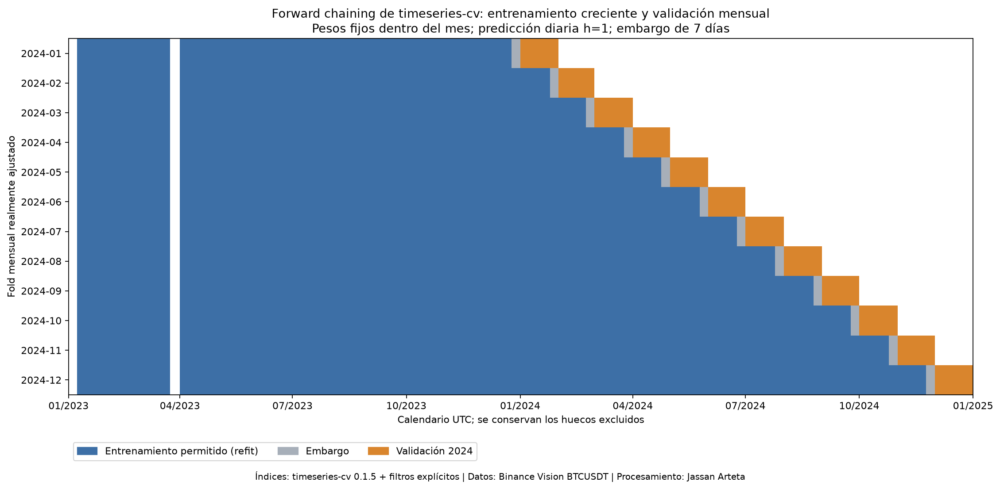
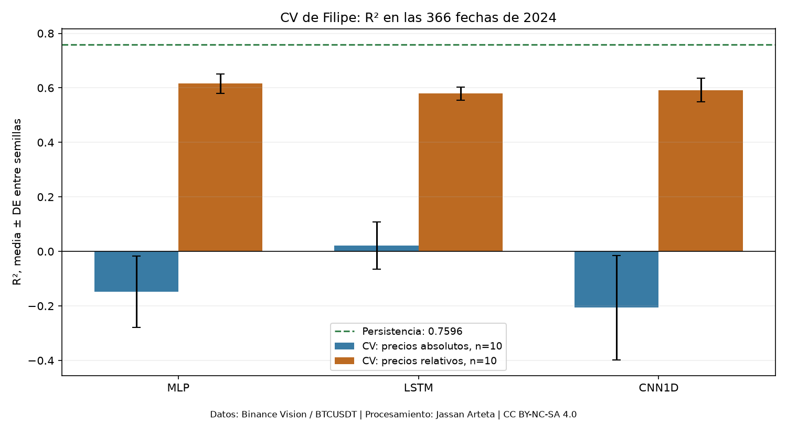
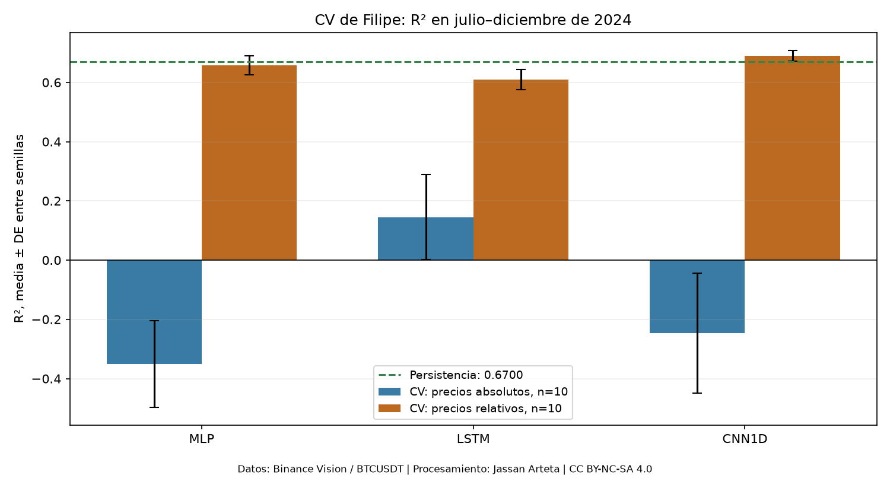
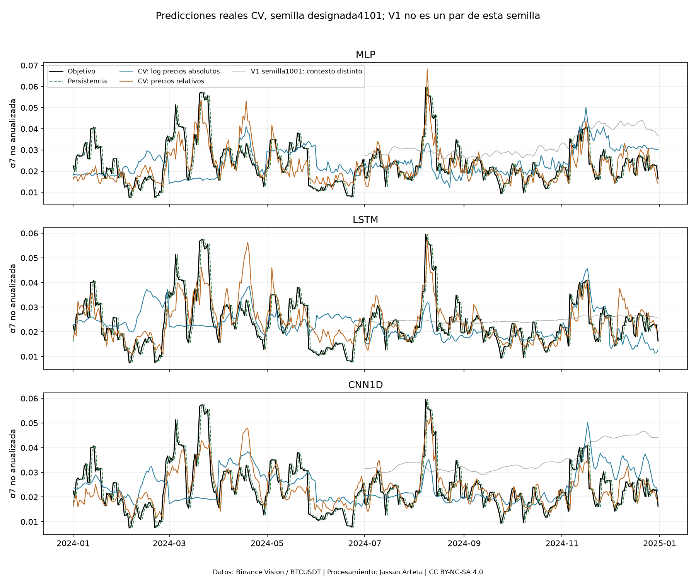
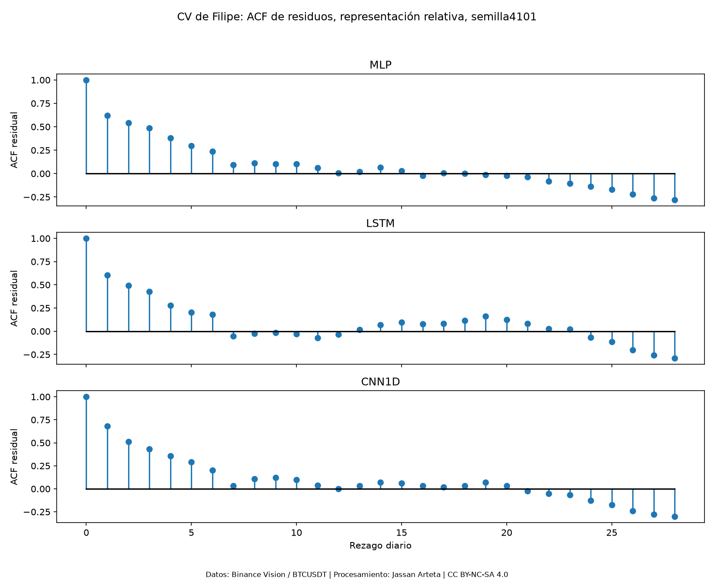
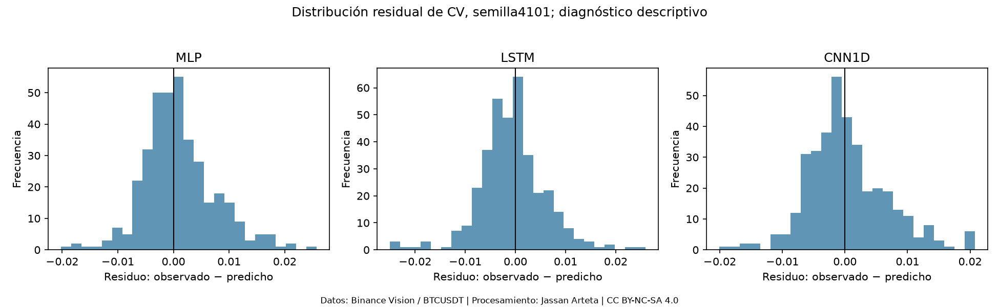

# 4. Implementación y evaluación: diseño y estado de ejecución

Se implementaron **MLP, LSTM y CNN1D poco profunda** mediante validación cruzada forward chaining con `timeseries-cv`, proyecto de DidierRLopes desarrollado con coautoría de Filipe R. Ramos. El entrenamiento comienza con 2023 e incorpora únicamente pasado permitido de 2024 en **doce bloques mensuales de validación**. La representación principal usa precios relativos al último cierre observable de cada ventana; `absolute_log` se conserva como control de preprocesamiento bajo la misma CV.

La ejecución terminó a las **15:26:13 UTC del 04/11/2026**: **60 trayectorias, 720 segmentos modelo–mes, 1.440 ajustes y 21.960 predicciones**, con 366 fechas y diez semillas por modelo/variante. El [resumen de ejecución](../_static/dl_r2_cv_20261104/execution_summary.json) identifica esas unidades. El suplemento estadístico utiliza esas predicciones y curvas ya guardadas: no añade entrenamientos, no modifica sus 1.440 ajustes ni abre test. Su [resumen](../_static/filipe_statistics_20261104/summary.json) registra fuentes, parámetros y alcance. Las tres redes relativas lograron R² anual positivo; persistencia conserva mejor RMSE anual (§4.4.9).

El calendario mantiene **2023 como entrenamiento inicial, 2024 para validación forward chaining, ajuste final con desarrollo 2023–2024 una vez cerradas las configuraciones y test previsto del 01/01/2025 al 31/08/2026**. El ajuste final y la evaluación reservada no se han ejecutado. Septiembre–octubre de 2026 queda sin asignar al test.

Las configuraciones se fijaron usando información de desarrollo que incluyó enero–junio de 2024. Las predicciones respetan la cronología de cada ajuste, pero esta evaluación es exploratoria: no constituye validación anidada de toda la selección ni confirmación sobre un periodo desconocido. La implementación no cierra por sí sola las fichas bibliográficas aplicadas pendientes de MLP/CNN1D de §3.

La evidencia está en el [método de CV](../_static/dl_r2_cv_20261104/method.json), las [configuraciones](../_static/dl_r2_cv_20261104/configuration.json), los [folds completos](../_static/dl_r2_cv_20261104/folds.json), su [resumen](../_static/dl_r2_cv_20261104/folds.csv) y la [firma previa a los ajustes](../_static/dl_r2_cv_20261104/code_manifest_before_fitting.json). Los índices admitidos alimentan efectivamente los entrenamientos y escaladores de cada mes.

## 4.1. Diseño Experimental

### 4.1.1. Definición clara de:

#### 4.1.1.1. Variables de entrada: representación y dimensiones

La unidad es un **día UTC de BTCUSDT**, agregado de velas oficiales de un minuto. Se utilizan apertura, máximo, mínimo, cierre y volumen (OHLCV), sin noticias ni atributos adicionales. Para el resultado del día d, las cinco covariables abarcan d−D,…,d−1.

Se fijó **D=7 común a las tres redes** usando desarrollo. El tensor es $X\in\mathbb R^{N\times7\times5}$; la MLP aplana esos mismos 35 valores. La CV compara `relative_window` y `absolute_log` sobre las mismas fuentes, fechas y ventanas (§4.1.3.1). No incorpora rezagos explícitos de σ7 como entrada.

Las ventanas conservan el calendario y no atraviesan días incompletos. El 24/03/2023 sigue excluido: no se imputa ni se construyen retornos saltando ese hueco.

#### 4.1.1.2. Variable objetivo y horizonte de predicción

El objetivo principal es la volatilidad poblacional de **siete retornos logarítmicos diarios**, $\sigma_7$, con `ddof=0`, sin anualizar; el horizonte es **h=1**. Las sensibilidades del objetivo $n=14,21,28$ y de otras historias de entrada no forman parte de esta ejecución.

Para el día de resultado $d$, se pronostica al inicio de ese día con $X_d=(z_{d-D},\ldots,z_{d-1})$, $z=(O,H,L,C,V)$, y $y_d=\sigma_7(d)$, conocida al terminar $d$. Incluye el retorno desconocido de ese día; no representa siete días enteramente futuros. Se conservan fecha, origen y disponibilidad de etiqueta.

La salida escalar utiliza Softplus para mantener positividad. Se entrenó con **MSE**, tras dividir Y por su media positiva de entrenamiento sin centrarla; las métricas se calcularon después de invertir esa escala. **RMSE es primaria**; MAE, MSE, R², MAPE y MASE son complementarias. Las políticas de ceros, escala y cobertura se mantienen en §4.4.2.

### 4.1.2. División del dataset

#### 4.1.2.1. Entrenamiento, validación y prueba

El calendario requerido distingue entrenamiento inicial, validación forward y evaluación reservada:

| Etapa | Calendario UTC | Aplicación |
|---|---|---|
| Entrenamiento inicial | 2023 | Primer bloque ajustado con 343 resultados elegibles hasta 24/12/2023 |
| Validación cruzada forward | Todo 2024 | Doce bloques mensuales; el entrenamiento crece con pasado ya observado de 2024, con embargo |
| Ajuste final de desarrollo | 2023–2024 | Pendiente tras cerrar la configuración; no lo realiza el runner de CV |
| Test reservado | 01/01/2025–31/08/2026 | 608 días de calendario; no utilizado para ajuste ni evaluación en esta CV |

En el primer bloque, la parada interna usa 253 muestras de subentrenamiento hasta 25/09/2023 y 83 etiquetas de validación interna del 03/10 al 24/12. En diciembre de 2024, el reajuste completo admite 678 etiquetas hasta 23/11/2024. Los índices exactos, no una proporción aleatoria, determinan las muestras.

Los 365 días de 2023, 366 de 2024 y 608 de test suman 1.339 días (27,26 %, 27,33 % y 45,41 %); son proporciones de calendario, no de muestras independientes. Septiembre–octubre de 2026 queda sin asignar. La [reserva de test](../_static/data/test_raw_reserve_20250101_20260831.json) identifica 20 ZIP por metadatos/hashes, sin congelar todavía sus muestras supervisadas.

#### 4.1.2.2. Esquema de validación y selección de hiperparámetros

Se ejecutó realmente `tsxv.splitTrainVal.split_train_val_forwardChaining(np.arange(731), 7, 1, 1)` de **timeseries-cv 0.1.5**, con NumPy 1.26.4 en su entorno separado. La función produce 716 orígenes diarios sobre el calendario completo; 366 corresponden a 2024. Como la biblioteca no ofrece una API mensual, el script agrupa esos orígenes en **12 bloques de calendario** y toma los candidatos de entrenamiento del primer fold diario de cada mes, con filtros de elegibilidad y embargo más estricto. El runner recibe y usa esos índices para entrenar las redes, no solo para dibujar una partición.

Para el primer día mensual $t$, el reajuste completo admite resultados $u\le t-D-1$, con D=7. El comienzo interno es $v=t-90$ días; el subentrenamiento admite $u\le v-D-1$ y la validación interna abarca v,…,t−D−1: **83 etiquetas** tras la purga, no 90 observaciones. Ambos cortes comprueban disponibilidad y calidad. El embargo no demuestra independencia de las volatilidades móviles.

| Fold | Último resultado de entrenamiento | N entrenamiento | N subentrenamiento | N validación interna | Días evaluados |
|---|---|---:|---:|---:|---:|
| 2024-01 | 24/12/2023 | 343 | 253 | 83 | 31 |
| 2024-02 | 24/01/2024 | 374 | 284 | 83 | 29 |
| 2024-03 | 22/02/2024 | 403 | 313 | 83 | 31 |
| 2024-04 | 24/03/2024 | 434 | 344 | 83 | 30 |
| 2024-05 | 23/04/2024 | 464 | 374 | 83 | 31 |
| 2024-06 | 24/05/2024 | 495 | 405 | 83 | 30 |
| 2024-07 | 23/06/2024 | 525 | 435 | 83 | 31 |
| 2024-08 | 24/07/2024 | 556 | 466 | 83 | 31 |
| 2024-09 | 24/08/2024 | 587 | 497 | 83 | 30 |
| 2024-10 | 23/09/2024 | 617 | 527 | 83 | 31 |
| 2024-11 | 24/10/2024 | 648 | 558 | 83 | 30 |
| 2024-12 | 23/11/2024 | 678 | 588 | 83 | 31 |

Se reajusta una vez por mes y se mantienen sus pesos durante ese mes. Cada pronóstico sigue siendo **h=1 diario** y utiliza la historia ya observable de su propio origen; no es un pronóstico de todo el mes emitido el día primero, ni son 366 reajustes. Los campos `test_indices` de los folds nombran validación mensual dentro de 2024, no el test reservado de 2025–2026.

D y los hiperparámetros se fijaron usando desarrollo, incluido enero–junio de 2024. Los folds mantienen causalidad por ajuste, pero la evaluación no es una validación anidada confirmatoria de todo el proceso de selección.

### 4.1.3. Definición de pipeline

#### 4.1.3.1. Preprocesamiento y construcción de datos

El pipeline verifica hashes, calendario, continuidad y alineación de los derivados diarios de 2023–2024, sin imputación. Los dos preprocesamientos se evalúan con las mismas particiones de Filipe:

| Variante | Transformación de precios | Ajuste de estandarización por canal |
|---|---|---|
| `relative_window`, principal | log(OHLC/cierre del último día de esa ventana), y log1p(volumen) | Todas las posiciones de las ventanas de entrenamiento |
| `absolute_log`, control CV | log(OHLC), y log1p(volumen) | Días de entrada únicos cubiertos por ventanas de entrenamiento |

La representación principal reduce la dependencia del nivel nominal del precio mediante el cierre ya observado al final de la propia ventana. **También cambia la ponderación de días repetidos en la estandarización**; la comparación evalúa dos especificaciones completas de preprocesamiento, sin atribuir aisladamente el resultado al cociente de precios.

Medias/desviaciones de X y media positiva de Y se ajustan solo con el entrenamiento de su etapa. Y se divide por esa media sin centrar y se invierte antes de puntuar. Una desviación nula de X se sustituye por uno y se registra. Los escaladores se recalculan por mes y por subajuste/reajuste con pasado permitido, sin estadísticas del bloque mensual evaluado.

#### 4.1.3.2. Entrenamiento y parada temprana

Cada segmento modelo–mes realiza **dos ajustes nuevos**: primero el subentrenamiento permitido elige duración por la MSE de su validación interna pasada; después se descartan esos pesos y se reajusta desde otra inicialización sobre la cohorte mensual completa permitida durante exactamente la mejor época elegida. Ambos ajustes calculan sus propios escaladores.

Una trayectoria variante–modelo–semilla encadena los doce modelos mensuales y sus predicciones diarias, con **24 ajustes por trayectoria**. No hay warm start entre meses ni se consulta el objetivo futuro del mes para elegir épocas. El entrenamiento incorpora resultados de meses anteriores de 2024 cuando ya están disponibles y cumplen el embargo.

#### 4.1.3.3. Evaluación y agregación de métricas

Se guardan objetivos, predicciones, fecha, origen, disponibilidad, variante, modelo, semilla y fold mensual. Cada trayectoria concatena sus **366 predicciones de 2024, una por fecha**, y calcula:

$$
\operatorname{RMSE}_{m,s,v}=\sqrt{\frac1{366}\sum_{d\in2024}(Y_d-\widehat Y_{m,s,v,d})^2}.
$$

R² se calcula con la media de Y y las sumas de cuadrados de **todo el calendario agrupado**. Las métricas mensuales se conservan para diagnóstico; ni el promedio de R² mensuales ni el de RMSE mensuales sustituye estas métricas globales. Promediar RMSE de días unitarios produciría MAE.

Las métricas se resumen entre las diez trayectorias de cada modelo/variante, sin sustituirlas por una predicción ensemble. Julio–diciembre se presenta además como desglose semestral de la misma CV, con 184 fechas y diez semillas. El test final no participa.

### 4.1.4. Piloto

No se ejecutó un **piloto prospectivo previo para dimensionar las repeticiones de esta CV**. Las diez semillas por modelo y variante fueron un presupuesto exploratorio. Su dispersión ya observada puede calibrar escenarios de una evaluación futura, pero no convierte las corridas existentes en un piloto registrado antes de entrenar.

El suplemento estadístico utiliza las diez diferencias de RMSE red–persistencia para calcular **sensibilidad de planificación retrospectiva y condicional al calendario**. Se declara α de planificación 0,05/12, objetivo hipotético de potencia 0,80 y margen de referencia 5 % del RMSE anual de persistencia. No se calcula potencia con el efecto observado ni se acredita suficiencia de las diez semillas.

Para una planificación prospectiva se requerirá un piloto bajo los folds, representación, ajuste y estimando que efectivamente se evaluarán. La dispersión estimada con diez recorridos es incierta. Para una métrica por semilla $m_s$ se conservan:

$$
\bar m=\frac1R\sum_s m_s,\qquad
s_m=\sqrt{\frac{\sum_s(m_s-\bar m)^2}{R-1}},\qquad
\mathrm{CV}=\frac{s_m}{\bar m}.
$$

Ni los doce bloques mensuales, ni los dos ajustes internos, ni las fechas constituyen semillas o mercados independientes. La [sensibilidad de diseño](../_static/filipe_statistics_20261104/design_sensitivity.csv) identifica su estimando y carácter retrospectivo.

### 4.1.5. Diferencia mínima de interés

El margen operativo es una **reducción relativa del 5 % de RMSE frente a persistencia**, sobre las mismas fechas y objetivo. Si $b>0$ es el RMSE determinista de persistencia y $m_{A,s}$ el de una red:

$$
G_s=b-m_{A,s},\qquad Q_s=1-\frac{m_{A,s}}b.
$$

El año 2024 de referencia tiene $b=0{,}00478897$ y, por tanto, $\delta_{\rm plan}=0{,}05b\approx0{,}000239449$. Esta conversión se usa únicamente como escenario para detectar frente a cero una diferencia de esa magnitud. No define un margen entre redes, de equivalencia o para una propuesta avanzada.

**Detectar frente a cero un efecto del tamaño del 5 % no demuestra que la ganancia supere el 5 %.** El suplemento contrasta por separado $H_0:\mu_Q\le0{,}05$ frente a ganancia mayor; su dimensionamiento prospectivo requeriría una alternativa $q_{\rm alt}>0{,}05$, que no se ha fijado. La calibración de dispersión no resuelve esa planificación ni convierte las fechas examinadas en confirmación externa.

### 4.1.6. Tamaño de muestra

Se ejecutaron **diez trayectorias por modelo y variante**, sin aumentar ese número al añadir análisis sobre predicciones guardadas. El suplemento presenta un R orientativo bajo aproximación normal, estimado con la dispersión de las diferencias ya disponibles:

$$
R_{\rm orientativo}\approx\left\lceil\frac{(z_{1-\alpha_{\rm plan}/2}+z_{0{,}80})^2\widehat\sigma_d^2}{\delta_{\rm plan}^2}\right\rceil,\qquad
\alpha_{\rm plan}=0{,}05/12.
$$

La familia global comprende nueve comparaciones suplementarias entre redes, persistencia y frontera de ganancia, más los tres controles de representación. Esta aproximación incorpora ese nivel conservador de planificación; no es una garantía de potencia ni corrige automáticamente la incertidumbre de σ_d, la dependencia temporal o el uso previo de desarrollo.

El [CSV de sensibilidad](../_static/filipe_statistics_20261104/design_sensitivity.csv) conserva dispersión, R actual, margen, nivel y R orientativo. Detectar grandes diferencias observadas puede ser posible sin demostrar sensibilidad suficiente para una mejora pequeña. La planificación definitiva requiere un piloto prospectivo y la alternativa que realmente interese; tampoco se ha dimensionado el número de periodos de mercado independientes.

### 4.1.7. Diferencia mínima detectable

Se calcula una **MDE₀ orientativa por dispersión retrospectiva** para R=10, detección frente a cero y potencia objetivo hipotética 0,80:

$$
\mathrm{MDE}_0(R)=\frac{(z_{1-\alpha_{\rm plan}/2}+z_{0{,}80})\widehat\sigma_d}{\sqrt R},\qquad
\alpha_{\rm plan}=0{,}05/12.
$$

El denominador se refiere a pares de inicializaciones condicionados al mismo calendario. La MDE no utiliza el efecto medio observado para calcular una supuesta potencia alcanzada. Tampoco es el umbral que debe superar una propuesta avanzada: falta su varianza pareada y un margen aplicado propio.

| Red relativa − persistencia | DE de diferencia RMSE | MDE₀ orientativa, R=10 | δ de referencia frente a cero | R orientativo normal |
|---|---:|---:|---:|---:|
| MLP | 0,000277963 | 0,000325833 | 0,000239448 | 19 |
| LSTM | 0,000187010 | 0,000219216 | 0,000239448 | 9 |
| CNN1D | 0,000337292 | 0,000395379 | 0,000239448 | 28 |

El escenario de LSTM arroja R orientativo 9 y los de MLP/CNN1D 19/28; que un número sea menor o mayor que diez no certifica potencia alcanzada: se usó una aproximación normal y una dispersión estimada con pocas semillas. Los [escenarios](../_static/filipe_statistics_20261104/design_sensitivity.csv) separan la MDE₀, el margen de referencia y el R orientativo. Son información de planificación futura, no un piloto anterior a la CV ni evidencia de potencia real 0,80. El dimensionamiento prospectivo y la planificación para demostrar ganancia mayor de 5 % permanecen abiertos.

### 4.1.8. Relación con el Entregable 2

La CV entrega código, particiones efectivas, configuraciones y resultados de desarrollo para la etapa posterior. La calibración retrospectiva de dispersión y su MDE₀ orientativa están disponibles; el piloto prospectivo, dimensionamiento definitivo y margen frente a un modelo avanzado siguen abiertos.

El calendario posterior es **cerrar la configuración con desarrollo 2023–2024, realizar su ajuste final permitido y evaluar una sola vez el test 2025–agosto de 2026** bajo el protocolo registrado correspondiente. Los dos últimos pasos no están ejecutados aquí. Las decisiones tomadas con resultados de desarrollo ya conocidos conservarán su fecha y alcance exploratorio. Sigue pendiente completar el respaldo bibliográfico aplicado del trío.

### 4.1.9. Registro

#### 4.1.9.1. Preregistro fechado y trazabilidad

Las especificaciones utilizadas se registraron a las **15:17:28 UTC del 04/11/2026**. El [resumen del método](../_static/dl_r2_cv_20261104/method.json) presenta el calendario y los controles, y el [manifiesto de código](../_static/dl_r2_cv_20261104/code_manifest_before_fitting.json), previo a los ajustes CV, enlaza el commit **`1f0ed23`**, los folds, los scripts y la firma `2a535b6ffdd8a7e11f9d017b9f62b75bdff6ad5f7e7b228b1f49b8a78d2d54a6`.

El registro antecede a estos ajustes, pero es posterior al EDA y al uso de información de desarrollo para fijar configuraciones. El [protocolo del suplemento](https://github.com/jassan-bit/DeepLearning_202630/blob/main/experiments/filipe_statistics_20261104/protocol.json) se fechó antes de sus cálculos, después de examinar descriptivamente 2024. Ninguno de los dos registros se presenta como anterior a toda observación ni como validación anidada confirmatoria.

#### 4.1.9.2. Estado del diseño y del piloto

| Producto | Estado y alcance |
|---|---|
| Folds de Filipe | Doce bloques mensuales, índices efectivos y hashes registrados |
| Configuraciones | D=7 e hiperparámetros fijados con desarrollo; representación relativa principal y control absoluto |
| Repeticiones | Diez trayectorias por modelo/variante: 60 trayectorias, 720 segmentos y 1.440 ajustes |
| Métricas y comparación | Métricas anuales/semestrales, sesgo, folds y análisis suplementario de diferencias, pérdidas temporales y residuos |
| Piloto y potencia de la CV | Calibración retrospectiva y escenarios MDE₀/R orientativo disponibles; piloto prospectivo y potencia definitiva pendientes |
| Bibliografía aplicada de MLP/CNN1D | Incompleta; entrenar código no sustituye evidencia de literatura |
| Objetivos n=14/21/28 y ruido simulado | No ejecutados |
| Ajuste final 2023–2024 y test reservado | Pendientes |

## 4.2. Implementación de los Tres Modelos Base

Se implementaron **MLP, LSTM unidireccional y CNN1D causal de dos capas** con validación forward mensual de Filipe. La representación principal es `relative_window`; el control `absolute_log` usa los mismos folds y semillas. GRU permanece como alternativa sin corrida; TCN y encoder de las fuentes no sustituyen el trío. Las configuraciones propias no se atribuyen a una réplica exacta de los artículos ni cierran las fichas aplicadas pendientes de §3.

### 4.2.1. Implementación de los tres modelos base

Las tres redes reciben D días de las mismas cinco covariables y producen un escalar positivo. Las configuraciones fijadas con desarrollo son:

| Modelo | Arquitectura implementada | H seleccionado |
|---|---|---:|
| MLP | Flatten → Linear(5D,H) → ReLU → Dropout(0,1) → Linear(H,1) → Softplus | 16 |
| LSTM | Una capa unidireccional → último estado oculto → Dropout(0,1) → Linear(H,1) → Softplus | 32 |
| CNN1D | Conv causal k=3, 5→H → ReLU/Dropout → Conv causal k=3, H→H → ReLU/Dropout → media temporal → Linear(H,1) → Softplus | 16 |

CNN1D usa padding solo a la izquierda; carece de dilatación, conexiones residuales y atención. El dropout es 0,1 después de cada convolución. LSTM usa los dos vectores de sesgo por puerta de PyTorch. Son implementaciones del proyecto; las ecuaciones y configuraciones de artículos de §3.3 se conservan con su atribución original.

### 4.2.2. Entrenamiento con el mismo pipeline, partición y semillas

#### 4.2.2.1. Pipeline, partición e información comunes

| Componente | Condición común ejecutada en CV |
|---|---|
| Datos y objetivo | Mismos derivados OHLCV, σ7, h=1 y D=7 |
| Partición | Mismos índices de Filipe, embargo y doce bloques mensuales |
| Información | Cinco canales idénticos; ninguna red recibe rezagos explícitos de σ7 |
| Preprocesamiento | Misma variante para comparar redes; ambas variantes sobre iguales ventanas |
| Ajuste | Dos etapas nuevas por modelo/mes; mismo límite y criterio interno de épocas |
| Semillas | Diez semillas comunes entre redes y variantes |
| Configuración | Hiperparámetros fijados con desarrollo; sin búsqueda dentro de la CV |
| Evaluación | Mismo calendario de 366 fechas, métricas originales y coberturas |

La comparación `relative_window` frente a `absolute_log` dentro de una familia mantiene semilla, fechas y cortes; el preprocesamiento es el factor intervenido. Puede cambiar la duración elegida por la misma regla interna. Las redes comparten exactamente la información entre sí; persistencia conserva la diferencia histórica declarada en §4.4.3.

#### 4.2.2.2. Semillas, reinicios y reproducibilidad

Se fijaron las diez semillas base **4101–4110**, comunes a las tres redes y las dos variantes. Cada mes usa `baseseed + monthordinal*100000`; el reajuste usa esa semilla mensual más 10000000 y el orden de lotes la semilla de su etapa más 17.

Cada etapa inicializa pesos nuevos y ajusta sus propios escaladores, sin warm start entre meses o etapas. Barajar los lotes del entrenamiento admitido no altera la cronología de ventanas y cortes. Las semillas describen aleatoriedad de entrenamiento sobre el mismo mercado, no nuevos mercados independientes. El registro identifica configuración, mes, semilla, firma de código y resultados.

### 4.2.3. Definición de hiperparámetros

Los hiperparámetros se fijaron con información de desarrollo y permanecen iguales en ambas variantes y todos los folds. En esta CV no se ejecutó otra búsqueda de arquitecturas o hiperparámetros.

| Campo | Valor ejecutado |
|---|---|
| Historia de entrada | D=7; objetivo n=7, h=1 |
| MLP | H=16; learning rate 0,001 |
| LSTM | H=32; learning rate 0,003 |
| CNN1D | H=16; learning rate 0,001 |
| Planificador | Ninguno |
| Batch size | 32 |
| Optimizador | AdamW |
| Regularización | Dropout 0,1; weight decay 0,0001 |
| Pérdida | MSE en Y dividida por media positiva train |
| Salida | Softplus |
| Gradiente | Clipping de norma 1 |
| Épocas máximas | 100 en ajuste interno |
| Parada | Mínima MSE de validación interna, patience=12, min_delta=0,00001 |

#### 4.2.3.1. Learning rate y planificador

Se usó AdamW **sin planificador**, con learning rate 0,001 en MLP/CNN1D y 0,003 en LSTM. Esos valores se fijaron usando desarrollo, incluido enero–junio de 2024, y no se reseleccionan por mes o por semilla. La exposición de esa selección impide presentar esta CV como una evaluación anidada independiente.

#### 4.2.3.2. Número de capas y unidades

La MLP tiene una capa oculta de 16 unidades, LSTM una capa recurrente unidireccional de 32 y CNN1D dos capas convolucionales k=3 de 16 canales. La profundidad y anchura permanecen fijas en todos los folds y ambos preprocesamientos. Son configuraciones del proyecto, sin adjudicar esos números a las fuentes documentales.

#### 4.2.3.3. Batch size

Se utilizó **batch size=32** para los tres modelos en ambas etapas de ajuste. No se buscó otro tamaño de lote. La medición de inferencia usa un máximo de 256 ejemplos por lote y se distingue del entrenamiento.

#### 4.2.3.4. Optimizador, regularización y función de pérdida

Se usó AdamW con weight decay=0,0001, dropout=0,1 y clipping de norma de gradiente=1. La ubicación del dropout se especifica en §4.2.1. La pérdida es MSE de $Y/\bar Y_{\mathrm{train}}$, con $\bar Y_{\mathrm{train}}>0$ y sin centrar: su término de datos equivale a la MSE original dividida por una constante positiva dentro de cada ajuste. No se entrenó con log(Y).

Los escaladores de X e Y se estiman de nuevo con el entrenamiento admitido de cada etapa; no con su validación. Softplus es la decisión propia para positividad. La inversión de la escala de Y precede a toda métrica publicada.

### 4.2.4. Estrategia de entrenamiento

#### 4.2.4.1. Número máximo de épocas

El ajuste interno permite **hasta 100 épocas**, en CPU y float32. Se aplica dentro de cada bloque mensual; el reajuste completo desde cero ejecuta exactamente la mejor época interna. Los pesos se mantienen dentro del mes y se reinician al comenzar el siguiente, incorporando únicamente pasado admitido.

#### 4.2.4.2. Early stopping y validación interna

Se minimiza la **MSE escalada de validación interna por época**, con `patience=12` y `min_delta=1e-5`. Se conserva la mejor época, se descarta el modelo interno y se inicializa otro modelo para el reajuste completo por esa duración; no se restaura el checkpoint interno como modelo definitivo.

En CV, el inicio interno es 90 días de calendario antes del comienzo del mes. Con embargo D=7, quedan **83 resultados internos** hasta el corte externo. Para enero: subentrenamiento hasta 25/09/2023 (253 ejemplos), validación interna 03/10–24/12 (83), reajuste completo hasta 24/12 (343). Para diciembre: subentrenamiento hasta 25/08/2024 (588), validación 02/09–23/11 (83), reajuste hasta 23/11 (678). Los escaladores se ajustan por separado a cada entrenamiento.

Las etiquetas del mes externo no eligen sus épocas. Incorporar meses anteriores de 2024 en ajustes posteriores sigue la política creciente registrada y respeta el embargo y la disponibilidad.

### 4.2.5. Registro

Una **trayectoria** variante–modelo–semilla contiene doce segmentos mensuales, cada uno con dos ajustes nuevos. La ejecución terminó a las 15:26:13 UTC; sus unidades se contabilizan por separado:

| Unidad | Cantidad | Interpretación |
|---|---:|---|
| Trayectorias | 60 | 2 variantes × 3 modelos × 10 semillas |
| Segmentos modelo–mes | 720 | Doce modelos mensuales por trayectoria |
| Ajustes efectivos | 1.440 | Selección interna de duración y reajuste nuevo por segmento |
| Predicciones | 21.960 | 366 fechas por trayectoria |

Los [folds](../_static/dl_r2_cv_20261104/folds.json) vinculan índices, fechas y disponibilidad. El [registro](../_static/dl_r2_cv_20261104/runs.csv) y los artefactos de cada segmento conservan arquitectura, semilla, preprocesamiento, mejor época, pesos, pérdidas y predicciones. Los segmentos, ajustes y fechas no se cuentan como semillas o mercados independientes.

#### 4.2.5.1. Curvas de entrenamiento y validación

Se conservaron **`history_inner.csv` y `history_refit.csv` para cada uno de los 720 segmentos modelo–mes**, dentro del paquete reproducible. El primero registra las curvas de entrenamiento y validación interna empleadas para elegir duración; el segundo registra el reajuste completo por esa duración.

Cada curva se interpreta con sus propias fechas, escala de Y y conjunto de ajuste. Las pérdidas internas no son curvas del mes externo de validación ni del test reservado. Las curvas de reajuste no contienen una nueva selección de duración sobre el mes evaluado. Las curvas internas reales de diciembre, semilla 4101, se muestran e interpretan en §4.4.9.4; se eligió ese corte por calendario, no por menor error.

#### 4.2.5.2. Número de parámetros

Los conteos medidos coinciden con estas expresiones propias; todos los parámetros son entrenables y no hay parámetros no entrenables:

| Modelo | Expresión para cinco canales | D y H seleccionados | Parámetros |
|---|---|---|---:|
| MLP | $(5D+1)H+(H+1)$ | D=7, H=16 | 593 |
| LSTM | $4H(5+H+2)+(H+1)$ | D=7, H=32 | 5.025 |
| CNN1D | $(15H+H)+(3H^2+H)+(H+1)$ | D=7, H=16 | 1.057 |

Los dos sesgos por puerta explican el +2 de LSTM. CNN incluye dos convoluciones k=3 y su cabeza lineal; el pooling y Softplus no añaden parámetros. Estos son conteos de código ejecutado, distintos de los conteos documentales condicionados de §3.

#### 4.2.5.3. Tiempo computacional y hardware empleado

Las mediciones son media ± DE de diez trayectorias por modelo/variante. Cada tiempo de entrenamiento suma los **24 ajustes** de la trayectoria; la inferencia suma las doce evaluaciones mensuales sobre sus **366 casos**.

| Variante CV | Modelo | Entrenamiento anual (s) | Inferencia de 366 casos (ms) |
|---|---|---:|---:|
| `absolute_log` | MLP | 9,1894 ± 1,6171 | 0,640 ± 0,090 |
| `absolute_log` | LSTM | 12,0101 ± 1,7380 | 3,751 ± 0,654 |
| `absolute_log` | CNN1D | 17,6608 ± 2,9553 | 4,085 ± 0,320 |
| `relative_window` | MLP | 21,3521 ± 1,2338 | 0,623 ± 0,041 |
| `relative_window` | LSTM | 18,5052 ± 2,3046 | 3,212 ± 0,362 |
| `relative_window` | CNN1D | 44,3499 ± 2,4250 | 3,691 ± 0,235 |

Son tiempos de pared con **tres workers de trayectorias concurrentes**, un hilo PyTorch por worker, CPU y float32. Incluyen el ajuste y su evaluación interna, sin preprocesamiento ni serialización. La inferencia usa cinco calentamientos y veinte pasadas con batch máximo 256; excluye inversión de escala y escritura. No son mediciones universales de latencia o despliegue.

Los [tiempos individuales](../_static/dl_r2_cv_20261104/runs.csv) y el [runtime](../_static/dl_r2_cv_20261104/runtime.json) conservan precisión, versiones, backend y límites de recursos. No se utilizó GPU.

### 4.2.6. Equidad en la optimización

Las tres redes reciben los mismos folds, diez semillas, preprocesamiento dentro de cada variante, límite de épocas, regla interna de parada y procedimiento de reajuste. Las configuraciones se mantienen fijas; igual presupuesto de entrenamiento no implica igual tiempo ni capacidad, por lo que ambos se reportan.

**No se ejecutó una búsqueda de hiperparámetros mediante CV en esta implementación.** Los valores se fijaron con desarrollo y se usan para comparar los dos preprocesamientos bajo condiciones comunes. Una búsqueda posterior deberá registrar el mismo método y presupuesto por red, espacios comparables y una separación de selección/evaluación adecuada. La CV presentada es exploratoria y no demuestra optimalidad de sus configuraciones.

### 4.2.7. Implementación desde cero o uso de librerías justificadas

#### 4.2.7.1. Implementación y entorno de software

La implementación usa módulos de **PyTorch 2.15.0+cpu**, Python 3.12.14 y float32. `dl_data.py` y `dl_data_v2.py` construyen datos y transformaciones; `dl_models.py` define las tres redes. El [runner CV](https://github.com/jassan-bit/DeepLearning_202630/blob/main/scripts/train_dl_r2_cv.py) ejecuta los ajustes reales y el [analizador](https://github.com/jassan-bit/DeepLearning_202630/blob/main/scripts/analyze_dl_r2_v2.py) calcula métricas y figuras. Las capas, pérdidas, optimizador y controles son explícitos.

La [preparación de folds](https://github.com/jassan-bit/DeepLearning_202630/blob/main/scripts/prepare_dl_r2_cv.py) ejecuta `timeseries-cv` 0.1.5 con NumPy 1.26.4 en un entorno separado, por compatibilidad de dependencias. El entrenador PyTorch consume esos mismos índices; no los sustituye por otro esquema. El [preprocesamiento relativo](https://github.com/jassan-bit/DeepLearning_202630/blob/main/scripts/dl_data_v2.py) mantiene la misma información OHLCV entre redes.

`requirements-training.lock.txt` y el [runtime](../_static/dl_r2_cv_20261104/runtime.json) registran NumPy 2.5.4, pandas 3.1.0, SciPy 1.18.1, statsmodels 0.15.0 y Matplotlib 3.11.2 para entrenamiento/análisis. Los hashes de función, módulo, scripts y manifiesto permiten verificar que los dos entornos utilizan los índices declarados.

#### 4.2.7.2. Estado de implementación

| Producto por familia | Estado |
|---|---|
| Arquitectura propia | Implementada y entrenada en doce folds mensuales |
| Hiperparámetros | Fijos con desarrollo; sin nueva búsqueda CV |
| Piloto de dimensionamiento | No hubo piloto prospectivo; dispersión actual utilizada solo para sensibilidad de planificación futura |
| Repeticiones | Diez trayectorias por variante; veinte entre ambas |
| Segmentos mensuales | 240 por familia, contando ambas variantes |
| Ajustes efectivos | 480 por familia |
| Artefactos | Configuraciones, escaladores, pérdidas, pesos y predicciones por segmento |
| Ajuste final 2023–2024/test | Pendientes |

La implementación no completa la trazabilidad bibliográfica aplicada de MLP/CNN1D ni demuestra reproducción exacta de los artículos.

## 4.3. Requisitos Experimentales

Los controles se aplican al entrenamiento forward mensual efectivo con índices de Filipe. La elección de configuraciones utilizó información del desarrollo ya examinado: mantener causalidad en cada fold no convierte este calendario en un conjunto confirmatorio independiente.

### 4.3.1. Control de semillas aleatorias

El runner fija Python, NumPy y PyTorch por etapa; utiliza las semillas y offsets de §4.2.2.2, incluido un generador explícito para lotes. Se activó **`torch.use_deterministic_algorithms(True)`** y un hilo de cómputo/interoperabilidad por worker. Runtime, precisión, backend y firma de código quedan registrados; no se presume identidad bit a bit entre versiones o hardware distintos.

La misma etiqueta de semilla entre arquitecturas conserva el emparejamiento operativo; no produce pesos iguales ni garantiza reducción de varianza. Una repetición técnica con igual semilla no se cuenta como otra corrida independiente de entrenamiento.

Se conservan esas opciones CPU y las semillas base/mensuales de §4.2.2.2, con diez trayectorias por variante/modelo. Los doce meses de una trayectoria comparten una semilla base identificable, pero cada segmento inicializa nuevos pesos por la regla fijada.

### 4.3.2. Repetición de experimentos

Se ejecutaron **diez trayectorias por modelo y variante**, con semillas base 4101–4110. El número es un presupuesto exploratorio declarado, **sin piloto específico de dimensionamiento ni garantía de potencia del 80 %**.

| Unidad | Interpretación |
|---|---|
| Trayectoria variante–modelo–semilla | Un procedimiento aleatorio de entrenamiento evaluado durante todo 2024 |
| Segmento mensual | Una etapa temporal de esa trayectoria, con dos ajustes |
| Fecha | Un objetivo temporal dependiente, no otra réplica independiente |
| Variante | Una especificación diferente del preprocesamiento |

Las doce particiones permiten examinar cambios temporales bajo el mismo mercado; no crean doce mercados independientes ni aumentan R a 120. Las comparaciones controladas entre variantes emparejan las diez semillas y las mismas fechas.

### 4.3.3. Reporte de media, desviación estándar e intervalos de confianza

Se calcula media, DE muestral e **IC marginal del 95 % t de Student con nueve grados de libertad** sobre diez trayectorias por modelo/variante, condicionado al calendario de 2024. Los resúmenes [anual](../_static/dl_r2_cv_20261104/analysis/metrics_summary.csv) y [semestral](../_static/dl_r2_cv_20261104/analysis/metrics_common_h2_cv_only.csv) identifican sus fechas. Son intervalos de aleatorización del entrenamiento; no representan toda la incertidumbre temporal o de selección.

El suplemento añade **nueve contrastes**: tres entre las redes relativas, tres red–persistencia y tres sobre ganancia relativa mayor que 5 %. Junto a los tres controles relativa–absoluta forman una **familia global Holm de doce**, que es el ajuste principal de reporte. Los ajustes de componentes de nueve y tres quedan como trazabilidad, sin tratarlos como confirmaciones independientes. Los IC del 95 % continúan siendo marginales: pueden excluir cero aunque el contraste ajustado de la familia no rechace.

| Contraste CV, relativo − absoluto | Diferencia media de RMSE | IC marginal 95 % | p Holm global, 12 contrastes |
|---|---:|---:|---:|
| MLP | -0,00439825 | [-0,00469839; -0,00409810] | 1.2228e-09 |
| LSTM | -0,00331851 | [-0,00361490; -0,00302213] | 1.12113e-08 |
| CNN1D | -0,00446676 | [-0,00506264; -0,00387089] | 3.48441e-07 |

El [CSV global](../_static/filipe_statistics_20261104/global_seed_tests.csv) conserva diferencias, estadísticos, grados de libertad, p-valores ajustados/sin ajustar y efectos. Los tres controles favorecen la representación relativa. Entre las redes principales, ningún contraste de RMSE rechaza con Holm global a α=0,05: el ranking anual continúa siendo descriptivo. Las redes tienen mayor RMSE que persistencia en estas diez inicializaciones; la incertidumbre por fechas se examina por separado.

El suplemento calcula además IC temporales marginales mediante **2.000 remuestreos circulares pareados de fechas**, bloque principal de 14 días y sensibilidad 7/28. En cada remuestreo se recalcula RMSE por semilla y después su media; no se reentrena ni se remuestrean semillas. Estos IC condicionan a los modelos guardados y no se vuelven simultáneos por aplicar Holm a otros p-valores.

### 4.3.4. Uso de GPU

**Se entrenó en CPU; no se utilizó GPU.** El [runtime](../_static/dl_r2_cv_20261104/runtime.json) registra `cuda_available=false`, Linux x86_64, float32, determinismo, versiones y límites cgroup. Se utilizaron tres workers de trayectorias, con un hilo PyTorch y uno de interoperabilidad por worker.

La memoria máxima permitida fue 32 GiB; ese límite no es una medición de pico consumido. No se inventan driver o memoria GPU. Los tiempos corresponden a ejecución concurrente y al procedimiento completo de doce cortes mensuales por trayectoria; el calentamiento y alcance de inferencia se precisan en §4.2.5.3.

### 4.3.5. Empaquetado reproducible

El experimento de desarrollo tiene código, versiones, manifiestos y artefactos para repetir sus fases. Reproducirlo requiere los derivados verificados de 2023–2024; no necesita abrir test.

#### 4.3.5.1. Archivo de dependencias

`requirements-training.lock.txt` fija las versiones efectivamente usadas en entrenamiento/análisis; los entornos de EDA y partición conservan sus propios archivos. El runtime identifica las versiones importadas, además de la lista de dependencias.

#### 4.3.5.2. Scripts o cuadernos ejecutables de extremo a extremo

Los scripts `prepare_dl_r2_cv.py`, `dl_data.py`, `dl_data_v2.py`, `dl_models.py`, `train_dl_r2_cv.py`, `export_filipe_book.py`, `analyze_filipe_statistics.py`, `plot_dl_cv_folds.py` y `verify_dl_r2_cv.py` cubren preparación, ajuste, exportación del análisis, suplemento estadístico, figura de particiones y comprobación.

El primer script ejecuta la función de Filipe en su entorno compatible y exporta índices; el runner consume esos mismos índices en el entorno PyTorch. `BUILD.md` documenta ambos entornos, comandos y restauración de artefactos. Los brutos oficiales conservan URLs/hashes de adquisición y no se redistribuyen en el sitio.

#### 4.3.5.3. Registro de configuración y artefactos de cada corrida

El [paquete de artefactos por segmento](../_static/dl_r2_cv_20261104/run_artifacts.tar.gz) contiene configuraciones, escaladores, splits, curvas, predicciones, resúmenes y los **720 checkpoints**. Su [manifiesto](../_static/dl_r2_cv_20261104/run_artifacts_manifest.json) identifica los **5.940 archivos** y sus hashes. Las {download}`instrucciones de reproducción <../_static/dl_r2_cv_20261104/README.md>` explican cómo restaurarlos sin entrenar.

El [método](../_static/dl_r2_cv_20261104/method.json), las [configuraciones](../_static/dl_r2_cv_20261104/configuration.json), los [folds](../_static/dl_r2_cv_20261104/folds.json), la [firma de código](../_static/dl_r2_cv_20261104/code_manifest_before_fitting.json), el [runtime](../_static/dl_r2_cv_20261104/runtime.json), las [corridas](../_static/dl_r2_cv_20261104/runs.csv) y las [predicciones](../_static/dl_r2_cv_20261104/predictions.csv) vinculan cada trayectoria con su configuración y calendario. Los manifiestos y firmas permiten comprobar las fuentes y decisiones efectivamente utilizadas.

### 4.3.6. Buenas Prácticas Obligatorias

#### 4.3.6.1. Prevención de data leakage (crítico)

| Control | Aplicación de la CV | Evidencia |
|---|---|---|
| Orden temporal | Primer ajuste con 2023; después solo pasado observado de 2024 | Índices de Filipe exportados y consumidos por el runner |
| Embargo externo/interno | Siete resultados omitidos en ambos cortes | Fechas e índices por mes |
| Transformaciones train | Escaladores propios de cada etapa y variante | Preprocesamiento por segmento |
| Parada sin etiqueta mensual futura | Bloque interno pasado; reajuste por duración fija | Logs y mejor época |
| Continuidad | Sin imputar ni atravesar el día incompleto | Calendario y filtros |
| Consistencia entre redes | Mismas muestras, semillas, variante y objetivo | Protocolo y registros |
| Desarrollo ya expuesto | Configuraciones fijadas con información de desarrollo | Alcance exploratorio, sin afirmar CV anidada |
| Test reservado | Enero de 2025–agosto de 2026 fuera de lectura/ajuste | Sin evaluación final |

Los incisos por modalidad se conservan con su aplicación o motivo de no aplicación.

##### 4.3.6.1.1. Separación de entrenamiento, validación y prueba

Una etiqueta pasada de 2024 puede entrar en el entrenamiento de un mes posterior **solo cuando los índices registrados la admiten** y cumple embargo/disponibilidad. Ninguna etiqueta del mes externo selecciona sus pesos, escaladores o épocas. El cumplimiento de esa causalidad no elimina la exposición de 2024 al proceso de elegir las configuraciones; se mantiene el alcance exploratorio.

##### 4.3.6.1.2. Transformaciones ajustadas solo en train

Aplica a ambas variantes: log/log1p y referencia del último cierre usan solo entradas observables; medias/desviaciones de X y media positiva de Y se ajustan con el entrenamiento de cada etapa mensual. No se usa el mes externo para estimar escaladores. Se conserva exclusión estricta, sin imputación. Vocabulario y codificación categórica no aplican a OHLCV numérico.

##### 4.3.6.1.3. Prevención de mezcla temporal

Se respetan disponibilidad, ventanas completas y embargo D=7 en cortes mensuales e internos. La actualización creciente solo incorpora pasado permitido; dentro del mes se usan pesos fijos y entradas diarias observadas hasta d−1. Barajar lotes del entrenamiento admitido no mezcla las particiones. Las etiquetas σ7 siguen siendo dependientes temporalmente.

##### 4.3.6.1.4. Prevención de fuga espacial

El control exige validar por bloques con separación mayor al rango de autocorrelación espacial. **No aplica al proyecto actual:** se modela una sola serie financiera sin coordenadas, unidades geográficas ni una estructura de vecindad espacial. No se presentan bloques o rangos espaciales como controles ejecutados.

##### 4.3.6.1.5. Prevención de fuga semántica en NLP

El control exige evitar duplicados y casi duplicados entre particiones y respetar el agrupamiento por autor o documento cuando exista. **No aplica al proyecto actual:** las entradas son OHLCV y no incluyen corpus textual, autores o documentos. Los datos de Twitter de una fuente bibliográfica no forman parte del dataset propio.

##### 4.3.6.1.6. Prevención de fuga por agrupamiento en imágenes

El control exige mantener las imágenes del mismo sujeto, sitio o escena en una sola partición. **No aplica al proyecto actual:** no hay imágenes de entrada ni unidades de agrupamiento de esa modalidad. Los gráficos del EDA son salidas de análisis, no observaciones visuales usadas para entrenar los modelos.

#### 4.3.6.2. Validación consistente entre los tres modelos base

Todas las redes comparten los doce folds, exclusiones, covariables, objetivo n=7/h=1 y diez semillas. Las variantes de preprocesamiento utilizan las mismas unidades, y sus comparaciones se emparejan dentro de cada red. La disponibilidad y hashes se auditan por segmento; persistencia conserva la diferencia de historia declarada. El cumplimiento causal por fold no convierte 2024 en el test reservado.

#### 4.3.6.3. Evaluación única del test por corrida

El test de 2025–agosto de 2026 **no se ha evaluado**. Primero se cerrará la configuración con desarrollo 2023–2024 y se registrará el ajuste final, sus máscaras, semillas, actualización y parada. El último modelo mensual de CV se entrena hasta noviembre y **no equivale al ajuste final con todo el desarrollo permitido**.

La evaluación reservada deberá realizar una sola pasada cronológica por corrida, con decisiones fijadas y predicciones guardadas para reutilizar análisis sin reseleccionar. Si se decide actualizar durante test, esa política se registrará antes, cada pronóstico precederá a su etiqueta y los ajustes respetarán disponibilidad/embargo. Se reportarán 2025 y 2026 por separado, sin incorporar automáticamente septiembre–octubre de 2026.

#### 4.3.6.4. Estado de cumplimiento

| Requisito | Estado |
|---|---|
| Datos y exclusiones | Derivados 2023–2024 verificados; test fuera de lectura |
| CV de Filipe entrenando redes | Ejecutada mediante doce bloques mensuales reales |
| Escalado y parada causales | Aplicados dentro de cada corte de cada variante |
| Repeticiones | Diez trayectorias por modelo/variante; 60 trayectorias en total |
| Ajustes | 720 segmentos mensuales y 1.440 ajustes efectivos |
| Potencia | Sensibilidad retrospectiva de planificación disponible; sin piloto previo ni garantía de potencia 0,80 |
| Comparación e inferencia por semillas | Doce contrastes en la familia global Holm: nueve suplementarios y tres de representación |
| Diagnósticos temporales | DM sobre pérdidas por fecha, Ljung–Box/BDS de semilla 4101 y remuestreo pareado por bloques; alcance exploratorio |
| Ruido simulado y objetivos n≠7 | No ejecutados |
| Ajuste final 2023–2024 y test 2025–2026 | Pendientes |

## 4.4. Evaluación

El proyecto corresponde a **regresión temporal con objetivo continuo, ruta 6.4 de la guía**, porque las entradas OHLCV no incluyen rezagos explícitos del objetivo. Se aplican las métricas de regresión y los diagnósticos temporales pertinentes. Las métricas de clasificación, segmentación, texto o localización espacial no se incorporan a este problema de volatilidad de Bitcoin.

### 4.4.1. Métrica principal, métricas secundarias y clasificación

La métrica primaria ejecutada es **RMSE**, coherente con MSE de entrenamiento; se reportaron **MAE, MSE, R², MAPE y MASE**. No se calculó sMAPE en este ciclo; adoptarla después exigiría declarar su carácter adicional.

**Clasificación tabular, de imágenes y de texto no aplica:** se predice una volatilidad continua y no clases o probabilidades de clase. Se conservan todos los incisos de la guía para documentar ese alcance; no se presentan como métricas calculadas del proyecto.

#### 4.4.1.1. Accuracy

Proporción de observaciones correctamente clasificadas. Debe acompañarse del soporte por clase, pues el desbalance puede hacer que una exactitud elevada oculte errores en clases minoritarias.

#### 4.4.1.2. Precision y Recall

Reportar precisión y exhaustividad por clase, identificando la clase positiva, el umbral de decisión y el criterio de agregación cuando corresponda. Los umbrales se fijan con desarrollo y no se seleccionan mediante test.

#### 4.4.1.3. F1-score macro, ponderado y por clase

Informar F1 por clase, promedio macro y promedio ponderado por soporte. Declarar el tratamiento de clases ausentes o denominadores nulos; los promedios no sustituyen el desglose por clase.

#### 4.4.1.4. AUC-ROC

Calcular el área bajo la curva ROC a partir de puntuaciones o probabilidades, no solo de etiquetas finales. En multiclase se declararán la estrategia uno contra el resto o uno contra uno y el promedio utilizado.

#### 4.4.1.5. AUC-PR

Reportar el área bajo la curva precisión–recall, recomendada especialmente con desbalance, junto con la prevalencia de la clase positiva. Declarar la convención de cálculo y distinguir el área de PR de average precision cuando la implementación no las haga equivalentes.

#### 4.4.1.6. Coeficiente de correlación de Matthews

Reportar MCC, especificando su variante binaria o multiclase y el tratamiento de los casos no definidos. Complementa las métricas anteriores; no reemplaza el análisis de errores por clase.

#### 4.4.1.7. Calibración

Evaluar el error de calibración esperado (ECE) y presentar un diagrama de fiabilidad. Declarar el número y la regla de los intervalos de probabilidad, sus soportes y el procedimiento multiclase utilizado. Discriminación y calibración responden a propiedades distintas de las probabilidades.

### 4.4.2. Regresión y series de tiempo: métricas de error

Este bloque **aplica**. Se calculan métricas originales por trayectoria de 366 fechas, con n=7/D=7/h=1, y se conservan las métricas de los doce folds mensuales. Julio–diciembre se presenta además como desglose semestral de esta misma CV. Las definiciones siguientes se mantienen para cualquier resultado, incluido un R² negativo.

#### 4.4.2.1. MSE, RMSE y MAE

Para objetivos $Y_t$, predicciones $\widehat Y_t$ y $N$ pares elegibles del mismo modelo, configuración, semilla y horizonte, se define $e_t=Y_t-\widehat Y_t$:

$$
\mathrm{MSE}=\frac1N\sum_t e_t^2,\qquad
\mathrm{RMSE}=\sqrt{\frac1N\sum_t e_t^2},\qquad
\mathrm{MAE}=\frac1N\sum_t|e_t|.
$$

#### 4.4.2.2. Coeficiente de determinación R²

$$
R^2=1-\frac{\sum_t e_t^2}{\sum_t(Y_t-\bar Y)^2}.
$$

R² puede ser negativo. Si el objetivo evaluado es constante, su denominador es cero y se reportará como no definido, junto con el contexto; no se sustituirá silenciosamente por un valor favorable. Con un único resultado por fold, R² por fold no está definido: se calculará sobre la colección de predicciones fuera de entrenamiento, no promediando R² diarios.

La media de Y del periodo evaluado aparece solo en la **definición de R²**. No autoriza usarla para entrenar ni como pronóstico disponible en el origen. Un R² frente a media train, si se informa, tendrá nombre distinto del R² convencional.

#### 4.4.2.3. Escala original y transformaciones del objetivo

Las métricas publicadas se calcularon en la **escala original de la volatilidad**, después de invertir la escala de la etiqueta: unidades de retorno logarítmico sin anualizar, no puntos porcentuales. Multiplicar la etiqueta por 100 multiplica RMSE y MAE por 100 y MSE por 10.000; los resultados de distintas escalas no se mezclarán.

#### 4.4.2.4. MAPE y cobertura de objetivos positivos

La política de MAPE ya está fijada: se utiliza exclusivamente el subconjunto de objetivos positivos, $\mathcal I_+=\{t:Y_t>0\}$, con $N_+=|\mathcal I_+|$:

$$
\mathrm{MAPE}_+=\frac{100}{N_+}\sum_{t\in\mathcal I_+}\left|\frac{e_t}{Y_t}\right|,\qquad N_+>0.
$$

Se informarán el número de ceros, los casos incluidos y la cobertura $N_+/N$. Si no hay objetivos positivos, MAPE se marca no definida. No se añadirán epsilons arbitrarios ni se ocultarán casos excluidos. Valores positivos muy pequeños pueden dominar MAPE y requieren interpretación conjunta con MAE y RMSE.

#### 4.4.2.5. sMAPE: convención y valores cercanos a cero

sMAPE no fue adoptada ni calculada en el protocolo ejecutado. Si se incorpora en otra evaluación, se registrarán convención, factor de escala y tratamiento de Y=predicción=0 antes de evaluarlo; su simetría no elimina los problemas cerca de cero.

#### 4.4.2.6. MASE y escala de entrenamiento

Para MASE se fijó el rezago de referencia $s=1$ día de calendario. En el entrenamiento permitido se calcula:

$$
a_{\mathrm{train},s}
=\frac1{|\mathcal J_s|}\sum_{j\in\mathcal J_s}|Y_j-Y_{j-s}|,
\qquad |\mathcal J_s|>0.
$$

$\mathcal J_s$ contiene pares de etiquetas válidas separados por **$s$ días de calendario**, ambos pertenecientes a la historia de entrenamiento permitida. No se comprimen huecos. La escala se calcula en unidades originales del objetivo y es común a los métodos comparados en ese origen, con identificador de su conjunto de referencia.

Se define la máscara de escalas admisibles y su tamaño:

$$
\mathcal I_M=\{t\in\mathcal V:a_{\mathrm{train}(t),1}>0\text{ y escala definida}\},
\qquad N_M=|\mathcal I_M|,
$$

$$
\mathrm{MASE}=\frac1{N_M}\sum_{t\in\mathcal I_M}
\frac{|Y_t-\widehat Y_t|}{a_{\mathrm{train}(t),1}},\qquad N_M>0.
$$

Si no hay pares válidos o la escala es cero, se conserva el caso como no definido y su motivo. Se reportan $N_M$, el total esperado y cobertura $N_M/N$; si $N_M=0$, la métrica completa es indefinida. La máscara proviene del entrenamiento y es común entre métodos, sin excluir fechas por su error. Una predicción no finita sigue la política de incidentes, no se oculta como exclusión de MASE.

La escala MASE se recalcula con la cohorte de entrenamiento de cada mes, antes de predecirlo, y se guarda por fecha. La métrica global promedia **errores escalados por su origen**; no divide la MAE anual por una sola escala. La política y las escalas son comunes a los métodos comparados en ese mes.

MASE<1 compara los errores con la variación ingenua estimada en entrenamiento; no demuestra por sí sola que la red supere a persistencia durante validación. El rezago s=1 permanece fijado sin consultar test.

### 4.4.3. Series de tiempo: error por horizonte y referencias ingenuas

Se mantienen **h=1, n=7 y D=7**. Los bloques mensuales expresan frecuencia de reajuste, no horizonte de un mes. Los objetivos n=14/21/28 y horizontes adicionales no se entrenaron en esta CV.

Persistencia pronostica $\widehat\sigma_7(d)=\sigma_7(d-1)$ sobre las mismas fechas de la comparación. Es una trayectoria determinista, no diez entrenamientos. Necesita ocho cierres para siete retornos; las redes reciben siete días OHLCV. La diferencia de una observación histórica queda declarada; las redes comparten información idéntica entre ellas y todos los métodos respetan disponibilidad.

La referencia se calcula sobre las 366 fechas de 2024 y, por separado, sobre las 184 de julio–diciembre. La Ridge del EDA no se reetiqueta como modelo del benchmark; no se ejecutó una referencia estacional sin justificar periodo. Ninguna referencia clásica ocupa uno de los tres puestos DL.

### 4.4.4. Regresión espacial y espacio-temporal

**No aplica al proyecto actual:** existe una única serie financiera temporal sin ubicaciones, regiones ni una estructura geográfica de vecindad. Los requisitos siguientes se documentan sin presentar mapas o diagnósticos espaciales ejecutados.

#### 4.4.4.1. Errores globales y por ubicación o región

Reportar métricas globales y desglosadas por ubicación o región, junto con cobertura y número de observaciones. Declarar cómo se agregan ubicaciones y periodos para que las unidades con más registros no determinen inadvertidamente todo el resultado.

#### 4.4.4.2. Autocorrelación espacial de los residuos

Aplicar el I de Moran sobre **residuos del modelo**, con matriz de pesos espaciales, criterio de vecindad y procedimiento de inferencia documentados. La autocorrelación del objetivo no sustituye este diagnóstico residual. Este control es distinto de la autocorrelación temporal examinada para BTCUSDT.

### 4.4.5. Etiquetado secuencial

**No aplica al proyecto actual:** se predice una volatilidad escalar por origen y no etiquetas por token ni entidades delimitadas en una secuencia.

#### 4.4.5.1. Precisión, exhaustividad y F1 a nivel de entidad

Reportar precisión, exhaustividad y F1 con coincidencia exacta de spans y tipo de entidad. Documentar el esquema de etiquetas y el tratamiento de secuencias inválidas; un acierto parcial de un span no cuenta como una entidad exacta.

#### 4.4.5.2. Exactitud a nivel de token

Reportar adicionalmente la proporción de tokens correctamente etiquetados, excluyendo padding y posiciones ignoradas según una regla declarada. Esta exactitud complementa las métricas de entidad y no las sustituye.

### 4.4.6. Aprendizaje secuencia a secuencia

**No aplica al proyecto actual:** la salida es una volatilidad continua escalar, no una secuencia generada ni una referencia textual.

#### 4.4.6.1. Métricas de generación acordes a la tarea

Seleccionar BLEU, ROUGE, chrF o exactitud de secuencia completa según el objetivo de generación y declarar la métrica principal. Estas métricas no se trasladan a errores de volatilidad.

#### 4.4.6.2. Configuración exacta del cálculo

Registrar tokenización y normalización, versión de la implementación, referencias utilizadas, parámetros de la métrica y agregación por ejemplo o corpus. Documentar también la decodificación empleada para generar las secuencias; cambios de configuración no se presentan como mejoras del modelo bajo una evaluación idéntica.

### 4.4.7. Segmentación de imágenes

**No aplica al proyecto actual:** no existen imágenes de entrada, máscaras ni etiquetas por píxel. Las expresiones siguientes documentan la guía y no representan resultados de segmentación del proyecto.

#### 4.4.7.1. Intersection over Union (IoU)

Para una clase, TP, FP y FN son verdaderos positivos, falsos positivos y falsos negativos a nivel de píxel:

$$
\mathrm{IoU}=\frac{TP}{TP+FP+FN}.
$$

Se declarará el tratamiento de clases o imágenes con denominador cero, sin asignarles silenciosamente un valor favorable.

#### 4.4.7.2. Dice Coefficient

El coeficiente Dice, equivalente al F1 binario de píxeles para la clase evaluada, se define como:

$$
\mathrm{Dice}=\frac{2TP}{2TP+FP+FN}.
$$

Se mantendrán las mismas convenciones de clases, máscaras y casos no definidos al comparar modelos.

#### 4.4.7.3. Pixel Accuracy

Proporción de píxeles evaluables correctamente clasificados. Declarar las posiciones ignoradas y el tratamiento del fondo; un fondo dominante puede ocultar errores en objetos pequeños.

#### 4.4.7.4. Mean IoU (mIoU)

Promedio de IoU sobre las clases incluidas en la evaluación. Especificar si se incluye el fondo, cómo se tratan las clases ausentes y si se agregan primero conteos del corpus o métricas por imagen. Esas convenciones producen estimandos distintos y deben mantenerse comunes entre modelos.

#### 4.4.7.5. Métricas de borde (opcionales)

Cuando la precisión espacial de los contornos sea crítica, documentar la métrica de borde, tolerancia, unidades y resolución espacial. La unidad de análisis y remuestreo será la imagen o el grupo independiente correspondiente; los píxeles de una imagen no se tratarán como réplicas independientes.

### 4.4.8. Comparación justa entre modelos base

#### 4.4.8.1. Mismo dataset y partición

En CV todas las redes y variantes usan las mismas 366 fechas y cortes mensuales, con diez semillas comunes. Los tamaños de entrenamiento crecen de 343 a 678 ejemplos y quedan registrados. La MLP reorganiza los mismos valores, sin atributos adicionales; la referencia persistente conserva la diferencia de historia descrita en §4.4.3.

#### 4.4.8.2. Mismo pipeline de preprocesamiento

La comparación entre redes dentro de cada variante conserva la misma transformación y sus entrenamientos admitidos. La comparación entre variantes cambia explícitamente representación y ponderación del escalado; no se presenta como igualdad de preprocesamiento. En ambas, los escaladores se ajustan causalmente por etapa/mes y se mantiene la exclusión estricta, sin seleccionar fechas según error.

#### 4.4.8.3. Misma configuración de evaluación

Se aplican las mismas métricas originales, inversas y reglas de cobertura, con una predicción por fecha y trayectoria. No se buscan hiperparámetros nuevos ni se escoge la mejor semilla. Las variantes de preprocesamiento se comparan sobre diez semillas emparejadas; las métricas anuales y semestrales identifican sus fechas por separado.

Para $b>0$, $Q=1-\mathrm{RMSE}_{\mathrm{red}}/b$. Alcanzar puntualmente 5 % y demostrar superación estadística de ese umbral son afirmaciones distintas. Un R² positivo tampoco demuestra superar a persistencia o generalizar al test reservado. Las conclusiones se precisan en §4.4.9.

### 4.4.9. Análisis de resultados

#### 4.4.9.1. Media, desviación estándar e intervalo de confianza

**CV forward mensual sobre todo 2024**, D=7,n=7,h=1, diez trayectorias por modelo/variante. Cada R² se calcula sobre las 366 predicciones agrupadas y después se resume entre semillas, sin promediar R² mensuales.

| Variante | Modelo | RMSE media ± DE | R² medio ± DE | IC marginal 95 % de R² |
|---|---|---:|---:|---:|
| `absolute_log` | MLP | 0,01044732 ± 0,00059931 | -0,14762 ± 0,13086 | [-0,24123; -0,05401] |
| `absolute_log` | LSTM | 0,00965393 ± 0,00042916 | 0,02123 ± 0,08714 | [-0,04111; 0,08357] |
| `absolute_log` | CNN1D | 0,01069636 ± 0,00084991 | -0,20625 ± 0,19112 | [-0,34297; -0,06952] |
| `relative_window`, principal | MLP | 0,00604907 ± 0,00027796 | 0,61567 ± 0,03554 | [0,59024; 0,64110] |
| `relative_window`, principal | LSTM | 0,00633541 ± 0,00018701 | 0,57889 ± 0,02481 | [0,56115; 0,59664] |
| `relative_window`, principal | CNN1D | 0,00622960 ± 0,00033729 | 0,59209 ± 0,04269 | [0,56155; 0,62262] |
| Referencia determinista | Persistencia | 0,00478897 | 0,75957 | No tiene IC entre semillas |

Los IC son t marginales entre diez semillas, condicionados a este calendario. La representación relativa mejora frente al control absoluto en las tres familias bajo la misma CV. La intervención comprende representación y ponderación del escalado. MLP relativa tiene la menor RMSE neuronal anual descriptiva. **Persistencia conserva menor RMSE anual que las seis configuraciones**; un R² positivo no equivale a superar esa referencia.

**Desglose semestral de la misma CV:** julio–diciembre de 2024, 184 fechas y las mismas diez semillas por modelo/variante.

| Modelo | CV absoluta: RMSE media / R² medio | CV relativa: RMSE media / R² medio |
|---|---:|---:|
| MLP | 0,00974147 / -0,35010 | 0,00490618 / 0,65781 |
| LSTM | 0,00774077 / 0,14463 | 0,00524287 / 0,60930 |
| CNN1D | 0,00934537 / -0,24689 | 0,00467321 / 0,68985 |
| Persistencia | 0,00482248 / 0,67000 | Misma referencia y fechas |

En ese semestre, CNN1D relativa reduce puntualmente la RMSE de persistencia un **3,10 %**, por debajo del margen práctico del 5 %. El DM suplementario corresponde al año completo, no al subperiodo, y no confirma superioridad semestral. No se evaluó test. El año completo conserva menor error descriptivo de persistencia.

Los CSV [anual](../_static/dl_r2_cv_20261104/analysis/metrics_summary.csv) y [semestral de CV](../_static/dl_r2_cv_20261104/analysis/metrics_common_h2_cv_only.csv) conservan métricas, DE, IC y cobertura. La media de RMSE entre semillas no es RMSE de un ensemble.

#### 4.4.9.2. Variabilidad por semilla frente a diferencias entre modelos

Las diez trayectorias de cada modelo/variante permiten estudiar inicialización sobre fechas compartidas; los doce meses no crean mercados nuevos. No se ajustó un modelo formal de componentes de varianza entre mes, semilla y arquitectura. Las tres arquitecturas son niveles elegidos y su dispersión no estima una varianza universal entre familias.

El suplemento compara diferencias de RMSE emparejadas entre redes relativas. Con Holm global de doce, los p-valores son **0,103352 para MLP−LSTM y 1 para MLP−CNN1D y LSTM−CNN1D**. No rechazar no demuestra equivalencia, y el candidato MLP se identifica por su menor media anual descriptiva, no como un ganador inferencial universal. Friedman sobre diez bloques-semilla produce χ²≈4,2 y p≈0,122456 bajo referencia asintótica; también condiciona al mismo calendario.

Las frecuencias emparejadas de menor RMSE son **9/10 para MLP frente a LSTM, 6/10 frente a CNN1D y 5/10 para LSTM frente a CNN1D**. Ninguna de las diez inicializaciones de cada red supera el RMSE anual determinista de persistencia. La [superioridad descriptiva](../_static/filipe_statistics_20261104/probability_superiority.csv) conserva empates y, cuando no hay empates, IC binomiales condicionales; no representa probabilidad universal entre mercados ni sustituye las pruebas sobre diferencias medias.

La inferencia temporal responde otra pregunta. DM usa el promedio de pérdidas cuadradas entre semillas por fecha, mientras el bootstrap recalcula la media de RMSE desde fechas remuestreadas. No se concatenan semillas×fechas como observaciones i.i.d. ni se reemplazan las métricas por un ensemble.

#### 4.4.9.3. Robustez por subgrupos, ruido y perturbaciones

Se compararon dos especificaciones de preprocesamiento bajo iguales modelos, semillas y CV mensual. Esta prueba controlada **no es una evaluación de ruido simulado o faltantes**, ni demuestra robustez a otros mercados. La variante relativa cambia tanto referencia de nivel de precios como ponderación del escalado; no se atribuye el resultado a uno solo de esos cambios.

No se ejecutaron perturbaciones controladas ni objetivos n=14/21/28. Un estudio futuro fijaría con entrenamiento reglas de segmentos/umbrales, intensidad y semilla del ruido, preservando coherencia OHLCV y continuidad. Alterar Y y recalcular σ7 sería otra simulación, con su propio protocolo.

#### 4.4.9.4. Diagnóstico de overfitting y underfitting

Se muestran curvas **reales de optimización por época** de la representación relativa en el fold de diciembre de 2024, semilla base **4101**, elegido en el protocolo suplementario. Usan train y validación interna del mismo segmento en escala original de Y; no son curvas de error frente al tamaño muestral ni del mes externo o del test.

| Red relativa | Época seleccionada | Épocas registradas | RMSE train en época seleccionada | RMSE validación interna en esa época |
|---|---:|---:|---:|---:|
| MLP | 25 | 37 | 0,00550184 | 0,00412031 |
| LSTM | 24 | 36 | 0,00496483 | 0,00413243 |
| CNN1D | 99 | 100 | 0,00435754 | 0,00392551 |

En MLP/LSTM el train continúa descendiendo mientras la validación interna empeora respecto a su mínimo; se seleccionan las épocas 25/24 y luego se reajustan redes nuevas por esas duraciones. CNN1D selecciona la época 99 dentro del máximo de 100. Es evidencia de ese segmento y no prueba de haber eliminado sobreajuste, subajuste o deriva en todo el calendario. El reajuste completo registra train, sin inventar otra curva de validación para escoger duración.

En el año, la razón entre DE de predicciones y DE del objetivo es **0,685/0,520/0,623** en absoluto y **0,860/0,824/0,823** en relativo para MLP/LSTM/CNN1D. La representación principal genera más variación predictiva, sin identificar por sí sola una causa del desempeño.

Sesgo positivo significa predicción por encima del objetivo; su signo es opuesto al residuo y−pred usado en los diagnósticos temporales.

#### 4.4.9.5. Análisis de errores por segmentos relevantes

Las [métricas por fold mensual](../_static/dl_r2_cv_20261104/analysis/fold_metrics.csv) identifican tamaño de muestra, variante, modelo y semilla para examinar deterioros temporales. La métrica anual agrupa predicciones y no promedia R² mensuales. El desglose julio–diciembre es otro periodo de la misma CV, no una evaluación independiente.

No se completó un estudio por rangos de volatilidad con umbrales fijados de antemano. Los rangos del objetivo observado serían diagnósticos retrospectivos, no covariables disponibles al pronosticar. Clase, ubicación y longitud textual no aplican; otras ventanas del objetivo requieren sus propias ejecuciones.

### 4.4.10. Análisis cualitativo

#### 4.4.10.1. Visualización de predicciones frente a valores reales

Las predicciones se visualizan para la semilla base **4101**, designada para diagnóstico, conservando los doce modelos mensuales y la referencia persistente. No se escoge la semilla de mejor resultado:

La comparación con máscaras de segmentación no aplica a estas entradas OHLCV y salida de volatilidad.

#### 4.4.10.2. Errores sistemáticos y casos difíciles

La revisión del R² utiliza predicciones fechadas, sesgo y dispersión, además de las métricas por mes. Los casos difíciles se contextualizan dentro de esa evidencia; no se atribuyen sus errores a causas económicas no verificadas ni se seleccionan solo episodios favorables. Las diferencias entre preprocesamientos se interpretan sobre el mismo procedimiento mensual.

#### 4.4.10.3. Residuos: estructura, sesgo y heterocedasticidad

Los residuos fechados se definen como $e_d=Y_d-\widehat Y_d$: media positiva indica subestimación. En los CSV, `bias` es media de predicción−objetivo y tiene signo opuesto. Se conserva la descomposición MSE=bias²+Var(pred−Y), además de dispersión y correlación descriptivas.

Se ejecutaron **Ljung–Box en rezagos 7/14/28**, con `model_df=0`, y **BDS en dimensiones 2/3**, radio 1,5 DE muestral, para las tres redes relativas con la **semilla designada 4101** y las **366 fechas continuas de 2024**. Los quince p-valores ajustados con Holm rechazan sus respectivas hipótesis a α=0,05. Los [diagnósticos](../_static/filipe_statistics_20261104/diagnostics.csv) identifican estadísticos, referencia, radio, grados de libertad y multiplicidad.

Los resultados evidencian autocorrelación y desviaciones de i.i.d. bajo sus referencias aproximadas. **BDS no demuestra exclusivamente no linealidad aprovechable**: el solapamiento de σ7, dependencia lineal, deriva y reajustes mensuales también pueden afectar el resultado. No se ejecutó una prueba específica de heterocedasticidad condicional ni se cuantifica una ganancia futura a partir de estos rechazos.

Para comparar precisión se ejecutó **DM sobre pérdidas cuadradas medias entre diez semillas por fecha**, Bartlett HAC14 y corrección HLN con h=1, más sensibilidad HAC7/28. Los seis pares primarios incluyen persistencia; con Holm de seis **ninguno rechaza a α=0,05**. Red−persistencia tiene p ajustados 0,069019, 0,051114 y 0,055317 para MLP/LSTM/CNN1D. Las hipótesis y el estimando difieren de la t por semillas; no se escoge la conclusión favorable de uno para sustituir al otro.

El [bootstrap temporal](../_static/filipe_statistics_20261104/block_bootstrap.csv) produce IC marginales de diferencias de **media de RMSE**, condicionado a los ajustes guardados. Sus intervalos no responden exactamente a la media de pérdidas cuadradas de DM ni incorporan el mismo ajuste múltiple: sus conclusiones se reportan con ese alcance. Las referencias HAC/HLN y las de los diagnósticos pueden verse afectadas por cambios de régimen; siguen siendo evidencia exploratoria sobre desarrollo, no confirmación de generalización.

#### 4.4.10.4. Productos y estado de ejecución

| Producto | Estado de la CV forward mensual |
|---|---|
| Predicciones | Una por fecha de 2024, variante/modelo/semilla |
| Métricas globales | Año completo con diez semillas; desglose semestral identificado |
| Configuración y pesos | Escaladores, pérdidas y pesos por cada uno de los 720 segmentos |
| Comparación | Nueve contrastes suplementarios y tres controles de representación, con Holm global de doce |
| Diagnóstico | R², sesgo, dispersión, métricas mensuales y curvas internas de diciembre/semilla 4101; heterocedasticidad condicional no contrastada |
| Diagnósticos temporales | DM/HAC/HLN (6 pares primarios), Ljung–Box/BDS (15), bootstrap temporal (2.000 réplicas por longitud) |
| Robustez de ruido/objetivos n≠7 | No ejecutada |
| Piloto y dimensionamiento de potencia | Sensibilidad retrospectiva disponible; piloto prospectivo y dimensionamiento definitivo pendientes |
| Ajuste final/test reservado | Pendientes |

La CV permite evaluar actualización creciente y desempeño durante 2024. Su carácter exploratorio y la exposición del desarrollo impiden presentar estos resultados como confirmación de generalización a 2025–2026.
