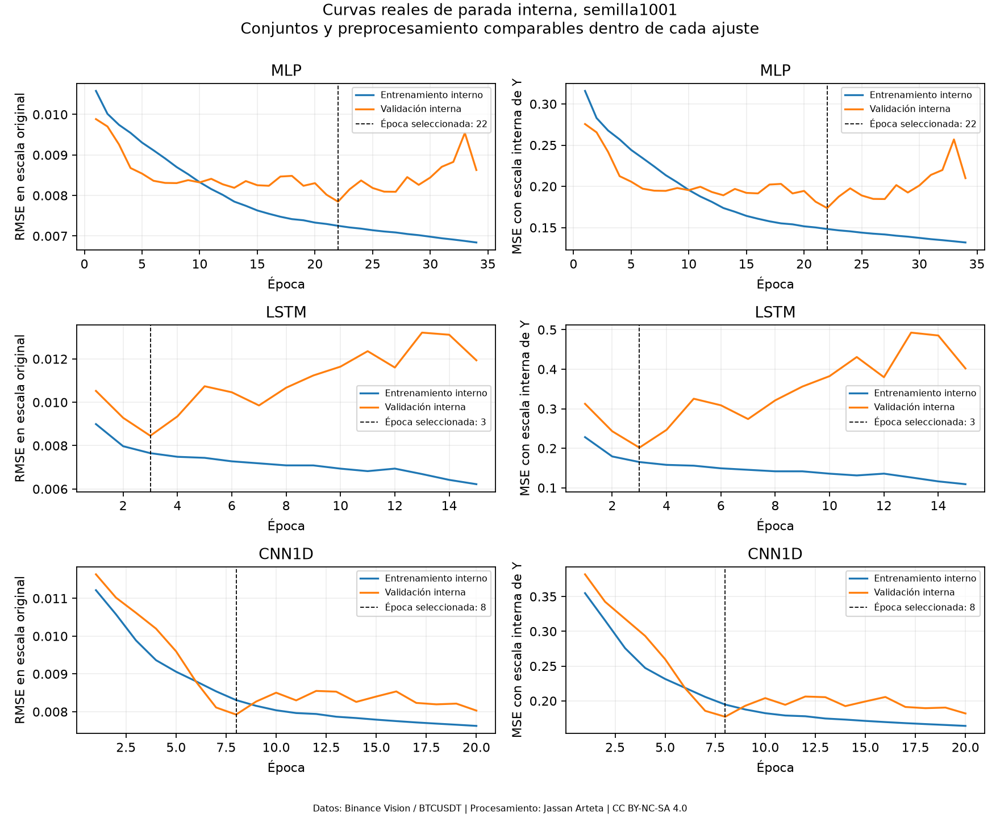
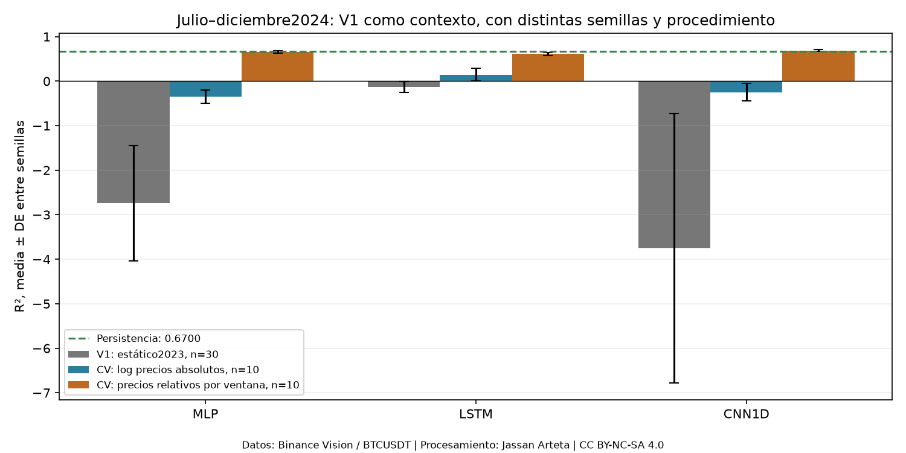
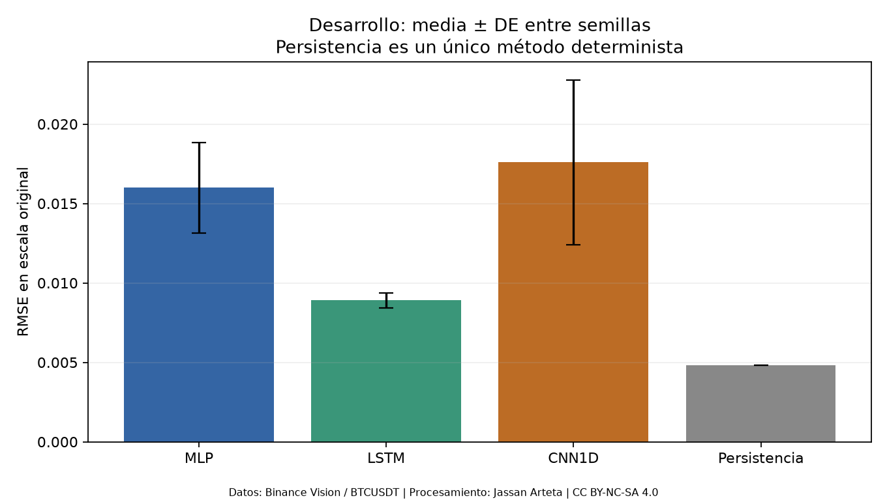
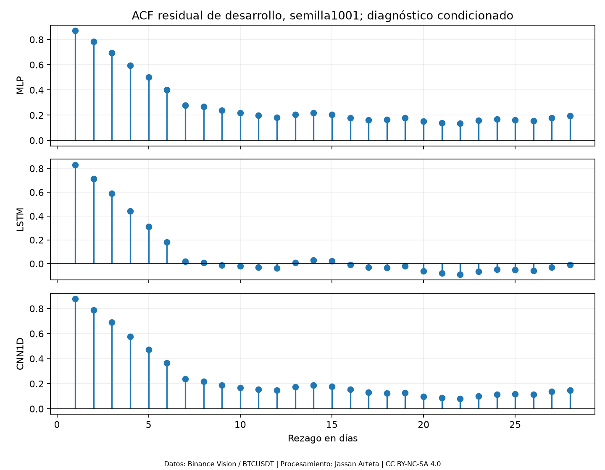

# 4. Implementación y evaluación: diseño y estado de ejecución

Se conservan **dos ciclos de desarrollo**, con MLP, LSTM y CNN1D poco profunda. **V1** ajustó pesos solo con 2023 y completó 201 corridas/402 ajustes; sus R² negativos y su entrenamiento estático motivaron la revisión. **V2** aplica ahora validación cruzada forward real con la biblioteca de Filipe: entrenamiento inicial en 2023, incorporación causal del pasado permitido de 2024 y doce bloques mensuales de validación durante 2024. Además compara dos representaciones de las mismas covariables para estudiar el problema de escala, sin cambiar el objetivo ni agregar rezagos de volatilidad.

V2 terminó a las **15:26:13 UTC del 04/11/2026**: **60 trayectorias, 720 segmentos modelo–mes, 1.440 ajustes y 21.960 predicciones**, con 366 fechas y diez semillas por modelo/variante. El [resumen de ejecución](../_static/dl_r2_cv_20261104/execution_summary.json) conserva esos conteos. Las tres redes relativas lograron R² anual positivo; persistencia conserva mejor RMSE anual (§4.4.9).

**El test del 01/01/2025 al 31/08/2026 permanece cerrado.** V2 es una revisión exploratoria diseñada tras observar V1; los hiperparámetros heredados ya usaron enero–junio de 2024. Sus predicciones son cronológicas respecto a cada ajuste, pero no constituyen validación anidada de toda la selección ni confirmación sobre un periodo desconocido. El ajuste final con desarrollo 2023–2024, después de cerrar la configuración, tampoco se ejecuta en esta CV.

La evidencia actual está en el [protocolo V2](../_static/dl_r2_cv_20261104/protocol.json), su [errata descriptiva](../_static/dl_r2_cv_20261104/protocol_erratum.json), los [folds completos](../_static/dl_r2_cv_20261104/folds.json), el [resumen de folds](../_static/dl_r2_cv_20261104/folds.csv) y la [firma previa a los ajustes](../_static/dl_r2_cv_20261104/code_manifest_before_fitting.json). El protocolo original firmado se conserva: la errata corrige la frase heredada «full2023», pues los índices y el runner ya ajustan sobre la cohorte mensual creciente correcta.

V1 permanece reproducible en su [protocolo inicial](../_static/dl_benchmark_20261104/protocol_initial.json), [selección](../_static/dl_benchmark_20261104/selected_configuration.json), [piloto](../_static/dl_benchmark_20261104/pilot_summary.json), [protocolo final de desarrollo](../_static/dl_benchmark_20261104/protocol_final.json) y [resumen de ejecución](../_static/dl_benchmark_20261104/execution_summary.json). La ejecución propia no cierra por sí sola las fichas bibliográficas aplicadas pendientes de MLP/CNN1D de §3. Los perfiles documentales LSTM/TCN/encoder no reemplazan el trío del proyecto.

## 4.1. Diseño Experimental

### 4.1.1. Definición clara de:

#### 4.1.1.1. Variables de entrada: representación y dimensiones

La unidad es un **día UTC de BTCUSDT**, agregado de velas oficiales de un minuto. Se utilizan apertura, máximo, mínimo, cierre y volumen (OHLCV), sin noticias ni atributos adicionales. Para el resultado del día d, las cinco covariables abarcan d−D,…,d−1.

La búsqueda V1 exploró D=7/14/21/28 y eligió **D=7 común a las tres redes**; V2 conserva esa elección, sin nueva búsqueda. El tensor es $X\in\mathbb R^{N\times7\times5}$; la MLP aplana esos mismos 35 valores. V2 compara `absolute_log` y `relative_window` sobre las mismas fuentes, fechas y ventanas (§4.1.3.1). No incorpora rezagos explícitos de σ7 como entrada.

Las ventanas conservan el calendario y no atraviesan días incompletos. El 24/03/2023 sigue excluido: no se imputa ni se construyen retornos saltando ese hueco.

#### 4.1.1.2. Variable objetivo y horizonte de predicción

El objetivo principal es la volatilidad poblacional de **siete retornos logarítmicos diarios**, $\sigma_7$, con `ddof=0`, sin anualizar; el horizonte es **h=1**. Las sensibilidades de objetivo $n=14,21,28$ **no se entrenaron**. Son distintas de las cuatro historias D exploradas con n=7.

Para el día de resultado $d$, se pronostica al inicio de ese día con $X_d=(z_{d-D},\ldots,z_{d-1})$, $z=(O,H,L,C,V)$, y $y_d=\sigma_7(d)$, conocida al terminar $d$. Incluye el retorno desconocido de ese día; no representa siete días enteramente futuros. Se conservan fecha, origen y disponibilidad de etiqueta.

La salida escalar utiliza Softplus para mantener positividad. Se entrenó con **MSE**, tras dividir Y por su media positiva de entrenamiento sin centrarla; todas las métricas se calcularon después de invertir esa escala. **RMSE es primaria**; MAE, MSE, R², MAPE y MASE son complementarias. Las políticas de ceros, escala y cobertura se mantienen en §4.4.2.

### 4.1.2. División del dataset

#### 4.1.2.1. Entrenamiento, validación y prueba

El calendario requerido distingue entrenamiento inicial, validación forward y evaluación reservada:

| Etapa V2 | Calendario UTC | Aplicación |
|---|---|---|
| Entrenamiento inicial | 2023 | Primer bloque ajustado con 343 resultados elegibles hasta 24/12/2023 |
| Validación cruzada forward | Todo 2024 | Doce bloques mensuales; el entrenamiento crece con pasado ya observado de 2024, con embargo |
| Ajuste final de desarrollo | 2023–2024 | Pendiente tras cerrar la configuración; no lo realiza el runner de CV |
| Test reservado | 01/01/2025–31/08/2026 | 608 días de calendario; sin abrir ni evaluar |

En el primer bloque V2, la parada interna usa 253 muestras de subentrenamiento hasta 25/09/2023 y 83 etiquetas de validación interna del 03/10 al 24/12. En diciembre de 2024, el reajuste completo admite 678 etiquetas hasta 23/11/2024. Los índices exactos, no una proporción aleatoria, determinan las muestras.

**Antecedente V1:** ajuste estático sobre 343 muestras de 2023; corte interno fijo 01/10/2023, con 251 muestras de subentrenamiento y 85 de validación. La búsqueda evaluó enero–junio de 2024 (182 fechas) y piloto/benchmark julio–diciembre (184). Esos cortes anteriores no se confunden con los bloques V2.

Los 365 días de 2023, 366 de 2024 y 608 de test suman 1.339 días (27,26 %, 27,33 % y 45,41 %); son proporciones de calendario, no de muestras independientes. Septiembre–octubre de 2026 queda sin asignar. La [reserva de test](../_static/data/test_raw_reserve_20250101_20260831.json) identifica 20 ZIP por metadatos/hashes, sin congelar todavía sus muestras supervisadas.

#### 4.1.2.2. Esquema de validación y selección de hiperparámetros

Se ejecutó realmente `tsxv.splitTrainVal.split_train_val_forwardChaining(np.arange(731), 7, 1, 1)` de **timeseries-cv 0.1.5**, con NumPy 1.26.4 en su entorno separado. La función produce 716 orígenes diarios sobre el calendario completo; 366 corresponden a 2024. Como la biblioteca no ofrece una API mensual, el script agrupa esos orígenes en **12 bloques de calendario** y toma los candidatos de entrenamiento del primer fold diario de cada mes, con filtros de elegibilidad y embargo más estricto. El runner recibe y usa esos índices para entrenar las redes, no solo para dibujar una partición.

Para el primer día mensual $t$, el reajuste completo admite resultados $u\le t-D-1$, con D=7. El comienzo interno es $v=t-90$ días; el subentrenamiento admite $u\le v-D-1$ y la validación interna abarca v,…,t−D−1: **83 etiquetas** tras la purga, no 90 observaciones. Ambos cortes comprueban disponibilidad y calidad. El embargo no demuestra independencia de las volatilidades móviles.

| Fold | Último resultado de entrenamiento | N entrenamiento | N subentrenamiento | N validación interna | Días evaluados |
|---|---|---:|---:|---:|---:|
| 2024-01 | 24/12/2023 | 343 | 253 | 83 | 31 |
| 2024-02 | 24/01/2024 | 374 | 284 | 83 | 29 |
| 2024-03 | 22/02/2024 | 403 | 313 | 83 | 31 |
| 2024-04 | 24/03/2024 | 434 | 344 | 83 | 30 |
| 2024-05 | 23/04/2024 | 464 | 374 | 83 | 31 |
| 2024-06 | 24/05/2024 | 495 | 405 | 83 | 30 |
| 2024-07 | 23/06/2024 | 525 | 435 | 83 | 31 |
| 2024-08 | 24/07/2024 | 556 | 466 | 83 | 31 |
| 2024-09 | 24/08/2024 | 587 | 497 | 83 | 30 |
| 2024-10 | 23/09/2024 | 617 | 527 | 83 | 31 |
| 2024-11 | 24/10/2024 | 648 | 558 | 83 | 30 |
| 2024-12 | 23/11/2024 | 678 | 588 | 83 | 31 |

Se reajusta una vez por mes y se mantienen sus pesos durante ese mes. Cada pronóstico sigue siendo **h=1 diario** y utiliza la historia ya observable de su propio origen; no es un pronóstico de todo el mes emitido el día primero, ni son 366 reajustes. Los campos `test_indices` de los folds nombran validación mensual dentro de 2024, no el test reservado de 2025–2026.

**V1 se conserva como antecedente estático, no como CV forward de redes.** V2 sí usa los índices de Filipe en los ajustes. Aun así, D e hiperparámetros proceden de la búsqueda V1 sobre enero–junio y la revisión se decidió después de ver sus resultados; por ello, la CV de 2024 es exploratoria, no una validación anidada confirmatoria del proceso completo de selección.

### 4.1.3. Definición de pipeline

#### 4.1.3.1. Preprocesamiento y construcción de datos

Ambos ciclos verifican hashes, calendario, continuidad y alineación de los derivados diarios de 2023–2024, sin imputación. V2 compara dos preprocesamientos registrados:

| Variante | Transformación de precios | Ajuste de estandarización por canal |
|---|---|---|
| `absolute_log` | log(OHLC), y log1p(volumen) | Días de entrada únicos cubiertos por ventanas de entrenamiento, como V1 |
| `relative_window` | log(OHLC/cierre del último día de esa ventana), y log1p(volumen) | Todas las posiciones de las ventanas de entrenamiento |

La segunda variante busca reducir dependencia del nivel absoluto del precio utilizando solo el cierre ya observado al final de cada ventana. **También cambia la ponderación de días repetidos en la estandarización**; por tanto, la comparación controla dos especificaciones completas de preprocesamiento y no identifica aisladamente el efecto del cociente de precios.

Medias/desviaciones de X y media positiva de Y se ajustan solo al entrenamiento de su etapa. Y se divide por esa media sin centrar y se invierte antes de puntuar. Una desviación nula de X se sustituye por uno y se registra. En V2 se recalculan los escaladores para cada mes y para cada subajuste/reajuste, con pasado permitido; no se emplean estadísticas de su bloque mensual futuro.

#### 4.1.3.2. Entrenamiento y parada temprana

En V2, cada segmento modelo–mes realiza **dos ajustes nuevos**: primero el subentrenamiento permitido elige duración por la MSE de su validación interna pasada; después se descartan esos pesos y se reajusta desde otra inicialización sobre la cohorte mensual completa permitida durante exactamente la mejor época elegida. Ambos ajustes calculan sus propios escaladores.

Una trayectoria variante–modelo–semilla encadena los doce modelos mensuales y sus predicciones diarias, con **24 ajustes por trayectoria**. No hay warm start entre meses, ni se consulta el objetivo futuro del mes para elegir épocas. El entrenamiento puede incorporar resultados de meses anteriores de 2024 ya disponibles y separados por el embargo. En V1, en cambio, una corrida contenía solo dos ajustes de 2023 y conservaba los pesos todo 2024.

#### 4.1.3.3. Evaluación y agregación de métricas

Se guardan objetivos, predicciones, fecha, origen, disponibilidad, variante, modelo, semilla y fold mensual. Para cada trayectoria V2 se concatenan sus **366 predicciones de 2024, una por fecha**, y se calcula:

$$
\operatorname{RMSE}_{m,s,v}=\sqrt{\frac1{366}\sum_{d\in2024}(Y_d-\widehat Y_{m,s,v,d})^2}.
$$

R² también se calcula con la media de Y y sumas de cuadrados de **todo el calendario agrupado**. Las métricas mensuales se conservan para diagnóstico; ni el promedio de R² mensuales ni el de RMSE mensuales sustituye estas métricas globales. Promediar RMSE de días unitarios produciría MAE.

Después se resumen las métricas de las diez trayectorias por modelo/variante, sin confundirlas con una predicción ensemble. El análisis común julio–diciembre usa las mismas 184 fechas para comparar con V1, pero sus 30 semillas y las diez de V2 son distintas: esa comparación es descriptiva, no pareada entre ciclos. El test final no participa.

### 4.1.4. Piloto

**Piloto histórico V1; no dimensiona automáticamente V2.**

Se completaron **cinco semillas por modelo**, `11, 23, 37, 53, 71`, después de seleccionar D e hiperparámetros y sin volver a seleccionarlos. Son 15 corridas/30 ajustes sobre las mismas 184 fechas de julio–diciembre de 2024. El [piloto registrado](../_static/dl_benchmark_20261104/pilot_summary.json) contiene:

| Modelo | R piloto | RMSE media | DE muestral | CV |
|---|---:|---:|---:|---:|
| MLP | 5 | 0,01458767 | 0,00232148 | 15,91 % |
| LSTM | 5 | 0,00915657 | 0,00087432 | 9,55 % |
| CNN1D | 5 | 0,02083167 | 0,00179438 | 8,61 % |

Para métricas $m_s$, $\bar m=R^{-1}\sum_s m_s$, $s_m=\sqrt{\sum_s(m_s-\bar m)^2/(R-1)}$ y $\mathrm{CV}=s_m/\bar m$. Las cinco semillas estiman variación del entrenamiento bajo datos fijados, no cinco mercados independientes.

Las semillas del piloto **no se incorporaron** a las 30 del benchmark. El calendario sí se reutilizó, por lo que permanece expuesto al dimensionamiento. El límite de recursos y la regla de R estaban registrados antes del piloto; no se añadieron semillas hasta obtener significación.

| Fase completada | Corridas | Ajustes por corrida | Total de ajustes |
|---|---:|---:|---:|
| Búsqueda | 96 | 2 | 192 |
| Piloto | 15 | 2 | 30 |
| Benchmark de desarrollo | 90 | 2 | 180 |
| **Total** | **201** | **2** | **402** |

Los folds, las configuraciones, los dos ajustes de una corrida y las fechas no se cuentan como semillas independientes.

**V2** utiliza diez semillas nuevas por modelo y variante en una revisión exploratoria con presupuesto limitado. No se ejecutó otro piloto para dimensionar su potencia, ni se transfirió la dispersión estática V1 como garantía del procedimiento mensual. Las doce particiones mensuales no son doce mercados independientes ni reemplazan las repeticiones de entrenamiento.

### 4.1.5. Diferencia mínima de interés

Los valores numéricos de planificación siguientes corresponden al **piloto y calendario V1 de julio–diciembre**; no constituyen un nuevo dimensionamiento de V2.

El margen operativo es una **reducción relativa del 5 % de RMSE frente a persistencia** sobre las mismas fechas. Si $b>0$ es su RMSE y $m_{A,s}$ la de una red:

$$
G_s=b-m_{A,s},\qquad Q_s=1-\frac{m_{A,s}}b.
$$

En calibración, $b=0{,}0048224787524133545$ y $\delta_{\mathrm{plan}}=0{,}05b=0{,}00024112393762066773$. La persistencia es determinista: restar el mismo b deja para este cálculo la misma dispersión entre semillas que la RMSE de la red. Esto no hace conocido el error de persistencia en otros periodos.

**Detectar una diferencia de magnitud 5 % respecto de cero no demuestra que la ganancia supere el 5 %.** Para probar $H_0:\mu_Q\le0{,}05$ se necesita inferencia respecto a esa frontera; para dimensionarla haría falta una alternativa $q_{\mathrm{alt}}>0{,}05$, que no se fijó en este ciclo. El bootstrap temporal recalcula ambas RMSE y su razón sobre los mismos bloques.

Los pares de redes usan $d_s=m_{A,s}-m_{B,s}$ y su DE pareada. El 5 % frente a persistencia no se transfiere a equivalencia, a todos los pares ni a una red avanzada frente al baseline DL; los márgenes específicos para esas afirmaciones siguen requiriendo justificación.

### 4.1.6. Tamaño de muestra

**Dimensionamiento histórico V1.** V2 conserva diez trayectorias exploratorias por modelo/variante, sin afirmar potencia derivada de este piloto ni cumplimiento del 80 %.

La aproximación registrada para detectar una diferencia frente a **cero** es:

$$
R\approx\left\lceil\frac{(z_{1-\alpha_{\mathrm{plan}}/2}+z_{0{,}80})^2\widehat\sigma_d^2}{\delta_{\mathrm{plan}}^2}\right\rceil.
$$

Se usó $\alpha_{\mathrm{plan}}=0{,}05/9$ como nivel conservador de planificación de la familia de nueve hipótesis; el análisis usa Holm. El factor 7,85 correspondería a α=0,05 bilateral sin multiplicidad y **no es el factor usado aquí**. Esta aproximación normal y su dispersión de solo cinco semillas tienen incertidumbre y condicionan el resultado al calendario observado.

| Contraste de planificación | R requerido aproximado | R ejecutado por modelo | Decisión |
|---|---:|---:|---|
| MLP frente a persistencia | 1.212 | 30 | Limitado por recursos |
| LSTM frente a persistencia | 172 | 30 | Limitado por recursos |
| CNN1D frente a persistencia | 724 | 30 | Limitado por recursos |

El protocolo inicial fijó mínimo 10 y **máximo 30 semillas** para este primer ciclo CPU. El mayor requerimiento fue 1.212; se aplicó el máximo de 30 y se registró `cap_limits_power=true` antes del benchmark. **No se alcanzó el tamaño dimensionado ni se acredita potencia del 80 %.** Cumplir los mínimos de cinco/seis corridas no subsana esa limitación.

La potencia objetivo se refiere a una diferencia de magnitud $\delta_{\mathrm{plan}}$ contra cero; no a superar la frontera del 5 %, ni a potencia conjunta de toda la familia. La planificación de superación exigiría usar $(q_{\mathrm{alt}}-0{,}05)^2$ en el denominador con una alternativa predefinida. Tampoco se dimensionaron así nuevos periodos de mercado.

### 4.1.7. Diferencia mínima detectable

**MDE registrada para V1 con R=30.** No se presenta como MDE de las diez trayectorias mensuales V2.

Para R semillas, la MDE contra cero se aproxima por:

$$
\mathrm{MDE}_0(R)=\frac{(z_{1-\alpha_{\mathrm{plan}}/2}+z_{0{,}80})\widehat\sigma_d}{\sqrt R}.
$$

Con la dispersión del piloto y **R=30**, se registraron:

| Modelo | MDE₀ en RMSE | δ de planificación | Potencia aproximada al δ planificado |
|---|---:|---:|---:|
| MLP | 0,00153200 | 0,00024112 | 1,42 % |
| LSTM | 0,00057698 | 0,00024112 | 10,34 % |
| CNN1D | 0,00118415 | 0,00024112 | 2,11 % |

En los tres casos MDE₀ supera δ. Son resultados de planificación calculados **antes** del benchmark con el piloto, no potencia retrospectiva a partir de su efecto observado. No certifican independencia temporal ni potencia suficiente para afirmar superación del 5 %. Los valores completos están en el resumen piloto.

### 4.1.8. Relación con el Entregable 2

La autorización para ejecutar permitió completar V1 y revisar ahora el procedimiento con CV forward real en desarrollo. La planificación V1 mostró que su límite de 30 semillas quedaba por debajo de 1.212 requeridas aproximadamente; V2 no elimina esa limitación ni transfiere sus cifras al nuevo diseño.

El calendario posterior es **cerrar la configuración con desarrollo 2023–2024, realizar su ajuste final permitido y evaluar una sola vez el test 2025–agosto de 2026** bajo el protocolo registrado que corresponda. Los dos últimos pasos no están ejecutados en este capítulo. Cualquier elección tras observar V2 identificará esa exposición; no se presenta como anterior a los resultados. Sigue pendiente ampliar el respaldo bibliográfico aplicado del trío.

### 4.1.9. Registro

#### 4.1.9.1. Preregistro fechado y trazabilidad

El [protocolo inicial](../_static/dl_benchmark_20261104/protocol_initial.json) quedó registrado el **04/11/2026 a las 14:28:17 UTC (09:28:17 Bogotá)** y en el commit **`3c3c481`**, antes del primer ajuste DL del proyecto. Fija datos/hashes, modelos, búsqueda, semillas, dos etapas de ajuste, exclusión estricta, embargo, métricas, potencia y límite de 30.

Después de la búsqueda se guardó la [selección](../_static/dl_benchmark_20261104/selected_configuration.json); después del piloto se congeló el [protocolo de benchmark de desarrollo](../_static/dl_benchmark_20261104/protocol_final.json), el **04/11 a las 14:37:41 UTC**, antes de sus 90 corridas. Este registra D=7, configuraciones, 30 semillas y hashes de los documentos anteriores, sin autorizar test. El código de entrenamiento se identifica por la firma `74dc4b3f4e43ab88c10e6e7d66331b82cc1e0f41287162504cf692f97790a9fc`. La ejecución terminó a las **14:38:23 UTC**.

La especificación del 03/11 y el borrador del 02/11 se conservan como antecedentes, no como configuración vigente. El registro actual es posterior al EDA y a observar datos históricos de desarrollo; preceder a los ajustes no equivale a registrarse antes de toda observación del estudio.

**Registro V2:** el [protocolo](../_static/dl_r2_cv_20261104/protocol.json) se fechó a las **15:17:28 UTC del 04/11/2026**; el [manifiesto de código](../_static/dl_r2_cv_20261104/code_manifest_before_fitting.json), previo al primer ajuste CV, enlaza el commit **`1f0ed23`**, folds, scripts y firma `2a535b6ffdd8a7e11f9d017b9f62b75bdff6ad5f7e7b228b1f49b8a78d2d54a6`.

La [errata](../_static/dl_r2_cv_20261104/protocol_erratum.json) conserva el protocolo firmado y aclara que `training.refit` heredó la frase «full2023». Los índices y el código ya reajustaban sobre la cohorte mensual creciente correcta; no hubo cambio de datos, pesos u optimización por esa aclaración. El registro V2 es posterior a observar el R² y demás resultados V1: su carácter exploratorio permanece explícito.

#### 4.1.9.2. Estado del diseño y del piloto

| Producto | Estado y alcance |
|---|---|
| V1 estático | 201 corridas, 402 ajustes; resultados y piloto conservados |
| Folds V2 de Filipe | Doce bloques mensuales, índices efectivos y hashes registrados |
| Configuraciones V2 | D=7 e hiperparámetros V1 fijos; dos preprocesamientos, sin nuevo HPO |
| Repeticiones V2 | Completadas: 60 trayectorias/720 segmentos/1.440 ajustes; diez semillas por variante/modelo |
| Métricas y comparación V2 | R²/RMSE anual, H2 común, sesgo, folds y tres pares entre variantes calculados |
| Potencia | V1 insuficiente al δ previsto; V2 no acredita 80 % |
| Bibliografía aplicada de MLP/CNN1D | Aún incompleta; código entrenado no sustituye evidencia de literatura |
| Objetivos n=14/21/28 y ruido simulado | Sin entrenar |
| Ajuste final 2023–2024 y test reservado | No ejecutados aquí |

## 4.2. Implementación de los Tres Modelos Base

Se mantienen **MLP, LSTM unidireccional y CNN1D causal de dos capas**, con las configuraciones propias seleccionadas en V1. V2 cambia el esquema de actualización a CV forward mensual y compara dos preprocesamientos, sin nueva optimización de arquitecturas. GRU permanece como alternativa sin corrida; TCN y encoder de las fuentes no sustituyen el trío. Las configuraciones propias no se atribuyen a una réplica exacta de los artículos ni cierran las fichas aplicadas pendientes de §3.

### 4.2.1. Implementación de los tres modelos base

Las tres redes reciben D días de las mismas cinco covariables y producen un escalar positivo. Las configuraciones elegidas por la búsqueda son:

| Modelo | Arquitectura implementada | H seleccionado |
|---|---|---:|
| MLP | Flatten → Linear(5D,H) → ReLU → Dropout(0,1) → Linear(H,1) → Softplus | 16 |
| LSTM | Una capa unidireccional → último estado oculto → Dropout(0,1) → Linear(H,1) → Softplus | 32 |
| CNN1D | Conv causal k=3, 5→H → ReLU/Dropout → Conv causal k=3, H→H → ReLU/Dropout → media temporal → Linear(H,1) → Softplus | 16 |

CNN1D usa padding solo a la izquierda; carece de dilatación, conexiones residuales y atención. El dropout es 0,1 después de cada convolución. LSTM usa los dos vectores de sesgo por puerta de PyTorch. Son implementaciones del proyecto; las ecuaciones y configuraciones de artículos de §3.3 se conservan con su atribución original.

### 4.2.2. Entrenamiento con el mismo pipeline, partición y semillas

#### 4.2.2.1. Pipeline, partición e información comunes

| Componente | Condición común ejecutada en V2 |
|---|---|
| Datos y objetivo | Mismos derivados OHLCV, σ7, h=1 y D=7 |
| Partición | Mismos índices de Filipe, embargo y doce bloques mensuales |
| Información | Cinco canales idénticos; ninguna red recibe rezagos explícitos de σ7 |
| Preprocesamiento | Misma variante para comparar redes; ambas variantes sobre iguales ventanas |
| Ajuste | Dos etapas nuevas por modelo/mes; mismo límite y criterio interno de épocas |
| Semillas | Diez semillas comunes entre redes y variantes |
| Selección | Sin nuevo HPO; hiperparámetros V1 fijos |
| Evaluación | Mismo calendario de 366 fechas, métricas originales y coberturas |

La comparación `relative_window` frente a `absolute_log` dentro de una familia mantiene semilla, fechas y cortes; el preprocesamiento es el factor intervenido. Puede cambiar la duración elegida por la misma regla interna. Las redes comparten exactamente la información entre sí; persistencia conserva la diferencia histórica declarada en §4.4.3.

#### 4.2.2.2. Semillas, reinicios y reproducibilidad

**Antecedente V1:**

Se usaron **101 y 202 en búsqueda**; **11, 23, 37, 53 y 71 en piloto**; y **1001–1030 en benchmark de desarrollo**, iguales entre modelos dentro de cada fase. El ajuste interno usa `runseed`; el reajuste completo usa `runseed + 10000000`; el generador de lotes usa la semilla de su etapa más 17.

Cada etapa inicializa pesos nuevos y ajusta sus propios escaladores, sin conservar checkpoints anteriores como warm start. Los lotes de entrenamiento se barajan con generador fijado; las ventanas y cortes siguen siendo cronológicos. Las semillas distintas describen aleatoriedad de entrenamiento sobre el mismo mercado, no nuevas realizaciones independientes de ese mercado. El registro de corridas conserva fase, configuración, semilla, firma de código y resultados.

Para **V2** se fijaron las diez semillas base **4101–4110**, comunes a las tres redes y las dos variantes. Cada mes usa `baseseed + monthordinal*100000`; el reajuste usa esa semilla mensual más 10000000 y el orden de lotes la semilla de su etapa más 17. Los pesos se reinician en ambos ajustes y entre meses. Las semillas distintas de V1 no se emparejan artificialmente con estas diez.

### 4.2.3. Definición de hiperparámetros

Los valores de esta tabla se seleccionaron en **V1** y permanecen fijos en V2; no se ejecutó nuevo HPO para corregir R².

El grid registrado exploró **H∈{16,32}** y **learning rate∈{0,001;0,003}**, con cuatro candidatos por familia y D. Los demás valores son decisiones comunes del protocolo, no hiperparámetros ajustados después del piloto.

| Campo | Valor ejecutado |
|---|---|
| Historia común seleccionada | D=7; objetivo n=7, h=1 |
| MLP | H=16; learning rate 0,001 |
| LSTM | H=32; learning rate 0,003 |
| CNN1D | H=16; learning rate 0,001 |
| Planificador | Ninguno |
| Batch size | 32 |
| Optimizador | AdamW |
| Regularización | Dropout 0,1; weight decay 0,0001 |
| Pérdida | MSE en Y dividida por media positiva train |
| Salida | Softplus |
| Gradiente | Clipping de norma 1 |
| Épocas máximas | 100 en ajuste interno |
| Parada | Mínima MSE de validación interna, patience=12, min_delta=0,00001 |

#### 4.2.3.1. Learning rate y planificador

En **V1** se evaluaron learning rates 0,001 y 0,003 con AdamW, **sin planificador**. Se seleccionaron 0,001 para MLP/CNN1D y 0,003 para LSTM con enero–junio de 2024. V2 hereda esos valores sin nueva búsqueda; esa selección previa forma parte de su exposición a desarrollo.

#### 4.2.3.2. Número de capas y unidades

Se compararon anchuras 16 y 32. La MLP tiene una capa oculta (H=16), LSTM una capa recurrente unidireccional (H=32) y CNN1D dos capas convolucionales k=3 (H=16). La profundidad permaneció fija por familia. Son variantes mínimas del proyecto; no se adjudican estos números a las fuentes documentales.

#### 4.2.3.3. Batch size

Se utilizó **batch size=32** para los tres modelos en ambas etapas de ajuste. No se buscó otro tamaño de lote. La medición de inferencia usa un máximo de 256 ejemplos por lote y se distingue del entrenamiento.

#### 4.2.3.4. Optimizador, regularización y función de pérdida

Se usó AdamW con weight decay=0,0001, dropout=0,1 y clipping de norma de gradiente=1. La ubicación del dropout se especifica en §4.2.1. La pérdida es MSE de $Y/\bar Y_{\mathrm{train}}$, con $\bar Y_{\mathrm{train}}>0$ y sin centrar: su término de datos equivale a la MSE original dividida por una constante positiva dentro de cada ajuste. No se entrenó con log(Y).

Los escaladores de X e Y se estiman de nuevo con el entrenamiento admitido de cada etapa; no con su validación. Softplus es la decisión propia para positividad. La inversión de la escala de Y precede a toda métrica publicada.

### 4.2.4. Estrategia de entrenamiento

#### 4.2.4.1. Número máximo de épocas

El ajuste interno permite **hasta 100 épocas**, en CPU y float32. V2 lo aplica dentro de cada bloque mensual; el reajuste completo desde cero ejecuta exactamente la mejor época interna. Los pesos quedan fijos dentro del mes y se reinician al comenzar el siguiente, incorporando únicamente pasado admitido. V1 conservaba los pesos de 2023 durante todo 2024; esa política se mantiene solo como antecedente.

#### 4.2.4.2. Early stopping y validación interna

Se minimiza la **MSE escalada de validación interna por época**, con `patience=12` y `min_delta=1e-5`. Se conserva la mejor época, se descarta el modelo interno y se inicializa otro modelo para el reajuste completo por esa duración; no se restaura el checkpoint interno como modelo definitivo.

En V2, el inicio interno es 90 días de calendario antes del comienzo del mes. Con embargo D=7, quedan **83 resultados internos** hasta el corte externo. Para enero: subentrenamiento hasta 25/09/2023 (253 ejemplos), validación interna 03/10–24/12 (83), reajuste completo hasta 24/12 (343). Para diciembre: subentrenamiento hasta 25/08/2024 (588), validación 02/09–23/11 (83), reajuste hasta 23/11 (678). Los escaladores se ajustan por separado a cada entrenamiento.

Las etiquetas de su mes externo no eligen sus épocas. Que meses anteriores de 2024 entren en ajustes posteriores es la política expanding registrada, no acceso al futuro. Los cortes y escaladores estáticos V1 siguen documentados en sus artefactos originales.

### 4.2.5. Registro

En **V1**, una corrida comprendía dos ajustes y produjo 201 corridas/402 ajustes. En **V2**, una **trayectoria** variante–modelo–semilla contiene doce segmentos mensuales, cada uno con dos ajustes nuevos. La ejecución V2 terminó a las 15:26:13 UTC; las unidades completadas se contabilizan por separado:

| Ciclo | Unidad repetida de entrenamiento | Segmentos mensuales | Ajustes efectivos | Predicciones por trayectoria |
|---|---|---:|---:|---:|
| V1, búsqueda/piloto/benchmark | 201 corridas de sus respectivas fases | No aplica | 402 | 182 o 184 según fase |
| V2, 2 variantes × 3 modelos × 10 semillas | 60 trayectorias | 720 | 1.440 | 366 |

Los [folds](../_static/dl_r2_cv_20261104/folds.json) vinculan índices, fechas y disponibilidad. El [registro V2](../_static/dl_r2_cv_20261104/runs.csv) y los artefactos de cada segmento conservan arquitectura, semilla, preprocesamiento, mejor época, pesos, pérdidas y predicciones. No se cuentan 720 segmentos ni 1.440 ajustes como semillas o mercados independientes. Los [registros V1](../_static/dl_benchmark_20261104/runs.csv) no se sobrescriben.

#### 4.2.5.1. Curvas de entrenamiento y validación

**Curvas históricas V1**, generadas desde pérdidas reales y con la semilla designada 1001; no representan la nueva CV mensual:

Las curvas se generaron desde pérdidas realmente registradas. La figura muestra entrenamiento y validación **interna** de la semilla designada 1001, no pérdidas de test ni curvas sintéticas:

Cada corrida conserva su log; la gráfica representativa no sustituye las 30 métricas individuales del benchmark.

V2 conserva `history_inner.csv` y `history_refit.csv` por cada modelo–mes dentro de sus artefactos. La parada se refiere al bloque interno de ese mes, no a sus resultados externos. No se reutiliza una curva V1 como prueba de ajuste V2.

#### 4.2.5.2. Número de parámetros

Los conteos medidos coinciden con estas expresiones propias; todos los parámetros son entrenables y no hay parámetros no entrenables:

| Modelo | Expresión para cinco canales | D y H seleccionados | Parámetros |
|---|---|---|---:|
| MLP | $(5D+1)H+(H+1)$ | D=7, H=16 | 593 |
| LSTM | $4H(5+H+2)+(H+1)$ | D=7, H=32 | 5.025 |
| CNN1D | $(15H+H)+(3H^2+H)+(H+1)$ | D=7, H=16 | 1.057 |

Los dos sesgos por puerta explican el +2 de LSTM. CNN incluye dos convoluciones k=3 y su cabeza lineal; el pooling y Softplus no añaden parámetros. Estos son conteos de código ejecutado, distintos de los conteos documentales condicionados de §3.

#### 4.2.5.3. Tiempo computacional y hardware empleado

**Mediciones históricas V1 seriales; no comparables directamente con el tiempo total V2 concurrente.**

Las mediciones siguientes son media ± DE de las 30 corridas de desarrollo, **serializadas en CPU**:

| Modelo | Entrenamiento: dos ajustes (s) | Inferencia de 184 casos (ms) |
|---|---:|---:|
| MLP | 0,3448 ± 0,1384 | 0,03979 ± 0,01082 |
| LSTM | 0,2270 ± 0,0576 | 0,46344 ± 0,08246 |
| CNN1D | 0,6349 ± 0,4926 | 0,35376 ± 0,05189 |

Entrenamiento mide tiempo de pared del ajuste interno más reajuste, incluida su evaluación de parada. Inferencia mide la ruta forward por lotes, incluida conversión y concatenación de salidas, con cinco calentamientos y media de 20 pasadas, batch máximo 256; excluye preprocesamiento, inversión de escala y escritura de artefactos. Los números son locales a este tamaño y entorno, no estimaciones universales de costo. La búsqueda usó tres workers y sus tiempos concurrentes no se mezclan con esta comparación.

El [runtime](../_static/dl_benchmark_20261104/runtime.json) registra CPU, float32, un hilo PyTorch por worker, cinco CPU visibles y cuota cgroup equivalente a cuatro CPU; no se utilizó GPU.

V2 usa tres workers de trayectorias concurrentes en el mismo entorno CPU. Sus [tiempos de corrida](../_static/dl_r2_cv_20261104/runs.csv) y [runtime](../_static/dl_r2_cv_20261104/runtime.json) tienen ese alcance; incluyen doce procesos de ajuste/reajuste mensual por trayectoria y no justifican una afirmación de aceleración respecto a V1.

### 4.2.6. Equidad en la optimización

**Búsqueda V1 conservada; V2 no realiza otra búsqueda.**

Las tres redes recibieron el mismo grid H×learning rate, las cuatro D y dos semillas de búsqueda: **4 candidatos × 4 historias × 2 semillas =32 corridas por familia**, 96 en total, con dos ajustes por corrida. La profundidad y el resto del entrenamiento se mantuvieron fijos. Igual número de evaluaciones no implica igual tiempo ni capacidad: los parámetros y costos se reportan por separado.

La selección calcula RMSE original sobre las 182 fechas de enero–junio. Para cada familia y D gana la menor media de las dos semillas; los empates exactos favorecen menos parámetros y luego identificador. Se escoge la D común con menor media de los tres ganadores por familia, con empate a menor D. El resultado fue **D=7**.

| Modelo | RMSE media de búsqueda | DE, dos semillas | Configuración elegida |
|---|---:|---:|---|
| MLP | 0,01052383 | 0,00263939 | H=16, lr=0,001 |
| LSTM | 0,01077513 | 0,00014039 | H=32, lr=0,003 |
| CNN1D | 0,01348078 | 0,00079256 | H=16, lr=0,001 |

Por la regla previa, **MLP quedó como identidad del baseline operativo de desarrollo** antes del piloto. Su identidad no se cambia por el ranking posterior de julio–diciembre. Se conservan todos los candidatos en `runs.csv`; no se amplió el grid tras observar el piloto. Este es un presupuesto finito y reducido, no evidencia de optimización exhaustiva de cada familia.

En V2 se aplican esos mismos H y learning rates a ambas variantes y todas las semillas/folds. La identidad operativa MLP de V1 no se reemplaza retrospectivamente. Un líder V2 es descriptivo en desarrollo ya expuesto; cualquier nueva elección deberá registrarse como posterior a esta revisión.

### 4.2.7. Implementación desde cero o uso de librerías justificadas

#### 4.2.7.1. Implementación y entorno de software

La implementación propia usa módulos de **PyTorch 2.15.0+cpu**, Python 3.12.14 y float32. `scripts/dl_data.py` construye datos y escaladores; `scripts/dl_models.py` define las tres redes; `scripts/train_dl_benchmark.py` ejecuta búsqueda, piloto y benchmark; `scripts/analyze_dl_benchmark.py` calcula tablas y figuras. Las librerías se justifican para tensores, diferenciación automática, optimización y análisis, manteniendo explícitas capas y reglas.

El entorno ejecutado queda fijado en `requirements-training.lock.txt` y [runtime.json](../_static/dl_benchmark_20261104/runtime.json): NumPy 2.5.4, pandas 3.1.0, SciPy 1.18.1, statsmodels 0.15.0 y Matplotlib 3.11.2. Los entornos de EDA y `timeseries-cv` se conservan separados; este último genera índices y no entrena las redes.

V2 enlaza las fuentes de [preparación de folds](https://github.com/jassan-bit/DeepLearning_202630/blob/main/scripts/prepare_dl_r2_cv.py), [runner CV](https://github.com/jassan-bit/DeepLearning_202630/blob/main/scripts/train_dl_r2_cv.py), [preprocesamiento relativo](https://github.com/jassan-bit/DeepLearning_202630/blob/main/scripts/dl_data_v2.py) y [análisis](https://github.com/jassan-bit/DeepLearning_202630/blob/main/scripts/analyze_dl_r2_v2.py). La preparación ejecutó realmente timeseries-cv 0.1.5 con NumPy 1.26.4 en su entorno aislado; PyTorch usa el entorno de entrenamiento ya registrado. Los hashes de función, módulo, scripts y manifiesto se conservan para que aislar bibliotecas no implique reconstruir otros índices.

#### 4.2.7.2. Estado de implementación

| Producto por modelo | V1 | V2 por cada familia |
|---|---|---|
| Arquitectura propia | Implementada y entrenada | Misma arquitectura y parámetros |
| Búsqueda | 32 corridas | Sin nuevo HPO |
| Piloto | 5 corridas | Sin nuevo piloto |
| Repeticiones de comparación | 30 corridas estáticas | 10 trayectorias por variante; 20 con ambas |
| Reajustes mensuales | No | 240 segmentos y 480 ajustes por familia, contando ambas variantes |
| Artefactos | Conservados | Escaladores, pérdidas, pesos y predicciones por segmento |
| Ajuste final 2023–2024/test | No ejecutado | No ejecutado |

Entrenar estas variantes no completa la trazabilidad bibliográfica aplicada de MLP/CNN1D ni demuestra reproducción exacta de los artículos.

## 4.3. Requisitos Experimentales

Los controles distinguen V1 estático de V2 con ajuste forward mensual real. Ambos son desarrollo; el segundo se diseñó tras observar el primero. Las mismas fechas históricas no se convierten en un nuevo conjunto confirmatorio por cambiar semillas o representación.

### 4.3.1. Control de semillas aleatorias

El runner fija Python, NumPy y PyTorch por etapa; utiliza las semillas y offsets de §4.2.2.2, incluido un generador explícito para lotes. Se activó **`torch.use_deterministic_algorithms(True)`** y un hilo de cómputo/interoperabilidad por worker. Runtime, precisión, backend y firma de código quedan registrados; no se presume identidad bit a bit entre versiones o hardware distintos.

La misma etiqueta de semilla entre arquitecturas conserva el emparejamiento operativo; no produce pesos iguales ni garantiza reducción de varianza. Una repetición técnica con igual semilla no se cuenta como otra corrida independiente de entrenamiento.

V2 conserva esas opciones CPU y usa las semillas base/mensuales de §4.2.2.2, con diez trayectorias por variante/modelo. Los doce meses de una trayectoria comparten una semilla base identificable, pero cada segmento inicializa nuevos pesos por la regla fijada.

### 4.3.2. Repetición de experimentos

**V1:** 30 semillas por modelo en su benchmark estático, además de cinco piloto y las de búsqueda. Superó el mínimo formal, pero quedó por debajo del máximo requerido de 1.212 estimado en su piloto.

**V2:** diez trayectorias por modelo y variante, con semillas 4101–4110. Es un presupuesto exploratorio previamente declarado para esta revisión, **sin nuevo dimensionamiento basado en piloto ni garantía de potencia del 80 %**. No se suman las 30 semillas V1 y las diez V2 como réplicas del mismo procedimiento.

| Unidad V2 | Interpretación |
|---|---|
| Trayectoria variante–modelo–semilla | Un procedimiento aleatorio de entrenamiento evaluado durante todo 2024 |
| Segmento mensual | Una etapa temporal de esa trayectoria, con dos ajustes |
| Fecha | Un objetivo temporal dependiente, no otra réplica independiente |
| Variante | Una especificación diferente del preprocesamiento |

Las doce particiones temporales permiten examinar cambios de régimen bajo el mismo mercado; no son doce mercados independientes ni aumentan R a 120. Las comparaciones controladas entre variantes emparejan las diez semillas comunes y sus mismas fechas.

### 4.3.3. Reporte de media, desviación estándar e intervalos de confianza

V2 calcula media, DE muestral e **IC marginal del 95 % t de Student con nueve grados de libertad** sobre diez trayectorias por modelo/variante, condicionado al calendario histórico de 2024. Los resultados globales y del calendario común con V1 están separados en [metrics_summary.csv](../_static/dl_r2_cv_20261104/analysis/metrics_summary.csv) y [metrics_common_h2.csv](../_static/dl_r2_cv_20261104/analysis/metrics_common_h2.csv).

La comparación controlada `relative_window − absolute_log` usa las diez semillas pareadas dentro de cada familia, con IC marginal y Holm para las tres pruebas de RMSE. Las diferencias de R² se reportan descriptivamente; los supuestos y el alcance exploratorio se conservan en [comparisons.csv](../_static/dl_r2_cv_20261104/analysis/comparisons.csv). Los IC entre semillas no representan toda la incertidumbre temporal ni la de elegir el procedimiento después de V1.

**Análisis histórico V1:** los [IC entre sus 30 semillas](../_static/dl_benchmark_20261104/analysis/metrics_summary.csv), [contrastes](../_static/dl_benchmark_20261104/analysis/paired_tests.csv) y [bootstrap temporal](../_static/dl_benchmark_20261104/analysis/block_bootstrap.csv) permanecen con su alcance original. No se transfieren sus nueve hipótesis o bloques a V2 como si acabaran de repetirse.

| Contraste V2, relativo − absoluto | Diferencia media de RMSE | IC marginal 95 % | p ajustado Holm, tres pares |
|---|---:|---:|---:|
| MLP | -0,00439825 | [-0,00469839; -0,00409810] | 3.05701e-10 |
| LSTM | -0,00331851 | [-0,00361490; -0,00302213] | 2.24227e-09 |
| CNN1D | -0,00446676 | [-0,00506264; -0,00387089] | 3.87157e-08 |

Una diferencia negativa favorece la variante relativa. Estos contrastes condicionan en los diez pares de entrenamiento y el calendario ya expuesto; no son contrastes V2 contra persistencia ni evidencia de test.

### 4.3.4. Uso de GPU

**Se entrenó en CPU; no se usó GPU.** El [runtime](../_static/dl_benchmark_20261104/runtime.json) registra `cuda_available=false`, Linux x86_64, precisión float32, versiones y límites cgroup. La memoria máxima permitida fue 32 GiB; ese límite no es una medición de pico consumido. No se inventan driver o memoria GPU inexistentes.

Piloto y benchmark se ejecutaron con un worker, un hilo PyTorch y un hilo de interoperabilidad. La búsqueda tuvo tres workers; sus tiempos no se usan como medida comparable serial. El alcance y calentamiento de la medición de inferencia están en §4.2.5.3.

El [runtime V2](../_static/dl_r2_cv_20261104/runtime.json) conserva CPU/float32, determinismo y límites de recursos; esta vez los tres workers ejecutan trayectorias CV. Se distinguen tiempos concurrentes de V2 y seriales de piloto/benchmark V1; el número de ajustes por trayectoria también cambió.

### 4.3.5. Empaquetado reproducible

El experimento de desarrollo tiene código, versiones, manifiestos y artefactos para repetir sus fases. Reproducirlo requiere los derivados verificados de 2023–2024; no necesita abrir test.

#### 4.3.5.1. Archivo de dependencias

`requirements-training.lock.txt` fija las versiones efectivamente usadas en entrenamiento/análisis; los entornos de EDA y partición conservan sus propios archivos. El runtime identifica las versiones importadas, además de la lista de dependencias.

#### 4.3.5.2. Scripts o cuadernos ejecutables de extremo a extremo

Los scripts `dl_data.py`, `dl_models.py`, `train_dl_benchmark.py`, `analyze_dl_benchmark.py` y `package_dl_benchmark.py` conservan construcción de muestras, ajuste, análisis y exportación. El protocolo registra argumentos, fuentes y firmas; la auditoría detalla tamaños e índices de cada D. Los brutos oficiales conservan URLs y hashes de adquisición y no se redistribuyen dentro del sitio.

V2 añade `prepare_dl_r2_cv.py`, `dl_data_v2.py`, `train_dl_r2_cv.py` y `analyze_dl_r2_v2.py`. El primer script corre en el entorno de Filipe y exporta los índices; el runner consume esos mismos índices en el entorno PyTorch. `BUILD.md` documenta los comandos y los dos entornos.

#### 4.3.5.3. Registro de configuración y artefactos de cada corrida

**Paquete histórico V1:**

Se conservan configuración por corrida, semilla, dos etapas de ajuste, escaladores, logs, predicciones, métricas y tiempos. Los pesos finales guardados corresponden a las 105 corridas piloto y benchmark; la búsqueda no conserva checkpoints. El [registro CSV](../_static/dl_benchmark_20261104/runs.csv), los protocolos, runtime, auditoría y resumen de ejecución enlazan esas piezas; el análisis conserva hashes de predicciones y del script. Se puede descargar el [paquete de artefactos de corrida](../_static/dl_benchmark_20261104/run_artifacts.tar.gz), verificar su [manifiesto](../_static/dl_benchmark_20261104/run_artifacts_manifest.json) y consultar las {download}`instrucciones de reproducción <../_static/dl_benchmark_20261104/README.md>`.

La reproducción de búsqueda/piloto/benchmark de **desarrollo ya dispone de implementaciones ejecutadas y resultados**. Esto no acredita todavía reproducción de un experimento de test, que no se ha realizado. Los registros históricos vacíos se mantienen diferenciados de los artefactos reales del 04/11.

El [paquete V2 de artefactos por segmento](../_static/dl_r2_cv_20261104/run_artifacts.tar.gz), su [manifiesto](../_static/dl_r2_cv_20261104/run_artifacts_manifest.json) y las {download}`instrucciones de reproducción V2 <../_static/dl_r2_cv_20261104/README.md>` se publican aparte del paquete histórico. V2 conserva su [protocolo](../_static/dl_r2_cv_20261104/protocol.json), [errata](../_static/dl_r2_cv_20261104/protocol_erratum.json), [folds exactos](../_static/dl_r2_cv_20261104/folds.json), [firma de código](../_static/dl_r2_cv_20261104/code_manifest_before_fitting.json), runtime, predicciones y análisis separados de V1. La errata modifica únicamente la descripción heredada del reajuste; no sustituye el protocolo firmado ni modifica sus resultados.

### 4.3.6. Buenas Prácticas Obligatorias

#### 4.3.6.1. Prevención de data leakage (crítico)

| Control | Aplicación actual V2 | Evidencia |
|---|---|---|
| Orden temporal | Primer ajuste 2023; meses posteriores incorporan solo pasado observado de 2024 | Índices de Filipe exportados y consumidos por el runner |
| Embargo externo/interno | Siete resultados omitidos en ambos cortes | Fechas e índices por mes |
| Transformaciones train | Escaladores propios de cada etapa y variante | Preprocesamiento por segmento |
| Parada sin etiqueta mensual futura | Bloque interno pasado; reajuste por duración fija | Logs y mejor época |
| Continuidad | Sin imputar ni atravesar el día incompleto | Calendario y filtros |
| Consistencia entre redes | Mismas muestras, semillas, variante y objetivo | Protocolo y registros |
| Desarrollo ya expuesto | Selección V1 y corrección posterior declaradas | Historial V1/V2; sin afirmar CV anidada |
| Test reservado | 2025–agosto de 2026 fuera de lectura/ajuste | Registros separados; sin evaluación final |

Los incisos por modalidad permanecen a continuación, con su aplicación o motivo de no aplicación.

##### 4.3.6.1.1. Separación de entrenamiento, validación y prueba

En V2, una etiqueta pasada de 2024 puede entrar en el entrenamiento de un mes posterior **solo cuando los índices registrados la admiten** y cumple embargo/disponibilidad. Ninguna etiqueta del mes externo selecciona sus pesos, escaladores o épocas. La evaluación forward de pesos no elimina la exposición previa de 2024 a elegir hiperparámetros y revisar V1; se conserva el alcance exploratorio.

##### 4.3.6.1.2. Transformaciones ajustadas solo en train

Aplica a ambas variantes: log/log1p y referencia del último cierre usan solo entradas observables; medias/desviaciones de X y media positiva de Y se ajustan con el entrenamiento de cada etapa mensual. No se usa el mes externo para estimar escaladores. Se conserva exclusión estricta, sin imputación. Vocabulario y codificación categórica no aplican a OHLCV numérico.

##### 4.3.6.1.3. Prevención de mezcla temporal

Se respetan disponibilidad, ventanas completas y embargo D=7 en cortes mensuales e internos. La actualización creciente solo incorpora pasado permitido; dentro del mes se usan pesos fijos y entradas diarias observadas hasta d−1. Barajar lotes del entrenamiento admitido no mezcla las particiones. Las etiquetas σ7 siguen siendo dependientes temporalmente.

##### 4.3.6.1.4. Prevención de fuga espacial

El control exige validar por bloques con separación mayor al rango de autocorrelación espacial. **No aplica al proyecto actual:** se modela una sola serie financiera sin coordenadas, unidades geográficas ni una estructura de vecindad espacial. No se presentan bloques o rangos espaciales como controles ejecutados.

##### 4.3.6.1.5. Prevención de fuga semántica en NLP

El control exige evitar duplicados y casi duplicados entre particiones y respetar el agrupamiento por autor o documento cuando exista. **No aplica al proyecto actual:** las entradas son OHLCV y no incluyen corpus textual, autores o documentos. Los datos de Twitter de una fuente bibliográfica no forman parte del dataset propio.

##### 4.3.6.1.6. Prevención de fuga por agrupamiento en imágenes

El control exige mantener las imágenes del mismo sujeto, sitio o escena en una sola partición. **No aplica al proyecto actual:** no hay imágenes de entrada ni unidades de agrupamiento de esa modalidad. Los gráficos del EDA son salidas de análisis, no observaciones visuales usadas para entrenar los modelos.

#### 4.3.6.2. Validación consistente entre los tres modelos base

V2 comparte los doce folds, exclusiones, covariables, objetivo n=7/h=1, diez semillas y configuraciones entre redes. Las dos variantes se comparan sobre esas mismas unidades, sin usar semillas V1 como pares. La disponibilidad y hashes se auditan por segmento; la diferencia informativa de persistencia se mantiene declarada. El cumplimiento causal por fold no permite llamar test reservado a 2024.

#### 4.3.6.3. Evaluación única del test por corrida

El test de 2025–agosto de 2026 **no se ha evaluado**. Primero se cerrará la configuración con desarrollo 2023–2024 y se registrará el ajuste final, sus máscaras, semillas, actualización y parada. El último modelo mensual de CV se entrena hasta noviembre y **no equivale al ajuste final con todo el desarrollo permitido**.

La evaluación reservada deberá realizar una sola pasada cronológica por corrida, con decisiones fijadas y predicciones guardadas para reutilizar análisis sin reseleccionar. Si se decide actualizar durante test, esa política se registrará antes, cada pronóstico precederá a su etiqueta y los ajustes respetarán disponibilidad/embargo. Se reportarán 2025 y 2026 por separado, sin incorporar automáticamente septiembre–octubre de 2026.

#### 4.3.6.4. Estado de cumplimiento

| Requisito | Estado por ciclo |
|---|---|
| Datos y exclusiones | Derivados 2023–2024 verificados; test fuera de lectura |
| CV de Filipe entrenando redes | Ejecutada en V2 mediante doce bloques mensuales reales |
| Escalado y parada causales | Aplicados dentro de cada corte de cada variante |
| V1 | 201 corridas y 402 ajustes conservados |
| V2 | Diez trayectorias por modelo/variante; conteos separados en §4.2.5 |
| Potencia | V1 limitado a R=30; V2 exploratorio sin nuevo dimensionamiento |
| Comparación de preprocesamientos | Pareada entre las diez semillas V2 |
| Comparación V1–V2 | Descriptiva sobre las mismas 184 fechas H2, semillas diferentes |
| Ruido simulado y objetivos n≠7 | No ejecutados |
| Ajuste final 2023–2024 y test 2025–2026 | Pendientes |

## 4.4. Evaluación

El proyecto corresponde a **regresión temporal con objetivo continuo, ruta 6.4 de la guía**, porque las entradas OHLCV no incluyen rezagos explícitos del objetivo. Se aplican las métricas de regresión y los diagnósticos temporales pertinentes. Las métricas de clasificación, segmentación, texto o localización espacial no se incorporan a este problema de volatilidad de Bitcoin.

### 4.4.1. Métrica principal, métricas secundarias y clasificación

La métrica primaria ejecutada es **RMSE**, coherente con MSE de entrenamiento; se reportaron **MAE, MSE, R², MAPE y MASE**. No se calculó sMAPE en este ciclo; adoptarla después exigiría declarar su carácter adicional.

**Clasificación tabular, de imágenes y de texto no aplica:** se predice una volatilidad continua y no clases o probabilidades de clase. Se conservan todos los incisos de la guía para documentar ese alcance; no se presentan como métricas calculadas del proyecto.

#### 4.4.1.1. Accuracy

Proporción de observaciones correctamente clasificadas. Debe acompañarse del soporte por clase, pues el desbalance puede hacer que una exactitud elevada oculte errores en clases minoritarias.

#### 4.4.1.2. Precision y Recall

Reportar precisión y exhaustividad por clase, identificando la clase positiva, el umbral de decisión y el criterio de agregación cuando corresponda. Los umbrales se fijan con desarrollo y no se seleccionan mediante test.

#### 4.4.1.3. F1-score macro, ponderado y por clase

Informar F1 por clase, promedio macro y promedio ponderado por soporte. Declarar el tratamiento de clases ausentes o denominadores nulos; los promedios no sustituyen el desglose por clase.

#### 4.4.1.4. AUC-ROC

Calcular el área bajo la curva ROC a partir de puntuaciones o probabilidades, no solo de etiquetas finales. En multiclase se declararán la estrategia uno contra el resto o uno contra uno y el promedio utilizado.

#### 4.4.1.5. AUC-PR

Reportar el área bajo la curva precisión–recall, recomendada especialmente con desbalance, junto con la prevalencia de la clase positiva. Declarar la convención de cálculo y distinguir el área de PR de average precision cuando la implementación no las haga equivalentes.

#### 4.4.1.6. Coeficiente de correlación de Matthews

Reportar MCC, especificando su variante binaria o multiclase y el tratamiento de los casos no definidos. Complementa las métricas anteriores; no reemplaza el análisis de errores por clase.

#### 4.4.1.7. Calibración

Evaluar el error de calibración esperado (ECE) y presentar un diagrama de fiabilidad. Declarar el número y la regla de los intervalos de probabilidad, sus soportes y el procedimiento multiclase utilizado. Discriminación y calibración responden a propiedades distintas de las probabilidades.

### 4.4.2. Regresión y series de tiempo: métricas de error

Este bloque **aplica**. V2 calcula métricas originales por trayectoria de 366 fechas, con n=7/D=7/h=1, y conserva métricas por sus doce folds mensuales. La comparación común con V1 usa 184 fechas H2 por separado. Las definiciones siguientes no cambian para convertir un R² negativo en positivo.

#### 4.4.2.1. MSE, RMSE y MAE

Para objetivos $Y_t$, predicciones $\widehat Y_t$ y $N$ pares elegibles del mismo modelo, configuración, semilla y horizonte, se define $e_t=Y_t-\widehat Y_t$:

$$
\mathrm{MSE}=\frac1N\sum_t e_t^2,\qquad
\mathrm{RMSE}=\sqrt{\frac1N\sum_t e_t^2},\qquad
\mathrm{MAE}=\frac1N\sum_t|e_t|.
$$

#### 4.4.2.2. Coeficiente de determinación R²

$$
R^2=1-\frac{\sum_t e_t^2}{\sum_t(Y_t-\bar Y)^2}.
$$

R² puede ser negativo. Si el objetivo evaluado es constante, su denominador es cero y se reportará como no definido, junto con el contexto; no se sustituirá silenciosamente por un valor favorable. Con un único resultado por fold, R² por fold no está definido: se calculará sobre la colección de predicciones fuera de entrenamiento, no promediando R² diarios.

La media de Y del periodo evaluado aparece solo en la **definición de R²**. No autoriza usarla para entrenar ni como pronóstico disponible en el origen. Un R² frente a media train, si se informa, tendrá nombre distinto del R² convencional.

#### 4.4.2.3. Escala original y transformaciones del objetivo

Las métricas publicadas se calcularon en la **escala original de la volatilidad**, después de invertir la escala de la etiqueta: unidades de retorno logarítmico sin anualizar, no puntos porcentuales. Multiplicar la etiqueta por 100 multiplica RMSE y MAE por 100 y MSE por 10.000; los resultados de distintas escalas no se mezclarán.

#### 4.4.2.4. MAPE y cobertura de objetivos positivos

La política de MAPE ya está fijada: se utiliza exclusivamente el subconjunto de objetivos positivos, $\mathcal I_+=\{t:Y_t>0\}$, con $N_+=|\mathcal I_+|$:

$$
\mathrm{MAPE}_+=\frac{100}{N_+}\sum_{t\in\mathcal I_+}\left|\frac{e_t}{Y_t}\right|,\qquad N_+>0.
$$

Se informarán el número de ceros, los casos incluidos y la cobertura $N_+/N$. Si no hay objetivos positivos, MAPE se marca no definida. No se añadirán epsilons arbitrarios ni se ocultarán casos excluidos. Valores positivos muy pequeños pueden dominar MAPE y requieren interpretación conjunta con MAE y RMSE.

#### 4.4.2.5. sMAPE: convención y valores cercanos a cero

sMAPE no fue adoptada ni calculada en el protocolo ejecutado. Si se incorpora en otro ciclo, se registrarán convención, factor de escala y tratamiento de Y=predicción=0 antes de evaluarlo; su simetría no elimina los problemas cerca de cero.

#### 4.4.2.6. MASE y escala de entrenamiento

Para MASE se fijó el rezago de referencia $s=1$ día de calendario. En el entrenamiento permitido se calcula:

$$
a_{\mathrm{train},s}
=\frac1{|\mathcal J_s|}\sum_{j\in\mathcal J_s}|Y_j-Y_{j-s}|,
\qquad |\mathcal J_s|>0.
$$

$\mathcal J_s$ contiene pares de etiquetas válidas separados por **$s$ días de calendario**, ambos pertenecientes a la historia de entrenamiento permitida. No se comprimen huecos. La escala se calcula en unidades originales del objetivo y es común a los métodos comparados en ese origen, con identificador de su conjunto de referencia.

Se define la máscara de escalas admisibles y su tamaño:

$$
\mathcal I_M=\{t\in\mathcal V:a_{\mathrm{train}(t),1}>0\text{ y escala definida}\},
\qquad N_M=|\mathcal I_M|,
$$

$$
\mathrm{MASE}=\frac1{N_M}\sum_{t\in\mathcal I_M}
\frac{|Y_t-\widehat Y_t|}{a_{\mathrm{train}(t),1}},\qquad N_M>0.
$$

Si no hay pares válidos o la escala es cero, se conserva el caso como no definido y su motivo. Se reportan $N_M$, el total esperado y cobertura $N_M/N$; si $N_M=0$, la métrica completa es indefinida. La máscara proviene del entrenamiento y es común entre métodos, sin excluir fechas por su error. Una predicción no finita sigue la política de incidentes, no se oculta como exclusión de MASE.

En **V1**, con ajuste estático D=7, la escala registrada fue **0,002482618143400422**, común a las redes durante 2024. Cuando la escala cambia con entrenamiento creciente, se promedian **errores escalados por origen**; no se divide la MAE global por una escala elegida después. MASE<1 compara esos errores con la variación ingenua estimada en entrenamiento, no demuestra por sí sola que el modelo supere a persistencia durante la evaluación. El rezago s=1 permanece fijado sin mirar test.

**V2 recalcula la escala MASE con la cohorte de entrenamiento de cada mes**, antes de predecir ese mes. La escala se guarda por fecha; la MASE global promedia errores absolutos divididos por su escala correspondiente. No se divide la MAE anual por una sola escala estática V1. Las MASE V1 y V2 no comparten la misma política de denominador y no se comparan directamente como un efecto exclusivo del modelo; el análisis conserva persistencia bajo cada política por separado.

### 4.4.3. Series de tiempo: error por horizonte y referencias ingenuas

Ambos ciclos mantienen **h=1, n=7**; V2 mantiene D=7 heredado de la búsqueda V1. Los bloques mensuales expresan frecuencia de reajuste, no horizonte de un mes. Los objetivos n=14/21/28 y horizontes adicionales no se entrenaron.

Persistencia pronostica $\widehat\sigma_7(d)=\sigma_7(d-1)$ sobre las mismas fechas de la comparación correspondiente. Es una trayectoria determinista, no diez o treinta entrenamientos. Necesita ocho cierres para siete retornos; las redes D=7 reciben siete días OHLCV. Esa diferencia de una observación histórica está declarada: las redes sí tienen información idéntica entre ellas, y ambas referencias respetan disponibilidad.

V1 conserva RMSE=0,00482248 de persistencia en julio–diciembre; no se usa esa cifra como si describiera todo 2024. V2 recalcula sus referencias sobre las 366 fechas y sobre el subconjunto H2 común. La Ridge de EDA no se reetiqueta como modelo del nuevo benchmark y no se ejecutó un ingenuo estacional sin justificar periodo. Ninguna referencia clásica ocupa un puesto del trío DL.

### 4.4.4. Regresión espacial y espacio-temporal

**No aplica al proyecto actual:** existe una única serie financiera temporal sin ubicaciones, regiones ni una estructura geográfica de vecindad. Los requisitos siguientes se documentan sin presentar mapas o diagnósticos espaciales ejecutados.

#### 4.4.4.1. Errores globales y por ubicación o región

Reportar métricas globales y desglosadas por ubicación o región, junto con cobertura y número de observaciones. Declarar cómo se agregan ubicaciones y periodos para que las unidades con más registros no determinen inadvertidamente todo el resultado.

#### 4.4.4.2. Autocorrelación espacial de los residuos

Aplicar el I de Moran sobre **residuos del modelo**, con matriz de pesos espaciales, criterio de vecindad y procedimiento de inferencia documentados. La autocorrelación del objetivo no sustituye este diagnóstico residual. Este control es distinto de la autocorrelación temporal examinada para BTCUSDT.

### 4.4.5. Etiquetado secuencial

**No aplica al proyecto actual:** se predice una volatilidad escalar por origen y no etiquetas por token ni entidades delimitadas en una secuencia.

#### 4.4.5.1. Precisión, exhaustividad y F1 a nivel de entidad

Reportar precisión, exhaustividad y F1 con coincidencia exacta de spans y tipo de entidad. Documentar el esquema de etiquetas y el tratamiento de secuencias inválidas; un acierto parcial de un span no cuenta como una entidad exacta.

#### 4.4.5.2. Exactitud a nivel de token

Reportar adicionalmente la proporción de tokens correctamente etiquetados, excluyendo padding y posiciones ignoradas según una regla declarada. Esta exactitud complementa las métricas de entidad y no las sustituye.

### 4.4.6. Aprendizaje secuencia a secuencia

**No aplica al proyecto actual:** la salida es una volatilidad continua escalar, no una secuencia generada ni una referencia textual.

#### 4.4.6.1. Métricas de generación acordes a la tarea

Seleccionar BLEU, ROUGE, chrF o exactitud de secuencia completa según el objetivo de generación y declarar la métrica principal. Estas métricas no se trasladan a errores de volatilidad.

#### 4.4.6.2. Configuración exacta del cálculo

Registrar tokenización y normalización, versión de la implementación, referencias utilizadas, parámetros de la métrica y agregación por ejemplo o corpus. Documentar también la decodificación empleada para generar las secuencias; cambios de configuración no se presentan como mejoras del modelo bajo una evaluación idéntica.

### 4.4.7. Segmentación de imágenes

**No aplica al proyecto actual:** no existen imágenes de entrada, máscaras ni etiquetas por píxel. Las expresiones siguientes documentan la guía y no representan resultados de segmentación del proyecto.

#### 4.4.7.1. Intersection over Union (IoU)

Para una clase, TP, FP y FN son verdaderos positivos, falsos positivos y falsos negativos a nivel de píxel:

$$
\mathrm{IoU}=\frac{TP}{TP+FP+FN}.
$$

Se declarará el tratamiento de clases o imágenes con denominador cero, sin asignarles silenciosamente un valor favorable.

#### 4.4.7.2. Dice Coefficient

El coeficiente Dice, equivalente al F1 binario de píxeles para la clase evaluada, se define como:

$$
\mathrm{Dice}=\frac{2TP}{2TP+FP+FN}.
$$

Se mantendrán las mismas convenciones de clases, máscaras y casos no definidos al comparar modelos.

#### 4.4.7.3. Pixel Accuracy

Proporción de píxeles evaluables correctamente clasificados. Declarar las posiciones ignoradas y el tratamiento del fondo; un fondo dominante puede ocultar errores en objetos pequeños.

#### 4.4.7.4. Mean IoU (mIoU)

Promedio de IoU sobre las clases incluidas en la evaluación. Especificar si se incluye el fondo, cómo se tratan las clases ausentes y si se agregan primero conteos del corpus o métricas por imagen. Esas convenciones producen estimandos distintos y deben mantenerse comunes entre modelos.

#### 4.4.7.5. Métricas de borde (opcionales)

Cuando la precisión espacial de los contornos sea crítica, documentar la métrica de borde, tolerancia, unidades y resolución espacial. La unidad de análisis y remuestreo será la imagen o el grupo independiente correspondiente; los píxeles de una imagen no se tratarán como réplicas independientes.

### 4.4.8. Comparación justa entre modelos base

#### 4.4.8.1. Mismo dataset y partición

En V2 todas las redes y variantes usan las mismas 366 fechas y cortes mensuales, con diez semillas comunes. Los tamaños de entrenamiento crecen de 343 a 678 ejemplos y quedan registrados. La MLP reorganiza los mismos valores, sin atributos adicionales; la referencia persistente conserva la diferencia de historia descrita en §4.4.3.

#### 4.4.8.2. Mismo pipeline de preprocesamiento

La comparación entre redes dentro de cada variante conserva la misma transformación y sus entrenamientos admitidos. La comparación entre variantes cambia explícitamente representación y ponderación del escalado; no se presenta como igualdad de preprocesamiento. En ambas, los escaladores se ajustan causalmente por etapa/mes y se mantiene la exclusión estricta, sin seleccionar fechas según error.

#### 4.4.8.3. Misma configuración de evaluación

Se aplican las mismas métricas originales, inversas y reglas de cobertura; se conserva una predicción por fecha y trayectoria. V2 no busca hiperparámetros nuevos ni escoge la mejor semilla. Las variantes se comparan pareadas en diez semillas; V1–V2 se compara descriptivamente en el semestre H2 común, sin mezclar sus 30 y diez repeticiones.

Para $b>0$, $Q=1-\mathrm{RMSE}_{\mathrm{red}}/b$. Alcanzar puntualmente 5 % y demostrar superación estadística de ese umbral son afirmaciones distintas. Un R² positivo tampoco demuestra superar a persistencia ni generalizar al test reservado. Las conclusiones numéricas de cada ciclo se mantienen separadas en §4.4.9.

### 4.4.9. Análisis de resultados

#### 4.4.9.1. Media, desviación estándar e intervalo de confianza

**V2: CV forward mensual sobre todo 2024**, D=7,n=7,h=1, diez trayectorias por variante/modelo. Cada R² se calcula sobre las 366 predicciones agrupadas y luego se resume entre semillas; no es promedio de R² mensuales.

| Variante | Modelo | RMSE media ± DE | R² medio ± DE | IC marginal 95 % de R² |
|---|---|---:|---:|---:|
| `absolute_log` | MLP | 0,01044732 ± 0,00059931 | -0,14762 ± 0,13086 | [-0,24123; -0,05401] |
| `absolute_log` | LSTM | 0,00965393 ± 0,00042916 | 0,02123 ± 0,08714 | [-0,04111; 0,08357] |
| `absolute_log` | CNN1D | 0,01069636 ± 0,00084991 | -0,20625 ± 0,19112 | [-0,34297; -0,06952] |
| `relative_window` | MLP | 0,00604907 ± 0,00027796 | 0,61567 ± 0,03554 | [0,59024; 0,64110] |
| `relative_window` | LSTM | 0,00633541 ± 0,00018701 | 0,57889 ± 0,02481 | [0,56115; 0,59664] |
| `relative_window` | CNN1D | 0,00622960 ± 0,00033729 | 0,59209 ± 0,04269 | [0,56155; 0,62262] |
| Referencia determinista | Persistencia | 0,00478897 | 0,75957 | No tiene IC entre semillas |

Los IC son t marginales entre diez semillas, condicionados a este calendario. `relative_window` mejora frente a `absolute_log` en las tres familias; ambas usan la misma CV y semillas, pero la intervención incluye representación y ponderación del escalado. MLP relativa tiene la menor RMSE neuronal anual descriptiva. **Persistencia sigue siendo mejor que las seis configuraciones en RMSE anual media**; R² positivo no equivale a superar esa referencia.

**Comparación contextual sobre el mismo H2 (184 fechas, julio–diciembre):** V1 tiene 30 semillas; V2 diez diferentes. Las diferencias entre ciclos son descriptivas, no pares del mismo experimento aleatorio.

| Modelo | V1 estático: RMSE media / R² medio | V2 absoluto: RMSE media / R² medio | V2 relativo: RMSE media / R² medio |
|---|---:|---:|---:|
| MLP | 0,01599031 / -2,73998 | 0,00974147 / -0,35010 | 0,00490618 / 0,65781 |
| LSTM | 0,00890346 / -0,12809 | 0,00774077 / 0,14463 | 0,00524287 / 0,60930 |
| CNN1D | 0,01758669 / -3,75860 | 0,00934537 / -0,24689 | 0,00467321 / 0,68985 |
| Persistencia | 0,00482248 / 0,67000 | Misma referencia y fechas | Misma referencia y fechas |

En H2, CNN1D relativa mejora puntualmente la RMSE de persistencia un **3,10 %**, por debajo del margen práctico del 5 %. No se ejecutó un contraste temporal V2 contra persistencia que certifique esa superioridad, ni se evaluó test. Ese resultado parcial no se extiende al año completo, donde persistencia conserva ventaja. La MLP seleccionada en la búsqueda V1 mantiene su identidad histórica; el ranking posterior no congela automáticamente otra configuración final.

Los CSV [anual](../_static/dl_r2_cv_20261104/analysis/metrics_summary.csv) y [H2 común](../_static/dl_r2_cv_20261104/analysis/metrics_common_h2.csv) conservan RMSE/MAE/MSE/R²/MAPE/MASE, DE, IC, cobertura y diagnóstico. La media de RMSE entre semillas no es RMSE de un ensemble. Los valores V1 originales, incluidos sus IC entre 30 semillas y resultados negativos, permanecen en su [resumen histórico](../_static/dl_benchmark_20261104/analysis/metrics_summary.csv); no se sobrescribieron para mejorar la presentación.

#### 4.4.9.2. Variabilidad por semilla frente a diferencias entre modelos

**Variabilidad histórica V1**:

Se conservaron las métricas individuales, DE y diferencias pareadas de las 30 semillas. La figura muestra variación de entrenamiento condicionada al mismo semestre:

No se ajustó un modelo formal de componentes de varianza. Las tres arquitecturas son niveles elegidos, no una muestra aleatoria de todas las redes. La dispersión de sus medias no estima una varianza universal entre familias. Tampoco se concatenan semillas o fechas como réplicas i.i.d.; la incertidumbre de fechas se examina con bloques y diferencias temporales de pérdidas, con el alcance y supuestos del capítulo 5.

V2 conserva diez trayectorias por variante/modelo y sus diferencias pareadas. Sus IC describen variación del entrenamiento condicionada a las mismas fechas, no una nueva muestra de mercados. No se ajustó una descomposición formal de varianza con efectos de mes/semilla/arquitectura, ni se promediaron predicciones para sustituir las métricas individuales.

#### 4.4.9.3. Robustez por subgrupos, ruido y perturbaciones

Se compararon dos especificaciones de preprocesamiento bajo iguales modelos, semillas y CV mensual. Esta prueba controlada **no es una evaluación de ruido simulado o faltantes**, ni demuestra robustez a otros mercados. La variante relativa cambia tanto referencia de nivel de precios como ponderación del escalado; no se atribuye el resultado a uno solo de esos cambios.

No se ejecutaron perturbaciones controladas ni objetivos n=14/21/28. Un estudio futuro fijaría con entrenamiento reglas de segmentos/umbrales, intensidad y semilla del ruido, preservando coherencia OHLCV y continuidad. Alterar Y y recalcular σ7 sería otra simulación, con su propio protocolo.

#### 4.4.9.4. Diagnóstico de overfitting y underfitting

Las pérdidas internas y de reajuste se conservan por modelo–mes en V2; la figura de §4.2.5.1 es histórica V1 y se identifica como tal. Las curvas deben interpretarse con sus conjuntos y escalas, sin tratar el mes externo como validación usada por época.

Para investigar el mal R² se examinan ahora **sesgo de predicción, dispersión de predicciones frente al objetivo y métricas mensuales**, además de RMSE. Que una transformación eleve R² no demuestra por sí solo que se haya eliminado overfitting, underfitting o cambio de régimen. El diagnóstico se conserva como exploratorio, sin reabrir selección con test.

En CV anual, la razón entre DE de predicciones y DE del objetivo pasa de **0,685/0,520/0,623** en absoluto a **0,860/0,824/0,823** en relativo para MLP/LSTM/CNN1D. Esto documenta predicciones con mayor variación y mejor R² bajo el segundo preprocesamiento, sin probar que el único problema fuera el nivel absoluto del precio.

En esta figura, sesgo positivo significa predicción por encima del objetivo; su convención se explicita en §4.4.10.3.

#### 4.4.9.5. Análisis de errores por segmentos relevantes

V2 conserva [métricas por fold mensual](../_static/dl_r2_cv_20261104/analysis/fold_metrics.csv), con tamaño de muestra y variante/modelo/semilla, para examinar deterioros temporales. La métrica anual se calcula agrupando predicciones y no promediando R² mensuales. El análisis H2 común separa enero–junio de selección histórica del calendario comparable con V1.

No se completó un estudio por rangos de volatilidad con umbrales fijados de antemano. Los rangos del objetivo observado serían diagnósticos retrospectivos, no covariables disponibles al pronosticar. Clase, ubicación o longitud textual no aplican a este contrato; las sensibilidades n≠7 no se deducen de haber buscado D.

### 4.4.10. Análisis cualitativo

#### 4.4.10.1. Visualización de predicciones frente a valores reales

Las predicciones V2 se visualizan para la semilla base **4101**, designada para diagnóstico, conservando los doce modelos mensuales y la referencia persistente. La figura no escoge la semilla de mejor resultado:

La [figura V1 de la semilla 1001](../_static/dl_benchmark_20261104/analysis/figures/predictions_designated_seed.png) permanece como antecedente estático; no representa la nueva CV. La comparación con máscaras de segmentación no aplica.

#### 4.4.10.2. Errores sistemáticos y casos difíciles

La revisión del R² utiliza predicciones fechadas, sesgo y dispersión, además de las métricas por mes. Los casos difíciles se contextualizan dentro de esa evidencia; no se atribuyen sus errores a causas económicas no verificadas ni se seleccionan solo episodios favorables. Las diferencias entre preprocesamientos se interpretan sobre el mismo procedimiento mensual.

#### 4.4.10.3. Residuos: estructura, sesgo y heterocedasticidad

**Diagnósticos residuales históricos V1; no se atribuyen a V2.**

Los residuos conservan fecha y signo $e_d=Y_d-\widehat Y_d$; un valor medio positivo indica subestimación. Se calculó ACF de residuos y residuos al cuadrado sin concatenar semillas ni tramos separados. La figura corresponde a la semilla 1001:

Se ejecutaron **Ljung–Box a rezagos 7/14/28**, con `model_df=0` (sin restar pesos neuronales), y **BDS con dimensiones 2/3 y radio 1,5 veces la DE muestral residual**, sobre el tramo continuo de 184 fechas. La familia de 15 diagnósticos de las tres redes usa Holm; parámetros, advertencias, estadísticas y p-valores quedan en [diagnostics.csv](../_static/dl_benchmark_20261104/analysis/diagnostics.csv) y la ACF en [acf.csv](../_static/dl_benchmark_20261104/analysis/acf.csv).

Son diagnósticos aproximados de residuos de desarrollo. Un rechazo de BDS cuestiona su hipótesis i.i.d.; no identifica por sí solo una causa no lineal ni demuestra mejora predictiva alcanzable. La volatilidad móvil consecutiva comparte seis retornos, por lo que h=1 no asegura errores independientes. No se ejecutó un análisis formal adicional de heterocedasticidad que permita darlo por completado.

V2 añade métricas de **sesgo** y descomposición $\mathrm{MSE}=\mathrm{bias}^2+\mathrm{Var}(\widehat Y-Y)$ por trayectoria. En sus CSV, `bias` se define como **media de predicción − objetivo**: positivo significa sobreestimación y tiene signo opuesto al residuo e definido arriba. También informa desviación de predicciones/objetivo y correlación; una correlación alta no garantiza calibración ni R² favorable. No se afirma haber repetido Ljung–Box/BDS de V1 sobre V2.

#### 4.4.10.4. Productos y estado de ejecución

| Producto | V1 histórico | V2 forward mensual |
|---|---|---|
| Predicciones | Fases de búsqueda/piloto/benchmark | Una por fecha de 2024, variante/modelo/semilla |
| Métricas globales | H2 con 30 semillas | 2024 completo con diez semillas; H2 común separado |
| Configuración y pesos | Preservados | Escaladores, pérdidas y pesos por modelo–mes |
| Comparaciones | Contrastes y bootstrap V1 | Variantes pareadas; V1–V2 descriptivo con semillas diferentes |
| Diagnóstico | ACF/Ljung–Box/BDS V1 | R², sesgo, dispersión y métricas mensuales |
| Robustez de ruido/objetivos n≠7 | No ejecutada | No ejecutada |
| Ajuste final/test reservado | No ejecutado | No ejecutado |

La mejora del procedimiento de validación no borra los resultados desfavorables V1 ni demuestra generalización a 2025–2026. V2 mantiene el carácter exploratorio que corresponde a revisar datos y resultados de desarrollo ya conocidos.
