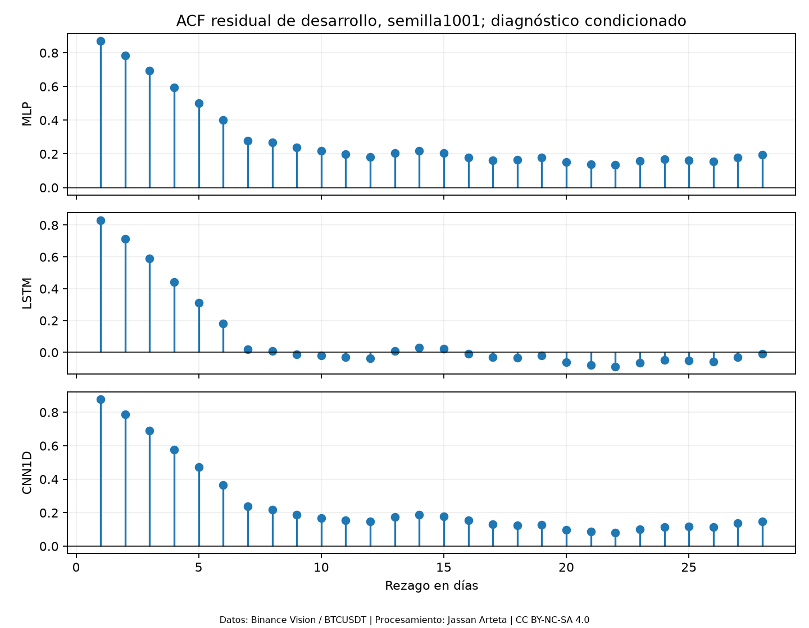
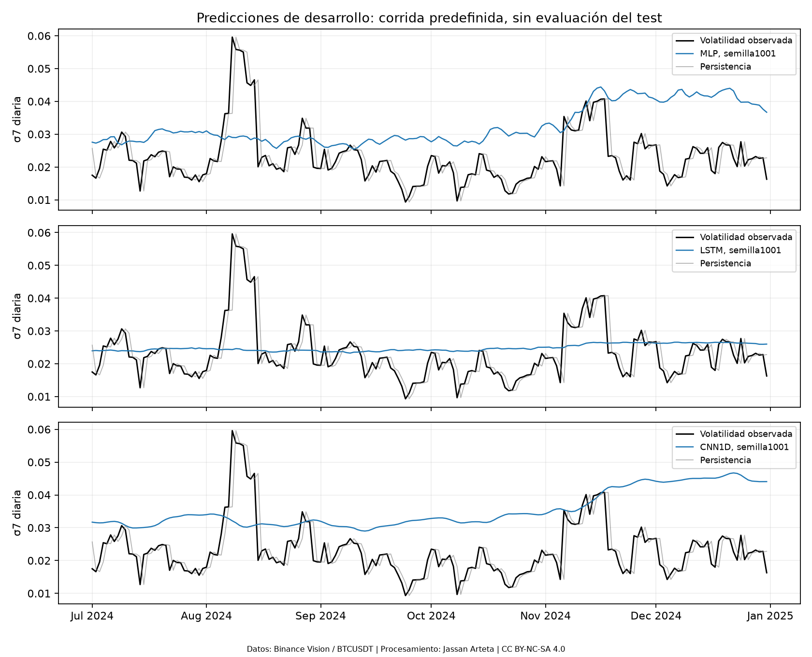
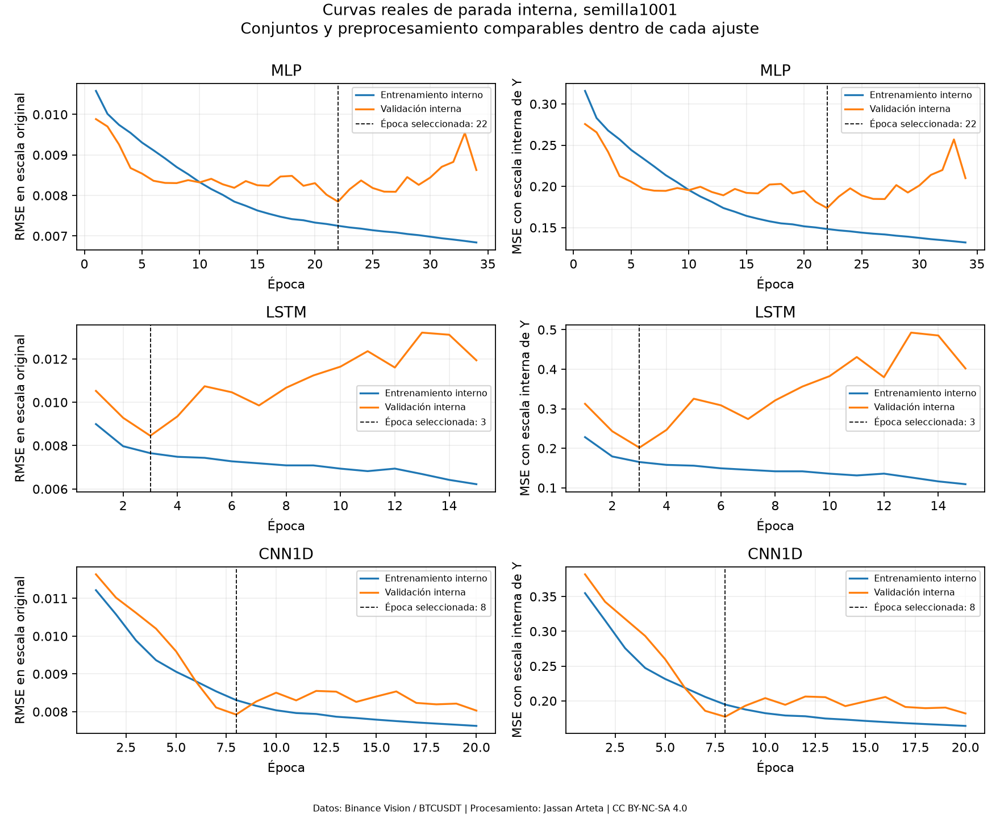
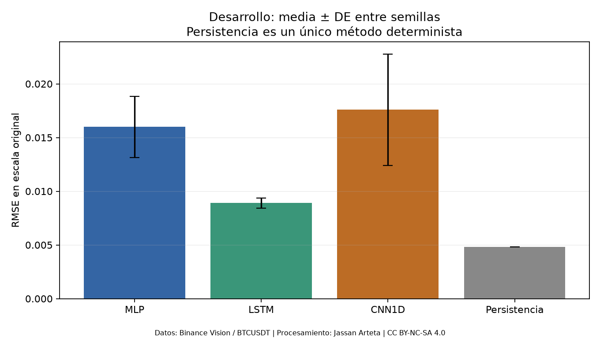

# 5. Benchmark de los Modelos Base y Definición del Baseline

El primer benchmark propio se ejecutó el **4 de noviembre de 2026** con tres modelos: **MLP, LSTM y CNN1D poco profunda**, treinta semillas por modelo y el mismo pipeline. Este capítulo reemplaza el estado anterior de ejecución diferida por mediciones verificables. Son resultados de **desarrollo/calibración ya expuesta**, no del test reservado: la búsqueda usa enero–junio de 2024 y la comparación posterior julio–diciembre de 2024. El test de 2025 y enero–agosto de 2026 permanece cerrado.

El protocolo inicial se registró a las 14:28:17 UTC, después del EDA y la revisión bibliográfica pero antes del primer ajuste DL del proyecto; el cierre posterior al piloto fue a las 14:37:41 UTC. La búsqueda fijó **D=7 y MLP como referencia operacional**. En la comparación posterior LSTM obtiene menor RMSE entre las redes, pero no reemplaza retrospectivamente esa selección. **Persistencia supera a las tres redes** en este calendario.

Los archivos permiten reproducir cada cifra: [protocolo inicial](../_static/dl_benchmark_20261104/protocol_initial.json), [protocolo final](../_static/dl_benchmark_20261104/protocol_final.json), [configuración seleccionada](../_static/dl_benchmark_20261104/selected_configuration.json), [piloto](../_static/dl_benchmark_20261104/pilot_summary.json), [registro de corridas](../_static/dl_benchmark_20261104/runs.csv), [predicciones de desarrollo](../_static/dl_benchmark_20261104/predictions/development_benchmark.csv) y {download}`alcance del análisis <../_static/dl_benchmark_20261104/analysis/README.md>`. La ejecución no resuelve el respaldo aplicado todavía ausente para MLP y CNN1D simple en el corpus de §3.

## 5.1. Comparación Tabular

### 5.1.1. Tabla de comparación de los tres modelos base

La comparación corresponde a BTCUSDT de Binance Spot, datos diarios UTC, entrada OHLCV de **D=7 días**, objetivo de volatilidad **$\sigma_7$ poblacional (`ddof=0`) sin anualizar** y horizonte h=1. Son las mismas **184 fechas, del 1 de julio al 31 de diciembre de 2024**, y semillas 1001–1030 para cada red; no hay fechas ni corridas faltantes en esta tabla.

Los modelos son ajustes estáticos con cohortes de entrenamiento de 2023 y embargo de D días. La búsqueda de D e hiperparámetros, el escalado, la validación interna y la parada siguen §4; no se reajustan con los resultados de julio–diciembre. La transformación logarítmica de OHLC y `log1p` de volumen, sus escalas por canal y la escala positiva de Y se ajustan solo con los datos de entrenamiento admitidos.

Para orígenes comunes $\mathcal V_c$ y semillas $\mathcal S_c$, la métrica de una corrida y la puntuación principal son:

$$
m_{m,s,c}=\sqrt{\frac1{N_c}\sum_{t\in\mathcal V_c}
(Y_t-\widehat Y_{m,s,t})^2},\qquad
S_{m,c}=\frac1{R_c}\sum_{s\in\mathcal S_c}m_{m,s,c}.
$$

Se ordena por **media de RMSE por corrida**, con DE muestral entre semillas. No es la RMSE del promedio de predicciones ni una única RMSE sobre filas semilla×fecha. Promediar predicciones definiría un ensemble adicional que no se evalúa aquí. No se comparan directamente RMSE de ventanas de volatilidad distintas.

#### 5.1.1.1. Modelo base

Resultados de desarrollo en unidades originales de volatilidad. Los IC de esta tabla son t de Student al 95 %, marginales y condicionados al mismo calendario; no son intervalos de generalización temporal.

| Modelo | Corridas | RMSE, media ± DE | IC 95 % de RMSE | MAE, media ± DE | Parámetros entrenables |
|---|---:|---:|---|---:|---:|
| MLP, H=16, LR=0,001 | 30 | 0,0159903 ± 0,0028545 | [0,0149244; 0,0170562] | 0,0138174 ± 0,0028091 | 593 |
| LSTM, H=32, LR=0,003 | 30 | 0,0089035 ± 0,0004854 | [0,0087222; 0,0090847] | 0,0068832 ± 0,0007473 | 5.025 |
| CNN1D, H=16, LR=0,001 | 30 | 0,0175867 ± 0,0051921 | [0,0156479; 0,0195255] | 0,0152235 ± 0,0052040 | 1.057 |
| Persistencia, referencia determinista | No aplica | 0,0048225; sin DE entre semillas | No aplica a semillas | 0,0028727; sin DE entre semillas | 0 |

Fuente: [metrics_summary.csv](../_static/dl_benchmark_20261104/analysis/metrics_summary.csv). Persistencia no es un cuarto modelo DL ni treinta entrenamientos repetidos. Pronostica con la última σ7 conocida y necesita ocho cierres anteriores; las redes reciben siete días de OHLCV. Esa diferencia de información debe conservarse al interpretar la comparación.

#### 5.1.1.2. Métricas: media ± desviación estándar

El CSV anterior conserva media, DE muestral, número de valores definidos, cobertura e IC de cada métrica. Las siguientes cifras son complementarias a RMSE; todas se calculan después de invertir la escala de Y:

| Modelo | R², media ± DE | MAPE (%), media ± DE | MASE, media ± DE |
|---|---:|---:|---:|
| MLP | −2,73998 ± 1,29673 | 69,6558 ± 14,4619 | 5,56565 ± 1,13150 |
| LSTM | −0,12809 ± 0,12276 | 33,7315 ± 5,0528 | 2,77255 ± 0,30100 |
| CNN1D | −3,75860 ± 3,02634 | 76,6621 ± 27,0778 | 6,13203 ± 2,09619 |
| Persistencia | 0,67000 | 13,2578 | 1,15711 |

MAPE y MASE tienen cobertura del 100 % en esta cohorte; sus denominadores y máscaras siguen §4.4. El denominador de MASE es histórico, por lo que no se debe esperar MASE=1 para la persistencia en estas fechas de evaluación. El R² negativo de las redes describe el error en este tramo frente a la media observada usada en la definición de R²; no identifica por sí solo la causa del mal desempeño.

#### 5.1.1.3. Intervalos de confianza del 95 % y método de construcción

Los IC marginales entre semillas emplean t de Student con 29 grados de libertad. Describen la media de desempeño del procedimiento de entrenamiento condicionada a los datos, partición e hiperparámetros observados. El solapamiento de IC marginales de modelos no sustituye un IC de su diferencia pareada.

El análisis temporal complementario remuestrea conjuntamente fechas en bloques circulares: 2.000 réplicas, longitud principal 14 días y sensibilidades 7 y 28 (§5.4.5). Recalcula la RMSE de cada semilla y luego su media; no remuestrea semillas ni reentrena modelos. Ambos intervalos contestan preguntas distintas. Los IC del 95 % publicados son marginales; Holm sobre p-valores no los convierte en intervalos simultáneos.

#### 5.1.1.4. Tiempo de entrenamiento y de inferencia

Las mediciones se hicieron en CPU con un hilo PyTorch, sin GPU y con ejecución serial de las corridas del benchmark. El tiempo de entrenamiento suma selección de época mediante validación interna y reajuste nuevo; excluye preprocesamiento y serialización. La inferencia se midió después de cinco calentamientos, con veinte pasadas y lote máximo de 256: cada duración corresponde a **las 184 predicciones**, no a una predicción individual.

| Modelo | Entrenamiento (s), media ± DE | Inferencia de 184 casos (ms), media ± DE |
|---|---:|---:|
| MLP | 0,34480 ± 0,13838 | 0,03979 ± 0,01082 |
| LSTM | 0,22704 ± 0,05764 | 0,46344 ± 0,08246 |
| CNN1D | 0,63489 ± 0,49260 | 0,35376 ± 0,05189 |

El registro completo está en [runs.csv](../_static/dl_benchmark_20261104/runs.csv). Los tiempos de la búsqueda, ejecutada con tres trabajadores, no se comparan directamente con estas mediciones seriales. Son tiempos locales y muy pequeños, sensibles a hardware, calentamiento y época de parada; no son una evaluación de despliegue ni de entrenamiento acelerado.

#### 5.1.1.5. Número de parámetros

El conteo proviene de las instancias reales de PyTorch: **593 en MLP, 5.025 en LSTM y 1.057 en CNN1D**, todos entrenables; cada modelo tiene cero parámetros no entrenables. La persistencia no tiene pesos ajustados. Las fórmulas y pruebas del conteo están en la implementación de §4.2.

MLP tiene una capa oculta; LSTM una capa recurrente unidireccional; CNN1D dos convoluciones causales ordinarias de kernel 3, sin dilatación ni residuales, seguidas de promedio temporal. La CNN ejecutada no reproduce la TCN de S1.

## 5.2. Ranking de Modelos Base

### 5.2.1. Orden de los tres modelos según la métrica principal

La búsqueda exhaustiva compartió cuatro historias D∈{7,14,21,28}, anchos {16,32}, tasas {0,001;0,003} y semillas {101,202}. Se seleccionó una configuración por familia y D, y después el D común que minimiza la media de los tres ganadores. Los desempates registrados prefieren menos parámetros y menor D cuando corresponde. Resultó **D=7**.

| Familia seleccionada en D=7 | RMSE de búsqueda enero–junio, media de 2 semillas | Puesto en búsqueda | Puesto descriptivo julio–diciembre |
|---|---:|---:|---:|
| MLP | 0,01052383 | 1 | 2 |
| LSTM | 0,01077513 | 2 | 1 |
| CNN1D | 0,01348078 | 3 | 3 |

Por la regla previa, **MLP es la referencia operacional seleccionada**. El orden descriptivo posterior es LSTM, MLP, CNN1D; persistencia obtiene menor error que todas. La discrepancia entre búsqueda y comparación se reporta sin sustituir MLP post hoc. La selección no exige demostrar superioridad frente a todas las alternativas para poder identificar una referencia operacional, y estos resultados expuestos no establecen un ganador en test.

La frecuencia de menor RMSE en el [bootstrap temporal](../_static/dl_benchmark_20261104/analysis/ranking_bootstrap.csv) es 1,000 para LSTM dentro de las tres redes y 1,000 para persistencia al incluirla, para las tres longitudes de bloque. Son frecuencias de remuestreo de estos modelos almacenados, no probabilidades posteriores ni una demostración de ranking poblacional.

### 5.2.2. Análisis del trade-off

Se comparan los frentes error–tiempo y error–parámetros usando las mediciones de §5.1. La dominancia sobre medias es descriptiva de esta CPU y este calendario, con la dispersión de corridas documentada; no acredita dominancia poblacional.

#### 5.2.2.1. Precisión frente a costo computacional

LSTM tiene la menor RMSE entre redes y el menor tiempo medio de entrenamiento observado, pero la mayor duración de inferencia. MLP tiene la inferencia más corta. En medias, MLP supera a CNN1D en error y en ambos tiempos medidos; esa comparación de costo no convierte la diferencia de RMSE entre semillas en significativa (§5.3.3).

La parada temprana cambia el número de épocas y contribuye al tiempo total. Por ello no se atribuye el menor tiempo de entrenamiento de LSTM a una eficiencia intrínseca de su arquitectura. Tampoco se establece una exigencia operacional de latencia que no haya sido definida para el proyecto.

#### 5.2.2.2. Precisión frente a complejidad del modelo

LSTM usa aproximadamente 8,47 veces los parámetros de MLP y 4,75 veces los de CNN1D. Su menor error observado se obtiene con más pesos, pero no con mayor tiempo medio de entrenamiento en estas corridas. La inferencia sí es más lenta que en MLP; parámetros y latencia no son intercambiables.

MLP y LSTM presentan un compromiso descriptivo entre RMSE y parámetros; CNN1D queda dominada por MLP en esas medias. Persistencia obtiene menor error sin pesos entrenados, aunque con la diferencia de historia disponible ya declarada. No se infiere utilidad económica ni una decisión de despliegue a partir de estos frentes.

## 5.3. Definición del Baseline y Margen de Mejora Disponible

Se distinguen la referencia DL congelada por la búsqueda, el líder descriptivo posterior, la referencia ingenua y la sensibilidad del diseño. Así se evita convertir la elección del menor error observado en una confirmación independiente.

### 5.3.1. Selección del baseline de referencia

#### 5.3.1.1. Identificación del mejor modelo base

La regla de menor RMSE media en enero–junio seleccionó **MLP, D=7, H=16 y LR=0,001**. La configuración comparte AdamW, dropout=0,1, decaimiento de pesos=10⁻⁴, lote 32 y las reglas de parada/reajuste de §4. Se conserva como **baseline DL operacional de desarrollo**.

LSTM es la mejor red por la media observada en julio–diciembre, pero esa evidencia no autoriza una sustitución retrospectiva. Persistencia es la referencia de menor error en esta evaluación; su ventaja impide afirmar que el uso de DL haya mejorado el pronóstico. Ninguna de estas denominaciones constituye una cota universal de error ni una elección confirmada con el test reservado.

#### 5.3.1.2. Desempeño con media, desviación e IC del 95 %

El baseline operacional MLP obtiene RMSE **0,0159903 ± 0,0028545**, IC t marginal del 95 % **[0,0149244; 0,0170562]**, en treinta semillas sobre 184 fechas expuestas. LSTM obtiene **0,0089035 ± 0,0004854**, IC **[0,0087222; 0,0090847]**, y persistencia **0,0048225**, sin variabilidad de inicialización. Se reportan selección y desempeño posterior con sus nombres y fases diferenciados.

### 5.3.2. Cuantificación de las diferencias entre modelos base

#### 5.3.2.1. Regresión y series de tiempo: diferencias respecto al peor y al mejor modelo

Para la métrica de error k se usarán sus medias por corrida $\bar M_{m,k,c}$ sobre repeticiones y fechas comparables. Los extremos descriptivos se identifican **por métrica**:

$$
r^{\mathrm{mejor}}_{k,c}=\arg\min_m\bar M_{m,k,c},\qquad
r^{\mathrm{peor}}_{k,c}=\arg\max_m\bar M_{m,k,c}.
$$

El mejor o peor por RMSE no tiene por qué serlo por MAE. Las tablas identificarán qué referente se usa para cada porcentaje. Si se calcula MAE frente a los identificadores elegidos por RMSE como análisis complementario, se rotulará así y no se los llamará extremos MAE. Los empates conservarán sus identificadores según §5.2.1.

La reducción relativa descriptiva se calculará **sobre las medias por corrida**:

$$
\Delta_k(m;r,c)=100\,
\frac{\bar M_{r,k,c}-\bar M_{m,k,c}}{\bar M_{r,k,c}},
\qquad \bar M_{r,k,c}>0.
$$

Un valor positivo favorece al modelo m frente a r; negativo indica mayor error. Respecto al mejor error de esa métrica, las otras filas tendrán reducciones no positivas. Si el referente vale cero, el porcentaje es indefinido, sin epsilon. Se publicarán también diferencias en unidades originales, con signo y referentes identificados.

La razón de medias no equivale a la media de porcentajes por semilla. Esta última sería otro estimando; no se mezcla con el principal de la tabla. Las comparaciones pareadas usan las métricas individuales y las predicciones, sin sustituirlas por cifras redondeadas. Para un IC de la razón se recalculan numerador y denominador conjuntamente bajo la unidad de inferencia registrada.

En julio–diciembre, LSTM y CNN1D son respectivamente los extremos mejor y peor entre las redes tanto por RMSE como por MAE. Son extremos descriptivos de desarrollo, separados de la referencia operacional MLP. Elegirlos en esas mismas fechas no elimina la incertidumbre de selección.

| Modelo | Reducción de RMSE frente a CNN1D (%) | Reducción de RMSE frente a LSTM (%) | Reducción de MAE frente a CNN1D (%) | Reducción de MAE frente a LSTM (%) |
|---|---:|---:|---:|---:|
| MLP | 9,077 | -79,597 | 9,236 | -100,741 |
| LSTM | 49,374 | 0,000 | 54,786 | 0,000 |
| CNN1D | 0,000 | -97,526 | 0,000 | -121,169 |

Frente a persistencia, la reducción relativa de RMSE es **−231,579 % en MLP, −84,624 % en LSTM y −264,682 % en CNN1D**: son aumentos de error, no mejoras. Las diferencias originales y sus IC se presentan en §§5.3.3 y 5.4.5. Estos porcentajes se calculan con cifras sin redondear del CSV.

#### 5.3.2.2. Clasificación, etiquetado secuencial y segmentación

Estas modalidades **no aplican al proyecto actual**:

- **Clasificación:** se predice volatilidad continua, sin clases ni probabilidades de clase.
- **Etiquetado secuencial:** no se predicen etiquetas por token ni entidades delimitadas.
- **Segmentación:** no hay imágenes de entrada, máscaras ni etiquetas por píxel.

Para documentar la guía, cuando la métrica principal sea F1-score, AUC-ROC, F1 de entidad, mIoU o Dice y **un valor mayor sea mejor**, sean $\bar S_{m,k,c}$ y $\bar S_{r,k,c}$ sus medias por corrida bajo la misma evaluación. La diferencia en unidades de la métrica y la mejora relativa frente a la referencia r serían:

$$
\Delta_{\mathrm{abs},k}(m;r,c)=\bar S_{m,k,c}-\bar S_{r,k,c}.
$$

$$
\Delta_{\mathrm{rel},k}(m;r,c)=100\,
\frac{\bar S_{m,k,c}-\bar S_{r,k,c}}{\bar S_{r,k,c}},
\qquad \bar S_{r,k,c}>0.
$$

«Diferencia absoluta» designa aquí el cambio en unidades de la métrica, **con signo**; no el valor absoluto matemático. Un valor positivo favorece a m. Se declararán la escala, el promedio y el referente: si la métrica se expresa en porcentaje, la diferencia de esos valores se comunica en puntos porcentuales, mientras la segunda expresión es un cambio porcentual relativo. El mejor y el peor se identifican por la mayor y la menor puntuación de esa métrica, respectivamente, conservando los empates. Con referencia cero, la diferencia relativa queda indefinida y se informa el motivo, sin añadir epsilon; la diferencia en unidades puede seguir definida.

Se conservarán las mismas muestras y repeticiones emparejadas. La razón entre medias no se confundirá con la media de razones por semilla, y la incertidumbre de una razón recalculará conjuntamente numerador y denominador. Estas definiciones no aportan resultados de clasificación, etiquetado o segmentación del proyecto.

#### 5.3.2.3. Secuencia a secuencia

**No aplica al proyecto actual:** la salida es una volatilidad escalar y no una secuencia generada. Para una tarea de generación se documentarían las diferencias en unidades y relativas de su métrica principal —por ejemplo, BLEU, ROUGE, chrF o exactitud de secuencia completa— con la convención de §5.3.2.2 cuando un valor mayor sea mejor.

Se declararán la escala, tokenización, versión, referencias, parámetros y agregación de la métrica antes de comparar puntuaciones. Se identificarán los referentes mejor y peor de esa métrica y se mantendrán el emparejamiento y el tratamiento de referencias cero. No se mezclarán escalas o configuraciones de cálculo distintas ni se presentarán esas diferencias como mediciones propias de volatilidad.

#### 5.3.2.4. Tamaño de efecto de cada diferencia

En el proyecto, las cantidades m siguientes son métricas de error, como RMSE. Para puntuaciones donde un valor mayor sea mejor se declarará el sentido del signo correspondiente. Una alternativa basada en rangos es la correlación rango-biserial pareada, con su convención de ceros y empates explícita.

Cada diferencia relevante se acompañará de una medida de efecto apropiada y su definición. Para diferencias pareadas por ejecución $d_s=m_{A,s}-m_{B,s}$ puede informarse:

$$
d_z=\frac{\bar d}{s_d},
$$

con signo, denominador y unidad de emparejamiento identificados. Si $s_d=0$, el cociente no está definido. No se sustituirá la desviación de las diferencias por la desviación de un solo modelo. Si se usa una medida basada en rangos, se especificará el cálculo y el tratamiento de empates.

El efecto entre semillas mide esa variabilidad condicionada a los mismos datos. Para efectos sobre errores temporalmente dependientes se justificará el método de bloques o diseño correspondiente. No se atribuirá independencia a todos los días por disponer de muchas predicciones.

Con $d_s=m_{A,s}-m_{B,s}$, un $d_z$ negativo favorece a A; la reducción porcentual anterior usa el signo opuesto, positiva cuando mejora m. Se rotularán ambas convenciones. El d_z pareado no se calcula con una desviación marginal o combinada de grupos independientes. Tampoco se sustituye automáticamente por el delta de Cliff basado en todos los cruces A×B: eso perdería el emparejamiento. El efecto de rangos elegido deberá conservar las parejas y su convención de ceros/empates. Los umbrales convencionales de efecto pequeño o grande no reemplazan el margen práctico.

### 5.3.3. Inferencia sobre las diferencias

#### 5.3.3.1. Comparaciones pareadas y corrección por multiplicidad

La familia prevista contiene **nueve contrastes entre semillas**: tres pares bilaterales entre redes, tres comparaciones bilaterales red–persistencia y tres contrastes unilaterales de ganancia relativa superior al 5 % frente a persistencia. Se aplica Holm conjuntamente a los nueve, sin dividirlos según sus resultados. Cada pareja de redes conserva la misma semilla y calendario; la persistencia es un valor fijo, no treinta ajustes independientes.

Son análisis de desarrollo: el calendario de 2024 ya se había expuesto al EDA y al diseño. Registrar el protocolo antes de entrenar y ajustar multiplicidad no vuelve confirmatorio ese calendario ni elimina el optimismo de selección. Una evaluación externa requerirá el test reservado o un procedimiento externo que haya aislado todo el diseño.

#### 5.3.3.2. Diferencia media, IC del 95 % y p-value ajustado y sin ajustar

Para cada par se usa Δ=RMSE(A)−RMSE(B); un valor negativo favorece A. Los IC son t marginales del 95 %, con 29 grados de libertad, y los efectos son d_z pareados. Los p-valores numéricos se calculan con la referencia t y sus condiciones, sin presentarlos como pruebas exactas de aleatorización.

| A − B | Δ media | IC 95 % marginal | d_z | p sin ajustar | p Holm, familia 9 |
|---|---:|---|---:|---:|---:|
| MLP − LSTM | 0,00708685 | [0,00598691; 0,00818678] | 2,40585 | 9,02388×10⁻¹⁴ | 5,41433×10⁻¹³ |
| MLP − CNN1D | −0,00159638 | [−0,00373267; 0,00053991] | −0,27903 | 0,137264 | 0,549057 |
| LSTM − CNN1D | −0,00868323 | [−0,01058312; −0,00678333] | −1,70661 | 2,98184×10⁻¹⁰ | 1,49092×10⁻⁹ |
| MLP − Persistencia | 0,01116783 | [0,01010196; 0,01223370] | 3,91241 | 2,50849×10⁻¹⁹ | 2,00679×10⁻¹⁸ |
| LSTM − Persistencia | 0,00408098 | [0,00389972; 0,00426225] | 8,40675 | 1,13894×10⁻²⁸ | 1,02504×10⁻²⁷ |
| CNN1D − Persistencia | 0,01276421 | [0,01082544; 0,01470298] | 2,45838 | 5,25204×10⁻¹⁴ | 3,67643×10⁻¹³ |

Fuente completa: [paired_tests.csv](../_static/dl_benchmark_20261104/analysis/paired_tests.csv), con estadísticos, diagnósticos y los nueve contrastes. En los tres unilaterales de mejora superior al 5 %, p sin ajustar y Holm son 1,000: las estimaciones favorecen a persistencia. No rechazar esa superioridad no demuestra equivalencia.

LSTM supera a las otras dos redes bajo este análisis condicionado a las semillas; MLP–CNN1D es inconcluso. Los diagnósticos Shapiro–Wilk de MLP–LSTM (p=0,020789) y MLP–persistencia (p=0,016355) muestran desviaciones de normalidad que limitan la calibración de la referencia t. Se conserva el análisis previamente elegido y se informa la limitación; no se sustituye por la prueba que resulte más favorable.

### 5.3.4. Umbral de mejora para modelos avanzados

Se distinguirán dos cantidades:

#### 5.3.4.1. Mejora mínima detectable frente al baseline

- **Mejora mínima detectable:** depende del diseño, la variabilidad pareada y la potencia; se estima con el procedimiento de §4.1, respetando sus supuestos.

La desviación entre corridas o la anchura de un IC por sí solas no bastan para declarar una mejora detectable: se necesitan contraste, potencia, emparejamiento y variabilidad de las diferencias. Si la mejora detectable supera el margen registrado para el contraste correspondiente, se ampliará el diseño o se explicitará esa limitación.

Para una propuesta avanzada A frente a un baseline B, en la misma unidad pareada:

$$
\operatorname{Var}(m_A-m_B)=\operatorname{Var}(m_A)
+\operatorname{Var}(m_B)-2\operatorname{Cov}(m_A,m_B).
$$

La DE o el IC de B aislado no identifica esa varianza ni una MDE verificable de A−B. Se necesitan estimando, política de entrenamiento o referencia fija, emparejamiento y datos de planificación o supuestos justificados sobre ambas cantidades. No existe una MDE numérica válida para una propuesta avanzada todavía no definida ni ejecutada. La planificación numérica disponible corresponde a cada red frente a persistencia (§5.4.7), no a una futura red avanzada frente a MLP.

Se mantendrá la distinción de §4.1.5–§4.1.7: detectar un efecto frente a cero es distinto de demostrar que supera un margen práctico. La MDE por semillas es condicional al calendario y no acredita por sí sola potencia temporal ni potencia conjunta de toda una familia. El umbral avanzado no se define sumando una DE al baseline o tomando un extremo de su IC.

#### 5.3.4.2. Margen de relevancia práctica

La regla registrada es una **reducción relativa de RMSE del 5 % frente a persistencia**. Con RMSE de persistencia 0,00482247875 en la calibración, su conversión de planificación es **δ=0,00024112394** y el nivel puntual correspondiente sería RMSE≤0,00458135481. Esta conversión usa desarrollo expuesto, no test, y ninguna red se aproxima a ese nivel en esta ejecución.

Detectar un efecto de esa magnitud frente a cero no es demostrar que la ganancia supera el 5 %. Los contrastes unilaterales sobre la frontera 0,05 se conservan separados del dimensionamiento aproximado frente a cero. La estimación puntual tampoco sustituye un contraste e intervalo sobre el margen.

El 5 % no se traslada automáticamente a una comparación entre redes ni a un modelo avanzado frente al baseline MLP. Esa comparación requerirá un margen aplicado propio, estimando, política de entrenamiento y planificación pareada registrados antes de evaluarla. La RMSE o el extremo de un IC de MLP no bastan para fijar ese umbral.

#### 5.3.4.3. Cota de referencia del problema

Cuando exista una cota de referencia verificable del problema, se discutirá junto con sus supuestos y su comparabilidad. Actualmente no se ha estimado ruido irreducible ni una cota de error para esta volatilidad financiera. La persistencia aporta contexto, pero **no es una cota teórica de error mínimo**; un resultado publicado en otro dataset tampoco lo es.

El acuerdo entre anotadores no aplica porque la etiqueta se construye mediante una fórmula sobre retornos, sin anotación humana. No se dispone de una medición de desempeño humano comparable que sirva como cota.

### 5.3.5. Interpretación

#### 5.3.5.1. Significación estadística y relevancia práctica

Entre semillas, las diferencias LSTM–MLP y LSTM–CNN1D son distinguibles con Holm bajo los supuestos t; MLP–CNN1D no lo es. Las tres redes tienen mayor error que persistencia y ninguna cumple la mejora práctica del 5 %. Por tanto, una ventaja relativa de LSTM dentro del grupo DL no representa mejora útil frente a la referencia ingenua en estas fechas.

La inferencia temporal y el remuestreo por bloques aportan otra perspectiva sobre las mismas predicciones, no confirmaciones independientes. No se afirma equivalencia, causalidad arquitectónica ni generalización a 2025–2026, otros activos o proveedores.

#### 5.3.5.2. Desempeño frente a complejidad, parámetros y costo

LSTM reduce RMSE respecto de MLP un 44,320 % en medias de julio–diciembre, a costa de 8,47 veces sus parámetros y una inferencia mayor. Su entrenamiento observado es más corto por el procedimiento y las épocas efectivas; no se interpreta como eficiencia arquitectónica general. CNN1D no aporta una mejora frente a MLP en las medias observadas y presenta mayor variabilidad. Ninguna red justifica una mejora predictiva frente a persistencia en este experimento.

#### 5.3.5.3. Conclusión explícita del baseline y margen disponible

El **baseline DL operacional de desarrollo es MLP, D=7, H=16, LR=0,001**, elegido en enero–junio. Su RMSE posterior es 0,0159903 ± 0,0028545; LSTM lidera descriptivamente las redes con 0,0089035 y persistencia obtiene 0,0048225. No se proclama un baseline ganador confirmado en test.

No hay un margen cuantificado para una arquitectura avanzada frente a MLP. El único margen práctico fijado, 5 % frente a persistencia, no se alcanza; el piloto tampoco acredita sensibilidad de 0,80 para detectar su magnitud con treinta semillas. Los residuos motivan investigación, sin cuantificar una mejora aprovechable garantizada.

#### 5.3.5.4. Estado del benchmark

| Producto | Estado verificable |
|---|---|
| Tres modelos y repeticiones | Ejecutados: 30 semillas por red, 90 corridas finales |
| Búsqueda común | 96 corridas; D=7; MLP seleccionado antes del piloto final |
| Piloto | 5 semillas por red; requerimiento máximo 1.212; límite registrado 30 |
| Métricas, tiempos y parámetros | Medidos; CSV y predicciones disponibles |
| Ranking posterior | LSTM, MLP, CNN1D; persistencia mejor que las tres |
| Inferencia | t pareada, Friedman, Holm, DM-HLN, bootstrap y diagnósticos ejecutados con alcance de desarrollo |
| Margen práctico | 5 % frente a persistencia; no alcanzado |
| Potencia del 80 % para esa magnitud | No acreditada con el límite de recursos |
| Baseline operacional | MLP congelado por búsqueda; no reseleccionado con julio–diciembre |
| Confirmación en test | No ejecutada; 2025–2026 sigue reservado |

La ejecución completa reúne 201 corridas y 402 ajustes al contar búsqueda, piloto, parada interna y reajuste. Es un benchmark medido de desarrollo con limitaciones explícitas, no una evaluación del test ni la resolución del respaldo bibliográfico pendiente.

## 5.4. Análisis Estadístico y Pruebas de Hipótesis

El análisis distingue variación entre entrenamientos, diferencias de pérdidas por fecha y diagnósticos residuales. Se utilizan las mismas predicciones de desarrollo para preguntas distintas; sus resultados no constituyen confirmaciones independientes ni evidencia del test reservado.

### 5.4.1. Hipótesis, unidad de análisis y supuestos

El protocolo inicial fijó RMSE, h=1, $\alpha=0{,}05$, direcciones y familias antes del primer entrenamiento DL, pero después de conocer el desarrollo histórico. El protocolo final conserva el límite de treinta semillas y registra el resultado del piloto. Son inferencias exploratorias de desarrollo, con los siguientes estimandos:

| Pregunta | Unidad y agregación ejecutadas | Familia principal |
|---|---|---|
| Variación por entrenamiento | Diferencias de métricas de las semillas 1001–1030; mismo calendario | 9 contrastes, Holm |
| Pérdida predictiva en el tiempo | 184 diferencias diarias de pérdidas cuadráticas promediadas sobre semillas | 6 pares, Holm; HAC 14 |
| Estructura residual | 184 residuos de la semilla predefinida 1001, sin concatenar semillas | 15 diagnósticos, Holm |

Se calcularon Shapiro–Wilk sobre diferencias pareadas, ACF residual y las verificaciones de continuidad/cobertura. No se publican gráficos Q–Q ni se presenta Shapiro como prueba suficiente de normalidad o de independencia. Las desviaciones de normalidad señaladas en §5.3.3 limitan la referencia t, y los diagnósticos temporales documentan dependencia.

Las treinta inicializaciones aportan variación del entrenamiento condicionada a estos datos, no treinta mercados independientes. Las 184 fechas tampoco se consideran i.i.d., por el solapamiento de σ7 y la dependencia adicional. Las configuraciones D no se convierten en bloques intercambiables ni las filas semilla×fecha en un tamaño muestral independiente de 5.520.

### 5.4.2. Comparaciones pareadas: t y Wilcoxon

Se ejecutó **t pareada**, con 30 pares y 29 grados de libertad, para las diferencias de RMSE entre redes. Frente a persistencia, el mismo cálculo compara la métrica de cada semilla con una referencia determinista, sin inventar repeticiones independientes de esa referencia. El resultado completo, incluidos estadístico, IC y Shapiro–Wilk, está en [paired_tests.csv](../_static/dl_benchmark_20261104/analysis/paired_tests.csv).

La t contrasta la media de las diferencias; no exige igualdad de varianzas marginales de las redes. La normalidad pertinente es la de las diferencias y la independencia se refiere a los entrenamientos condicionados al calendario. Las desviaciones diagnosticadas acompañan los resultados; no se seleccionó después una prueba según su p-valor.

**Wilcoxon no se ejecutó.** Su uso requeriría definir hipótesis de desplazamiento, simetría pertinente, tratamiento de ceros/empates y cálculo exacto o aproximado; no es un reemplazo automático de la prueba de la media. Con cinco pares sin ceros ni empates, el menor p bilateral exacto es $2/2^5=0{,}0625$; con seis es $0{,}03125$, todavía mayor que $0{,}05/3$. Por eso cumplir un mínimo de semillas no garantiza potencia tras multiplicidad. Aquí se ejecutaron treinta semillas, pero tampoco se alcanzó el tamaño exigido por el piloto.

### 5.4.3. Comparación conjunta de tres modelos

Se ejecutó **Friedman** sobre treinta bloques completos de semillas de las tres redes: estadístico χ² aproximado **45,26667**, con dos grados de libertad y **p=1,48070×10⁻¹⁰**. El resumen está en [summary.json](../_static/dl_benchmark_20261104/analysis/summary.json).

La conclusión es condicional al calendario común: no acredita independencia de mercados ni identifica por sí sola qué par difiere. Se conservan treinta bloques completos sin imputación ni selección de semillas. ANOVA de medidas repetidas no se ejecutó; habría requerido justificar la estructura de covarianza y las correcciones correspondientes.

### 5.4.4. Comparaciones post-hoc y corrección por multiplicidad

Las comparaciones pareadas principales ya estaban previstas y **no dependen de que Friedman actúe como puerta de entrada**. Se aplicó Holm a los nueve contrastes entre semillas; los seis pares temporales y los quince diagnósticos tienen sus familias diferenciadas por pregunta, registradas antes de interpretarlos.

Nemenyi y Bonferroni como análisis alternativos de resultados no se ejecutaron. El nivel conservador α=0,05/9 solo se utilizó para planificar tamaño/MDE, mientras los p-valores observados se ajustan por Holm. No se añade automáticamente una segunda corrección a un procedimiento ya simultáneo. La corrección de multiplicidad no repara supuestos inválidos ni convierte desarrollo expuesto en confirmación externa.

### 5.4.5. Intervalos de confianza y tamaño de efecto

#### 5.4.5.1. Bootstrap de las diferencias pareadas

Se ejecutó un **bootstrap circular pareado de fechas**, con 2.000 réplicas, semilla de remuestreo 20261104 y longitud principal de 14 días. Las sensibilidades de 7 y 28 días usan el mismo procedimiento y permanecen identificadas en [block_bootstrap.csv](../_static/dl_benchmark_20261104/analysis/block_bootstrap.csv). Se remuestrean juntas etiquetas y predicciones de todos los métodos; cada réplica calcula la RMSE de cada semilla y después su media. Las razones recalculan conjuntamente el denominador de persistencia.

| A − B | Diferencia de RMSE | IC percentil 95 %, bloques de 14 días |
|---|---:|---|
| MLP − LSTM | 0,0070868463 | [0,0030695119; 0,01100505] |
| MLP − CNN1D | -0,0015963798 | [-0,0019706962; -0,0012442331] |
| MLP − Persistencia | 0,01116783 | [0,0076314113; 0,014521738] |
| LSTM − CNN1D | -0,0086832262 | [-0,012660688; -0,0044586473] |
| LSTM − Persistencia | 0,0040809842 | [0,0022340656; 0,0057947357] |
| CNN1D − Persistencia | 0,01276421 | [0,0090669865; 0,016202049] |

Son intervalos marginales de variación temporal de evaluación **condicionada a los modelos almacenados**: no se reentrena ni se remuestrean semillas, por lo que no incorporan conjuntamente toda la incertidumbre del entrenamiento ni garantizan generalización temporal.

Para MLP–CNN1D, el IC temporal excluye cero aunque el IC entre semillas lo incluye. No hay contradicción: una unidad cambia las fechas manteniendo los entrenamientos observados; la otra cambia inicializaciones manteniendo las fechas. Se publican ambos sin seleccionar el que favorezca una conclusión. El IC de diferencias de RMSE tampoco es el IC de una diferencia de pérdidas cuadráticas de DM.

#### 5.4.5.2. Tamaño de efecto junto con el p-value

Se informa d_z pareado para cada diferencia de métricas en §5.3.3 y en el CSV, usando la DE de las diferencias, no una DE marginal o combinada de grupos independientes. Δ y d_z negativos favorecen A; la reducción porcentual usa la convención opuesta.

Los efectos LSTM–MLP y LSTM–CNN1D reflejan diferencias grandes respecto de la variación entre estas inicializaciones, sin cuantificar utilidad financiera o variación entre mercados. El margen aplicado sigue siendo el 5 % frente a persistencia. No se calculó delta de Cliff ni rango-biserial; sustituir el emparejamiento por todos los cruces A×B cambiaría el estimando.

### 5.4.6. Advertencia sobre independencia

#### 5.4.6.1. Ejecuciones que comparten el conjunto de prueba

El nombre del inciso corresponde al requisito general; **esta ejecución comparte desarrollo/calibración, no el test reservado**. Las treinta semillas de cada red comparten las mismas 184 fechas, etiquetas, configuración y entrenamiento admitido. Sus IC y pruebas describen la variación entre entrenamientos bajo ese calendario.

Las etiquetas consecutivas σ7 comparten seis retornos; aumentar semillas no aumenta el número de periodos de mercado observados. Las predicciones conservan identificadores de fecha, modelo y semilla, y no se agrupan como observaciones i.i.d. El carácter determinista de persistencia también se conserva.

#### 5.4.6.2. Validación repetida y remuestreo por bloques

No se ejecutó validación cruzada repetida ni K-fold aleatorio. Se mantuvo validación interna cronológica y un ajuste estático; no se aplicó una corrección de varianza derivada para otro diseño como si resolviera la dependencia temporal.

El remuestreo temporal ejecutado usa bloques circulares pareados de 14 días, con 7 y 28 como sensibilidad. Mantiene la dependencia local aproximada y las parejas entre métodos, pero los bordes circulares y la duración limitada del tramo son supuestos del procedimiento. Las frecuencias de ranking y los IC de bloques son evidencia condicionada a las predicciones guardadas, no garantías de independencia o estabilidad futura.

### 5.4.7. Reporte de potencia y diferencia mínima detectable

El piloto usó cinco semillas distintas de las finales —11, 23, 37, 53 y 71— sobre la misma calibración de julio–diciembre. Para detectar frente a cero una diferencia de magnitud $\delta=0{,}00024112394$, equivalente al 5 % de la RMSE de persistencia en desarrollo, se planificó potencia 0,80 y α conservador 0,05/9 mediante la aproximación normal pareada de §4.1.

| Red | DE piloto de RMSE frente a referencia fija | R requerido aproximado | R final | MDE frente a cero con R=30, potencia objetivo 0,80 |
|---|---:|---:|---:|---:|
| MLP | 0,00232148 | 1.212 | 30 | 0,00153200 |
| LSTM | 0,00087432 | 172 | 30 | 0,00057698 |
| CNN1D | 0,00179438 | 724 | 30 | 0,00118415 |

Fuente: [pilot_summary.json](../_static/dl_benchmark_20261104/pilot_summary.json). Prevaleció el **límite de recursos registrado de treinta semillas**, por debajo del máximo requerido de 1.212. Se declara expresamente el incumplimiento del tamaño que exigiría la guía para esa potencia. Las tres MDE superan δ: **no se acredita potencia del 80 % para detectar una magnitud del 5 %**. Las estimaciones aproximadas de planificación para esa magnitud con R=30 son 0,0142, 0,1034 y 0,0211, respectivamente; no son potencias retrospectivas calculadas con los efectos finales.

Esta planificación condiciona el calendario y supone normalidad de diferencias y la referencia fija. No dimensiona automáticamente fechas dependientes, DM, BDS ni una propuesta avanzada frente a MLP. Detectar una diferencia frente a cero tampoco acredita que supere el margen práctico del 5 %; esa frontera requiere su alternativa y planificación propias.

### 5.4.8. Ausencia de significación y equivalencia

**No rechazar una diferencia no demuestra equivalencia.** Si se desea afirmar equivalencia entre modelos, se planteará un análisis separado, por ejemplo **TOST** con margen práctico predefinido. Una alternativa bayesiana con **ROPE** deberá declarar modelo, distribución posterior y regla de decisión; no se presentará como si fuera la misma prueba frecuentista.

El margen de equivalencia debe fijarse con sentido aplicado, escala, referencia y unidades claras. El 5 % de mejora frente a persistencia es un criterio de superioridad práctica y no define automáticamente una banda de equivalencia entre dos modelos. No se ensanchará después para conseguir equivalencia. Se distinguirán ausencia de evidencia, evidencia de diferencia y evidencia de equivalencia bajo el diseño correspondiente.

En un TOST al nivel 0,05, bajo el método y la calibración aplicables, ambas pruebas unilaterales deben rechazar; su regla usual corresponde al **IC del 90 % completamente dentro de la banda**. Se distinguirá ese intervalo de decisión del IC del 95 % requerido para el reporte general. Si cambia el nivel por comparación debido a multiplicidad, el intervalo de decisión debe corresponder al procedimiento realmente utilizado.

Las dos unilaterales de un TOST forman una prueba de intersección–unión; no se les aplica por defecto Bonferroni como si fueran dos afirmaciones independientes. Las equivalencias entre varios pares o configuraciones sí requieren su tratamiento de familia. Para ROPE se registrarán también dependencia, priors, posterior y criterio de decisión, sin inventar ahora sus valores.

**Resultado actual:** MLP–CNN1D no rechaza la igualdad de medias entre semillas con Holm (p=0,549057); se informa como inconcluso bajo ese diseño. No se ejecutó TOST ni ROPE y no se afirma equivalencia. Los contrastes unilaterales frente al 5 % tampoco son pruebas de equivalencia.

### 5.4.9. Test de Diebold–Mariano

#### 5.4.9.1. Comparación de precisión predictiva por horizonte

Se ejecutó Diebold–Mariano únicamente para el horizonte registrado **h=1**, sobre las 184 fechas consecutivas de julio–diciembre. La pérdida es cuadrática, coherente con RMSE. Para errores $e_{A,s,t}=Y_t-\widehat Y_{A,s,t}$, la serie registrada es la diferencia de pérdidas promediadas entre semillas:

$$
d_t=\frac1{30}\sum_{s=1001}^{1030}
\left(e_{A,s,t}^2-e_{B,s,t}^2\right),\qquad H_0:\mathbb E[d_t]=0.
$$

Una media negativa favorece A. Persistencia aporta su misma pérdida determinista a cada pareja; no se trata como treinta procesos entrenados. La serie no es la pérdida del promedio de predicciones ni concatena 184×30 observaciones. Tampoco contrasta directamente la media de RMSE por semilla usada en el ranking, pues promediar raíces y tomar la raíz de una pérdida media son operaciones distintas.

No se eligió la semilla de menor error para ejecutar DM. Agregar horizontes exigiría registrar su papel y la ampliación de la familia antes de evaluar.

#### 5.4.9.2. Corrección Harvey–Leybourne–Newbold y pérdida coherente

El análisis principal usa **HAC de Bartlett con rezago 14**, h=1 y la corrección Harvey–Leybourne–Newbold. Las sensibilidades HAC 7 y 28 se conservan separadas; no se eligió el rezago por su significación. Los p-valores bilaterales usan una referencia t con T−1=183 grados de libertad, **aproximada**, con Holm sobre los seis pares principales.

Para T fechas consecutivas y varianza de largo plazo admisible $\widehat\Omega_d>0$:

$$
DM=\frac{\sqrt T\,\bar d}{\sqrt{\widehat\Omega_d}},\qquad
DM_{\mathrm{HLN}}=DM\sqrt{\frac{T+1-2h+h(h-1)/T}{T}}.
$$

Con h=1 el factor es $\sqrt{(T-1)/T}$. **h no se sustituye por n=7 ni D=7**, y ese factor no corrige por sí solo la dependencia de σ7 ni garantiza calibración de cualquier HAC.

| A − B | Diferencia media de pérdida cuadrática | DM-HLN | p sin ajustar | p Holm, familia 6 |
|---|---:|---:|---:|---:|
| MLP − LSTM | 0,00018406691 | 2,893437 | 0,004273305 | 0,00663043 |
| MLP − CNN1D | -7,1784771e-05 | -4,807961 | 3,171305e-06 | 1,902783e-05 |
| MLP − Persistencia | 0,00024031006 | 4,02422 | 8,35857e-05 | 0,0003343428 |
| LSTM − CNN1D | -0,00025585168 | -3,306286 | 0,001137843 | 0,003413529 |
| LSTM − Persistencia | 5,6243148e-05 | 2,975981 | 0,003315215 | 0,00663043 |
| CNN1D − Persistencia | 0,00031209483 | 4,277476 | 3,041587e-05 | 0,0001520794 |

Fuente: [temporal_dm.csv](../_static/dl_benchmark_20261104/analysis/temporal_dm.csv). En la especificación principal se rechaza igualdad de pérdidas para los seis pares: LSTM favorecida frente a MLP/CNN1D, MLP frente a CNN1D y persistencia frente a todas. Esto no contradice el resultado inconcluso MLP–CNN1D entre semillas: cambian estimando y unidad de incertidumbre.

La referencia requiere momentos y dependencia adecuados para estimar la varianza de largo plazo; un tramo de 184 fechas, deriva, modelos seleccionados y etiquetas solapadas limitan la interpretación. HAC, HLN y Holm no convierten esa evidencia expuesta en confirmación externa ni prueban superación del 5 %. Las sensibilidades no se presentan como pruebas principales adicionales.

### 5.4.10. Test BDS (Brock–Dechert–Scheinkman)

Se ejecutó BDS sobre los residuos ordenados de la **semilla predefinida 1001**, h=1 y las mismas 184 fechas, sin prefiltrado ni agrupación de semillas. Se usan dimensiones 2 y 3, con 183 y 182 vectores de inmersión respectivamente, y ε=1,5 veces la DE muestral residual de cada red. Los seis BDS y nueve Ljung–Box forman la familia de quince diagnósticos ajustada con Holm.

| Red | ε | Dimensión | Estadístico BDS | p sin ajustar | p Holm, familia 15 |
|---|---:|---:|---:|---:|---:|
| MLP | 0,014471341 | 2 | 18,5201 | 1,421675e-76 | 9,951727e-76 |
| MLP | 0,014471341 | 3 | 18,37325 | 2,151413e-75 | 1,290848e-74 |
| LSTM | 0,012537396 | 2 | 15,34825 | 3,638829e-53 | 7,277658e-53 |
| LSTM | 0,012537396 | 3 | 15,07379 | 2,408773e-51 | 2,408773e-51 |
| CNN1D | 0,015044008 | 2 | 20,54051 | 9,358426e-94 | 7,48674e-93 |
| CNN1D | 0,015044008 | 3 | 20,63415 | 1,355199e-94 | 1,219679e-93 |

Fuente: [diagnostics.csv](../_static/dl_benchmark_20261104/analysis/diagnostics.csv), con versión, radio, tamaño útil y advertencias. Bajo su referencia normal aproximada, se rechaza i.i.d. en ambas dimensiones de las tres redes.

El rechazo de BDS no identifica exclusivamente no linealidad estructural ni capacidad predictiva aprovechable. Dependencia lineal, heterocedasticidad, deriva, estimación de modelos y etiquetas solapadas también afectan su interpretación y calibración; Holm no repara esas condiciones. No se extrapola el resultado de esta semilla a todos los entrenamientos.

### 5.4.11. Test de Ljung–Box

Se ejecutó Ljung–Box sobre los mismos residuos de la semilla 1001 en los rezagos registrados **7, 14 y 28**. Se usa **model_df=0**: no se resta el número de pesos de la red como si fueran parámetros ARMA. Los grados de libertad de la referencia χ² son, respectivamente, 7, 14 y 28; sus p-valores son aproximados.

| Red | Rezago | Q | p sin ajustar | p Holm, familia 15 |
|---|---:|---:|---:|---:|
| MLP | 7 | 509,5771 | 6,996479e-106 | 9,095422e-105 |
| MLP | 14 | 576,4649 | 5,40088e-114 | 7,561232e-113 |
| MLP | 28 | 659,4703 | 5,716454e-121 | 8,574681e-120 |
| LSTM | 7 | 352,8016 | 3,097088e-72 | 1,548544e-71 |
| LSTM | 14 | 353,5511 | 7,404031e-67 | 2,961612e-66 |
| LSTM | 28 | 360,8814 | 1,606715e-59 | 4,820145e-59 |
| CNN1D | 7 | 492,8041 | 2,824187e-102 | 2,824187e-101 |
| CNN1D | 14 | 536,6333 | 1,569977e-105 | 1,883972e-104 |
| CNN1D | 28 | 582,9916 | 4,684525e-105 | 5,152978e-104 |

Los nueve resultados rechazan ausencia conjunta de autocorrelación hasta esos rezagos bajo la referencia usada. No son nueve confirmaciones independientes ni demuestran que un modelo avanzado pueda eliminarla. No se ejecutó aquí Ljung–Box sobre residuos al cuadrado; requeriría identificar esa pregunta como diagnóstico adicional.

### 5.4.12. Interpretación de los residuos

#### 5.4.12.1. Estructura residual y posible margen de mejora

La ACF de la semilla 1001 es elevada en el primer rezago: **0,870991 en MLP, 0,831449 en LSTM y 0,877100 en CNN1D**. En la figura, MLP y CNN1D conservan correlaciones positivas a rezagos más largos; LSTM cae antes hacia cero. Las estimaciones completas están en [acf.csv](../_static/dl_benchmark_20261104/analysis/acf.csv).

Ljung–Box y BDS documentan estructura residual y desviaciones de i.i.d. bajo sus referencias aproximadas. El solapamiento del objetivo, la deriva y la heterocedasticidad pueden contribuir; no se atribuye toda esa estructura a falta de capacidad de las redes. No se cuantifica una ganancia futura por observarla ni se identifica un mecanismo causal. Una propuesta avanzada deberá demostrar su aprovechamiento con predicciones y comparación justas en evaluación no usada para diseñarla.

### 5.4.13. Buenas Prácticas Estadísticas

#### 5.4.13.1. Nivel de significancia declarado antes de analizar resultados

Se registró $\alpha=0{,}05$ con familias y direcciones en el protocolo inicial previo al entrenamiento. Se informa el contexto de desarrollo ya conocido y el cierre posterior al piloto; no se presenta ese registro como anterior a todo contacto con los datos. El dimensionamiento usa α=0,05/9, y los contrastes observados usan las familias Holm documentadas.

#### 5.4.13.2. P-valores numéricos, ajustados y sin ajustar

Las tablas y CSV conservan p-valores numéricos ajustados y sin ajustar, logaritmos y límites de precisión. La notación científica evita reducirlos a “p<0,05”. Ningún p-valor se muestra como cero por conveniencia. Las referencias t, χ² de Friedman/Ljung–Box, normal de BDS y t aproximada de DM mantienen sus condiciones; “numérico” no significa una prueba matemáticamente exacta.

#### 5.4.13.3. Intervalos de confianza y tamaños de efecto

Se publican IC t marginales entre semillas, d_z pareados e IC percentiles de fechas por bloques. Cada tabla identifica método, unidad y signo. Los primeros condicionan el calendario y los segundos los modelos almacenados; no se suman automáticamente sus incertidumbres. No se calculó un IC de equivalencia ni se confunden los IC marginales con una banda simultánea de la familia.

#### 5.4.13.4. Verificación de supuestos

Se publican Shapiro–Wilk de las diferencias, continuidad y cobertura, ACF, Ljung–Box y BDS. Shapiro señala desviaciones en MLP–LSTM y MLP–persistencia; la dependencia residual es patente en la corrida designada. Estos resultados limitan las referencias inferenciales y no autorizan a declarar “supuestos verificados” de forma global. No se seleccionó la prueba, semilla o rezago por obtener el menor p-valor.

#### 5.4.13.5. Múltiples ejecuciones documentadas

Se ejecutaron **treinta semillas finales por red, 1001–1030**, además de cinco semillas piloto distintas y dos de búsqueda. Cada corrida inicializa desde cero; el reajuste posterior a la parada interna usa una semilla derivada independiente y registrada. Las noventa corridas finales tienen los mismos orígenes y no se descartaron según su error.

Treinta supera el mínimo general de cinco y el de seis para rangos, pero queda por debajo de lo solicitado por el piloto: el límite de recursos no demuestra potencia suficiente. Las fechas y los dos ajustes internos de cada corrida no se contabilizan como nuevas semillas del benchmark.

#### 5.4.13.6. Métrica principal y comparaciones declaradas con antelación

RMSE, h=1, búsqueda común, selección de MLP antes del piloto y las familias de nueve, seis y quince contrastes se conservan en los protocolos enlazados. D e hiperparámetros se seleccionan con enero–junio; julio–diciembre cuantifica el resultado posterior y el piloto sin reabrirlos. La exposición previa de 2024 al EDA se declara, por lo que no se reivindica confirmación independiente. El test 2025–2026 sigue cerrado.

#### 5.4.13.7. Registro y trazabilidad de cada contraste

| Registro | Contenido verificable |
|---|---|
| [paired_tests.csv](../_static/dl_benchmark_20261104/analysis/paired_tests.csv) | Nueve contrastes: modelos, estimando, hipótesis, pares, diferencia, DE, t, grados de libertad, IC, d_z, Shapiro y p-valores |
| [temporal_dm.csv](../_static/dl_benchmark_20261104/analysis/temporal_dm.csv) | Seis pares principales y sensibilidades, fechas, h, HAC, kernel, HLN, pérdida media y p-valores |
| [diagnostics.csv](../_static/dl_benchmark_20261104/analysis/diagnostics.csv) | Semilla, rezagos, model_df, dimensión, ε, vectores útiles y familia Holm de quince |
| [block_bootstrap.csv](../_static/dl_benchmark_20261104/analysis/block_bootstrap.csv) | Longitud, réplicas, semilla de remuestreo, diferencias/razones e IC marginales |
| [summary.json](../_static/dl_benchmark_20261104/analysis/summary.json) | Versiones, hashes, cohorte, Friedman, fuentes, alcance y limitaciones |
| [pilot_summary.json](../_static/dl_benchmark_20261104/pilot_summary.json) | Dispersión de planificación, δ, R requerido, límite y MDE |

Cada resultado identifica fase y unidad de inferencia; no se omiten pares desfavorables ni se separan familias después de observar p-valores. Los contrastes de DeLong, McNemar, segmentación o lenguaje no aplican a la volatilidad continua de esta serie. TOST, ROPE, Wilcoxon, Nemenyi y ANOVA se distinguen explícitamente como no ejecutados.

### 5.4.14. Interpretación

#### 5.4.14.1. Diferencias estadísticamente significativas

En el análisis entre semillas con Holm, LSTM obtiene menor RMSE que MLP y CNN1D; MLP–CNN1D es inconcluso. Las tres redes tienen mayor error que persistencia. DM-HLN sobre pérdidas cuadráticas medias por fecha distingue los seis pares, con el orden de pérdidas favorable a persistencia, LSTM, MLP y CNN1D. Las afirmaciones mantienen sus supuestos, estimandos y alcance de desarrollo.

#### 5.4.14.2. Significancia estadística y relevancia práctica

La ventaja de LSTM dentro de las redes no demuestra utilidad frente a persistencia: su RMSE media es un 84,624 % mayor. Ninguna red cumple el 5 % de reducción fijado y los contrastes de superación del margen tienen p=1,000. MLP–CNN1D no se declara equivalente por no rechazar entre semillas. Tampoco se fija un margen práctico entre redes a posteriori.

#### 5.4.14.3. Conclusiones respaldadas por diferencias, incertidumbre y efectos

Las conclusiones se apoyan en treinta repeticiones, dispersión, diferencias pareadas, IC, d_z, Holm, análisis temporal y limitaciones del piloto. Las pruebas reutilizan predicciones y no son confirmaciones independientes. No se atribuyen ventajas causales a recurrencia/convolución ni generalización al test no evaluado. El límite de treinta semillas impide afirmar la potencia objetivo, aunque se observen diferencias grandes.

#### 5.4.14.4. Estado del análisis estadístico

| Producto | Estado |
|---|---|
| Predicciones y residuos | Disponibles para 30 semillas por red y 184 fechas de desarrollo |
| Familias y parámetros | Registrados: Holm 9 entre semillas, Holm 6 DM principal y Holm 15 diagnósticos |
| Normalidad y dependencia | Shapiro calculado; ACF y diagnósticos publicados; límites explícitos, sin Q–Q publicado |
| Comparación entre semillas | t pareada y Friedman ejecutados; Wilcoxon/ANOVA/Nemenyi no ejecutados |
| DM, BDS y Ljung–Box | Ejecutados con parámetros y referencias aproximadas documentados |
| IC y efectos | t marginal, d_z y bootstrap temporal pareado publicados |
| Potencia/MDE | Piloto ejecutado; máximo R=1.212 frente al límite 30; potencia objetivo no acreditada |
| Equivalencia | TOST y ROPE no ejecutados; no se afirma equivalencia |
| Confirmación externa | Pendiente; test 2025–2026 no leído ni evaluado por este experimento |

El análisis cuantifica un experimento real de desarrollo; no transforma su exposición previa o los límites de diseño en evidencia confirmatoria.

## 5.5. Discusión Crítica

La discusión se apoya en mediciones propias, sus unidades de incertidumbre y literatura verificable. Las comparaciones descriptivas se identifican como tales; las afirmaciones inferenciales mantienen supuestos y límites. Una explicación arquitectónica plausible no sustituye evidencia causal ni se presenta como resultado probado.

### 5.5.1. Desempeño y explicación de las diferencias

LSTM tiene la menor RMSE posterior entre las redes y sus diferencias frente a MLP y CNN1D son distinguibles bajo el análisis t condicionado a semillas, con Holm e IC publicados. La ventaja no se conserva frente a persistencia, que obtiene menor RMSE, MAE y mejor R². MLP permanece como referencia operacional porque fue seleccionado con la fase de búsqueda, no por ser el menor error posterior.

En la corrida designada, LSTM produce una trayectoria muy suave que omite picos; MLP y CNN1D también suavizan y muestran niveles persistentemente elevados en partes del tramo. Persistencia sigue la etiqueta con un día de rezago. La figura ilustra errores sistemáticos reales de esa semilla, sin resumir la variación de las treinta ni demostrar utilidad económica. La historia adicional disponible para persistencia se declara en §5.1.

Las curvas corresponden a la **parada interna**, no a un ajuste contra julio–diciembre ni contra test. Se seleccionan las épocas 22 para MLP, 3 para LSTM y 8 para CNN1D; se registran 34, 15 y 20 épocas, respectivamente. En LSTM el error interno de entrenamiento sigue disminuyendo mientras la validación empeora después de su mínimo, lo que justifica conservar la regla de parada. Esto no identifica por sí solo por qué LSTM obtiene menor error en la calibración posterior.

Recurrencia, convolución causal y representación plana incorporan sesgos distintos, pero atribuirles causalmente estas diferencias requeriría ablaciones o comparaciones adicionales controladas. No se afirma que una familia sea superior por su nombre ni por una única semilla.

### 5.5.2. Generalización y estabilidad

LSTM presenta la menor DE entre semillas de la RMSE en este calendario: 0,0004854, frente a 0,0028545 de MLP y 0,0051921 de CNN1D. Esa estabilidad es del entrenamiento condicionado a las mismas fechas, no una prueba de generalización temporal.

Las barras muestran **DE, no IC del 95 %**. Persistencia carece de variación de inicialización. El bootstrap de fechas mantiene el orden descriptivo en las longitudes examinadas, pero condiciona los modelos ya ajustados y no representa nuevos regímenes de mercado.

No se determina qué red generaliza mejor a 2025 o enero–agosto de 2026: ese test no se ha utilizado para modelado ni evaluado por este ciclo. La diferencia de orden entre enero–junio y julio–diciembre puede incluir selección, deriva, historia y variación de ajuste; no identifica por sí sola sobreajuste de una arquitectura. Un solo activo y proveedor, la máscara de elegibilidad y el día incompleto excluido del desarrollo limitan además la extrapolación a otros datos.

### 5.5.3. Significación estadística y relevancia práctica

La diferencia MLP−LSTM es 0,00708685, IC entre semillas [0,00598691; 0,00818678], d_z=2,40585 y p Holm=5,41433×10⁻¹³; la calibración t se limita por Shapiro p=0,020789. MLP−CNN1D tiene IC que cruza cero y p Holm=0,549057, aunque su pérdida temporal media favorece MLP. Se conservan ambas perspectivas con su estimando explícito, sin escoger la favorable.

Los aumentos de RMSE frente a persistencia son 231,579 %, 84,624 % y 264,682 % para MLP, LSTM y CNN1D. Por tanto, la ventaja de LSTM entre redes no alcanza el criterio aplicado de mejora del 5 % frente a persistencia. No hay evidencia de equivalencia ni potencia de 0,80 acreditada para detectar la magnitud planificada con el límite de treinta semillas.

### 5.5.4. Desempeño frente a costo y complejidad

LSTM combina menor error entre redes y menor tiempo medio de entrenamiento medido, pero usa más parámetros y mayor tiempo de inferencia. MLP tiene menor costo de inferencia y menos pesos; CNN1D presenta mayor error medio y costo que MLP en las condiciones medidas. La ausencia de significación entre semillas para MLP–CNN1D impide convertir ese orden descriptivo en una afirmación de superioridad poblacional de RMSE.

Las épocas seleccionadas y la validación interna forman parte del costo: no se comparó una época idéntica de cada arquitectura. Las mediciones locales de fracciones de segundo no establecen un requisito de producción. La mejor referencia de error sigue siendo persistencia, sin pesos, por lo que más complejidad DL no se tradujo aquí en una mejora predictiva frente a ella.

### 5.5.5. Baseline y umbral para un modelo avanzado

La referencia DL operacional es **MLP, D=7, H=16, LR=0,001, n=7 y h=1**, seleccionada en enero–junio. Su resultado de desarrollo posterior es RMSE 0,0159903 ± 0,0028545, IC t marginal [0,0149244; 0,0170562]. LSTM es el líder descriptivo posterior dentro de las redes; persistencia obtiene RMSE 0,0048225. No se reemplaza MLP ni se afirma un ganador de test.

Una propuesta avanzada necesita un margen aplicado propio frente a esa referencia, variabilidad pareada y evaluación comparable. Hoy no existe una MDE válida para una propuesta todavía no especificada. El 5 % registrado frente a persistencia corresponde a otra comparación, no se cumple y no debe transferirse a MLP. El piloto indica además que el límite de treinta semillas no cubre la magnitud de planificación con potencia de 0,80.

Si los resultados de una evaluación orientan el diseño de la propuesta avanzada, esa evaluación deja de ser confirmación independiente para ella. Se deberá aislar el procedimiento completo y evaluar también el baseline congelado en las mismas fechas. Esto no reasigna retrospectivamente un periodo nuevo ni autoriza abrir ahora el test reservado.

### 5.5.6. Brecha con la literatura y margen de mejora potencial

La brecha entre modelos avanzados publicados y las referencias básicas se examinará con los estudios incluidos en la revisión. Se comprobarán definición de volatilidad, escala, frecuencia, horizonte, activo, proveedor, periodos, particiones, selección y número de repeticiones.

Solo bajo comparabilidad suficiente se cuantificará una diferencia directa. Si los estudios usan otros datos o protocolos, se presentarán como contexto y se explicará por qué no permiten calcular un margen numérico trasladable al experimento propio. No se restará una RMSE publicada de la RMSE local sin verificar primero unidades y condiciones.

Se discutirá la credibilidad de la brecha considerando intervalos, variabilidad, sesgos de publicación y calidad metodológica. Una mejora publicada no constituye una garantía de que otra arquitectura la reproduzca en BTCUSDT bajo este calendario.

En §3.4.3 ya se cuantificaron las reducciones puntuales de RMSE de D-TCN frente a TCN en S1: **User 8,53 %, Tweet 5,04 %, VADER −4,65 % y Count −26,74 %**. Proceden de medias redondeadas; cambian arquitectura e información social, con cuarenta reinicios frente a veinte del comparador. Son contexto bibliográfico, no un margen numérico transferible a OHLCV diario, n7/h1 o al baseline propio medido aquí con otro protocolo.

Los resultados actuales tampoco permiten trasladar esas brechas: ninguna de las tres redes mejora persistencia en este desarrollo. La literatura puede motivar hipótesis, pero no proporciona una reducción futura garantizada ni resuelve la ausencia de respaldo aplicado de MLP/CNN1D simple en el corpus revisado.

### 5.5.7. Amenazas a la validez

| Dimensión | Riesgo | Control o evidencia ejecutada | Límite restante |
|---|---|---|---|
| Interna | Fuga temporal por ventanas, escalado o parada | Ventanas causales, embargo D, escaladores solo de train y parada interna pasada | Verificaciones de implementación no eliminan errores de especificación económica |
| Interna | Optimización desigual o selección de semillas | Mismo presupuesto: cuatro configuraciones por familia/D y dos semillas; treinta semillas finales completas | Los espacios mínimos no agotan el potencial de cada familia |
| Interna | Selección posterior | MLP y D=7 fijados con búsqueda; no sustituidos por LSTM posterior | Desarrollo de 2024 ya conocido por EDA y calibración reutilizada para piloto |
| Interna | Cobertura diferente | Mismas 184 fechas por red y semilla; sin fallas ni exclusiones por desempeño | Cohorte de seis meses y máscaras de elegibilidad restringen representatividad |
| Externa | Un activo, proveedor y régimen | BTCUSDT de Binance Spot y fechas declarados | Test 2025–2026 cerrado; sin otros activos o exchanges |
| De construcción | Proxy σ7 e información de referencia | Fórmula, escala y h explícitos; persistencia causal | Solapamiento de etiquetas; persistencia requiere ocho cierres frente a D=7 de OHLCV |
| De construcción | Métricas y costos | RMSE/MAE/R²/MAPE/MASE, cobertura completa y tiempos locales definidos | No se mide utilidad financiera, riesgo operacional ni ruido irreducible |
| De conclusión estadística | Dependencia, normalidad y potencia | Holm, IC/efectos, HAC-HLN, bloques, Shapiro y diagnósticos | Referencias aproximadas, 184 fechas y límite 30 frente a R requerido máximo 1.212 |

Los controles y archivos acreditan lo que se ejecutó, no una garantía absoluta de validez. Varias pruebas sobre las mismas predicciones no constituyen réplicas externas independientes.

### 5.5.8. Limitaciones del estudio

El experimento es real pero acotado: un activo y proveedor, objetivo móvil solapado, cuatro historias candidatas, espacios pequeños de búsqueda y solo 184 fechas posteriores de desarrollo. El piloto usa esa misma calibración y el límite de treinta semillas queda por debajo de lo que exige su aproximación de potencia. Los modelos son ajustes estáticos con entrenamiento admitido de 2023; los resultados no constituyen evaluación de test; su política de actualización sigue pendiente.

Los intervalos entre semillas no capturan mercados nuevos y el bootstrap temporal no reentrena. Los diagnósticos se limitan a la semilla 1001 y emplean referencias aproximadas. Las figuras revelan suavizado y desajustes de nivel en esa corrida, pero no permiten atribuir causas sin análisis adicional. Persistencia dispone de un cierre histórico adicional respecto de la ventana OHLCV de las redes.

La ejecución no completa el respaldo de §3: el corpus aplicado mantiene **0/5 estudios para MLP y 0/5 para CNN1D simple**; LSTM sí tiene apoyo documental. La CNN propia no es la TCN publicada. Los resultados no sustituyen las referencias ausentes ni justifican exagerar la calidad de fuentes suplementarias. La persistencia gana aquí y no se ha demostrado mejora financiera o generalización en el test reservado.

### 5.5.9. Recomendaciones futuras

#### 5.5.9.1. Recomendaciones derivadas de las limitaciones

Antes de abrir el test, completar el respaldo aplicado de MLP/CNN1D simple, revisar las desviaciones de nivel y documentar cualquier modificación del pipeline como un experimento nuevo de desarrollo. Si se modifica la selección tras estos resultados, registrar la nueva regla y reconocer la exposición previa, sin presentar el cambio como confirmación del protocolo original.

Para una propuesta avanzada, fijar primero el margen frente al baseline, su estimando y el presupuesto que permita una planificación defendible; aumentar semillas cuando sea viable sin confundirlas con más periodos independientes. Considerar evaluación temporal externa, información comparable de persistencia y análisis por segmentos registrados. Ninguna extensión a noticias, otros mercados o arquitecturas se presenta como una mejora garantizada. El test reservado conserva su función hasta que se cierre el procedimiento que vaya a evaluarse.

#### 5.5.9.2. Matriz de conclusiones y evidencia pendiente

| Pregunta | Evidencia actual | Conclusión y límite |
|---|---|---|
| ¿Qué red funciona mejor? | RMSE, IC, treinta semillas y contrastes | LSTM lidera julio–diciembre; MLP fue elegido en búsqueda. No hay explicación causal demostrada |
| ¿Cuál generaliza mejor? | Desarrollo expuesto y bootstrap condicionado | No determinado para test u otros mercados |
| ¿Hay diferencia significativa y relevante? | Holm/IC/d_z y análisis temporal | LSTM difiere de MLP/CNN1D bajo los supuestos; MLP–CNN1D inconcluso entre semillas; ninguna red mejora persistencia |
| ¿Compensa la complejidad? | Parámetros y tiempos medidos | Compromiso LSTM–MLP entre error y recursos; ninguna red mejora la referencia ingenua |
| ¿Cuál es el baseline? | Selección registrada en enero–junio | MLP operacional D=7/H=16/LR=0,001; no sustituido por el líder posterior |
| ¿Qué margen debe superar un avanzado? | Piloto y margen frente a persistencia | Margen avanzado todavía por registrar; 5 % frente a persistencia no transferible; potencia objetivo no cubierta |
| ¿Qué margen sugiere la literatura? | Brechas de §3.4.3 y diferencias de información/protocolo | Contexto no transferible numéricamente a esta evaluación |
| ¿Qué limita las conclusiones? | Protocolo, CSV, diagnósticos y auditoría de cobertura | Calibración expuesta, dependencia, límite de semillas, un mercado y respaldo aplicado incompleto |

Los hallazgos responden al primer benchmark de desarrollo ejecutado. La conclusión desfavorable frente a persistencia se conserva y el test 2025–2026 permanece sin evaluar.
