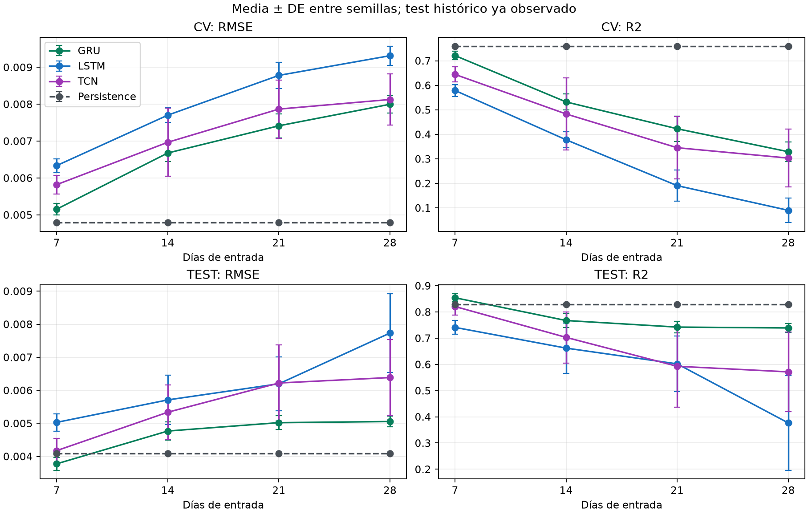
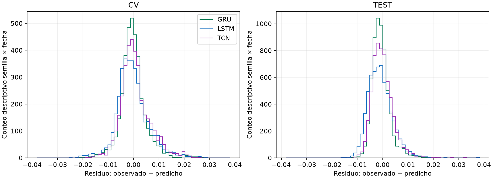
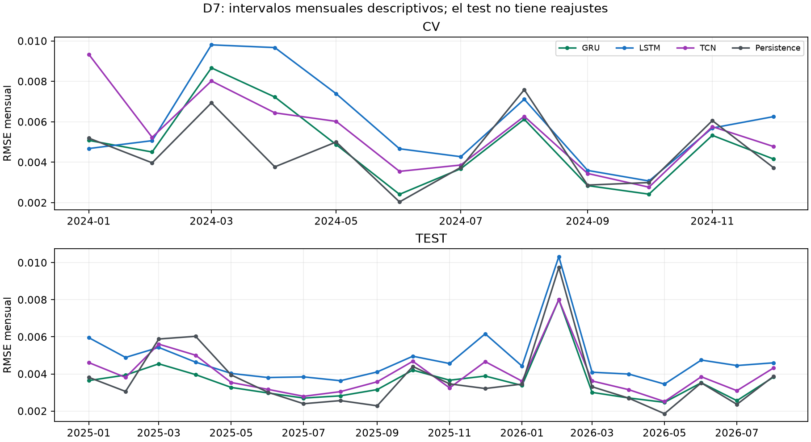

# 5. Benchmark de los modelos base y definición del baseline

**Comparación principal: GRU H32–LSTM H32–MLP H16**, D7, diez semillas originales y **608 fechas del 01/01/2025–31/08/2026**. MLP ya se ejecutó con los mismos datos, entrenamiento, transformaciones, semillas y calendario que las recurrentes: este cuadro reúne registros auténticos, sin nuevos ajustes. El estudio de 60 fechas y los registros TCN se conservan como evidencia complementaria. Elegir ahora esta presentación, tras conocer ambos resultados, no crea una evaluación independiente.

(benchmark-core-actual-e1)=
(benchmark-core-historico-e1)=
## 5.0. Comparación principal del núcleo en las 608 fechas originales

El {download}`expediente principal D7 <../_static/e1_primary_608_20261107/README.md>` publica el [resumen de seis métricas](../_static/e1_primary_608_20261107/metric_summary.csv), las [corridas originales](../_static/e1_primary_608_20261107/run_metrics.csv) y la [procedencia de ejecución](../_static/e1_primary_608_20261107/execution_provenance.json), incluida la referencia de persistencia. Su promoción editorial no entrena modelos ni emite pronósticos nuevos.

El {download}`expediente original compatible del núcleo <../_static/e1_historical_core_20261107/README.md>` concilia resultados reales de MLP/LSTM del 04/11 con GRU/LSTM del 05/11. Las LSTM coinciden exactamente por semilla en las seis métricas, cuatro historias y ambas fases: **480 igualdades**, verificadas junto a los contratos de datos, purgas, folds y calendario. El conjunto ampliado conserva **240 puntuaciones de corrida**: dos fases × cuatro entradas × tres modelos × diez semillas nominales 4101–4110.

Las recetas principales tienen **5.025 parámetros LSTM, 3.777 GRU y 593/1.153/1.713/2.273 MLP** al variar D7/14/21/28. En MLP se mantiene una capa oculta de 16 unidades y cambia la dimensión aplanada de entrada. La representación es `relative_window`, con cinco canales, σ₇ poblacional y h=1. El [manifiesto de fuentes](../_static/e1_historical_core_20261107/source_manifest.json) verifica identidad; estas métricas no se recalculan desde pronósticos inventados o datos aproximados.

**Resultado principal D7: test original 01/01/2025–31/08/2026, 608 fechas.**

| Modelo principal | RMSE ± DE | MAE ± DE | MSE ± DE | R² ± DE | MAPE % ± DE | MASE ± DE |
|---|---:|---:|---:|---:|---:|---:|
| GRU | 0,0037751 ± 0,0001941 | 0,0027985 ± 0,0001892 | 1.4285e-05 ± 1.5019e-06 | 0,8541731 ± 0,0153311 | 18,0667 ± 1,5054 | 1,0325637 ± 0,0698244 |
| LSTM | 0,0050298 ± 0,0002637 | 0,0039189 ± 0,0002196 | 2.5361e-05 ± 2.6077e-06 | 0,7411085 ± 0,0266194 | 25,3406 ± 3,4056 | 1,4459454 ± 0,0810156 |
| MLP | 0,0047932 ± 0,0003988 | 0,0036400 ± 0,0001764 | 2.3118e-05 ± 4.1315e-06 | 0,7640118 ± 0,0421752 | 21,5699 ± 0,7252 | 1,3430385 ± 0,0650917 |
| Persistencia | 0,0040856 | 0,0023532 | 1.6692e-05 | 0,8296050 | 13,7553 | 0,8682451 |

**GRU H32/D7 es el baseline neuronal principal por desarrollo** y obtiene la menor RMSE test del núcleo (**0,0037751**) y el mayor R² (**0,8541731**). Su RMSE es menor y su R² mayor que los de persistencia (**0,0040856; 0,8296050**). Persistencia mantiene mejores MAE y MAPE: el resultado no identifica una ganadora en todas las métricas. La referencia determinista no tiene dispersión entre semillas.

### 5.0.1. Desarrollo original y sensibilidad de las recetas

**D7: CV 2024, doce bloques mensuales y 366 fechas.**

| Modelo principal | RMSE ± DE | MAE ± DE | MSE ± DE | R² ± DE | MAPE % ± DE | MASE ± DE |
|---|---:|---:|---:|---:|---:|---:|
| GRU | 0,0051546 ± 0,0001616 | 0,0036192 ± 0,0001308 | 2.6593e-05 ± 1.6698e-06 | 0,7212140 ± 0,0175052 | 16,0924 ± 0,6301 | 1,3759951 ± 0,0494612 |
| LSTM | 0,0063354 ± 0,0001870 | 0,0047263 ± 0,0001245 | 4.0169e-05 ± 2.3663e-06 | 0,5788925 ± 0,0248069 | 21,7863 ± 0,8045 | 1,7898208 ± 0,0464476 |
| MLP | 0,0060491 ± 0,0002780 | 0,0043804 ± 0,0002110 | 3.6661e-05 ± 3.3905e-06 | 0,6156695 ± 0,0355439 | 19,3303 ± 0,7369 | 1,6616816 ± 0,0842150 |
| Persistencia | 0,0047890 | 0,0029435 | 2.2934e-05 | 0,7595711 | 13,5521 | 1,1183522 |

**Sensibilidad a las cuatro entradas: RMSE media guardada por corrida.**

| D | LSTM CV | MLP CV | GRU CV | LSTM test | MLP test | GRU test |
|---:|---:|---:|---:|---:|---:|---:|
| 7 | 0,0063354 | 0,0060491 | 0,0051546 | 0,0050298 | 0,0047932 | 0,0037751 |
| 14 | 0,0077018 | 0,0069510 | 0,0066768 | 0,0057094 | 0,0052448 | 0,0047674 |
| 21 | 0,0087796 | 0,0083825 | 0,0074140 | 0,0061970 | 0,0058746 | 0,0050212 |
| 28 | 0,0093129 | 0,0093860 | 0,0079966 | 0,0077325 | 0,0074423 | 0,0050551 |

Los tres mínimos por familia se encuentran en **D7 según RMSE CV**, y GRU/D7 tiene el menor valor CV del núcleo histórico. D7 se escoge por desarrollo, no por el orden del test. La designación actual de este cuadro como principal sucede después de conocer los dos periodos evaluados; las diez semillas son un presupuesto exploratorio, sin piloto ni dimensionamiento prospectivo.

**IC marginales del 95 % de RMSE para D7, entre diez semillas:**

| Fase | LSTM | MLP | GRU |
|---|---|---|---|
| CV | [0,0062016; 0,0064692] | [0,0058502; 0,0062479] | [0,0050390; 0,0052701] |
| TEST | [0,0048412; 0,0052184] | [0,0045079; 0,0050785] | [0,0036363; 0,0039140] |

El {download}`resumen completo de seis métricas e IC por entrada <../_static/e1_historical_core_20261107/metric_summary.csv>` y las {download}`puntuaciones por semilla <../_static/e1_historical_core_20261107/run_metrics.csv>` conservan todos los resultados. Los IC t usan DE muestral y nueve grados de libertad; describen inicialización condicionada a las mismas fechas, sin simultaneidad ni incertidumbre temporal incorporada. Las métricas de distinta escala no se suman para elegir una ganadora.

Los {download}`contrastes exploratorios D7 <../_static/e1_historical_core_20261107/paired_rmse.csv>` informan los tres pares de RMSE por fase, diferencia orientada, IC marginal, d_z, Shapiro y Holm dentro de cada familia de tres. Son análisis posteriores sobre etiquetas-semilla y periodos conocidos. No hay nuevos DM, BDS, residuos o bootstrap temporal con MLP: sus vectores diarios originales de test no están disponibles aquí, y los agregados por corrida no los reconstruyen.

El {ref}`capítulo 10 <final-core-mlp-e1>` conserva el complemento de 60 fechas con recetas diferentes, HPO equitativa y R=465. Sus curvas, dimensionamiento y DM no se transfieren a las recetas principales. Los veinte meses del test principal aportan mayor cobertura temporal que ese complemento; una sola trayectoria de BTC no representa universalmente otros periodos o mercados.

### 5.0.2. Robustez complementaria en las 60 fechas de septiembre–octubre de 2026

La ejecución complementaria con **LSTM H16, MLP H32 y GRU H16** completó **465 inicializaciones por red**, con pesos y transformadores cerrados antes de recalcular el periodo histórico **01/09–30/10/2026: 60 fechas comunes**. GRU fue el baseline elegido con desarrollo; persistencia es una referencia determinista. La evaluación se diseñó después de conocer ese periodo y mantiene alcance exploratorio.

| Modelo complementario | RMSE, media ± DE | IC marginal 95 % RMSE | MAE, media ± DE | R² medio |
|---|---:|---|---:|---:|
| LSTM | 0,00565123 ± 0,00056569 | [0,00559968; 0,00570278] | 0,00429363 ± 0,00042837 | 0,215843 |
| MLP | 0,00516664 ± 0,00048727 | [0,00512224; 0,00521105] | 0,00397196 ± 0,00041141 | 0,345286 |
| GRU | 0,00511696 ± 0,00077519 | [0,00504631; 0,00518760] | 0,00391028 ± 0,00062417 | 0,348891 |
| Persistencia | 0,00384478 | No aplica entre semillas | 0,00212123 | 0,640632 |

La [tabla completa de seis métricas](../_static/e1_core_mlp_extension_20261107/metric_summary.csv) conserva media, DE e IC entre semillas, condicionados a las mismas fechas. **Persistencia tiene la menor RMSE puntual; GRU y MLP presentan resultados próximos**, por delante de LSTM entre las redes. El orden de medias no acredita superioridad temporal ni equivalencia.

El [contraste pareado GRU–MLP](../_static/e1_core_mlp_extension_20261107/pairwise_rmse.csv) tiene **p Holm=0,243**: no rechaza la hipótesis de diferencia media cero y **no demuestra equivalencia**. Los dos pares neuronales frente a LSTM rechazan en la familia Holm-3 entre semillas. Los diagnósticos rechazan normalidad de las diferencias; las t y sus IC se interpretan como aproximaciones condicionadas al calendario, con los supuestos registrados.

Ninguna de las [seis comparaciones temporales DM-HLN](../_static/e1_core_mlp_extension_20261107/dm_pairs.csv) rechaza tras Holm-6. Los [intervalos familiares del bootstrap temporal principal, bloque 7](../_static/e1_core_mlp_extension_20261107/temporal_bootstrap.csv), tampoco acreditan una ganancia superior al 5 %. Semillas, fechas y métricas son unidades distintas; la ejecución conserva resultados adversos e inconclusos. El {ref}`capítulo 10 <final-core-mlp-e1>` desarrolla la planificación, los diagnósticos y su alcance.

## Archivo complementario de GRU–LSTM–TCN

Las secciones 5.1–5.5 conservan las tablas y análisis del estudio anterior con TCN, en D=7/14/21/28, diez semillas, CV 2024 y test histórico de 608 fechas. **GRU/D7 fue el baseline neuronal seleccionado con CV de aquel estudio**. La fase I produjo 120 trayectorias, 2.880 ajustes y 43.920 predicciones; su evaluación reunió 72.960 valores, con ochenta modelos GRU/TCN nuevos y cuarenta LSTM reutilizados.

El test ya se había observado antes de diseñar esa comparación y sus contrastes fueron posteriores: sus resultados son exploratorios. El control LSTM reprodujo 14.640 pronósticos de CV. Las diferencias respecto a TCN, LSTM o persistencia conservan sus unidades y alcance; la incorporación posterior de MLP no modifica esas tablas ni convierte sus pruebas en contrastes del núcleo actual.

## 5.1. Comparación Tabular

Las tablas presentan todas las historias y las seis métricas. Los agregados entre semillas se calculan después de puntuar cada trayectoria completa.

### 5.1.1. Tabla histórica complementaria GRU–LSTM–TCN

Las descargas [CV](../_static/gru_lstm_tcn_20261105/metric_summary_cv.csv) y [test](../_static/gru_lstm_tcn_20261105/metric_summary_test.csv) contienen medias, DE muestrales, IC y conteos definidos. Las redes tienen diez semillas; persistencia es una sola trayectoria determinista y se identifica por D para conservar su denominador MASE.

#### 5.1.1.1. Modelo base

**CV2024: 366 fechas por trayectoria.**

| D | Modelo | RMSE, media ± DE | IC95 % RMSE | R², media ± DE | Parámetros |
|---:|---|---:|---:|---:|---:|
| 7 | GRU | 0,0051546 ± 0,0001616 | [0,0050390; 0,0052701] | 0,721214 ± 0,017505 | 3777 |
| 7 | LSTM | 0,0063354 ± 0,0001870 | [0,0062016; 0,0064692] | 0,578892 ± 0,024807 | 5025 |
| 7 | TCN | 0,0058196 ± 0,0002562 | [0,0056363; 0,0060029] | 0,644330 ± 0,030513 | 4289 |
| 7 | Persistencia | 0,0047890 | No aplica a semillas | 0,759571 | 0 |
| 14 | GRU | 0,0066768 ± 0,0002370 | [0,0065073; 0,0068464] | 0,532118 ± 0,033416 | 3777 |
| 14 | LSTM | 0,0077018 ± 0,0001999 | [0,0075588; 0,0078448] | 0,377765 ± 0,032441 | 5025 |
| 14 | TCN | 0,0069670 ± 0,0009256 | [0,0063048; 0,0076292] | 0,483061 ± 0,147325 | 4289 |
| 14 | Persistencia | 0,0047890 | No aplica a semillas | 0,759571 | 0 |
| 21 | GRU | 0,0074140 ± 0,0003267 | [0,0071803; 0,0076477] | 0,422748 ± 0,051604 | 3777 |
| 21 | LSTM | 0,0087796 ± 0,0003524 | [0,0085275; 0,0090317] | 0,190751 ± 0,063743 | 5025 |
| 21 | TCN | 0,0078665 ± 0,0007890 | [0,0073021; 0,0084309] | 0,345395 ± 0,127822 | 4289 |
| 21 | Persistencia | 0,0047890 | No aplica a semillas | 0,759571 | 0 |
| 28 | GRU | 0,0079966 ± 0,0002369 | [0,0078271; 0,0081660] | 0,329105 ± 0,040046 | 3777 |
| 28 | LSTM | 0,0093129 ± 0,0002589 | [0,0091277; 0,0094980] | 0,090149 ± 0,050359 | 5025 |
| 28 | TCN | 0,0081262 ± 0,0006931 | [0,0076304; 0,0086220] | 0,303192 ± 0,118173 | 4289 |
| 28 | Persistencia | 0,0047890 | No aplica a semillas | 0,759571 | 0 |

El parámetro D no cambia n=7 ni h=1. Los pesos se comparten temporalmente y sus conteos no aumentan con D. Aumentar la historia también aumenta el embargo y reduce el entrenamiento elegible.

#### 5.1.1.2. Métricas: media ± desviación estándar

**Test histórico: 608 fechas por trayectoria.**

| D | Modelo | RMSE, media ± DE | IC95 % RMSE | R², media ± DE | Parámetros |
|---:|---|---:|---:|---:|---:|
| 7 | GRU | 0,0037751 ± 0,0001941 | [0,0036363; 0,0039140] | 0,854173 ± 0,015331 | 3777 |
| 7 | LSTM | 0,0050298 ± 0,0002637 | [0,0048412; 0,0052184] | 0,741108 ± 0,026619 | 5025 |
| 7 | TCN | 0,0041747 ± 0,0003728 | [0,0039079; 0,0044414] | 0,820819 ± 0,032191 | 4289 |
| 7 | Persistencia | 0,0040856 | No aplica a semillas | 0,829605 | 0 |
| 14 | GRU | 0,0047674 ± 0,0002737 | [0,0045716; 0,0049632] | 0,767302 ± 0,026815 | 3777 |
| 14 | LSTM | 0,0057094 ± 0,0007524 | [0,0051711; 0,0062476] | 0,662048 ± 0,095907 | 5025 |
| 14 | TCN | 0,0053366 ± 0,0008272 | [0,0047449; 0,0059284] | 0,702991 ± 0,097530 | 4289 |
| 14 | Persistencia | 0,0040856 | No aplica a semillas | 0,829605 | 0 |
| 21 | GRU | 0,0050212 ± 0,0002070 | [0,0048731; 0,0051693] | 0,742235 ± 0,021903 | 3777 |
| 21 | LSTM | 0,0061970 ± 0,0008139 | [0,0056148; 0,0067792] | 0,601894 ± 0,106170 | 5025 |
| 21 | TCN | 0,0062210 ± 0,0011532 | [0,0053960; 0,0070459] | 0,592724 ± 0,156640 | 4289 |
| 21 | Persistencia | 0,0040856 | No aplica a semillas | 0,829605 | 0 |
| 28 | GRU | 0,0050551 ± 0,0001589 | [0,0049415; 0,0051688] | 0,738908 ± 0,016552 | 3777 |
| 28 | LSTM | 0,0077325 ± 0,0011902 | [0,0068811; 0,0085839] | 0,376622 ± 0,180465 | 5025 |
| 28 | TCN | 0,0063864 ± 0,0011537 | [0,0055611; 0,0072117] | 0,571424 ± 0,151746 | 4289 |
| 28 | Persistencia | 0,0040856 | No aplica a semillas | 0,829605 | 0 |

**Métricas secundarias de CV.**

| D | Modelo | MAE, media ± DE | MAPE %, media ± DE | MSE, media ± DE | MASE, media ± DE |
|---:|---|---:|---:|---:|---:|
| 7 | GRU | 0,0036192 ± 0,0001308 | 16,0924 ± 0,6301 | 0,0000265931 ± 0,0000016698 | 1,37600 ± 0,04946 |
| 7 | LSTM | 0,0047263 ± 0,0001245 | 21,7863 ± 0,8045 | 0,0000401690 ± 0,0000023663 | 1,78982 ± 0,04645 |
| 7 | TCN | 0,0042473 ± 0,0001500 | 18,9330 ± 0,6031 | 0,0000339270 ± 0,0000029106 | 1,61777 ± 0,05925 |
| 7 | Persistencia | 0,0029435 | 13,5521 | 0,0000229342 | 1,11835 |
| 14 | GRU | 0,0049486 ± 0,0001794 | 21,7150 ± 0,7837 | 0,0000446307 ± 0,0000031875 | 1,87334 ± 0,06847 |
| 14 | LSTM | 0,0056700 ± 0,0001658 | 24,4425 ± 1,4407 | 0,0000593542 ± 0,0000030945 | 2,14989 ± 0,06420 |
| 14 | TCN | 0,0050224 ± 0,0003579 | 22,0064 ± 1,3197 | 0,0000493102 ± 0,0000140531 | 1,91020 ± 0,14217 |
| 14 | Persistencia | 0,0029435 | 13,5521 | 0,0000229342 | 1,11335 |
| 21 | GRU | 0,0054819 ± 0,0002303 | 23,8402 ± 0,9648 | 0,0000550634 ± 0,0000049224 | 2,07691 ± 0,08821 |
| 21 | LSTM | 0,0062492 ± 0,0002399 | 26,2239 ± 1,0187 | 0,0000771933 ± 0,0000060804 | 2,36819 ± 0,09224 |
| 21 | TCN | 0,0054871 ± 0,0004066 | 23,0163 ± 1,2862 | 0,0000624420 ± 0,0000121928 | 2,08595 ± 0,15775 |
| 21 | Persistencia | 0,0029435 | 13,5521 | 0,0000229342 | 1,11245 |
| 28 | GRU | 0,0056527 ± 0,0001611 | 24,2246 ± 0,5269 | 0,0000639959 ± 0,0000038200 | 2,16339 ± 0,06176 |
| 28 | LSTM | 0,0064968 ± 0,0001772 | 26,1069 ± 0,8578 | 0,0000867896 ± 0,0000048037 | 2,47789 ± 0,06705 |
| 28 | TCN | 0,0056234 ± 0,0003789 | 23,0948 ± 1,5804 | 0,0000664677 ± 0,0000112723 | 2,15431 ± 0,14961 |
| 28 | Persistencia | 0,0029435 | 13,5521 | 0,0000229342 | 1,12126 |

**Métricas secundarias del test histórico.**

| D | Modelo | MAE, media ± DE | MAPE %, media ± DE | MSE, media ± DE | MASE, media ± DE |
|---:|---|---:|---:|---:|---:|
| 7 | GRU | 0,0027985 ± 0,0001892 | 18,0667 ± 1,5054 | 0,0000142854 ± 0,0000015019 | 1,03256 ± 0,06982 |
| 7 | LSTM | 0,0039189 ± 0,0002196 | 25,3406 ± 3,4056 | 0,0000253613 ± 0,0000026077 | 1,44595 ± 0,08102 |
| 7 | TCN | 0,0031443 ± 0,0003475 | 19,8847 ± 2,4480 | 0,0000175528 ± 0,0000031535 | 1,16015 ± 0,12823 |
| 7 | Persistencia | 0,0023532 | 13,7553 | 0,0000166921 | 0,86825 |
| 14 | GRU | 0,0035609 ± 0,0003000 | 22,1494 ± 2,5660 | 0,0000227953 ± 0,0000026269 | 1,31402 ± 0,11069 |
| 14 | LSTM | 0,0042049 ± 0,0004001 | 24,6377 ± 1,6635 | 0,0000331062 ± 0,0000093952 | 1,55164 ± 0,14765 |
| 14 | TCN | 0,0040122 ± 0,0005922 | 24,6464 ± 4,2369 | 0,0000290954 ± 0,0000095541 | 1,48055 ± 0,21853 |
| 14 | Persistencia | 0,0023532 | 13,7553 | 0,0000166921 | 0,86834 |
| 21 | GRU | 0,0037942 ± 0,0001314 | 22,6636 ± 0,7514 | 0,0000252510 ± 0,0000021456 | 1,39217 ± 0,04820 |
| 21 | LSTM | 0,0045288 ± 0,0004498 | 26,6124 ± 3,0421 | 0,0000389989 ± 0,0000104005 | 1,66172 ± 0,16505 |
| 21 | TCN | 0,0045999 ± 0,0007228 | 27,9433 ± 5,7696 | 0,0000398973 ± 0,0000153447 | 1,68782 ± 0,26522 |
| 21 | Persistencia | 0,0023532 | 13,7553 | 0,0000166921 | 0,86343 |
| 28 | GRU | 0,0038322 ± 0,0001177 | 23,6993 ± 1,3838 | 0,0000255769 ± 0,0000016214 | 1,40706 ± 0,04320 |
| 28 | LSTM | 0,0053131 ± 0,0007067 | 30,8444 ± 6,5454 | 0,0000610668 ± 0,0000176786 | 1,95080 ± 0,25949 |
| 28 | TCN | 0,0046625 ± 0,0006904 | 28,2255 ± 5,0322 | 0,0000419838 ± 0,0000148653 | 1,71193 ± 0,25350 |
| 28 | Persistencia | 0,0023532 | 13,7553 | 0,0000166921 | 0,86401 |

Las métricas usan la escala original de sigma7. MAPE está expresada en porcentaje; MSE tiene unidades cuadráticas. MASE mantiene el denominador aprendido con el entrenamiento de cada D. Persistencia tiene mejor MAE y MAPE que GRU/D7 en test, aunque GRU tenga menor RMSE; no se descartan esas métricas.

#### 5.1.1.3. Intervalos de confianza del 95 % y método de construcción

El IC95 % marginal de una métrica es $\bar m\pm t_{0{,}975;9}s_m/\sqrt{10}$. Describe aleatoriedad de entrenamiento condicionada a fechas y receta, sin incorporar una nueva trayectoria de mercado. No se interpreta el solapamiento de IC marginales como una prueba entre modelos; para eso se utilizan las diferencias pareadas.

Persistencia no tiene un IC entre semillas. Esa ausencia no significa que su error carezca de incertidumbre temporal.

#### 5.1.1.4. Tiempo de entrenamiento y de inferencia

| Modelo D7 | Train CV, segundos ± DE | Inferencia CV registrada, segundos ± DE | Parámetros |
|---|---:|---:|---:|
| GRU | 32,53 ± 2,91 | 0,002635 ± 0,000177 | 3777 |
| LSTM | 14,65 ± 1,88 | 0,002318 ± 0,000167 | 5025 |
| TCN | 73,35 ± 8,82 | 0,008192 ± 0,000584 | 4289 |

La tabla suma tiempos registrados de la trayectoria CV y sus mediciones de inferencia; no es una prueba aislada de latencia online. La duración elegida, CPU y concurrencia afectan el costo. Los [tiempos CV](../_static/gru_lstm_tcn_20261105/cost_summary_cv.csv) y [finales](../_static/gru_lstm_tcn_20261105/cost_summary_test.csv) conservan todos los D. LSTM final tiene costo incremental cero por reutilización, sin eliminar su costo histórico.

#### 5.1.1.5. Número de parámetros

GRU tiene 3.777 parámetros, TCN 4.289 y LSTM 5.025 en todos los D. Persistencia no ajusta pesos. Igual número de parámetros no implica igual costo: recurrentes y convoluciones ejecutan operaciones diferentes, y la época de parada también varía.

## 5.2. Ranking de Modelos Base

El orden de selección procede exclusivamente de CV. El test describe después las recetas ya cerradas.

### 5.2.1. Orden de los tres modelos según la métrica principal

| D | Orden neuronal por RMSE CV | RMSE GRU CV | RMSE persistencia CV |
|---:|---|---:|---:|
| 7 | GRU → TCN → LSTM | 0,0051546 | 0,0047890 |
| 14 | GRU → TCN → LSTM | 0,0066768 | 0,0047890 |
| 21 | GRU → TCN → LSTM | 0,0074140 | 0,0047890 |
| 28 | GRU → TCN → LSTM | 0,0079966 | 0,0047890 |

Las tres redes seleccionan D7; GRU/D7 obtiene RMSE CV **0,0051545685 ± 0,0001615571**, frente a 0,0058196121 de TCN/D7 y 0,0063354143 de LSTM/D7. Persistencia obtiene 0,0047889696. El [cierre de selección](../_static/gru_lstm_tcn_20261105/selected_by_cv.json) no se sustituye por otro orden al observar test.

### 5.2.2. Análisis del trade-off

Se comparan error, variabilidad, parámetros y tiempos de la receta completa. Un menor error en un único calendario no garantiza que el costo adicional resulte útil fuera de muestra.

#### 5.2.2.1. Precisión frente a costo computacional

En D7/CV, GRU consume más tiempo registrado que LSTM a pesar de tener menos parámetros; TCN es la más costosa de las tres en esta ejecución. El número de épocas y los operadores impiden atribuir todo el tiempo a una única causa. El costo final de reutilizar LSTM se separa del de entrenarla.

#### 5.2.2.2. Precisión frente a complejidad del modelo

GRU es la red de menor número de pesos; LSTM mantiene una celda de memoria adicional y TCN emplea seis convoluciones en tres bloques residuales. Que GRU tenga menor RMSE aquí no demuestra que la complejidad adicional sea innecesaria en otros periodos o con otro ajuste.

## 5.3. Definición del Baseline y Margen de Mejora Disponible

Baseline significa aquí la referencia neuronal seleccionada con desarrollo. Persistencia permanece como referencia determinista contextual y como condición adicional para una mejora avanzada.

### 5.3.1. Selección del baseline de referencia

Se selecciona GRU/D7 por la media de RMSE CV, conservando las reglas causales y la representación relativa. La decisión antecede al ajuste final y a esta puntuación, aunque el calendario histórico ya fuera conocido.

#### 5.3.1.1. Identificación del mejor modelo base

GRU/D7 es el mejor modelo neuronal según CV. Su elección no depende de escoger una semilla afortunada: se utiliza la media de diez ejecuciones. Persistencia es mejor en RMSE CV; por ello el término baseline neuronal no implica que GRU ya venza a una referencia ingenua en desarrollo.

#### 5.3.1.2. Desempeño con media, desviación e IC del 95 %

| Periodo | RMSE GRU/D7: media ± DE | IC95 % marginal | R²: media ± DE |
|---|---:|---:|---:|
| CV2024 | 0,0051545685 ± 0,0001615571 | [0,0050389976; 0,0052701395] | 0,721214 ± 0,017505 |
| Test histórico | 0,0037751113 ± 0,0001941007 | [0,0036362600; 0,0039139626] | 0,854173 ± 0,015331 |

Persistencia tiene RMSE test 0,0040855959 y R² 0,829605. Sus MAE 0,0023531639 y MAPE 13,7553 % son menores que los de GRU, 0,0027985090 y 18,0667 %. CV y test describen regímenes y políticas de ajuste diferentes; no se interpreta su diferencia como una ganancia causal.

### 5.3.2. Cuantificación de las diferencias entre modelos base

Las diferencias se calculan sobre resultados de las mismas semillas y fechas. La dirección, escala y denominador se explicitan antes de interpretarlas.

#### 5.3.2.1. Regresión y series de tiempo: diferencias respecto al peor y al mejor modelo

Para una referencia B y un modelo A, la ganancia absoluta es RMSE(B)−RMSE(A) y la reducción relativa es $100[1-\mathrm{RMSE}(A)/\mathrm{RMSE}(B)]$.

En D7/test, la ganancia media de GRU frente a LSTM es **0,0012546753**, aproximadamente **24,94 %**; frente a TCN es **0,0003995392**, aproximadamente **9,57 %**. Frente a persistencia la reducción puntual de RMSE es aproximadamente **7,60 %**. Esta última no forma parte de la familia de tres contrastes neuronales y no recibe sus p-valores.

#### 5.3.2.2. Clasificación, etiquetado secuencial y segmentación

No aplica como tarea de clasificación o etiquetado: no hay clases ni entidades. No se convierten reducciones de RMSE en exactitud de clasificación ni en probabilidades de rentabilidad.

#### 5.3.2.3. Secuencia a secuencia

No aplica a generación de secuencias: se predice un escalar a h=1. Los doce bloques mensuales de CV agrupan 366 pronósticos diarios por trayectoria; los veinte intervalos de reporte de test agrupan 608. Esa agregación temporal no convierte la salida escalar en una tarea de traducción o decodificación.

#### 5.3.2.4. Tamaño de efecto de cada diferencia

| Fase | A − B | d_z pareado | IC95 % bootstrap de d_z |
|---|---|---:|---:|
| CV | GRU − LSTM | -4,180 | [-7,471; -3,139] |
| CV | GRU − TCN | -2,428 | [-4,822; -1,700] |
| CV | LSTM − TCN | 1,262 | [0,843; 2,474] |
| TEST | GRU − LSTM | -4,182 | [-10,976; -3,077] |
| TEST | GRU − TCN | -1,124 | [-2,604; -0,574] |
| TEST | LSTM − TCN | 2,006 | [1,486; 3,469] |

$d_z=\bar d/s_d$ usa diferencias A−B por semilla. Un valor negativo favorece A para RMSE. Su escala depende de la DE de diferencias, no es una reducción porcentual ni un efecto económico. Los IC bootstrap de 4.999 remuestras son sensibilidades condicionales a diez pares.

### 5.3.3. Inferencia sobre las diferencias

La familia D7 contiene **GRU−LSTM, GRU−TCN y LSTM−TCN**, con diez diferencias de RMSE por par. Se aplica t bilateral y Holm-3 separadamente en CV y test. **La familia se definió después de observar test**: sus p-valores son exploratorios, no el resultado confirmatorio de una selección bibliográfica o estadística previa.

Las descargas [CV](../_static/gru_lstm_tcn_20261105/within_trio_pairs_cv.csv) y [test](../_static/gru_lstm_tcn_20261105/within_trio_pairs_test.csv) conservan p brutos/ajustados, diferencias, IC, efectos y diagnósticos. La sensibilidad de cuatro D contiene doce pares por fase y usa Holm-12; no se elige la corrección más favorable.

#### 5.3.3.1. Comparaciones pareadas y corrección por multiplicidad

H0 es media de las diferencias de RMSE igual a cero, frente a alternativa bilateral. Se parean las diez semillas nominales, sin tratar meses como réplicas. Holm ordena tres p-valores y los compara secuencialmente con α/3, α/2 y α; no impone α/3 a cada contraste. α=0,05 es la convención del análisis posterior.

#### 5.3.3.2. Diferencia media, IC del 95 % y p-value ajustado y sin ajustar

| Fase | A − B | Diferencia media RMSE | IC95 % | p sin ajustar | p Holm-3 |
|---|---|---:|---:|---:|---:|
| CV | GRU − LSTM | -0,0011808 | [-0,0013829; -0,0009788] | 3.36628e-07 | 1.00988e-06 |
| CV | GRU − TCN | -0,0006650 | [-0,0008610; -0,0004691] | 3.06616e-05 | 6.13232e-05 |
| CV | LSTM − TCN | 0,0005158 | [0,0002234; 0,0008082] | 0.00315693 | 0.00315693 |
| TEST | GRU − LSTM | -0,0012547 | [-0,0014693; -0,0010400] | 3.35348e-07 | 1.00604e-06 |
| TEST | GRU − TCN | -0,0003995 | [-0,0006538; -0,0001453] | 0.00616503 | 0.00616503 |
| TEST | LSTM − TCN | 0,0008551 | [0,0005502; 0,0011601] | 0.000133987 | 0.000267974 |

Los tres pares D7 se distinguen de cero con Holm-3 en cada fase. Los IC familiares Bonferroni de nivel individual 98,333 % también excluyen cero. El orden neuronal medio es GRU–TCN–LSTM en D7; eso no acredita generalización nueva, selección independiente o una mejora práctica de cualquier magnitud.

### 5.3.4. Umbral de mejora para modelos avanzados

Se define un criterio operativo para evaluar posteriormente un modelo avanzado. Al haberse observado ya el test, este criterio es una propuesta futura y no una regla que hubiera gobernado el experimento presentado.

#### 5.3.4.1. Mejora mínima detectable frente al baseline

Las diez semillas del estudio histórico de fase I no procedieron de un piloto de potencia. No se afirma potencia 0,80 ni se calcula «potencia alcanzada» usando el efecto observado. La MDE del futuro avanzado depende de su propia dispersión pareada frente a las referencias y del procedimiento previsto.

Si la MDE supera el margen relevante, habrá que mejorar el diseño o declarar esa limitación. Aumentar semillas sólo precisa el componente de aleatoriedad del entrenamiento sobre estas fechas; no proporciona otro mercado o un test desconocido.

#### 5.3.4.2. Margen de relevancia práctica

Se fija ahora $\delta=0{,}05\times\mathrm{RMSE}_{CV}(\mathrm{GRU/D7})=0{,}000257728426649811$. El [registro del margen](../_static/gru_lstm_tcn_20261105/future_margin.json) declara su definición posterior al test y su finalidad académica.

Una evaluación futura deberá exigir una mejora relevante frente a GRU/D7 y persistencia, con piloto y multiplicidad propios. Un IC que excluye cero no demuestra automáticamente superar δ; este umbral tampoco equivale a una utilidad financiera.

#### 5.3.4.3. Cota de referencia del problema

Persistencia es una referencia reproducible y observable, no una cota óptima del problema. Ninguno de los resultados permite afirmar que se alcanzó el error irreducible. El soporte de ocho cierres de persistencia difiere de D7; se mantiene visible esa diferencia de información.

### 5.3.5. Interpretación

Se distinguen error observado, diferencia entre semillas, contraste temporal y margen práctico. Responden a preguntas relacionadas, sin ser corroboraciones independientes.

#### 5.3.5.1. Significación estadística y relevancia práctica

Los contrastes D7 rechazan diferencia cero entre las redes bajo su referencia t y corrección declarada. La relevancia práctica exige además un margen justificado y una evaluación nueva. No se emplea el margen definido ahora para describir el benchmark como un éxito previsto de antemano.

#### 5.3.5.2. Desempeño frente a complejidad, parámetros y costo

GRU combina menor RMSE D7 con menos pesos, pero no con menor tiempo CV que LSTM. TCN introduce convoluciones causales y residuos, con costo mayor en esta ejecución. La decisión práctica requiere valorar precisión, estabilidad, recursos y complejidad de mantenimiento.

#### 5.3.5.3. Conclusión explícita del baseline y margen disponible

El baseline neuronal de este archivo histórico es GRU/D7. Persistencia continúa como referencia adicional; la ganancia RMSE de test de GRU no se extiende a MAE y MAPE. El margen operativo futuro es 0,0002577284 y se declara posterior a la observación de test.

#### 5.3.5.4. Estado del benchmark

El benchmark inicial de doce recetas y diez semillas está ejecutado; su comparación interna y diagnósticos permanecen posteriores y exploratorios. La fase II D7 incorpora HPO, piloto, dimensionamiento y una evaluación preespecificada sobre otra reserva histórica (§9). Ese cierre no se atribuye a las otras entradas y un futuro modelo avanzado requiere su propia planificación y datos no usados para diseñarlo.

## 5.4. Análisis Estadístico y Pruebas de Hipótesis

El [plan del análisis público](../_static/gru_lstm_tcn_20261105/public_analysis_plan.json) está fechado el 05/11/2026, **después de puntuar e inspeccionar el test histórico**. Distingue diferencias de RMSE por semilla, prueba conjunta por bloques de semilla, pérdidas diarias y diagnósticos mensuales. No se acumulan sus rechazos como evidencia independiente.

Las estimaciones se calculan desde resultados guardados, sin reajustar pesos ni realizar nuevas inferencias.

### 5.4.1. Hipótesis, unidad de análisis y supuestos

Para los pares neuronales, la unidad es una RMSE de periodo completo por semilla. Se supone una distribución de diferencias compatible con la referencia t y ejecuciones de RNG independientes, condicionadas al calendario. Diez semillas no son diez periodos de mercado. Para DM la unidad es una pérdida por fecha; para diagnósticos, el bloque mensual.

### 5.4.2. Comparaciones pareadas: t y Wilcoxon

El contraste informado es t pareada bilateral, $t=\bar d/(s_d/\sqrt{10})$, con nueve grados de libertad. Shapiro se presenta como diagnóstico y no selecciona una prueba alternativa tras observar p.

Wilcoxon exige otros supuestos y no se ejecutó como una segunda oportunidad de significación. Su resolución discreta depende de pares útiles, ceros y empates. El hecho de disponer de diez semillas no demuestra potencia suficiente para t o rangos.

### 5.4.3. Comparación conjunta de tres modelos

Se calculó Friedman para tres redes D7 y diez bloques de semilla: **χ²≈18,2, p≈0,000111666 en CV** y **χ²≈16,8, p≈0,000224867 en test**, con dos grados de libertad. La [tabla conjunta](../_static/gru_lstm_tcn_20261105/friedman_D7.csv) conserva también Holm-2 como sensibilidad entre fases.

Es una aproximación chi-cuadrado con sólo diez bloques; su interpretación es condicional a estas fechas. No localiza por sí sola los pares distintos ni transforma la familia posterior en confirmatoria.

### 5.4.4. Comparaciones post-hoc y corrección por multiplicidad

Los tres pares D7 reciben Holm-3 por fase. La sensibilidad de las cuatro historias conserva doce hipótesis y Holm-12: [CV](../_static/gru_lstm_tcn_20261105/within_trio_pairs_allD_cv.csv) y [test](../_static/gru_lstm_tcn_20261105/within_trio_pairs_allD_test.csv).

Friedman, pares por semilla, DM y diagnósticos son familias distintas con objetivos distintos. Las correcciones no constituyen control global de todas las decisiones históricas y de esta revisión posterior; ese límite se conserva.

### 5.4.5. Intervalos de confianza y tamaño de efecto

Se publican IC95 % marginales, IC familiares Bonferroni y d_z junto con sus convenciones. La incertidumbre por semillas no reemplaza la dependencia y variación temporal.

#### 5.4.5.1. Bootstrap de las diferencias pareadas

La sensibilidad de efecto usa 4.999 remuestras pareadas de las diez diferencias, con reemplazo; se recalcula d_z en cada muestra y se informa cuántas fueron definidas. No se remuestrean meses como mercados ni se reentrenan redes. Con diez pares y cocientes por una DE estimada, el bootstrap puede ser inestable y no certifica cobertura exacta.

#### 5.4.5.2. Tamaño de efecto junto con el p-value

Se conserva el signo A−B para diferencia y d_z; negativo favorece A. Un efecto grande puede surgir de poca dispersión entre inicializaciones y no equivale a una gran reducción absoluta del error. Las tablas de §5.3.2.4 y los CSV mantienen efecto, IC y p en conjunto.

### 5.4.6. Advertencia sobre independencia

Todos los modelos comparten fechas y objetivos; pares, meses y métricas no son experimentos independientes.

#### 5.4.6.1. Ejecuciones que comparten el conjunto de prueba

Las 608 fechas del test son una sola trayectoria de mercado. Cambiar la semilla estima sensibilidad del entrenamiento sobre esa trayectoria. Reutilizar LSTM es un control identificado, sin generar información de mercado nueva ni una réplica adicional de sus predicciones.

#### 5.4.6.2. Validación repetida y remuestreo por bloques

Los doce meses CV contienen entrenamientos crecientes y las ventanas del objetivo se solapan. No se aplica automáticamente una corrección de CV aleatoria ni se remuestrean esos meses como bloques independientes. La sensibilidad bootstrap presentada remuestrea semillas; cualquier bootstrap temporal requeriría longitud de bloque y alcance propios.

### 5.4.7. Reporte de potencia y diferencia mínima detectable

Se informa R=10 como presupuesto fijo y la ausencia de piloto prospectivo de potencia para GRU/TCN. El margen futuro se define después del test. No se usa el p observado ni d_z para declarar potencia alcanzada, y no se atribuye al trío un tamaño dimensionado para otros procedimientos.

### 5.4.8. Ausencia de significación y equivalencia

No rechazar diferencia cero no demuestra equivalencia. Si una propuesta futura afirma equivalencia, necesitará márgenes y procedimiento, por ejemplo TOST o una ROPE justificada, fijados antes. No se ejecuta ni exige una prueba de equivalencia para interpretar este benchmark de diferencias.

### 5.4.9. Test de Diebold–Mariano

DM compara **pérdidas cuadráticas diarias en unidades originales, promediadas entre las diez semillas**. El estimando es distinto de la media de RMSE por semilla. Se conserva h=1, HAC Bartlett/Newey–West con seis rezagos y corrección HLN; la familia tiene tres pares por fase.

Los [resultados CV](../_static/gru_lstm_tcn_20261105/dm_pairs_cv.csv) y [test](../_static/gru_lstm_tcn_20261105/dm_pairs_test.csv) son exploratorios y posteriores al test.

#### 5.4.9.1. Comparación de precisión predictiva por horizonte

| Fase | A − B | DM con HLN | p sin ajustar | p Holm-3 |
|---|---|---:|---:|---:|
| CV | GRU − LSTM | -4,059 | 6.0442e-05 | 0.000181326 |
| CV | GRU − TCN | -1,868 | 0.0625374 | 0.125075 |
| CV | LSTM − TCN | 1,164 | 0.245324 | 0.245324 |
| TEST | GRU − LSTM | -6,258 | 7.38874e-10 | 2.21662e-09 |
| TEST | GRU − TCN | -5,232 | 2.31746e-07 | 4.63492e-07 |
| TEST | LSTM − TCN | 4,636 | 4.35165e-06 | 4.35165e-06 |

En CV, GRU−TCN tiene p Holm≈0,1251 y no rechaza; la t por semillas sí rechaza. En test, ese DM tiene p Holm≈4,63×10⁻⁷. La diferencia no se resuelve eligiendo el p menor: cambian unidad, pérdida y dependencia tratada.

#### 5.4.9.2. Corrección Harvey–Leybourne–Newbold y pérdida coherente

La estadística usa la varianza de largo plazo del diferencial diario con covarianzas divididas por n, kernel Bartlett y seis rezagos; HLN utiliza horizonte uno y referencia t con n−1 grados de libertad. Los seis rezagos atienden el solapamiento de sigma7, sin garantizar que capturen toda dependencia o cambios de régimen.

### 5.4.10. Test BDS (Brock–Dechert–Scheinkman)

Se calculó BDS sobre residuos mensuales de cada familia, D y semilla, con **dimensión de incrustación 2** y **ε=1,5 veces la DE muestral residual**, a h=1. Hay **1.440 hipótesis en CV y 2.400 en test**, corregidas por Holm separadamente por fase.

Los CSV [CV](../_static/gru_lstm_tcn_20261105/bds_by_fold_cv.csv) y [test](../_static/gru_lstm_tcn_20261105/bds_by_fold_test.csv) preservan estadística, p, estado, advertencias y rechazos; los siguientes promedios de p son **sólo descriptivos**, sin ser un p global.

| Fase | D | Modelo | n definidos | p medio ± DE, descriptivo | Rechazos brutos % | Rechazos Holm % |
|---|---:|---|---:|---:|---:|---:|
| CV | 7 | GRU | 120 | 0,2548 ± 0,3203 | 47,5 | 24,2 |
| CV | 7 | LSTM | 120 | 0,1043 ± 0,2168 | 70,8 | 47,5 |
| CV | 7 | TCN | 120 | 0,2604 ± 0,3153 | 46,7 | 25,8 |
| CV | 14 | GRU | 120 | 0,1014 ± 0,2214 | 76,7 | 58,3 |
| CV | 14 | LSTM | 120 | 0,0863 ± 0,1954 | 74,2 | 60,8 |
| CV | 14 | TCN | 120 | 0,1762 ± 0,2928 | 63,3 | 37,5 |
| CV | 21 | GRU | 120 | 0,0796 ± 0,2057 | 81,7 | 70,0 |
| CV | 21 | LSTM | 120 | 0,0938 ± 0,2005 | 75,0 | 67,5 |
| CV | 21 | TCN | 120 | 0,1599 ± 0,2747 | 64,2 | 47,5 |
| CV | 28 | GRU | 120 | 0,0696 ± 0,1908 | 85,0 | 73,3 |
| CV | 28 | LSTM | 120 | 0,0636 ± 0,1816 | 85,0 | 70,0 |
| CV | 28 | TCN | 120 | 0,1720 ± 0,2893 | 63,3 | 45,8 |
| TEST | 7 | GRU | 200 | 0,2389 ± 0,2978 | 43,0 | 14,5 |
| TEST | 7 | LSTM | 200 | 0,0500 ± 0,1849 | 91,0 | 68,0 |
| TEST | 7 | TCN | 200 | 0,2167 ± 0,3036 | 54,0 | 27,5 |
| TEST | 14 | GRU | 200 | 0,0353 ± 0,1117 | 85,5 | 50,0 |
| TEST | 14 | LSTM | 200 | 0,0174 ± 0,0954 | 92,5 | 73,5 |
| TEST | 14 | TCN | 200 | 0,0686 ± 0,1807 | 80,5 | 58,0 |
| TEST | 21 | GRU | 200 | 0,0200 ± 0,1051 | 95,5 | 68,5 |
| TEST | 21 | LSTM | 200 | 0,0128 ± 0,0644 | 95,0 | 77,0 |
| TEST | 21 | TCN | 200 | 0,0353 ± 0,1342 | 89,5 | 70,5 |
| TEST | 28 | GRU | 200 | 0,0113 ± 0,0657 | 96,0 | 66,5 |
| TEST | 28 | LSTM | 200 | 0,0137 ± 0,0783 | 96,0 | 90,0 |
| TEST | 28 | TCN | 200 | 0,0464 ± 0,1550 | 88,0 | 74,5 |

BDS contrasta una referencia iid, no únicamente linealidad. Los bloques tienen entre 28 y 31 residuos y el objetivo se solapa; la aproximación asintótica es frágil. Un rechazo no identifica por sí solo no linealidad explotable ni garantiza que una red más compleja mejore pronósticos.

### 5.4.11. Test de Ljung–Box

Ljung–Box se aplicó a los residuos mensuales en rezagos **1 y 5**, con model_df=0. Las familias contienen **2.880 hipótesis CV y 4.800 test**, con Holm por fase. Los CSV [CV](../_static/gru_lstm_tcn_20261105/ljung_box_by_fold_cv.csv) y [test](../_static/gru_lstm_tcn_20261105/ljung_box_by_fold_test.csv) conservan todos los casos.

model_df=0 no afirma que ajustar una red consuma cero grados de libertad; no existe aquí una corrección ARMA justificada para esos parámetros. El tamaño corto limita la calibración. No rechazo no acredita residuos independientes.

### 5.4.12. Interpretación de los residuos

Se interpreta conjuntamente la forma del error, su estructura temporal y los límites de las pruebas. Un diagnóstico residual no equivale a una ganancia de predicción alcanzable.

#### 5.4.12.1. Estructura residual y posible margen de mejora

El histograma muestra observado menos predicho y no representa probabilidades de utilidad financiera. Las diferencias de colas y sesgo deben contrastarse con RMSE/MAE; BDS y Ljung–Box añaden preguntas específicas. La reserva de mejora no se cuantifica restando un p-value a uno.

### 5.4.13. Buenas Prácticas Estadísticas

La trazabilidad identifica qué se fijó antes de ajustar y qué se decidió después de observar resultados. La transparencia de esa diferencia es parte del reporte.

#### 5.4.13.1. Nivel de significancia declarado antes de analizar resultados

α=0,05 es la convención del análisis público posterior. No se presenta como una decisión congelada antes del test histórico. El plan conserva fecha y familia; una futura confirmación deberá fijarlos antes de acceder a sus resultados.

#### 5.4.13.2. P-valores numéricos, ajustados y sin ajustar

Se informan p numéricos brutos y ajustados, sin sustituir valores pequeños por cero. La familia de cada corrección se identifica y no se mezcla Holm-3 con Holm-12 o los miles de diagnósticos.

#### 5.4.13.3. Intervalos de confianza y tamaños de efecto

Cada comparación informa diferencia firmada, IC marginal y familiar, y d_z con sensibilidad bootstrap. Se evita decidir sólo mediante p<0,05 o sólo mediante el solapamiento de IC marginales.

#### 5.4.13.4. Verificación de supuestos

Shapiro D7 tiene p>0,05 en los tres pares de cada fase (seis diagnósticos en total), pero diez diferencias no prueban normalidad. No se cambió la t por otra prueba para favorecer resultados. La dependencia temporal se trata de forma distinta en DM y diagnósticos; esas correcciones siguen teniendo límites.

#### 5.4.13.5. Múltiples ejecuciones documentadas

Diez semillas por receta están conservadas, incluidas las peores. Las cuatro historias y las dos fases se publican completas. El control LSTM y su reutilización final están identificados, sin contarlos como nuevas observaciones independientes de mercado.

#### 5.4.13.6. Métrica principal y comparaciones declaradas con antelación

RMSE y la regla de selección con CV preceden al ajuste final. La familia interna D7 del libro, sus diagnósticos y el margen futuro se definen después del test y se rotulan así. No se atribuye a estas preguntas la antelación de otros contrastes.

#### 5.4.13.7. Registro y trazabilidad de cada contraste

La [allowlist pública](../_static/gru_lstm_tcn_20261105/public_allowlist_manifest.json), el [manifiesto de procedencia](../_static/gru_lstm_tcn_20261105/source_manifest.json) y el [resumen](../_static/gru_lstm_tcn_20261105/summary.json) relacionan outputs, fuentes y métodos. Los catálogos distinguen ajustes nuevos y reutilizados.

Los hashes respaldan identidad e integridad, sin constituir una validación automática del diseño o una garantía de ausencia de sesgo.

### 5.4.14. Interpretación

La conclusión depende del estimando: aleatoriedad de entrenamiento, pérdida por fecha, orden entre tres modelos o comportamiento residual.

#### 5.4.14.1. Diferencias estadísticamente significativas

Los tres pares D7 se distinguen de cero mediante t/Holm en ambas fases. Friedman también encuentra diferencias globales bajo su aproximación. En DM/CV sólo GRU−LSTM rechaza con Holm-3; en DM/test rechazan los tres pares. Estos resultados son condicionales y posteriores, sin independencia entre análisis.

#### 5.4.14.2. Significancia estadística y relevancia práctica

El margen futuro de 5 % de GRU/CV no convierte los rechazos de este análisis histórico en una demostración prevista de relevancia práctica. La reducción RMSE de GRU en test coexiste con peor MAE/MAPE que persistencia; ninguna prueba aporta por sí sola una interpretación económica.

#### 5.4.14.3. Conclusiones respaldadas por diferencias, incertidumbre y efectos

Se respalda el orden medio GRU–TCN–LSTM en D7 sobre estas fechas, con incertidumbre y supuestos explícitos. No se demuestra una superioridad universal, otra trayectoria de mercado ni que GRU y LSTM sean mecanismos sin redundancia.

(alcance-estadistico)=
#### 5.4.14.4. Estado y alcance del análisis estadístico

| Análisis histórico complementario | Unidad/familia | Alcance |
|---|---|---|
| t y Holm | Diez RMSE pareadas; tres pares D7 por fase | Diferencias de inicialización condicionales |
| Sensibilidad de historias | Doce pares por fase, Holm-12 | No reemplaza la familia D7 |
| Friedman | Tres redes, diez bloques de semilla | Omnibus aproximado |
| DM | Pérdida cuadrática diaria media; tres pares por fase | HAC6/HLN, estimando distinto |
| BDS | Bloque mensual; 1.440/2.400 hipótesis | Iid asintótico en bloques cortos |
| Ljung–Box | Rezagos 1/5; 2.880/4.800 hipótesis | Autocorrelación, model_df=0 |
| Confirmación prospectiva | No ejecutada | Test histórico ya observado |

Todos estos outputs públicos se definieron después de inspeccionar test. Su publicación documenta resultados guardados; no crea entrenamientos, pronósticos o confirmaciones nuevas.

## 5.5. Discusión Crítica

La discusión integra los resultados con sus amenazas a la validez y la evidencia bibliográfica, sin ampliar el alcance más allá de lo ejecutado.

### 5.5.1. Desempeño y explicación de las diferencias

GRU/D7 obtiene menor RMSE media neuronal en CV y test; TCN/D7 sigue y LSTM/D7 queda detrás. Persistencia domina RMSE CV y MAE/MAPE test. Las compuertas y convoluciones son explicaciones arquitectónicas plausibles, no causas identificadas por esta comparación.

### 5.5.2. Generalización y estabilidad

Los meses muestran variación del error dentro de una misma trayectoria. Los pesos de test están fijos, mientras CV reajusta mensualmente. El mejor promedio no demuestra estabilidad en todos los regímenes ni generalización a otra criptomoneda o periodo.

### 5.5.3. Significación estadística y relevancia práctica

La significación pareada es condicional a las semillas y datos observados. Los rechazos temporales y por semillas no son confirmaciones independientes. Un futuro avanzado necesita un margen justificado, potencia planificada y evaluación desconocida para sostener una mejora práctica.

### 5.5.4. Desempeño frente a costo y complejidad

GRU tiene 3.777 pesos frente a 4.289 de TCN y 5.025 de LSTM. La menor parametrización no asegura menor tiempo; el registro CV muestra que LSTM fue más rápida. La TCN mantiene operadores residuales y receptivo teórico 29, con costo dependiente de época e historia.

### 5.5.5. Baseline y umbral para un modelo avanzado

La referencia neuronal es GRU/D7, elegida con CV. El objetivo futuro se formula frente a GRU y persistencia, usando como margen orientativo 0,0002577284 fijado ahora. No se ejecutó un avanzado ni se afirma haber cerrado el criterio de E2.

### 5.5.6. Brecha con la literatura y margen de mejora potencial

El **corte bibliográfico histórico del 05/11/2026** registró referencias GRU 3/7, LSTM 5/7 y TCN 1/7. Akbiyik et al. {cite:p}`akbiyik2023` aporta el respaldo directo TCN; Miura et al. {cite:p}`miura2019` respalda recurrentes. La {ref}`ampliación de fuentes gratuitas <free-model-expansion-e1>` y la {ref}`síntesis acumulada actual <homogeneous-expansion-e1>` documentan las lecturas posteriores, sus roles y los denominadores comparables. Las configuraciones OHLCV/sigma7 propias son adaptaciones, no réplicas o valores trasladados de artículos.

La terna de **este archivo complementario** es GRU–LSTM–TCN. El núcleo principal GRU H32–LSTM H32–MLP H16 aparece en §5.0, con su complemento de robustez en el capítulo 10; sus filas no se mezclan con estas tablas TCN. El respaldo financiero adicional de TCN se distingue del respaldo específico de volatilidad realizada cripto; la selección conserva su intercambio entre recurrencia, complejidad y contraste de mecanismos. Las diferencias funcionales GRU/LSTM no demuestran independencia de sus errores, y el resultado del test no decide qué estudios se incluyen.

### 5.5.7. Amenazas a la validez

Las amenazas de **esta fase I** son exposición previa a desarrollo/test, selección con un calendario único, preguntas estadísticas posteriores, falta de piloto de potencia del trío, recetas no optimizadas exhaustivamente y soporte bibliográfico TCN limitado en el corte inicial. La reutilización LSTM es control transparente; no una evaluación nueva. El piloto y el HPO de la comparación final D7 se documentan por separado en el capítulo 9 y no se atribuyen retrospectivamente a esta fase.

### 5.5.8. Limitaciones del estudio

No se estableció independencia de mercado, utilidad financiera, robustez a ruido artificial, sensibilidad a otros horizontes o superioridad fuera de BTCUSDT. Los IC por semillas no cubren toda incertidumbre temporal; BDS/Ljung–Box de bloques cortos y HAC6 no eliminan esas limitaciones.

### 5.5.9. Recomendaciones futuras

Las recomendaciones se dirigen a una versión nueva, sin reajustar decisiones después del test presentado.

#### 5.5.9.1. Recomendaciones derivadas de las limitaciones

Diseñar un piloto pareado del futuro avanzado, fijar su tamaño y multiplicidad, justificar el margen, utilizar una evaluación desconocida y contrastar presupuesto de HPO/capacidad. La revisión actual fundamenta el núcleo LSTM–MLP–GRU y conserva los mecanismos de TCN como evidencia complementaria. Comprobar complementariedad predictiva o una ganancia transferible requiere un diseño propio; no se deduce de las diferencias arquitectónicas o de añadir referencias.

#### 5.5.9.2. Matriz de conclusiones y evidencia pendiente

| Conclusión | Evidencia | Pendiente |
|---|---|---|
| GRU/D7 es el baseline neuronal | Menor RMSE CV, cierre antes de esta fase final | Confirmación temporal nueva |
| GRU tiene menor RMSE test | Diez trayectorias, t/Holm y pérdidas diarias | No domina MAE/MAPE de persistencia |
| Control LSTM conservado | CV exactamente reproducida y final reutilizado identificado | No aporta otro mercado |
| Trío con apoyo aplicado | GRU/LSTM/TCN con extracción histórica y síntesis acumulada de roles y mecanismos | El 1/7 de TCN pertenece al corte inicial; el respaldo financiero relacionado no equivale a recurrencia cripto ni prueba complementariedad de errores |
| Criterio operativo futuro | 5 % de RMSE GRU/CV, declarado después del test | Piloto propio y evaluación independiente |
| Integridad pública | Agregados, manifiestos y 120 configuraciones finales | Evidencia privada para reproducir pesos/pronósticos |

La interpretación se limita a las recetas y fechas observadas, con todas las historias y métricas visibles.

**Comparación complementaria anterior en septiembre–octubre de 2026.** El [capítulo 9](09_estudio_planificado.md) reúne el diseño público previo, la rejilla equitativa de ocho candidatos por familia, el piloto de 60 días, el cálculo de R y los resultados sobre el 01/09–30/10/2026. Esa fase mantiene n=7/h=1 y covariables OHLCV, con D7 fijo. Los resultados de fase I y sus limitaciones permanecen identificados; la potencia planificada entre semillas no representa potencia temporal ni confirma otros mercados.
