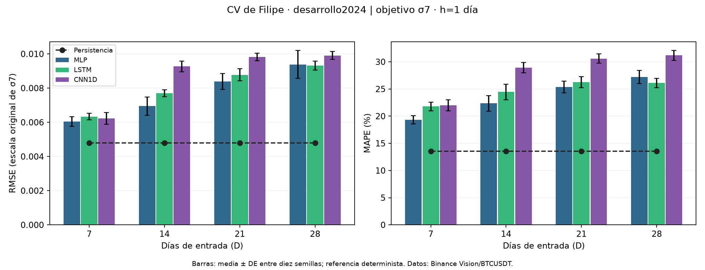
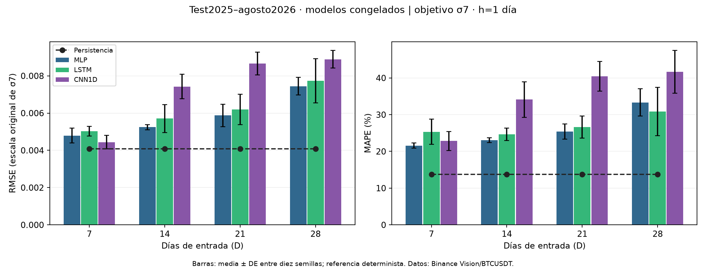
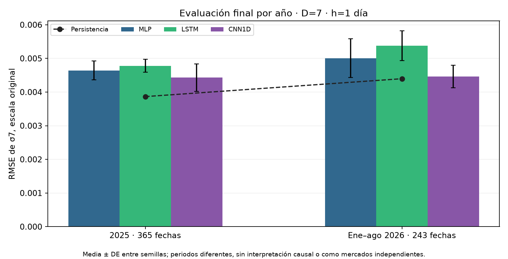
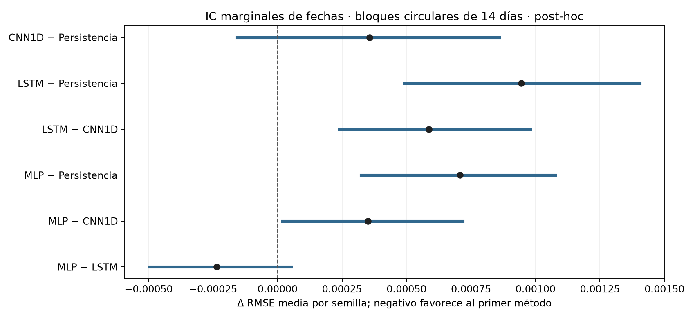
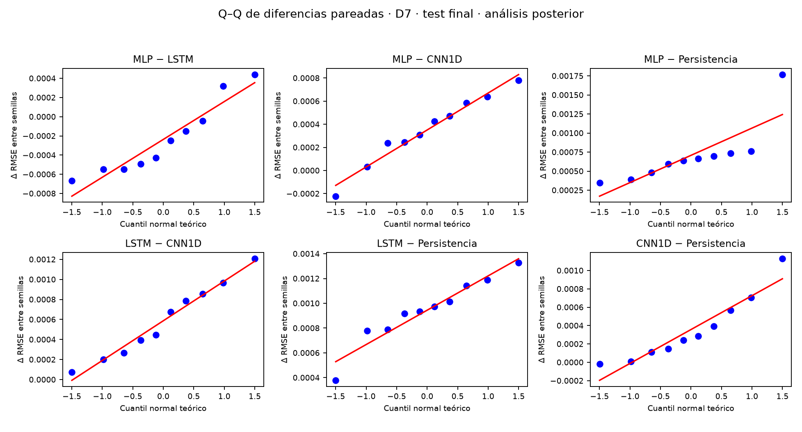

# 5. Benchmark de los Modelos Base y Definición del Baseline

Se completó el benchmark de **MLP, LSTM y CNN1D con entradas de 7, 14, 21 y 28 días**. El objetivo permanece en **siete retornos diarios, volatilidad poblacional sin anualizar**, horizonte **h=1 día** y cinco covariables OHLCV. La fuente de un minuto se agrega a diario antes de formar entradas.

La comparación vigente utiliza **D=7,14,21,28**, objetivo **n=7** y horizonte **h=1 diario**, con representación `relative_window` y diez semillas por combinación. La elección de historia/modelo se cerró con CV de 2024 antes de abrir test. El [cierre previo](../_static/filipe_multihistory_20261104/freeze.json) conserva las decisiones, fuentes y hashes.

La CV primaria utiliza doce meses de 2024, entrenamiento inicial de 2023 y pasado permitido de 2024: **120 trayectorias y 43.920 predicciones**. D7 reutiliza sus treinta trayectorias relativas verificadas; las otras noventa son nuevas. La comparación inicial D7 con `absolute_log` se mantiene como antecedente y no se amplió a otros D.

El cierre seleccionó **MLP, D=7, `relative_window`** por la media de RMSE de CV. Después se realizaron **120 ajustes finales**, se firmaron pesos/escaladores y se evaluó el test **01/01/2025–31/08/2026**, con **608 fechas por corrida**. Los veinte meses del test son intervalos de reporte de esos pesos fijos, no veinte reajustes. Septiembre–octubre de 2026 permanece fuera.

Se publican las métricas requeridas y **BDS por fold/mes para todos los D, modelos y semillas**. El promedio de p-valores es descriptivo. Los contrastes y bootstrap del suplemento inicial D7 conservan su alcance de desarrollo y no se presentan como inferencia sobre el test nuevo.

La publicación ampliada ofrece métricas agregadas por semilla y mes, diagnósticos y manifiestos de trazabilidad. Los vectores de predicción individuales, series de mercado, pesos y paquetes completos se conservan localmente; no se ofrecen como descargas públicas de esta ampliación.

El [protocolo del complemento](../_static/e1_audit_improvements_20261104/protocol.json), [resumen inferencial](../_static/e1_audit_improvements_20261104/inference/summary.json) y [resumen descriptivo](../_static/e1_audit_improvements_20261104/descriptive/summary.json) completa la auditoría con resultados anuales, variabilidad, segmentos y comparación formal del test. El complemento se registró **después de inspeccionar el test**, antes de estos cálculos. Es un análisis **post-hoc/exploratorio** de las predicciones guardadas de las tres configuraciones **D7 elegidas con CV**, más persistencia determinista. No es una confirmación prospectiva, no cambia la selección MLP/D7 y no ejecuta nuevos pronósticos ni entrenamientos.

## 5.1. Comparación Tabular

Las comparaciones comparten fuente, calendario, objetivo n=7, horizonte y cohorte dentro de cada fase. **CV y test se muestran por separado**: no se mezclan para seleccionar la configuración ni se interpreta su diferencia como efecto causal de D.

Las tablas completas [de CV](../_static/filipe_multihistory_20261104/analysis_cv/metrics_summary.csv), [de test](../_static/filipe_multihistory_20261104/test/analysis/metrics_summary.csv), [CV por fold](../_static/filipe_multihistory_20261104/analysis_cv/fold_metrics_summary.csv) y [test por mes](../_static/filipe_multihistory_20261104/test/analysis/fold_metrics_summary.csv) conservan media, DE, IC, cobertura y número de valores definidos.

### 5.1.1. Tabla de comparación de los tres modelos base

Cada entrada es $D\times5$ con D=7,14,21,28. El objetivo es σ7, `ddof=0`, sin anualizar; h=1. En CV los índices diarios de Filipe se agrupan en doce meses y se purgan resultados u>t−D−1 en el comienzo mensual t. La validación interna usa únicamente pasado permitido y no recibe etiquetas del mes externo.

Para N fechas de una fase y R=10 semillas se calcula primero:

$$
m_{D,m,s}=\sqrt{\frac1N\sum_{d}(y_d-\widehat y_{D,m,s,d})^2},\qquad
\bar m_{D,m}=\frac1{10}\sum_s m_{D,m,s}.
$$

Se utilizan N=366 en CV y la cohorte común registrada en test. R² se calcula desde la media y sumas de cuadrados del periodo completo, sin promediar R² mensuales. La media entre semillas no equivale a la RMSE de una predicción ensemble. El test emplea pesos finales fijos, con entradas observables hasta d−1.

#### 5.1.1.1. Modelo base

**CV forward de 2024, diez semillas por D–familia.** Los IC son t marginales entre semillas, condicionados al calendario.

| D (días) | Modelo | RMSE, media ± DE | IC marginal 95 % de RMSE | R², media ± DE | Parámetros |
|---:|---|---:|---|---:|---:|
| 7 | MLP | 0,0060491 ± 0,0002780 | [0,0058502; 0,0062479] | 0,615670 ± 0,035544 | 593 |
| 7 | LSTM | 0,0063354 ± 0,0001870 | [0,0062016; 0,0064692] | 0,578892 ± 0,024807 | 5.025 |
| 7 | CNN1D | 0,0062296 ± 0,0003373 | [0,0059883; 0,0064709] | 0,592088 ± 0,042687 | 1.057 |
| 7 | Persistencia | 0,0047890 | No aplica a semillas | 0,759571 | 0 |
| 14 | MLP | 0,0069510 ± 0,0005341 | [0,0065689; 0,0073331] | 0,490785 ± 0,080012 | 1.153 |
| 14 | LSTM | 0,0077018 ± 0,0001999 | [0,0075588; 0,0078448] | 0,377765 ± 0,032441 | 5.025 |
| 14 | CNN1D | 0,0092696 ± 0,0003187 | [0,0090416; 0,0094976] | 0,098246 ± 0,061482 | 1.057 |
| 14 | Persistencia | 0,0047890 | No aplica a semillas | 0,759571 | 0 |
| 21 | MLP | 0,0083825 ± 0,0004626 | [0,0080515; 0,0087134] | 0,261352 ± 0,081648 | 1.713 |
| 21 | LSTM | 0,0087796 ± 0,0003524 | [0,0085275; 0,0090317] | 0,190751 ± 0,063743 | 5.025 |
| 21 | CNN1D | 0,0098231 ± 0,0002269 | [0,0096608; 0,0099854] | -0,012060 ± 0,047010 | 1.057 |
| 21 | Persistencia | 0,0047890 | No aplica a semillas | 0,759571 | 0 |
| 28 | MLP | 0,0093860 ± 0,0008195 | [0,0087998; 0,0099723] | 0,070100 ± 0,161632 | 2.273 |
| 28 | LSTM | 0,0093129 ± 0,0002589 | [0,0091277; 0,0094980] | 0,090149 ± 0,050359 | 5.025 |
| 28 | CNN1D | 0,0099066 ± 0,0002304 | [0,0097418; 0,0100714] | -0,029350 ± 0,047984 | 1.057 |
| 28 | Persistencia | 0,0047890 | No aplica a semillas | 0,759571 | 0 |

Persistencia no tiene pesos ni variación de inicialización. Se repite su etiqueta por D para explicitar el comparador y denominador MASE de cada grupo; **no son nuevas corridas independientes**. La referencia necesita ocho cierres anteriores; D7 recibe siete días OHLCV y D14/21/28 reciben más historia. Ese soporte distinto se declara al interpretar los resultados.

Las barras indican media ± DE entre semillas; la referencia persistente es determinista.

#### 5.1.1.2. Métricas: media ± desviación estándar

**Test final 01/01/2025–31/08/2026, 608 fechas elegibles por corrida.** Cada fila neuronal resume diez pesos finales ajustados solo con desarrollo y firmados antes de leer test.

| D (días) | Modelo | RMSE, media ± DE | IC marginal 95 % de RMSE | R², media ± DE | Parámetros |
|---:|---|---:|---|---:|---:|
| 7 | MLP | 0,0047932 ± 0,0003988 | [0,0045079; 0,0050785] | 0,764012 ± 0,042175 | 593 |
| 7 | LSTM | 0,0050298 ± 0,0002637 | [0,0048412; 0,0052184] | 0,741108 ± 0,026619 | 5.025 |
| 7 | CNN1D | 0,0044427 ± 0,0003568 | [0,0041874; 0,0046979] | 0,797351 ± 0,033620 | 1.057 |
| 7 | Persistencia | 0,0040856 | No aplica a semillas | 0,829605 | 0 |
| 14 | MLP | 0,0052448 ± 0,0001439 | [0,0051419; 0,0053478] | 0,719001 ± 0,015490 | 1.153 |
| 14 | LSTM | 0,0057094 ± 0,0007524 | [0,0051711; 0,0062476] | 0,662048 ± 0,095907 | 5.025 |
| 14 | CNN1D | 0,0074212 ± 0,0006584 | [0,0069502; 0,0078922] | 0,433815 ± 0,100196 | 1.057 |
| 14 | Persistencia | 0,0040856 | No aplica a semillas | 0,829605 | 0 |
| 21 | MLP | 0,0058746 ± 0,0006002 | [0,0054453; 0,0063040] | 0,644395 ± 0,078879 | 1.713 |
| 21 | LSTM | 0,0061970 ± 0,0008139 | [0,0056148; 0,0067792] | 0,601894 ± 0,106170 | 5.025 |
| 21 | CNN1D | 0,0086565 ± 0,0006164 | [0,0082155; 0,0090975] | 0,231560 ± 0,110033 | 1.057 |
| 21 | Persistencia | 0,0040856 | No aplica a semillas | 0,829605 | 0 |
| 28 | MLP | 0,0074423 ± 0,0004717 | [0,0071049; 0,0077798] | 0,432546 ± 0,073317 | 2.273 |
| 28 | LSTM | 0,0077325 ± 0,0011902 | [0,0068811; 0,0085839] | 0,376622 ± 0,180465 | 5.025 |
| 28 | CNN1D | 0,0088902 ± 0,0004757 | [0,0085499; 0,0092305] | 0,191122 ± 0,086580 | 1.057 |
| 28 | Persistencia | 0,0040856 | No aplica a semillas | 0,829605 | 0 |

Las métricas adicionales requeridas conservan escala original; **MAPE se expresa en porcentaje**:

| D (días) | Modelo | MAE, media ± DE | MAPE (%), media ± DE | MSE, media ± DE | MASE, media ± DE |
|---:|---|---:|---:|---:|---:|
| 7 | MLP | 0,0036400 ± 0,0001764 | 21,5699 ± 0,7252 | 0,000023118 ± 0,000004132 | 1,34304 ± 0,06509 |
| 7 | LSTM | 0,0039189 ± 0,0002196 | 25,3406 ± 3,4056 | 0,000025361 ± 0,000002608 | 1,44595 ± 0,08102 |
| 7 | CNN1D | 0,0034670 ± 0,0003380 | 22,8304 ± 2,5527 | 0,000019852 ± 0,000003293 | 1,27923 ± 0,12470 |
| 7 | Persistencia | 0,0023532 | 13,7553 | 0,000016692 | 0,86825 |
| 14 | MLP | 0,0039266 ± 0,0000828 | 23,0465 ± 0,6938 | 0,000027527 ± 0,000001517 | 1,44893 ± 0,03056 |
| 14 | LSTM | 0,0042049 ± 0,0004001 | 24,6377 ± 1,6635 | 0,000033106 ± 0,000009395 | 1,55164 ± 0,14765 |
| 14 | CNN1D | 0,0055150 ± 0,0004639 | 34,1032 ± 4,8418 | 0,000055464 ± 0,000009815 | 2,03506 ± 0,17120 |
| 14 | Persistencia | 0,0023532 | 13,7553 | 0,000016692 | 0,86834 |
| 21 | MLP | 0,0044246 ± 0,0002915 | 25,4061 ± 2,0566 | 0,000034836 ± 0,000007727 | 1,62350 ± 0,10696 |
| 21 | LSTM | 0,0045288 ± 0,0004498 | 26,6124 ± 3,0421 | 0,000038999 ± 0,000010401 | 1,66172 ± 0,16505 |
| 21 | CNN1D | 0,0063372 ± 0,0003112 | 40,4725 ± 4,0513 | 0,000075277 ± 0,000010779 | 2,32528 ± 0,11419 |
| 21 | Persistencia | 0,0023532 | 13,7553 | 0,000016692 | 0,86343 |
| 28 | MLP | 0,0055578 ± 0,0002967 | 33,3174 ± 3,7242 | 0,000055588 ± 0,000007182 | 2,04064 ± 0,10894 |
| 28 | LSTM | 0,0053131 ± 0,0007067 | 30,8444 ± 6,5454 | 0,000061067 ± 0,000017679 | 1,95080 ± 0,25949 |
| 28 | CNN1D | 0,0064983 ± 0,0003872 | 41,6831 ± 5,8112 | 0,000079239 ± 0,000008481 | 2,38598 ± 0,14216 |
| 28 | Persistencia | 0,0023532 | 13,7553 | 0,000016692 | 0,86401 |

Las tablas [por cada mes](../_static/filipe_multihistory_20261104/test/analysis/fold_metrics_summary.csv) muestran media/DE entre las diez semillas, además de las métricas globales anteriores. La métrica global se recalcula agrupando fechas; no es el promedio simple de los meses. Los CSV guardan cobertura y casos indefinidos; no se añaden epsilons para ocultar denominadores nulos.

Las medias de RMSE de las doce configuraciones neuronales son mayores que la de persistencia en este test. Es una comparación descriptiva del periodo, sin declarar una inferioridad estadística no contrastada.

**Desglose anual, configuraciones principales D7:**

| Periodo UTC | Modelo D7 | Fechas | RMSE, media ± DE | R², media ± DE |
|---|---|---|---|---|
| 2025 | MLP | 365 | 0,0046416 ± 0,0002831 | 0,721799 ± 0,035761 |
| 2025 | LSTM | 365 | 0,0047791 ± 0,0001940 | 0,705625 ± 0,023410 |
| 2025 | CNN1D | 365 | 0,0044285 ± 0,0004096 | 0,745659 ± 0,048297 |
| 2025 | Persistencia | 365 | 0,0038649 (determinista) | 0,807759 (determinista) |
| Enero–agosto de 2026 | MLP | 243 | 0,0050073 ± 0,0005764 | 0,801709 ± 0,049573 |
| Enero–agosto de 2026 | LSTM | 243 | 0,0053780 ± 0,0004416 | 0,772590 ± 0,037541 |
| Enero–agosto de 2026 | CNN1D | 243 | 0,0044593 ± 0,0003332 | 0,843810 ± 0,024196 |
| Enero–agosto de 2026 | Persistencia | 243 | 0,0043963 (determinista) | 0,848949 (determinista) |

[Todos los D y métricas por año](../_static/e1_audit_improvements_20261104/descriptive/annual_metrics_summary.csv). Los periodos tienen 365 y 243 fechas; R² utiliza su propio denominador anual. Las cifras no se interpretan como mejora causal por transcurrir un año.

#### 5.1.1.3. Intervalos de confianza del 95 % y método de construcción

Los IC de desempeño de las tablas originales son t marginales entre diez semillas, condicionados al mismo calendario. Se calcula primero una métrica por semilla/periodo y luego media, DE e IC; persistencia tiene un único resultado determinista y no recibe diez repeticiones artificiales.

El complemento añade **IC de diferencias pareadas**, efectos e incertidumbre temporal de las tres configuraciones D7 seleccionadas, en §5.3.3 y §5.4.5. Cada intervalo identifica su eje de remuestreo: semillas o bloques de fechas. Un p ajustado por Holm no vuelve simultáneos los IC marginales, y el bootstrap sobre predicciones almacenadas no incorpora volver a entrenar en otros mercados.

#### 5.1.1.4. Tiempo de entrenamiento y de inferencia

Los registros separan entrenamiento CV, ajuste final y puntuación de test. Cada trayectoria CV suma sus 24 ajustes, mientras cada corrida final añade un solo ajuste de desarrollo por la duración cerrada. Se utilizó CPU y se conservaron épocas, hardware, versiones y condiciones de concurrencia.

D7 reutiliza los tiempos de su ejecución original. El [resumen de ajustes finales](../_static/filipe_multihistory_20261104/final_fit_summary.csv) publica las duraciones registradas de esa etapa; los registros locales de CV conservan sus mediciones completas. Las [métricas CV por semilla](../_static/filipe_multihistory_20261104/analysis_cv/run_metrics.csv) y los manifiestos vinculan cada configuración con sus resultados, sin presentar diferencias entre ejecuciones como un benchmark controlado de velocidad. **Test se puntuó una vez por checkpoint**; no se repitió su evaluación para fabricar medidas de latencia.

#### 5.1.1.5. Número de parámetros

Los conteos reales son:

| D | MLP (H=16) | LSTM (H=32) | CNN1D (H=16) |
|---:|---:|---:|---:|
| 7 | 593 | 5.025 | 1.057 |
| 14 | 1.153 | 5.025 | 1.057 |
| 21 | 1.713 | 5.025 | 1.057 |
| 28 | 2.273 | 5.025 | 1.057 |

MLP aumenta el tamaño de la capa de entrada según D: $80D+33$ parámetros. LSTM y CNN1D comparten pesos temporales y conservan sus conteos. Todas mantienen la profundidad y anchura registradas; persistencia no tiene parámetros ajustados.

## 5.2. Ranking de Modelos Base

La selección se realizó con la media anual de RMSE de **CV2024**, no con el test. Se distingue el orden observado del procedimiento elegido previamente y de una superioridad estadística no probada. La ausencia de otra prueba no se sustituye por afirmar que la menor media gana universalmente.

### 5.2.1. Orden de los tres modelos según la métrica principal

| D | Orden neuronal por RMSE de CV | Menor RMSE neuronal | RMSE de persistencia |
|---:|---|---:|---:|
| 7 | MLP → CNN1D → LSTM | 0,0060491 | 0,0047890 |
| 14 | MLP → LSTM → CNN1D | 0,0069510 | 0,0047890 |
| 21 | MLP → LSTM → CNN1D | 0,0083825 | 0,0047890 |
| 28 | LSTM → MLP → CNN1D | 0,0093129 | 0,0047890 |

La mejor historia de cada familia se eligió únicamente con desarrollo:

| Familia | D elegido con CV | RMSE CV, media ± DE | RMSE test, media ± DE | R² test, media ± DE |
|---|---:|---:|---:|---:|
| MLP | 7 | 0,0060491 ± 0,0002780 | 0,0047932 ± 0,0003988 | 0,764012 ± 0,042175 |
| LSTM | 7 | 0,0063354 ± 0,0001870 | 0,0050298 ± 0,0002637 | 0,741108 ± 0,026619 |
| CNN1D | 7 | 0,0062296 ± 0,0003373 | 0,0044427 ± 0,0003568 | 0,797351 ± 0,033620 |

El baseline neuronal cerrado es **MLP, D=7, `relative_window`**, RMSE CV **0,0060491 ± 0,0002780**. El desempate registrado usa tolerancia 10⁻¹², D menor, parámetros y nombre de familia. El test informa el desempeño de esta elección y las otras once configuraciones predeclaradas; un orden diferente en test **no cambia el baseline seleccionado**.

En este procedimiento, las tres familias eligieron D7. Las entradas mayores no mejoraron su media anual de CV; también modificaron purga, muestras admitidas y validación interna, por lo que no se atribuye el cambio exclusivamente a la longitud de contexto.

Las pruebas Holm-12/Friedman y frecuencias de bootstrap del estudio inicial corresponden solo a las redes D7 de 2024. No acreditan diferencias entre estas doce configuraciones o entre sus resultados finales.

### 5.2.2. Análisis del trade-off

Se comparan error, historia, parámetros y costo de entrenamiento. Las tablas permiten evaluar compromisos observados, sin suponer que más contexto o más parámetros deben mejorar el error. La selección sigue la regla registrada de RMSE de CV, no un criterio de costo añadido después del test.

#### 5.2.2.1. Precisión frente a costo computacional

Una ventana mayor puede aumentar cómputo y cambiar el número de épocas elegido. Los tiempos reflejan ambas cosas y la concurrencia local. La CV y el ajuste final tienen alcances distintos; no se suman mediciones de inferencia repetida del estudio inicial a la única pasada de test como si fueran una prueba de despliegue.

#### 5.2.2.2. Precisión frente a complejidad del modelo

Al pasar D7→D28, MLP crece de 593 a 2.273 parámetros; LSTM permanece en 5.025 y CNN1D en 1.057. Una mejora al aumentar D en LSTM/CNN1D cambia contexto sin aumentar pesos, pero también cambia purga y entrenamiento elegible. No se atribuye la diferencia exclusivamente al tamaño de representación sin considerar ese procedimiento completo.

Persistencia sigue siendo una referencia sin pesos y con soporte histórico declarado. Superar solo otra red no equivale a mejorar esa referencia.

## 5.3. Definición del Baseline y Margen de Mejora Disponible

El baseline es una arquitectura, D, representación, regla de selección, épocas, escalado y ajuste final completos. Se seleccionó con CV y quedó firmado antes del test; no es la fila de menor error elegida después de abrirlo.

La referencia neuronal cerrada es **MLP, D=7, `relative_window`**. El test conserva todas las configuraciones predeclaradas y permite comprobar si esta elección mejora o empeora persistencia fuera de desarrollo, sin sustituirla por otra historia al observar el resultado.

### 5.3.1. Selección del baseline de referencia

La selección considera las 366 fechas agrupadas de 2024 y las diez semillas, sin elegir un mes o una inicialización de menor error. El ajuste final conserva la regla de duración definida con diciembre de 2024 y no utiliza early stopping sobre test.

#### 5.3.1.1. Identificación del mejor modelo base

**MLP, D=7, `relative_window`** es el **baseline neuronal seleccionado antes de test**. Mantiene los hiperparámetros de su familia, AdamW, dropout 0,1, weight decay 10⁻⁴ y batch 32. La duración de cada semilla final consta en el cierre.

Su elección se apoya en RMSE media de CV **0,0060491 ± 0,0002780**. La CV utilizó desarrollo ya explorado y no es una búsqueda anidada. Persistencia permanece como referencia contextual fuerte y debe acompañar cualquier afirmación de mejora.

#### 5.3.1.2. Desempeño con media, desviación e IC del 95 %

| Periodo del baseline cerrado | RMSE, media ± DE | IC marginal 95 % | R², media ± DE |
|---|---:|---|---:|
| CV2024 | 0,0060491 ± 0,0002780 | [0,0058502; 0,0062479] | 0,615670 ± 0,035544 |
| Test2025–agosto2026 | 0,0047932 ± 0,0003988 | [0,0045079; 0,0050785] | 0,764012 ± 0,042175 |

Persistencia obtiene RMSE test **0,0040856** y R² **0,829605** sobre las mismas fechas. Su ausencia de DE entre semillas refleja determinismo, no ausencia de incertidumbre temporal. CV y test tienen calendarios y política de ajuste diferentes; no se estima una ganancia causal tomando su diferencia.

### 5.3.2. Cuantificación de las diferencias entre modelos base

Se publican diferencias en unidades originales y porcentajes con denominador y dirección explícitos, manteniendo el mismo objetivo y periodo.

#### 5.3.2.1. Regresión y series de tiempo: diferencias respecto al peor y al mejor modelo

Para una media de error por semilla $\bar M_m$ y referencia r se reporta:

$$
\Delta(m;r)=100\frac{\bar M_r-\bar M_m}{\bar M_r},\qquad \bar M_r>0.
$$

Un valor positivo favorece a m; referencia cero implica razón indefinida. La razón de medias no es la media de razones. La tabla siguiente es **descriptiva del test** y compara dentro del mismo D, sin reseleccionar la configuración:

| D | Red | Reducción RMSE frente a peor red (%) | Reducción frente a mejor red (%) | Reducción frente a persistencia (%) |
|---:|---|---:|---:|---:|
| 7 | MLP | 4,704 | -7,890 | -17,319 |
| 7 | LSTM | 0,000 | -13,216 | -23,110 |
| 7 | CNN1D | 11,673 | 0,000 | -8,740 |
| 14 | MLP | 29,326 | 0,000 | -28,374 |
| 14 | LSTM | 23,067 | -8,857 | -39,744 |
| 14 | CNN1D | 0,000 | -41,495 | -81,643 |
| 21 | MLP | 32,136 | 0,000 | -43,789 |
| 21 | LSTM | 28,412 | -5,487 | -51,679 |
| 21 | CNN1D | 0,000 | -47,354 | -111,879 |
| 28 | MLP | 16,286 | 0,000 | -82,160 |
| 28 | LSTM | 13,022 | -3,899 | -89,263 |
| 28 | CNN1D | 0,000 | -19,454 | -117,598 |

Las diferencias absolutas se obtienen de las métricas en escala original de §5.1; los CSV mantienen precisión sin redondear. El orden puntual del test no constituye un contraste de hipótesis o prueba de equivalencia.

**Complemento final D7: ΔMAE y ΔRMSE respecto a referencias fijadas con CV.** MLP fue la mejor red de CV, LSTM la de mayor RMSE entre las tres D7 seleccionadas, y persistencia es la referencia determinista. Δ=A−referencia; reducción positiva favorece a A. El ranking final no redefine esas referencias.

| Modelo D7 | Referencia fijada con CV | Δ RMSE | Reducción relativa RMSE | Δ MAE | Reducción relativa MAE |
|---|---|---|---|---|---|
| LSTM | MLP | 0,0002366 | -4,936 % | 0,0002789 | -7,662 % |
| CNN1D | MLP | -0,0003505 | 7,313 % | -0,0001729 | 4,751 % |
| Persistencia | MLP | -0,0007076 | 14,762 % | -0,0012868 | 35,352 % |
| MLP | LSTM | -0,0002366 | 4,704 % | -0,0002789 | 7,117 % |
| CNN1D | LSTM | -0,0005871 | 11,673 % | -0,0004518 | 11,530 % |
| Persistencia | LSTM | -0,0009442 | 18,772 % | -0,0015657 | 39,953 % |
| MLP | Persistencia | 0,0007076 | -17,319 % | 0,0012868 | -54,684 % |
| LSTM | Persistencia | 0,0009442 | -23,110 % | 0,0015657 | -66,537 % |
| CNN1D | Persistencia | 0,0003571 | -8,740 % | 0,0011139 | -47,335 % |

El [CSV de diferencias](../_static/e1_audit_improvements_20261104/inference/relative_differences.csv) conserva signos, denominadores y precisión. Estas razones son descriptivas; sus contrastes e intervalos se reportan con estimandos separados.

#### 5.3.2.2. Clasificación, etiquetado secuencial y segmentación

**No aplican al proyecto actual:** se pronostica volatilidad continua, sin clases, etiquetas por token o máscaras de imagen. Para una tarea con puntuación S donde mayor sea mejor se definirían:

$$
\Delta_{\rm abs}(m;r)=\bar S_m-\bar S_r,\qquad
\Delta_{\rm rel}(m;r)=100\frac{\bar S_m-\bar S_r}{\bar S_r},\quad\bar S_r>0.
$$

La diferencia en unidades conserva signo; si S se expresa en porcentaje, se distinguen puntos porcentuales de cambio relativo. Con referencia cero, la razón queda indefinida. Estas expresiones no aportan mediciones de clasificación, etiquetado o segmentación del proyecto.

#### 5.3.2.3. Secuencia a secuencia

**No aplica:** la salida es una volatilidad escalar y no una secuencia generada. En una tarea de generación se fijarían métrica, escala, tokenización, referencias y versión antes de comparar BLEU, ROUGE, chrF o exactitud completa. Se mantendrían referentes, parejas y tratamiento de denominadores cero, sin atribuir esas métricas a Bitcoin.

#### 5.3.2.4. Tamaño de efecto de cada diferencia

Para diferencias pareadas de RMSE por semilla se usa d_z=media(Δ_s)/DE(Δ_s). Δ<0 favorece al primer procedimiento; si la dispersión fuera nula, el efecto se marcaría no definido. La magnitud se refiere a aleatorización del entrenamiento sobre **el mismo calendario**, no a variabilidad entre mercados.

| Par D7 (A−B) | d_z | IC95 % por semillas | Réplicas definidas |
|---|---|---|---|
| MLP − LSTM | -0,6248 | [-2,3592; 0,0188] | 2000/2000 |
| MLP − CNN1D | 1,1776 | [0,5501; 3,0132] | 2000/2000 |
| MLP − Persistencia | 1,7744 | [1,4009; 7,1380] | 2000/2000 |
| LSTM − CNN1D | 1,5960 | [1,1294; 2,8712] | 2000/2000 |
| LSTM − Persistencia | 3,5809 | [2,3304; 8,2246] | 2000/2000 |
| CNN1D − Persistencia | 1,0008 | [0,7050; 1,7554] | 2000/2000 |

Los IC son percentiles del 95 % de 2.000 remuestreos pareados de semillas, separados del bootstrap temporal de §5.4.5. Con diez pares su calibración tiene incertidumbre; no se interpreta un d_z grande como utilidad financiera. Las diferencias en escala original y los resultados de cada réplica definida se conservan en [paired_comparisons.csv](../_static/e1_audit_improvements_20261104/inference/paired_comparisons.csv).

### 5.3.3. Inferencia sobre las diferencias

El complemento se registró **después de inspeccionar el test**, antes de estos cálculos. Es un análisis **post-hoc/exploratorio** de las predicciones guardadas de las tres configuraciones **D7 elegidas con CV**, más persistencia determinista. No es una confirmación prospectiva, no cambia la selección MLP/D7 y no ejecuta nuevos pronósticos ni entrenamientos.

La familia principal de RMSE por inicialización contiene seis pares: tres entre redes y tres frente a persistencia, con Holm-6. La familia temporal DM y los diagnósticos Ljung–Box se corrigen por separado porque responden a preguntas distintas. Ninguna constituye una confirmación independiente de las otras.

El [suplemento inicial D7/2024](../_static/filipe_statistics_20261104/summary.json) conserva sus familias históricas Holm-12/DM-6/diagnósticos-15; no se mezclan sus p-valores con los del test final.

#### 5.3.3.1. Comparaciones pareadas y corrección por multiplicidad

Los diez pares corresponden a las mismas semillas y las mismas 608 fechas. La t bilateral compara la **media de diferencias de RMSE entre inicializaciones**; se declara Holm-6 y se conservan IC t marginales y Shapiro. Persistencia se resta como puntuación fija; eso no crea diez modelos persistentes.

El protocolo registra también signed-rank como sensibilidad de localización y DM con pérdidas por fecha. No se cambia de prueba después de observar qué p resulta menor. Los [supuestos y parámetros](../_static/e1_audit_improvements_20261104/protocol.json) se fijaron antes de este cálculo, después de examinar el test.

#### 5.3.3.2. Diferencia media, IC del 95 % y p-value ajustado y sin ajustar

**Test final D7: Δ=A−B; diez pares de semillas; IC t marginales.**

| Par D7 (A−B) | Δ RMSE | IC t95 % marginal | d_z | p sin ajustar | p Holm-6 |
|---|---|---|---|---|---|
| MLP − LSTM | -0,0002366 | [-0,0005075; 0,0000343] | -0,6248 | 0,0795924236639 | 0,0795924236639 |
| MLP − CNN1D | 0,0003505 | [0,0001376; 0,0005635] | 1,1776 | 0,00474273329683 | 0,0142281998905 |
| MLP − Persistencia | 0,0007076 | [0,0004223; 0,0009929] | 1,7744 | 0,000329595973315 | 0,00164797986657 |
| LSTM − CNN1D | 0,0005871 | [0,0003240; 0,0008503] | 1,5960 | 0,000693029203939 | 0,00277211681575 |
| LSTM − Persistencia | 0,0009442 | [0,0007556; 0,0011328] | 3,5809 | 1,25996859221e-06 | 7,55981155327e-06 |
| CNN1D − Persistencia | 0,0003571 | [0,0001019; 0,0006123] | 1,0008 | 0,0114583647913 | 0,0229167295826 |

Cinco de los seis pares rechazan cero con Holm-6 bajo esta referencia condicional; MLP−LSTM no rechaza. Shapiro marca **MLP−persistencia**, p≈0,001142, por lo que su t/IC se leen como aproximaciones sensibles al supuesto. No rechazar Shapiro con diez pares tampoco demuestra normalidad.

La familia temporal principal arroja otro resultado: DM/HAC14/HLN con Holm-6 rechaza MLP−persistencia, LSTM−CNN1D y LSTM−persistencia; **MLP−CNN1D y CNN1D−persistencia no rechazan** (§5.4.9). No se escoge una de estas respuestas como si contrastaran el mismo estimando.

[Tabla completa con diagnósticos, precisión numérica y efectos](../_static/e1_audit_improvements_20261104/inference/paired_comparisons.csv).

### 5.3.4. Umbral de mejora para modelos avanzados

Se adopta un **criterio operativo para el benchmark académico futuro**: una propuesta avanzada debe mejorar la RMSE **más del 5 % frente a MLP/D7 y frente a persistencia**, sobre la misma cohorte de una evaluación independiente. La selección actual MLP/D7 permanece intacta.

La [política registrada](../_static/e1_audit_improvements_20261104/academic_margin_policy.json) explicita origen y temporalidad. Se define después de conocer los resultados actuales y antes de cualquier nuevo modelo: no se presenta como margen previo del test ya observado ni como criterio de utilidad financiera. Las sensibilidades de 1/2,5/5/10 % permiten valorar la dependencia de la convención; el 5 % operativo no se elige buscando un rechazo favorable.

#### 5.3.4.1. Mejora mínima detectable frente al baseline

Para demostrar una ganancia superior al 5 %, se planifica sobre la **distancia por encima de esa frontera**, no contra diferencia cero de errores sin ajustar. Para referencia j:

$$
D_{j,s}=0{,}95\,m_{j,s}-m_{A,s},\qquad H_{0,j}:\mathbb E[D_j]\le0,\quad H_{1,j}:\mathbb E[D_j]>0.
$$

El estimando relativo es una **razón de medias de RMSE por semilla**, $Q_j=1-\mathbb E[m_A]/\mathbb E[m_j]$. Como la referencia tiene media positiva, $Q_j>0{,}05$ equivale a $\mathbb E[0{,}95m_j-m_A]>0$. No se sustituye por $\mathbb E[1-m_{A,s}/m_{j,s}]$, que es otro estimando cuando la referencia neuronal varía entre semillas. Para persistencia determinista coinciden.

La planificación declara dos contrastes unilaterales, α=0,025 cada uno y potencia marginal hipotética 0,90. Por la cota de la unión, la probabilidad de fallar alguna comparación queda como máximo en 0,20; la potencia conjunta es al menos 0,80 **bajo los supuestos**. No se presume independencia entre ambos contrastes.

Cada uno de los [27 escenarios](../_static/e1_audit_improvements_20261104/planning/academic_joint_power_scenarios.csv) supone **la misma media avanzada A para ambas comparaciones**, fijada 7,5/10/15 % por debajo de persistencia de CV. Su DE se supone 0,5/1/2 veces la del baseline y su correlación pareada con MLP 0/0,5/0,9. Se anclan las medias históricas de CV —MLP 0,0060491 y persistencia 0,0047890— solo para ilustrar el diseño. La tabla muestra correlación 0,5:

| Ganancia alternativa A vs P | DE_A/DE_MLP supuesta | RMSE media de A supuesta | R teórico vs MLP | R teórico vs P | R conjunto, mínimo 5 |
|---|---|---|---|---|---|
| 7,5 % | 0,5 | 0,0044298 | 3 | 17 | 17 |
| 7,5 % | 1,0 | 0,0044298 | 3 | 59 | 59 |
| 7,5 % | 2,0 | 0,0044298 | 4 | 229 | 229 |
| 10,0 % | 0,5 | 0,0043101 | 3 | 6 | 6 |
| 10,0 % | 1,0 | 0,0043101 | 3 | 17 | 17 |
| 10,0 % | 2,0 | 0,0043101 | 4 | 59 | 59 |
| 15,0 % | 0,5 | 0,0040706 | 3 | 4 | 5 |
| 15,0 % | 1,0 | 0,0040706 | 3 | 6 | 6 |
| 15,0 % | 2,0 | 0,0040706 | 4 | 17 | 17 |

Se invierte t no central bajo diferencias normales y se fija **R de ejecución ≥ max(5, R calculado frente a ambas referencias)**. Si se usan pruebas por rangos, se requieren al menos seis ejecuciones; este cálculo normal/t no certifica potencia de una prueba por rangos.

La varianza frente al baseline neuronal incorpora su aleatoriedad y la covarianza pareada:

$$
\operatorname{Var}(D_B)=0{,}95^2\sigma_B^2+\sigma_A^2-2(0{,}95)\rho\sigma_A\sigma_B.
$$

Persistencia es determinista respecto a las semillas, por lo que su varianza de referencia no se replica artificialmente. La incertidumbre temporal/entre mercados se mantiene separada de esta planificación de aleatorizaciones.

El [resumen académico](../_static/e1_audit_improvements_20261104/planning/academic_planning_summary.json) y la {download}`explicación de escenarios <../_static/e1_audit_improvements_20261104/planning/academic_margin_README.md>` conservan supuestos y límites. **Falta el piloto propio de la propuesta avanzada** para estimar sus diferencias frente a ambas referencias; el piloto entre baselines de §4.1 responde otra pregunta. Estos escenarios no son potencia alcanzada, garantía de éxito o elección de otro periodo de prueba.

Los [36 escenarios anteriores frente a cero](../_static/e1_audit_improvements_20261104/planning/advanced_margin_scenarios.csv), sus sensibilidades de 1/2,5/5/10 % y los [mínimos de ejecución](../_static/e1_audit_improvements_20261104/planning/advanced_execution_minimums.csv) se conservan como otro cálculo: detectar una diferencia δ frente a cero no demuestra que la mejora exceda δ.

#### 5.3.4.2. Margen de relevancia práctica

El contexto confirmado es **académico**. Se fija una mejora operativa superior al **5 % frente a las dos referencias**, no una tolerancia de ganancias, riesgos o decisiones financieras. La elección se fundamenta como convención transparente y comparable con el criterio ya usado frente a persistencia, acompañada de sensibilidad 1/2,5/5/10 %.

En una evaluación nueva se compararán errores relativos sobre la misma cohorte; no se trasladará un umbral absoluto de 2024 a otro régimen. Los [umbrales ilustrativos](../_static/e1_audit_improvements_20261104/planning/operational_threshold_scenarios.csv) mantienen las anclas históricas y no representan una nueva selección del modelo actual.

La persistencia es una referencia más fuerte en la CV: MLP necesitaría reducir aproximadamente **20,831 %** su RMSE para igualarla. Por eso, mejorar 1/2,5/5/10 % solo frente a MLP aún puede quedar por encima del error persistente. La nueva regla exige superar el 5 % también frente a persistencia y considerar incertidumbre de ambas diferencias. El promedio favorable por sí solo no demuestra que se rebase la frontera.

#### 5.3.4.3. Cota de referencia del problema

Persistencia es una referencia observable: su RMSE de CV2024 es 0,00478897 y en el test de la cohorte del baseline es **0,0040856**. Ninguna es una cota irreducible universal. El acuerdo humano no es una referencia aplicable a esta etiqueta automática y no se estimó una volatilidad latente sin ruido.

La ventana móvil del objetivo, el retorno todavía desconocido del día y el ruido del proveedor deben distinguirse del error reducible de la red. El BDS residual no convierte una diferencia observada en una ganancia alcanzable certificada.

### 5.3.5. Interpretación

Las conclusiones combinan magnitud de error, incertidumbre, costo y alcance del diseño; los p-valores por sí solos no fijan una referencia operacional definitiva.

#### 5.3.5.1. Significación estadística y relevancia práctica

Las diferencias de medias y sus IC de semillas no sustituyen un contraste temporal ni garantizan relevancia económica. El test se evalúa con la configuración cerrada y todas sus semillas; no se escoge una configuración distinta por su error final. Un resultado no significativo tampoco demuestra equivalencia.

#### 5.3.5.2. Desempeño frente a complejidad, parámetros y costo

Las tablas permiten relacionar error final con D y número de pesos. MLP aumenta parámetros con D; LSTM/CNN1D no, aunque su cómputo puede crecer. Los costos se interpretan con duración y concurrencia registradas, sin añadir una utilidad de despliegue no medida.

#### 5.3.5.3. Conclusión explícita del baseline y margen disponible

El baseline neuronal **seleccionado antes de test** es **MLP, D=7, `relative_window`**; su RMSE final es **0,0047932 ± 0,0003988**. La reducción puntual frente a persistencia es **-17,319 %**; un signo negativo indica mayor error de la red.

Esa medida es descriptiva del test y no prueba estadísticamente una ganancia superior al 5 %. Una propuesta avanzada seguirá el criterio académico futuro del 5 % frente a ambas referencias y comparará el procedimiento completo con una evaluación independiente posterior.

#### 5.3.5.4. Estado del benchmark

**Ejecutado:** cuatro entradas, CV, selección/cierre, 120 ajustes finales, tablas globales/mensuales/anuales, BDS por fold y complemento post-hoc de comparación final D7 con diferencias, efectos, IC, DM y Ljung–Box. Se preservan los pronósticos y los pesos originales.

**Definido para una fase futura:** criterio académico del 5 % frente a MLP/D7 y persistencia, con sensibilidad y planificación condicional. **Estado académico:** Miura et al. (2019) respalda MLP/CNN como familias, con dimensión CNN no reportada y recurrencia limitada. El nuevo piloto de §4.1 registra cinco semillas por baseline e historia para dimensionar futuras repeticiones; no demuestra la frontera avanzada ni potencia alcanzada. Esa comparación avanzada conserva su propio piloto y evaluación independiente pendientes. **Equivalencia es condicional:** TOST/ROPE solo si se formula esa afirmación.

## 5.4. Análisis Estadístico y Pruebas de Hipótesis

El análisis distingue tres alcances: la CV inicial D7/2024, el BDS mensual de las cuatro historias y el complemento final D7/608 fechas. Cada uno conserva su registro, familia de hipótesis y límites.

El complemento se registró **después de inspeccionar el test**, antes de estos cálculos. Es un análisis **post-hoc/exploratorio** de las predicciones guardadas de las tres configuraciones **D7 elegidas con CV**, más persistencia determinista. No es una confirmación prospectiva, no cambia la selección MLP/D7 y no ejecuta nuevos pronósticos ni entrenamientos.

El [protocolo](../_static/e1_audit_improvements_20261104/protocol.json) y el [resumen](../_static/e1_audit_improvements_20261104/inference/summary.json) documentan seis pares t, seis signed-rank de sensibilidad, seis DM principales con sensibilidades HAC, nueve Ljung–Box y dos ejes de bootstrap. Las familias separadas no constituyen un único control de toda la investigación.

### 5.4.1. Hipótesis, unidad de análisis y supuestos

La comparación principal del complemento utiliza las tres configuraciones D7 elegidas con CV, más persistencia contextual. La t pregunta por la media de diez diferencias de RMSE pareadas por semilla; DM pregunta por precisión mediante pérdidas cuadráticas medias por fecha. La unidad no es semilla×fecha.

Los diagnósticos Shapiro y Q–Q conservan los diez pares, sin descartar semillas. MLP−persistencia activa la señal de Shapiro, por lo que su referencia t es aproximada. Las etiquetas σ7 consecutivas comparten seis retornos y pueden existir cambios de régimen; los IC/contrastes temporales también dependen de sus supuestos de dependencia y estabilidad.

### 5.4.2. Comparaciones pareadas: t y Wilcoxon

La tabla principal t/IC/efectos se encuentra en §5.3.3.2. Con diez pares, los IC son marginales y la interpretación de normalidad es limitada.

Se calculó además la sensibilidad **Wilcoxon signed-rank bilateral**, con Holm-6 propio, para el parámetro de localización bajo simetría. Las seis parejas no tienen ceros ni empates absolutos y usan distribución exacta. El mínimo bilateral con n=10 es 2/2¹⁰=0,001953125.

| Par D7 | p exacto signed-rank | p Holm-6 de sensibilidad |
|---|---|---|
| MLP − LSTM | 0,083984375 | 0,083984375 |
| MLP − CNN1D | 0,005859375 | 0,017578125 |
| MLP − Persistencia | 0,001953125 | 0,01171875 |
| LSTM − CNN1D | 0,001953125 | 0,01171875 |
| LSTM − Persistencia | 0,001953125 | 0,01171875 |
| CNN1D − Persistencia | 0,005859375 | 0,017578125 |

Cinco pares rechazan en esta sensibilidad; no es una prueba de la misma media que t ni una confirmación independiente. No se eligió Wilcoxon porque produjera un resultado favorable. [Estados, estadísticos y supuestos](../_static/e1_audit_improvements_20261104/inference/wilcoxon_sensitivity.csv).

### 5.4.3. Comparación conjunta de tres modelos

El contraste conjunto histórico de las tres redes D7 en CV2024 fue Friedman sobre diez bloques-semilla, con Q=4,2 y p=0,122456 bajo referencia asintótica. Se mantiene como antecedente; no describe el test final.

El complemento final registra comparaciones pareadas principales con control de su familia. No añade ANOVA ni Nemenyi, no convierte meses en bloques iid y no utiliza el omnibus histórico como puerta para los nuevos pares. El post-hoc no se interpreta como una selección confirmatoria del ganador del test.

### 5.4.4. Comparaciones post-hoc y corrección por multiplicidad

Se mantienen familias distintas según pregunta:

| Familia del complemento final | Hipótesis planificadas | Ajuste |
|---|---:|---|
| Media de ΔRMSE por semillas | 6 | Holm-6 |
| Sensibilidad signed-rank de localización | 6 | Holm-6 separado |
| DM temporal principal, HAC14 | 6 | Holm-6 |
| Ljung–Box, tres redes × tres rezagos | 9 | Holm-9 |
| IC de bootstrap | Marginales | No se llaman simultáneos por ajustar otros p |

Las variantes HAC7/28 y bloques de fechas L7/28 son sensibilidades previstas, no ocasiones para elegir la conclusión favorable. BDS conserva sus familias mensuales anteriores CV2880/test4800. Un ajuste de multiplicidad no elimina selección, dependencia mal modelada ni una referencia mal calibrada.

### 5.4.5. Intervalos de confianza y tamaño de efecto

Los intervalos por semillas, los efectos y el remuestreo temporal del complemento final identifican explícitamente qué aleatoriedad describen. Los resultados históricos permanecen en sus archivos propios.

#### 5.4.5.1. Bootstrap de las diferencias pareadas

Se ejecutó bootstrap circular **pareado de fechas** sobre las 608 fechas finales: 2.000 réplicas, longitud principal L=14 y sensibilidades L=7/28. Cada réplica comparte los mismos índices entre procedimientos y semillas; recalcula cada RMSE/MAE por semilla y después su media. No concatena semilla×fecha como observaciones independientes y no reentrena.

**Intervalos percentiles marginales del 95 %, L14:**

| Par D7 (A−B) | Δ RMSE | IC temporal95 % de Δ RMSE | Δ MAE | IC temporal95 % de Δ MAE |
|---|---|---|---|---|
| MLP − LSTM | -0,0002366 | [-0,0004979; 0,0000520] | -0,0002789 | [-0,0005000; -0,0000456] |
| MLP − CNN1D | 0,0003505 | [0,0000200; 0,0007179] | 0,0001729 | [-0,0000790; 0,0004481] |
| MLP − Persistencia | 0,0007076 | [0,0003231; 0,0010770] | 0,0012868 | [0,0009975; 0,0015950] |
| LSTM − CNN1D | 0,0005871 | [0,0002397; 0,0009798] | 0,0004518 | [0,0002457; 0,0006688] |
| LSTM − Persistencia | 0,0009442 | [0,0004922; 0,0014049] | 0,0015657 | [0,0012213; 0,0019225] |
| CNN1D − Persistencia | 0,0003571 | [-0,0001559; 0,0008587] | 0,0011139 | [0,0008123; 0,0014050] |

El IC de CNN1D−persistencia incluye cero, mientras el de MLP−CNN1D excluye cero marginalmente. DM principal con Holm-6 no rechaza ninguno de esos dos pares: los estimandos y el control de multiplicidad difieren. No se elige el resultado favorable como confirmación.

Los [36 intervalos](../_static/e1_audit_improvements_20261104/inference/date_bootstrap.csv) conservan métricas, bloques y coberturas. Condicionan a los modelos guardados y aproximan incertidumbre temporal bajo la estabilidad representada por esos bloques; no incorporan volver a entrenar sobre mercados nuevos.

#### 5.4.5.2. Tamaño de efecto junto con el p-value

Los d_z, diferencias originales, IC t y p se reportan en §5.3.3. El IC de d_z procede de remuestreo pareado de **semillas**, con 2.000 réplicas y las mismas fechas fijas. El IC temporal de diferencias procede de bloques de **fechas**; no son el mismo intervalo ni su combinación produce automáticamente incertidumbre total.

Las seis réplicas de persistencia en la notación algebraica son la misma referencia determinista, no entrenamientos distintos. No se calcularon Cliff o rango-biserial ni se intercambian sus interpretaciones con d_z.

### 5.4.6. Advertencia sobre independencia

Compartir calendario y ventanas genera dependencia que debe distinguirse de la variación de inicialización.

#### 5.4.6.1. Ejecuciones que comparten el conjunto de prueba

Las diez corridas de cada configuración comparten las mismas fechas de CV y, después, las mismas fechas de test. Las semillas representan variabilidad del entrenamiento, no diez mercados. Sus IC no cuantifican toda la variación temporal entre periodos.

Las σ7 consecutivas comparten seis retornos; los meses de CV comparten entrenamiento y los de test conservan pesos finales. No se concatenan semilla×fecha o mes×semilla como observaciones independientes. Persistencia es un único pronóstico determinista por fecha.

#### 5.4.6.2. Validación repetida y remuestreo por bloques

La validación de desarrollo utiliza forward chaining creciente con doce meses y horizonte diario; no es K-fold aleatorio repetido. El complemento final reutiliza sus pesos fijos y predicciones fuera de desarrollo.

El bootstrap temporal final usa L14 con L7/28 de sensibilidad (§5.4.5). No reproduce entrenamiento sobre otra trayectoria ni justifica aplicar automáticamente Nadeau–Bengio a un diseño temporal diferente. Las 608 fechas, diez semillas y veinte meses conservan significados distintos.

### 5.4.7. Reporte de potencia y diferencia mínima detectable

El [nuevo piloto registrado](../_static/e1_filipe_pilot_20261105/protocol.json) de §4.1 estima la dispersión de cinco semillas nuevas por modelo e historia y dimensiona **doce pares entre redes**, con δ absoluto 0,00023944847859645605 y α=0,05/12. Su [tabla de R y MDE](../_static/e1_filipe_pilot_20261105/analysis/paired_dimensioning.csv) distingue DE puntual y límite superior unilateral marginal del 95 %, R futuro y MDE con R=5. La potencia objetivo 0,80 es marginal y condicional a diferencias normales; no es potencia lograda ni una evaluación temporal independiente. Sus resultados no se mezclan con las diez semillas ni con los contrastes de test que siguen.

El complemento calcula **MDE₀ retrospectiva y condicional** de los seis pares finales a partir de su DE observada, R=10, potencia hipotética 0,80 y α de planificación 0,05/6:

$$
\mathrm{MDE}_0(R)=\frac{(z_{1-\alpha_{plan}/2}+z_{0,80})\widehat\sigma_d}{\sqrt R}.
$$

| Par D7 | DE de Δ RMSE por semilla | MDE₀ orientativa, R=10 |
|---|---|---|
| MLP − LSTM | 0,0003787 | 0,0004167 |
| MLP − CNN1D | 0,0002977 | 0,0003276 |
| MLP − Persistencia | 0,0003988 | 0,0004388 |
| LSTM − CNN1D | 0,0003679 | 0,0004048 |
| LSTM − Persistencia | 0,0002637 | 0,0002902 |
| CNN1D − Persistencia | 0,0003568 | 0,0003926 |

[Tabla y alcance](../_static/e1_audit_improvements_20261104/inference/design_sensitivity.csv). Esta calibración no calcula potencia con el efecto medio observado, no acredita suficiencia de diez semillas ni sustituye el piloto previo. Tampoco dimensiona demostrar una ganancia por encima de una frontera práctica. Los escenarios para el criterio académico avanzado se publican separados en §5.3.4; la regla futura ya está definida, mientras el piloto y dimensionamiento definitivos siguen pendientes.

### 5.4.8. Ausencia de significación y equivalencia

No rechazar una diferencia no demuestra equivalencia. **No se ejecutó TOST ni ROPE** porque no se afirma equivalencia. Una banda de equivalencia propia será necesaria únicamente si se plantea ese análisis.

TOST requiere una banda práctica predefinida y ambas pruebas unilaterales; con α=0,05 sin otro ajuste, su regla usual corresponde al IC del 90 % dentro de la banda. Ese intervalo no se confunde con los IC del 95 % de reporte. ROPE exige un modelo bayesiano, priors, posterior y regla de decisión. El 5 % de mejora sobre persistencia no define automáticamente una banda de equivalencia entre modelos ni se ensancha después para obtener una conclusión.

### 5.4.9. Test de Diebold–Mariano

Se ejecutó DM del test sobre las seis parejas de las tres configuraciones D7 y persistencia. El horizonte real es **h=1 día**, no D ni n=7. Se comparten las 608 fechas y se conserva la familia temporal principal con Holm-6.

[Resultados principales y sensibilidades](../_static/e1_audit_improvements_20261104/inference/dm_tests.csv). El registro es post-hoc: completa la inferencia de resultados ya observados y no representa confirmación prospectiva.

#### 5.4.9.1. Comparación de precisión predictiva por horizonte

Para cada fecha se calcula la pérdida cuadrática de cada semilla y después su media. Se compara la diferencia de esas pérdidas medias, **no el error cuadrático de una predicción ensemble ni la media de diferencias de RMSE por semilla**.

Con Bartlett/HAC14 y HLN h1:

| Par D7 (A−B) | Media Δ pérdida cuadrática | DM-HLN | p sin ajustar | p Holm-6 |
|---|---|---|---|---|
| MLP − LSTM | -0,000002244 | -1,6088 | 0,108175107733 | 0,268010884131 |
| MLP − CNN1D | 0,000003266 | 1,7016 | 0,089336961377 | 0,268010884131 |
| MLP − Persistencia | 0,000006426 | 4,0558 | 5,64770179493e-05 | 0,000282385089747 |
| LSTM − CNN1D | 0,000005510 | 2,5370 | 0,0114299331879 | 0,0457197327514 |
| LSTM − Persistencia | 0,000008669 | 4,1925 | 3,16983468971e-05 | 0,000190190081382 |
| CNN1D − Persistencia | 0,000003160 | 1,4973 | 0,134835316614 | 0,268010884131 |

La referencia temporal principal rechaza tres pares con Holm-6: MLP−persistencia, LSTM−CNN1D y LSTM−persistencia. La diferencia positiva de pérdida favorece al segundo procedimiento. MLP−LSTM, MLP−CNN1D y CNN1D−persistencia no rechazan bajo esta referencia aproximada.

#### 5.4.9.2. Corrección Harvey–Leybourne–Newbold y pérdida coherente

Se estima la varianza de largo plazo de la diferencia de pérdida con pesos Bartlett y ancho HAC14. HAC7/28 son sensibilidades previstas, conservadas en el CSV sin escoger la favorable. HLN para h=1 y T=608 multiplica por √(607/608); se usa referencia t aproximada con 607 grados de libertad.

La corrección de muestra pequeña y Holm no garantizan calibración bajo cualquier deriva o heterocedasticidad. El procedimiento se interpreta con su estimando y dependencia; no se concluye equivalencia por ausencia de rechazo.

### 5.4.10. Test BDS (Brock–Dechert–Scheinkman)

Se ejecutó **BDS sobre residuos de h=1 por cada fold/mes, D=7/14/21/28, modelo y las diez semillas**, con dimensiones de incrustación **2 y 3** y radio **1,5 DE muestral** del residuo del bloque. El residuo es observado−predicho.

CV: **2.880 filas planificadas, 2.880 p-valores definidos**; test: **4.800 filas planificadas, 4.800 definidos**.

Se publican [BDS por fold de CV](../_static/filipe_multihistory_20261104/analysis_cv/bds_by_fold.csv), [resumen por fold de CV](../_static/filipe_multihistory_20261104/analysis_cv/bds_by_fold_summary.csv), [BDS por mes de test](../_static/filipe_multihistory_20261104/test/analysis/bds_by_fold.csv) y [resumen por mes de test](../_static/filipe_multihistory_20261104/test/analysis/bds_by_fold_summary.csv). Los resúmenes [de CV](../_static/filipe_multihistory_20261104/analysis_cv/bds_pvalues_descriptive_summary.csv) y [de test](../_static/filipe_multihistory_20261104/test/analysis/bds_pvalues_descriptive_summary.csv) conservan media/DE de p, cantidad planificada/definida y estados. Los casos degenerados o no finitos quedan registrados y no se sustituyen por cero.

**Resumen descriptivo de p por D, familia y dimensión**, sobre las semillas y meses de cada fase; los valores por cada fold se conservan en los enlaces anteriores:

| D | Red | Dimensión | p medio ± DE, CV | p medio ± DE, test | Rechazos Holm CV/test |
|---:|---|---:|---:|---:|---:|
| 7 | MLP | 2 | 0,187543 ± 0,298378 | 0,076018 ± 0,189438 | 54 de 120 ; 97 de 200 |
| 7 | MLP | 3 | 0,187511 ± 0,299019 | 0,094188 ± 0,207507 | 50 de 120 ; 100 de 200 |
| 7 | LSTM | 2 | 0,104282 ± 0,216751 | 0,050000 ± 0,184918 | 55 de 120 ; 135 de 200 |
| 7 | LSTM | 3 | 0,115311 ± 0,220061 | 0,051976 ± 0,158720 | 48 de 120 ; 124 de 200 |
| 7 | CNN1D | 2 | 0,189190 ± 0,289672 | 0,105102 ± 0,221707 | 54 de 120 ; 84 de 200 |
| 7 | CNN1D | 3 | 0,216587 ± 0,305149 | 0,118528 ± 0,232420 | 54 de 120 ; 76 de 200 |
| 14 | MLP | 2 | 0,057291 ± 0,193246 | 0,041902 ± 0,134103 | 76 de 120 ; 121 de 200 |
| 14 | MLP | 3 | 0,064782 ± 0,182154 | 0,043533 ± 0,130718 | 66 de 120 ; 115 de 200 |
| 14 | LSTM | 2 | 0,086290 ± 0,195357 | 0,017436 ± 0,095400 | 73 de 120 ; 147 de 200 |
| 14 | LSTM | 3 | 0,114850 ± 0,233369 | 0,024050 ± 0,104575 | 69 de 120 ; 133 de 200 |
| 14 | CNN1D | 2 | 0,040308 ± 0,151474 | 0,004959 ± 0,055291 | 95 de 120 ; 184 de 200 |
| 14 | CNN1D | 3 | 0,036687 ± 0,144666 | 0,015195 ± 0,095313 | 98 de 120 ; 179 de 200 |
| 21 | MLP | 2 | 0,031146 ± 0,128393 | 0,034867 ± 0,126915 | 93 de 120 ; 143 de 200 |
| 21 | MLP | 3 | 0,046430 ± 0,150166 | 0,028493 ± 0,113573 | 92 de 120 ; 141 de 200 |
| 21 | LSTM | 2 | 0,093804 ± 0,200501 | 0,012820 ± 0,064395 | 80 de 120 ; 153 de 200 |
| 21 | LSTM | 3 | 0,123288 ± 0,262537 | 0,023574 ± 0,104464 | 76 de 120 ; 142 de 200 |
| 21 | CNN1D | 2 | 0,000347 ± 0,003615 | 0,017463 ± 0,099971 | 116 de 120 ; 191 de 200 |
| 21 | CNN1D | 3 | 0,004778 ± 0,037973 | 0,015312 ± 0,096886 | 114 de 120 ; 191 de 200 |
| 28 | MLP | 2 | 0,044668 ± 0,153850 | 0,010747 ± 0,086350 | 88 de 120 ; 186 de 200 |
| 28 | MLP | 3 | 0,053219 ± 0,168621 | 0,008909 ± 0,061053 | 90 de 120 ; 181 de 200 |
| 28 | LSTM | 2 | 0,063567 ± 0,181633 | 0,013675 ± 0,078342 | 84 de 120 ; 179 de 200 |
| 28 | LSTM | 3 | 0,065453 ± 0,182395 | 0,020768 ± 0,108517 | 83 de 120 ; 176 de 200 |
| 28 | CNN1D | 2 | 0,000531 ± 0,004030 | 0,008418 ± 0,061554 | 113 de 120 ; 191 de 200 |
| 28 | CNN1D | 3 | 0,002424 ± 0,023429 | 0,007675 ± 0,048608 | 109 de 120 ; 191 de 200 |

Los conteos de rechazo son pruebas individuales bajo la familia de su fase, no réplicas independientes ni una estimación de probabilidad universal.

Cada fase conserva la familia planificada de sus **2.880 pruebas CV o 4.800 pruebas test**, con Holm y α=0,05. El promedio de p-valores solicitado es **solo descriptivo: no es una prueba combinada ni permite declarar independencia global**.

Los bloques mensuales contienen 28–31 residuos y las referencias asintóticas son frágiles con esas muestras pequeñas. El solapamiento de σ7, cambios de régimen y dependencia lineal también pueden producir rechazo. BDS no demuestra exclusivamente no linealidad aprovechable ni cuantifica una mejora futura.

### 5.4.11. Test de Ljung–Box

Se calculó Ljung–Box sobre residuos finales y−ŷ de la semilla designada **4101**, tres redes D7, T=608, rezagos 7/14/28 y `model_df=0`. No se descuentan parámetros neuronales como órdenes ARMA. Se aplica Holm a la familia de nueve diagnósticos.

| Modelo D7 | Rezago | Q Ljung–Box | p sin ajustar | p Holm-9 |
|---|---|---|---|---|
| MLP | 7 | 448,545 | 9,11843511646e-93 | 5,47106106987e-92 |
| MLP | 14 | 450,203 | 3,2231428532e-87 | 1,6115714266e-86 |
| MLP | 28 | 467,082 | 3,92271491279e-81 | 1,56908596512e-80 |
| LSTM | 7 | 550,707 | 9,94666769533e-115 | 8,9520009258e-114 |
| LSTM | 14 | 557,474 | 5,87989815293e-110 | 4,70391852234e-109 |
| LSTM | 28 | 562,357 | 8,88711230229e-101 | 6,2209786116e-100 |
| CNN1D | 7 | 233,554 | 8,72218933362e-47 | 2,61665680009e-46 |
| CNN1D | 14 | 242,187 | 1,18292180267e-43 | 2,36584360535e-43 |
| CNN1D | 28 | 259,806 | 2,0513896045e-39 | 2,0513896045e-39 |

Los nueve rechazan ausencia de autocorrelación conjunta bajo la referencia χ² aproximada. [Estados, log-p y parámetros](../_static/e1_audit_improvements_20261104/inference/ljung_box.csv). La etiqueta móvil comparte retornos entre fechas; un rechazo no demuestra por sí solo una oportunidad predictiva aprovechable por una arquitectura más compleja.

### 5.4.12. Interpretación de los residuos

El complemento combina tres evidencias distintas: DM de precisión relativa por fechas, Ljung–Box de autocorrelación residual y diagnósticos descriptivos de sesgo/dispersión por intervalos. BDS mensual sigue contrastando desviaciones de iid bajo una referencia corta aproximada.

Las nueve pruebas Ljung–Box finales rechazan; el [diagnóstico por intervalos](../_static/e1_audit_improvements_20261104/descriptive/residual_bins_summary.csv) muestra heterogeneidad de dispersión. Ese producto no es una prueba formal ARCH ni identifica una causa. No se promete un porcentaje de mejora estructural por observar autocorrelación o BDS significativo.

#### 5.4.12.1. Estructura residual y posible margen de mejora

Para los pesos finales, estructura remanente y meses difíciles motivan hipótesis posteriores que deberán evaluarse de forma independiente si guían cambios. El peor mes D7 común a las cuatro referencias es febrero de 2026; las tablas y agregados no lo excluyen.

Los intervalos se definieron con cuantiles de desarrollo, pero su composición por fechas depende de cada pronóstico. Las barras son diagnósticos agregados, no observaciones iid ni demostración de no linealidad aprovechable. Los diagnósticos iniciales de D7/2024 conservan su [registro histórico](../_static/filipe_statistics_20261104/summary.json).

### 5.4.13. Buenas Prácticas Estadísticas

Las decisiones, fuentes, código y fechas de cierre distinguen desarrollo exploratorio de evaluación final. Se conservan resultados favorables/desfavorables y estados indefinidos. El test no se utiliza para cambiar D, hiperparámetros, épocas o semillas después de puntuarlo.

#### 5.4.13.1. Nivel de significancia declarado antes de analizar resultados

El complemento fija **α=0,05** antes de calcular los nuevos contrastes, después de inspeccionar el test. Se conserva esa temporalidad post-hoc. t/Wilcoxon/DM usan seis hipótesis por familia, Ljung–Box nueve; el mismo p no se usa como prueba de otro estimando.

BDS mantiene sus familias previas CV2880/test4800 y su p medio descriptivo. La planificación avanzada usa α=0,025 como escenario conservador para dos preguntas futuras, separado del análisis ya realizado.

#### 5.4.13.2. P-valores numéricos, ajustados y sin ajustar

Los CSV del complemento publican estadísticos, p sin ajustar y con Holm, representación logarítmica y estados. Cuando una cola excede precisión numérica se conserva su logaritmo, no se interpreta un cero de máquina como probabilidad matemática nula.

Los IC de bootstrap son marginales, las sensibilidades se muestran completas y los resultados no definidos no se reemplazan por valores favorables. La [tabla de familias](../_static/e1_audit_improvements_20261104/inference/summary.json) distingue la t por semillas, la sensibilidad signed-rank, DM temporal y Ljung–Box.

#### 5.4.13.3. Intervalos de confianza y tamaños de efecto

Se reportan IC t marginales de desempeño y de diferencias por semillas, efectos d_z con IC de remuestreo de semillas y diferencias RMSE/MAE con IC por bloques de fechas. Los ejes y estimandos se mantienen separados.

No se presenta como simultáneo un intervalo marginal porque otro resultado tenga p Holm. No se afirma equivalencia; TOST/ROPE y su margen son condicionales. El suplemento no convierte las inicializaciones de una sola serie en mercados independientes.

#### 5.4.13.4. Verificación de supuestos

Se verifican fuentes, cronología, continuidad, máscaras, escalas y cohortes antes del complemento. Shapiro/Q–Q de las diferencias finales se calculan sobre diez pares, sin seleccionar o eliminar semillas.

MLP−persistencia activa la señal de Shapiro; los IC t se conservan con advertencia y se aporta la sensibilidad signed-rank ya registrada. No rechazar otros Shapiro no demuestra normalidad. La referencia temporal y el BDS también pueden verse afectados por solapamiento de etiquetas y deriva.

#### 5.4.13.5. Múltiples ejecuciones documentadas

Se conservan las **diez semillas 4101–4110** en cada D–familia. La CV primaria cuenta 120 trayectorias; el ajuste final cuenta 120 modelos nuevos. Ninguna semilla se excluye por error. Los 1.440 segmentos de CV y veinte intervalos de test no son semillas adicionales o mercados independientes. Diez repeticiones no certifican potencia suficiente.

#### 5.4.13.6. Métrica principal y comparaciones declaradas con antelación

El protocolo fijó RMSE principal, σ7/ddof0, h1, cuatro entradas, representación relativa y diez semillas. La selección se cerró con la media anual de CV, desempate registrado y épocas de diciembre. El [cierre previo](../_static/filipe_multihistory_20261104/freeze.json) antecede a lectura de test.

El análisis BDS por fase/fold y sus parámetros se registraron. No se cambió el margen del 5 %, se eligió un semestre favorable ni se seleccionó una configuración a partir de test. La exposición previa del desarrollo sigue declarada.

El nuevo complemento se registra después de examinar las métricas finales, antes de calcular sus pruebas y tablas. La selección original y las cuatro historias no cambian. Las comparaciones principales se restringen a las tres D7 elegidas por CV y persistencia; no se reclasifica el análisis añadido como prueba prospectiva.

#### 5.4.13.7. Registro y trazabilidad de cada contraste

| Registro | Contenido y alcance |
|---|---|
| [Protocolo de ampliación](../_static/filipe_multihistory_20261104/protocol.json) y [cierre](../_static/filipe_multihistory_20261104/freeze.json) | Entradas y selección previas a test |
| [Protocolo del complemento](../_static/e1_audit_improvements_20261104/protocol.json) | Posterior a ver test, previo a sus cálculos nuevos |
| [Inferencia final](../_static/e1_audit_improvements_20261104/inference/summary.json) | Familias, estimandos, réplicas, fuentes y hashes |
| [Descriptivos](../_static/e1_audit_improvements_20261104/descriptive/summary.json) | Años, variabilidad, segmentos y diagnósticos |
| [Política académica futura](../_static/e1_audit_improvements_20261104/academic_margin_policy.json) y [planificación conjunta](../_static/e1_audit_improvements_20261104/planning/academic_planning_summary.json) | Regla 5 % frente a ambas referencias; escenarios hipotéticos, no piloto realizado |
| [Réplicas verificables](../_static/e1_audit_improvements_20261104/reproducibility/summary.json) | Restauración aislada de artefactos privados y verificación sin otro pronóstico |
| [Suplemento histórico](../_static/filipe_statistics_20261104/summary.json) | D7/2024; familias conservadas en su propio registro |

Los archivos publicados son agregados, código y manifiestos; los vectores individuales, series diarias, pesos y paquetes completos permanecen locales. Nemenyi, TOST y ROPE no se ejecutaron. DeLong, McNemar, segmentación y generación de lenguaje no aplican a la salida continua.

### 5.4.14. Interpretación

El complemento formaliza diferencias del test ya examinado con alcances explícitos. Los rechazos por semillas, pérdida temporal y remuestreo no son confirmaciones independientes ni comparten necesariamente hipótesis. MLP/D7 sigue siendo la selección previa; CNN1D no la reemplaza porque su error final sea menor.

#### 5.4.14.1. Diferencias estadísticamente significativas

La t/Holm-6 por inicializaciones rechaza cinco pares; MLP−LSTM no rechaza. MLP−persistencia tiene advertencia Shapiro y referencia t aproximada. La sensibilidad signed-rank se declara por separado y no se elige por su significación.

En la prueba temporal principal DM/HAC14/HLN/Holm-6, **LSTM−CNN1D** es el único par entre redes que rechaza; MLP−LSTM y MLP−CNN1D no rechazan. MLP/LSTM frente a persistencia rechazan con signo de mayor pérdida neuronal, mientras CNN1D−persistencia no rechaza. Son resultados exploratorios y aproximados, no una clasificación universal de arquitecturas.

#### 5.4.14.2. Significancia estadística y relevancia práctica

El baseline cerrado cambia puntualmente el RMSE de persistencia en **-17,319 %** durante test. Un valor negativo significa mayor error neuronal. El margen operativo del 5 % conserva su valor previo; no se redefine para favorecer el resultado.

La cifra no es una prueba de superar ese margen y no acredita utilidad financiera. No rechazar una diferencia tampoco demuestra equivalencia. Como no se afirma equivalencia, TOST/ROPE y su banda son condicionales, no requisitos pendientes automáticos.

#### 5.4.14.3. Conclusiones respaldadas por diferencias, incertidumbre y efectos

Se integran diferencias, incertidumbre, efectos y periodo. El IC temporal marginal de MLP−CNN1D excluye cero, pero su DM ajustado no rechaza; el IC de CNN1D−persistencia incluye cero. No se toma la familia que produzca la conclusión favorable como evidencia superior.

Las variaciones por año y mes pueden reflejar distribución del mercado, tamaño de entrenamiento y distinta actualización CV/test. La descomposición descriptiva identifica variación entre celdas; no prueba causas ni convierte años en experimentos independientes. Si estos resultados orientan otro procedimiento, el test actual no vuelve a ser una reserva desconocida.

#### 5.4.14.4. Estado del análisis estadístico

| Producto | Estado verificable |
|---|---|
| D7/14/21/28, CV, cierre y test | Ejecutados con los pesos y selección originales |
| Tablas anuales/meses, segmentos y variabilidad | Complementadas desde pronósticos guardados |
| Inferencia final principal D7 | t/efectos/IC, signed-rank de sensibilidad, DM, Ljung–Box y bootstrap temporal ejecutados como post-hoc |
| Planificación futura | Criterio académico 5 % frente a MLP/D7 y persistencia definido; escenarios frente a la frontera y sensibilidades, sin potencia lograda |
| Literatura y piloto | Respaldo aplicado MLP/CNN con límites; nuevo piloto entre baselines registrado antes de sus corridas y dimensionamiento de semillas futuras en §4.1; sin potencia alcanzada ni nueva validación temporal |
| Equivalencia | Condicional: no se afirma ni se exige TOST/ROPE automáticamente |

Las pruebas se interpretan con sus supuestos. No se acredita potencia 0,80 por observar diez semillas o generar una tabla retrospectiva.

## 5.5. Discusión Crítica

La discusión utiliza la selección previa de desarrollo, la evaluación final y los diagnósticos residuales con sus límites. Las doce configuraciones de test se publican completas; el procedimiento elegido no cambia porque otra fila tenga menor error final.

### 5.5.1. Desempeño y explicación de las diferencias

El desarrollo seleccionó **MLP, D=7, `relative_window`**, con RMSE CV **0,0060491 ± 0,0002780**. En test obtiene **0,0047932 ± 0,0003988**. Los demás D y familias se mantienen visibles para examinar el orden observado, sin llamarlo selección confirmatoria posterior.

La menor RMSE neuronal puntual del test corresponde a **CNN1D, D=7**, con **0,0044427**. Ese resultado posterior no sustituye la selección previa de CV. Ninguna de las doce configuraciones tiene menor RMSE media de test que persistencia.

MLP aplana el contexto; LSTM incorpora estado recurrente y CNN1D comparte filtros causales locales con promedio temporal. Son sesgos inductivos descritos, no mecanismos causales de victoria probados. Cambiar D modifica contexto y purga; en MLP además cambia parámetros. Ninguna ventaja se atribuye exclusivamente a una de esas diferencias.

### 5.5.2. Generalización y estabilidad

El test permite evaluar fuera del calendario de desarrollo el procedimiento previamente cerrado, con pesos fijos y todas las semillas. No acredita generalización universal a otros activos, fuentes o regímenes; se trata de un único tramo temporal de Bitcoin.

La estabilidad se examina en las tablas mensuales. Una media global positiva de R² no excluye meses negativos; su promedio mensual tampoco sustituye el R² global. La comparación con CV incorpora una política de actualización distinta: modelos mensuales crecientes en 2024 frente a pesos finales fijos durante test.

El [desglose anual](../_static/e1_audit_improvements_20261104/descriptive/annual_metrics_summary.csv) compara 365 y 243 fechas sin promediar R² de meses. En CNN1D/D7 la RMSE anual es aproximadamente 0,004429/0,004459 y R² 0,745659/0,843810: un R² mayor no implica aquí una RMSE menor. La referencia persistente conserva menor RMSE medio en ambos periodos. Los rangos de σ7 y los casos mensuales completan estabilidad, sin atribuir cambios a una causa única.

### 5.5.3. Significación estadística y relevancia práctica

La diferencia puntual del baseline cerrado frente a persistencia en test es **−17,319 %** de reducción relativa: tiene mayor RMSE neuronal. El 5 % operativo conserva su referencia y no se adapta al resultado.

La t por semillas, DM por pérdida temporal y el bootstrap responden preguntas distintas (§5.4.14). La única comparación neuronal que rechaza DM principal ajustado es LSTM−CNN1D; eso no reabre la selección MLP/D7. Ninguno de esos contrastes prueba utilidad financiera ni que una ganancia supere una frontera práctica.

BDS evalúa desviación de iid residual, no precisión entre modelos; sus p medios siguen siendo descriptivos. Ausencia de rechazo no equivale a equivalencia.

### 5.5.4. Desempeño frente a costo y complejidad

Los cuatro D permiten contrastar error observado con tamaño de entrada y pesos. MLP pasa de 593 a 2.273 parámetros; LSTM/CNN1D mantienen 5.025/1.057. Se incluyen duraciones locales con sus condiciones, sin convertirlas en evaluación de despliegue.

La persistencia no requiere pesos entrenados y conserva su soporte histórico declarado. Un aumento de complejidad debe acompañarse de una mejora útil y reproducible; más parámetros por sí solos no la demuestran.

### 5.5.5. Baseline y umbral para un modelo avanzado

El baseline neuronal previo a test permanece **MLP, D=7, `relative_window`**, RMSE final **0,0047932 ± 0,0003988**, IC marginal por semillas **[0,0045079; 0,0050785]**. Persistencia obtiene RMSE **0,0040856** sobre las mismas fechas.

Para futuras propuestas académicas queda definido superar el **5 % de reducción relativa frente a MLP/D7 y frente a persistencia**. La política se registra después de estos resultados y no los reclasifica. Se publican [27 escenarios de planificación conjunta](../_static/e1_audit_improvements_20261104/planning/academic_joint_power_scenarios.csv) frente a esa frontera, con alternativas superiores al 5 %, dispersión/correlación hipotéticas y mínimos de la guía.

La propuesta avanzada aún requiere estimar su propia variabilidad en un piloto y seleccionar una evaluación nueva independiente. El piloto registrado entre baselines de §4.1 dimensiona otra pregunta. Los resultados actuales no demuestran de antemano que un modelo avanzado alcanzará el criterio y no se afirma utilidad financiera.

### 5.5.6. Brecha con la literatura y margen de mejora potencial

Las diferencias publicadas en la literatura sirven como contexto cuando se declaran objetivos, escala, fuente y partición. No se trasladan a la σ7 diaria de este proyecto como una ganancia esperada. Miura et al. (2019), incorporado en una revisión posterior al benchmark, acredita comparadores MLP y CNN independientes para RV de tres horas de Bitcoin. Su Tabla 1 no declara dimensionalidad CNN, filtros ni anchos; las redes propias continúan siendo adaptaciones, no réplicas. Las frecuencias actuales son una fuente en seis para MLP y para CNN como familias; no se atribuye recurrencia amplia ni una selección bibliográfica a priori.

### 5.5.7. Amenazas a la validez

| Amenaza | Control/evidencia | Límite |
|---|---|---|
| Interna | Índices reales de Filipe, purgas D, escaladores train, firma previa al test | Desarrollo ya conocido; sin búsqueda anidada |
| Externa | Test posterior a desarrollo, periodo y cohorte documentados | Un activo/proveedor; no asegura otro régimen |
| De construcción | σ7/ddof0, h1, soporte de entradas y persistencia explícitos | Proxy solapado; ruido de mercado/proveedor no separado |
| De conclusión | Diez semillas, IC marginales, BDS con familias planificadas y estados | Dependencia temporal; bloques BDS pequeños; nuevos contrastes post-hoc con referencias aproximadas |

Los meses CV comparten historia y los meses test comparten pesos finales; ninguno crea mercados independientes. El cierre demuestra el orden de decisiones respecto al test, no ausencia de toda exposición anterior de desarrollo. El test ya consultado no podrá usarse como nueva reserva desconocida para cambios orientados por él.

### 5.5.8. Limitaciones del estudio

El estudio conserva un activo, un proveedor, n=7, h=1, cuatro historias y diez semillas. Los nuevos diagnósticos, segmentos y tablas no crean otro mercado ni otra evaluación desconocida.

BDS mensual usa 28–31 residuos; los contrastes temporales y el bootstrap también suponen una representación adecuada de dependencia y estabilidad. Los IC por semillas condicionan al calendario. MLP−persistencia activa el diagnóstico Shapiro y su referencia t se declara aproximada.

El respaldo aplicado de MLP/CNN está acreditado por Miura et al. (2019), con límites de recurrencia, dimensionalidad CNN y adaptación. El nuevo piloto entre baselines aporta un registro previo a sus nuevas corridas y planificación sobre el calendario 2024 conocido; no subsana el orden histórico ni acredita potencia lograda. La comparación de un modelo avanzado aún requiere su propio piloto y una evaluación independiente. La sensibilidad de ruido/proveedor y otras arquitecturas/objetivos siguen fuera del alcance ejecutado. TOST/ROPE es condicional a afirmar equivalencia. Se conserva la regla de épocas de diciembre; no se retoca usando test.

### 5.5.9. Recomendaciones futuras

Las siguientes acciones derivan de fallos y límites observados; no se promete obtener un p-valor favorable o un R² predeterminado.

#### 5.5.9.1. Recomendaciones derivadas de las limitaciones

Ampliar la recurrencia aplicada de MLP y CNN, documentar las configuraciones que la fuente deja desconocidas y preparar el piloto de una comparación avanzada conforme a la regla académica futura ya definida. Investigar meses difíciles y estructura residual mediante hipótesis registradas, manteniendo información causal y una referencia persistente adecuada.

Si los hallazgos del test orientan cambios de D, arquitectura o actualización, evaluarlos después en otro tramo independiente. Más semillas no sustituyen otros periodos/activos. La dependencia residual no garantiza que añadir complejidad produzca una ganancia determinada.

#### 5.5.9.2. Matriz de conclusiones y evidencia pendiente

| Pregunta | Evidencia actual | Conclusión o cierre pendiente |
|---|---|---|
| ¿Se completaron las cuatro entradas? | CV y test, mismo n7/h1 | Sí, sin cambiar el objetivo al cambiar D |
| ¿Qué baseline se fijó? | Selección por CV y congelación | MLP/D7; no se reemplaza por el orden de test |
| ¿Hay comparación formal final? | Pares/efectos/IC, DM, signed-rank y Ljung–Box | Sí, como suplemento explícitamente post-hoc con estimandos separados |
| ¿Se supera persistencia? | Medias y análisis pareado/temporal | La RMSE media de las doce redes es mayor; los contrastes dependen del estimando y supuestos |
| ¿Qué mejora analítica se añadió? | Años, rangos, variabilidad y meses difíciles | Diagnóstico calculado desde los pronósticos originales |
| ¿Qué criterio avanzado se fijó? | Política académica futura y escenarios frente a la frontera | Superar 5 % frente a MLP/D7 y persistencia; no es previo al test actual ni certifica potencia lograda |
| ¿Hay un piloto registrado antes de nuevas corridas? | Nuevo protocolo de §4.1, cinco semillas por modelo/historia y doce pares de planificación | Sí, respecto de esas nuevas inicializaciones sobre 2024 conocido; no vuelve prospectivo el estudio ya observado ni prueba potencia alcanzada |
| ¿Equivalencia es requisito pendiente? | No se afirma equivalencia | TOST/ROPE solo si se formula esa pregunta |
| ¿Qué sigue abierto? | Matriz de cierre y corpus | Límites de recurrencia/dimensión CNN, ejecución definitiva con nuevas semillas, piloto avanzado y evaluación independiente si se diseñan cambios con este test |
