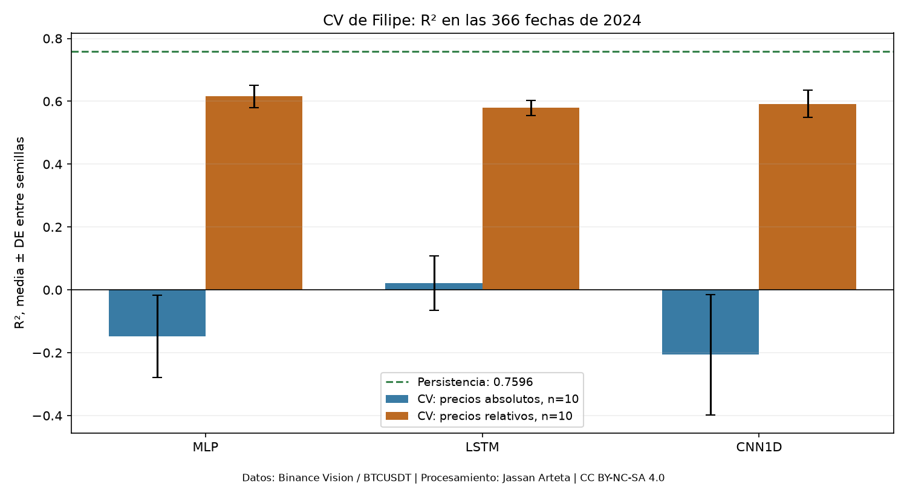
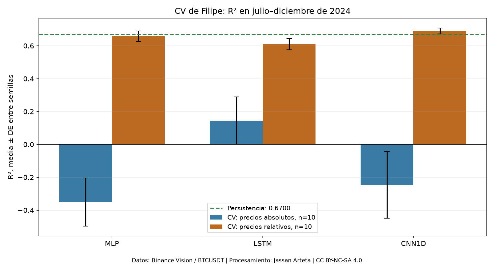
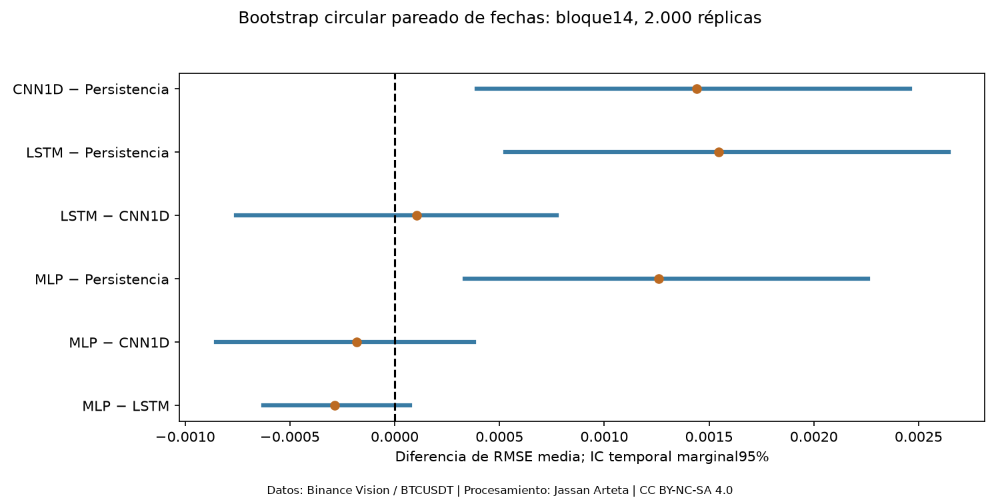
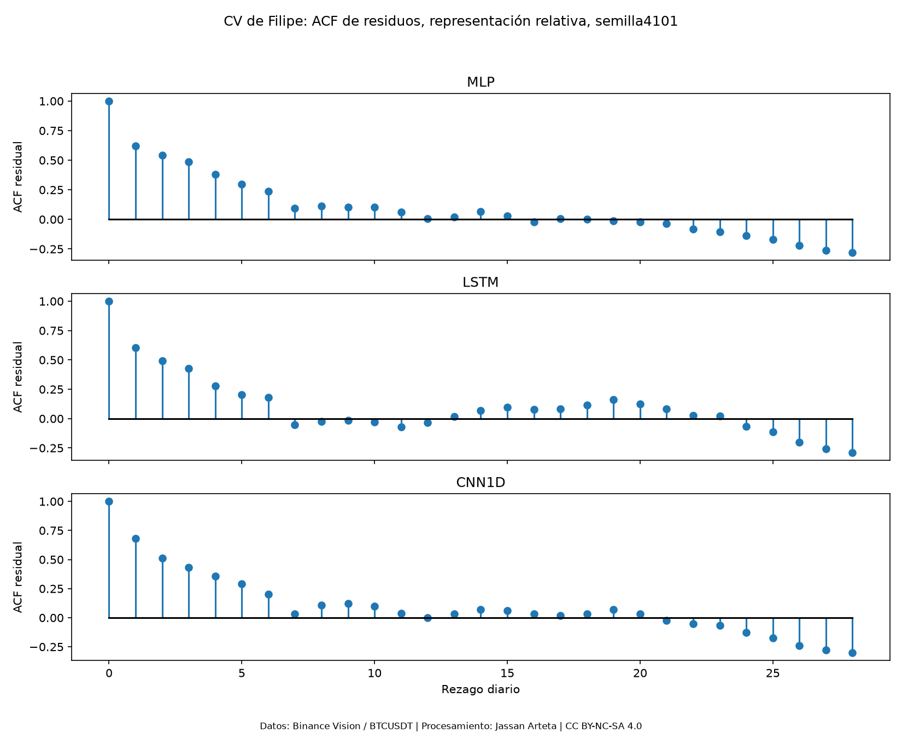
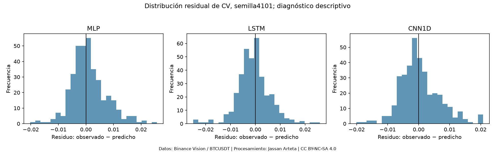
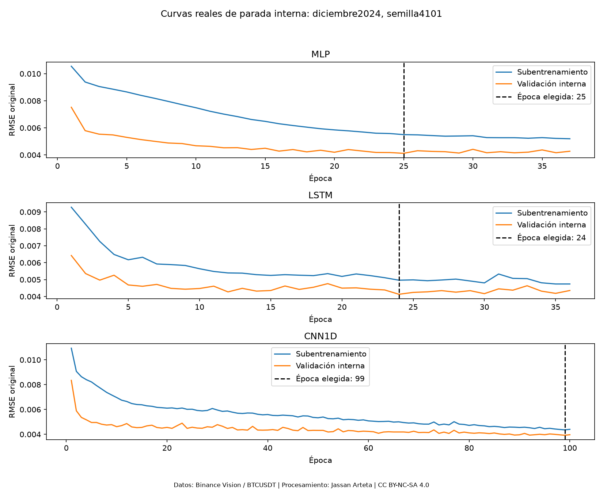

# 5. Benchmark de los Modelos Base y Definición del Baseline

El benchmark utiliza **validación forward chaining con `timeseries-cv`**, proyecto de DidierRLopes desarrollado con coautoría de Filipe R. Ramos. Las tres redes son **MLP, LSTM y CNN1D poco profunda**. La representación principal es `relative_window`; `absolute_log` se conserva como control de preprocesamiento dentro de la misma CV.

Se ejecutaron **doce bloques mensuales de 2024**, con entrenamiento inicial de 2023 e incorporación del pasado permitido de 2024. Cada trayectoria reúne 366 predicciones diarias de horizonte h=1. Las diez semillas por red y variante producen **60 trayectorias, 720 segmentos modelo–mes y 1.440 ajustes efectivos**: selección interna de duración y reajuste nuevo en cada segmento. No son 366 reajustes diarios ni pronósticos de un mes adelante.

El [método de CV](../_static/dl_r2_cv_20261104/method.json) y las [configuraciones](../_static/dl_r2_cv_20261104/configuration.json), los [folds](../_static/dl_r2_cv_20261104/folds.csv) y las [corridas](../_static/dl_r2_cv_20261104/runs.csv) permiten comprobar el procedimiento. La configuración se fijó usando desarrollo ya explorado: la evaluación de 2024 es **exploratoria**, sin selección anidada ni confirmación externa. El ajuste final con desarrollo completo y el test de enero de 2025–agosto de 2026 siguen pendientes; septiembre–octubre de 2026 permanece sin asignar al test.

El [complemento estadístico registrado](../_static/filipe_statistics_20261104/protocol.json) completa las comparaciones, los diagnósticos y el remuestreo sobre estas mismas predicciones. Se definió después de examinar los resultados descriptivos de desarrollo y antes de calcular el complemento; mantiene alcance **exploratorio**, con cero entrenamientos nuevos y sin consultar test.

**Resultado anual:** MLP relativo tiene la menor RMSE entre las redes y las tres redes relativas obtienen R² medio positivo. **Persistencia conserva menor error en todo 2024.** Las cifras siguientes identifican periodo, representación y unidad de incertidumbre.

## 5.1. Comparación Tabular

Las tablas utilizan las mismas fuentes BTCUSDT de Binance Spot, calendario UTC, objetivo y cohortes dentro de cada comparación.

### 5.1.1. Tabla de comparación de los tres modelos base

La entrada es una ventana **D=7 días × cinco canales OHLCV**, el objetivo es volatilidad poblacional de siete retornos diarios, sin anualizar y con `ddof=0`, y el horizonte es **h=1**. En cada comienzo mensual b se admiten etiquetas de entrenamiento hasta $u\le b-D-1$. La ventana interna de noventa días antes de b deja **83 etiquetas después de la purga**; sus escaladores se ajustan solo con el subentrenamiento. El reajuste completo usa escaladores propios y toda la cohorte mensual admitida.

La función `split_train_val_forwardChaining(np.arange(731),7,1,1)` proporciona los índices diarios. El adaptador los reúne en doce bloques mensuales y agrega controles explícitos de embargo y calidad. El entrenador consume esos índices para ajustar cada red. Los pesos quedan fijos durante el mes, mientras cada pronóstico diario usa OHLCV observable de los días anteriores.

Para fechas $\mathcal V$ y semillas $\mathcal S$, la puntuación principal es:

$$
m_{m,s}=\sqrt{\frac1N\sum_{t\in\mathcal V}(Y_t-\widehat Y_{m,s,t})^2},\qquad
S_m=\frac1R\sum_{s\in\mathcal S}m_{m,s}.
$$

Primero se reúnen las 366 predicciones anuales de cada trayectoria y se calcula su RMSE; después se promedian las diez semillas. No se puntúa un ensemble ni se mezclan semillas×fechas como observaciones independientes. El R² anual también se calcula desde las 366 predicciones, **sin promediar R² diarios o mensuales**.

#### 5.1.1.1. Modelo base

**Representación principal `relative_window`, 1 de enero–31 de diciembre de 2024.** Cada fila neuronal resume diez trayectorias completas. Los IC t del 95 % son marginales entre semillas y condicionan el calendario.

| Modelo | RMSE, media ± DE | IC 95 % de RMSE | MAE, media ± DE | R², media ± DE | Parámetros |
| --- | --- | --- | --- | --- | --- |
| MLP | 0,0060491 ± 0,0002780 | [0,0058502; 0,0062479] | 0,0043804 ± 0,0002110 | 0,615670 ± 0,035544 | 593 |
| LSTM | 0,0063354 ± 0,0001870 | [0,0062016; 0,0064692] | 0,0047263 ± 0,0001245 | 0,578892 ± 0,024807 | 5.025 |
| CNN1D | 0,0062296 ± 0,0003373 | [0,0059883; 0,0064709] | 0,0046780 ± 0,0002212 | 0,592088 ± 0,042687 | 1.057 |
| Persistencia | 0,0047890 | No aplica a semillas | 0,0029435 | 0,759571 | 0 |

Fuente: [metrics_summary.csv](../_static/dl_r2_cv_20261104/analysis/metrics_summary.csv). Persistencia es una referencia determinista, sin pesos ni variabilidad de inicialización; no se cuenta como diez entrenamientos ni como un cuarto modelo DL. Necesita ocho cierres para obtener la última σ7 conocida, mientras las redes reciben siete días OHLCV. Esa diferencia de información histórica observable se conserva en la interpretación.

Las barras representan DE, no IC. La línea de persistencia no tiene variabilidad entre semillas.

#### 5.1.1.2. Métricas: media ± desviación estándar

Todas las métricas se expresan después de invertir la escala positiva de Y. RMSE es la principal; las siguientes complementan la lectura de la representación relativa:

| Modelo | IC 95 % de R² | MAPE (%), media ± DE | MASE, media ± DE |
| --- | --- | --- | --- |
| MLP | [0,590243; 0,641096] | 19,3303 ± 0,7369 | 1,66168 ± 0,08422 |
| LSTM | [0,561147; 0,596638] | 21,7863 ± 0,8045 | 1,78982 ± 0,04645 |
| CNN1D | [0,561551; 0,622624] | 21,9803 ± 1,0000 | 1,77956 ± 0,08783 |
| Persistencia | No aplica a semillas | 13,5521 | 1,11835 |

MAPE y MASE tienen cobertura del 100 %. MASE emplea en cada mes una escala calculada únicamente con su entrenamiento admisible, registrada por predicción; no se espera MASE=1 para persistencia en las fechas de validación. R² positivo significa menor MSE que la referencia algebraica de la media observada del periodo, sin implicar superioridad frente a persistencia.

**Control de representación dentro de la misma CV anual.** Ambos preprocesamientos comparten modelos, configuraciones, folds y diez semillas:

| Representación CV | Red | RMSE, media ± DE | R², media ± DE |
| --- | --- | --- | --- |
| `absolute_log` | MLP | 0,0104473 ± 0,0005993 | -0,147616 ± 0,130856 |
| `absolute_log` | LSTM | 0,0096539 ± 0,0004292 | 0,021226 ± 0,087144 |
| `absolute_log` | CNN1D | 0,0106964 ± 0,0008499 | -0,206245 ± 0,191124 |
| `relative_window` | MLP | 0,0060491 ± 0,0002780 | 0,615670 ± 0,035544 |
| `relative_window` | LSTM | 0,0063354 ± 0,0001870 | 0,578892 ± 0,024807 |
| `relative_window` | CNN1D | 0,0062296 ± 0,0003373 | 0,592088 ± 0,042687 |

`absolute_log` usa logaritmos de precios y volumen, con escala por canal sobre días únicos de entrenamiento. `relative_window` expresa OHLC respecto al último cierre observable de cada ventana y ajusta escalas sobre posiciones de ventanas de entrenamiento. Esta comparación cambia representación y ponderación del escalado; no aísla causalmente una sola transformación.

**Subperiodo julio–diciembre: 184 fechas de la misma CV.** Se informa por separado del año, sin intercambiar denominadores ni cohortes:

| Red relativa | RMSE, media ± DE | R², media ± DE |
| --- | --- | --- |
| MLP | 0,0049062 ± 0,0002224 | 0,657808 ± 0,032033 |
| LSTM | 0,0052429 ± 0,0002265 | 0,609298 ± 0,033741 |
| CNN1D | 0,0046732 ± 0,0001429 | 0,689848 ± 0,018888 |
| Persistencia | 0,0048225 | 0,669995 |

Fuente del subperiodo: [metrics_common_h2_cv_only.csv](../_static/dl_r2_cv_20261104/analysis/metrics_common_h2_cv_only.csv). CNN1D relativa obtiene una reducción puntual de RMSE del **3,095 %** frente a persistencia, inferior al margen operativo del 5 %. El orden semestral no se extiende al año completo ni se interpreta como superioridad temporal confirmada.

#### 5.1.1.3. Intervalos de confianza del 95 % y método de construcción

Los IC marginales entre semillas emplean t de Student con **nueve grados de libertad**:

$$
\bar m\pm t_{0{,}975;9}\frac{s_m}{\sqrt{10}}.
$$

Describen la media de desempeño del procedimiento de entrenamiento condicionada a datos, configuración y calendario. Para comparar métodos se calcula además el IC de la diferencia pareada, sin inferirlo del solapamiento de IC aislados.

Se ejecutó también bootstrap circular pareado de fechas: **2.000 réplicas, bloque principal de 14 días y sensibilidad de 7/28**, recalculando la RMSE de cada semilla y después su media. Este intervalo temporal condiciona a los modelos guardados; no remuestrea semillas ni reentrena. Los IC publicados son marginales: ajustar p-valores con Holm no los convierte en bandas simultáneas. Métodos y resultados se detallan en §5.4.5.

#### 5.1.1.4. Tiempo de entrenamiento y de inferencia

Los tiempos corresponden a una trayectoria anual completa: entrenamiento suma el ajuste interno y reajuste de los doce bloques; inferencia suma las mediciones de las 366 predicciones. Se usaron CPU, un hilo PyTorch por trabajador y tres trabajadores concurrentes.

| Representación | Red | Entrenamiento de 12 bloques (s), media ± DE | Inferencia de 366 casos (ms), media ± DE |
| --- | --- | --- | --- |
| `absolute_log` | MLP | 9,189 ± 1,617 | 0,6397 ± 0,0896 |
| `absolute_log` | LSTM | 12,010 ± 1,738 | 3,7515 ± 0,6540 |
| `absolute_log` | CNN1D | 17,661 ± 2,955 | 4,0847 ± 0,3203 |
| `relative_window` | MLP | 21,352 ± 1,234 | 0,6227 ± 0,0413 |
| `relative_window` | LSTM | 18,505 ± 2,305 | 3,2121 ± 0,3623 |
| `relative_window` | CNN1D | 44,350 ± 2,425 | 3,6905 ± 0,2351 |

La inferencia se midió por bloques después de cinco calentamientos y con veinte pasadas, lote máximo 256. Entrenamiento incluye la evaluación de parada; las medidas excluyen preprocesamiento y serialización. Son tiempos locales, sensibles a concurrencia y número de épocas, sin una evaluación de despliegue. Fuentes: [runs.csv](../_static/dl_r2_cv_20261104/runs.csv) y [runtime](../_static/dl_r2_cv_20261104/runtime.json).

#### 5.1.1.5. Número de parámetros

Los conteos de instancias reales son **593 parámetros entrenables en MLP, 5.025 en LSTM y 1.057 en CNN1D**; no hay parámetros no entrenables. Persistencia no tiene pesos ajustados.

MLP tiene una capa oculta de 16 unidades; LSTM una capa recurrente unidireccional de 32; CNN1D dos convoluciones causales ordinarias de 16 canales y kernel 3, seguidas de promedio temporal. Los dos preprocesamientos mantienen esas arquitecturas. La CNN propia no reproduce la TCN publicada en la literatura.

## 5.2. Ranking de Modelos Base

El ranking se define por la media de RMSE por trayectoria, con representación y periodo identificados. Es descriptivo de esta CV de desarrollo.

### 5.2.1. Orden de los tres modelos según la métrica principal

En **todo 2024**, el orden dentro de `relative_window` es **MLP, CNN1D, LSTM**. En `absolute_log` es LSTM, MLP, CNN1D. Persistencia tiene menor RMSE que las seis combinaciones. En julio–diciembre el orden relativo es CNN1D, MLP, LSTM; cada ranking conserva su periodo.

Las comparaciones de RMSE entre las tres redes relativas **no rechazan igualdad de media** con Holm global-12 (§5.3.3), y Friedman tampoco rechaza su hipótesis con diez bloques-semilla (p=0,12245643). Esto no demuestra equivalencia. MLP es el líder por media anual observada y el candidato neuronal, sin superioridad confirmada sobre las otras redes.

El [bootstrap de ranking](../_static/filipe_statistics_20261104/ranking_bootstrap.csv), con L14, asigna frecuencias de menor RMSE de **0,6670 a MLP, 0,0485 a LSTM y 0,2845 a CNN1D** dentro del trío. Al incluir persistencia, su frecuencia es **0,9930**. Son frecuencias de remuestreo condicionadas a estos modelos y fechas, no probabilidades posteriores ni de ganar en otro mercado.

La [superioridad empírica por semillas](../_static/filipe_statistics_20261104/probability_superiority.csv) cuenta menor RMSE en cada par sobre el mismo calendario:

| Primer método frente a segundo | Victorias estrictas | Proporción | IC 95 % condicional |
| --- | --- | --- | --- |
| MLP frente a LSTM | 9/10 | 0,900 | [0,555; 0,997] |
| MLP frente a CNN1D | 6/10 | 0,600 | [0,262; 0,878] |
| MLP frente a Persistencia | 0/10 | 0,000 | [0,000; 0,308] |
| LSTM frente a CNN1D | 5/10 | 0,500 | [0,187; 0,813] |
| LSTM frente a Persistencia | 0/10 | 0,000 | [0,000; 0,308] |
| CNN1D frente a Persistencia | 0/10 | 0,000 | [0,000; 0,308] |

No hubo empates; los intervalos Clopper–Pearson son marginales y suponen pares de aleatorizaciones de entrenamiento independientes bajo este calendario. Un 0/10 no prueba probabilidad universal cero, y un 9/10 no acredita superioridad tras toda la multiplicidad. La frecuencia de victorias y la diferencia media de RMSE son estimandos distintos. La proporción no describe otros mercados o periodos.

### 5.2.2. Análisis del trade-off

Se comparan error, parámetros y costos bajo la misma CV. La dominancia sobre medias describe estas estimaciones y no garantiza dominancia poblacional ni utilidad financiera.

#### 5.2.2.1. Precisión frente a costo computacional

La representación relativa reduce RMSE con los mismos parámetros, pero exige más tiempo medio de entrenamiento que la absoluta en las tres redes. Las diferencias de duración incorporan épocas seleccionadas y concurrencia, sin demostrar eficiencia arquitectónica intrínseca.

Entre las redes relativas, MLP tiene la menor RMSE anual y la menor duración de inferencia; LSTM tiene menor tiempo medio de entrenamiento. Las condiciones de §5.1.1.4 se mantienen y no se inventa una restricción de latencia operacional.

#### 5.2.2.2. Precisión frente a complejidad del modelo

MLP relativa combina el menor error anual neuronal con el menor conteo de parámetros. LSTM utiliza aproximadamente 8,47 veces sus pesos y CNN1D 1,78 veces, sin obtener menor error anual. La ventaja semestral de CNN1D no modifica esa comparación anual.

Persistencia obtiene mejor desempeño anual sin pesos aprendidos, con la diferencia de información histórica observable indicada. Más parámetros o mayor tiempo no se consideran una mejora por sí mismos.

## 5.3. Definición del Baseline y Margen de Mejora Disponible

El baseline se expresa como una arquitectura y procedimiento completos: fuentes, objetivo, representación, entrenamiento creciente, reglas de parada y calendario. Se distingue la referencia neuronal descriptiva de la confirmación final pendiente.

### 5.3.1. Selección del baseline de referencia

La elección descriptiva se apoya en el desempeño anual completo y no en seleccionar el mes o la semilla de menor error.

#### 5.3.1.1. Identificación del mejor modelo base

**MLP con `relative_window`, D=7, H=16 y learning rate=0,001 es el candidato a baseline DL por menor RMSE anual media.** Comparte AdamW, dropout 0,1, weight decay 10⁻⁴, batch 32, parada interna y reajuste mensual de §4.

La configuración completa y el margen para una propuesta avanzada deberán cerrarse antes del ajuste final y del test. La CV usa desarrollo ya explorado; no acredita selección anidada o generalización externa. Persistencia conserva el papel de referencia contextual fuerte, con menor error anual que las redes.

#### 5.3.1.2. Desempeño con media, desviación e IC del 95 %

MLP relativa obtiene RMSE **0,0060491 ± 0,0002780**, IC t del 95 % **[0,0058502; 0,0062479]**, y R² **0,615670 ± 0,035544**, sobre diez trayectorias y 366 fechas. Persistencia obtiene RMSE **0,0047890** y R² **0,759571**; no tiene dispersión de inicialización.

La lectura es condicional al calendario de 2024. No se sustituye el año por el semestre favorable a una arquitectura ni se presenta este candidato como una cota universal de error.

### 5.3.2. Cuantificación de las diferencias entre modelos base

Se publican diferencias en unidades originales y porcentajes con denominador y dirección explícitos, manteniendo el mismo objetivo y periodo.

#### 5.3.2.1. Regresión y series de tiempo: diferencias respecto al peor y al mejor modelo

Para medias de error por trayectoria $\bar M_m$, una reducción relativa frente a r es:

$$
\Delta(m;r)=100\frac{\bar M_r-\bar M_m}{\bar M_r},\qquad\bar M_r>0.
$$

Un valor positivo favorece a m; si el denominador es cero, se reporta indefinido sin epsilon. La razón de medias no es la media de razones por semilla. Mejor y peor se identifican por métrica, no se trasladan automáticamente de RMSE a MAE.

En la representación relativa anual, MLP y LSTM son los extremos mejor y peor entre redes por RMSE. Los porcentajes siguientes usan datos sin redondear:

| Red relativa | Reducción RMSE frente a LSTM (%) | Reducción frente a MLP (%) | Reducción frente a su variante absoluta (%) | Reducción frente a persistencia anual (%) |
| --- | --- | --- | --- | --- |
| MLP | 4,520 | 0,000 | 42,099 | -26,313 |
| LSTM | 0,000 | -4,734 | 34,375 | -32,292 |
| CNN1D | 1,670 | -2,984 | 41,760 | -30,082 |

Todos los valores anuales frente a persistencia son negativos: las redes tienen mayor error. En el semestre julio–diciembre, CNN1D relativa obtiene una reducción puntual del 3,095 %, inferior al 5 % y sin prueba temporal de superioridad ejecutada.

#### 5.3.2.2. Clasificación, etiquetado secuencial y segmentación

**No aplican al proyecto actual:** se pronostica volatilidad continua, sin clases, etiquetas por token o máscaras de imagen. Para una tarea con puntuación S donde mayor sea mejor se definirían:

$$
\Delta_{\rm abs}(m;r)=\bar S_m-\bar S_r,\qquad
\Delta_{\rm rel}(m;r)=100\frac{\bar S_m-\bar S_r}{\bar S_r},\quad\bar S_r>0.
$$

La diferencia en unidades conserva signo; si S se expresa en porcentaje, se distinguen puntos porcentuales de cambio relativo. Con referencia cero, la razón queda indefinida. Estas expresiones no aportan mediciones de clasificación, etiquetado o segmentación del proyecto.

#### 5.3.2.3. Secuencia a secuencia

**No aplica:** la salida es una volatilidad escalar y no una secuencia generada. En una tarea de generación se fijarían métrica, escala, tokenización, referencias y versión antes de comparar BLEU, ROUGE, chrF o exactitud completa. Se mantendrían referentes, parejas y tratamiento de denominadores cero, sin atribuir esas métricas a Bitcoin.

#### 5.3.2.4. Tamaño de efecto de cada diferencia

Para diferencias pareadas de RMSE por semilla $d_s=m_{A,s}-m_{B,s}$ se reporta:

$$
d_z=\frac{\bar d}{s_d}.
$$

Δ<0 favorece al primer procedimiento cuando se compara error. El denominador es la DE de las diferencias, no una DE marginal. Con dispersión nula se deja indefinido. Los efectos estandarizados y sus diferencias en unidades originales se conservan para las seis comparaciones entre redes y persistencia y para los tres controles de representación.

Los contrastes de ganancia relativa emplean $g_s=1-m_{A,s}/m_{\rm pers}$; allí un valor positivo favorece a la red y la frontera práctica es 0,05. La distancia estandarizada a esa frontera no se confunde con el efecto respecto a cero. Estas medidas describen variación entre inicializaciones sobre un calendario fijo; no sustituyen el margen aplicado ni cuantifican variación entre mercados.

### 5.3.3. Inferencia sobre las diferencias

El análisis reúne comparaciones de las tres redes relativas, persistencia, la frontera práctica del 5 % y los controles de representación. La [familia global](../_static/filipe_statistics_20261104/global_seed_tests.csv) contiene **doce hipótesis por semillas**; Holm global-12 es el ajuste principal de las tablas. Los registros conservan los ajustes de componentes para trazabilidad, sin tratarlos como corroboraciones independientes.

#### 5.3.3.1. Comparaciones pareadas y corrección por multiplicidad

La familia de doce incluye tres diferencias bilaterales entre redes relativas, tres bilaterales de red frente a persistencia, tres pruebas unilaterales de ganancia relativa superior a 0,05 y los tres controles bilaterales relativa−absoluta. Se utilizan diez pares de semillas base y las mismas 366 fechas. Para persistencia, la puntuación fija se resta de cada ejecución de la red; repetirla algebraicamente no crea diez realizaciones de la referencia.

El complemento y su multiplicidad se registraron antes de calcular estas pruebas, pero después de examinar resultados descriptivos del desarrollo. La t conserva nueve grados de libertad y las comparaciones son exploratorias; no acreditan una selección anidada ni confirmación en datos nuevos.

#### 5.3.3.2. Diferencia media, IC del 95 % y p-value ajustado y sin ajustar

Diferencias de **RMSE anual media por semilla**, con Δ=primer procedimiento−segundo; Δ<0 favorece al primero. IC del 95 % marginales, t(9):

| Comparación | Δ RMSE | IC 95 % de Δ | d_z | p sin ajustar | p Holm global-12 |
| --- | --- | --- | --- | --- | --- |
| MLP − LSTM | -0,0002863 | [-0,0005087; -0,0000640] | -0,9212 | 0,017225365 | 0,10335219 |
| MLP − CNN1D | -0,0001805 | [-0,0004783; 0,0001173] | -0,4336 | 0,20351666 | 1 |
| MLP − Persistencia | 0,0012601 | [0,0010613; 0,0014589] | 4,5334 | 1,670790e-07 | 1,336632e-06 |
| LSTM − CNN1D | 0,0001058 | [-0,0002203; 0,0004320] | 0,2321 | 0,48167197 | 1 |
| LSTM − Persistencia | 0,0015464 | [0,0014127; 0,0016802] | 8,2693 | 8,441270e-10 | 9,285398e-09 |
| CNN1D − Persistencia | 0,0014406 | [0,0011993; 0,0016819] | 4,2712 | 2,794885e-07 | 1,956420e-06 |

La persistencia tiene menor error en los diez recorridos de cada red y sus diferencias rechazan cero bajo la referencia condicional por semillas. Ninguna pareja de redes rechaza con Holm-12. Los IC marginales no se interpretan como intervalos simultáneos; en particular, un IC marginal puede excluir cero mientras su p ajustado no rechaza.

**Controles de preprocesamiento bajo la misma CV**, integrados en la misma familia global:

| Comparación | Δ RMSE | IC 95 % marginal | d_z | p sin ajustar | p Holm global-12 |
| --- | --- | --- | --- | --- | --- |
| MLP: relativa − absoluta | -0,0043982 | [-0,0046984; -0,0040981] | -10,4826 | 1,019002e-10 | 1,222802e-09 |
| LSTM: relativa − absoluta | -0,0033185 | [-0,0036149; -0,0030221] | -8,0095 | 1,121134e-09 | 1,121134e-08 |
| CNN1D: relativa − absoluta | -0,0044668 | [-0,0050626; -0,0038709] | -5,3624 | 3,871572e-08 | 3,484415e-07 |

Las tres representaciones relativas reducen la RMSE frente a su control absoluto con el ajuste global. El cambio combina representación y ponderación del escalado; no aísla una causa única.

**Pruebas unilaterales de superar el margen práctico**, $H_0:\mathbb E[g_s]\le0,05$ frente a $H_1:\mathbb E[g_s]>0,05$:

| Red | Ganancia media vs persistencia | IC 95 % marginal de ganancia | p sin ajustar | p Holm global-12 |
| --- | --- | --- | --- | --- |
| MLP | -26,313 % | [-30,465; -22,161] % | 0,99999998 | 1 |
| LSTM | -32,292 % | [-35,085; -29,498] % | 1 | 1 |
| CNN1D | -30,082 % | [-35,121; -25,044] % | 0,99999996 | 1 |

Las ganancias anuales son negativas y no se demuestra una mejora superior al 5 %. Los IC anteriores describen la ganancia media; no son por sí solos un procedimiento de equivalencia. Los [resultados completos](../_static/filipe_statistics_20261104/global_seed_tests.csv) incluyen estadísticos t, grados de libertad, Shapiro, precisión numérica y familias. Los IC de ΔR² relativa−absoluta siguen siendo secundarios descriptivos en el [control de representación](../_static/dl_r2_cv_20261104/analysis/comparisons.csv).

### 5.3.4. Umbral de mejora para modelos avanzados

El margen práctico y la diferencia mínima detectable son cantidades distintas; ambas requieren definición para la comparación concreta que vaya a realizarse.

#### 5.3.4.1. Mejora mínima detectable frente al baseline

La MDE depende del contraste, potencia objetivo, emparejamiento y dispersión de las diferencias. Para una propuesta avanzada A frente al baseline B:

$$
\operatorname{Var}(m_A-m_B)=\operatorname{Var}(m_A)+\operatorname{Var}(m_B)-2\operatorname{Cov}(m_A,m_B).
$$

La DE o el IC de B aislado no identifican esa varianza. **No se ha dimensionado una MDE de un modelo avanzado que aún no se ha evaluado**, ni se obtiene sumando una DE al candidato MLP.

Para los métodos ya ejecutados, §5.4.7 sí calcula sensibilidad orientativa frente a cero usando la dispersión observada entre diez pares. Es una calibración retrospectiva y condicionada al calendario, no un piloto anterior al entrenamiento ni una garantía de potencia. Sus valores no se trasladan a una nueva arquitectura o a la pregunta de superar el 5 % sin definir una alternativa apropiada.

#### 5.3.4.2. Margen de relevancia práctica

El criterio operativo aceptado es una **reducción relativa de RMSE de al menos 5 % frente a persistencia**, sobre las mismas fechas. No se interpreta como utilidad financiera calibrada ni se transfiere automáticamente a una comparación entre redes o de un modelo avanzado frente al candidato MLP.

En todo 2024 ninguna red supera a persistencia; en julio–diciembre la reducción puntual de CNN1D relativa es 3,095 %, inferior a ese margen. Alcanzar un porcentaje puntual tampoco demostraría que la mejora excede el margen con incertidumbre. Para la propuesta avanzada falta fijar su propio margen y diseñar la comparación antes de evaluarla.

#### 5.3.4.3. Cota de referencia del problema

Persistencia es una referencia contextual fuerte y observable, con RMSE anual 0,0047890. Su error no constituye una cota irreducible universal. El acuerdo humano no es una referencia aplicable a esta etiqueta automática y no se ha estimado una volatilidad latente sin ruido.

No se deduce de estos datos una cota certificada de desempeño alcanzable. La ventana móvil del objetivo, el retorno del día aún desconocido y el ruido del proveedor deben distinguirse del error reducible del modelo.

### 5.3.5. Interpretación

Las conclusiones combinan magnitud de error, incertidumbre, costo y alcance del diseño; los p-valores por sí solos no fijan una referencia operacional definitiva.

#### 5.3.5.1. Significación estadística y relevancia práctica

Las tres mejoras relativa−absoluta rechazan bajo Holm global-12. Las diferencias de las redes relativas frente a persistencia también rechazan por semillas, con signo de mayor error neuronal; entre redes no hay rechazo con ese ajuste.

La inferencia temporal da una lectura distinta: los seis DM primarios no rechazan después de Holm-6. El bootstrap L14 produce IC marginales de diferencias de RMSE, condicionado a los modelos guardados. No se selecciona la prueba con conclusión favorable: fecha, semilla, pérdida cuadrática y media de RMSE son alcances y funcionales distintos. Ningún resultado demuestra la mejora práctica del 5 % o generalización externa.

#### 5.3.5.2. Desempeño frente a complejidad, parámetros y costo

La representación relativa mejora error anual sin añadir pesos. MLP relativa combina el menor RMSE neuronal y los menos parámetros, mientras LSTM relativa necesita menos tiempo medio de entrenamiento. El mayor costo de CNN1D no se traduce en el menor error anual. Los compromisos son descriptivos de la CV y de la CPU registrada.

#### 5.3.5.3. Conclusión explícita del baseline y margen disponible

El **candidato a baseline DL es MLP con precios relativos y forward chaining mensual**, por menor RMSE media anual. Persistencia continúa como la referencia contextual de menor error anual y no se ha demostrado una mejora de las redes del 5 % sobre ella.

El procedimiento final y el margen de una propuesta avanzada quedan por cerrar. El resultado de desarrollo no establece un umbral universal ni autoriza elegir retrospectivamente el periodo más favorable.

#### 5.3.5.4. Estado del benchmark

Se dispone de tres redes, dos preprocesamientos comparables, diez trayectorias por combinación, 366 fechas, costos y parámetros. El [complemento](../_static/filipe_statistics_20261104/summary.json) añade doce comparaciones por semillas con Holm global, Friedman, seis DM principales con sensibilidad HAC, quince diagnósticos residuales, bootstrap temporal, superioridad empírica, sensibilidad MDE y curvas internas guardadas. Todo se calcula desde la CV existente: **cero ajustes nuevos y cero archivos de test consultados**.

Persisten pendientes genuinos: piloto prospectivo y dimensionamiento definitivo, banda de equivalencia, margen para una propuesta avanzada, cierre del procedimiento final, ajuste final con desarrollo y test. El respaldo bibliográfico aplicado de MLP/CNN1D simple tampoco se completa mediante estos cálculos.

## 5.4. Análisis Estadístico y Pruebas de Hipótesis

Los procedimientos siguientes están ejecutados sobre las predicciones de la CV de Filipe, salvo las excepciones identificadas explícitamente. El [protocolo del complemento](../_static/filipe_statistics_20261104/protocol.json) se registró antes de sus cálculos y después de la revisión descriptiva de 2024. Las inferencias son **exploratorias y condicionadas al desarrollo ya examinado**; no se añaden entrenamientos ni confirmación reservada.

Se separan la familia global de **12 contrastes por semillas**, la familia de **6 DM temporales primarios** y los **15 diagnósticos de residuos**. Estos grupos responden preguntas distintas y no constituyen corroboraciones independientes. El ajuste por familias no se presenta como control global de todas las pruebas del capítulo.

### 5.4.1. Hipótesis, unidad de análisis y supuestos

Para error, $d_s=\mathrm{RMSE}_{A,s}-\mathrm{RMSE}_{B,s}$ y la hipótesis bilateral es $H_0:\mathbb E[d_s]=0$; Δ<0 favorece a A. Para mejora práctica, $g_s=1-\mathrm{RMSE}_{{\rm red},s}/\mathrm{RMSE}_{\rm pers}$ y se contrasta unilateralmente superar la frontera 0,05. Los controles de representación conservan el orden relativa−absoluta.

La unidad de las pruebas por semillas es la aleatorización de entrenamiento condicionada a datos, configuración y calendario compartidos. Las doce particiones mensuales son dependientes y no crean doce mercados. La t exige un diseño de pares defendible y una distribución apropiada de sus diferencias; Shapiro es un diagnóstico, sin escoger retrospectivamente la prueba que produzca significación.

### 5.4.2. Comparaciones pareadas: t y Wilcoxon

La t pareada utiliza diez diferencias y nueve grados de libertad. Se conservan estadístico, IC marginal, p sin ajustar y p Holm global-12. No se sustituyó por otra prueba según el resultado observado.

Wilcoxon no se ejecutó. Su eventual aplicación debe fijar hipótesis, ceros, empates, referencia exacta o aproximada y supuestos; no contrasta automáticamente la misma media que la t. Su resolución discreta y diez semillas no garantizan potencia suficiente.

### 5.4.3. Comparación conjunta de tres modelos

Se ejecutó **Friedman sobre diez bloques-semilla completos** de las tres redes relativas, condicionado al calendario de 2024. Se obtuvo estadístico **4,2000**, con referencia asintótica χ² de dos grados de libertad y **p=0,12245643**. Los rangos medios fueron MLP=1,5, LSTM=2,4 y CNN1D=2,1.

No se rechaza su hipótesis a α=0,05; esto no demuestra equivalencia ni igualdad de desempeño fuera de desarrollo. Se declara la referencia aproximada y el número reducido de bloques. El contraste global no se utilizó como filtro para ejecutar las comparaciones pareadas registradas. Fuente: [summary.json](../_static/filipe_statistics_20261104/summary.json).

### 5.4.4. Comparaciones post-hoc y corrección por multiplicidad

Holm global-12 ajusta conjuntamente los seis contrastes bilaterales entre métodos relativos/persistencia, los tres unilaterales de ganancia >5 % y los tres controles de representación. La tabla principal utiliza ese ajuste; los CSV retienen los ajustes de componentes para trazabilidad, sin convertirlos en pruebas adicionales independientes.

No se ejecutó Nemenyi ni ANOVA. Las comparaciones pareadas estaban especificadas en el complemento y no quedaron condicionadas al rechazo de Friedman. DM utiliza su familia primaria de seis comparaciones de pérdidas por fecha, y los diagnósticos su familia de quince; no se mezclan sus estimandos ni se exige una segunda corrección equivalente sobre un post-hoc ya simultáneo.

### 5.4.5. Intervalos de confianza y tamaño de efecto

Se reportan IC t de diferencias entre semillas y percentiles de un bootstrap temporal de fechas. Ambos son marginales y condicionan aspectos diferentes del procedimiento. Las diferencias en unidades de RMSE se priorizan frente a estandarizaciones aisladas; para cada resultado se identifica el signo y la unidad.

#### 5.4.5.1. Bootstrap de las diferencias pareadas

Se aplicó **bootstrap circular pareado de fechas**, 2.000 réplicas, L=14 principal y sensibilidad L=7/28, semilla 20261104. Los índices de cada réplica son comunes a los cuatro procedimientos. Se recalcula RMSE por semilla y luego su media, y la razón de mejora usa el mismo denominador remuestreado. No se concatena semilla×fecha como observaciones independientes.

IC percentiles marginales del 95 % con L14:

| Comparación | IC de diferencia RMSE | IC de ganancia relativa |
| --- | --- | --- |
| MLP − LSTM | [-0,0006277; 0,0000720] | [-1,291; 9,828] % |
| MLP − CNN1D | [-0,0008532; 0,0003781] | [-6,368; 13,062] % |
| MLP − Persistencia | [0,0003343; 0,0022573] | [-50,797; -6,548] % |
| LSTM − CNN1D | [-0,0007565; 0,0007734] | [-13,093; 11,627] % |
| LSTM − Persistencia | [0,0005281; 0,0026421] | [-59,589; -10,508] % |
| CNN1D − Persistencia | [0,0003919; 0,0024583] | [-56,008; -7,287] % |

Los IC entre redes incluyen cero. Los IC marginales red−persistencia excluyen cero con signo de mayor error de la red. Estos IC no están ajustados por multiplicidad y su funcional es la media de RMSE; DM/Holm-6 contrasta otra pregunta, sobre pérdidas cuadráticas y una familia simultánea (§5.4.9).

Los [18 intervalos](../_static/filipe_statistics_20261104/block_bootstrap.csv) conservan las tres longitudes, sin elegir la favorable. El remuestreo condiciona a los modelos guardados: **no remuestrea semillas ni reentrena** sobre historias nuevas. Su calibración depende de una representación adecuada de dependencia y estabilidad local; las etiquetas solapadas y cambios mensuales de red limitan una lectura universal.

#### 5.4.5.2. Tamaño de efecto junto con el p-value

Las diferencias de RMSE, IC t marginales y d_z se reportan para los pares de métodos y controles de representación (§5.3.3). El signo sigue primer método−segundo para error; una ganancia relativa mantiene su dirección propia. La DE es la de diferencias emparejadas.

No se calculó delta de Cliff ni rango-biserial; no se presentan como equivalentes automáticos a d_z. Los tamaños grandes entre inicializaciones no describen variabilidad entre mercados ni garantizan relevancia económica.

### 5.4.6. Advertencia sobre independencia

Compartir calendario y ventanas genera dependencia que debe distinguirse de la variación de inicialización.

#### 5.4.6.1. Ejecuciones que comparten el conjunto de prueba

El inciso expresa una precaución general: **la ejecución actual comparte validación de desarrollo, no el test reservado**. Las diez trayectorias de cada combinación utilizan las mismas fechas, etiquetas y reglas. Sus IC no cuantifican la variación entre periodos de mercado independientes.

Las σ7 consecutivas comparten seis retornos. Las predicciones mantienen fecha, red, variante, semilla y fold; no se concatenan todas las filas como observaciones independientes. Persistencia se trata como un único pronóstico determinista.

#### 5.4.6.2. Validación repetida y remuestreo por bloques

Se ejecutó forward chaining creciente con doce bloques mensuales y horizonte diario, manteniendo pesos dentro de cada mes. No se utilizó K-fold aleatorio ni múltiples particiones aleatorias repetidas.

El bootstrap de fechas usa bloques L14 y sensibilidad L7/L28. Aun así, no reproduce volver a entrenar sobre otras trayectorias de mercado. No se aplica una corrección de varianza derivada de otro diseño como si reparara selección, dependencia o fuga de información. Las 366 fechas, diez semillas y doce bloques conservan sus significados distintos.

### 5.4.7. Reporte de potencia y diferencia mínima detectable

Las diez semillas constituyen un presupuesto exploratorio. Se calcula ahora **sensibilidad de planificación con dispersión retrospectiva**, condicionada al calendario, para mostrar lo que ese tamaño puede distinguir bajo una aproximación normal. No se presenta como piloto anterior al entrenamiento, potencia observada a partir del efecto obtenido o certificado de suficiencia.

Para $\alpha_{\rm plan}=0,05/12$ y objetivo hipotético $1-\beta=0,80$:

$$
\operatorname{MDE}_0\approx
\frac{(z_{1-\alpha_{\rm plan}/2}+z_{0,80})\widehat\sigma_d}{\sqrt R},\qquad
R_{\rm orient}=\left\lceil
\frac{(z_{1-\alpha_{\rm plan}/2}+z_{0,80})^2\widehat\sigma_d^2}{\delta_{\rm plan}^2}
\right\rceil.
$$

Para red frente a persistencia, $\delta_{\rm plan}=0,05\,\mathrm{RMSE}_{\rm pers}=0,0002394485$ es el efecto a detectar **frente a cero**, sin afirmar que se supera el 5 %:

| Red vs persistencia | DE de diferencia | MDE0 con R=10 | δplan frente a cero | R orientativo |
| --- | --- | --- | --- | --- |
| MLP | 0,0002780 | 0,0003258 | 0,0002394485 | 19 |
| LSTM | 0,0001870 | 0,0002192 | 0,0002394485 | 9 |
| CNN1D | 0,0003373 | 0,0003954 | 0,0002394485 | 28 |

Bajo estos supuestos y esta calibración, diez pares quedan por debajo del R orientativo de MLP y CNN1D; el valor orientativo de LSTM no acredita un piloto prospectivo ni potencia exacta. La dispersión se estima con solo diez pares y tiene incertidumbre. Para pares entre redes se publican MDE0, pero no R orientativo porque no se definió su margen propio.

Fuente: [design_sensitivity.csv](../_static/filipe_statistics_20261104/design_sensitivity.csv). No se dimensiona aquí demostrar ganancia >5 % sin una alternativa $q_{\rm alt}>0,05$, ni un modelo avanzado aún inexistente. Dimensionar aleatorizaciones de entrenamiento tampoco dimensiona la incertidumbre temporal o las fechas del test.

### 5.4.8. Ausencia de significación y equivalencia

No rechazar una diferencia no demuestra equivalencia. **No se ejecutó TOST ni ROPE**, y falta un margen de equivalencia propio.

TOST requiere una banda práctica predefinida y ambas pruebas unilaterales; con α=0,05 sin otro ajuste, su regla usual corresponde al IC del 90 % dentro de la banda. Ese intervalo no se confunde con los IC del 95 % de reporte. ROPE exige un modelo bayesiano, priors, posterior y regla de decisión. El 5 % de mejora sobre persistencia no define automáticamente una banda de equivalencia entre modelos ni se ensancha después para obtener una conclusión.

### 5.4.9. Test de Diebold–Mariano

Se ejecutó Diebold–Mariano para las **seis parejas** de las tres redes relativas y persistencia, sobre las mismas 366 fechas. El estimando y la corrección se fijaron en el complemento exploratorio. Fuente: [temporal_dm.csv](../_static/filipe_statistics_20261104/temporal_dm.csv).

#### 5.4.9.1. Comparación de precisión predictiva por horizonte

Para h=1 se contrasta la media de diferencias de pérdida cuadrática por fecha:

$$
d_t=\frac1R\sum_{s=1}^{R}\left(e_{A,s,t}^2-e_{B,s,t}^2\right),\qquad H_0:\mathbb E[d_t]=0.
$$

Persistencia aporta una trayectoria determinista; las redes aportan la media de pérdidas de las diez semillas. No es la pérdida de un ensemble ni la media de RMSE por trayectoria: promediar raíces difiere de promediar pérdidas. Tampoco se elige la semilla de menor error.

El signo negativo favorece al primer método en pérdida cuadrática. Los cambios mensuales de parámetros, etiquetas solapadas y posibles cambios de régimen limitan las referencias estacionarias de la prueba; se conservan como evidencia exploratoria de este calendario.

#### 5.4.9.2. Corrección Harvey–Leybourne–Newbold y pérdida coherente

Se utilizó HAC de Bartlett con **rezago 14 principal** y sensibilidades 7/28, horizonte h=1 y corrección Harvey–Leybourne–Newbold. Para varianza de largo plazo positiva:

$$
DM=\frac{\sqrt T\,\bar d}{\sqrt{\widehat\Omega_d}},\qquad
DM_{\rm HLN}=DM\sqrt{\frac{T+1-2h+h(h-1)/T}{T}}.
$$

Aquí T=366 y el factor HLN es $\sqrt{(T-1)/T}$; h no se sustituye por n=7 o D=7. Se usa referencia t de Student con 365 grados de libertad, aproximada, y Holm sobre las seis comparaciones principales:

| Comparación | DM HLN, HAC14 | p sin ajustar | p Holm-6 |
| --- | --- | --- | --- |
| MLP − LSTM | -1,53375 | 0,12595787 | 0,37787361 |
| MLP − CNN1D | -0,59704 | 0,55084908 | 1 |
| MLP − Persistencia | 2,39216 | 0,017254737 | 0,069018947 |
| LSTM − CNN1D | 0,24639 | 0,80551675 | 1 |
| LSTM − Persistencia | 2,64512 | 0,0085190747 | 0,051114448 |
| CNN1D − Persistencia | 2,55372 | 0,011063495 | 0,055317477 |

**Ninguna pareja rechaza tras Holm-6 a α=0,05.** Aunque las tres comparaciones red−persistencia presentan p nominales inferiores a 0,05, sus valores ajustados son superiores. No se sustituye el ajuste por el resultado nominal ni se elige otra banda HAC para lograr rechazo.

Las sensibilidades HAC7/28 se conservan descriptivamente en el CSV; no reabren la selección del análisis principal. La corrección HLN no resuelve por sí sola no estacionariedad, selección o todas las formas de dependencia.

### 5.4.10. Test BDS (Brock–Dechert–Scheinkman)

Se evaluaron residuos $e_t=Y_t-\widehat Y_t$ de la **semilla designada 4101**, representación relativa, 366 días continuos, dimensiones 2/3 y radio **1,5 veces la DE muestral residual** de cada red. Los seis BDS integran, junto con nueve Ljung–Box, una familia de quince diagnósticos con Holm:

| Red | BDS dimensión 2 | p Holm-15 | BDS dimensión 3 | p Holm-15 |
| --- | --- | --- | --- | --- |
| MLP | 15,87586 | 2,793724e-56 | 16,98187 | 4,474445e-64 |
| LSTM | 13,48015 | 2,046800e-41 | 13,66246 | 3,402977e-42 |
| CNN1D | 17,93968 | 4,045146e-71 | 17,95778 | 3,337250e-71 |

Se rechazan las seis hipótesis de i.i.d. bajo la referencia aproximada utilizada. BDS **no identifica exclusivamente no linealidad aprovechable**: dependencia lineal, heterocedasticidad, deriva, etiquetas móviles y estimación mensual también afectan sus resultados. Los radios exactos, estadísticos y p sin ajustar están en [diagnostics.csv](../_static/filipe_statistics_20261104/diagnostics.csv). No se transforma ese rechazo en una ganancia futura cuantificada.

### 5.4.11. Test de Ljung–Box

Se ejecutó Ljung–Box sobre los mismos residuos de la semilla 4101, con rezagos **7, 14 y 28** y `model_df=0`. No se descuentan 593, 5.025 o 1.057 pesos como si fueran órdenes ARMA. Las referencias χ² son aproximadas para errores externos de redes reajustadas mensualmente.

| Red | p Holm-15, rezago 7 | p Holm-15, rezago 14 | p Holm-15, rezago 28 |
| --- | --- | --- | --- |
| MLP | 4,242223e-92 | 1,153786e-89 | 2,008099e-101 |
| LSTM | 6,532286e-71 | 1,724077e-66 | 3,641182e-81 |
| CNN1D | 2,076805e-88 | 4,728694e-86 | 3,017740e-100 |

Los nueve contrastes rechazan ausencia conjunta de autocorrelación hasta sus rezagos. Se conservan estadísticos Q, grados de libertad y p sin ajustar en el CSV. La evidencia no distingue por sí sola entre solapamiento de σ7, errores de especificación, cambios de régimen u otras fuentes. No se realizó aquí una prueba ARCH ni un contraste separado sobre residuos al cuadrado.

### 5.4.12. Interpretación de los residuos

La descripción residual y los quince diagnósticos formales están ejecutados. La fuerte dependencia remanente limita una lectura i.i.d. de los errores, mientras la diferencia entre incertidumbre por semillas y por fechas impide basar las conclusiones solo en los promedios.

#### 5.4.12.1. Estructura residual y posible margen de mejora

Para la semilla designada, con signo residual **observado−predicho**:

| Red relativa | Media residual | DE residual | RMSE de esta semilla |
| --- | --- | --- | --- |
| MLP | 0,0010027 | 0,0064693 | 0,0065378 |
| LSTM | -0,0006784 | 0,0065510 | 0,0065772 |
| CNN1D | 0,0003229 | 0,0063742 | 0,0063736 |

Estas cifras corresponden a una sola inicialización, no a las medias anuales de diez semillas de §5.1. La descomposición por todas las trayectorias continúa disponible en [bias_decomposition.csv](../_static/dl_r2_cv_20261104/analysis/bias_decomposition.csv); allí el sesgo se define como predicho−observado, con signo opuesto al residuo usado en esta tabla.

ACF, Ljung–Box y BDS muestran estructura remanente, pero **no cuantifican una mejora futura alcanzable** ni prueban una causa arquitectónica. Los modelos avanzados deben demostrar su aprovechamiento con un diseño posterior y una evaluación separada.

El ejemplo de parada corresponde a diciembre de 2024, fijado en el complemento, semilla 4101: mejores épocas **25/24/99** de MLP/LSTM/CNN1D, con **37/36/100** épocas registradas. CNN1D llega al máximo de 100 en ese corte; no se declara convergencia garantizada. Son curvas por época en subentrenamiento y validación interna, no curvas frente a tamaño muestral ni pérdidas del test. La inversión de escala permite comparar entrenamiento y validación dentro de cada ajuste.

### 5.4.13. Buenas Prácticas Estadísticas

Se conservan el registro temporal del análisis, resultados completos, unidades de incertidumbre y los procedimientos que aún requieren decisiones futuras. Los cálculos complementarios usan las predicciones ya guardadas; no alteran arquitectura, pesos, cohortes o métricas base.

#### 5.4.13.1. Nivel de significancia declarado antes de analizar resultados

Se utiliza α=0,05. La familia global de doce hipótesis por semillas usa Holm; DM ajusta sus seis comparaciones principales y los diagnósticos sus quince hipótesis. Estas familias no se presentan como confirmaciones independientes ni como un único control simultáneo de toda la investigación.

El complemento se registró antes de calcular sus estadísticos, **después** de la revisión descriptiva de desarrollo. Ese orden no se declara anterior a observar 2024 o a elegir las configuraciones. El análisis sigue siendo exploratorio.

#### 5.4.13.2. P-valores numéricos, ajustados y sin ajustar

Los CSV publican p-valores numéricos ajustados y sin ajustar, estadísticos, grados de libertad, logaritmos y límites de precisión. La notación científica evita reducirlos a «p<0,05». Un valor numérico no convierte la referencia t en una prueba exacta de aleatorización.

#### 5.4.13.3. Intervalos de confianza y tamaños de efecto

Se reportan IC t marginales y d_z de las diferencias por semillas, IC secundarios descriptivos de ΔR² e intervalos percentiles de bloques para diferencias de RMSE. Cada resultado identifica qué se remuestrea o varía. Holm en p-valores no convierte los IC marginales en simultáneos; no se fabrica una banda de equivalencia.

#### 5.4.13.4. Verificación de supuestos

Se verificaron índices, continuidad, cobertura, escaladores y métricas. Shapiro–Wilk se guarda para cada diferencia por semillas y no actúa como selector de pruebas. La ausencia de rechazo no demuestra normalidad; diez pares ofrecen poca resolución para diagnosticar distribuciones.

Ljung–Box y BDS de la semilla 4101 detectan dependencia residual con Holm-15, y las ACF se publican. Sus referencias son aproximadas ante σ7 solapada y cambios mensuales. Los [gráficos Q–Q](../_static/filipe_statistics_20261104/figures/paired_seed_qq.png) son diagnósticos del diseño por semillas, no garantía de independencia temporal. Ninguna semilla, métrica o prueba se escoge por favorecer la conclusión.

#### 5.4.13.5. Múltiples ejecuciones documentadas

Se ejecutaron **diez trayectorias completas por red y variante**, semillas base 4101–4110. Cada mes utiliza una semilla derivada y el reajuste otra inicialización nueva, con configuración registrada. No se descartaron trayectorias por su error.

Los 720 segmentos mensuales y los 1.440 ajustes no son 720 o 1.440 semillas independientes. Diez supera mínimos aritméticos habituales, pero no demuestra potencia suficiente ni aumenta el número de mercados observados.

#### 5.4.13.6. Métrica principal y comparaciones declaradas con antelación

RMSE es principal; σ7/ddof0, D7, h1, dos representaciones y diez semillas describen la ejecución CV. El complemento fijó antes de sus cálculos las nueve comparaciones adicionales, su integración global con los tres controles, HAC14 y sensibilidades, quince diagnósticos y bootstrap L14/7/28.

Esas decisiones analíticas son posteriores al examen descriptivo de desarrollo y no constituyen una nueva búsqueda anidada. No se sustituye el año por un subperiodo favorable, no se cambia el margen del 5 % para conseguir un resultado ni se atribuye al complemento un preregistro anterior al entrenamiento.

#### 5.4.13.7. Registro y trazabilidad de cada contraste

| Registro | Contenido verificable |
|---|---|
| [folds.json](../_static/dl_r2_cv_20261104/folds.json) | Índices reales de Filipe, adaptación mensual, purgas y hashes |
| [runs.csv](../_static/dl_r2_cv_20261104/runs.csv) | Sesenta trayectorias, semillas, configuraciones, métricas y costos |
| [Protocolo complementario](../_static/filipe_statistics_20261104/protocol.json) | Hipótesis, familias, HAC, diagnósticos y remuestreo registrados antes del cálculo |
| [global_seed_tests.csv](../_static/filipe_statistics_20261104/global_seed_tests.csv) | Doce hipótesis, IC, t, d_z, Shapiro, p sin ajustar y Holm global-12 |
| [paired_tests.csv](../_static/filipe_statistics_20261104/paired_tests.csv) | Nueve contrastes de redes/persistencia/frontera y ajustes de componente |
| [temporal_dm.csv](../_static/filipe_statistics_20261104/temporal_dm.csv) | Seis DM principales y doce sensibilidades HAC |
| [diagnostics.csv](../_static/filipe_statistics_20261104/diagnostics.csv) | Quince Ljung–Box/BDS de la semilla 4101, estadísticos y p-valores |
| [block_bootstrap.csv](../_static/filipe_statistics_20261104/block_bootstrap.csv) | Dieciocho intervalos de bloques, funcional, réplicas y semillas |
| [design_sensitivity.csv](../_static/filipe_statistics_20261104/design_sensitivity.csv) | MDE0 y R orientativo, con calibración retrospectiva explícita |
| [probability_superiority.csv](../_static/filipe_statistics_20261104/probability_superiority.csv) | Victorias, empates e IC condicionados a pares de semillas |
| [summary.json](../_static/filipe_statistics_20261104/summary.json) | Fuentes, hashes, versiones, Friedman, curvas, conteos y límites |

Wilcoxon, Nemenyi, TOST y ROPE no se ejecutaron; sus ausencias no se sustituyen por tablas inventadas. DeLong, McNemar, segmentación y generación de lenguaje no aplican al objetivo continuo de este proyecto.

### 5.4.14. Interpretación

La interpretación combina la incertidumbre entre inicializaciones, el análisis de pérdidas por fechas y el remuestreo temporal, manteniendo sus estimandos y ajustes. El candidato neuronal sigue siendo descriptivo de desarrollo; no se confunde significación con confirmación externa.

#### 5.4.14.1. Diferencias estadísticamente significativas

Con Holm global-12 se rechazan las tres diferencias de representación y las tres diferencias red−persistencia, estas últimas con signo de **mayor error de las redes**. No se rechaza ninguna comparación entre redes relativas ni ninguna prueba de ganancia anual superior al 5 %. Friedman tampoco rechaza.

Los seis DM principales no rechazan después de Holm-6. Los quince diagnósticos residuales rechazan sus hipótesis bajo referencias aproximadas. Estos resultados no se reducen a un único «ganador significativo»: cada familia estudia una pregunta y una fuente de variación distinta.

#### 5.4.14.2. Significancia estadística y relevancia práctica

Reducir error frente al control absoluto no demuestra mejorar persistencia ni utilidad económica. La ganancia media anual de cada red respecto a persistencia es negativa; las pruebas de superar la frontera 0,05 no rechazan.

La ventaja puntual de CNN1D en julio–diciembre es 3,095 %, menor al margen del 5 %. Los contrastes principales se refieren al año completo y no se trasladan retrospectivamente a ese semestre. Tampoco una ausencia de diferencia demuestra equivalencia: su banda práctica sigue sin definirse.

#### 5.4.14.3. Conclusiones respaldadas por diferencias, incertidumbre y efectos

La persistencia tiene menor error anual observado; la variación entre semillas distingue esa diferencia dentro del calendario, mientras DM/Holm-6 conserva incertidumbre temporal suficiente para no rechazar. Los IC de bloques muestran diferencias marginales condicionadas a modelos guardados, con otro funcional y sin ajuste simultáneo. Se reportan todas estas lecturas, sin escoger la más favorable.

MLP mantiene la menor media neuronal, pero las parejas entre redes no se distinguen con Holm global-12 y los IC temporales entre redes incluyen cero. Los tamaños de efecto de semillas, frecuencias de bootstrap y diez recorridos no se extrapolan a mercados independientes.

#### 5.4.14.4. Estado del análisis estadístico

**Ejecutado:** métricas por trayectoria/mes, IC t, familia global de doce comparaciones por semillas, Friedman, DM/HAC/HLN y sensibilidades, quince diagnósticos, ACF, bootstrap temporal, probabilidad de superioridad descriptiva, sensibilidad MDE y curvas internas reales. El complemento no entrenó modelos nuevos ni abrió el test.

**Pendiente:** piloto prospectivo y dimensionamiento definitivo, margen de equivalencia o de modelo avanzado, cierre del procedimiento, ajuste final con desarrollo y evaluación reservada. La sensibilidad retrospectiva no certifica potencia 0,80 ni resuelve la dependencia entre fechas.

## 5.5. Discusión Crítica

La discusión responde a las preguntas del entregable con evidencia de la CV efectiva y límites explícitos, sin convertir el desarrollo exploratorio en confirmación de generalización.

### 5.5.1. Desempeño y explicación de las diferencias

MLP relativa tiene menor RMSE neuronal anual; CNN1D relativa lidera julio–diciembre. La comparación de tres redes no rechaza con Holm global-12 ni con Friedman, por lo que el orden por medias no se convierte en superioridad confirmada entre arquitecturas. MLP aplana la historia, LSTM incorpora estado recurrente y CNN1D comparte filtros temporales; estos sesgos son descripciones, sin un mecanismo causal de victoria demostrado.

La representación relativa mejora frente a la absoluta en cada red bajo los mismos folds y semillas, con el ajuste global. Cambian conjuntamente representación y ponderación del escalado. Las curvas del último bloque muestran que CNN1D llega al límite de épocas; ese caso limita una afirmación de convergencia, sin justificar aumentar épocas hasta obtener el resultado deseado.

### 5.5.2. Generalización y estabilidad

No se determina qué red generaliza mejor al test reservado: no fue evaluado por este ciclo. La CV incorpora únicamente pasado permitido en cada mes, pero su diseño utiliza desarrollo ya conocido y configuraciones escogidas con ese desarrollo.

La estabilidad mensual es limitada: el R² medio entre semillas es negativo en **2 de doce meses para MLP relativa, 3 para LSTM y 4 para CNN1D**. La media anual positiva no elimina esos fallos. Los [resultados por fold](../_static/dl_r2_cv_20261104/analysis/fold_metrics.csv), el activo y proveedor únicos y la exclusión del día incompleto delimitan la extrapolación.

### 5.5.3. Significación estadística y relevancia práctica

Los controles de representación rechazan con Holm global-12. En las redes relativas, persistencia conserva menor error anual y las diferencias por semillas la favorecen; ninguna pareja neuronal rechaza con el mismo ajuste. Las pruebas anuales de ganancia superior al 5 % no rechazan.

DM/Holm-6 no establece diferencias temporales significativas al 0,05, y los IC de bootstrap son marginales condicionados a modelos guardados. La evidencia por semillas y por fechas se presenta completa y por separado. Ningún resultado confirma desempeño fuera de desarrollo o cambia el hecho de que el 3,095 % semestral de CNN1D es inferior al margen operativo.

### 5.5.4. Desempeño frente a costo y complejidad

Las redes relativas conservan el mismo conteo de pesos que sus controles absolutos, con menor error y más tiempo medio de ajuste. MLP relativa combina menor RMSE anual y menos parámetros; LSTM relativa presenta menor tiempo medio de entrenamiento. No se deriva una decisión de despliegue ni una ventaja poblacional a partir de costos concurrentes locales.

### 5.5.5. Baseline y umbral para un modelo avanzado

El candidato neuronal es **MLP relativa bajo CV mensual**, con RMSE anual 0,0060491. Una propuesta avanzada deberá compararse con un procedimiento completamente cerrado, emparejamiento adecuado y un margen práctico propio; mejorar el candidato neuronal no exime de considerar la persistencia anual más fuerte.

El ajuste final con desarrollo y el protocolo del test deben cerrarse antes de consultarlo. Si los resultados del test se usan después para diseñar otra propuesta, será necesaria otra evaluación independiente para confirmarla.

### 5.5.6. Brecha con la literatura y margen de mejora potencial

Las diferencias publicadas en la literatura sirven como contexto cuando se declaran objetivos, escala, fuente y partición. No se trasladan a la σ7 diaria de este proyecto como una ganancia esperada. El corpus mantiene apoyo aplicado pendiente para MLP y CNN1D simple; la ejecución propia no completa esa evidencia ni convierte la CNN en una réplica de la TCN publicada.

### 5.5.7. Amenazas a la validez

| Amenaza | Evidencia y control | Límite |
|---|---|---|
| Interna | Folds de Filipe, disponibilidad, purga, escaladores train y configuración por segmento | Desarrollo conocido y configuración elegida con él; sin selección anidada |
| Externa | Año completo, semestre y fecha de cada predicción identificados | Un activo/proveedor/periodo; test no evaluado |
| De construcción | σ7/ddof0 y métricas explícitas; persistencia observable | Proxy con ruido y solapamiento; información histórica de persistencia incluye un cierre más |
| De conclusión estadística | Holm global-12, DM6, diagnósticos15, IC marginales y bloques | Referencias aproximadas; familias distintas; dependencia, no estacionariedad y diez semillas |

Los bloques mensuales crecen y comparten entrenamiento; no son independientes entre sí. La selección de configuraciones y la definición del complemento son posteriores a observar desarrollo. Registrar los cálculos evita cambiar el análisis para favorecer resultados, pero no restaura una evaluación desconocida. El bootstrap usa modelos guardados y la sensibilidad MDE estima dispersión a posteriori: ninguno sustituye un piloto prospectivo o una reserva externa.

### 5.5.8. Limitaciones del estudio

El estudio comprende un activo, proveedor, objetivo móvil, configuraciones fijas y diez semillas por combinación. Los meses con R² negativo persisten. Ljung–Box/BDS detectan dependencia residual; los supuestos de las referencias HAC, diagnósticos y bloques siguen siendo aproximados ante solapamiento y cambios mensuales.

Persistencia tiene menor error anual. La incertidumbre por semillas la distingue del error de las redes, mientras los seis DM ajustados no rechazan; esos alcances no se intercambian. La ventaja puntual semestral de CNN1D no alcanza el 5 % ni confirma utilidad financiera. Los intervalos publicados son marginales, las frecuencias de remuestreo no son posteriores y la sensibilidad MDE no prueba suficiencia del diseño.

El respaldo aplicado, piloto prospectivo, margen avanzado/equivalencia, cierre final, ajuste con desarrollo y test permanecen pendientes. No se alteró el objetivo, la fórmula de R² o las fechas para mejorar las métricas.

### 5.5.9. Recomendaciones futuras

Las siguientes acciones derivan de fallos y límites observados; no se promete obtener un p-valor favorable o un R² predeterminado.

#### 5.5.9.1. Recomendaciones derivadas de las limitaciones

Cerrar representación, configuración, actualización y márgenes antes del ajuste final y del test. Completar el respaldo aplicado de MLP/CNN1D y un piloto prospectivo de variabilidad coherente con el procedimiento creciente; utilizar la calibración de dispersión publicada solo como orientación inicial.

Investigar meses de R² negativo y estructura residual con hipótesis registradas y comparar información disponible frente a persistencia. La dependencia detectada no indica automáticamente añadir rezagos de volatilidad, cambiar de tipo de problema o una ganancia futura determinada. Más semillas no sustituyen periodos externos; el test no se empleará para diseñar otra propuesta sin una confirmación independiente posterior.

#### 5.5.9.2. Matriz de conclusiones y evidencia pendiente

| Pregunta | Evidencia disponible | Conclusión o pendiente |
|---|---|---|
| ¿Qué red funciona mejor? | Media anual, Holm global-12, Friedman y bloques | MLP lidera por media; no se confirma diferencia entre las tres redes |
| ¿Qué R² se obtuvo? | Año y julio–diciembre de la misma CV | Medias relativas positivas; persisten meses negativos |
| ¿Se supera persistencia? | Métricas, pruebas por semillas, DM y bloques | Menor error anual de persistencia; no se demuestra ganancia >5 % ni diferencia temporal con DM ajustado |
| ¿Qué estructura queda? | ACF, nueve Ljung–Box y seis BDS, semilla 4101 | Dependencia residual; no prueba exclusiva de no linealidad aprovechable |
| ¿Compensa la complejidad? | Parámetros, costos y curvas internas | MLP combina menor media neuronal y menos pesos; no se acredita utilidad de despliegue |
| ¿Cuál es el baseline y margen avanzado? | Candidato MLP relativo y sensibilidad MDE de métodos ejecutados | Cierre y margen avanzado pendientes; no se transfiere una MDE a un modelo inexistente |
| ¿Cuántas repeticiones? | Diez pares y calibración de dispersión | R orientativo 19/9/28 frente a cero para MLP/LSTM/CNN; no es piloto previo ni potencia certificada |
| ¿Se puede extrapolar al test? | Reserva sin evaluación | Falta ajuste final y evaluación con protocolo cerrado |
| ¿Qué falta de la revisión? | Corpus aplicado y fichas técnicas propias | Las fichas y los resultados no sustituyen las referencias aplicadas faltantes |
