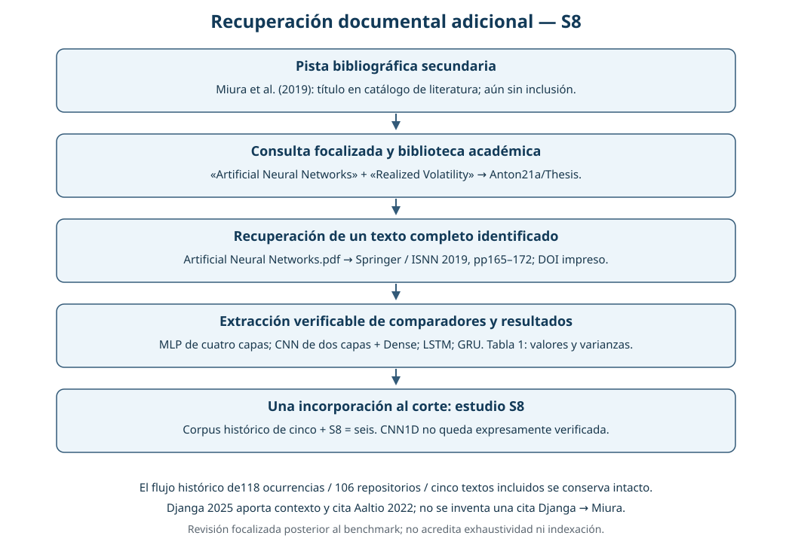

# 8. Entregables: productos y evidencias

```{raw} html
<div class="admonition note" id="descargar-entregable-1">
  <p class="admonition-title">Descargas del Entregable 1</p>
  <p><a class="btn btn-primary btn-lg" href="../_static/e1_downloads/entregable1_completo.zip" download="entregable1_completo.zip">Descargar entrega completa · ZIP</a></p>
  <p>Incluye los siete productos de esta unidad. También puedes descargar cada entregable por separado en la tabla siguiente.</p>
</div>
```

Este capítulo reúne los **siete productos del Entregable 1** y sus evidencias verificables. La revisión vigente incluye **40 referencias y siete estudios cripto completos**, con referencias independientes y modelos propuestos diferenciados. Todos incluyen BTC; uno también otras diecinueve criptomonedas. T1/T2/T3 permanecen como transferencia financiera con niveles de lectura separados. Los límites de recurrencia, configuración propia y cronología experimental se conservan.

**Descarga directa desde el Jupyter Book:** pulsa el botón superior para obtener todo o el botón de la fila correspondiente para obtener un solo producto. Los archivos se descargan desde este sitio. Para verificar la entrega, descarga las <a href="../_static/e1_downloads/SHA256SUMS.txt" download="SHA256SUMS.txt">sumas SHA-256</a> y el <a href="../_static/e1_downloads/catalogo.json" download="catalogo.json">catálogo de la versión</a>.

| Ítem | Producto desarrollado | Estado de la entrega | Descarga directa |
|---|---|---|---|
| {ref}`8.1 <entrega-8-1>` | Informe en Jupyter Book | Publicado, con capítulos, figuras y archivos de respaldo | <a class="btn btn-primary btn-sm" href="../_static/e1_downloads/8_1_informe_html.zip" download="8_1_informe_html.zip" aria-label="Descargar 8.1: informe HTML en ZIP">Descargar ZIP</a> |
| {ref}`8.2 <entrega-8-2>` | Código EDA, tres modelos y análisis estadístico | Versionado; restauración y verificación privada aislada comprobadas | <a class="btn btn-primary btn-sm" href="../_static/e1_downloads/8_2_codigo.zip" download="8_2_codigo.zip" aria-label="Descargar 8.2: código en ZIP">Descargar ZIP</a> |
| {ref}`8.3 <entrega-8-3>` | Dataset o instrucciones y scripts exactos | Fuente, descargador, calendario y hashes documentados | <a class="btn btn-primary btn-sm" href="../_static/e1_downloads/8_3_dataset_instrucciones.zip" download="8_3_dataset_instrucciones.zip" aria-label="Descargar 8.3: instrucciones del dataset en ZIP">Descargar ZIP</a> |
| {ref}`8.4 <entrega-8-4>` | Síntesis de literatura y flujo de búsqueda | Siete estudios cripto y 40 referencias; matriz, síntesis, frecuencias por papel, flujo y errata HARNet disponibles; originales T2/T3 pendientes | <a class="btn btn-primary btn-sm" href="../_static/e1_downloads/8_4_literatura.zip" download="8_4_literatura.zip" aria-label="Descargar 8.4: literatura y flujo en ZIP">Descargar ZIP</a> |
| {ref}`8.5 <entrega-8-5>` | Comparación, baseline e inferencia | Métricas históricas y suplemento exploratorio; estudio D7 registrado de nuevas aleatorizaciones completado y auditado | <a class="btn btn-primary btn-sm" href="../_static/e1_downloads/8_5_benchmark.zip" download="8_5_benchmark.zip" aria-label="Descargar 8.5: benchmark e inferencia en ZIP">Descargar ZIP</a> |
| {ref}`8.6 <entrega-8-6>` | Dependencias, semillas y configuraciones | Locks, recetas y registros de las corridas identificados | <a class="btn btn-primary btn-sm" href="../_static/e1_downloads/8_6_configuraciones.zip" download="8_6_configuraciones.zip" aria-label="Descargar 8.6: dependencias y configuraciones en ZIP">Descargar ZIP</a> |
| {ref}`8.7 <entrega-8-7>` | Declaración de métrica, margen, independencia y partición | Decisiones históricas y protocolo/R del estudio D7 publicados antes de sus nuevas fases; alcances separados | <a class="btn btn-primary btn-sm" href="../_static/e1_downloads/8_7_declaracion.zip" download="8_7_declaracion.zip" aria-label="Descargar 8.7: declaración y cronología en ZIP">Descargar ZIP</a> |

Descomprime el ZIP antes de usarlo. Para leer el informe abre `informe/intro.html`; si el navegador restringe sus recursos locales, ejecuta `python -m http.server 8000 --directory informe` desde la carpeta extraída y abre `http://localhost:8000`. Las fórmulas MathJax y los enlaces a fuentes externas pueden requerir internet. El paquete de código incluye scripts, pruebas, dependencias y el manual `BUILD.md`; recalcular los resultados individuales originales requiere además la evidencia privada allí descrita. El paquete de datos contiene instrucciones, el descargador oficial y manifiestos. Los ZIP públicos entregan tablas agregadas y metadatos; las predicciones individuales y los pesos permanecen en la entrega privada.

El [manifiesto de los siete productos](../_static/e1_deliverables_20261104/delivery_manifest.json), también disponible [como tabla CSV](../_static/e1_deliverables_20261104/delivery_manifest.csv), identifica sus evidencias. El [inventario de archivos de esta entrega](../_static/e1_deliverables_20261104/public_manifest.json) conserva sus hashes. La [matriz de cierre de la auditoría](../_static/e1_audit_improvements_20261104/cierre_auditoria_e1_20261104.csv) conserva el trabajo que requiere evidencia adicional.

(entrega-8-1)=
## 8.1. Informe en Jupyter Book

El informe es este [Jupyter Book publicado](https://jassan-bit.github.io/DeepLearning_202630/intro.html). Su contenido desarrolla la formulación del problema, EDA, literatura, implementación, benchmark, ruta temporal, limitaciones y productos de entrega.

| Componente del informe | Ubicación |
|---|---|
| Problema, fuente y objetivo σ7 | [Capítulo 1](01_problema_dataset.md) |
| Calidad, distribuciones y estructura temporal | [Capítulo 2](02_eda.md) |
| Revisión y extracción de modelos | [Capítulo 3](03_estado_arte.md) |
| Diseño, implementación y evaluación | [Capítulo 4](04_implementacion_evaluacion.md) |
| Tablas, baseline e inferencia | [Capítulo 5](05_benchmark.md) |
| Procedimiento para regresión temporal | [Capítulo 6](06_procedimiento.md) |
| Limitaciones y criterios de evaluación | [Capítulo 7](07_limitaciones_entregables.md) |
| Decisiones y pendientes verificables | [Matriz de cierre](protocolo_pendiente.md) |

El [manual de construcción](https://github.com/jassan-bit/DeepLearning_202630/blob/main/BUILD.md) fija Jupyter Book v1, las dependencias y la comprobación de enlaces. Construir el HTML utiliza resultados guardados; no ejecuta otro entrenamiento o pronóstico.

```bash
jupyter-book build book --all --warningiserror --keep-going
python scripts/check_book_links.py
```

(entrega-8-2)=
## 8.2. Código completo, ejecutable y versionado

El [repositorio del proyecto](https://github.com/jassan-bit/DeepLearning_202630) conserva el código de adquisición, EDA, preparación supervisada, **MLP/LSTM/CNN1D**, validación, evaluación y análisis. Las versiones efectivamente utilizadas se identifican por los hashes del [registro de código previo al entrenamiento](../_static/filipe_multihistory_20261104/code_manifest_before_fitting.json) y de la [congelación anterior al test](../_static/filipe_multihistory_20261104/freeze.json).

| Etapa | Código principal | Producto verificable |
|---|---|---|
| Adquisición | [download_binance_spot.py](https://github.com/jassan-bit/DeepLearning_202630/blob/main/scripts/download_binance_spot.py) | Archivos oficiales y manifiesto SHA-256 |
| EDA y derivados diarios | [eda_binance_development.py](https://github.com/jassan-bit/DeepLearning_202630/blob/main/scripts/eda_binance_development.py) | Calidad, OHLCV diario y etiquetas históricas |
| Ventanas y transformaciones | [dl_data.py](https://github.com/jassan-bit/DeepLearning_202630/blob/main/scripts/dl_data.py), [dl_data_v2.py](https://github.com/jassan-bit/DeepLearning_202630/blob/main/scripts/dl_data_v2.py) | Entradas causales y escaladores de entrenamiento |
| Tres arquitecturas | [dl_models.py](https://github.com/jassan-bit/DeepLearning_202630/blob/main/scripts/dl_models.py) | MLP, LSTM unidireccional y CNN1D poco profunda |
| CV original D7 | [train_dl_r2_cv.py](https://github.com/jassan-bit/DeepLearning_202630/blob/main/scripts/train_dl_r2_cv.py) | Corridas D7; se conserva la variante primaria `relative_window` |
| Índices y ampliación de CV | [prepare_filipe_multihistory.py](https://github.com/jassan-bit/DeepLearning_202630/blob/main/scripts/prepare_filipe_multihistory.py), [train_filipe_multihistory.py](https://github.com/jassan-bit/DeepLearning_202630/blob/main/scripts/train_filipe_multihistory.py) | Folds y corridas D14/21/28; D7 reutilizado de su registro original |
| Cierre, ajuste final y test | [close_filipe_multihistory.py](https://github.com/jassan-bit/DeepLearning_202630/blob/main/scripts/close_filipe_multihistory.py), [final_fit_filipe_multihistory.py](https://github.com/jassan-bit/DeepLearning_202630/blob/main/scripts/final_fit_filipe_multihistory.py) | Decisiones cerradas, 120 modelos finales y evaluación de 608 fechas |
| Estudio D7 registrado de aleatoriedad | [run_filipe_confirmatory_d7.py](https://github.com/jassan-bit/DeepLearning_202630/blob/main/scripts/run_filipe_confirmatory_d7.py), [analyze_filipe_confirmatory_d7.py](https://github.com/jassan-bit/DeepLearning_202630/blob/main/scripts/analyze_filipe_confirmatory_d7.py) y [verify_filipe_confirmatory_d7.py](https://github.com/jassan-bit/DeepLearning_202630/blob/main/scripts/verify_filipe_confirmatory_d7.py) | Ampliación de veinte semillas de varianza, cierre R=79 y fase definitiva completados; análisis registrado y auditoría PASS sobre 2024 conocido |
| Métricas y BDS por bloque | [analyze_filipe_multihistory.py](https://github.com/jassan-bit/DeepLearning_202630/blob/main/scripts/analyze_filipe_multihistory.py) | Tablas por entrada, modelo, semilla y mes |
| Complementos de la auditoría | [analyze_e1_audit_descriptives.py](https://github.com/jassan-bit/DeepLearning_202630/blob/main/scripts/analyze_e1_audit_descriptives.py), [analyze_e1_final_inference.py](https://github.com/jassan-bit/DeepLearning_202630/blob/main/scripts/analyze_e1_final_inference.py) | Tablas anuales, residuos, variabilidad e inferencia post-hoc |
| Piloto nuevo y dimensionamiento | [run_filipe_pilot.py](https://github.com/jassan-bit/DeepLearning_202630/blob/main/scripts/run_filipe_pilot.py), [analyze_filipe_pilot.py](https://github.com/jassan-bit/DeepLearning_202630/blob/main/scripts/analyze_filipe_pilot.py) | Registro previo, 60 trayectorias nuevas de validación y R/MDE para futuras semillas |

La ejecución registrada conserva **120 trayectorias primarias de CV, 1.440 segmentos modelo–mes y 43.920 predicciones**. Tras seleccionar con desarrollo se ajustaron 120 modelos finales y se guardaron **72.960 predicciones de test**. Los comandos y la separación de entornos están desarrollados en [BUILD.md](https://github.com/jassan-bit/DeepLearning_202630/blob/main/BUILD.md).

El [piloto nuevo](../_static/e1_filipe_pilot_20261105/execution_summary.json) se entrega por separado: cinco semillas nuevas por familia e historia, 60 trayectorias, 720 segmentos, 1.440 ajustes y 21.960 pronósticos únicos de validación. No se agregan a las semillas del benchmark original ni se utilizan para volver a seleccionar el baseline. El [registro anterior a sus corridas](../_static/e1_filipe_pilot_20261105/protocol.json) y la [verificación independiente](../_static/e1_filipe_pilot_20261105/verification/revision_filipe_pilot_20261105.json) conservan su alcance condicionado a 2024 y los hashes de ejecución.

**Ruta de entrega reproducible.** La evidencia completa se entrega privadamente con un manifiesto de hashes. El [restaurador](https://github.com/jassan-bit/DeepLearning_202630/blob/main/scripts/restore_e1_private_artifacts.py) copia y verifica esa evidencia en un directorio aislado, conservando los registros originales y su marcador de primer acceso al test. La prueba realizada restauró **113 insumos y seis TAR, con 16.890 miembros**, y ejecutó allí una auditoría independiente: [recibo de la réplica](../_static/e1_audit_improvements_20261104/reproducibility/replication_receipt.json) y [resumen de verificación](../_static/e1_audit_improvements_20261104/reproducibility/summary.json).

Esa comprobación recalcula métricas desde resultados guardados y verifica los pesos por sus hashes; no se presenta como repetición de todos los entrenamientos en otra máquina. Un clon público contiene resúmenes y código; para verificar la evidencia individual se necesita el paquete privado indicado en el manual.

El piloto nuevo tiene su propio paquete privado: **6.739 archivos**, incluidos 720 checkpoints, con [recibo de hashes y cantidades](../_static/e1_filipe_pilot_20261105/verification/private_delivery_receipt.json). Se restauró en una copia aislada y allí se reprodujo la auditoría: [recibo de restauración](../_static/e1_filipe_pilot_20261105/verification/replica_receipt.json). Esta verificación no entrenó ni ejecutó nuevas predicciones y no publica los pesos o vectores individuales.

(entrega-8-3)=
## 8.3. Dataset e instrucciones exactas de obtención

El dataset procede de **Binance Vision / Binance Spot, par BTCUSDT, velas de un minuto y fechas UTC**. El [manifiesto de adquisición](../_static/data/binance_spot_BTCUSDT_1m_20230101_20261030.json) identifica 75 archivos de 01/01/2023 a 30/10/2026, con URL, checksum, bytes, esquema y auditoría temporal. Registra **2.014.480 filas**, frente a 2.014.560 minutos esperados: hay 80 minutos ausentes y un timestamp de cierre inesperado en marzo de 2023.

Las [instrucciones del dataset](https://github.com/jassan-bit/DeepLearning_202630/blob/main/data/README.md) y el descargador permiten obtener o reanudar la misma adquisición sin claves de API:

```bash
python3 scripts/download_binance_spot.py \
  --start 2023-01-01 --end 2026-10-30 \
  --output /ruta/privada/binance-spot-data --workers 4
```

El script verifica cada ZIP contra el checksum oficial y conserva las discrepancias para revisión. La comprobación local de los archivos adquiridos usa `sha256sum -c SHA256SUMS_2023-01-01_2026-10-30.txt` desde el directorio de datos. La procedencia y condiciones consultadas se documentan en [términos de la fuente](../_static/data_source/terms_snapshot.json); disponibilidad pública no implica redistribución irrestricta.

| Función experimental | Periodo UTC | Uso efectivo |
|---|---|---|
| Historia inicial | 01/01/2023–31/12/2023 | Pasado inicial para ajustar |
| Validación forward | 01/01/2024–31/12/2024 | Doce bloques mensuales, historia creciente y embargo D |
| Ajuste final | Desarrollo permitido de 2023–2024 | Configuración y duración ya cerradas, purga D |
| Test | 01/01/2025–31/08/2026 | 608 fechas comunes, pesos finales fijos |
| Sin asignación al experimento | Septiembre–octubre de 2026 | Adquisición conservada; no incorporada automáticamente al test |

Para modelar se agregan las velas a **OHLCV diario UTC**. Cada entrada contiene D=7/14/21/28 días anteriores; el objetivo sigue siendo la desviación poblacional de **n=7 retornos logarítmicos diarios**, sin anualizar, y h=1. Se conserva el calendario y se excluyen los días incompletos y sus ventanas afectadas, sin imputar ni unir retornos a través de huecos. El [manifiesto de cohorte](../_static/filipe_multihistory_20261104/test/cohort_manifest.json) y la [auditoría de calidad del test](../_static/filipe_multihistory_20261104/test/raw_test_audit.json) registran la aplicación final de esas reglas.

La web publica metadatos y agregados. Los ZIP brutos, derivados diarios del test, predicciones individuales y pesos se conservan fuera de esta vista pública y forman parte de la ruta privada descrita en §8.2.

(entrega-8-4)=
## 8.4. Tabla de síntesis de la literatura y flujo de búsqueda

Se entrega la [síntesis vigente de siete estudios cripto](../_static/literature_e1/crypto_extension_20261105/study_synthesis.csv), la [matriz normalizada CSV](../_static/literature_e1/crypto_extension_20261105/evidence_matrix.csv) y su [JSON trazable](../_static/literature_e1/crypto_extension_20261105/evidence_matrix.json). La matriz contiene diez registros: siete estudios aplicados y T1/T2/T3 en estratos financieros separados. El [catálogo vigente de 40 referencias](../_static/literature_e1/crypto_extension_20261105/references_access_40.csv) conserva las 39 anteriores y añade S9. Los cortes de [seis estudios](../_static/literature_e1/recovery_20261105/synthesis_six_columns.csv) y [39 citas](../_static/literature_e1/journal_update_20261105/references_access_39.csv) permanecen como antecedentes, sin sobrescribir sus cifras.

| Estudio del corpus | Dataset y objetivo descritos | Comparadores DL identificados |
|---|---|---|
| S1 · Akbiyik et al. (2023) | Bitcoin a 15 minutos y Twitter; volatilidad futura agregada de retornos intradiarios | LSTM, GRU y TCN; D-TCN es la propuesta avanzada |
| S2 · Zeri (2026) | BTCUSDT perpetuo/Crypto Lake; log-RV de 30 minutos | GRU, BiLSTM y encoder Transformer |
| S5 · Gao et al. (manuscrito 2023) | Yahoo BTC-USD diario; medida móvil de 30 días desplazada siete días | LSTM de una capa; la densa lineal es contexto |
| S6 · Wang et al. (sin año corroborado) | Bitcoin diario; RV sin definición suficiente para equipararla a σ7 | Transformer OHLCV independiente; EGARCH–Transformer es híbrido |
| S7 · Alakhouch Idriss (2026) | Bitcoin diario; medida futura de 30 días anualizada | LSTM 64→32 con cabeza Dense16→1; no MLP independiente |
| S8 · Miura, Pichl y Kaizoji (2019) | Bitstamp BTC/USD minuto; RV como suma de retornos logarítmicos cuadrados en intervalos de tres horas | MLP de cuatro capas, LSTM de dos capas + Dense, GRU y CNN de dos capas + Dense, todos comparadores independientes |
| S9 · Djanga, Cucuringu y Zhang (2025) | Veinte pares cripto USDT incluido BTC; RV de 30 minutos, rejilla de cinco minutos y trayectoria del día siguiente | LSTM propuesta UAM con cabeza MLP opcional. No se verifica otra referencia MLP/CNN/LSTM simple independiente; las seis cifras QLIKE recuperadas son ganadores HAR/LightGBM, no LSTM. |

El [registro de la fuente primaria S8](../_static/literature_e1/recovery_20261105/primary_source.json) conserva URL, versión y SHA-256 del PDF leído. Su portada identifica *Advances in Neural Networks – ISNN 2019*, LNCS 11554, páginas 165–172 y DOI **10.1007/978-3-030-22796-8_18**. La [extracción de la Tabla 1](../_static/literature_e1/recovery_20261105/miura_table1.csv), página impresa 171, permite verificar estos valores publicados:

| Comparador S8 | RMSE de CV | RMSE de test | Varianza de RMSE de test reportada |
|---|---:|---:|---:|
| MLP, cuatro capas con dropout | 1,7209×10⁻² | 2,2067×10⁻³ | 6,8202×10⁻¹⁰ |
| MLP, cuatro capas con BN | 1,7364×10⁻² | 2,1952×10⁻³ | 2,5325×10⁻⁹ |
| LSTM, dos capas + Dense | 1,7276×10⁻² | 2,1960×10⁻³ | 1,0293×10⁻⁹ |
| CNN, dos capas + Dense | 1,7495×10⁻² | 2,1817×10⁻³ | 6,7603×10⁻¹⁰ |

El artículo declara diez folds temporales y 100 corridas de CV, y treinta inicializaciones aleatorias de pesos para test. Las dispersiones de su tabla son **varianzas, no desviaciones estándar**. Las dos variantes MLP no se cuentan como dos estudios. Los valores y los riesgos metodológicos se conservan en la [evaluación de S8](../_static/literature_e1/recovery_20261105/quality_assessment.json), junto con la [evaluación histórica de los otros textos](../_static/literature_e1/quality_assessment.csv). Los objetivos, fuentes, periodos y escalas difieren de σ7: sus métricas no se ordenan como si fueran corridas del mismo benchmark.



El {download}`informe de recuperación <../_static/literature_e1/recovery_20261105/README.md>` separa descubrimiento, lectura del texto e incorporación de S8. El [flujo anterior](../_static/literature_e1/flow.svg) conserva **118 ocurrencias de repositorios, 12 duplicadas y 106 repositorios distintos; 20 inspeccionados; siete textos evaluados, cinco incluidos y dos excluidos**. Otra etapa histórica, de [13 cadenas, 18 páginas y 92 repositorios únicos](../_static/e1_audit_improvements_20261104/literature/search_log.json), no aportó entonces textos completos nuevos. Esas cifras no se mezclan ni se suman sin deduplicación documental conjunta, y no acreditan búsquedas nativas en las bases no consultadas.

**Estado actual por papel y denominador:** las [frecuencias](../_static/literature_e1/crypto_extension_20261105/family_frequencies.csv) mantienen **MLP independiente 1/7, CNN genérica independiente 1/7, CNN1D simple explícita 0/7 y LSTM como referencia 5/7** en el corpus formal. La presencia empírica LSTM es 6/7 al incluir la propuesta S9; no se confunde con referencia básica. El estrato de seis con comparadores DL extraíbles conserva MLP/CNN 1/6 y CNN1D 0/6. Todos los siete incluyen BTC y uno incluye otras monedas; no se suman como grupos disjuntos. S8 no especifica dimensión CNN o hiperparámetros suficientes para replicar la red propia. S9 no incrementa MLP por su cabeza interna, ni se le atribuyen cifras neuronales ausentes.

**Transferencia metodológica desde otros mercados.** Las tres fuentes siguientes se entregan en una [tabla separada](../_static/literature_e1/journal_update_20261105/methodological_comparison.csv) y un [registro de procedencia](../_static/literature_e1/journal_update_20261105/methodological_sources.json). Aportan **un original de revista leído, una fuente de código de autor y una identidad editorial**; no se suman a los siete estudios cripto.

| Fuente metodológica | Material verificado y aporte | Alcance y límite |
|---|---|---|
| T1 · Bucci (2020), *Realized Volatility Forecasting with Neural Networks*, *Journal of Financial Econometrics*, DOI 10.1093/jjfinec/nbaa008 | Original editorial completo; FNN/MLP con una capa oculta: cinco neuronas en la muestra completa y tres en crisis; FNNX tiene uno y tres, respectivamente. [Extracción primaria](../_static/literature_e1/journal_update_20261105/bucci2020_primary_extraction.json) y [métricas MSE/QLIKE verificadas](../_static/literature_e1/journal_update_20261105/bucci2020_metrics.csv) | Volatilidad del S&P 500 a frecuencia mensual. Respalda una FNN pequeña en finanzas; no replica nuestra MLP16, nuestras entradas OHLCV o la etiqueta diaria σ7. |
| T2 · Reisenhofer, Bayer y Hautsch (2022), HARNet | [Código de autor](../_static/literature_e1/crypto_extension_20261105/harnet_current_code_evidence.json): Conv1D causal en índices, kernels 5/4, dilataciones 1/5 y un filtro; [errata de escalado](../_static/literature_e1/crypto_extension_20261105/harnet_erratum.json) | Original no leído y revista no verificada. La escala local usa constantes 0/0,001; fit_transform no aprende extremos y su orden no prueba fuga. El [CSV de 31 índices](../_static/literature_e1/crypto_extension_20261105/harnet_schema.json) tiene rv5, pero el cargador solicita rv5_ss; no se ejecutó o reparó una réplica. |
| T3 · Moreno-Pino y Zohren (2024), DeepVol, *Quantitative Finance*, DOI 10.1080/14697688.2024.2387222 | [Identidad de publicación](../_static/literature_e1/journal_update_20261105/deepvol2024_publication.json) corroborada en el CV de un autor | Original no leído. Aporta contexto bibliográfico, sin extracción de arquitectura, hiperparámetros o resultados. |

Bucci respalda metodológicamente la elección de una FNN simple y el código de HARNet permite inspeccionar Conv1D causal para volatilidad financiera {cite:p}`bucci2020realized,reisenhofer2022harnet`. Son fuentes y mercados distintos; su combinación no demuestra que la arquitectura CNN1D propia esté publicada con la misma configuración. DeepVol se cita con el límite documental indicado {cite:p}`morenopino2024deepvol`. Ninguna fuente modifica los resultados propios, las frecuencias BTC o la cronología de selección.

El catálogo actual se descarga en [CSV](../_static/literature_e1/crypto_extension_20261105/references_access_40.csv), [JSON](../_static/literature_e1/crypto_extension_20261105/references_access_40.json) y [BibTeX](../_static/literature_e1/crypto_extension_20261105/references_access_40.bib). El [catálogo de 39](../_static/literature_e1/journal_update_20261105/references_access_39.csv) y su {download}`informe previo <../_static/literature_e1/journal_update_20261105/README.md>` conservan el alcance financiero anterior. Las [siete coincidencias secundarias de revistas](../_static/literature_e1/journal_update_20261105/journal_index_matches.csv) no verifican cada artículo, cobertura anual o Q1. Los candidatos sin original y los originales HARNet/DeepVol siguen pendientes; no se prometen textos no recuperados.

**Ampliación cripto descargable del 05/11/2026.** S9 era una pista conocida y se reevaluó al ampliar el alcance a todas las criptomonedas. El original completo se leyó, pero el manuscrito no acredita revista, DOI o indexación. Esta actualización es posterior al benchmark y al estudio D7; no ejecuta entrenamientos, pronósticos o cambios de modelos.

| Evidencia de la ampliación | Descarga directa |
|---|---|
| Extracción primaria S9, activos, arquitectura, calidad y cifras con ubicación | [S9_extraction.json](../_static/literature_e1/crypto_extension_20261105/S9_extraction.json) |
| Síntesis, matriz y frecuencias por papel | [Síntesis](../_static/literature_e1/crypto_extension_20261105/study_synthesis.csv), [matriz CSV](../_static/literature_e1/crypto_extension_20261105/evidence_matrix.csv), [JSON](../_static/literature_e1/crypto_extension_20261105/evidence_matrix.json) y [frecuencias](../_static/literature_e1/crypto_extension_20261105/family_frequencies.csv) |
| Cifras de autores con modelo, escala y fuente | [Registro de métricas](../_static/literature_e1/crypto_extension_20261105/reported_metrics.csv); los QLIKE de S9 son ganadores HAR/LightGBM, no LSTM |
| Búsqueda, cribado y flujo | [Bitácora](../_static/literature_e1/crypto_extension_20261105/search_log.json), [decisiones](../_static/literature_e1/crypto_extension_20261105/screening.csv) y [diagrama](../_static/literature_e1/crypto_extension_20261105/flow.svg) |
| Estado y trazabilidad de archivos | [Resumen](../_static/literature_e1/crypto_extension_20261105/summary.json) y [manifiesto SHA-256](../_static/literature_e1/crypto_extension_20261105/manifest.json) |
| Corrección científica HARNet y límite de reproducción | [Errata](../_static/literature_e1/crypto_extension_20261105/harnet_erratum.json) y [esquema del CSV](../_static/literature_e1/crypto_extension_20261105/harnet_schema.json) |

(entrega-8-5)=
## 8.5. Tabla comparativa, baseline e inferencia estadística

Se entregan las [métricas de CV](../_static/filipe_multihistory_20261104/analysis_cv/metrics_summary.csv), las [métricas del test para cuatro entradas](../_static/filipe_multihistory_20261104/test/analysis/metrics_summary.csv) y el [desglose anual 2025/2026](../_static/e1_audit_improvements_20261104/descriptive/annual_metrics_summary.csv). Incluyen RMSE, MAE, MSE, MAPE, R² y MASE, cobertura, número de resultados definidos, media, DE e IC entre semillas.

Las tres familias seleccionaron D7 con desarrollo. Para las **608 fechas del test**, la comparación principal queda:

| Modelo D7 | RMSE, media ± DE | R², media ± DE | Papel en la entrega |
|---|---:|---:|---|
| MLP | 0,0047932 ± 0,0003988 | 0,764012 ± 0,042175 | Baseline neuronal seleccionado antes del test |
| LSTM | 0,0050298 ± 0,0002637 | 0,741108 ± 0,026619 | Segundo modelo base |
| CNN1D | 0,0044427 ± 0,0003568 | 0,797351 ± 0,033620 | Tercer modelo base; menor RMSE neuronal puntual en test |
| Persistencia | 0,0040856 | 0,829605 | Referencia determinista contextual |

Las filas neuronales resumen diez semillas; persistencia no tiene repeticiones de inicialización. MLP/D7 conserva la selección fijada con CV, aunque CNN1D/D7 tenga menor RMSE neuronal observada en test. Persistencia obtiene menor RMSE medio que las doce configuraciones neuronales; ese comparador se mantiene visible al plantear una mejora avanzada.

| Producto estadístico entregado | Evidencia |
|---|---|
| Diferencias pareadas, IC, tamaños de efecto y p-valores Holm | [Seis comparaciones principales](../_static/e1_audit_improvements_20261104/inference/paired_comparisons.csv) |
| Sensibilidad de localización por rangos | [Wilcoxon](../_static/e1_audit_improvements_20261104/inference/wilcoxon_sensitivity.csv) |
| Precisión predictiva temporal por h=1 | [Diebold–Mariano con HAC/HLN](../_static/e1_audit_improvements_20261104/inference/dm_tests.csv) |
| Autocorrelación residual | [Ljung–Box](../_static/e1_audit_improvements_20261104/inference/ljung_box.csv) |
| IC pareados de diferencias RMSE/MAE sobre bloques de fechas | [Bootstrap temporal](../_static/e1_audit_improvements_20261104/inference/date_bootstrap.csv) |
| Diferencias absolutas y relativas de error | [RMSE y MAE](../_static/e1_audit_improvements_20261104/inference/relative_differences.csv) |
| Diagnóstico BDS mensual por semilla y entrada | [CV: 2.880 contrastes](../_static/filipe_multihistory_20261104/analysis_cv/bds_by_fold.csv) y [test: 4.800](../_static/filipe_multihistory_20261104/test/analysis/bds_by_fold.csv) |

El complemento final es **post-hoc/exploratorio**: se registró después de inspeccionar el test y reutiliza sus pronósticos guardados. La incertidumbre por semillas, la pérdida temporal y el remuestreo de fechas responden preguntas diferentes; no son confirmaciones independientes. Se conservan las alertas de supuestos, los IC marginales y la multiplicidad. El promedio de p-valores BDS es descriptivo y no compara precisión entre modelos. La discusión detallada y las conclusiones están en [el capítulo 5](05_benchmark.md).

El {ref}`estudio D7 posterior de aleatoriedad <estudio-d7-confirmatorio>` se entrega completado y auditado como fase separada, registrada antes de nuevas corridas sobre 2024 conocido. Excluye las veinte semillas de varianza y las cinco anteriores de sus **79 semillas definitivas por receta**; el R se publicó/verificó antes de iniciarlas. Sus tres pares no se mezclan con el suplemento post-hoc del test. MLP tiene menor RMSE media que LSTM y CNN1D bajo la t registrada con Holm-3, con dos alertas de normalidad; los IC familiares no demuestran una ventaja mayor que δ. No se afirma equivalencia, potencia lograda o generalización a otro periodo.

| Producto del estudio D7 registrado | Descarga directa |
|---|---|
| Métricas de las 79 semillas definitivas por modelo | [RMSE y sus IC](../_static/e1_filipe_confirmatory_d7_20261105/analysis/rmse_summary.csv) y [métricas secundarias](../_static/e1_filipe_confirmatory_d7_20261105/analysis/metrics_summary.csv) |
| Tres contrastes registrados, IC y tamaños de efecto | [Comparaciones completas](../_static/e1_filipe_confirmatory_d7_20261105/analysis/paired_comparisons.csv) |
| Piloto de varianza y R fijado antes de las definitivas | [Dimensionamiento](../_static/e1_filipe_confirmatory_d7_20261105/planning/paired_dimensioning.csv) y [cierre R=79](../_static/e1_filipe_confirmatory_d7_20261105/locked_design.json) |
| Sensibilidad posterior de MDE, separada del diseño previo | [MDE con DE definitiva](../_static/e1_filipe_confirmatory_d7_20261105/planning/final_sd_sensitivity.csv) y [fecha/alcance posterior](../_static/e1_filipe_confirmatory_d7_20261105/planning/posthoc_design_sensitivity.json); MLP−CNN1D supera δ, sin cambiar R |
| Ejecución, auditoría e inventario | [Resumen de ambas fases](../_static/e1_filipe_confirmatory_d7_20261105/execution_overview.json), [verificación PASS](../_static/e1_filipe_confirmatory_d7_20261105/verification/revision_filipe_confirmatory_d7_20261105.json) y [manifiesto SHA-256](../_static/e1_filipe_confirmatory_d7_20261105/public_manifest.json) |

El {download}`informe del estudio D7 <../_static/e1_filipe_confirmatory_d7_20261105/README.md>` describe los agregados públicos y la evidencia privada. Las dos fases nuevas suman 297 trayectorias, 3.564 segmentos mensuales, 7.128 ajustes y 108.702 predicciones; no se agregan a la cohorte de semillas del benchmark histórico.

Se añade una {download}`matriz de afirmaciones respaldadas y límites <../_static/e1_deliverables_20261104/statistical_scope.md>`, incluida en los ZIP 8.5 y 8.7. La separación histórica desarrollo/test se mantiene; los contrastes añadidos después se interpretan como exploratorios, con menor fuerza confirmatoria. No se suman sus resultados como si fueran replicaciones independientes.

(entrega-8-6)=
## 8.6. Dependencias, semillas y configuración de cada corrida

Los entornos se entregan separados para mantener la compatibilidad de la librería CV y del entrenamiento:

| Entorno | Archivo versionado | Versiones identificadas |
|---|---|---|
| Construcción del libro | [requirements-book.lock.txt](../_static/e1_deliverables_20261104/dependencies/requirements-book.lock.txt) | Python 3.12; Jupyter Book 1.0.4.post1 |
| Generación de índices | [requirements-cv.txt](../_static/e1_deliverables_20261104/dependencies/requirements-cv.txt) | NumPy 1.26; `timeseries-cv` 0.1.5 |
| EDA | [requirements-eda.lock.txt](../_static/e1_deliverables_20261104/dependencies/requirements-eda.lock.txt) | Entorno fijado para preparar los derivados y figuras |
| Entrenamiento y análisis | [requirements-training.lock.txt](../_static/e1_deliverables_20261104/dependencies/requirements-training.lock.txt) | [Runtime registrado](../_static/filipe_multihistory_20261104/runtime.json): PyTorch 2.15.0+cpu, NumPy 2.5.4, pandas 3.1.0 y SciPy 1.18.1 |

Las **diez semillas base son 4101–4110**, comunes entre familias e historias. En CV se usa `semilla_fold = semilla_base + 100000 × ordinal_del_mes`, con enero=0 y diciembre=11; el refit independiente suma 10.000.000. El ajuste final usa `semilla_base + 10000000`. La partición es cronológica y determinista: no tiene semilla de sorteo. El código y las configuraciones registran también el generador del orden de minibatches y el determinismo estricto de PyTorch sobre CPU.

| Familia | Configuración compartida entre historias | Parámetros |
|---|---|---:|
| MLP | Una capa oculta de 16 unidades; LR 0,001 | 80D+33: 593/1.153/1.713/2.273 |
| LSTM | Una capa unidireccional de 32 unidades; LR 0,003 | 5.025 |
| CNN1D | Dos convoluciones causales de 16 canales, kernel 3 y promedio temporal; LR 0,001 | 1.057 |

Se fijaron AdamW, decaimiento de pesos 0,0001, dropout 0,1, batch 32, MSE, máximo de 100 épocas y clipping 1. La parada interna usa MSE de validación, paciencia 12 y mejora mínima 0,00001. Para el ajuste final se reutiliza la época seleccionada en diciembre de 2024 de la misma familia, D y semilla, sin seleccionar duración con test.

Se entregan dos catálogos de configuraciones: [1.440 segmentos modelo–mes de CV](../_static/e1_deliverables_20261104/cv_configuration_catalog.csv) y [120 ajustes finales](../_static/e1_deliverables_20261104/final_configuration_catalog.csv). Los segmentos de CV corresponden a 2.880 entrenamientos internos/refits. Cada fila identifica modelo, D, semilla, ancho, LR, épocas, parámetros y hash de la configuración completa; el catálogo CV añade mes y semillas internas de ajuste/refit. Son metadatos públicos y no contienen los pesos ni valores de los escaladores.

El piloto posterior conserva las mismas recetas y añade las semillas **6201–6205**, sin reutilizar las 4101–4110. Sus [60 registros agregados](../_static/e1_filipe_pilot_20261105/runs.csv), [720 segmentos mensuales](../_static/e1_filipe_pilot_20261105/fold_metrics.csv), [protocolo](../_static/e1_filipe_pilot_20261105/protocol.json) y [runtime](../_static/e1_filipe_pilot_20261105/runtime.json) permiten identificar la ejecución. Se publican media/DE/CV, las doce DE pareadas y el [dimensionamiento](../_static/e1_filipe_pilot_20261105/analysis/paired_dimensioning.csv); los pesos, escaladores y pronósticos individuales permanecen privados.

El estudio D7 posterior completó veinte semillas de ampliación **6301, 6303, …, 6339** y fijó R=79 para las semillas definitivas `50000001+2k`, k=0,…,78: **50000001–50000157, solo impares**. El cierre se publicó y verificó antes de iniciar esas corridas definitivas, ya completadas y auditadas. Las cinco semillas piloto y las veinte de ampliación se excluyen de los contrastes definitivos; la agrupación de 25 es solo una sensibilidad de varianza. Se conservan las recetas, CPU y determinismo, doce meses y embargo D7. El [catálogo nuevo de 3.564 configuraciones mensuales](../_static/e1_filipe_confirmatory_d7_20261105/configuration_catalog.csv) separa 720 segmentos de ampliación y 2.844 definitivos, sin sumarlos al catálogo histórico. Incluye semillas de inicialización/refit, épocas seleccionadas, parámetros y hash de la configuración.

El [protocolo](../_static/filipe_multihistory_20261104/protocol.json), los [registros D7, incluidas sus variantes](../_static/dl_r2_cv_20261104/runs.csv), las [90 trayectorias de la ampliación D14/21/28](../_static/filipe_multihistory_20261104/runs.csv), el [registro de los 120 ajustes finales](../_static/filipe_multihistory_20261104/final_fit_summary.csv) y el [manifiesto de identidades finales](../_static/filipe_multihistory_20261104/final_models_manifest.json) completan la trazabilidad por `D–modelo–semilla`. Los escaladores, curvas, checkpoints y predicciones individuales de cada corrida permanecen en el paquete privado con sus hashes.

(entrega-8-7)=
## 8.7. Declaración de métrica, margen, unidad y partición

La [declaración y cronología versionada](../_static/e1_deliverables_20261104/declaration_and_chronology.json) distingue las decisiones anteriores al primer ajuste o al acceso experimental al test de las añadidas después. Los horarios siguientes corresponden al **4 de noviembre de 2026, Bogotá (UTC−5)**.

| Decisión o registro | Contenido declarado | Momento y alcance |
|---|---|---|
| Registro inicial de desarrollo | RMSE primaria; criterio operativo del 5 % frente a persistencia; semillas, cohorte y planificación del procedimiento inicial | 09:28:17, después del EDA y antes del primer ajuste DL; no anterior a examinar desarrollo |
| Protocolo de cuatro entradas | D=7/14/21/28, n=7, h=1, diez semillas, CV forward y reglas del test | 14:31:02; la ampliación usa desarrollo previamente expuesto |
| Congelación de selección y épocas | MLP/D7 como referencia neuronal, doce combinaciones a reportar, duración y reglas de calidad | 14:42:49, antes del primer acceso experimental de modelado al test, registrado a las 14:44:21 |
| Suplemento estadístico final | Pares principales, familias, incertidumbre temporal y diagnósticos | Posterior a inspeccionar test; explícitamente post-hoc/exploratorio |
| Criterio académico para modelos futuros | Mejora superior al 5 % frente a MLP/D7 **y** persistencia, con incertidumbre y multiplicidad | Definido después del test actual; no se atribuye retroactivamente al protocolo inicial |
| Piloto nuevo entre baselines | Cinco semillas nuevas por modelo/D; doce pares, δ absoluto 0,00023944847859645605 y α=0,05/12 | Registro a las 20:59:10; primera trayectoria nueva a las 21:01:26, después del commit público de preregistro. Prospectivo respecto de esas corridas, no del benchmark histórico |

El **5 de noviembre de 2026, UTC**, se publicó el [protocolo del estudio D7 de aleatoriedad](https://github.com/jassan-bit/DeepLearning_202630/blob/268f348a69d1ffb5c34a1df2f18cabae42e64db4/experiments/e1_filipe_confirmatory_d7_20261105/protocol.json) antes de sus nuevas corridas. Su cronología separa ampliación de veinte semillas, fijación/publicación de R y semillas definitivas independientes de las anteriores. El cierre de R=79 se publicó a las **13:00:39,305189 UTC**; el marcador de inicio de fase registra **13:00:48,791334 UTC** y la primera trayectoria definitiva comenzó a las **13:00:52,025057 UTC**. Es un registro prospectivo de nuevas aleatorizaciones sobre calendario conocido; no precede al benchmark histórico ni define un test nuevo.

La fase definitiva terminó a las **13:26:12,559668 UTC** y el análisis se completó a las **13:26:19,938706 UTC**. La [auditoría independiente](../_static/e1_filipe_confirmatory_d7_20261105/verification/revision_filipe_confirmatory_d7_20261105.json) registró PASS a las **13:27:28,824664 UTC**. La tabla siguiente conserva ocho eventos en **UTC**, separados de las horas históricas en Bogotá de la tabla anterior.

```{include} ../_static/e1_filipe_confirmatory_d7_20261105/tables/chronology.md
```

El [protocolo](../_static/e1_filipe_confirmatory_d7_20261105/protocol.json), el [recibo de publicación del protocolo](../_static/e1_filipe_confirmatory_d7_20261105/preregistration_git_receipt.json) y el [recibo de publicación de R](../_static/e1_filipe_confirmatory_d7_20261105/locked_design_publication_receipt.json) permiten comprobar el orden. La fecha de registro documental no se confunde con la publicación efectiva ni con el comienzo de sus ajustes.

**Declaración utilizada para interpretar los resultados:**

| Campo | Definición |
|---|---|
| Métrica primaria | RMSE de σ7, en su escala diaria original y sin anualizar; se calcula por semilla y periodo antes de resumir |
| Métricas secundarias | MAE, MSE, MAPE, R² y MASE; máscaras y cobertura explícitas |
| Margen operativo original | Reducción relativa del 5 % de RMSE frente a persistencia; no margen de equivalencia ni tolerancia financiera |
| Unidad de observación | Día UTC con entrada OHLCV de D días anteriores y etiqueta al cierre del día pronosticado |
| Unidad de aleatoriedad y emparejamiento | Trayectoria/ajuste por semilla, emparejada entre modelos sobre las mismas fechas; incertidumbre condicionada al calendario |
| Alcance de independencia | Una serie y un mercado BTCUSDT; fechas solapadas, meses y semillas no crean mercados independientes |
| Partición | Historia inicial 2023, validación forward 2024, ajuste final con desarrollo permitido y test enero de 2025–agosto de 2026 |
| Regla temporal | Sin barajar la partición; embargo igual al máximo rezago D según §6.4 de la guía; transformaciones ajustadas solo con el pasado admitido |

La [política académica futura](../_static/e1_audit_improvements_20261104/academic_margin_policy.json) define la reducción mediante la razón de medias de RMSE: $1-\mathbb E[m_A]/\mathbb E[m_{\rm ref}]>0,05$, para cada referencia. Se entregan [sensibilidades de 1/2,5/5/10 %](../_static/e1_audit_improvements_20261104/planning/advanced_margin_scenarios.csv) y [27 escenarios frente a la frontera práctica](../_static/e1_audit_improvements_20261104/planning/academic_joint_power_scenarios.csv). Son supuestos de planificación para una comparación nueva, sin afirmación de utilidad financiera o potencia realmente alcanzada.

El [protocolo del piloto nuevo](../_static/e1_filipe_pilot_20261105/protocol.json) y su [recibo de publicación](../_static/e1_filipe_pilot_20261105/preregistration_git_receipt.json) se registraron antes de las cinco semillas nuevas por familia/historia. Su [resumen de planificación](../_static/e1_filipe_pilot_20261105/analysis/summary.json) dimensiona futuras semillas entre baselines sobre 2024 conocido; no certifica potencia alcanzada ni repara el orden del experimento histórico.

El [borrador para una futura evaluación independiente](../_static/e1_audit_improvements_20261104/next_study_pilot_DRAFT.json) conserva otro alcance y no se presenta como ejecutado. Se mantiene explícito que **no hubo piloto previo al benchmark original, preregistro anterior al EDA o margen avanzado anterior al test ya examinado**. El registro del piloto nuevo no altera esa cronología.

La {download}`declaración histórica de alcance y requisitos futuros <../_static/e1_deliverables_20261104/statistical_scope.json>` conserva los hashes y el estado de aquel corte documental dentro del ZIP 8.7. Sus requisitos para una **comparación avanzada o nueva evaluación temporal** siguen en borrador: arquitectura avanzada, piloto propio, cohorte independiente y cierre prospectivo. El estudio D7 de aleatoriedad tiene ahora su propio protocolo y R publicados antes de nuevas corridas, descritos por separado. El criterio avanzado >5 % mantiene su fecha posterior al test histórico y no puede probarse retroactivamente sobre ese mismo test.
