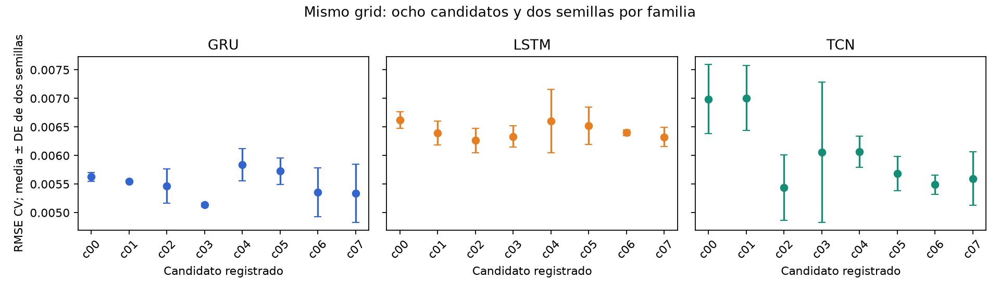
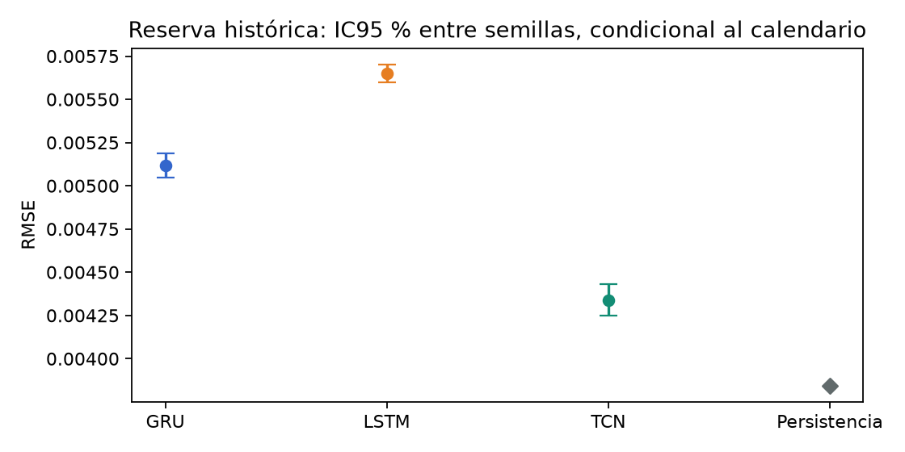

(planned-study)=
# 9. Estudio D7 con piloto, ajuste equitativo y evaluación preespecificada

Este capítulo documenta una nueva fase principal de **GRU–LSTM–TCN** con entrada **D=7**, objetivo **n=7** y horizonte **h=1**. Su diseño, búsqueda, piloto y análisis se registraron antes de la ejecución definitiva y de calcular resultados en la reserva del **01/09–30/10/2026**. La cronología verificable y los resultados de esta fase se identifican por separado del benchmark exploratorio anterior.

## 9.1. Dos fases y dos alcances

| Elemento | Fase I: benchmark exploratorio | Fase II: estudio D7 planificado |
|---|---|---|
| Entradas | D=7/14/21/28 | D=7, seleccionado previamente con desarrollo |
| Ajuste de hiperparámetros | Recetas fijas, sin búsqueda nueva comparable | Ocho candidatos y dos semillas por familia, mismo método y presupuesto |
| Piloto | No dimensionó la fase I | Diez semillas nuevas por familia; procedimiento fijado antes de la ejecución definitiva |
| Repeticiones definitivas | Diez por familia e historia, presupuesto fijo | 465 por familia, calculadas a partir del piloto |
| Evaluación | Enero de 2025–agosto de 2026, periodo ya observado | Septiembre–30 de octubre de 2026, reserva histórica no usada anteriormente para resultados |
| Inferencia | Contrastes y margen posteriores | Comparaciones, margen y multiplicidad fijados antes de la nueva evaluación |

Las tablas de los capítulos 3–8 conservan sus identificadores y métricas de fase I. Su publicación no cambia de fecha ni adquiere carácter prospectivo. El piloto y el HPO de este capítulo se aplican a D7; **no dimensionan retrospectivamente D14/21/28**.

La adquisición había recorrido las filas de los archivos de la nueva reserva para auditar integridad, timestamps y esquema. Según los registros conservados, ese periodo no había sido usado para calcular objetivos, seleccionar recetas o evaluar modelos. Por eso se describe como una **reserva histórica no utilizada anteriormente para resultados**, sin afirmar que los ZIP nunca se abrieron, que las predicciones se emitieron en vivo o que existe otro mercado independiente.

## 9.2. Registro y orden de ejecución

El diseño y el código quedaron publicados en [`ac7dd7f`](https://github.com/jassan-bit/DeepLearning_202630/commit/ac7dd7f67c0dec2397b519897cf6da8056b238f5). El cierre de planificación se [publicó después del piloto y antes del ajuste definitivo](https://github.com/jassan-bit/DeepLearning_202630/commit/5a0acfbc2ff582e252f0e6fb18aaf652963221f8), con R=465, recetas y hashes fijados. La siguiente secuencia separa decisiones y resultados:

| Hito | Fecha UTC | Evidencia |
|---|---|---|
| Publicación del diseño y código antes del HPO | 05/11/2026 18:58:34 | [Diseño y código públicos](https://github.com/jassan-bit/DeepLearning_202630/commit/ac7dd7f67c0dec2397b519897cf6da8056b238f5) |
| Registro firmado anterior al primer entrenamiento | 2026-11-05T18:58:45.401767+00:00 | [Registro firmado](../_static/gru_lstm_tcn_planned_20261105/registration.json) |
| Selección de recetas con desarrollo y congelación antes del piloto | 2026-11-05T19:08:54.034356+00:00 | [Recetas seleccionadas](../_static/gru_lstm_tcn_planned_20261105/selected_recipes.json) |
| Cierre del piloto y dimensionamiento anterior al ajuste definitivo | 2026-11-05T19:10:49.722409+00:00 | [Dimensionamiento](../_static/gru_lstm_tcn_planned_20261105/dimensioning.json) |
| Cierre de todos los pesos y escaladores | 2026-11-05T19:29:06.360013+00:00 | [Cierre de pesos](../_static/gru_lstm_tcn_planned_20261105/final_freeze_provenance.json) |
| Primer acceso para derivar la cohorte de la nueva reserva | 2026-11-05T19:29:59.711588+00:00 | [Cronología de acceso](../_static/gru_lstm_tcn_planned_20261105/chronology.json) |
| Análisis de las predicciones guardadas | 2026-11-05T19:30:55.968197+00:00 | [Resumen del análisis](../_static/gru_lstm_tcn_planned_20261105/summary.json) |

No se eligieron semillas, recetas o pruebas a partir del error de la reserva. Los fallos técnicos conservan sus registros y no autorizan sustituir una semilla desfavorable. Una ejecución incompleta o un resultado no concluyente se reporta con su estado real.

(planned-hpo)=
## 9.3. Búsqueda comparable de hiperparámetros

La búsqueda exhaustiva utiliza **ocho candidatos por familia**, correspondientes al producto de dos anchos, dos tasas de aprendizaje y dos niveles de dropout:

| Hiperparámetro | GRU | LSTM | TCN |
|---|---|---|---|
| Ancho | 16 o 32 unidades | 16 o 32 unidades | 8 o 16 canales |
| Learning rate | 0,001 o 0,003 | 0,001 o 0,003 | 0,001 o 0,003 |
| Dropout | 0 o 0,1 | 0 o 0,1 | 0 o 0,1 |
| Candidatos | 8 | 8 | 8 |
| Semillas de búsqueda | 6101 y 6102 | 6101 y 6102 | 6101 y 6102 |

Las arquitecturas conservan una capa recurrente GRU/LSTM y tres bloques residuales causales de TCN. Se comparten AdamW, decaimiento de pesos 0,0001, batch 32, clipping 1, máximo de cien épocas, paciencia 12, min_delta 0,00001 y el mismo criterio cronológico de parada. Igualar amplitud y evaluaciones controla el esfuerzo de búsqueda; no implica idéntico número de parámetros o tiempo por candidato.

Los índices reales de `split_train_val_forwardChaining` se agrupan en **diez bloques mensuales de enero–octubre de 2024**, con embargo de siete días. Cada candidato y semilla realiza selección interna y reajuste fresco en cada mes: **320 ajustes por familia y 960 en total**. La puntuación es la media entre las dos semillas de sus RMSE sobre las 305 fechas concatenadas. No se promedian RMSE mensuales ni se evalúa un ensemble. Los empates siguen el menor número de parámetros y después el identificador de candidato; entre familias, el orden alfabético fijado.

| Modelo | Candidato | Ancho | Learning rate | Dropout | Parámetros | RMSE enero–octubre, media ± DE |
|---|---|---:|---:|---:|---:|---:|
| GRU | c03 | 16 | 0,003 | 0,1 | 1.121 | 0,00513620 ± 0,00003068 |
| LSTM | c02 | 16 | 0,003 | 0,0 | 1.489 | 0,00626389 ± 0,00021402 |
| TCN | c02 | 8 | 0,003 | 0,0 | 1.185 | 0,00543698 ± 0,00056998 |

Las tres recetas y el baseline de fase II se congelan por ese criterio de desarrollo, antes del piloto y de la reserva. Desarrollo ya había sido observado en fases anteriores: este HPO no se presenta como una evaluación externa anidada.

(planned-pilot)=
## 9.4. Piloto anterior a la ejecución definitiva

Se ejecutan las tres recetas seleccionadas con **diez semillas independientes 7101–7110**, disjuntas de las usadas en HPO y en la comparación definitiva. El origen es el 01/11/2024 y la evaluación ocupa **60 días, del 01/11 al 30/12/2024**. La selección de épocas utiliza validación interna pasada de 90 días con embargo propio; un reajuste fresco usa el entrenamiento permitido. Los pesos permanecen fijos durante los 60 días.

Esta longitud y ausencia de reajuste imitan la evaluación nueva mejor que una métrica anual. El piloto sigue condicionado a un calendario de desarrollo conocido; no garantiza que su dispersión se transfiera sin cambios a 2026.

| Modelo | Semillas | RMSE piloto, media ± DE | Coeficiente de variación |
|---|---:|---:|---:|
| GRU | 10 | 0,00467578 ± 0,00025013 | 5,35 % |
| LSTM | 10 | 0,00587301 ± 0,00080547 | 13,71 % |
| TCN | 10 | 0,00525383 ± 0,00048561 | 9,24 % |

Para cada par se calcula la diferencia de RMSE por semilla y su desviación estándar muestral. El dimensionamiento utiliza esa dispersión pareada, no las DE marginales sumadas ni los días como si fueran repeticiones independientes.

| Par A–B | Diferencia piloto A−B, media | DE pareada | Cota DE simultánea 80 % | Shapiro–Wilk, p |
|---|---:|---:|---:|---:|
| GRU–LSTM | -0,00119723 | 0,00086285 | 0,00135631 | 0,2690 |
| GRU–TCN | -0,00057805 | 0,00048886 | 0,00076844 | 0,5258 |
| LSTM–TCN | 0,00061918 | 0,00108827 | 0,00171065 | 0,5792 |

Las diferencias medias del piloto son descriptivas. La alternativa de planificación sigue siendo δ fijada previamente; no se sustituye por el efecto favorable observado. Shapiro–Wilk no demuestra normalidad ni cambia el contraste registrado.

(planned-power)=
## 9.5. Dimensionamiento, potencia y diferencia mínima detectable

La métrica primaria es RMSE en unidades originales de σ₇. Se fija antes de esta fase la alternativa académica de planificación

$$
\delta=0{,}00025772842664981106,
$$

correspondiente al 5 % de la RMSE CV del GRU/D7 inicial. Su procedencia es posterior al test de fase I; para fase II queda registrada antes de la nueva evaluación. No se convierte en un criterio anterior del experimento histórico ni en utilidad financiera.

Se planifican tres comparaciones bilaterales de diferencias de RMSE, con α=0,05 y referencia conservadora α*=0,05/3. El cálculo usa t no central y busca el menor entero R≥10 con potencia marginal de al menos 0,80 para cada par al efecto δ. Con m=10 semillas piloto y ν=m−1, la DE de planificación incluye la incertidumbre mediante el límite superior simultáneo del 80 %:

$$
s_{\mathrm{plan},AB}=s_{d,AB}\sqrt{\frac{\nu}{\chi^2_{(1-0{,}80)/3;\nu}}}.
$$

La asignación definitiva toma el máximo R de los tres pares. Se reportan también los resultados con DE puntual y límites simultáneos del 90 % y 95 %, sin escoger retrospectivamente el que produzca menos ejecuciones.

| Par | R con DE puntual | R con cota DE 80 % | R definitivo común | Potencia planificada con cota DE |
|---|---:|---:|---:|---:|
| GRU–LSTM | 121 | 293 | 465 | 0,954577 |
| GRU–TCN | 41 | 96 | 465 | 0,999999 |
| LSTM–TCN | 190 | 465 | 465 | 0,800891 |

| Escenario de dispersión | R máximo de los tres pares |
|---|---:|
| DE puntual | 190 |
| Cota superior simultánea 80 % | 465 |
| Cota superior simultánea 90 % | 575 |
| Cota superior simultánea 95 % | 702 |

La decisión registrada fue **R=465 por familia**, con semillas nuevas **8101–8565**. La diferencia mínima detectable se calcula con el mismo contraste, R y DE de planificación; no se presenta una «potencia alcanzada» calculada a partir del efecto observado en test.

| Par | MDE a R=465 y cota DE 80 % | δ de planificación |
|---|---:|---:|
| GRU–LSTM | 0,00020414183 | 0,00025772843 |
| GRU–TCN | 0,00011566032 | 0,00025772843 |
| LSTM–TCN | 0,00025747480 | 0,00025772843 |

La pareja LSTM–TCN determina R. Para esa cota de dispersión, R=464 da potencia 0,79991073 y R=465 da 0,80089111. Ese umbral es una propiedad del diseño y los supuestos fijados antes de la reserva; no es potencia calculada con el efecto del test.

**Alcance de la potencia:** el cálculo describe aleatoriedad del entrenamiento bajo diferencias gaussianas e inicializaciones independientes, condicionada al calendario y a la transferencia de dispersión desde el piloto. No acredita potencia conjunta del 80 % para rechazar las tres hipótesis ni potencia temporal sobre los 60 días. La deriva del mercado y las etiquetas solapadas son incertidumbres distintas.

(planned-reserve)=
## 9.6. Ajuste definitivo y reserva nueva

Se ajustan desde cero las tres recetas con R semillas disjuntas. El desarrollo se mantiene en **2023–2024**; no se incorporan etiquetas de 2025 o 2026 para entrenar. El origen nominal es el 01/01/2025 y el embargo de siete días admite resultados hasta el 24/12/2024. Cada semilla selecciona épocas con pasado permitido y realiza un reajuste fresco. Sus escaladores se estiman únicamente con el entrenamiento correspondiente. El tramo enero de 2025–agosto de 2026 no se reasigna al entrenamiento: se conserva la decisión de ajustar con desarrollo 2023–2024. El largo intervalo hasta la nueva reserva y los cambios de régimen pueden afectar la generalización; esta fase no simula una adaptación continua del modelo durante ese lapso.

Antes de construir las etiquetas de la reserva se congelan **3R checkpoints y sus escaladores**. Agosto de 2026 aporta únicamente el contexto ya observable para las primeras ventanas y etiquetas de septiembre. La cohorte de resultados es **01/09–30/10/2026**, 60 fechas comunes. La evaluación utiliza pesos y escaladores fijos, un pase de puntuación explícito y predicciones conservadas; no modifica hiperparámetros ni aplica parada según resultados.

| Etapa | Trayectorias / modelos | Ajustes nuevos | Predicciones de evaluación |
|---|---:|---:|---:|
| HPO | 48 trayectorias, 480 segmentos | 960 | 14.640 |
| Piloto | 30 trayectorias | 60 | 1.800 |
| Definitivo | 1.395 modelos frescos | 2.790 | 83.700 |
| Persistencia de la reserva | Una trayectoria determinista | 0 | 60 |

### 9.6.1. Métricas de la reserva

| Modelo | RMSE, media ± DE | IC95 % marginal RMSE | MAE, media | MSE, media | R², media ± DE | MAPE, media (%) | MASE, media |
|---|---:|---|---:|---:|---:|---:|---:|
| GRU | 0,00511696 ± 0,00077519 | [0,00504631; 0,00518760] | 0,00391028 | 0,00002678286 | 0,348891 ± 0,166926 | 27,3519 | 1,442772 |
| LSTM | 0,00565123 ± 0,00056569 | [0,00559968; 0,00570278] | 0,00429363 | 0,00003225568 | 0,215843 ± 0,139802 | 29,9635 | 1,584217 |
| TCN | 0,00433967 ± 0,00099896 | [0,00424864; 0,00443070] | 0,00338399 | 0,00001982850 | 0,517956 ± 0,216707 | 25,4918 | 1,248587 |
| Persistencia | 0,00384478 | No aplica: determinista | 0,00212123 | 0,00001478230 | 0,640632 | 16,4344 | 0,782667 |

| Modelo | Ajuste definitivo por semilla, segundos media ± DE | Inferencia de 60 fechas, segundos media ± DE |
|---|---:|---:|
| GRU | 1,4198 ± 1,7854 | 0,000376 ± 0,000133 |
| LSTM | 0,6190 ± 0,6440 | 0,000338 ± 0,000218 |
| TCN | 4,1816 ± 3,0943 | 0,000878 ± 0,000206 |

Los tiempos son de pared en CPU, bajo la concurrencia registrada. La inferencia corresponde a un pase de las sesenta ventanas por checkpoint, sin un benchmark repetido de latencia. No se infiere un speedup frente a fase I con condiciones diferentes. El [desglose de costes](../_static/gru_lstm_tcn_planned_20261105/cost_summary.csv) conserva también búsqueda y piloto.

Persistencia conserva una trayectoria determinista, sin diez o R copias para simular variación entre semillas. Se reportan RMSE, MAE, MSE, MAPE, R² y MASE con sus coberturas. Las métricas de 60 días no se comparan como una mejora directa con la RMSE del test anterior de 608 días: cambia la cohorte y el régimen.

(planned-inference)=
### 9.6.2. Comparaciones primarias fijadas previamente

La familia principal contiene GRU–LSTM, GRU–TCN y LSTM–TCN. Se reportan diferencia media pareada, IC95 % marginal y familiar, t pareada, p-valores numéricos sin ajustar y con Holm-3, efecto d_z y su sensibilidad bootstrap entre semillas. Shapiro–Wilk es diagnóstico; no decide qué prueba se publica según el p-valor más favorable.

| Comparación A−B | Diferencia RMSE | IC95 % marginal | IC95 % familiar | p sin ajustar | p Holm-3 | d_z |
|---|---:|---|---|---:|---:|---:|
| GRU−LSTM | -0,00053427 | [-0,00061511; -0,00045344] | [-0,00063311; -0,00043544] | 4,057e-33 | 4,057e-33 | -0,6023 |
| GRU−TCN | 0,00077729 | [0,00066247; 0,00089210] | [0,00063690; 0,00091767] | 1,953e-34 | 3,906e-34 | 0,6169 |
| LSTM−TCN | 0,00131156 | [0,00120706; 0,00141606] | [0,00118379; 0,00143933] | 1,948e-86 | 5,843e-86 | 1,1438 |

Diferencia negativa favorece A. Los tamaños de efecto y sus IC bootstrap, diagnóstico de normalidad y estados numéricos se conservan en el [CSV de los tres pares](../_static/gru_lstm_tcn_planned_20261105/pairwise_rmse.csv). Los intervalos familiares son Bonferroni; la decisión de p utiliza Holm.

La familia primaria registra **3/3 comparaciones con p Holm menor que 0,05**, bajo la referencia t fijada. El ranking descriptivo por RMSE media de esta reserva sitúa a **TCN** primero entre las redes y a **Persistencia** al considerar también persistencia. El baseline operativo sigue siendo **GRU/D7-c03 de 16 unidades**, seleccionado antes del piloto y de la reserva; no se reelige por ese ranking. Las diferencias entre semillas están condicionadas a estas mismas sesenta fechas, no a periodos o mercados independientes.

**Normalidad rechazada en la comparación definitiva.** Shapiro–Wilk rechaza normalidad en los tres pares:

| Diagnóstico de las diferencias definitivas | p Shapiro–Wilk |
|---|---:|
| GRU−LSTM | 6,3417e-18 |
| GRU−TCN | 3,0188e-09 |
| LSTM−TCN | 1,5817e-08 |

Por eso las t y sus IC se interpretan como **aproximaciones para 465 pares independientes condicionados al calendario**, apoyadas en un argumento asintótico que requiere varianza finita, no como inferencia exacta demostrada bajo normalidad. El número grande de semillas no prueba por sí solo la cobertura. El piloto de diez pares no había rechazado normalidad, pero no podía establecerla ni garantizar su transferencia. La potencia 0,80 sigue siendo una propiedad de planificación bajo los supuestos registrados; no se convierte en potencia alcanzada.

Se conservan las pruebas previamente fijadas y se informa esta limitación; no se sustituye después de ver resultados por el método con menor p. El bootstrap preespecificado de d_z aporta sensibilidad del efecto, sin transformar retrospectivamente los p-valores t en pruebas exactas.

**La dispersión del piloto tampoco se transfirió uniformemente.** La DE definitiva observada de GRU–TCN es aproximadamente 1,64 veces su cota de planificación:

| Transferencia de dispersión | Cota DE del piloto, 80 % simultánea | DE definitiva observada | Razón observada / cota |
|---|---:|---:|---:|
| GRU−LSTM | 0,00135631 | 0,00088703 | 0,654 |
| GRU−TCN | 0,00076844 | 0,00125995 | 1,640 |
| LSTM−TCN | 0,00171065 | 0,00114671 | 0,670 |

Esa cota era incertidumbre sobre el piloto bajo el modelo de planificación, no una garantía frente a otro régimen. R=465 sigue siendo el resultado correcto del cálculo previo y no se reduce o redefine después del test, pero estos datos no demuestran que se alcanzara su potencia prevista. La MDE recalculada con la DE observada que se presenta a continuación es sensibilidad retrospectiva del diseño, no un nuevo piloto o una validación de potencia.

**Sensibilidad retrospectiva de la MDE, con referencia normal aproximada.** Después de evaluar se aplica la función `detectable_difference` ya registrada a las DE definitivas, manteniendo R=465, α*=0,05/3 y el objetivo de referencia 0,80. Es un diagnóstico descriptivo posterior, **no un nuevo análisis primario, potencia observada/alcanzada o evidencia preespecificada adicional**.

| Par | MDE retrospectiva aproximada con DE observada |
|---|---:|
| GRU−LSTM | 0,00013350927 |
| GRU−TCN | 0,00018963813 |
| LSTM−TCN | 0,00017259459 |

Las tres MDE son menores que δ=0,00025772843 bajo esa referencia. El cálculo no demuestra potencia real del 80 %: persisten el rechazo de normalidad, la transferencia imperfecta de dispersión y la ausencia de potencia temporal acreditada. No se modifica el R ni ninguna conclusión primaria a partir de esta sensibilidad.

Una diferencia distinguible de cero y una reducción superior al 5 % son afirmaciones diferentes. El informe distingue estimaciones puntuales de evidencia mediante límites de confianza que superen el margen.

### 9.6.3. Dependencia temporal y análisis secundarios

DM utiliza la pérdida cuadrática diaria media de los modelos individuales, no el error de sus predicciones promediadas. Se fija HAC con seis rezagos, horizonte uno y corrección Harvey–Leybourne–Newbold. Su familia secundaria de seis pares incluye las tres comparaciones neuronales y cada red frente a persistencia, con Holm-6. Ese ajuste es propio del análisis secundario; no se presenta como control conjunto de todos los contrastes del libro ni como una corroboración independiente de las pruebas entre semillas.

| Comparación | DM-HLN | p sin ajustar | p Holm-6 |
|---|---:|---:|---:|
| GRU−LSTM | -2,14970 | 0,035690 | 0,214140 |
| GRU−TCN | 1,51721 | 0,134553 | 0,312176 |
| LSTM−TCN | 1,79334 | 0,078044 | 0,312176 |
| GRU−Persistencia | 1,77097 | 0,081732 | 0,312176 |
| LSTM−Persistencia | 1,97290 | 0,053198 | 0,265991 |
| TCN−Persistencia | 1,38736 | 0,170550 | 0,312176 |

El bootstrap temporal remuestrea fechas emparejadas con bloques circulares de longitud principal siete y sensibilidades tres/catorce, 4.999 réplicas y semilla registrada. Conserva la media de RMSE por semilla. Sus intervalos condicionan a los modelos ajustados y a este periodo corto; no representan otro entrenamiento o mercado independiente.

| Comparación A−B, bloque 7 | Diferencia RMSE | IC95 % temporal familiar | Ganancia A frente a B (%) | IC temporal familiar de ganancia (%) |
|---|---:|---|---:|---|
| GRU−LSTM | -0,00053427 | [-0,00095181; -0,00011274] | 9,454 | [3,406; 13,115] |
| GRU−TCN | 0,00077729 | [-0,00026960; 0,00167658] | -17,911 | [-32,496; 8,524] |
| LSTM−TCN | 0,00131156 | [-0,00012600; 0,00258912] | -30,223 | [-50,617; 3,661] |
| GRU−Persistencia | 0,00127218 | [-0,00011566; 0,00290888] | -33,089 | [-88,580; 2,910] |
| LSTM−Persistencia | 0,00180645 | [0,00012537; 0,00375502] | -46,985 | [-113,690; -3,688] |
| TCN−Persistencia | 0,00049489 | [-0,00067105; 0,00163266] | -12,872 | [-58,478; 13,616] |

DM/HAC6/HLN registra **0/6 rechazos tras Holm**; el menor p ajustado es 0,214140. La ausencia de rechazo no demuestra equivalencia ni que los errores sean idénticos. Los IC temporales familiares del bloque siete excluyen cero en **2/6 pares**. Ninguna dirección de las seis comparaciones acredita una ganancia superior al 5 % mediante el límite temporal familiar del bloque principal. GRU frente a LSTM tiene un límite inferior de ganancia del 3,406 %, por debajo del 5 %; los otros intervalos favorables tampoco superan ese umbral. Persistencia tiene menor RMSE puntual que todas las redes. Son análisis secundarios con supuestos de dependencia y estabilidad aproximados sobre sesenta fechas. No sustituyen la comparación primaria entre semillas ni garantizan su misma conclusión. Las sensibilidades de bloques tres/catorce se conservan en el [CSV completo](../_static/gru_lstm_tcn_planned_20261105/temporal_bootstrap.csv), sin escoger la longitud que resulte más favorable.

Los residuos y sus diagnósticos se interpretan con la longitud de 60 fechas y el solapamiento de σ₇. Rechazar iid no identifica por sí solo no linealidad aprovechable. No se usa este análisis secundario para cambiar retrospectivamente el ganador seleccionado con desarrollo.

## 9.7. Cierre y limitaciones que permanecen

| Requisito | Evidencia de fase II | Alcance |
|---|---|---|
| HPO comparable | Ocho candidatos, dos semillas y diez folds por familia; todos los candidatos reportados | Espacio compacto registrado, no óptimo global de cada arquitectura |
| Piloto antes de la ejecución definitiva | Diez semillas nuevas por familia, recetas congeladas y cohorte de 60 días | Desarrollo conocido, dispersión de entrenamiento condicionada al calendario |
| Dimensionamiento | t no central, incertidumbre de DE, multiplicidad y R registrado | Potencia de planificación marginal, no potencia temporal o conjunta |
| Inferencia anterior a la nueva reserva | Familia, margen y métodos registrados antes de puntuar | Reserva histórica de un único mercado y periodo corto |
| Historia experimental | Fase I conservada con sus hashes y carácter exploratorio | Los resultados anteriores no se vuelven prospectivos |

Después de publicar esta evaluación, sus 60 fechas son resultados conocidos. Una reproducción futura de los mismos archivos no recupera un holdout sin consultar ni adquiere otra confirmación independiente.

La literatura conserva sus propios límites: en el **corte verificado del 05/11/2026**, TCN aparece como comparador independiente en **1/7 estudios** y la inclusión conjunta de GRU/LSTM necesita argumentación de mecanismos y alcance. La {download}`ampliación nativa del 06/11 <../_static/literature_e1/native_search_20261106/README.md>` añade registros WoS/Scopus para cribado; sus 244 ocurrencias y 182 grupos provisionales no equivalen a 182 estudios incluidos ni alteran por sí solos esas frecuencias. El [capítulo 3](03_estado_arte.md) documenta esta separación. Hacer este estudio tampoco aumenta la recurrencia bibliográfica ni certifica indexación individual de los artículos.

Las {download}`dos lecturas completas adicionales del 06/11 <../_static/literature_e1/primary_reviews_20261106/README.md>`, sobre CVI implícita y modelos híbridos GARCH, elevan la bibliografía actual a 42 referencias y conservan sus estratos propios. No cambian el objetivo σ₇, las recetas seleccionadas, el baseline o el análisis ya registrado de esta fase.

La fase II cierra el orden piloto–dimensionamiento–ajuste definitivo y el esfuerzo comparable dentro del espacio de HPO registrado. También fija sus métodos antes de evaluar la nueva reserva. Las conclusiones de precisión y relevancia se limitan a lo que muestran sus intervalos y análisis; completar ese orden no garantiza que todas las redes superen persistencia, una mejora práctica o generalización temporal. El benchmark anterior conserva sus resultados exploratorios.

## 9.8. Código y archivos verificables

La entrada es [run_gru_lstm_tcn_planned.py](https://github.com/jassan-bit/DeepLearning_202630/blob/main/scripts/run_gru_lstm_tcn_planned.py), con [carga de datos](https://github.com/jassan-bit/DeepLearning_202630/blob/main/scripts/planned_study_data.py) y [estadística](https://github.com/jassan-bit/DeepLearning_202630/blob/main/scripts/planned_study_statistics.py). [BUILD.md](https://github.com/jassan-bit/DeepLearning_202630/blob/main/BUILD.md) detalla los comandos por fase.

| Evidencia | Archivo |
|---|---|
| Diseño y registro anterior al HPO | [Diseño](../_static/gru_lstm_tcn_planned_20261105/design.json) y [registro](../_static/gru_lstm_tcn_planned_20261105/registration.json) |
| Búsqueda y recetas seleccionadas | [24 candidatos](../_static/gru_lstm_tcn_planned_20261105/hpo_summary.csv) y [selección](../_static/gru_lstm_tcn_planned_20261105/selected_recipes.json) |
| Piloto y dimensionamiento | [30 métricas](../_static/gru_lstm_tcn_planned_20261105/pilot_metrics.csv), [plan](../_static/gru_lstm_tcn_planned_20261105/dimensioning.json) y [cierre público](../_static/gru_lstm_tcn_planned_20261105/closed_planning.json) |
| Métricas e inferencia | [Resumen](../_static/gru_lstm_tcn_planned_20261105/metric_summary.csv), [pares primarios](../_static/gru_lstm_tcn_planned_20261105/pairwise_rmse.csv), [DM](../_static/gru_lstm_tcn_planned_20261105/dm_pairs.csv) y [bootstrap temporal](../_static/gru_lstm_tcn_planned_20261105/temporal_bootstrap.csv) |
| Procedencia y cierre | [Cronología](../_static/gru_lstm_tcn_planned_20261105/chronology.json), [pesos congelados](../_static/gru_lstm_tcn_planned_20261105/final_freeze_provenance.json), [resumen](../_static/gru_lstm_tcn_planned_20261105/summary.json) y [SHA-256 permitidos](../_static/gru_lstm_tcn_planned_20261105/public_allowlist_manifest.json) |

Los artefactos públicos son metadatos, configuraciones, agregados y figuras; las observaciones/predicciones individuales, escaladores y checkpoints completos permanecen en la evidencia conservada. La construcción del JBook consume los archivos publicados y no vuelve a entrenar o puntuar la reserva.
