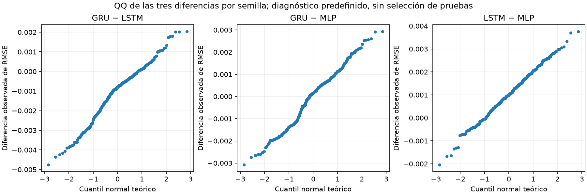
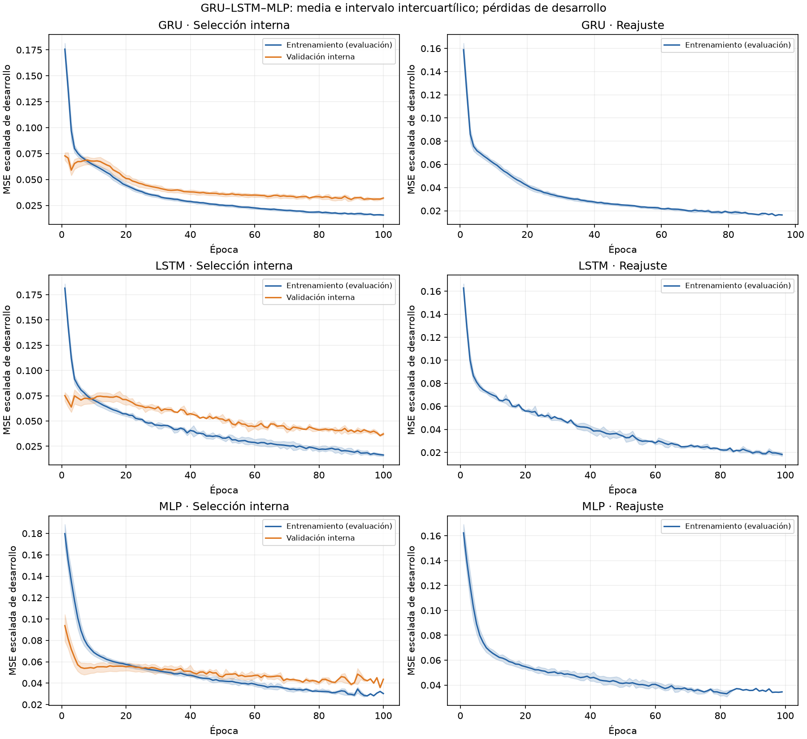
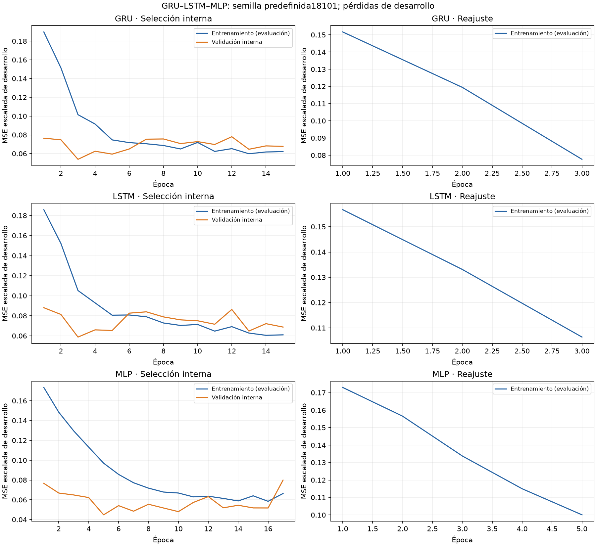

(remediation-608-e1)=
# 11. Benchmark de 608 fechas con HPO equitativo y planificación

Esta ejecución nueva compara **GRU32, LSTM32 y MLP16** bajo un mismo procedimiento de ajuste, piloto, dimensionamiento y evaluación. Mantiene las arquitecturas del benchmark original y conserva sus resultados como referencia histórica. Las métricas nuevas proceden de nuevos pesos y predicciones; el R²≈0,854 original no se atribuye por anticipado a esta ejecución.

El objetivo es corregir dos límites metodológicos del benchmark original: sus diez semillas no se dimensionaron mediante un piloto previo y las tres familias no recibieron el mismo esfuerzo de HPO. La nueva ejecución también conserva predicciones diarias de las tres redes sobre las **mismas 608 fechas**, permitiendo análisis temporal y residual conjunto.

| Requisito | Evidencia de la ejecución nueva |
|---|---|
| Búsqueda comparable entre familias | Mismos cuatro candidatos, dos semillas y diez folds; 160 etapas por red |
| Piloto anterior al ajuste definitivo | Diez semillas nuevas por red en desarrollo; media, DE y CV registrados |
| Dimensionamiento anterior al ajuste definitivo | Regla prefijada, R=309 calculado y plan íntegro publicado antes de entrenar |
| Inferencia temporal y residual de la terna | Predicciones nuevas de todas las semillas sobre las mismas 608 fechas, con identidad y cierre propios |

Se distinguen tres estudios: **esta ejecución D7/R309** es la comparación principal; **el original de cuatro entradas/R10** conserva sus resultados históricos; **el complemento de 60 fechas/R465** conserva sus otras anchuras y su calendario. Los contrastes de una ejecución no se transfieren a otra.

## Contrato común y arquitecturas

| Elemento | Definición fijada |
|---|---|
| Fuente | Binance Spot BTCUSDT; archivos originales por SHA-256 |
| Entrada | D7×5, OHLCV diario anterior al día objetivo; representación relativa |
| Objetivo | Desviación estándar poblacional de siete retornos logarítmicos; horizonte un día |
| Desarrollo | 2023–2024; transformaciones aprendidas únicamente del entrenamiento permitido |
| Ajuste definitivo | 709 etiquetas elegibles hasta 24/12/2024, con embargo de siete días |
| Evaluación | 01/01/2025–31/08/2026: 608 fechas, pesos y preprocesadores fijos |
| GRU | Una capa de 32 unidades y salida Softplus; 3.777 parámetros |
| LSTM | Una capa de 32 unidades y salida Softplus; 5.025 parámetros |
| MLP | Ventana ordenada aplanada, una capa oculta ReLU de 16 unidades y salida Softplus; 593 parámetros |

Las anchuras se mantienen por la elección de arquitecturas básicas documentada en la literatura y la decisión explícita del autor. El ajuste común busca learning rate y dropout; no se presenta como búsqueda exhaustiva de todas las arquitecturas posibles.

## HPO equitativo antes del piloto

Cada familia recibe exactamente **cuatro candidatos**: learning rate **0,001/0,003** × dropout **0/0,1**. Se cruzan con las mismas dos semillas **16101–16102** y diez bloques mensuales de enero–octubre de 2024. Cada trayectoria concatena 305 fechas de validación; se selecciona por la media del RMSE entre semillas, con desempate registrado por parámetros e identificador.

Son **24 trayectorias, 240 bloques y 480 etapas de ajuste** en total: 160 etapas por familia. Todas comparten AdamW, decaimiento 0,0001, batch 32, clipping 1, máximo de cien épocas, paciencia 12 y mejora mínima 0,00001. La parada interna es causal y el reajuste comienza desde cero. La receta de cada familia y el baseline se congelan con desarrollo antes del piloto y de puntuar.

| Familia | Candidato elegido | LR | Dropout | RMSE CV, media ± DE entre dos semillas |
|---|---|---:|---:|---:|
| **GRU32** | **c03** | **0,003** | **0,1** | **0,00499677 ± 0,00034400** |
| LSTM32 | c02 | 0,003 | 0 | 0,00639760 ± 0,00005660 |
| MLP16 | c03 | 0,003 | 0,1 | 0,00582375 ± 0,00026931 |

**GRU32 es el baseline neuronal elegido con CV.** Estas medias corresponden a desarrollo; no son resultados del test. Las recetas originales se conservan separadas: la MLP histórica usaba LR 0,001 y la LSTM histórica dropout 0,1. Igualar la búsqueda significa ofrecer los mismos cuatro candidatos y etapas; no exige igualar segundos de cómputo ni demuestra haber encontrado el óptimo global de cada familia.

## Piloto, margen y tamaño de muestra

El piloto utiliza **diez semillas nuevas por familia, 17101–17110**, sobre 01/11–30/12/2024, con las recetas elegidas y pesos fijos durante sus sesenta fechas. Sus treinta trayectorias y sesenta etapas se mantienen separadas de las ejecuciones definitivas. Se informan media, DE y coeficiente de variación de RMSE por modelo.

| Modelo | RMSE piloto medio | DE piloto | CV = DE/media |
|---|---:|---:|---:|
| GRU32 | 0,00467598 | 0,00035816 | 7,66 % |
| LSTM32 | 0,00585168 | 0,00072491 | 12,39 % |
| MLP16 | 0,00561207 | 0,00026381 | 4,70 % |

Se conserva **δ=0,00025772842664981106**, el margen académico fijado a partir del GRU32 inicial. Se dimensionan los tres pares mediante t no central, α*=0,05/3, potencia marginal objetivo 0,80 y cota superior simultánea del 80 % de la DE pareada. Se publican δ/DE, MDE y sensibilidad de la cota al 90/95 %.

La regla prefijada es **R final=máximo(30, R requerido por los tres pares)**. Las semillas finales comienzan en **18101** y son comunes a las tres familias. El piso de treinta es conservador para el tratamiento entre inicializaciones; no demuestra normalidad ni potencia por sí mismo. Si el requerimiento supera 10.000, el cálculo falla explícitamente y no se recorta a un R conveniente.

El piloto produjo **R requerido=R final=309**, con semillas **18101–18409**: **927 modelos y 1.854 etapas definitivas**. Sumando HPO y piloto son **2.394 etapas de ajuste**. Este tamaño se calculó, publicó y verificó antes del primer ajuste definitivo de esta ejecución.

| Par | DE de diferencias | Cota superior de DE, simultánea 80 % | R requerido con esa cota | δ/DE superior | Potencia planificada en R=309 | MDE en R=309, DE superior |
|---|---:|---:|---:|---:|---:|---:|
| GRU–LSTM | 0,00088638 | 0,00139330 | **309** | 0,18498 | 0,80024 | 0,00025766 |
| GRU–MLP | 0,00044431 | 0,00069842 | 80 | 0,36902 | 0,99998 | 0,00012916 |
| LSTM–MLP | 0,00076400 | 0,00120094 | 231 | 0,21461 | 0,91322 | 0,00022209 |

Con las DE puntuales, el máximo requerido habría sido 127. Las sensibilidades de la cota simultánea al 90/95 % producen máximos 383/467; se publican como sensibilidad sin cambiar retrospectivamente la regla registrada del 80 %. El MDE expresa una diferencia distinguible de cero bajo los supuestos del cálculo; no demuestra que una diferencia observada exceda δ.

El piloto, su dispersión y duración se interpretan como información de desarrollo. Transferir dispersión desde sus sesenta fechas a las 608 de evaluación es un supuesto de planificación, no una garantía. La potencia dimensionada distingue δ de cero entre semillas; no acredita potencia temporal del 80 %, potencia conjunta del 80 % o potencia alcanzada.

## Orden de ejecución y protección de la evaluación

El código, el diseño y los análisis se publican y verifican antes de los ajustes nuevos. La selección de recetas precede al piloto. El plan calculado se publica y verifica antes del primer ajuste definitivo. El registro vincula commit, diseño, fuentes y ejecución; las filas de resultados rechazan identidades o cohortes mezcladas.

La fuente científica es el commit [98e0cbcf](https://github.com/jassan-bit/DeepLearning_202630/commit/98e0cbcf4bb09dba863289261677dd6e7534d259), verificado por GET el **08/11/2026 a las 01:08:27 UTC**, antes del registro a las 01:09:05. La HPO cerró a las 01:13:53 y el piloto a las 01:15:04. El plan se calculó a las 01:15:15 y se publicó íntegro en [0f5f5eae](https://github.com/jassan-bit/DeepLearning_202630/blob/0f5f5eaeb7131b1413a062cb0cce104a88f3ddf3/experiments/e1_608_remediation_20261107/planning/plan.json); un GET verificó sus bytes a las **01:17:26**, antes de registrarlo a las 01:17:45. En Colombia, estos hitos corresponden al 7 de noviembre. El SHA-256 del plan es `6295b408623c811aa707b7c55355ab5fb529306f91049b047bac8dcc4d0fd15f`.

Los **927 modelos**, sus configuraciones, preprocesadores y curvas quedaron congelados antes de permitir lectura de los CSV de evaluación. Cada checkpoint se puntuó una sola vez sobre las 608 fechas. Los veinte ZIP mensuales originales se validaron por tamaño, checksum y calendario; la verificación previa de bytes no calculó etiquetas ni predicciones.

| Hito de cierre | 08/11/2026, UTC |
|---|---|
| Inicio de ajustes definitivos | 01:17:53 |
| Todos los pesos y escaladores congelados | **01:28:08** |
| Primera lectura registrada de precios de evaluación | **01:28:33** |
| Puntuación completa | 01:28:54 |
| Análisis completo | 01:29:29 |

La [cronología con precisión completa](../_static/e1_608_remediation_20261107/chronology.json), el [registro](../_static/e1_608_remediation_20261107/registration.json) y el [manifiesto de fuentes y cierres](../_static/e1_608_remediation_20261107/source_manifest.json) vinculan estos hitos. El cierre comprende **563.616 pronósticos neuronales**, más persistencia determinista. Las tres familias tienen todas las fechas y todas las semillas previstas; no se sustituyeron semillas por su rendimiento.

## Análisis fijado antes de observar los resultados nuevos

Se calculan **RMSE, MAE, MSE, R², MAPE y MASE** por corrida, con medias, DE e IC marginales. Persistencia es una referencia determinista adicional. Se publican parámetros, hardware y tiempos de entrenamiento e inferencia de las tres recetas bajo el mismo procedimiento.

La comparación entre inicializaciones conserva t pareada/Holm-3, IC marginales y familiares, efecto d_z y sensibilidad bootstrap. Shapiro–Wilk y Q–Q diagnostican las diferencias; Friedman/Kendall W y Wilcoxon/Holm-3 aportan análisis de rangos preespecificados. Se distingue la aproximación de la t de las condiciones requeridas por cada prueba, sin escoger después el p-valor más favorable.

La inferencia temporal utiliza las **608 fechas comunes**: DM con HAC6 y corrección HLN para los tres pares neuronales y los tres frente a persistencia, con Holm-6. La pérdida es la MSE diaria media de modelos individuales, no el error de un ensemble. El bootstrap circular usa 4.999 remuestras comunes, bloque principal siete y sensibilidad tres/catorce; mantiene la media de RMSE individuales como estimando y los intervalos familiares de seis pares.

BDS de dimensión dos/radio 1,5 DE y Ljung–Box en rezagos uno/cinco se aplican a los residuos diarios de cada modelo y semilla. Se informan multiplicidad, casos indefinidos y limitaciones por dependencia y régimen. Los vectores diarios, pesos y escaladores permanecen privados; se publican métricas, pérdidas, configuración y firmas que permiten verificar el cierre.

## Alcance histórico y relación con las versiones anteriores

**El calendario de 608 días ya era conocido antes de este estudio.** El registro es anterior a los ajustes de esta ejecución, sin convertir retrospectivamente el calendario en un test independiente nuevo. Las conclusiones se limitan a la comparación histórica de las recetas y procedimientos descritos.

La comparación original de diez semillas y el complemento de sesenta días se conservan completos, con resultados favorables, adversos e inconclusos. La nueva ejecución no modifica sus archivos ni mezcla sus predicciones. Conserva las anchuras, los datos y el calendario originales, pero emplea recetas elegidas por HPO común, selección interna de duración, reajustes y semillas nuevos. No es una reproducción exacta de los pesos históricos; las diferencias observadas no se atribuyen causalmente a una sola de esas decisiones.

## Resultados de la ejecución cerrada

| Modelo | RMSE media ± DE | IC marginal 95 % de RMSE | R² medio |
|---|---:|---|---:|
| GRU32 | 0,00521269 ± 0,00112121 | [0,00508718; 0,00533819] | 0,709833 |
| LSTM32 | 0,00625115 ± 0,00079563 | [0,00616209; 0,00634021] | 0,594658 |
| MLP16 | 0,00522813 ± 0,00054111 | [0,00516756; 0,00528870] | 0,717998 |
| Persistencia | **0,00408560** | No aplica entre semillas | **0,829605** |

El [resumen de las seis métricas](../_static/e1_608_remediation_20261107/metric_summary.csv) contiene RMSE, MAE, MSE, R², MAPE y MASE; las [corridas](../_static/e1_608_remediation_20261107/run_metrics.csv) conservan las 309 puntuaciones por familia. Son medias de modelos individuales, sin seleccionar semillas por test y sin sustituirlas por un ensemble.

**Persistencia obtiene menor error que las redes nuevas.** GRU conserva la menor RMSE media neuronal y el papel de baseline por CV; MLP tiene menor MSE medio y mayor R² medio neuronal. Ese orden diferente es posible: la media de raíces no es la raíz de la media, y GRU presenta más dispersión entre semillas. Ninguna de estas cifras sustituye el R²=0,854173 de la ejecución original.

### Comparación entre inicializaciones

Los [tres pares primarios](../_static/e1_608_remediation_20261107/pairwise_rmse.csv) usan diferencias de RMSE con signo A−B y Holm-3:

| Par A−B | Diferencia media | IC familiar | p Holm-3 |
|---|---:|---|---:|
| GRU−LSTM | −0,00103846 | [−0,00121721; −0,00085971] | 1,91×10⁻³⁴ |
| GRU−MLP | −0,00001545 | [−0,00018107; 0,00015018] | **0,822534** |
| LSTM−MLP | 0,00102302 | [0,00088694; 0,00115909] | 6,84×10⁻⁵⁰ |

Se detectan diferencias entre LSTM y ambas redes, condicionadas al calendario. GRU–MLP no rechaza diferencia media cero; no se demuestra equivalencia. Los dos IC familiares frente a LSTM exceden δ en su dirección favorable; el de GRU–MLP no lo hace. Esta relevancia entre inicializaciones se distingue del análisis temporal.

Shapiro rechaza normalidad para GRU−LSTM y GRU−MLP (p≈0,000074 y 0,001520), y no para LSTM−MLP (p≈0,888). Se conserva la t predefinida como aproximación con R=309, junto a bootstrap y diagnósticos; no se escoge una prueba según su p-valor. [Friedman](../_static/e1_608_remediation_20261107/friedman_rmse.csv) obtiene χ²=184,706, p≈7,79×10⁻⁴¹ y Kendall W=0,298876. [Wilcoxon/Holm-3](../_static/e1_608_remediation_20261107/wilcoxon_rmse.csv) mantiene su hipótesis y sus supuestos propios, incluida simetría para una lectura de desplazamiento.

Las [coordenadas Q–Q](../_static/e1_608_remediation_20261107/qq_data.csv) contienen las 309 diferencias ordenadas de cada par. Los diagnósticos no convierten semillas en muestras temporales independientes.

### Inferencia temporal y residuos del trío

Los [seis DM-HLN/HAC6](../_static/e1_608_remediation_20261107/dm_pairs.csv) comparan la MSE diaria media de modelos individuales sobre las 608 fechas:

| Par | p Holm-6 | Resultado bajo el procedimiento registrado |
|---|---:|---|
| GRU−LSTM | 0,009542 | Menor pérdida de GRU |
| GRU−MLP | 0,728434 | No rechaza diferencia cero |
| LSTM−MLP | 0,064115 | No rechaza tras multiplicidad |
| GRU−persistencia | 0,009567 | Menor pérdida de persistencia |
| LSTM−persistencia | 0,009542 | Menor pérdida de persistencia |
| MLP−persistencia | 0,000299 | Menor pérdida de persistencia |

El [bootstrap circular](../_static/e1_608_remediation_20261107/temporal_bootstrap.csv) conserva bloque principal siete y sensibilidad tres/catorce, 4.999 remuestras comunes por bloque. En el bloque principal, los límites inferiores familiares de ganancia de persistencia frente a GRU, LSTM y MLP son **8,60 %, 21,27 % y 10,22 %**, respectivamente. Bajo ese procedimiento, persistencia supera el margen relativo del 5 % frente a las tres redes. GRU–MLP conserva un intervalo que cruza cero.

El bootstrap favorece MLP frente a LSTM, con límite inferior familiar de ganancia 6,32 %, mientras DM no rechaza ese par tras Holm-6. Ambos resultados se informan: DM usa pérdida cuadrática diaria y el bootstrap la media de RMSE individuales, con estimandos y aproximaciones distintos. Las sensibilidades por longitud de bloque no sustituyen al bloque principal según cuál resulte favorable.

El archivo de [diagnósticos residuales](../_static/e1_608_remediation_20261107/diagnostics.csv) contiene **927 BDS y 1.854 Ljung–Box**, todos definidos. Las tres familias rechazan tras Holm en todas sus semillas y rezagos registrados: hay evidencia de dependencia residual bajo estos contrastes. No se acredita ruido blanco o adecuación completa del modelo. El solapamiento de σ₇, los cambios de régimen y los supuestos asintóticos limitan la interpretación. Estos cálculos incluyen las nuevas predicciones diarias de **MLP16**, sin atribuirlos a sus vectores originales ausentes.

## Curvas públicas y costes observados

Se publican **33.141 filas de pérdidas observadas**, con [curvas por corrida](../_static/e1_608_remediation_20261107/learning_curves_by_run.csv), [media/IQR y cobertura por época](../_static/e1_608_remediation_20261107/learning_curve_summary.csv) y la [semilla individual 18101](../_static/e1_608_remediation_20261107/first_seed_learning_curves.csv), fijada antes de puntuar. La validación pertenece a la selección interna de desarrollo; el reajuste final sólo registra entrenamiento.

Las pérdidas disminuyen durante la optimización. La distancia entre entrenamiento y validación y la dependencia residual impiden equiparar esa disminución con generalización perfecta. Las curvas tardías tienen menos corridas por parada anticipada; `n_available` permite comprobar su cobertura. Las MSE escaladas usan transformaciones propias de cada ajuste y no son la RMSE de test en unidades originales.

| Modelo | Parámetros | Ajuste, segundos media ± DE | Inferencia de las 608 fechas, segundos media ± DE |
|---|---:|---:|---:|
| GRU32 | 3.777 | 3,83227 ± 4,49027 | 0,002236 ± 0,000535 |
| LSTM32 | 5.025 | 0,98946 ± 0,97834 | 0,002276 ± 0,000548 |
| MLP16 | 593 | 1,02220 ± 0,81332 | 0,000369 ± 0,000100 |

Los [tiempos por corrida](../_static/e1_608_remediation_20261107/run_costs.csv) y el [resumen de costes](../_static/e1_608_remediation_20261107/cost_summary.csv) proceden de esta ejecución CPU. El ajuste incluye selección interna y reajuste; las duraciones varían con las épocas elegidas. Se registraron tres workers con un hilo de PyTorch y uno interop por worker, determinismo activado, Python 3.12.14 y PyTorch 2.15.0+cpu; la afinidad ofrece cinco CPU lógicas y la cuota equivale a cuatro núcleos. El [runtime observado](../_static/e1_608_remediation_20261107/runtime.json) separa padre y workers. Estos tiempos describen el entorno y procedimiento observados; no constituyen un ranking universal de velocidad de las familias.

## Verificación y reproducción

La auditoría numérica de esta entrega recalculó las métricas desde las predicciones cerradas mediante fórmulas independientes del módulo científico de producción. Verificó **13.160 comparaciones numéricas** de métricas e inferencia entre semillas: discrepancia máxima **3,55×10⁻¹⁵**. Friedman, Wilcoxon, Q–Q, los 2.781 diagnósticos residuales y los 18 intervalos temporales coincidieron; en DM sólo apareció redondeo de varianza de hasta 3,31×10⁻²⁴. También comprobó hashes, semillas, fechas y el orden publicación→piloto→plan→ajustes→congelación→acceso→análisis. Es una verificación interna de cálculos y trazabilidad, no una réplica histórica de pesos ni una revisión por pares externa.

El [manifiesto público](../_static/e1_608_remediation_20261107/manifest.json) contiene **33 archivos más el propio manifiesto**, idénticos entre resultados y recursos del libro. [BUILD.md](https://github.com/jassan-bit/DeepLearning_202630/blob/main/BUILD.md) detalla el entorno y las fases para una salida nueva; las [descargas de §8](08_entregables.md) incorporan código, configuraciones y agregados. Compilar HTML o empaquetar no entrena ni vuelve a puntuar modelos. Los precios, objetivos, predicciones diarias, pesos y valores de escaladores permanecen privados.
