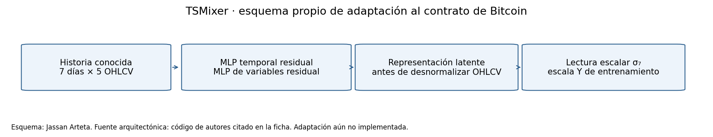
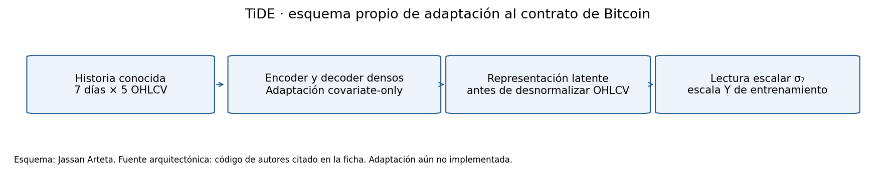
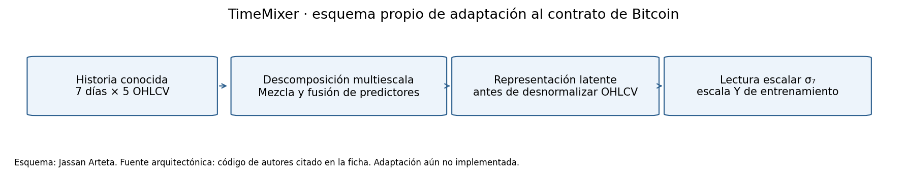
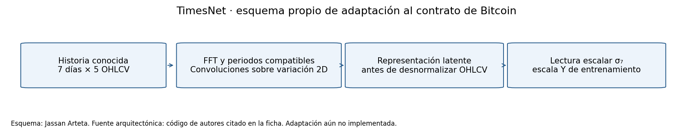
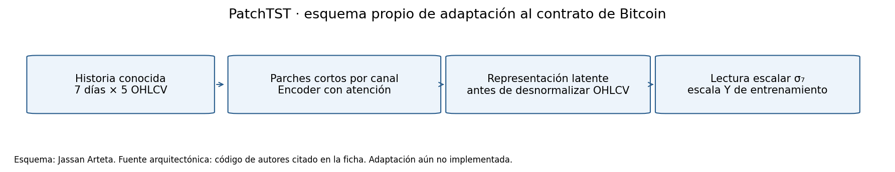
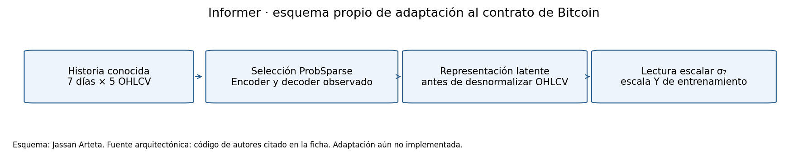
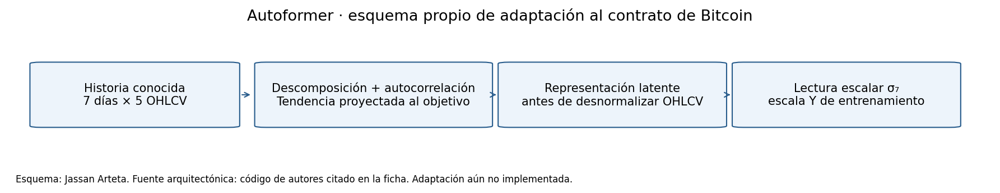
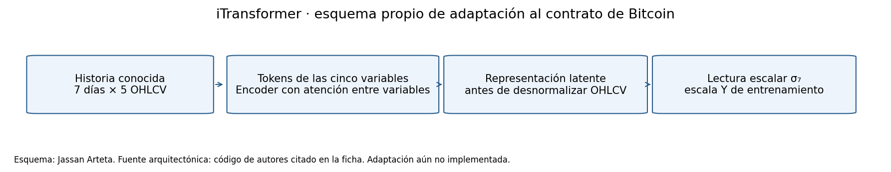
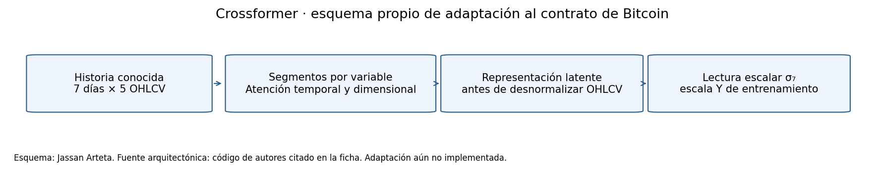

### 3.3.1 TSMixer

**Familia:** MLP / mezcla temporal y de variables.

**Fuente arquitectónica:** [TSMixer: An All-MLP Architecture for Time Series Forecasting](https://doi.org/10.48550/arXiv.2303.06053), 2023. Identificador: 10.48550/arXiv.2303.06053. La naturaleza editorial o de preprint se conserva en el registro de fuentes.

**Texto completo leído:** [2303.06053v5](https://arxiv.org/abs/2303.06053v5), 24 páginas PDF; SHA-256 `864079eb9702bca1f27f540819052af94625b226cd5a652a02638800f95b365e`. Se distingue esta versión del registro editorial.

**Código primario:** [implementación fijada por commit](https://raw.githubusercontent.com/google-research/google-research/d3a4bd8f0eceddda553e47085033b537935b283f/tsmixer/tsmixer_basic/models/tsmixer.py), SHA-256 `84a7451f86b40b989f7ab7aa36368f24f39610ad62d7ce43e474a30a4e006159`. Licencia observada: Apache-2.0.

**Síntesis matemática propia, basada en el código examinado:**

$$
T=X+\mathcal M_t(\mathcal N(X)^\top)^\top,\qquad Z=T+\mathcal M_c(\mathcal N(T)).
$$

**Resultado publicado rastreable:** ETTh1 multivariante; variante **TSMixer básico multivariante**; contexto L=512, horizonte H=96; **MSE 0.361 y MAE 0.392**, misma fila de la tabla 3, **página PDF 10**. Escala: estandarización global por covariable y RevIN; se evalúa sin invertir la escala global, cuyo ajuste train-only no se explicita. Son resultados externos, no una corrida de Bitcoin ni un ranking comparable entre estos diez artículos.

**Calidad y reproducibilidad:** La fila LTSF seleccionada no declara repeticiones ni dispersión. Las cinco semillas y media±DE de M5 pertenecen a otra tarea. El PDF declara estandarización global y RevIN, pero no explicita el ajuste del scaler sólo en entrenamiento; parte de los comparadores se importa de otro artículo.

Estado para la fila seleccionada: repeticiones: NR; semillas: NR; dispersión de esta fila: NR; scaler train-only: NR; prueba formal: NR; igual presupuesto HPO: NR. `NR` significa no reportado en el PDF para ese alcance; `NV` significa no verificado y `partial`, evidencia parcial. El detalle y los localizadores están en la [matriz metodológica](../literature_fulltext/quality_matrix.csv).

**Respaldo aplicado adicional:** [Time-mixing and feature-mixing modelling for realized volatility forecast: Evidence from TSMixer model](https://doi.org/10.1016/j.jfds.2024.100143), `WOS:001491684900001`. Alcance: Volatilidad realizada de acciones. Sus 9 citas corresponden a ese estudio representativo, no automáticamente al original arquitectónico. El registro de apoyo procede de resumen/metadatos, salvo el preprint original de S-Mamba también leído.

**Adaptación propuesta:** Mezclar días y variables con MLP residuales; lectura escalar para σ7.

**Complejidad:** Estimación estructural propia por bloque O(C L² + L C F), más la proyección; L=7 y C=5. No es un recuento medido de FLOPs. El número de parámetros y FLOPs de la configuración ETTh1 seleccionada no está reportado; los tiempos/memorias de otras condiciones se conservan en la [matriz de eficiencia](../literature_fulltext/efficiency_matrix.csv), sin trasladarlos a D7 ni a Bitcoin.

**Limitación técnica:** La fuente elegida es Google/Chen All-MLP TSMixer, distinta de variantes IBM con nombre parecido. Las capas y la receta del adaptador aún deben fijarse antes de entrenarlo.

**Alcance histórico de ejecución:** la revisión bibliográfica del 2026-11-05 no ajustó modelos ni efectuó reproducciones numéricas. La adaptación D7×5→σ₇ y su evaluación en Bitcoin siguen pendientes. La [réplica externa de TimeMixer y el piloto de tres modelos en ETTh1](https://jassan-bit.github.io/DeepLearning_202630/entregable2/sections/05_paper_guia.html) pertenecen a la etapa posterior del capítulo 5.

### 3.3.2 TiDE

**Familia:** MLP / mezcla temporal y de variables.

**Fuente arquitectónica:** [Long-term Forecasting with TiDE: Time-series Dense Encoder](https://doi.org/10.48550/arXiv.2304.08424), 2023. Identificador: 10.48550/arXiv.2304.08424. La naturaleza editorial o de preprint se conserva en el registro de fuentes.

**Texto completo leído:** [2304.08424v5](https://arxiv.org/abs/2304.08424v5), 21 páginas PDF; SHA-256 `eee9d9e3248f262a137e6cf63920137263f3bbbe22cd8608e5eec77882af1999`. Se distingue esta versión del registro editorial.

**Código primario:** [implementación fijada por commit](https://raw.githubusercontent.com/google-research/google-research/d3a4bd8f0eceddda553e47085033b537935b283f/tide/models.py), SHA-256 `ad8fd8d498809deeed9c847a169cada42134cbd0351b03e750706132a5d151c7`. Licencia observada: Apache-2.0.

**Síntesis matemática propia, basada en el código examinado:**

$$
z=\operatorname{Enc}(\operatorname{vec}(X)),\qquad r=\operatorname{Dec}(z),\qquad \widehat y=g_\sigma(r).
$$

**Resultado publicado rastreable:** ETTh1 multivariante; variante **TiDE completo, RevIN activado, todos los residuales; tabla 2 con configuración de tabla 8**; contexto L=720, horizonte H=96; **MSE 0.375 y MAE 0.398**, misma fila de la tabla 2, **página PDF 8**. Escala: estandarización con media/DE del periodo de entrenamiento y RevIN activado para ETTh1. Son resultados externos, no una corrida de Bitcoin ni un ranking comparable entre estos diez artículos.

**Calidad y reproducibilidad:** Declara cinco ejecuciones independientes. La tabla 5 (PDF p.19) proporciona errores estándar para ETTh1/H96: MSE 0.0003 y MAE 0.0002; no son desviaciones estándar. La normalización con media/DE del periodo de entrenamiento está explícita. Los presupuestos HPO de todos los comparadores no se igualan documentalmente.

Estado para la fila seleccionada: repeticiones: reported; semillas: NR; dispersión de esta fila: reported; scaler train-only: reported; prueba formal: NR; igual presupuesto HPO: NR. `NR` significa no reportado en el PDF para ese alcance; `NV` significa no verificado y `partial`, evidencia parcial. El detalle y los localizadores están en la [matriz metodológica](../literature_fulltext/quality_matrix.csv).

**Respaldo aplicado adicional:** [A Deep Learning Method for Photovoltaic Power Generation Forecasting Based on a Time-Series Dense Encoder](https://doi.org/10.3390/en18102434), `WOS:001495953000001`. Alcance: Pronóstico en otro dominio. Sus 13 citas corresponden a ese estudio representativo, no automáticamente al original arquitectónico. El registro de apoyo procede de resumen/metadatos, salvo el preprint original de S-Mamba también leído.

**Adaptación propuesta:** Codificar las covariables históricas con bloques densos; decoder escalar sin covariables futuras.

**Complejidad:** Estimación propia Σℓ O(dℓ dℓ₊₁) sobre capas densas, más proyecciones de variables. Los anchos no están fijados; no se infieren parámetros ni FLOPs numéricos. El número de parámetros y FLOPs de la configuración ETTh1 seleccionada no está reportado; los tiempos/memorias de otras condiciones se conservan en la [matriz de eficiencia](../literature_fulltext/efficiency_matrix.csv), sin trasladarlos a D7 ni a Bitcoin.

**Limitación técnica:** La interfaz original no se ejecuta sin cambios bajo el contrato heredado. La cabeza/skip escalar y retirar historia del objetivo deben declararse como adaptaciones.

La formulación original incorpora historia del objetivo y covariables futuras; la versión covariate-only bajo el contrato vigente es una adaptación explícita que necesita validación, no una reproducción idéntica.

**Alcance histórico de ejecución:** la revisión bibliográfica del 2026-11-05 no ajustó modelos ni efectuó reproducciones numéricas. La adaptación D7×5→σ₇ y su evaluación en Bitcoin siguen pendientes. La [réplica externa de TimeMixer y el piloto de tres modelos en ETTh1](https://jassan-bit.github.io/DeepLearning_202630/entregable2/sections/05_paper_guia.html) pertenecen a la etapa posterior del capítulo 5.

### 3.3.3 TimeMixer

**Familia:** MLP / mezcla temporal y de variables.

**Fuente arquitectónica:** [TimeMixer: Decomposable Multiscale Mixing for Time Series Forecasting](https://doi.org/10.48550/arXiv.2405.14616), 2024. Identificador: 10.48550/arXiv.2405.14616. La naturaleza editorial o de preprint se conserva en el registro de fuentes.

**Texto completo leído:** [2405.14616v1](https://arxiv.org/abs/2405.14616v1), 28 páginas PDF; SHA-256 `a599b338e44af70d8e9c87be3c5417bde7864b2c92074e1346703f3e2b641e3d`. Se distingue esta versión del registro editorial.

**Código primario:** [implementación fijada por commit](https://raw.githubusercontent.com/kwuking/TimeMixer/e24610583b36fdd8c76cc17a8df4e65759a5f460/models/TimeMixer.py), SHA-256 `817d62f4aac54c8566e560f6d3785856e31c8ee51460279ee3d0a4823f11d4be`. Licencia observada: Apache-2.0.

**Síntesis matemática propia, basada en el código examinado:**

$$
X_s=\operatorname{Down}_s(X),\quad (S_s,T_s)=\operatorname{Decomp}(X_s),\quad \widehat y=g_\sigma(\{\operatorname{Mix}_s(S_s,T_s)\}_s).
$$

**Resultado publicado rastreable:** ETTh1 multivariante; variante **TimeMixer unificado, M=3 y cuatro escalas 96/48/24/12**; contexto L=96, horizonte H=96; **MSE 0.375 y MAE 0.400**, misma fila de la tabla 13, **página PDF 17**. Escala: escala/unidades exactas de las métricas no reportadas en el PDF. Son resultados externos, no una corrida de Bitcoin ni un ranking comparable entre estos diez artículos.

**Calidad y reproducibilidad:** Declara tres repeticiones. La media±DE de la tabla 9 corresponde al promedio de cuatro horizontes, no a esta fila H96. Sus afirmaciones de IC/significancia no incluyen prueba identificada, p-valores ni extremos reproducibles. La configuración unificada alinea contexto, batch y épocas, sin demostrar igual presupuesto de búsqueda.

Estado para la fila seleccionada: repeticiones: reported; semillas: NR; dispersión de esta fila: NR; scaler train-only: NR; prueba formal: partial; igual presupuesto HPO: NR. `NR` significa no reportado en el PDF para ese alcance; `NV` significa no verificado y `partial`, evidencia parcial. El detalle y los localizadores están en la [matriz metodológica](../literature_fulltext/quality_matrix.csv).

**Respaldo aplicado adicional:** [Adaptive multi-scale short term wind power forecasting framework based on TimeMixer and Mix-of-Experts](https://doi.org/10.1016/j.epsr.2025.112196), `WOS:001569047800001`. Alcance: Comparador en otro dominio. Sus 11 citas corresponden a ese estudio representativo, no automáticamente al original arquitectónico. El registro de apoyo procede de resumen/metadatos, salvo el preprint original de S-Mamba también leído.

**Adaptación propuesta:** Combinar escalas temporales compatibles con siete días; no agregar entradas externas.

**Complejidad:** Estimación propia O(Σₛ C Lₛ² + costes de FFN de variables), sumando las escalas. No es una medición de FLOPs. El número de parámetros y FLOPs de la configuración ETTh1 seleccionada no está reportado; los tiempos/memorias de otras condiciones se conservan en la [matriz de eficiencia](../literature_fulltext/efficiency_matrix.csv), sin trasladarlos a D7 ni a Bitcoin.

**Limitación técnica:** Las escalas y longitudes predeterminadas para historias de 96/336 pasos no sirven automáticamente para D7. No se añaden variables futuras ni se invierte la escala OHLCV como si el objetivo fuera una de sus columnas.

**Alcance histórico de ejecución:** la revisión bibliográfica del 2026-11-05 no ajustó modelos ni efectuó reproducciones numéricas. La adaptación D7×5→σ₇ y su evaluación en Bitcoin siguen pendientes. La [réplica externa de TimeMixer y el piloto de tres modelos en ETTh1](https://jassan-bit.github.io/DeepLearning_202630/entregable2/sections/05_paper_guia.html) pertenecen a la etapa posterior del capítulo 5.

### 3.3.4 TimesNet

**Familia:** Convolución multiescala / variación2D.

**Fuente arquitectónica:** [TimesNet: Temporal 2D-Variation Modeling for General Time Series Analysis](https://doi.org/10.48550/arXiv.2210.02186), 2023. Identificador: 10.48550/arXiv.2210.02186. La naturaleza editorial o de preprint se conserva en el registro de fuentes.

**Texto completo leído:** [2210.02186v3](https://arxiv.org/abs/2210.02186v3), 23 páginas PDF; SHA-256 `a45cb3d35c7b4db7091439ee714fd43dd6cd9e8f2fb1867f5463ae0433aebbd1`. Se distingue esta versión del registro editorial.

**Código primario:** [implementación fijada por commit](https://raw.githubusercontent.com/thuml/Time-Series-Library/4e938a1767106324dd753b2a44832bf870a0252e/models/TimesNet.py), SHA-256 `f64c4bed1fd7347090044a0163bd4209c9f9ec1c1b19ceff47842df36b64bba7`. Licencia observada: MIT.

**Síntesis matemática propia, basada en el código examinado:**

$$
p_i=\lfloor L/f_i\rfloor,\quad Z=\sum_i a_i\operatorname{Reshape}_{p_i}^{-1}(\operatorname{Conv2D}_i(\operatorname{Reshape}_{p_i}(X))).
$$

**Resultado publicado rastreable:** ETTh1 multivariante; variante **TimesNet con Inception compartido**; contexto L=96, horizonte H=96; **MSE 0.384 y MAE 0.402**, misma fila de la tabla 13, **página PDF 21**. Escala: Series Stationarization declarada; scaler global y unidades exactas de estas métricas no reportados. Son resultados externos, no una corrida de Bitcoin ni un ranking comparable entre estos diez artículos.

**Calidad y reproducibilidad:** Declara tres repeticiones; la dispersión de esta fila H96 no está reportada. Series Stationarization es una normalización interna y no acredita por sí sola un scaler global ajustado sólo en entrenamiento. Los controles compartidos de entrada/salida no demuestran igual presupuesto HPO.

Estado para la fila seleccionada: repeticiones: reported; semillas: NR; dispersión de esta fila: NR; scaler train-only: NR; prueba formal: NR; igual presupuesto HPO: NR. `NR` significa no reportado en el PDF para ese alcance; `NV` significa no verificado y `partial`, evidencia parcial. El detalle y los localizadores están en la [matriz metodológica](../literature_fulltext/quality_matrix.csv).

**Respaldo aplicado adicional:** [Charting new avenues in financial forecasting with TimesNet: The impact of intraperiod and interperiod variations on realized volatility prediction](https://doi.org/10.1016/j.eswa.2024.124851), `WOS:001283528600001`. Alcance: Volatilidad realizada de acciones. Sus 14 citas corresponden a ese estudio representativo, no automáticamente al original arquitectónico. El registro de apoyo procede de resumen/metadatos, salvo el preprint original de S-Mamba también leído.

**Adaptación propuesta:** Transformar la historia a representaciones de variación 2D; limitar frecuencias al soporte D7.

**Complejidad:** Estimación propia O(L d log L) para FFT más O(Σᵢ Aᵢ kᵢ² d_in d_out) para convoluciones 2D sobre rejillas con relleno. No se ha medido el coste numérico. El número de parámetros y FLOPs de la configuración ETTh1 seleccionada no está reportado; los tiempos/memorias de otras condiciones se conservan en la [matriz de eficiencia](../literature_fulltext/efficiency_matrix.csv), sin trasladarlos a D7 ni a Bitcoin.

**Limitación técnica:** El README original deriva la implementación a Time-Series-Library: se conservan ambos repositorios. Periodos inferidos por FFT fuera del soporte observado no prueban memoria de largo plazo.

La ecuación 1 del artículo usa techo para el periodo y el código examinado usa división entera (piso); la fórmula anterior describe ese código. FFT_for_Period promedia amplitudes sobre el batch. Para no compartir información entre orígenes temporales, la adaptación propuesta debe seleccionar periodos por ventana o inferir con batch=1, excluir explícitamente la frecuencia cero y limitar k≤⌊L_eff/2⌋. Son controles propuestos, aún no ejecutados.

**Alcance histórico de ejecución:** la revisión bibliográfica del 2026-11-05 no ajustó modelos ni efectuó reproducciones numéricas. La adaptación D7×5→σ₇ y su evaluación en Bitcoin siguen pendientes. La [réplica externa de TimeMixer y el piloto de tres modelos en ETTh1](https://jassan-bit.github.io/DeepLearning_202630/entregable2/sections/05_paper_guia.html) pertenecen a la etapa posterior del capítulo 5.

### 3.3.5 PatchTST

**Familia:** Atención / Transformer.

**Fuente arquitectónica:** [A Time Series is Worth 64 Words: Long-term Forecasting with Transformers](https://doi.org/10.48550/arXiv.2211.14730), 2023. Identificador: 10.48550/arXiv.2211.14730. La naturaleza editorial o de preprint se conserva en el registro de fuentes.

**Texto completo leído:** [2211.14730v2](https://arxiv.org/abs/2211.14730v2), 24 páginas PDF; SHA-256 `ffd4021d25b4959883242f256b0fe4ec42f477f66db78c61bfacf7baa7848b0e`. Se distingue esta versión del registro editorial.

**Código primario:** [implementación fijada por commit](https://raw.githubusercontent.com/yuqinie98/PatchTST/204c21efe0b39603ad6e2ca640ef5896646ab1a9/PatchTST_supervised/models/PatchTST.py), SHA-256 `49d8bb865e1226d6338842f4b33c4bc6992cefb048dc2a4a5a8c410ca708586b`. Licencia observada: Apache-2.0.

**Síntesis matemática propia, basada en el código examinado:**

$$
P_c=\operatorname{Patch}(X_{:,c}),\quad Z_c=\operatorname{Encoder}(P_cW_p+E),\quad \widehat y=g_\sigma(Z_1,\ldots,Z_5).
$$

**Resultado publicado rastreable:** ETTh1 multivariante; variante **PatchTST/64 supervisado, parche 16 y salto 8**; contexto L=512, horizonte H=96; **MSE 0.370 y MAE 0.400**, misma fila de la tabla 3, **página PDF 7**. Escala: normalización de instancia declarada; scaler global y unidades exactas de las métricas no reportados. Son resultados externos, no una corrida de Bitcoin ni un ranking comparable entre estos diez artículos.

**Calidad y reproducibilidad:** La tabla principal usa semilla 2021. La robustez con cinco semillas 2019–2023 y media±DE se estudia para la variante /42; no se atribuye su dispersión a /64. La normalización de instancia está descrita, pero el scaler global y su población de ajuste no quedan explícitos en el PDF.

Estado para la fila seleccionada: repeticiones: reported; semillas: reported; dispersión de esta fila: NR; scaler train-only: NR; prueba formal: NR; igual presupuesto HPO: NR. `NR` significa no reportado en el PDF para ese alcance; `NV` significa no verificado y `partial`, evidencia parcial. El detalle y los localizadores están en la [matriz metodológica](../literature_fulltext/quality_matrix.csv).

**Respaldo aplicado adicional:** [Can transformers transform financial forecasting?](https://doi.org/10.1108/CFRI-01-2024-0032), `WOS:001250609400001`. Alcance: Volatilidad realizada de acciones. Sus 23 citas corresponden a ese estudio representativo, no automáticamente al original arquitectónico. El registro de apoyo procede de resumen/metadatos, salvo el preprint original de S-Mamba también leído.

**Adaptación propuesta:** Usar parches cortos y fusionar representaciones de los cinco canales en un objetivo.

**Complejidad:** Estimación propia O(C P² d + C P d²), con P parches. Reducir tokens puede ahorrar atención, pero con L=7 no demuestra una ventaja. El número de parámetros y FLOPs de la configuración ETTh1 seleccionada no está reportado; los tiempos/memorias de otras condiciones se conservan en la [matriz de eficiencia](../literature_fulltext/efficiency_matrix.csv), sin trasladarlos a D7 ni a Bitcoin.

**Limitación técnica:** Los parches predeterminados de 16/32 pasos exceden D7. Una nueva cabeza que combine canales es una adaptación que debe declararse y validarse.

**Alcance histórico de ejecución:** la revisión bibliográfica del 2026-11-05 no ajustó modelos ni efectuó reproducciones numéricas. La adaptación D7×5→σ₇ y su evaluación en Bitcoin siguen pendientes. La [réplica externa de TimeMixer y el piloto de tres modelos en ETTh1](https://jassan-bit.github.io/DeepLearning_202630/entregable2/sections/05_paper_guia.html) pertenecen a la etapa posterior del capítulo 5.

### 3.3.6 Informer

**Familia:** Atención / Transformer.

**Fuente arquitectónica:** [Informer: Beyond Efficient Transformer for Long Sequence Time-Series Forecasting](https://doi.org/10.1609/aaai.v35i12.17325), 2021. Identificador: 10.1609/aaai.v35i12.17325. La naturaleza editorial o de preprint se conserva en el registro de fuentes.

**Texto completo leído:** [2012.07436v3](https://arxiv.org/abs/2012.07436v3), 15 páginas PDF; SHA-256 `95d8d427005e4dab28932b2630886931fc095996fdd4a65d0e050bae801ffc37`. Se distingue esta versión del registro editorial.

**Código primario:** [implementación fijada por commit](https://raw.githubusercontent.com/zhouhaoyi/Informer2020/29f2a739226a509202a092b464163da81fa74960/models/model.py), SHA-256 `bc8e062fbbb4f4ae970ca0d02d2bf43b2e92c3251c3627d887c01d35cbc6891a`. Licencia observada: Apache-2.0 in LICENSE; README badge separately says CC BY-NC-SA.

**Síntesis matemática propia, basada en el código examinado:**

$$
\operatorname{Attn}(\overline Q,K,V)=\operatorname{softmax}(\overline QK^\top/\sqrt d)V,\qquad \widehat y=g_\sigma(Z).
$$

**Resultado publicado rastreable:** ETTh1 multivariante; variante **Informer con ProbSparse y distilling, columna Informer sin daga**; contexto L=NR (contexto ganador no reportado), horizonte H=24; **MSE 0.577 y MAE 0.549**, misma fila de la tabla 2, **página PDF 6**. Escala: estandarización media cero/DE uno declarada; ajuste train-only e inversión al evaluar no explicitados. Son resultados externos, no una corrida de Bitcoin ni un ranking comparable entre estos diez artículos.

**Calidad y reproducibilidad:** Declara cinco ejecuciones con desplazamiento de los conjuntos de entrenamiento/validación; no equivale a cinco semillas independientes sobre una única partición fija. No reporta dispersión para la fila seleccionada. La estandarización está declarada, sin precisar ajuste sólo en entrenamiento ni inversión al evaluar.

Estado para la fila seleccionada: repeticiones: reported; semillas: NR; dispersión de esta fila: NR; scaler train-only: NR; prueba formal: NR; igual presupuesto HPO: NR. `NR` significa no reportado en el PDF para ese alcance; `NV` significa no verificado y `partial`, evidencia parcial. El detalle y los localizadores están en la [matriz metodológica](../literature_fulltext/quality_matrix.csv).

**Respaldo aplicado adicional:** [Can transformers transform financial forecasting?](https://doi.org/10.1108/CFRI-01-2024-0032), `WOS:001250609400001`. Alcance: Volatilidad realizada de acciones. Sus 23 citas corresponden a ese estudio representativo, no automáticamente al original arquitectónico. El registro de apoyo procede de resumen/metadatos, salvo el preprint original de S-Mamba también leído.

**Adaptación propuesta:** Atención dispersa con contexto observado; decoder sin valores futuros verdaderos ni calendario añadido.

**Complejidad:** El mecanismo original propone atención O(L log L); el modelo completo añade proyecciones/FFN O(L d²) y decoder. No se deduce superioridad de velocidad con L=7. El número de parámetros y FLOPs de la configuración ETTh1 seleccionada no está reportado; los tiempos/memorias de otras condiciones se conservan en la [matriz de eficiencia](../literature_fulltext/efficiency_matrix.csv), sin trasladarlos a D7 ni a Bitcoin.

**Limitación técnica:** La licencia raíz observada es Apache-2.0 y el badge del README indica CC BY-NC-SA: se distinguen código, datos y badge. Debe comprobarse que el distilling sea válido con siete pasos.

**Alcance histórico de ejecución:** la revisión bibliográfica del 2026-11-05 no ajustó modelos ni efectuó reproducciones numéricas. La adaptación D7×5→σ₇ y su evaluación en Bitcoin siguen pendientes. La [réplica externa de TimeMixer y el piloto de tres modelos en ETTh1](https://jassan-bit.github.io/DeepLearning_202630/entregable2/sections/05_paper_guia.html) pertenecen a la etapa posterior del capítulo 5.

### 3.3.7 Autoformer

**Familia:** Atención / Transformer.

**Fuente arquitectónica:** [Autoformer: Decomposition Transformers with Auto-Correlation for Long-Term Series Forecasting](https://doi.org/10.48550/arXiv.2106.13008), 2021. Identificador: 10.48550/arXiv.2106.13008. La naturaleza editorial o de preprint se conserva en el registro de fuentes.

**Texto completo leído:** [2106.13008v5](https://arxiv.org/abs/2106.13008v5), 20 páginas PDF; SHA-256 `6ec6743b8d3df87a91ecd7b17d83123c0132f5ab87dffeb6318c05e2cb13f11b`. Se distingue esta versión del registro editorial.

**Código primario:** [implementación fijada por commit](https://raw.githubusercontent.com/thuml/Autoformer/51c7d416ae120b805fd5beef2f4ccf7de496a6ff/models/Autoformer.py), SHA-256 `f18e9e82844ed8c4dc26e00c3c2f0b7c278ac8ea8427c4fab7331939bf69829d`. Licencia observada: MIT.

**Síntesis matemática propia, basada en el código examinado:**

$$
R_{QK}=\operatorname{IFFT}(\operatorname{FFT}(Q)\overline{\operatorname{FFT}(K)}),\quad Z=\sum_{\tau\in\operatorname{TopK}(R)}a_\tau\operatorname{Roll}_{\tau}(V).
$$

**Resultado publicado rastreable:** ETTh1 multivariante; variante **Autoformer speedup, dos capas de encoder y una de decoder**; contexto L=96, horizonte H=24; **MSE 0.384 y MAE 0.425**, misma fila de la tabla 5, **página PDF 13**. Escala: normalización global del benchmark no reportada en el PDF. Son resultados externos, no una corrida de Bitcoin ni un ranking comparable entre estos diez artículos.

**Calidad y reproducibilidad:** Declara tres ejecuciones y presenta DE para otros casos, como ETTm2/H96; no se transfiere esa incertidumbre a ETTh1/H24. La normalización global del benchmark no está reportada en el PDF. Los resultados corresponden a la versión speedup.

Estado para la fila seleccionada: repeticiones: reported; semillas: NR; dispersión de esta fila: NR; scaler train-only: NR; prueba formal: NR; igual presupuesto HPO: NR. `NR` significa no reportado en el PDF para ese alcance; `NV` significa no verificado y `partial`, evidencia parcial. El detalle y los localizadores están en la [matriz metodológica](../literature_fulltext/quality_matrix.csv).

**Respaldo aplicado adicional:** [Can transformers transform financial forecasting?](https://doi.org/10.1108/CFRI-01-2024-0032), `WOS:001250609400001`. Alcance: Volatilidad realizada de acciones. Sus 23 citas corresponden a ese estudio representativo, no automáticamente al original arquitectónico. El registro de apoyo procede de resumen/metadatos, salvo el preprint original de S-Mamba también leído.

**Adaptación propuesta:** Descomposición y autocorrelación temporal; proyectar coherentemente tendencia y estacionalidad al objetivo.

**Complejidad:** Correlación basada en FFT O(L d log L), más proyecciones/FFN O(L d²). Es una síntesis estructural propia, no un coste medido del modelo completo. El número de parámetros y FLOPs de la configuración ETTh1 seleccionada no está reportado; los tiempos/memorias de otras condiciones se conservan en la [matriz de eficiencia](../literature_fulltext/efficiency_matrix.csv), sin trasladarlos a D7 ni a Bitcoin.

**Limitación técnica:** Fijar c_out=1 puede difundir una tendencia OHLCV en unidades incompatibles con σ₇. El regresor de volatilidad basado sólo en covariables es una adaptación explícita.

Roll es una operación circular sobre representaciones de historia observada, no una garantía de causalidad por posición. La rama de tendencia en unidades de covariables también debe proyectarse de forma coherente al objetivo σ₇ antes de aplicar la escala Y de entrenamiento.

**Alcance histórico de ejecución:** la revisión bibliográfica del 2026-11-05 no ajustó modelos ni efectuó reproducciones numéricas. La adaptación D7×5→σ₇ y su evaluación en Bitcoin siguen pendientes. La [réplica externa de TimeMixer y el piloto de tres modelos en ETTh1](https://jassan-bit.github.io/DeepLearning_202630/entregable2/sections/05_paper_guia.html) pertenecen a la etapa posterior del capítulo 5.

### 3.3.8 iTransformer

**Familia:** Atención / Transformer.

**Fuente arquitectónica:** [iTransformer: Inverted Transformers Are Effective for Time Series Forecasting](https://doi.org/10.48550/arXiv.2310.06625), 2024. Identificador: 10.48550/arXiv.2310.06625. La naturaleza editorial o de preprint se conserva en el registro de fuentes.

**Texto completo leído:** [2310.06625v4](https://arxiv.org/abs/2310.06625v4), 25 páginas PDF; SHA-256 `83e889795af52c672090255493266e3ea93e7b2a32c528f58074f2f9f757ffc5`. Se distingue esta versión del registro editorial.

**Código primario:** [implementación fijada por commit](https://raw.githubusercontent.com/thuml/iTransformer/c2426e68ca13f74aaec08045c5c724d8ad328124/model/iTransformer.py), SHA-256 `6f34777a5a12c253a293f79e7e1fd5b6f79ac100b443951e051e269e7e2542db`. Licencia observada: MIT.

**Síntesis matemática propia, basada en el código examinado:**

$$
H^{(0)}=X^\top W_e,\qquad H^{(\ell+1)}=\operatorname{Encoder}(H^{(\ell)}),\qquad \widehat y=g_\sigma(H).
$$

**Resultado publicado rastreable:** ETTh1 multivariante; variante **iTransformer completo, columna original Ours**; contexto L=96, horizonte H=96; **MSE 0.386 y MAE 0.405**, misma fila de la tabla 10, **página PDF 23**. Escala: preprocesamiento del benchmark remitido a TimesNet; no son errores de precio bruto ni de Bitcoin. Son resultados externos, no una corrida de Bitcoin ni un ranking comparable entre estos diez artículos.

**Calidad y reproducibilidad:** El análisis de robustez incluye cinco semillas en otros datasets; su tabla 5 no contiene ETTh1 y no acredita incertidumbre de esta fila. La atención entre variables tiene coste cuadrático en el número de variables, no en el número de fechas. Un contexto común no prueba igualdad de presupuesto HPO.

Estado para la fila seleccionada: repeticiones: NV; semillas: NR; dispersión de esta fila: NR; scaler train-only: NR; prueba formal: NR; igual presupuesto HPO: NR. `NR` significa no reportado en el PDF para ese alcance; `NV` significa no verificado y `partial`, evidencia parcial. El detalle y los localizadores están en la [matriz metodológica](../literature_fulltext/quality_matrix.csv).

**Respaldo aplicado adicional:** [Short-term freeway traffic speed multistep prediction using an iTransformer model](https://doi.org/10.1016/j.physa.2024.130185), `WOS:001352915400001`. Alcance: Pronóstico en otro dominio. Sus 35 citas corresponden a ese estudio representativo, no automáticamente al original arquitectónico. El registro de apoyo procede de resumen/metadatos, salvo el preprint original de S-Mamba también leído.

**Adaptación propuesta:** Atender entre tokens de variables, cada uno con siete observaciones; lectura escalar de covariables.

**Complejidad:** Estimación propia O(C L d + C² d + C d²) para embedding/bloque: atención entre C variables, no entre L fechas. El número de parámetros y FLOPs de la configuración ETTh1 seleccionada no está reportado; los tiempos/memorias de otras condiciones se conservan en la [matriz de eficiencia](../literature_fulltext/efficiency_matrix.csv), sin trasladarlos a D7 ni a Bitcoin.

**Limitación técnica:** La ventaja asintótica depende del eje de atención y no acredita una mejora para sólo cinco variables. La lectura escalar debe preceder a cualquier desnormalización por canal.

**Alcance histórico de ejecución:** la revisión bibliográfica del 2026-11-05 no ajustó modelos ni efectuó reproducciones numéricas. La adaptación D7×5→σ₇ y su evaluación en Bitcoin siguen pendientes. La [réplica externa de TimeMixer y el piloto de tres modelos en ETTh1](https://jassan-bit.github.io/DeepLearning_202630/entregable2/sections/05_paper_guia.html) pertenecen a la etapa posterior del capítulo 5.

### 3.3.9 Crossformer

**Familia:** Atención / Transformer.

**Fuente arquitectónica:** [Crossformer: Transformer Utilizing Cross-Dimension Dependency for Multivariate Time Series Forecasting](https://openreview.net/forum?id=vSVLM2j9eie), 2023. Identificador: OpenReview vSVLM2j9eie; DOI no verificado. La naturaleza editorial o de preprint se conserva en el registro de fuentes.

**Texto completo leído:** [ICLR 2023 conference PDF](https://openreview.net/forum?id=vSVLM2j9eie), 21 páginas PDF; SHA-256 `a5fcad16cd810492124af3efad2fa18f7c5f9556fb303bb88360cceaf396183a`. Se distingue esta versión del registro editorial.

**Código primario:** [implementación fijada por commit](https://raw.githubusercontent.com/Thinklab-SJTU/Crossformer/c10c8eadb153d1dd9798250967747ca3ebb81383/cross_models/cross_former.py), SHA-256 `deee243b2ae877084320dce49e691c8860c56f0cbda269c6f0cdb50848f6c708`. Licencia observada: Apache-2.0.

**Síntesis matemática propia, basada en el código examinado:**

$$
H_{c,s}=\operatorname{DSW}(X_{s:s+p,c}),\quad Z=\operatorname{Attn}_{\rm dim}(\operatorname{Attn}_{\rm time}(H)),\quad\widehat y=g_\sigma(Z).
$$

**Resultado publicado rastreable:** ETTh1 multivariante; variante **Crossformer original completo DSW+TSA+HED sin covariables**; contexto L=NR (contexto ganador no reportado), horizonte H=24; **MSE 0.305 y MAE 0.367**, misma fila de la tabla 1, **página PDF 7**. Escala: normalización con media/DE de entrenamiento declarada en §4.1; la fila se conserva en la escala del benchmark. Son resultados externos, no una corrida de Bitcoin ni un ranking comparable entre estos diez artículos.

**Calidad y reproducibilidad:** Declara media de cinco ejecuciones y normalización con media/DE de entrenamiento; no proporciona IDs de semillas ni dispersión para esta fila. El contexto ganador exacto no está reportado y no se infiere del ejemplo del README. Algunos comparadores se importan de Informer y utilizan covariables calendario distintas.

Estado para la fila seleccionada: repeticiones: reported; semillas: NR; dispersión de esta fila: NR; scaler train-only: reported; prueba formal: NR; igual presupuesto HPO: NR. `NR` significa no reportado en el PDF para ese alcance; `NV` significa no verificado y `partial`, evidencia parcial. El detalle y los localizadores están en la [matriz metodológica](../literature_fulltext/quality_matrix.csv).

**Respaldo aplicado adicional:** [Ultra-short-term wind power forecast based on multi-feature information fusion of GAT-Crossformer](https://doi.org/10.1016/j.energy.2025.138706), `WOS:001614987300004`. Alcance: Comparador en otro dominio. Sus 18 citas corresponden a ese estudio representativo, no automáticamente al original arquitectónico. El registro de apoyo procede de resumen/metadatos, salvo el preprint original de S-Mamba también leído.

**Adaptación propuesta:** Segmentación temporal y atención por tiempo y dimensión, con padding exclusivamente derivado del pasado.

**Complejidad:** Estimación propia O(C S² d + S C R d) para atención temporal y dimensional con routers; S segmentos y R routers. Proyecciones/FFN añaden coste. El número de parámetros y FLOPs de la configuración ETTh1 seleccionada no está reportado; los tiempos/memorias de otras condiciones se conservan en la [matriz de eficiencia](../literature_fulltext/efficiency_matrix.csv), sin trasladarlos a D7 ni a Bitcoin.

**Limitación técnica:** Segmentos de seis pasos y merges de cuatro requieren rediseñar una jerarquía válida con pocos segmentos. El DOI editorial del original no está identificado; se conserva su enlace OpenReview.

**Alcance histórico de ejecución:** la revisión bibliográfica del 2026-11-05 no ajustó modelos ni efectuó reproducciones numéricas. La adaptación D7×5→σ₇ y su evaluación en Bitcoin siguen pendientes. La [réplica externa de TimeMixer y el piloto de tres modelos en ETTh1](https://jassan-bit.github.io/DeepLearning_202630/entregable2/sections/05_paper_guia.html) pertenecen a la etapa posterior del capítulo 5.

### 3.3.10 S-Mamba

**Familia:** Espacio de estados selectivo.

**Fuente arquitectónica:** [Is Mamba effective for time series forecasting?](https://doi.org/10.1016/j.neucom.2024.129178), 2025. Identificador: 10.1016/j.neucom.2024.129178. La naturaleza editorial o de preprint se conserva en el registro de fuentes.

**Texto completo leído:** [2403.11144v3](https://arxiv.org/abs/2403.11144v3), 14 páginas PDF; SHA-256 `11f25c26b33a50455c835cd4062d9314b417716c8a6d35356249efa56d230751`. Se distingue esta versión del registro editorial.

**Código primario:** [implementación fijada por commit](https://raw.githubusercontent.com/wzhwzhwzh0921/S-D-Mamba/e7e8bf04066135afa43d85b0a87afa97cda16e3f/model/S_Mamba.py), SHA-256 `48952b3906962917bc76345b5247ce350cae3243915142896b1952b4813b5fc9`. Licencia observada: Not verified: no root LICENSE found at captured commit.

**Síntesis matemática propia, basada en el código examinado:**

$$
h_i=\overline A_i h_{i-1}+\overline B_i e_i,\quad z_i=C_i h_i,\quad Z=\operatorname{Mamba}(E)+\operatorname{Flip}(\operatorname{Mamba}(\operatorname{Flip}(E))).
$$

**Resultado publicado rastreable:** ETTh1 multivariante; variante **S-Mamba principal con bi-Mamba VC y FFN TD**; contexto L=96, horizonte H=96; **MSE 0.386 y MAE 0.405**, misma fila de la tabla 3, **página PDF 7**. Escala: normalización interna del encoder declarada; scaler global y escala final de estas métricas no reportados. Son resultados externos, no una corrida de Bitcoin ni un ranking comparable entre estos diez artículos.

**Calidad y reproducibilidad:** En las 14 páginas del preprint suministrado no se reportan repeticiones, semillas, dispersión, prueba formal, optimizador ni presupuesto HPO. La normalización dentro del encoder no demuestra un scaler global train-only. Se leyó el preprint v3 de 2024, no el cuerpo de la publicación editorial de 2025.

Estado para la fila seleccionada: repeticiones: NR; semillas: NR; dispersión de esta fila: NR; scaler train-only: NR; prueba formal: NR; igual presupuesto HPO: NR. `NR` significa no reportado en el PDF para ese alcance; `NV` significa no verificado y `partial`, evidencia parcial. El detalle y los localizadores están en la [matriz metodológica](../literature_fulltext/quality_matrix.csv).

**Respaldo aplicado adicional:** [Is Mamba effective for time series forecasting?](https://doi.org/10.1016/j.neucom.2024.129178), `WOS:001416250600001`. Alcance: Modelo original de pronóstico multivariado. Sus 252 citas corresponden a ese estudio representativo, no automáticamente al original arquitectónico. El registro de apoyo procede de resumen/metadatos, salvo el preprint original de S-Mamba también leído.

**Adaptación propuesta:** Estados selectivos entre tokens de variables; salida escalar y escala propia del objetivo.

**Complejidad:** Embedding O(C L d) y scan selectivo lineal en C tokens de variables para estado/ancho fijos, más FFN/proyecciones. Esta implementación no recorre simplemente L tokens cronológicos. El número de parámetros y FLOPs de la configuración ETTh1 seleccionada no está reportado; los tiempos/memorias de otras condiciones se conservan en la [matriz de eficiencia](../literature_fulltext/efficiency_matrix.csv), sin trasladarlos a D7 ni a Bitcoin.

**Limitación técnica:** No se verificó licencia raíz. Un docstring copia una referencia a iTransformer; la identidad se contrasta con README y registro editorial. Los módulos registrados pero inactivos exigen una política explícita al contar parámetros.

La bidireccionalidad recorre tokens de las cinco variables ya observadas, no fechas futuras. El código registra módulos que no participan en forward; al implementarlo habrá que distinguir parámetros registrados y activos. No se verificó una licencia raíz que autorice reutilizar ese código.

**Alcance histórico de ejecución:** la revisión bibliográfica del 2026-11-05 no ajustó modelos ni efectuó reproducciones numéricas. La adaptación D7×5→σ₇ y su evaluación en Bitcoin siguen pendientes. La [réplica externa de TimeMixer y el piloto de tres modelos en ETTh1](https://jassan-bit.github.io/DeepLearning_202630/entregable2/sections/05_paper_guia.html) pertenecen a la etapa posterior del capítulo 5.
