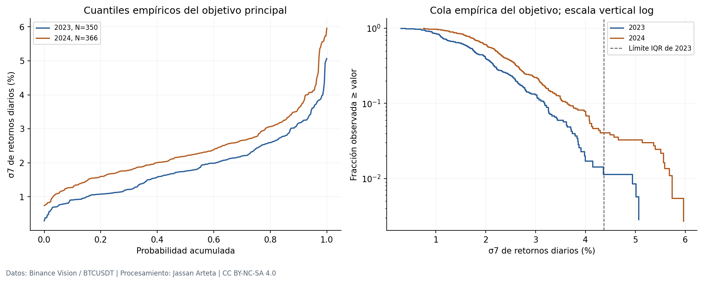
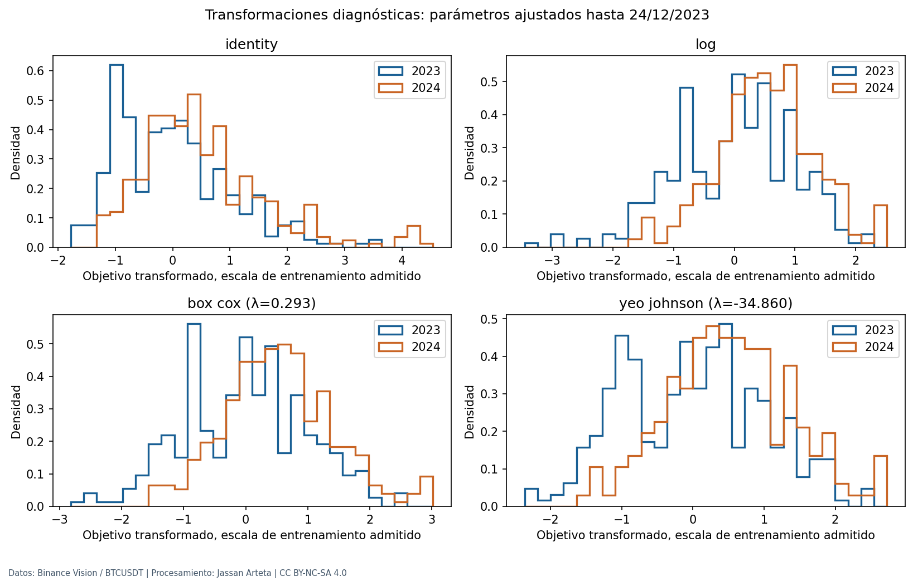
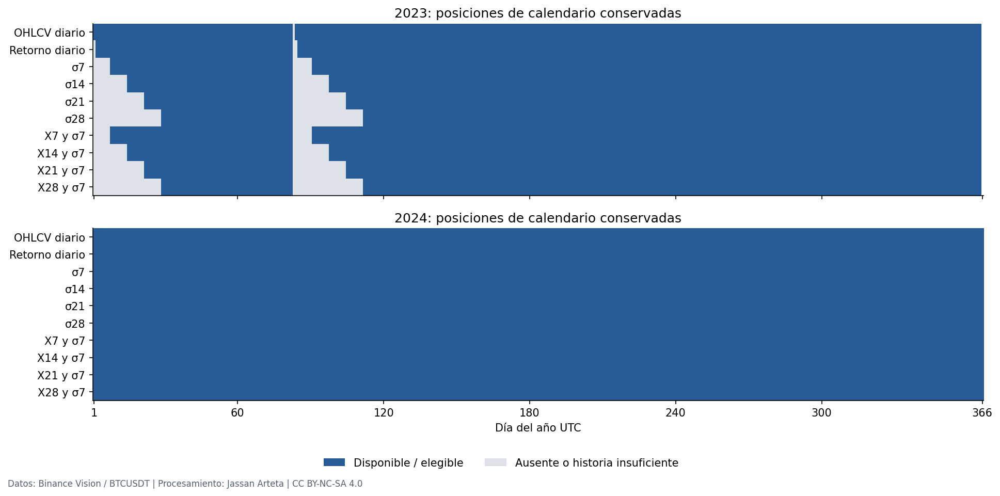
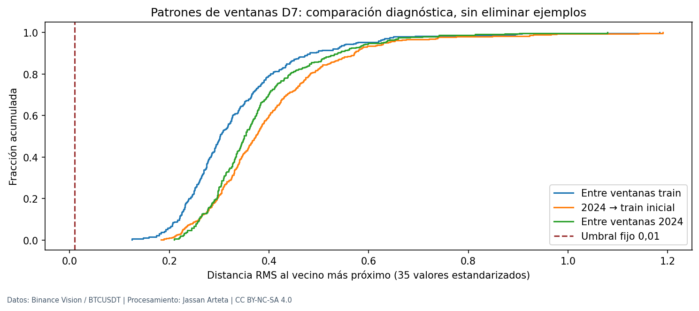
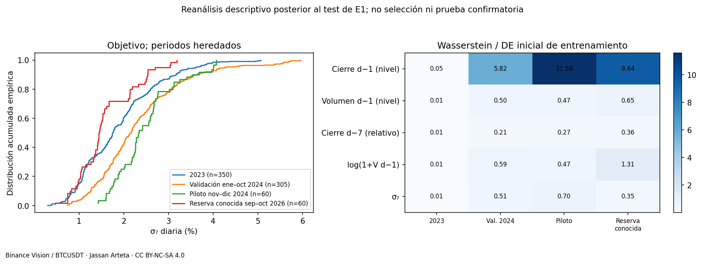
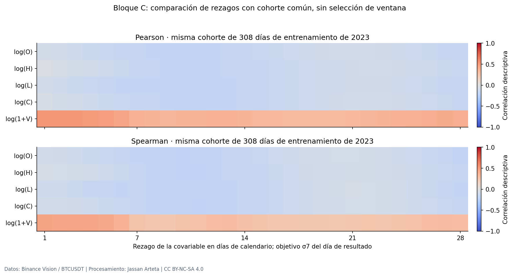
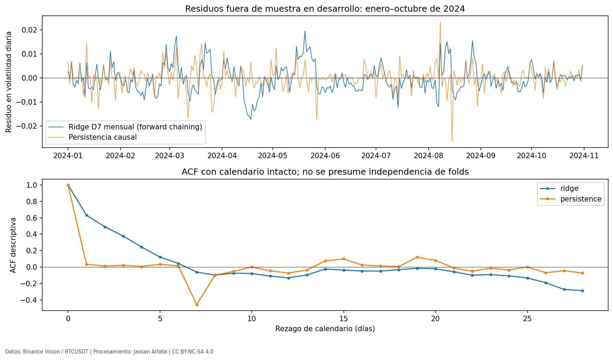

# 2. Análisis Exploratorio de Datos (EDA) Orientado a Decisiones

**Orientación de entrega del 14/11/2026:** el protocolo ejecutado es [§48](48_protocolo_reducido.md), los resultados comunes están en [§6](06_benchmark_final.md), la reproducción registrada en [§55](55_reproduccion_ablaciones.md) y el Apéndice B actual en [§61](61_reproduccion_consolidada.md). Las cifras científicas y los recibos históricos conservan su fecha y su alcance.

**Alcance:** los datos, controles y experimentos ya ejecutados de esta sección se conservan como evidencia histórica. No acreditan entrenamiento del benchmark común del catálogo obligatorio de 16 sistemas, definido en [§43](43_catalogo_obligatorio.md). Cualquier presupuesto o receta anterior requiere revisión y nuevo registro antes de reutilizarse.

El EDA de E1 se **amplía y conserva**. Este capítulo reutiliza sus evidencias de desarrollo y añade análisis reproducibles de transformaciones, casi duplicados, soportes temporales y residuos bajo forward chaining. Cada bloque termina con decisiones de preprocesamiento, consecuencias para arquitectura/validación y riesgos; la {ref}`tabla de trazabilidad <e2-trazabilidad-eda>` reúne esas relaciones.

Se distinguen dos alcances de este EDA: **desarrollo 2023–2024** para diagnósticos y **perfil retrospectivo de la reserva de E1 ya conocida** para describir desplazamiento de distribución. Este último no selecciona arquitecturas, transformaciones, umbrales ni periodos y no convierte la reserva en una confirmación nueva. El panel de configuraciones del registro histórico y el benchmark vigente de [§6](06_benchmark_final.md) conservan identidades diferentes; el [piloto P0 de desarrollo](09_protocolo_registrado.md), registrado previamente, ya se ejecutó como otra etapa y no se presenta como ese benchmark.

El contrato principal sigue siendo D=7, n=7, h=1, cinco canales OHLCV y σ₇ poblacional sin anualizar. D es historia de entrada, n es ventana del objetivo y h es horizonte: no se intercambian. Los resultados n=14/21/28 de E1 son sensibilidades de la etiqueta, no objetivos añadidos al benchmark actual. La guía completa de 65 páginas permite cerrar la clasificación como **F2a, series de tiempo**, según la {ref}`resolución de ruta <e2-ruta-temporal>`; las covariables y etiquetas heredadas no se modifican por esa reclasificación.

## 2.1 EDA General

### 2.1.1 Análisis de la variable objetivo

La distribución es continua, positiva en el desarrollo observado y asimétrica. Se conservan las unidades de retorno logarítmico diario, sin multiplicar por 100 en las tablas.

| Periodo de desarrollo | Etiquetas σ₇ | Media | Mediana | DE poblacional | Asimetría | Exceso de curtosis |
|---|---:|---:|---:|---:|---:|---:|
| 2023 | 350 | 0,018797 | 0,017567 | 0,008890 | 0,8024 | 0,4965 |
| 2024 | 366 | 0,023661 | 0,021989 | 0,009767 | 1,1796 | 1,8431 |

La cerca descriptiva $Q_{0,75}+1,5\,IQR$, ajustada solo con 2023, es 0,04370768. La exceden 3/350 días de 2023 y 14/366 de 2024. Un valor extremo no es automáticamente corrupto; tampoco estos momentos prueban una distribución de cola de potencia. Los [perfiles heredados](../_static/eda_decisions/heredado/eda_general_quality/target_profiles.csv) conservan cuantiles, ceros y coberturas.



**Ampliación de E2: transformaciones.** Se comparan identidad, logaritmo, Box–Cox y Yeo–Johnson. Sus parámetros se estiman exclusivamente con las 343 etiquetas admisibles de 2023 hasta el 24/12 y se aplican sin reajuste a 2024 para este diagnóstico. Se verifican dominio e inversión; las transformaciones no se incorporan al entrenamiento de los modelos heredados.

| Transformación | λ ajustada | Asimetría 2023 | Asimetría 2024 | Exceso curtosis 2023 | Exceso curtosis 2024 |
|---|---|---|---|---|---|
| Identidad | — | 0,8024 | 1,1796 | 0,4965 | 1,8431 |
| Log | 0,000000 | -0,3909 | -0,0743 | 0,0149 | 0,1112 |
| Box–Cox | 0,292770 | -0,0112 | 0,2936 | -0,3620 | 0,2014 |
| Yeo–Johnson | -34,859961 | 0,0875 | 0,1419 | -0,6671 | -0,2030 |

Parámetros ajustados con **343 resultados admisibles hasta el 24/12/2023**; perfiles descriptivos sobre 350 etiquetas de 2023 y 366 de 2024. La inversión de los valores observados difiere menos de $10^{-12}$. Una λ negativa en Yeo–Johnson impone un límite al rango de la rama positiva: la inversión de predicciones arbitrarias exige comprobar dominio. No se adopta esa transformación.



Para comparar sus formas, los histogramas se centran y escalan con la media y DE transformadas del entrenamiento admisible. Los valores negativos del eje de esa figura son valores estandarizados, no volatilidades negativas; las tablas anteriores conservan las unidades y momentos indicados.

Una distribución más simétrica no demuestra una menor RMSE en escala original. Entrenar con MSE de log(Y), por ejemplo, cambia el problema de optimización y requiere tratar el sesgo de retransformación; invertir la predicción no recupera automáticamente la media condicional original. Si una transformación se investigara posteriormente, sus parámetros se ajustarían dentro de cada entrenamiento admisible del fold y se compararía con el mismo protocolo, sin modificar retrospectivamente E1.

Los ratios de clases, clases raras, entropía de clases, `focal loss` y `class-balanced loss` no aplican a este objetivo continuo. La poca frecuencia de volatilidad extrema se aborda mediante errores por régimen y cobertura, sin barajar ni sobremuestrear fechas para alterar su prevalencia.

**Decisión de preprocesamiento:** conservar etiquetas positivas válidas y el escalado heredado por la media de entrenamiento; no recortar extremos ni adoptar una transformación nueva. **Impacto en arquitectura y validación:** mantener salida escalar no negativa en las recetas base y medir RMSE en escala original; cualquier alternativa debe ajustarse dentro de cada fold. **Riesgos:** selección por apariencia del histograma, confundir transformación con mejora predictiva y convertir eventos extremos legítimos en datos eliminados.

### 2.1.2 Calidad, duplicados y ruido del objetivo

La auditoría de adquisición de E1 identificó 80 minutos ausentes y una vela presente con `close_time` irregular el 24/03/2023. No son 81 filas ausentes. Se excluye el día diario incompleto y las etiquetas/ventanas que dependan de él, conservando las fechas y los brutos.

| Comprobación de desarrollo | 2023 | 2024 |
|---|---:|---:|
| Días de calendario | 365 | 366 |
| Días OHLCV completos | 364 | 366 |
| Claves diarias duplicadas | 0 | 0 |
| Filas OHLCV completas idénticas | 0 | 0 |
| Retornos diarios válidos | 362 | 366 |
| Etiquetas σ₇ válidas | 350 | 366 |

No se detectan OHLC no positivos/incoherentes ni volúmenes negativos en los días completos auditados. Las [comprobaciones por año](../_static/eda_decisions/heredado/eda_general_quality/quality_by_year.csv) indican su denominador; cero hallazgos en ese alcance no certifica ausencia universal de errores del proveedor.



**Ampliación de E2: casi duplicados.** Se comparan ventanas D7 en la representación relativa de OHLC y `log1p(V)`. La distancia es la raíz de la media de diferencias estandarizadas al cuadrado; el escalado se aprende solo con ventanas de entrenamiento admisibles de 2023, hasta el 24/12. Se declara una alerta descriptiva si la distancia es ≤0,01; no se optimiza el umbral con validación. Se distinguen vecinos dentro de entrenamiento y vecinos de 2024 respecto a entrenamiento.

| Comparación | Consultas | Referencia | Alertas ≤0,01 | Duplicados relativos exactos | Distancia mínima | Mediana |
|---|---|---|---|---|---|---|
| Dentro de entrenamiento inicial | 343 | 343 | 0 | 0 | 0,125280 | 0,301770 |
| 2024 frente a entrenamiento inicial | 366 | 343 | 0 | 0 | 0,183537 | 0,373253 |
| Dentro de 2024 | 366 | 366 | 0 | 0 | 0,209485 | 0,350097 |

No se detectan alertas bajo esa regla. El [análisis de sensibilidad del umbral](../_static/eda_decisions/nearest_window_sensitivity.csv) conserva otros umbrales descriptivos; no se elige uno por su resultado ni se cambia el conjunto de entrenamiento.



La igualdad de fechas o de vectores, la proximidad de patrones y el solapamiento temporal son comprobaciones distintas. Dos ventanas bursátiles cercanas pueden ser observaciones legítimas; una distancia superior al umbral tampoco demuestra ausencia de fuga. El examen de soportes temporales de §2.1.4 complementa esta comprobación.

**Etiquetado y ruido.** E1 reconstruyó por una segunda implementación las 2.924 posiciones día–ventana de n=7/14/21/28: 2.780 etiquetas válidas, cero discrepancias de elegibilidad y error numérico máximo de aproximadamente $1,027\times10^{-15}$, frente a una tolerancia de $10^{-12}$. En n=7 son 716 etiquetas válidas. El [resumen de reconstrucción](../_static/eda_decisions/heredado/eda_general_quality/label_reconstruction_summary.csv) verifica el algoritmo; **no estima el ruido económico de la volatilidad latente**.

No hay anotadores humanos, por lo que acuerdo entre anotadores y detección de etiquetas de clase erróneas no aplican. La volatilidad de siete retornos es un proxy con incertidumbre por ventana finita, microestructura y proveedor. Sin una medición externa comparable o un modelo de observación identificado, no se cuantifica un ruido irreducible ni un techo de desempeño. No se sustituye esa ausencia por la precisión de la reconstrucción o por el error del mejor modelo.

**Decisión de preprocesamiento:** no imputar, comprimir huecos ni eliminar patrones parecidos automáticamente; propagar la máscara de calidad a todas las ventanas. **Impacto en arquitectura y validación:** todos los candidatos utilizarán la misma cohorte elegible y máscaras; se conserva la etiqueta heredada. **Riesgos:** confundir similitud con duplicación, solapamiento con independencia o consistencia numérica con ausencia de ruido de medición. El ruido externo queda como limitación no identificada.

### 2.1.3 Identificación de sesgos y posibles atajos

| Sesgo o atajo posible | Evidencia y alcance | Consecuencia técnica |
|---|---|---|
| Representación | Una serie BTCUSDT, un exchange y una cotización en USDT | No generalizar a otras criptomonedas, exchanges o USD; no contar semillas como mercados |
| Temporal | Distribuciones y relaciones móviles cambian entre 2023 y 2024 | Forward chaining y análisis por régimen; no partición aleatoria |
| Adquisición | Interrupción de minutos y cambio de unidad de timestamps entre años | Validar unidad por archivo, normalizar a UTC y conservar calendario |
| Tendencia compartida | Precios en nivel cambian fuertemente de escala entre periodos | Conservar OHLC relativos al último cierre conocido; una correlación no prueba información causal |
| Solapamiento del objetivo | σ₇ de fechas consecutivas comparte seis retornos | Persistencia como referencia; incertidumbre temporal por bloques |
| Información futura | OHLCV completo del día a predecir solo existe después de su cierre | Admitir únicamente barras ya cerradas; excluir escalado/selección con test |

La normalización relativa reduce la dependencia directa del nivel del precio, pero no garantiza invariancia de distribución ni elimina todos los atajos. El volumen también cambia de régimen. No se introducen variables de calendario, identificadores o covariables externas cuya disponibilidad no esté auditada.

**Decisión de preprocesamiento:** conservar normalización causal y controles de unidades; no realizar balance de clases en una regresión. **Impacto en arquitectura y validación:** comparar mecanismos temporales bajo las mismas entradas y orígenes, reportando resultados por segmentos de volatilidad. **Riesgos:** atribuir a una arquitectura lo que proviene de escala, calendario, proveedor o información futura; extrapolación a activos no observados.

### 2.1.4 Partición, auditoría de soportes y estado del test

Se conserva el calendario de fase II descrito en {ref}`§1.1.1 <e2-contrato-heredado>`. Las proporciones de calendario de fase I no se usan como porcentajes de ventanas del protocolo vigente. La partición es cronológica y determinista: **semilla de partición no aplicable**. Los scripts de esta ampliación también son deterministas; los remuestreos heredados declaran su propia semilla.

La auditoría usa los índices ya materializados de `timeseries-cv` 0.1.5, proyecto de DidierRLopes con Filipe R. Ramos. Los diez bloques enero–octubre de 2024 son una adaptación mensual de esos índices diarios con embargo D=7; no se atribuye a la librería una API mensual inexistente. Para el origen $t$ se exige que toda etiqueta de entrenamiento tenga fecha $u\le t-8$.

Con D=n=7, la entrada de un ejemplo $u$ usa días $[u-7,u-1]$ y su etiqueta necesita cierres de $[u-7,u]$. Se comprueban por separado identidades de resultados, precedencia, disponibilidad y soportes brutos. Una fecha que fue validación en un fold puede incorporarse a entrenamiento de un fold posterior cuando ya es pasada y cumple el embargo; ese uso expansivo es legítimo y no hace independientes los folds.

| Fold | Entrenamiento elegible | Validación | Última etiqueta train | Días de embargo | Intersección de soporte bruto |
|---|---|---|---|---|---|
| 2024-01 | 343 | 31 | 2023-12-24 | 7 | 0 |
| 2024-02 | 374 | 29 | 2024-01-24 | 7 | 0 |
| 2024-03 | 403 | 31 | 2024-02-22 | 7 | 0 |
| 2024-04 | 434 | 30 | 2024-03-24 | 7 | 0 |
| 2024-05 | 464 | 31 | 2024-04-23 | 7 | 0 |
| 2024-06 | 495 | 30 | 2024-05-24 | 7 | 0 |
| 2024-07 | 525 | 31 | 2024-06-23 | 7 | 0 |
| 2024-08 | 556 | 31 | 2024-07-24 | 7 | 0 |
| 2024-09 | 587 | 30 | 2024-08-24 | 7 | 0 |
| 2024-10 | 617 | 31 | 2024-09-23 | 7 | 0 |

Las **305 fechas** de validación son únicas y consecutivas; no se detectan violaciones de disponibilidad ni intersecciones de soportes en las separaciones externa e interna auditadas. Esto no implica independencia entre ejemplos o folds.

Descargar la [auditoría de los folds](../_static/eda_decisions/fold_leakage_audit.csv). Estos controles comprueban el calendario y la representación analizados; no certifican por sí solos los adaptadores, las referencias endógenas y las cohortes del panel ampliado de configuraciones del registro histórico.

**Identidad de la reserva y cronología.** El manifiesto heredado tiene SHA-256 `af723bcca2caffcbe44ae5243e2863bbcdcd39ae8cd42df491af0a2857926bb2`; el derivado diario de la reserva ya evaluada tiene SHA-256 `93ec9490137eee80581f56f987067001d346a421235962da5b2e9645970adebf`. El [registro de identidad y alcance](../_static/eda_traceability/partition_identity.json) enlaza la reserva y la cronología de E1 sin redistribuir ese vector de precios.

E1 conserva registros de cierre de pesos anteriores a su evaluación de fase II. **Ese hecho no sella nuevamente el test para E2.** Las fechas 01/09–30/10/2026 ya se conocen y el perfil de §2.1.5 se calcula después de su evaluación. Un hash acredita identidad, no desconocimiento de los resultados ni ausencia de decisiones previas basadas en ellos. No existe aquí un nuevo test sellado antes de cualquier modelo de E2; las comparaciones futuras sobre esos periodos tendrán alcance exploratorio.

**Decisión de preprocesamiento:** ajustar toda transformación aprendida con entrenamiento admisible y comprobar las máscaras y soportes antes de materializar lotes. **Impacto en arquitectura y validación:** mismo forward chaining, embargo y cohorte para todos los candidatos; no trasladar automáticamente R=465. **Riesgos:** escalado global, selección por test, confundir datos históricos de entrada admisibles con nuevas etiquetas de entrenamiento o presentar el hash actual como un sellado prospectivo.

### 2.1.5 Cambio de distribución

**Evidencia heredada de desarrollo.** En el perfil causal lag 1, 2023 y 2024 tienen 350 y 366 casos completos. La distancia KS es aproximadamente 0,920–0,924 para OHLC en nivel, 0,2332 para volumen y 0,2405 para σ₇. La [permutación por bloques de 14/28 días](../_static/eda_decisions/heredado/eda_general_shift/conditional_block_permutation.csv) usa 2.000 réplicas y Holm sobre doce contrastes; sus referencias son exploratorias y condicionales, sin garantía de intercambiabilidad bajo tendencias.

Para σ₇, los p-valores Monte Carlo ajustados son aproximadamente 0,06197 y 0,09395: la distancia descriptiva no se convierte en rechazo ajustado a 0,05. Tampoco el no rechazo acredita igualdad de distribuciones. Los precios en nivel sí presentan diferencias fuertes bajo ambas referencias; esto apoya examinar la representación relativa, sin demostrar que resuelva la generalización.

**Ampliación de E2: fases y reserva conocida.** Se calculan perfiles de entrenamiento 2023, validación enero–octubre de 2024, piloto 01/11–30/12/2024 y reserva conocida 01/09–30/10/2026. Se distingue el conteo de días con etiqueta del conteo de ventanas D7 completas. Además de OHLCV causal lag 1 y σ₇, se examinan los 35 componentes de la representación relativa que efectivamente recibe la red.

| Periodo | Etiquetas σ₇ | Media | Mediana | KS vs train admisible | Wasserstein / DE train |
|---|---|---|---|---|---|
| 2023 completo | 350 | 0,01879672 | 0,01756716 | 0,0101 | 0,0149 |
| Validación ene–oct 2024 | 305 | 0,02342930 | 0,02157384 | 0,2322 | 0,5102 |
| Piloto nov–30 dic 2024 | 60 | 0,02496225 | 0,02335663 | 0,3931 | 0,7014 |
| Reserva conocida sep–30 oct 2026 | 60 | 0,01594273 | 0,01452699 | 0,2764 | 0,3457 |

La referencia de distancias contiene **343 ejemplos admisibles hasta el 24/12/2023**; la fila descriptiva de 2023 completo contiene 350 etiquetas. Por eso la distancia de esa fila frente a la referencia no es exactamente cero. Los perfiles de ventanas y sus denominadores están separados en los CSV.



Las [distancias de distribución](../_static/eda_known_shift/distribution_distances.csv) incluyen KS y Wasserstein normalizada por la DE de la referencia admisible hasta el 24/12/2023, sin reajustar la escala con validación, piloto o reserva. Una componente constante de entrenamiento no tiene denominador positivo: su distancia normalizada se marca no definida, sin inventar un épsilon. Son distancias descriptivas, no p-valores iid ni garantías de adaptación de dominio.

Frente a esa referencia, Wasserstein/DE del cierre bruto lag 1 es aproximadamente **5,82 / 11,58 / 9,64** en validación, piloto y reserva; para el cierre relativo lag 7 es **0,21 / 0,27 / 0,36**. El volumen `log1p` conserva desplazamientos **0,59 / 0,47 / 1,31**. Esto muestra que reducir el cambio de nivel del precio no elimina toda la deriva ni demuestra mejor capacidad predictiva.

El [registro de procedencia](../_static/eda_known_shift/provenance.json) identifica la lectura del derivado ya evaluado. No se reentrena ni se vuelven a puntuar predicciones en este paso. Las distribuciones del test se muestran para diagnosticar la evaluación histórica; no se usan para escoger una nueva configuración o una reserva más favorable.

**Decisión de preprocesamiento:** conservar las transformaciones heredadas y sus parámetros de entrenamiento; no adaptar con la reserva. **Impacto en arquitectura y validación:** evaluar estabilidad por fase/régimen y registrar sensibilidad a cambios de distribución; una propuesta de adaptación requeriría diseño propio compatible con el contrato. **Riesgos:** normalizar usando test, interpretar KS como prueba causal o explotar un perfil retrospectivo para seleccionar modelos y llamarlo confirmatorio.

## 2.2 EDA temporal: covariables y diagnóstico de la ruta F2a

Se conserva el análisis de covariables del bloque C que originó el diagnóstico. La autocorrelación residual fuerte activa RT1 (PDF p32) y la reclasificación a F2a, ahora resuelta. La {ref}`sección 7.4 <e2-ruta-temporal>` integra el bloque B y los diagnósticos E1 reutilizables —STL, ADF/KPSS, ACF/PACF, ARCH y BDS— con sus fechas, frecuencias y límites, sin presentarlos como análisis nuevos ni como pruebas sobre residuos del benchmark final todavía pendiente.

### 2.2.1 Estructura y disponibilidad temporal de covariables

La adquisición es de un minuto y la representación del modelo es diaria UTC. Se usan siete barras completas anteriores al día resultado, en orden y sin comprimir huecos. Los días inválidos afectan a sus ventanas dependientes, no solo a una fila aislada.

| Cantidad | Disponible al emitir el pronóstico al inicio de $t$ | Papel |
|---|---|---|
| OHLCV completo de $t-k$, $k\ge1$ | Sí, desde el inicio de $t-k+1$ | Entrada causal |
| OHLCV completo de $t$ | No; se completa al inicio de $t+1$ | Excluido de las entradas |
| σ₇(t), que incluye el retorno de $t$ | No | Objetivo |
| σ₇(t−1) | Sí, si todos sus cierres son válidos | Diagnóstico de régimen/persistencia; no sexto canal de las redes heredadas |
| Correlación móvil que utiliza Y(t) | Solo después de conocer el resultado | Diagnóstico retrospectivo, no atributo disponible al emitir |

El [contrato de disponibilidad heredado](../_static/eda_decisions/heredado/eda_temporal_specific/availability_contract.csv) y la nueva auditoría por fold mantienen esta distinción. Las correlaciones diagnósticas pueden usar logaritmos de precios en nivel; no se confunden con los tensores relativos que recibe el modelo.

**Decisión de preprocesamiento:** alinear entradas hasta $t-1$, objetivo en $t$ y marcas de disponibilidad; no imputar barras incompletas. **Impacto en arquitectura y validación:** conservar tensores $7\times5$ y mecanismos temporales causales; auditar cada nuevo canal antes de introducirlo. **Riesgos:** desfase de un día, normalización con un cierre futuro y tratar una estadística retrospectiva como entrada contemporánea.

### 2.2.2 Relación covariables–objetivo y cambios de régimen

E1 calculó 140 asociaciones de cinco covariables transformadas con rezagos de 1–28 días, usando una **cohorte común de 308 resultados de 2023** para comparar los rezagos con el mismo denominador. El volumen con rezago 1 presenta Pearson 0,50454 y Spearman 0,45311. Los máximos absolutos descriptivos de precios aparecen entre 9 y 12 días, con asociaciones bastante menores; no justifican cambiar D=7 por inspección de un máximo entre muchos.



Los [coeficientes por rezago](../_static/eda_decisions/heredado/eda_temporal_specific/lag_correlations_common_train.csv) describen asociación, no causalidad, importancia condicional ni desempeño fuera de muestra. En particular, los logaritmos de precios en nivel comparten tendencia; un pico marginal no demuestra que el modelo necesite ese rezago.

Las correlaciones móviles se estimaron en ventanas de 60 días, con al menos 50 pares válidos: 309 ventanas definidas por variable en 2023 y 366 en 2024. La mediana de la relación volumen–objetivo pasa de 0,33949 a 0,31574 y su signo es positivo en 99,03 % y 100 % de las ventanas definidas; varias relaciones de precios cambian de signo. El [resumen móvil](../_static/eda_decisions/heredado/eda_temporal_specific/rolling_relationship_summary.csv) conserva coberturas. Las ventanas se solapan y no son réplicas independientes de regímenes.

**Decisión de preprocesamiento:** conservar los cinco canales y D=7 del contrato, con la normalización causal; no seleccionar rezagos por máximos retrospectivos. **Impacto en arquitectura y validación:** comparar memoria recurrente/convolución causal bajo la misma historia; examinar errores por régimen y mes. **Riesgos:** relaciones espurias por tendencia, selección múltiple de rezagos y tratar las ventanas móviles como una prueba de cambio estructural confirmatoria.

(e2-diagnostico-forward)=
### 2.2.3 Diagnóstico con residuos de una referencia forward chaining

La ampliación del EDA ajustó una referencia **Ridge, α=1 fijado**, en cada uno de los diez folds mensuales enero–octubre de 2024. Usa exclusivamente las cinco covariables D7, los índices y el embargo heredados, y escalado aprendido en entrenamiento de cada fold. Esta ejecución diagnóstica no es una búsqueda de hiperparámetros ni una corrida del benchmark definitivo. Ridge también integra el catálogo E2, con su HPO y enlace puntual definidos por el protocolo registrado; esas reglas del benchmark no alteran las cifras diagnósticas de esta tabla. Persistencia $\widehat Y_t=Y_{t-1}$ aporta una referencia causal adicional.

| Referencia | Fechas | RMSE | MAE | ACF(1) | ACF(7) |
|---|---|---|---|---|---|
| Ridge D7 forward | 305 | 0,00576554 | 0,00431479 | 0,632228 | -0,061013 |
| Persistencia causal | 305 | 0,00474310 | 0,00292428 | 0,033256 | -0,458558 |

Ridge mantiene dependencia de primer rezago y pierde frente a persistencia en RMSE en estas fechas. Persistencia reduce mucho la ACF(1), pero conserva una ACF(7) negativa considerable: no elimina toda la estructura residual. Para lag 7, Ljung–Box de Ridge da Q=266,4062, p≈8,88183×10⁻⁵⁴ y p ajustado≈5,77319×10⁻⁵². El ajuste Holm corresponde a **66 diagnósticos de EDA** (dos referencias × once grupos, incluidos los diez meses y el total × tres rezagos), no a la familia de las RQ del benchmark.



Se reportan [métricas por fold](../_static/eda_decisions/forward_reference_metrics.csv), [ACF](../_static/eda_decisions/forward_reference_acf.csv) y [Ljung–Box](../_static/eda_decisions/forward_reference_ljung_box.csv), con número de observaciones, rezagos y grados de libertad declarados. La referencia se ajusta con observaciones anteriores, no sobre los residuos de validación; no se resta mecánicamente el número de 35 entradas a los grados de libertad. La aproximación chi-cuadrado es un diagnóstico exploratorio y puede ser imprecisa en meses cortos o con heterogeneidad. No se convierten fechas separadas por huecos en observaciones consecutivas; agrupar meses tampoco elimina cambios de modelo o de régimen.

**Resolución de ruta metodológica.** La autocorrelación remanente originó la alerta sobre dinámica no explicada. Con la guía completa, RT1 (PDF p32) exige reclasificar cuando los residuos de una referencia muestran autocorrelación fuerte. Por ello, el 06/11/2026 se cierra la ruta **F2a, series de tiempo**, documentada en la {ref}`sección 7 <e2-ruta-temporal>`. No se mantiene una clasificación abierta por el mero hecho de que las redes excluyan Y rezagada.

Esta evidencia no demuestra que añadir Y rezagada mejore un modelo ni autoriza cambiar las entradas heredadas. Una sensibilidad con rezagos del objetivo necesitaría una decisión documentada y una evaluación de desarrollo compatible con la herencia de E1; aquí no se añade ese canal ni se cambia la partición. El solapamiento de σ₇ también contribuye a la dependencia y debe distinguirse de un mecanismo aprovechable fuera de muestra.

**Decisión de preprocesamiento:** conservar X/Y y máscaras heredadas; no añadir rezagos de Y silenciosamente. **Impacto en arquitectura y validación:** seguir F2a, usar incertidumbre por bloques e incluir persistencia, naive semanal y ARIMA con soporte e información endógena declarados; los residuos de cada modelo ejecutado requieren sus propios diagnósticos. **Riesgos:** interpretar ACF como prueba de no linealidad o de utilidad de una nueva variable, presentar Ridge como cuarto modelo base o confundir el diagnóstico de EDA con el benchmark definitivo.

(e2-trazabilidad-eda)=
## 2.3 Trazabilidad hallazgo–decisión

La [tabla completa descargable](../_static/eda_traceability/hallazgo_decision.csv) registra evidencia, preprocesamiento, arquitectura, protocolo, riesgo y alcance para cada análisis. Contrastada con **A.1 de la guía completa (PDF p61)**, cubre sus cinco campos: hallazgo, evidencia, decisión de preprocesamiento, impacto en arquitectura/validación y riesgo/fuga. Las columnas adicionales separan protocolo, alcance y estado. El CSV se conserva íntegro como registro histórico: la fila `RESID` describe la alerta anterior al cierre de la ruta y no expresa el estado vigente. El [registro complementario de decisiones vigentes](../_static/eda_traceability/decisiones_vigentes.csv) enlaza esa fila con la decisión **F2a del 06/11/2026**, documentada en la {ref}`sección 7 <e2-ruta-temporal>`, y registra por separado su incorporación documental del 08/11/2026. No se retrofecha ni se reescribe la evidencia histórica.

Ridge α=1 fue una referencia diagnóstica del EDA, no uno de los diez modelos vigentes. Sus cifras no sustituyen resultados del nuevo catálogo ni autorizan añadirlo como candidato adicional.

| Hallazgo | Decisión y efecto en el diseño | Riesgo que controla |
|---|---|---|
| Objetivo positivo y cola derecha | Mantener escala/etiqueta; reportar errores en extremos y RMSE original | Recorte o transformación oportunista |
| Un día incompleto y ventanas dependientes | Máscara causal común, sin imputación ni compresión | Datos inconsistentes y tamaños no comparables |
| Similitud entre ventanas distinta de identidad | Auditoría de vecinos separada de la temporal; no borrado automático | Falsos duplicados o falsas garantías de ausencia de fuga |
| Reconstrucción numérica consistente | Mantener algoritmo; declarar ruido externo no identificado | Falso techo de desempeño |
| Una serie y cambios de régimen | Alcance por mercado, forward chaining y análisis segmentado | Pseudorreplicación y generalización excesiva |
| Soportes de entrenamiento anteriores a validación | Conservar índices, embargo y escalado por fold | Información futura |
| Reserva ya evaluada | Identidad trazable y perfil retrospectivo; alcance exploratorio | Sellado retrospectivo ficticio |
| Desplazamiento entre fases | Representación causal fija y análisis de estabilidad | Adaptación con test |
| Asociaciones móviles variables | Comparar mecanismos con la misma información | Elección de rezagos por asociación marginal |
| Dependencia residual | Resolución F2a y referencias específicas; contrato D7 conservado | Clasificación del problema por conveniencia |

(e2-reproduccion-eda)=
## 2.4 Reproducción y estado de cierre

Las evidencias heredadas se copian con sus hashes de procedencia y se distinguen de las calculadas en E2. Los nuevos scripts no modifican las fuentes, ni el código experimental, resultados o modelos de E1.

**Descarga directa:** {download}`código, tablas y figuras del EDA en un ZIP <../_static/eda_descargas/EDA_E2_codigo_tablas_figuras.zip>`, con {download}`manifiesto SHA-256 <../_static/eda_descargas/MANIFIESTO.json>`. Es un complemento del repositorio; el LEEME explica las entradas de desarrollo y la adquisición oficial necesarias para ejecutar. Se conservan aparte los brutos y los precios individuales de test.

Desde la raíz del repositorio, con Python 3.12 y el entorno de `requirements-eda.lock.txt`:

```bash
.venv-eda/bin/python scripts/eda_e2_decisions.py
```

La reconstrucción del perfil de la reserva conocida, sus argumentos y el procedimiento de agregación sin reentrenar se documentan en el {download}`README de distribución <../_static/eda_known_shift/README.md>`. El {download}`README del resto del EDA <../_static/eda_decisions/README.md>` especifica entradas, dependencias y productos. Descargar también los [resultados resumidos del EDA](../_static/eda_decisions/summary.json) y los [perfiles agregados por fase](../_static/eda_known_shift/aggregated_profile.csv).

| Requisito recibido | Estado y límite |
|---|---|
| Objetivo, calidad, sesgos y duplicados | Analizados con cifras, figuras, scripts y decisiones explícitas |
| Partición y solapamiento | Auditados para el calendario y representación D7 heredados; cada implementación futura deberá respetarlos |
| Comparación de distribuciones | Desarrollo y reserva conocida descritos; análisis del test retrospectivo, sin selección de configuración |
| Estructura, disponibilidad, relaciones rezagadas/móviles | Evidencia E1 ampliada y trazable |
| Residuos de referencia | Diagnóstico forward de desarrollo ejecutado; resolución F2a registrada en §7 |
| Ruido externo y techo de desempeño | No identificables con esta única fuente/proxy; limitación explícita, sin cota inventada |
| Sellado prospectivo de un test nuevo de E2 | No disponible en los periodos heredados ya conocidos |
| Tabla del Apéndice A y ruta completa | Guía completa recibida; tabla cotejada con A.1 y ruta F2a cerrada |
| Referencias F2a | Naive, naive semanal y ARIMA implementadas y verificadas con doce pruebas sintéticas en §7; no son resultados Bitcoin |
| Benchmark del catálogo vigente | Pendiente; P0 de desarrollo ejecutado y analizado por separado, sin afirmar resultados finales ni potencia acreditada |


## Archivo de la versión anterior

La {download}`versión exacta anterior a esta consolidación <../_static/e2_delivery_reproduction_20261114/archived_chapters/02_eda.md>` se conserva con su SHA256 en el [manifiesto de archivo](../_static/e2_delivery_reproduction_20261114/chapter_archive_manifest.json). Sus estados pendientes describen el corte original.
