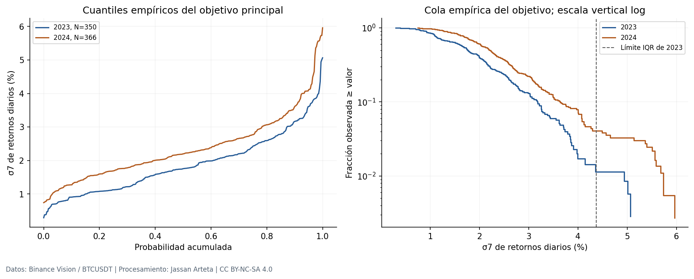
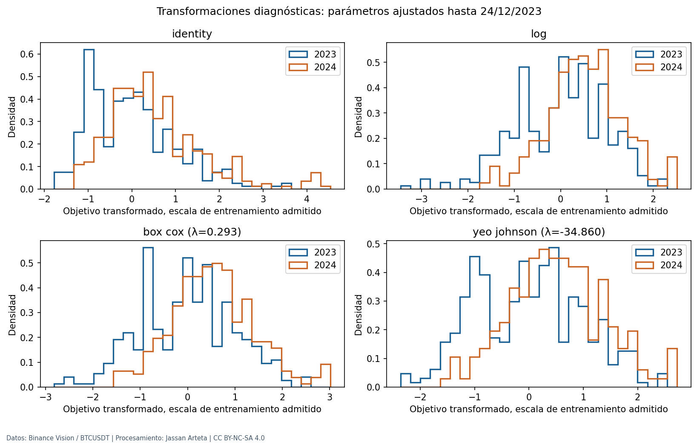
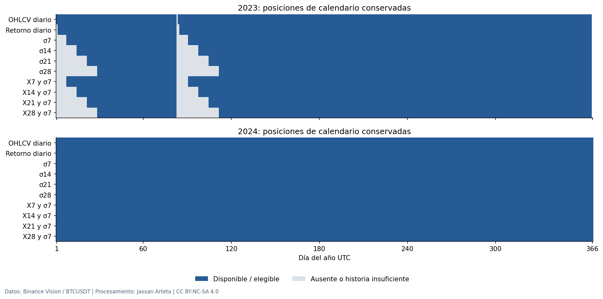
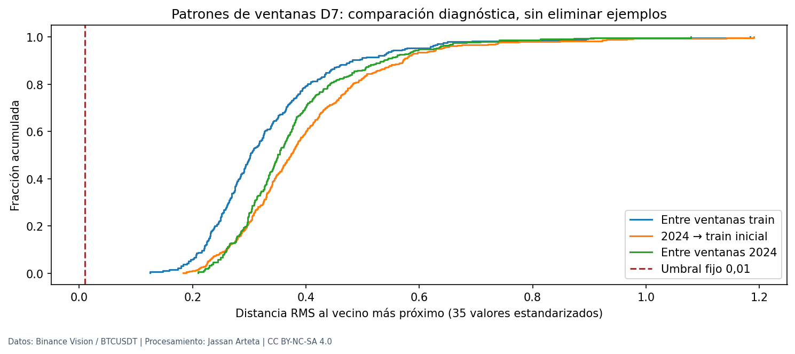
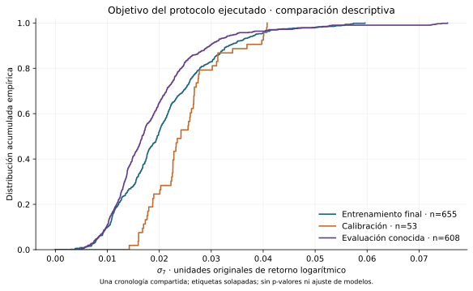
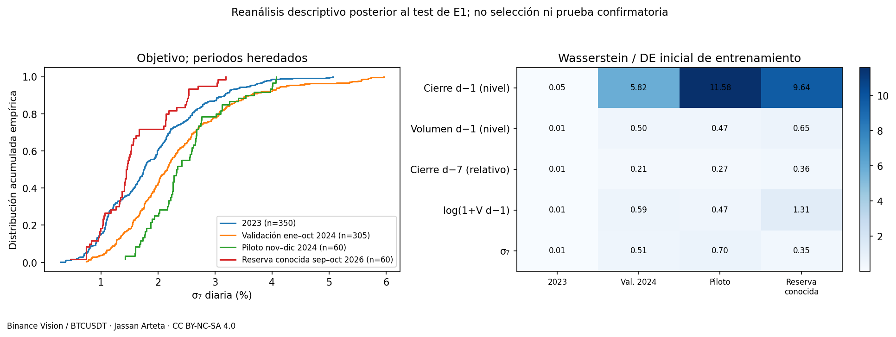
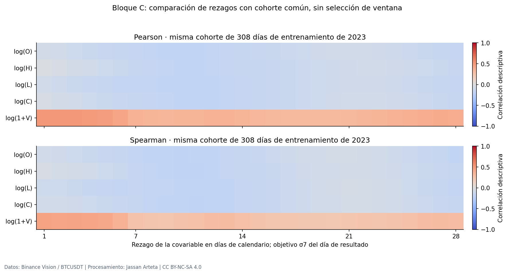
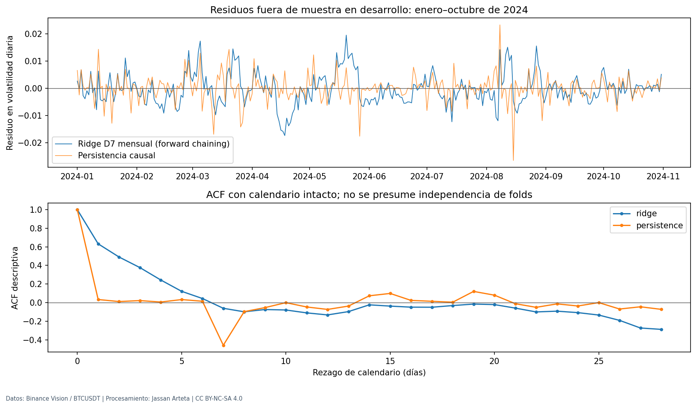

# 2. Análisis Exploratorio de Datos (EDA) Orientado a Decisiones

**Lectura vigente:** el protocolo ejecutado es [§48](48_protocolo_reducido.md), los resultados comunes están en [§6](06_benchmark_final.md), la reproducción registrada en [§55](55_reproduccion_ablaciones.md) y el Apéndice B actual en [§61](61_reproduccion_consolidada.md). El {download}`índice de evidencias del EDA <../_static/e2_eda_current_v1/README.md>` reúne la auditoría del calendario actual, los perfiles descriptivos y la trazabilidad de la guía. Las cifras científicas y los recibos históricos conservan su fecha y su alcance.

**Alcance:** este capítulo distingue el EDA de desarrollo heredado de E1 y ampliado en E2, la comprobación documental de la partición ejecutada y los perfiles retrospectivos calculados con datos ya admitidos. El benchmark de [16 sistemas](43_catalogo_obligatorio.md) está completado; sus resultados pertenecen a §6. Esta actualización no entrena modelos, no cambia recetas y no convierte los análisis posteriores en decisiones anteriores al benchmark.

El EDA de E1 se **amplía y conserva**. Este capítulo reutiliza sus evidencias de desarrollo y añade análisis reproducibles de transformaciones, casi duplicados, soportes temporales y residuos bajo forward chaining. Cada bloque termina con decisiones de preprocesamiento, consecuencias para arquitectura/validación y riesgos; la {ref}`tabla de trazabilidad <e2-trazabilidad-eda>` reúne esas relaciones.

El **desarrollo 2023–2024** aporta los diagnósticos de diseño. La partición vigente conserva **655 ejemplos de entrenamiento final, 53 de calibración y 608 de evaluación heredada de E1**. Sus perfiles posteriores describen desplazamiento; no seleccionan arquitecturas, transformaciones, umbrales ni periodos. La antigua reserva de septiembre–octubre de 2026 y el [piloto P0](09_protocolo_registrado.md) conservan su identidad histórica y no se presentan como el test o el piloto actuales.

El contrato principal sigue siendo D=7, n=7, h=1, cinco canales OHLCV y σ₇ poblacional sin anualizar. D es historia de entrada, n es ventana del objetivo y h es horizonte: no se intercambian. Los resultados n=14/21/28 de E1 son sensibilidades de la etiqueta, no objetivos añadidos al benchmark actual. La guía completa de 65 páginas permite cerrar la clasificación como **F2a, series de tiempo**, según la {ref}`resolución de ruta <e2-ruta-temporal>`; las covariables y etiquetas heredadas no se modifican por esa reclasificación.

## 2.1 EDA General

### 2.1.1 Análisis de la variable objetivo

La distribución es continua, positiva en el desarrollo observado y asimétrica. Se conservan las unidades de retorno logarítmico diario, sin multiplicar por 100 en las tablas.

| Periodo de desarrollo | Etiquetas σ₇ | Media | Mediana | DE poblacional | Asimetría | Exceso de curtosis |
|---|---:|---:|---:|---:|---:|---:|
| 2023 | 350 | 0,018797 | 0,017567 | 0,008890 | 0,8024 | 0,4965 |
| 2024 | 366 | 0,023661 | 0,021989 | 0,009767 | 1,1796 | 1,8431 |

La cerca descriptiva $Q_{0,75}+1,5\,IQR$, ajustada solo con 2023, es 0,04370768. La exceden 3/350 días de 2023 y 14/366 de 2024. Un valor extremo no es automáticamente corrupto; tampoco estos momentos prueban una distribución de cola de potencia. Los [perfiles heredados](../_static/eda_decisions/heredado/eda_general_quality/target_profiles.csv) conservan cuantiles, ceros y coberturas.



**Ampliación de E2: transformaciones.** Se comparan identidad, logaritmo, Box–Cox y Yeo–Johnson. Sus parámetros se estiman exclusivamente con las 343 etiquetas admisibles de 2023 hasta el 24/12 y se aplican sin reajuste a 2024 para este diagnóstico. Se verifican dominio e inversión; las transformaciones no se incorporan al entrenamiento de los modelos heredados.

| Transformación | λ ajustada | Asimetría 2023 | Asimetría 2024 | Exceso curtosis 2023 | Exceso curtosis 2024 |
|---|---|---|---|---|---|
| Identidad | — | 0,8024 | 1,1796 | 0,4965 | 1,8431 |
| Log | 0,000000 | -0,3909 | -0,0743 | 0,0149 | 0,1112 |
| Box–Cox | 0,292770 | -0,0112 | 0,2936 | -0,3620 | 0,2014 |
| Yeo–Johnson | -34,859961 | 0,0875 | 0,1419 | -0,6671 | -0,2030 |

Parámetros ajustados con **343 resultados admisibles hasta el 24/12/2023**; perfiles descriptivos sobre 350 etiquetas de 2023 y 366 de 2024. La inversión de los valores observados difiere menos de $10^{-12}$. Una λ negativa en Yeo–Johnson impone un límite al rango de la rama positiva: la inversión de predicciones arbitrarias exige comprobar dominio. No se adopta esa transformación.



Para comparar sus formas, los histogramas se centran y escalan con la media y DE transformadas del entrenamiento admisible. Los valores negativos del eje de esa figura son valores estandarizados, no volatilidades negativas; las tablas anteriores conservan las unidades y momentos indicados.

Una distribución más simétrica no demuestra una menor RMSE en escala original. Entrenar con MSE de log(Y), por ejemplo, cambia el problema de optimización y requiere tratar el sesgo de retransformación; invertir la predicción no recupera automáticamente la media condicional original. Si una transformación se investigara posteriormente, sus parámetros se ajustarían dentro de cada entrenamiento admisible del fold y se compararía con el mismo protocolo, sin modificar retrospectivamente E1.

Los ratios de clases, clases raras, entropía de clases, `focal loss` y `class-balanced loss` no aplican a este objetivo continuo. La poca frecuencia de volatilidad extrema se aborda mediante errores por régimen y cobertura, sin barajar ni sobremuestrear fechas para alterar su prevalencia.

**Decisión de preprocesamiento:** conservar etiquetas positivas válidas y el escalado heredado por la media de entrenamiento; no recortar extremos ni adoptar una transformación nueva. **Impacto en arquitectura y validación:** mantener salida escalar no negativa en las recetas base y medir RMSE en escala original; cualquier alternativa debe ajustarse dentro de cada fold. **Riesgos:** selección por apariencia del histograma, confundir transformación con mejora predictiva y convertir eventos extremos legítimos en datos eliminados.

### 2.1.2 Calidad, duplicados y ruido del objetivo

La auditoría de adquisición de E1 identificó 80 minutos ausentes y una vela presente con `close_time` irregular el 24/03/2023. No son 81 filas ausentes. Se excluye el día diario incompleto y las etiquetas/ventanas que dependan de él, conservando las fechas y los brutos.

| Comprobación de desarrollo | 2023 | 2024 |
|---|---:|---:|
| Días de calendario | 365 | 366 |
| Días OHLCV completos | 364 | 366 |
| Claves diarias duplicadas | 0 | 0 |
| Filas OHLCV completas idénticas | 0 | 0 |
| Retornos diarios válidos | 362 | 366 |
| Etiquetas σ₇ válidas | 350 | 366 |

No se detectan OHLC no positivos/incoherentes ni volúmenes negativos en los días completos auditados. Las [comprobaciones por año](../_static/eda_decisions/heredado/eda_general_quality/quality_by_year.csv) indican su denominador; cero hallazgos en ese alcance no certifica ausencia universal de errores del proveedor.



**Ampliación de E2: casi duplicados.** Se comparan ventanas D7 en la representación relativa de OHLC y `log1p(V)`. La distancia es la raíz de la media de diferencias estandarizadas al cuadrado; el escalado se aprende solo con ventanas de entrenamiento admisibles de 2023, hasta el 24/12. Se declara una alerta descriptiva si la distancia es ≤0,01; no se optimiza el umbral con validación. Se distinguen vecinos dentro de entrenamiento y vecinos de 2024 respecto a entrenamiento.

| Comparación | Consultas | Referencia | Alertas ≤0,01 | Duplicados relativos exactos | Distancia mínima | Mediana |
|---|---|---|---|---|---|---|
| Dentro de entrenamiento inicial | 343 | 343 | 0 | 0 | 0,125280 | 0,301770 |
| 2024 frente a entrenamiento inicial | 366 | 343 | 0 | 0 | 0,183537 | 0,373253 |
| Dentro de 2024 | 366 | 366 | 0 | 0 | 0,209485 | 0,350097 |

No se detectan alertas bajo esa regla. El [análisis de sensibilidad del umbral](../_static/eda_decisions/nearest_window_sensitivity.csv) conserva otros umbrales descriptivos; no se elige uno por su resultado ni se cambia el conjunto de entrenamiento.



La igualdad de fechas o de vectores, la proximidad de patrones y el solapamiento temporal son comprobaciones distintas. Dos ventanas bursátiles cercanas pueden ser observaciones legítimas; una distancia superior al umbral tampoco demuestra ausencia de fuga. El examen de soportes temporales de §2.1.4 complementa esta comprobación.

**Etiquetado y ruido.** E1 reconstruyó por una segunda implementación las 2.924 posiciones día–ventana de n=7/14/21/28: 2.780 etiquetas válidas, cero discrepancias de elegibilidad y error numérico máximo de aproximadamente $1,027\times10^{-15}$, frente a una tolerancia de $10^{-12}$. En n=7 son 716 etiquetas válidas. El [resumen de reconstrucción](../_static/eda_decisions/heredado/eda_general_quality/label_reconstruction_summary.csv) verifica el algoritmo; **no estima el ruido económico de la volatilidad latente**.

No hay anotadores humanos, por lo que acuerdo entre anotadores y detección de etiquetas de clase erróneas no aplican. La volatilidad de siete retornos es un proxy con incertidumbre por ventana finita, microestructura y proveedor. Sin una medición externa comparable o un modelo de observación identificado, no se cuantifica un ruido irreducible ni un techo de desempeño. No se sustituye esa ausencia por la precisión de la reconstrucción o por el error del mejor modelo.

**Decisión de preprocesamiento:** no imputar, comprimir huecos ni eliminar patrones parecidos automáticamente; propagar la máscara de calidad a todas las ventanas. **Impacto en arquitectura y validación:** los sistemas comparados comparten la cohorte elegible y las máscaras; se conserva la etiqueta heredada. **Riesgos:** confundir similitud con duplicación, solapamiento con independencia o consistencia numérica con ausencia de ruido de medición. El ruido externo queda como limitación no identificada.

### 2.1.3 Identificación de sesgos y posibles atajos

| Sesgo o atajo posible | Evidencia y alcance | Consecuencia técnica |
|---|---|---|
| Representación | Una serie BTCUSDT, un exchange y una cotización en USDT | No generalizar a otras criptomonedas, exchanges o USD; no contar semillas como mercados |
| Temporal | Distribuciones y relaciones móviles cambian entre 2023 y 2024 | Forward chaining y análisis por régimen; no partición aleatoria |
| Adquisición | Interrupción de minutos y cambio de unidad de timestamps entre años | Validar unidad por archivo, normalizar a UTC y conservar calendario |
| Tendencia compartida | Precios en nivel cambian fuertemente de escala entre periodos | Conservar OHLC relativos al último cierre conocido; una correlación no prueba información causal |
| Solapamiento del objetivo | σ₇ de fechas consecutivas comparte seis retornos | Persistencia como referencia; incertidumbre temporal por bloques |
| Información futura | OHLCV completo del día a predecir solo existe después de su cierre | Admitir únicamente barras ya cerradas; excluir escalado/selección con test |

La normalización relativa reduce la dependencia directa del nivel del precio, pero no garantiza invariancia de distribución ni elimina todos los atajos. El volumen también cambia de régimen. No se introducen variables de calendario, identificadores o covariables externas cuya disponibilidad no esté auditada.

**Decisión de preprocesamiento:** conservar normalización causal y controles de unidades; no realizar balance de clases en una regresión. **Impacto en arquitectura y validación:** comparar mecanismos temporales bajo las mismas entradas y orígenes, reportando resultados por segmentos de volatilidad. **Riesgos:** atribuir a una arquitectura lo que proviene de escala, calendario, proveedor o información futura; extrapolación a activos no observados.

### 2.1.4 Partición, auditoría de soportes y estado del test

El calendario ejecutado es el de [§48](48_protocolo_reducido.md), compatible con el {ref}`contrato heredado <e2-contrato-heredado>`. La partición es cronológica y determinista: **semilla de partición no aplicable**. La semilla HPO **271201** y las seis finales **271801–271806** controlan el entrenamiento; no aleatorizan fechas. La [auditoría vigente](../_static/e2_eda_current_v1/partition_audit.json) comprueba fechas, máscaras, firmas de preparación y recibos guardados, sin abrir archivos brutos ni volver a ejecutar modelos.

| Origen del fold HPO | Entrenamiento elegible | Última etiqueta train | Validación interna, inclusive | Fechas de validación |
|---|---:|---|---|---:|
| 01/01/2024 | 253 | 25/09/2023 | 03/10–24/12/2023 | 83 |
| 01/07/2024 | 435 | 25/03/2024 | 02/04–23/06/2024 | 83 |
| 01/10/2024 | 527 | 25/06/2024 | 03/07–23/09/2024 | 83 |

Los tres folds aportan **249 fechas concatenadas de selección**, no resultados del test final. El embargo excluye siete fechas de objetivo entre cada entrenamiento y su validación; las transformaciones se ajustan con el entrenamiento admisible de ese fold. Una fecha validada en un fold puede integrar un entrenamiento posterior cuando ya es pasada; los entrenamientos expansivos se solapan y no son réplicas independientes.

| Etapa final | Periodo de etiquetas, inclusive | Ejemplos elegibles | Uso |
|---|---|---:|---|
| Entrenamiento | 08/01/2023–31/10/2024, con máscara de calidad | 655 | Ajuste de pesos y transformaciones |
| Embargo | 01–07/11/2024 | — | Sin etiquetas de ajuste ni calibración |
| Calibración y piloto | 08/11–30/12/2024 | 53 | Calibradores y diagnóstico de desarrollo; sin HPO |
| Puente | 31/12/2024 | — | Observaciones históricas causales; sin ajuste ni recalibración |
| Evaluación heredada de E1 | 01/01/2025–31/08/2026 | 608 | Mismos pesos, escaladores y calibradores congelados |

Con D=n=7, $X_t$ usa OHLCV de $[t-7,t-1]$ y $Y_t$ necesita ocho cierres de $[t-7,t]$. La auditoría distingue **IDs de ejemplos**, soportes de entradas y soportes de etiquetas. En las separaciones entrenamiento→validación HPO y entrenamiento final→calibración no se intersectan los cierres de las etiquetas. Los IDs de calibración y test también son disjuntos, pero sus soportes brutos **sí se comparten**: $Y_{30/12/2024}$ y $Y_{01/01/2025}$ reutilizan seis cierres y cinco retornos. Es reutilización causal legítima en un pronóstico rolling; no demuestra independencia ni implica por sí sola fuga. Las referencias endógenas pueden reutilizar historia disponible con parámetros congelados; su mayor soporte se declara en §7.

**Auditoría ancestral conservada.** La [tabla original de diez folds mensuales](../_static/eda_decisions/fold_leakage_audit.csv) documenta enero–octubre de 2024 y 305 fechas del EDA Ridge/persistencia. Se conserva con sus bytes y sus controles originales; no representa los tres folds HPO ni las 608 fechas del benchmark actual. Los índices históricos usaron `timeseries-cv` 0.1.5, proyecto de DidierRLopes con Filipe R. Ramos, y una adaptación mensual propia; no se atribuye a la librería una API mensual.

**Identidad y exposición previa.** La [admisión vigente de datos](../_static/e2_benchmark_final_20261113/data_admission.json) y la [congelación de 81 predictores](../_static/e2_benchmark_final_20261113/final_freeze.json) vinculan el periodo de 608 fechas, sus hashes y la ausencia de reajuste posterior al acceso de esta campaña. La partición de E1 se hereda; no se exige otra reserva para conservar esa herencia. Su exposición histórica sigue declarada y no se recupera cegamiento prospectivo. El [registro anterior de identidad](../_static/eda_traceability/partition_identity.json) pertenece a la reserva de septiembre–octubre de 2026 y mantiene su alcance histórico, incluido el estado del benchmark de aquel corte. Un hash acredita identidad, no desconocimiento de resultados.

**Decisión de preprocesamiento:** conservar máscaras, calendario y transformaciones ajustadas con cada entrenamiento admisible. **Impacto en arquitectura y validación:** comparar los 16 sistemas en la cohorte común y distinguir selección interna, calibración y scoring con pesos fijos. **Riesgos:** escalado global, selección por test, confundir historia causal con etiquetas de ajuste o IDs disjuntos con independencia de soportes.

### 2.1.5 Cambio de distribución

**Evidencia heredada de desarrollo.** En el perfil causal lag 1, 2023 y 2024 tienen 350 y 366 casos completos. La distancia KS es aproximadamente 0,920–0,924 para OHLC en nivel, 0,2332 para volumen y 0,2405 para σ₇. La [permutación por bloques de 14/28 días](../_static/eda_decisions/heredado/eda_general_shift/conditional_block_permutation.csv) usa 2.000 réplicas y Holm sobre doce contrastes; sus referencias son exploratorias y condicionales, sin garantía de intercambiabilidad bajo tendencias.

Para σ₇, los p-valores Monte Carlo ajustados son aproximadamente 0,06197 y 0,09395: la distancia descriptiva no se convierte en rechazo ajustado a 0,05. Tampoco el no rechazo acredita igualdad de distribuciones. Los precios en nivel sí presentan diferencias fuertes bajo ambas referencias; esto apoya examinar la representación relativa, sin demostrar que resuelva la generalización.

**Perfiles del calendario vigente.** La [tabla descriptiva actual del objetivo](../_static/e2_eda_current_v1/target_profiles.csv) contiene nueve filas: entrenamiento/validación de cada uno de los tres folds HPO y entrenamiento final/calibración/evaluación. Conserva sus denominadores **253/83, 435/83, 527/83 y 655/53/608**, fechas, momentos y distancias descriptivas. El [resumen y la procedencia](../_static/e2_eda_current_v1/summary.json) separan la reconstrucción de perfiles a partir de derivados existentes de cualquier ajuste predictivo. Los folds expansivos no se agrupan como observaciones independientes.



La ECDF compara **655/53/608 etiquetas** en su escala original. Las distancias KS y Wasserstein del CSV son resúmenes de diferencia, **sin p-valores ni inferencia iid**. Sus referencias corresponden al entrenamiento de cada comparación; no se aprende una nueva transformación con calibración o test. Este perfil se calcula después de conocer la evaluación: describe dificultad y desplazamiento, sin cambiar recetas, umbrales ni fechas.

| Partición final | n | Media σ₇ | Mediana σ₇ | Distancia KS frente a train final | Wasserstein / DE train final |
|---|---:|---:|---:|---:|---:|
| Entrenamiento | 655 | 0,02095388 | 0,01960572 | 0 | 0 |
| Calibración | 53 | 0,02511173 | 0,02417553 | 0,352096 | 0,492181 |
| Evaluación heredada | 608 | 0,01887752 | 0,01669688 | 0,150397 | 0,250287 |

**Covariables: perfil anual heredado.** La [copia íntegra del perfil anual de E1](../_static/e2_eda_current_v1/inherited_annual_profiles.csv) compara 2023, 2024, 2025 (**365 fechas**) y enero–agosto de 2026 (**243 fechas**). Contiene OHLCV del mismo día, retorno, `log1p` de volumen y σ₇; su referencia de escala es el desarrollo observado hasta **03/12/2024**. Por ello es un perfil retrospectivo de variables brutas, no el tensor causal de 35 componentes D7×5 ni una comparación recalculada con el entrenamiento final hasta octubre. Se conservan sus periodos separados y no se mezclan sus distancias con las del CSV actual del objetivo. No autoriza usar OHLCV de $t$ para predecir $Y_t$.

**Antecedente de 60 días conservado.** El [perfil histórico por fases](../_static/eda_known_shift/aggregated_profile.csv), sus [distancias](../_static/eda_known_shift/distribution_distances.csv), la [figura original](../_static/eda_known_shift/known_distribution_shift.png) y el [registro de procedencia](../_static/eda_known_shift/provenance.json) describen otra comparación: train admisible de 343 ejemplos hasta el 24/12/2023, validación enero–octubre de 2024, piloto 01/11–30/12/2024 y reserva 01/09–30/10/2026, de 60 días cada uno de estos dos últimos periodos. Incluyen perfiles de OHLCV lag 1 y de componentes relativos. Sus cifras y bytes no cambian; septiembre–octubre de 2026 no integra las 608 fechas de la evaluación actual y no fue abierto para el scoring de esta campaña.

:::{dropdown} Figura histórica: comparación con la reserva de 60 días

:::

**Decisión de preprocesamiento:** conservar las transformaciones heredadas y sus parámetros de entrenamiento; no adaptar con la reserva. **Impacto en arquitectura y validación:** evaluar estabilidad por fase/régimen y registrar sensibilidad a cambios de distribución; una propuesta de adaptación requeriría diseño propio compatible con el contrato. **Riesgos:** normalizar usando test, interpretar KS como prueba causal o explotar un perfil retrospectivo para seleccionar modelos y llamarlo confirmatorio.

## 2.2 EDA temporal: covariables y diagnóstico de la ruta F2a

**La ruta metodológica adoptada es F2a: series de tiempo.** La autocorrelación residual fuerte de la referencia Ridge activa la regla RT1 de la guía (p.32), que exige esa reclasificación. La {ref}`sección 7 <e2-ruta-temporal>` enlaza el diagnóstico con el protocolo ejecutado.

Los apartados siguientes desarrollan el **EDA de series de tiempo del bloque B** y conservan las **comprobaciones complementarias de covariables del bloque C**: disponibilidad, desfases y relación con el objetivo. **B y C son bloques del EDA; utilizar el análisis del bloque C no significa adoptar la ruta F2b.** La tarea predictiva es una regresión porque estima un valor continuo de σ₇, dentro de la ruta F2a.

Los diagnósticos E1 y la referencia inicial del EDA conservan su fecha; los de las 81 trayectorias finales en [§49](49_diagnosticos_f2a.md) son posteriores al benchmark.

### 2.2.1 Estructura y disponibilidad temporal de covariables

La adquisición es de un minuto y la representación del modelo es diaria UTC. Se usan siete barras completas anteriores al día resultado, en orden y sin comprimir huecos. Los días inválidos afectan a sus ventanas dependientes, no solo a una fila aislada.

| Cantidad | Disponible al emitir el pronóstico al inicio de $t$ | Papel |
|---|---|---|
| OHLCV completo de $t-k$, $k\ge1$ | Sí, desde el inicio de $t-k+1$ | Entrada causal |
| OHLCV completo de $t$ | No; se completa al inicio de $t+1$ | Excluido de las entradas |
| σ₇(t), que incluye el retorno de $t$ | No | Objetivo |
| σ₇(t−1) | Sí, si todos sus cierres son válidos | Diagnóstico de régimen/persistencia; no sexto canal de las redes heredadas |
| Correlación móvil que utiliza Y(t) | Solo después de conocer el resultado | Diagnóstico retrospectivo, no atributo disponible al emitir |

El [contrato de disponibilidad heredado](../_static/eda_decisions/heredado/eda_temporal_specific/availability_contract.csv) y la nueva auditoría por fold mantienen esta distinción. Las correlaciones diagnósticas pueden usar logaritmos de precios en nivel; no se confunden con los tensores relativos que recibe el modelo.

**Decisión de preprocesamiento:** alinear entradas hasta $t-1$, objetivo en $t$ y marcas de disponibilidad; no imputar barras incompletas. **Impacto en arquitectura y validación:** conservar tensores $7\times5$ y mecanismos temporales causales; auditar cada nuevo canal antes de introducirlo. **Riesgos:** desfase de un día, normalización con un cierre futuro y tratar una estadística retrospectiva como entrada contemporánea.

### 2.2.2 Relación covariables–objetivo y cambios de régimen

E1 calculó 140 asociaciones de cinco covariables transformadas con rezagos de 1–28 días, usando una **cohorte común de 308 resultados de 2023** para comparar los rezagos con el mismo denominador. El volumen con rezago 1 presenta Pearson 0,50454 y Spearman 0,45311. Los máximos absolutos descriptivos de precios aparecen entre 9 y 12 días, con asociaciones bastante menores; no justifican cambiar D=7 por inspección de un máximo entre muchos.



Los [coeficientes por rezago](../_static/eda_decisions/heredado/eda_temporal_specific/lag_correlations_common_train.csv) describen asociación, no causalidad, importancia condicional ni desempeño fuera de muestra. En particular, los logaritmos de precios en nivel comparten tendencia; un pico marginal no demuestra que el modelo necesite ese rezago.

Las correlaciones móviles se estimaron en ventanas de 60 días, con al menos 50 pares válidos: 309 ventanas definidas por variable en 2023 y 366 en 2024. La mediana de la relación volumen–objetivo pasa de 0,33949 a 0,31574 y su signo es positivo en 99,03 % y 100 % de las ventanas definidas; varias relaciones de precios cambian de signo. El [resumen móvil](../_static/eda_decisions/heredado/eda_temporal_specific/rolling_relationship_summary.csv) conserva coberturas. Las ventanas se solapan y no son réplicas independientes de regímenes.

**Decisión de preprocesamiento:** conservar los cinco canales y D=7 del contrato, con la normalización causal; no seleccionar rezagos por máximos retrospectivos. **Impacto en arquitectura y validación:** comparar memoria recurrente/convolución causal bajo la misma historia; examinar errores por régimen y mes. **Riesgos:** relaciones espurias por tendencia, selección múltiple de rezagos y tratar las ventanas móviles como una prueba de cambio estructural confirmatoria.

(e2-diagnostico-forward)=
### 2.2.3 Diagnóstico con residuos de una referencia forward chaining

La ampliación inicial del EDA ajustó una referencia **Ridge, α=1 fijado**, en cada uno de los diez folds mensuales enero–octubre de 2024. Usa exclusivamente las cinco covariables D7, los índices y el embargo de aquel diagnóstico, y escalado aprendido en entrenamiento de cada fold. Es una referencia de desarrollo sin HPO, ajena al catálogo obligatorio vigente de 16 sistemas. Sus **305 fechas** pertenecen a ese diseño histórico; no son las 249 fechas de selección ni las 608 de prueba actuales. Persistencia $\widehat Y_t=Y_{t-1}$ aporta una referencia causal adicional.

| Referencia | Fechas | RMSE | MAE | ACF(1) | ACF(7) |
|---|---|---|---|---|---|
| Ridge D7 forward | 305 | 0,00576554 | 0,00431479 | 0,632228 | -0,061013 |
| Persistencia causal | 305 | 0,00474310 | 0,00292428 | 0,033256 | -0,458558 |

Ridge mantiene dependencia de primer rezago y pierde frente a persistencia en RMSE en estas fechas. Persistencia reduce mucho la ACF(1), pero conserva una ACF(7) negativa considerable: no elimina toda la estructura residual. Para lag 7, Ljung–Box de Ridge da Q=266,4062, p≈8,88183×10⁻⁵⁴ y p ajustado≈5,77319×10⁻⁵². El ajuste Holm corresponde a **66 diagnósticos de EDA** (dos referencias × once grupos, incluidos los diez meses y el total × tres rezagos), no a la familia de las RQ del benchmark.



Se reportan [métricas por fold](../_static/eda_decisions/forward_reference_metrics.csv), [ACF](../_static/eda_decisions/forward_reference_acf.csv) y [Ljung–Box](../_static/eda_decisions/forward_reference_ljung_box.csv), con número de observaciones, rezagos y grados de libertad declarados. La referencia se ajusta con observaciones anteriores, no sobre los residuos de validación; no se resta mecánicamente el número de 35 entradas a los grados de libertad. La aproximación chi-cuadrado es un diagnóstico exploratorio y puede ser imprecisa en meses cortos o con heterogeneidad. No se convierten fechas separadas por huecos en observaciones consecutivas; agrupar meses tampoco elimina cambios de modelo o de régimen.

**Resolución de ruta metodológica.** La autocorrelación remanente originó la alerta sobre dinámica no explicada. Con la guía completa, RT1 (PDF p32) exige reclasificar cuando los residuos de una referencia muestran autocorrelación fuerte. Por ello, el 06/11/2026 se cierra la ruta **F2a, series de tiempo**, documentada en la {ref}`sección 7 <e2-ruta-temporal>`. No se mantiene una clasificación abierta por el mero hecho de que las redes excluyan Y rezagada.

Esta evidencia no demuestra que añadir Y rezagada mejore un modelo ni autoriza cambiar las entradas heredadas. Una sensibilidad con rezagos del objetivo necesitaría una decisión documentada y una evaluación de desarrollo compatible con la herencia de E1; aquí no se añade ese canal ni se cambia la partición. El solapamiento de σ₇ también contribuye a la dependencia y debe distinguirse de un mecanismo aprovechable fuera de muestra.

**Decisión de preprocesamiento:** conservar X/Y y máscaras heredadas; no añadir rezagos de Y silenciosamente. **Impacto en arquitectura y validación:** seguir F2a, usar incertidumbre por bloques e incluir persistencia, naive semanal y ARIMA con soporte e información endógena declarados; los residuos de cada modelo ejecutado requieren sus propios diagnósticos. **Riesgos:** interpretar ACF como prueba de no linealidad o de utilidad de una nueva variable, presentar Ridge como cuarto modelo base o confundir el diagnóstico de EDA con el benchmark definitivo.

(e2-eda-series-heredado)=
### 2.2.4 Series de tiempo: evidencia heredada y decisiones del bloque B

La ruta F2a requiere el bloque B además del análisis de covariables. Se reutilizan los análisis ejecutados del [EDA de E1, §§2.5.1–2.5.6](https://jassan-bit.github.io/DeepLearning_202630/sections/02_eda.html), conservando sus frecuencias, tramos y supuestos. Las [especificaciones ADF/KPSS diarias](https://raw.githubusercontent.com/jassan-bit/DeepLearning_202630/main/results/eda_development/stationarity_daily.csv), las [del objetivo](https://raw.githubusercontent.com/jassan-bit/DeepLearning_202630/main/results/eda_development/stationarity_volatility.csv) y el [resumen ejecutado](https://raw.githubusercontent.com/jassan-bit/DeepLearning_202630/main/results/eda_development/summary.json) permiten comprobar los resultados sin repetirlos.

| Análisis y evidencia | Decisión de preprocesamiento | Impacto en arquitectura | Impacto en validación | Riesgos y límite |
|---|---|---|---|---|
| **Tendencia, estacionalidad y ruido:** STL robusto de log-cierres diarios, 25/03–31/12/2023, periodo 7; E1 §2.5.1 | Conservar representación relativa causal; no usar el suavizado centrado de STL como entrada | Comparar mecanismos temporales bajo la misma ventana D7 | Evaluar por tiempo y régimen; no seleccionar una temporada por inspección de STL | El periodo semanal impuesto no demuestra estacionalidad; su residuo no estima ruido irreducible |
| **Estacionariedad:** ADF con constante y 7 rezagos; KPSS con constante y rezagos automáticos. σ₇, 01/04–31/12/2023, n=275: pADF≈0,002423 y pKPSS>0,10; E1 §2.5.2 | Mantener etiqueta y escala; no diferenciar automáticamente Y | No añadir una capa o transformación por un único contraste | Interpretar conjuntamente ambos tests, con su tramo y especificación | Compatibilidad con estacionariedad en ese tramo no garantiza estabilidad en 2024–2026; no rechazo no prueba el supuesto |
| **Dependencia temporal:** ACF, PACF y periodograma de retornos diarios, 26/03–31/12/2023, n=281, 28 rezagos; E1 §2.5.3 | Mantener calendario y D7 heredados; distinguir retornos de σ₇ | Comparar memoria recurrente, convolución y atención con idéntica historia | Conservar orden temporal y remuestreo por bloques | Bandas por rezago aproximadas; no seleccionar D por el mayor pico ni trasladar diagnósticos de minuto a día |
| **Heterocedasticidad y dependencia residual:** ARCH-LM de retornos diarios centrados, 7 rezagos, p≈0,341; BDS y Ljung–Box por fold/semilla de los modelos históricos de E1; E1 §§2.5.3/2.5.6 | Preservar extremos válidos y escalado aprendido con train | Mantener comparadores simples; diagnosticar cada predictor ejecutado | Distinguir pruebas de la serie y pruebas de residuos guardados; conservar multiplicidad y casos no definidos | ARCH no rechazado no acredita homocedasticidad; BDS contrasta iid y no identifica exclusivamente no linealidad |
| **Picos, anomalías y cambios:** máscaras de continuidad, extremos conservados y candidato CUSUM 15/10/2023 sin confirmación; E1 §§2.5.1/2.5.5 | Excluir corrupción según máscara, sin borrar eventos por magnitud del error | No atribuir capacidad adicional a una ruptura no confirmada | Analizar errores por régimen y estabilidad, sin mover fronteras del test | Un candidato descriptivo no demuestra ruptura ni causa económica |
| **Frecuencia y granularidad:** adquisición de un minuto, agregación diaria UTC y un día incompleto de desarrollo; §§2.1.2/2.2.1 | No imputar con el futuro ni comprimir huecos; propagar invalidez a soportes dependientes | Tensor fijo 7×5 de días completos anteriores | Cohorte común por disponibilidad; embargo de siete fechas de objetivo | Confundir siete filas con siete días consecutivos o incluir la barra de $t$ |
| **Predictibilidad intrínseca informal:** persistencia forward en 305 fechas de desarrollo, RMSE=0,00474310 y MAE=0,00292428; §2.2.3 | Conservar σ₇ y la referencia causal $Y_{t-1}$ | Exigir contexto frente al pronóstico ingenuo antes de atribuir ganancia a Deep Learning | Comparar sobre las mismas fechas; el resultado histórico no sustituye la A2 de 608 fechas | Error ingenuo como referencia informal del margen de mejora, sin interpretarlo como techo de Bayes |

La [auditoría final de §49](49_diagnosticos_f2a.md) ya ejecutó Ljung–Box, ARCH-LM, BDS y Jarque–Bera sobre **81 trayectorias** del benchmark congelado. Esa evidencia posterior permite discutir residuos de los modelos actuales; no se presenta como EDA previo ni modifica la decisión F2a. [§57](57_errores_techo.md) añade entropía de permutación con órdenes 3/4/5 y retardo 1, sin atravesar huecos, también como análisis posterior. Complejidad ordinal y error de persistencia no identifican un ruido externo ni un error mínimo alcanzable.

**Decisión de preprocesamiento:** conservar transformaciones causales, etiqueta y máscaras de E1. **Impacto en arquitectura y validación:** aplicar F2a con entradas D7 comunes, referencias temporales y controles de disponibilidad del protocolo ejecutado. **Riesgos:** elegir ventanas por picos retrospectivos, trasladar pruebas entre frecuencias o presentar diagnósticos finales como decisiones tomadas antes del entrenamiento.

(e2-trazabilidad-eda)=
## 2.3 Trazabilidad hallazgo–decisión

La [trazabilidad vigente descargable](../_static/e2_eda_current_v1/decision_traceability.csv) registra los requisitos de **2.1, B y C**, su evidencia, decisión de preprocesamiento, impacto en arquitectura, validación, riesgos y alcance. La [lista de cotejo CSV](../_static/e2_eda_current_v1/guide_checklist.csv) y su [versión JSON](../_static/e2_eda_current_v1/guide_checklist.json) distinguen evidencia heredada, actualización descriptiva, no aplicabilidad y limitaciones. Cubren los campos de **A.1 de la guía completa (PDF p61)** sin atribuir cumplimiento a una casilla vacía.

La [tabla anterior](../_static/eda_traceability/hallazgo_decision.csv) se conserva íntegra como registro histórico. Su fila `RESID` describe la alerta anterior al cierre de la ruta. El [registro complementario anterior](../_static/eda_traceability/decisiones_vigentes.csv) enlaza esa fila con la decisión **F2a del 06/11/2026**, documentada en la {ref}`sección 7 <e2-ruta-temporal>`, y distingue su incorporación documental del 08/11/2026. Las referencias de aquel registro a Ridge en un catálogo anterior conservan ese alcance; no incorporan Ridge al catálogo obligatorio vigente.

Ridge α=1 fue una referencia diagnóstica del EDA, no uno de los diez modelos vigentes. Sus cifras no sustituyen resultados del nuevo catálogo ni autorizan añadirlo como candidato adicional.

| Hallazgo | Decisión y efecto en el diseño | Riesgo que controla |
|---|---|---|
| Objetivo positivo y cola derecha | Mantener escala/etiqueta; reportar errores en extremos y RMSE original | Recorte o transformación oportunista |
| Un día incompleto y ventanas dependientes | Máscara causal común, sin imputación ni compresión | Datos inconsistentes y tamaños no comparables |
| Similitud entre ventanas distinta de identidad | Auditoría de vecinos separada de la temporal; no borrado automático | Falsos duplicados o falsas garantías de ausencia de fuga |
| Reconstrucción numérica consistente | Mantener algoritmo; declarar ruido externo no identificado | Falso techo de desempeño |
| Una serie y cambios de régimen | Alcance por mercado, forward chaining y análisis segmentado | Pseudorreplicación y generalización excesiva |
| Soportes de entrenamiento anteriores a validación | Conservar índices, embargo y escalado por fold | Información futura |
| Reserva ya evaluada | Identidad trazable y perfil retrospectivo; alcance exploratorio | Sellado retrospectivo ficticio |
| Desplazamiento entre fases | Representación causal fija y análisis de estabilidad | Adaptación con test |
| Asociaciones móviles variables | Comparar mecanismos con la misma información | Elección de rezagos por asociación marginal |
| Dependencia residual | Resolución F2a y referencias específicas; contrato D7 conservado | Clasificación del problema por conveniencia |

(e2-reproduccion-eda)=
## 2.4 Reproducción y estado de cierre

Las evidencias heredadas conservan sus hashes de procedencia y se distinguen de los productos actuales. El {download}`índice de evidencias vigente <../_static/e2_eda_current_v1/README.md>` reúne perfiles, auditoría, lista de cotejo y fuentes. Los scripts `scripts/audit_e2_eda_partition.py` y `scripts/e2_eda_current_profiles.py` trabajan con derivados y registros ya existentes: no entrenan, no ejecutan inferencia, no abren ZIP brutos ni modifican fuentes o modelos. La auditoría no vuelve a leer tensores privados de entrenamiento; comprueba sus fechas, máscaras y firmas registradas.

**Descargas históricas conservadas:** {download}`código, tablas y figuras del EDA anterior en un ZIP <../_static/eda_descargas/EDA_E2_codigo_tablas_figuras.zip>`, con su {download}`manifiesto SHA-256 original <../_static/eda_descargas/MANIFIESTO.json>`. El archivo no se presenta como paquete del nuevo perfil; el LEEME conserva las entradas de desarrollo y la adquisición oficial de aquel corte. Los brutos y los precios individuales de test se conservan aparte.

La reproducción del **EDA histórico** conserva este comando, desde la raíz del repositorio, con Python 3.12 y `requirements-eda.lock.txt`:

```bash
.venv-eda/bin/python scripts/eda_e2_decisions.py
```

La reconstrucción del **perfil histórico de la reserva de 60 días** se documenta en el {download}`README de distribución anterior <../_static/eda_known_shift/README.md>`. El {download}`README del resto del EDA anterior <../_static/eda_decisions/README.md>` especifica sus entradas, dependencias y productos. Permanecen disponibles los [resultados resumidos de aquel EDA](../_static/eda_decisions/summary.json) y sus [perfiles agregados por fase](../_static/eda_known_shift/aggregated_profile.csv). Para la partición de 655/53/608 ejemplos, consultar el [resumen actual](../_static/e2_eda_current_v1/summary.json) y la [auditoría actual](../_static/e2_eda_current_v1/partition_audit.json).

| Requisito recibido | Estado y límite |
|---|---|
| Objetivo, calidad, sesgos y duplicados | Analizados con cifras, figuras, scripts y decisiones explícitas |
| Partición y solapamiento | Tres folds HPO y partición final auditados mediante registros existentes; IDs disjuntos y reutilización causal de soportes distinguidos |
| Comparación de distribuciones | Nueve perfiles actuales del objetivo y ECDF 655/53/608; covariables brutas en perfil anual E1 separado; descripción retrospectiva sin selección |
| Estructura, disponibilidad, relaciones rezagadas/móviles | Evidencia E1 ampliada y trazable |
| Residuos de referencia | Diagnóstico forward de desarrollo ejecutado; resolución F2a registrada en §7 |
| Series de tiempo, bloque B | STL, ADF/KPSS, ACF/PACF, ARCH/BDS, cambios, frecuencia y predictibilidad informal desarrollados en §2.2.4 con evidencia E1 reutilizada |
| Ruido externo y techo de desempeño | No identificados con esta única fuente/proxy; limitación explícita que la reconstrucción numérica no cierra |
| Partición y test heredados | Herencia E1 aceptada; identidad, congelación actual y exposición previa documentadas, sin exigir otra reserva ni afirmar cegamiento recuperado |
| Tabla del Apéndice A y ruta completa | Guía completa recibida; tabla cotejada con A.1 y ruta F2a cerrada |
| Referencias F2a | Persistence, SeasonalNaive y ARIMA evaluadas sobre las 608 fechas comunes; las pruebas sintéticas previas siguen siendo antecedentes |
| Benchmark del catálogo vigente | Completado en §6: 16 sistemas, 81 predictores y 608 fechas; sin superioridad práctica confirmada tras Holm y con alcance retrospectivo |
| Residuos de modelos finales | 81 trayectorias diagnosticadas en §49; análisis posterior separado del EDA que motivó F2a |


## Archivo de la versión anterior

La {download}`versión exacta anterior a esta consolidación <../_static/e2_delivery_reproduction_20261114/archived_chapters/02_eda.md>` se conserva con su SHA256 en el [manifiesto de archivo](../_static/e2_delivery_reproduction_20261114/chapter_archive_manifest.json). Sus estados pendientes describen el corte original.
