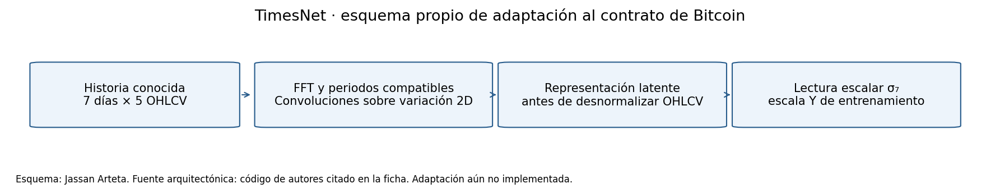
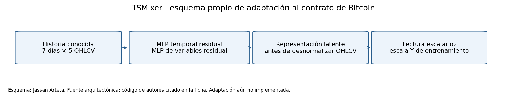
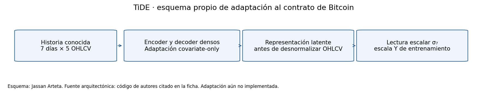
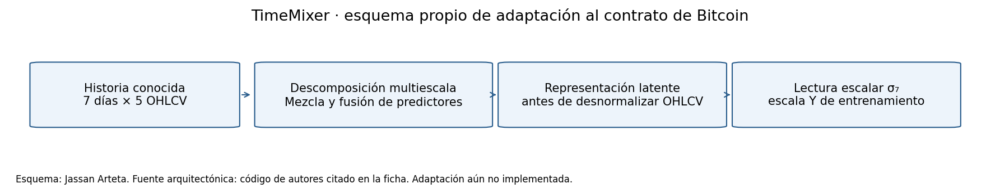
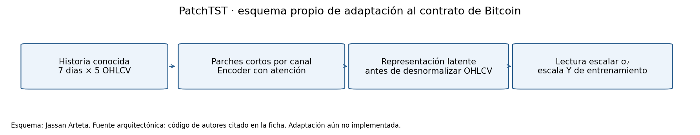
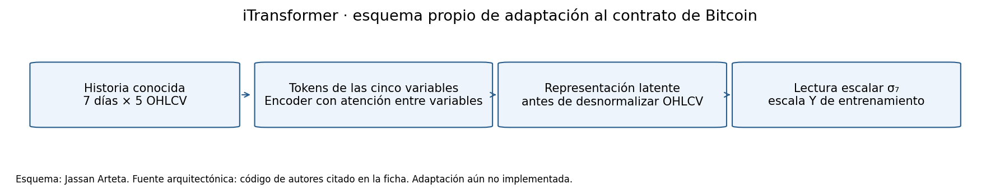
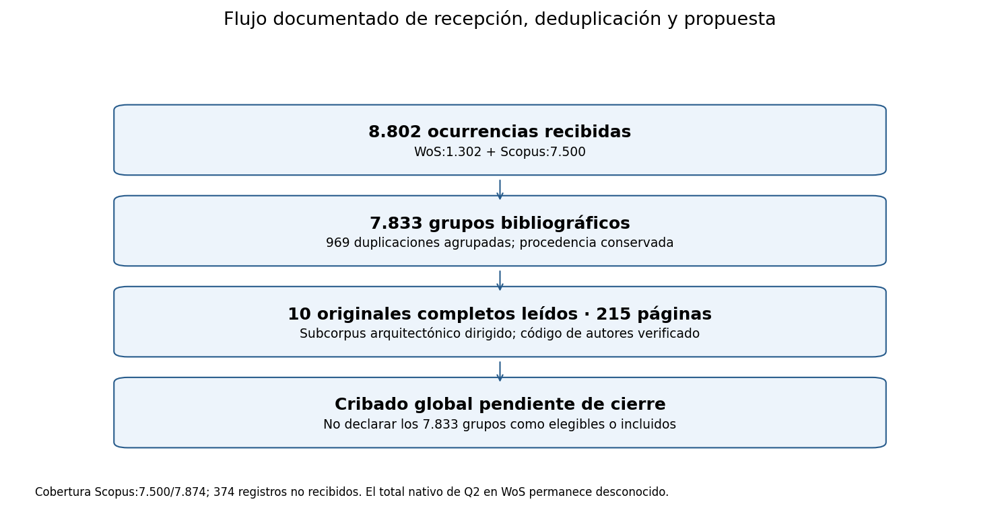

# 3. Revisión Sistemática del Estado del Arte

**Lectura vigente.** La revisión amplía E1 y sustenta el catálogo de **diez modelos, cuatro familias y nueve fuentes arquitectónicas**; FCN y ResNet comparten estudio. El flujo del **corpus recibido** está reconciliado: **9.559 grupos cribados, 42 estudios aplicados únicos, 120 evaluaciones primarias focales o reutilizadas y cero pendientes operativos**. Hay 174 informes no recuperados y límites de cobertura de las búsquedas. El [expediente de elegibilidad y selección](62_cierre_literatura_focal.md) contiene los dictámenes detallados; este capítulo los ordena conforme a §§3.1–3.4 de la guía.

El {download}`índice de evidencias vigente <../_static/e2_literature_current_v1/README.md>`, la [lista de cotejo de 41 requisitos](../_static/e2_literature_current_v1/guide_checklist.csv), la [trazabilidad requisito–evidencia](../_static/e2_literature_current_v1/decision_traceability.csv) y el [manifiesto](../_static/e2_literature_current_v1/manifest.json) permiten revisar el alcance. Los resultados externos se mantienen separados del [benchmark E2 completado](06_benchmark_final.md): dieciséis sistemas, 81 predictores congelados y 608 fechas comunes. Esta consolidación documental no cambia sus resultados ni atribuye retrospectivamente a los puntajes bibliográficos la selección experimental anterior.

## 3.1 Estrategia de búsqueda y trazabilidad

### 3.1.1 Cadenas aportadas y procedencia

Las cadenas originales se recuperaron del historial de GitHub y de los recibos; no faltan por volver a solicitarlas. Se conservan operadores y campos exactos. **Q1 · Aplicación, WoS:**

```text
TS=((bitcoin OR ethereum OR cryptocurrenc* OR cryptoasset*)
AND (volatility OR "realized volatility" OR "realised volatility")
AND ("deep learning" OR "neural network*" OR transformer*
OR LSTM OR GRU OR CNN OR TCN))
```

**Q2 · Familias y mecanismos, WoS:**

```text
TS=(("time series" OR forecasting OR "temporal prediction")
AND (TSMixer OR TiDE OR TimeMixer OR PatchTST OR iTransformer
OR Crossformer OR TimesNet OR MICN OR Mamba
OR "structured state space"))
```

Son dos consultas distintas. Q2 no contiene Informer ni Autoformer; sus fuentes dirigidas no se presentan como resultados de una búsqueda nominal inexistente. El [ledger de consultas originales](../_static/e2_literature_closure_final/search_history/git_query_history_ledger.csv) enlaza cadena, plataforma, commit, archivo, filtros conocidos y cobertura. El manifiesto [WoS](../_static/literature_wos/source_manifest.json), el de [Scopus](../_static/literature_scopus/source_manifest.json) y el de [arXiv](../_static/literature_native_20261108/arxiv/query_manifest.json) conservan hashes y paginación disponible.

**Fechas y filtros.** La fecha de recepción o de un commit no equivale a la ejecución de una búsqueda. Los WoS iniciales tienen `DA=2026-11-06`, sin hora ni zona; los lotes de 302/500/500 registros no identifican inequívocamente su consulta y rango de exportación. Para Scopus se documentan 7.500 recibidos frente a 7.874 mostrados, pero el CSV no contiene todos los filtros nativos. La ventana principal es **2019–2026**, con excepciones fundacionales justificadas —Wang 2016—; las exportaciones contienen años fuera de esa ventana y no se las describe como si ya estuvieran íntegramente filtradas. Cada estudio conserva fecha nominal, versión leída y rol.

Las cuatro consultas complementarias arXiv del 08/11 se ejecutaron por API a las 18:45:29 UTC, sin filtro de fecha y con paginación registrada: Bitcoin/volatilidad; cripto/volatilidad o varianza; volatilidad/varianza y familias; HAR/volatilidad y redes. El manifiesto enlazado conserva las expresiones completas, no sólo estas descripciones. Las tres cadenas transversales de §3.1.5 tienen otro recibo y denominador.

### 3.1.2 Bases, periodo y cobertura

Se recibieron exportaciones nativas de **WoS y Scopus**; IEEE Xplore aporta una ronda adicional y arXiv es complemento. GitHub de autores se usa para código/artefactos, no se cuenta como otra base bibliográfica. Las consultas y recuperaciones dirigidas se distinguen de una descarga completa de resultados.

| Ronda recibida | Ocurrencias | Duplicados dentro de ronda | Grupos de la ronda | Alcance de cobertura |
|---|---:|---:|---:|---|
| WoS + Scopus iniciales | 8.802 | 969 | 7.833 | Scopus: 7.500/7.874; WoS: lotes 302/500/500, totales y rangos globales incompletos |
| WoS + Scopus + IEEE posterior | 1.634 | 556 | 1.078 | 340/828/466 ocurrencias; conserva sus consultas y filtros conocidos, sin imputar los ausentes |
| arXiv complementario | 1.199 | 195 | 1.004 | Cuatro consultas: 181/391/605/22 apariciones; extracción API registrada |
| Antes de conciliar rondas | **11.635** | **1.720** | **9.915** | Los grupos de diferentes rondas todavía pueden repetir un estudio |
| Enlaces entre rondas | — | **356** | **9.559** | Unión bibliográfica recibida, no universo completo de las bases |

Los reenvíos con el mismo SHA no se suman como búsquedas nuevas. Las rondas dirigidas de 1.104 registros Scopus aplicados y de nueve fuentes actuales aportan material por identidad; no se añaden sin deduplicación a los 9.559 ni se consideran recuperación de los 374 ausentes. Los seis grupos exclusivamente dirigidos quedan fuera del denominador recibido. [Conciliación por ronda](../_static/e2_literature_final_audit_20261114/rounds.csv) y [enlaces conservados](../_static/e2_literature_final_audit_20261114/cross_round_link_ledger.csv).

La cobertura histórica permanece limitada por **374 resultados Scopus mostrados pero no recibidos** y por totales/rangos WoS incompletos. Son límites de cobertura, no exclusiones científicas. El flujo del material recibido se cierra con disposiciones explícitas; no se afirma exhaustividad global ni se exige inventar un total nativo desconocido.

### 3.1.3 Inclusión, exclusión y evaluación de calidad

| Criterio | Regla aplicada y límite |
|---|---|
| Relevancia | Verificar la variable realmente predicha y el papel de la red. Precio, retorno, trading o incertidumbre predictiva no equivalen automáticamente a pronóstico de dispersión. |
| Rol en la revisión | Separar núcleo aplicado cripto, contexto financiero de otros mercados y fuentes de mecanismos transferibles. Diferir de σ₇ no excluye por sí solo un antecedente. |
| Deep Learning | Identificar arquitectura y profundidad/rol neuronal en la evidencia primaria; una mención en título o bibliografía no basta. |
| Datos y métricas | Registrar población, proxy, escala, frecuencia, horizonte, lookback, partición y versión. No combinar errores de tareas distintas como un efecto común. |
| Reproducibilidad | Distinguir datos/código públicos identificados, snapshot exacto, detalles suficientes y reproducción numérica ejecutada. |
| Calidad editorial | Conservar revista/congreso, identificadores y año de la fuente. Q1 es preferido, no requisito universal de los congresos; el cuartil exige fuente y año propios. No se deduce Q1 de un DOI, de estar en Scopus ni de ser citado. |
| Riesgo metodológico | Examinar fuga, ámbito de escalado, repeticiones, semillas, pruebas y esfuerzo de comparadores. NR significa no reportado en el alcance revisado; NV, no verificado. Ninguno demuestra fuga o cero repeticiones. |
| Identidades y versiones | Enlazar preprint/publicación sólo con evidencia de identidad; conservar fórmulas y resultados de la versión leída. Los contenedores de actas no son otro estudio empírico. |

El cribado y las adjudicaciones fueron **asistidos por IA**; no hay dos revisores humanos independientes acreditados y **κ de Cohen no aplica como resultado disponible**. Cada dictamen distingue título, resumen y examen de secciones primarias. «Evaluación primaria» no significa lectura íntegra de cada PDF.

La [extracción aplicada](https://raw.githubusercontent.com/jassan-bit/DeepLearning_202630/main/references/literature_e2/prisma_received_v1/quality_applied_studies.csv) tiene **504 filas: 42 estudios × doce dimensiones fijas** —objetivo, horizonte, modelos, datos, partición, fuga, repeticiones, HPO, métricas, pruebas, código y equidad—, con versión preferida, valores, localizadores y estado de verificación. La [extracción de los diez sistemas](../_static/e2_literature_closure_20261113/current10_extraction.csv) complementa arquitectura, adaptación, familia, código autoral y eficiencia fuente. Sus denominadores son diferentes.

Para las **nueve fuentes arquitectónicas actuales**, la [matriz de calidad vigente](../_static/e2_literature_delivery_closure_20261114_v3/quality/current_nine_quality.csv) registra:

| Condición de reporte | Estado en nueve estudios |
|---|---|
| Partición | Ocho reportada; una NR |
| Escalado ajustado sólo con entrenamiento | Dos reportado; seis NR; una NV |
| Repeticiones del resultado examinado | Cuatro reportadas; tres NR; una parcial; una NV |
| Identificadores de semillas | Una fuente reporta; ocho NR |
| Igual presupuesto HPO entre comparadores | Nueve NR |
| Fuentes públicas de datos / repositorios de autor | **9/9 y 9/9 identificados**, sin acreditar por ello réplica o snapshots exactos |

La evaluación de sesgo se apoya en ese reporte y sus localizadores; no traduce campos NR/NV en acusaciones de fuga o desigualdad demostrada. Los resultados favorables y adversos se conservan.

### 3.1.4 Flujo de recepción y deduplicación

```{figure} ../_static/e2_prisma_received_v1/prisma_received.svg
:alt: Flujo reconciliado del corpus recibido: 9559 grupos cribados y 42 estudios aplicados únicos.
:width: 100%

Flujo tipo PRISMA del corpus recibido, con unidades y destinos diferenciados.
```

| Etapa / unidad | Resultado |
|---|---:|
| Ocurrencias − duplicados internos − reducciones entre rondas | **11.635 − 1.720 − 356 = 9.559 grupos** |
| Grupos cribados, exactamente una disposición por grupo | **9.559/9.559** |
| Resúmenes auténticos almacenados y enlazados | **8.939** |
| Grupos con resumen íntegro leído o lectura previa reutilizada en el cribado | **2.197** |
| Exclusiones del núcleo por título, resumen o metadatos | **7.084** |
| Candidatos contextuales en otra función / retenidos para comprobación documental | **2.178 / 297** |
| Informes no recuperados / contenedores enlazados | **174 / 2** |
| Grupos con evidencia primaria / evaluaciones primarias focales o reutilizadas | **121 / 120** |
| Grupos con inclusión aplicada / estudios aplicados únicos | **44 / 42** |
| Pendientes operativos del flujo recibido | **0** |

Los 121 grupos con evidencia primaria se distribuyen en 44 inclusiones aplicadas, 34 exclusiones tras secciones primarias, 41 contextos y dos informes con criterio DL no resuelto. Una evaluación puede reutilizarse para grupos del mismo estudio; 44 grupos no son 44 estudios independientes. Los **174 informes no recuperados** tienen intentos documentados y elegibilidad desconocida, sin contarse como exclusiones científicas. Los dos contextos con incertidumbre tras la lectura no requieren repetir un PDF idéntico para simular un cierre.

El [ledger individual](https://raw.githubusercontent.com/jassan-bit/DeepLearning_202630/main/references/literature_e2/prisma_received_v1/received_groups_9559.csv), el [flujo estructurado](../_static/e2_prisma_received_v1/received_flow.json), el [recibo de cierre](../_static/e2_prisma_received_v1/completion_receipt.json), los [dictámenes compactos](https://raw.githubusercontent.com/jassan-bit/DeepLearning_202630/main/references/literature_e2/prisma_received_v1/full_reports_compact.jsonl) y los [intentos de recuperación](https://raw.githubusercontent.com/jassan-bit/DeepLearning_202630/main/references/literature_e2/prisma_received_v1/retrieval_attempts.csv) permiten reconstruir los destinos. Las 396 lecturas y las colas de recuperación de cortes anteriores permanecen en el archivo histórico; no son el estado vigente.

### 3.1.5 Búsqueda transversal de mecanismos

La guía requiere tres cadenas que combinen mecanismo, modalidad de origen y transferencia/adaptación. Las tres siguientes se ejecutaron contra la API nativa arXiv, sin filtro de fecha y con `start=0,max_results=10`:

```text
all:"residual network" AND all:vision AND (all:transfer OR all:adaptation)
all:attention AND all:"image patches" AND (all:transfer OR all:adaptation)
all:"LSTM autoencoder" AND all:industrial AND (all:transfer OR all:adaptation)
```

| Consulta | Ejecución nativa, UTC del 13/11/2026 | Total nativo | Ocurrencias recuperadas |
|---|---|---:|---:|
| Residuales / visión | 19:29:26 | 106 | 10 |
| Atención / parches de imagen | 19:29:30 | 78 | 10 |
| LSTM-autoencoder / industria | 19:29:33 | 3 | 3 |

El [recibo verificado](../_static/e2_native_transverse_20261113/source_summary.json), la [tabla de consultas](../_static/e2_native_transverse_20261113/query_counts.csv) y su [manifiesto](../_static/e2_native_transverse_20261113/manifest.json) sustituyen el estado «intento fallido» para esta recuperación posterior. El intento previo bloqueado a las 18:52:37 conserva sus nulos históricos. **187 es suma de totales nativos y 23 es suma de ocurrencias recuperadas; ninguno es un número de estudios únicos incluidos.** La ronda no está íntegramente recuperada, deduplicada y adjudicada, y no se suma al flujo de 9.559 grupos.

La [tabla de mecanismos candidatos](../_static/e2_literature_closure_20261113/transverse_mechanisms.csv) registra aplicación de origen, fuente primaria, propiedad transferible, puente al catálogo y límite D7:

| Mecanismo / origen | Fuente primaria y puente | Propiedad y valoración preliminar de transferencia |
|---|---|---|
| Convolución, residuales y pooling / visión | [Long et al.](https://arxiv.org/abs/1411.4038), [He et al.](https://arxiv.org/abs/1512.03385) → Wang | Localidad y optimización residual; padding y campo receptivo deben respetar los siete días observados. |
| Ramas multiescala / visión | [Szegedy et al.](https://arxiv.org/abs/1602.07261) → InceptionTime | Filtros paralelos; kernels 40/20/10 exceden D7 y no aportan historia adicional. |
| Tokens de segmentos / visión | [ViT](https://arxiv.org/abs/2010.11929), [Swin](https://arxiv.org/abs/2103.14030) → PatchTST/Crossformer | Segmentar observaciones para atención; adaptar geometría sin inventar días ni intercambiar ejes temporal/variables. |
| Mezcla de posiciones y canales / visión | [MLP-Mixer](https://arxiv.org/abs/2105.01601) → TSMixer | Separar mezcla temporal y de covariables; el contexto corto no hereda ventajas de secuencias largas. |

La tabla alimenta la selección del modelo original de E3 sin comprometerla. Identificar referencias de origen no acredita lectura íntegra de todas ellas ni eficacia transferida. Las tres consultas **locales** anteriores de atención/visión, mezcla/visión y estado selectivo/lenguaje —15/3/90 coincidencias; unión 102— conservan otro alcance y no se presentan como búsquedas nativas adicionales.

### 3.1.6 Verificación acotada del material disponible

Los cuatro originales aportados después de los primeros cortes ya tienen dictamen: **Framework AMEM–LSTM, Stacking y CEEMDAN–RF–LSTM incluidos narrativamente; Jordan fuera del núcleo DL y conservado como comparador neuronal**. El [cierre focal](../_static/e2_literature_closure_final/flow.json) mantiene su denominador de treinta objetivos: 17 incluidos, once excluidos y dos contextos de efecto no identificable. Sus cero accesos/revisiones pendientes no equivalen a ausencia de incertidumbre científica. Este corte focal no reemplaza las 42 inclusiones del flujo recibido.

Los originales y resúmenes completos permanecen fuera de la redistribución pública. Se publican metadatos, hashes, localizadores y síntesis propias breves. Los PDF iniciales, las exportaciones y sus reenvíos se verifican por identidad; un bloqueo de acceso no demuestra ausencia de un resultado o de Deep Learning. Los dos contextos —Zahid y CryptoMamba-SSM— conservan [acceso y revisión adjudicados](../_static/e2_literature_closure_final/constructs/current_delivery_state.csv), con constructo/efecto no identificado y sin aportar un efecto al núcleo aplicado.

## 3.2 Catálogo vigente para Bitcoin

Se seleccionan **exactamente diez modelos** por mecanismos, diversidad y código identificado, con desempeño examinado únicamente en estratos comparables. No se afirma que sean los diez mejores del universo global. La [justificación individual](../_static/e2_literature_closure_final/selection/catalogue_selection_rationale.csv) conserva la función de cada candidato:

| Familia | Sistemas y función representativa |
|---|---|
| Convolucional, **4** | **FCN-1D:** convolución simple/GAP; **ResNet-1D:** profundidad residual; **Inception-1D:** ramas multiescala; **TimesNet:** periodización y variación 2D. |
| Recurrente/autoencoder, **1** | **LSTM-autoencoder con predictor:** reconstrucción, transferencia y ajuste supervisado. |
| MLP/mezcla, **3** | **TSMixer:** mezcla temporal y de variables; **TiDE:** encoder–decoder denso residual; **TimeMixer:** descomposición y mezcla multiescala. |
| Atención, **2** | **PatchTST:** tokens de parches temporales; **iTransformer:** tokens de variables. |

Se verifica la diversidad mínima de **cuatro familias**, no cuatro nombres de una misma familia. Además del Top 10, **MLP16, LSTM32 y GRU32** conservan las referencias de E1; **ARIMA** aporta el comparador no profundo y **Persistence/SeasonalNaive** los pronósticos ingenuos. Completan **dieciséis sistemas**, evaluados en la misma cohorte. Ridge y CNN–LSTM–atención no se añaden silenciosamente al catálogo obligatorio.

### Puntaje explícito, escenarios y comparabilidad

La [tabla completa de componentes](../_static/e2_literature_delivery_closure_20261114_v3/citation_snapshot/conditional_scores.csv) conserva los cinco criterios:

$$
S=100(0{,}15C+0{,}15U+0{,}25P+0{,}25A+0{,}20F).
$$

- **C:** citas Scopus por año desde la primera versión conocida, divididas por la referencia fija 487 y recortadas a [0,1]; las nueve fuentes actuales proceden del mismo CSV de citas, sin sumar versiones.
- **U:** recencia, $\operatorname{clip}((año-2019)/7,0,1)$.
- **P:** desempeño publicado, normalizado sólo dentro de un pool/estrato explícito. Una escala local no identifica mérito global entre tareas.
- **A:** disponibilidad de implementación de autor con identidad fijada; no equivale a una réplica.
- **F:** representatividad, $1/n_{familia}$, calculada sobre el catálogo de cuatro familias.

El [protocolo del escenario documental](../_static/e2_literature_delivery_closure_20261114_v3/citation_snapshot/scenario_protocol.json) permite **50/50 componentes calculables** mediante utilidades locales; el escenario anterior de 49/50 se conserva. Los resultados de una red Inception individual se separan del ensemble y la sensibilidad de SAE conserva el cambio de ganador por métrica. La aritmética no hace equivalentes clasificación UCR, PM2.5 y ETTh1.

El tratamiento estricto usa **tarea, dataset, horizonte, lookback, métrica y fuente/tabla**. [Puntajes por estrato](../_static/e2_literature_closure_final/selection/stratified_scores.csv), [cobertura](../_static/e2_literature_closure_final/selection/stratum_coverage.csv) y [tabla principal](../_static/e2_literature_closure_final/selection/tabla_principal.csv) conservan todos los comparadores de cada pool. En ETTh1/H96/L96 no existe una única tabla con los seis modelos de forecasting; PatchTST cambia de 0,414 a 0,460 entre fuentes. SAE-L25 queda sin un pool no degenerado al separar comparadores L30. No se imputa P=0 en un estrato sin identificación.

Cuando **P global no está identificado**, el puntaje es $S_{global}\in[B,B+25]$, con $B=100(0{,}15C+0{,}15U+0{,}25A+0{,}20F)$. Los diez candidatos admiten rangos **1–10** y no hay dominancia robusta con los pesos originales. Son límites algebraicos, no intervalos de confianza. Se conserva la [sensibilidad de pesos](../_static/e2_literature_closure_final/selection/robust_global_P_bounds.csv), sin elegir el peso favorable. La selección defendible es documental y diversa; la comparabilidad global permanece como límite.

La siguiente tabla reproduce todos los componentes identificados y los límites del puntaje global del expediente. P permanece explícitamente no identificado; los escenarios locales completos y sus estratos están disponibles en los CSV enlazados.

| Sistema | C | U | A | F | P global | S global, límites algebraicos |
|---|---:|---:|---:|---:|---|---:|
| FCN-1D | 0,4196 | 0,0000 | 1,0000 | 0,2500 | No identificado [0;1] | [36,29; 61,29] |
| ResNet-1D | 0,4196 | 0,0000 | 1,0000 | 0,2500 | No identificado [0;1] | [36,29; 61,29] |
| Inception-1D | 0,4520 | 0,0000 | 1,0000 | 0,2500 | No identificado [0;1] | [36,78; 61,78] |
| LSTM-autoencoder con predictor | 0,0824 | 0,0000 | 1,0000 | 1,0000 | No identificado [0;1] | [46,24; 71,24] |
| TimesNet | 0,7745 | 0,4286 | 1,0000 | 0,2500 | No identificado [0;1] | [48,05; 73,05] |
| TSMixer | 0,1268 | 0,5714 | 1,0000 | 0,3333 | No identificado [0;1] | [42,14; 67,14] |
| TiDE | 0,1268 | 0,5714 | 1,0000 | 0,3333 | No identificado [0;1] | [42,14; 67,14] |
| TimeMixer | 0,4237 | 0,7143 | 1,0000 | 0,3333 | No identificado [0;1] | [48,74; 73,74] |
| PatchTST | 1,0000 | 0,4286 | 1,0000 | 0,5000 | No identificado [0;1] | [56,43; 81,43] |
| iTransformer | 0,7074 | 0,5714 | 1,0000 | 0,5000 | No identificado [0;1] | [54,18; 79,18] |

La guía §3.2 exige puntaje explícito y reproducible; **no exige un preregistro bibliográfico**. Se declara la cronología posterior del cálculo sin atribuirle haber causado la selección autorizada anteriormente. El puntaje no usa A2 ni cambia la elección de modelos por resultados del test.

### Fuentes conocidas fuera del catálogo

La [tabla de exclusiones nominales](../_static/e2_literature_closure_final/selection/named_exclusions_preserved.csv) conserva **Informer, Autoformer, Crossformer y S-Mamba**. Su motivo es el alcance de diez sistemas y la cobertura de mecanismos/familias; no inferioridad experimental demostrada. Crossformer tiene 1.675 citas y S-Mamba 313 en el corte conocido; las de Informer/Autoformer permanecen desconocidas, no cero. La cobertura disponible no acredita un censo global de todos los modelos más citados excluidos. Se conservan sus fuentes y sus antecedentes sin trasladar puntuaciones a los modelos que los sustituyeron.

## 3.3 Fuentes y adaptación de los modelos vigentes

Las diez fichas siguientes separan **fuente original**, **adaptación D7×5** y **evidencia ejecutada de E2**. Las referencias académicas completas están en [la bibliografía](referencias.md); cuando un DOI es de arXiv se declara como identificador de preprint, sin convertirlo en DOI editorial. Las fichas enlazan diagramas, formulación, innovación, datos, métricas y calidad. El [registro de extracción](../_static/e2_literature_closure_20261113/current10_extraction.csv) conserva versiones, hashes/localizadores, arquitectura y código de autores.

**Arquitectura definida y §14.** Los diez cuerpos publicados y sus adaptaciones están fijados en [§44](44_arquitecturas_publicadas.md) y en la enmienda ejecutada de [§48](48_protocolo_reducido.md), incluida **TIDE-D7-PUBLISHED-R0-v2**. No se aplica una NAS de mil arquitecturas a una receta con cuerpo publicado definido. Las variantes históricas propias y sus búsquedas conservan otra identidad. Los parámetros, tiempos y FLOPs propios de E2 se presentan por separado en §3.4; los NR/NV de un paper no significan que esos costes sigan sin documentar en E2.

### FCN-1D · fuente y adaptación

**Referencia y aporte.** Wang, Z., Yan, W. y Oates, T., *Time Series Classification from Scratch with Deep Neural Networks: A Strong Baseline*, preprint v4 de 2016, DOI [10.48550/arXiv.1611.06455](https://doi.org/10.48550/arXiv.1611.06455), fuente compartida con ResNet {cite:p}`e2_wang_fcn_resnet`. La identidad editorial IJCNN 2017 no se confunde con el DOI arXiv. Fig. 1/§II.B: tres convoluciones, canales 128/256/128, kernels 8/5/3, BN/ReLU y GAP; aporta una referencia temporal sin recurrencia ni atención.

```text
X[B,7,5] → Conv(128,8) → Conv(256,5) → Conv(128,3)
         → GAP temporal → cabeza escalar positiva σ₇
            (BN/ReLU en los bloques)
```

$$
h^{(j)}=\operatorname{ReLU}(\operatorname{BN}(\operatorname{Conv}_j(h^{(j-1)}))),\qquad z_c=L^{-1}\sum_s h^{(3)}_{s,c},\qquad \widehat\sigma_7=\operatorname{Softplus}(w^\top z+b).
$$

**Evidencia original.** Clasificación univariante UCR44, particiones originales. Tabla I, fila Adiac: error **0,143**, frente a **0,174** de ResNet; no es RMSE ni MPCE agregado. Selección por menor pérdida de entrenamiento; repeticiones y dispersión de esa condición NR. Los tests entre datasets del artículo no son incertidumbre entre semillas del resultado Adiac. La ficha {ref}`FCN ampliada <e2-lit-fcn>` conserva código, fórmulas de coste y limitaciones.

**Adaptación ejecutada y crítica.** El cuerpo Conv2D con dimensión singleton se portó a Conv1D, con padding declarado y salida de regresión; no se incorporan días anteriores a D7. GAP puede perder posición y los kernels exceden el contexto, sin que ello pruebe fracaso en BTC. El coste derivado de convolución por pasada es $O(BL\sum_j k_j C_{j-1}C_j)$; parámetros/FLOPs/tiempo de la condición original no quedaron verificados en esta extracción. Su código público no acredita igualdad de HPO frente a comparadores importados. La evaluación E2 ya se ejecutó bajo la receta registrada.

### ResNet-1D · fuente y adaptación

**Referencia y aporte.** Misma fuente Wang {cite:p}`e2_wang_fcn_resnet`, §II.C/fig. 1(c). Son **dos sistemas y un estudio**. Tres bloques residuales con canales 64/128/128, convoluciones 8/5/3, proyecciones y GAP aportan una comparación de profundidad/optimización frente a FCN.

```text
X[B,7,5] → Bloque residual(64) → Bloque residual(128)
         → Bloque residual(128) → GAP → cabeza σ₇
```

$$
h_{out}=\operatorname{ReLU}(F(h_{in})+P(h_{in})),\qquad \widehat\sigma_7=\operatorname{Softplus}(w^\top\operatorname{GAP}(h)+b).
$$

**Evidencia original.** Error Adiac **0,174**, frente a FCN **0,143**, en la misma tabla I. Las métricas de clasificación no acreditan desempeño de volatilidad. Partición, selección y límites de repeticiones/HPO son los del estudio compartido. La {ref}`ficha detallada <e2-lit-resnet>` especifica las nueve convoluciones y las proyecciones.

**Adaptación ejecutada y crítica.** Conserva el cuerpo residual publicado y una cabeza escalar positiva. Las conexiones cortas facilitan optimización, sin garantizar generalización; BN y mayor profundidad pueden ser sensibles a batches pequeños y regímenes. Coste derivado $O(BL\sum_{j=1}^{9}k_jC_{j-1}C_j)$ más proyecciones; coste original por modelo no verificado en la ficha. Los recuentos y fases de E2 sí se conservan en §3.4.

### Inception-1D · fuente y adaptación

**Referencia y aporte.** Ismail Fawaz, H. et al. (2020), *InceptionTime: Finding AlexNet for Time Series Classification*, *Data Mining and Knowledge Discovery* 34, 1936–1962, DOI [10.1007/s10618-020-00710-y](https://doi.org/10.1007/s10618-020-00710-y) {cite:p}`e2_inceptiontime`. Ramas convolucionales multiescala, bottleneck, max-pool, residuales y GAP permiten contrastar diferentes escalas. E2 utiliza **una red individual**, no el ensemble original de cinco.

```text
h → bottleneck → {Conv10 | Conv20 | Conv40} ┐
h → MaxPool3 → Conv1×1                    ├→ concat → BN/ReLU
                                           (seis módulos, residuales)
                                  → GAP → cabeza σ₇ de una red
```

$$
I(h)=\operatorname{ReLU}\!\left(\operatorname{BN}\!\left[\operatorname{concat}(C_{10}(B(h)),C_{20}(B(h)),C_{40}(B(h)),C_1(\operatorname{MaxPool}(h)))\right]\right).
$$

**Evidencia externa separada.** En los [artefactos numéricos de autores UCR2018/128](../_static/e2_literature_delivery_closure_20261114_v3/inception_single/recomputed.json), el error medio de redes individuales es **0,1639239119738714** y el del ensemble de cinco **0,1564056859794546**. El primero promedia cinco ajustes por dataset y luego 128 datasets: no combina sus predicciones, no es MPCE ni RMSE y no es una tabla impresa del artículo. Las comparaciones del ensemble UCR85 se mantienen en la {ref}`ficha fuente <e2-lit-inception>`, sin atribuir su significación a la red individual.

**Adaptación ejecutada y crítica.** Se conserva un cuerpo de seis módulos y cabeza positiva, con geometría/padding D7 registrados. Los kernels largos no agregan historia observada. Por módulo, una derivación de productos convolucionales es $O(BL[Mb+bf(10+20+40)+Mf])$ cuando hay bottleneck, con canales M, ancho b y f filtros por rama; pooling, BN, residuales y cabeza añaden operaciones. El ensemble cambia presupuesto y objeto comparado; no se hereda su mejora como resultado de E2 ni se inventa dispersión comparable entre las tareas.

### LSTM-autoencoder con predictor · fuente y adaptación

**Referencia y aporte.** Sagheer, A. y Kotb, M. (2019), *Unsupervised Pre-training of a Deep LSTM-based Stacked Autoencoder for Multivariate Time Series Forecasting Problems*, *Scientific Reports* 9, 19038, DOI [10.1038/s41598-019-55320-6](https://doi.org/10.1038/s41598-019-55320-6) {cite:p}`e2_lstm_sae`. Su innovación es preentrenar representaciones recurrentes por reconstrucción y transferirlas al predictor supervisado; **no es una pérdida conjunta de reconstrucción/pronóstico**.

```text
Train admisible → AE1: encoder25/decoder → reconstrucción
                → AE2: encoder26/decoder → reconstrucción
                → transferencia de encoders → predictor supervisado σ₇
```

$$
\theta_{AE}^{*}=\arg\min_{\theta}\sum_t\|X_t-D_{\theta}(E_{\theta}(X_t))\|_F^2,\qquad
\theta_{pred}^{*}=\arg\min_{\theta}\sum_t\left(Y_t-g_{\theta}(E_{\theta}(X_t))\right)^2.
$$

La segunda fase se inicializa con los encoders preentrenados; las dos capas de preentrenamiento y la supervisión tienen recibos separados. La mecánica LSTM satisface $c_s=f_s\odot c_{s-1}+i_s\odot\widetilde c_s$, $h_s=o_s\odot\tanh(c_s)$. La identidad ejecutada **SAE-D7-PUBLISHED-v1** fija dos encoders 25/26 y dropout 0,3, documentados en [§44](44_arquitecturas_publicadas.md); la propuesta conjunta antigua se conserva únicamente como antecedente.

**Evidencia original.** Tabla 2, Beijing PM2.5, LSTM-SAE de dos capas y lookback **25**: **RMSE 24,041; MAE 12,060; SMAPE 9,864**. DLSTM de dos capas tiene RMSE **23,750**, menor; el ganador depende de métrica. Los comparadores con L30 constituyen otro estrato. Los conteos 30.660/4.380/8.760 no reconstruyen por sí solos la cronología. No se acredita incertidumbre de esa fila ni igualdad de presupuesto HPO. La {ref}`ficha histórica <e2-lit-sae>` conserva el otro caso de bicicletas y la distinción fuente/propuesta.

**Coste y límites.** Una capa recurrente cuesta por pasada $O(BL(Cd+d^2))$, más decoder/cabeza y las tres fases de ajuste; no es un recuento completo de FLOPs. Reconstruir ventanas de test durante preentrenamiento sería acceso indebido: todas las fases usan el entrenamiento admisible. Su reconstrucción no garantiza una representación útil para pronosticar σ₇. Datos/código públicos identificados no resuelven la licencia específica de cada componente ni equivalen a reproducir el paper.

### TimesNet · fuente y adaptación

**Familia:** Convolución multiescala / variación2D.

**Fuente arquitectónica:** [TimesNet: Temporal 2D-Variation Modeling for General Time Series Analysis](https://doi.org/10.48550/arXiv.2210.02186), 2023. Identificador: 10.48550/arXiv.2210.02186. La naturaleza editorial o de preprint se conserva en el registro de fuentes.

**Texto completo leído:** [2210.02186v3](https://arxiv.org/abs/2210.02186v3), 23 páginas PDF; SHA-256 `a45cb3d35c7b4db7091439ee714fd43dd6cd9e8f2fb1867f5463ae0433aebbd1`. Se distingue esta versión del registro editorial.

**Código primario:** [implementación fijada por commit](https://raw.githubusercontent.com/thuml/Time-Series-Library/4e938a1767106324dd753b2a44832bf870a0252e/models/TimesNet.py), SHA-256 `f64c4bed1fd7347090044a0163bd4209c9f9ec1c1b19ceff47842df36b64bba7`. Licencia observada: MIT.



**Síntesis matemática propia, basada en el código examinado:**

$$
p_i=\lfloor L/f_i\rfloor,\quad Z=\sum_i a_i\operatorname{Reshape}_{p_i}^{-1}(\operatorname{Conv2D}_i(\operatorname{Reshape}_{p_i}(X))).
$$

**Resultado publicado rastreable:** ETTh1 multivariante; variante **TimesNet con Inception compartido**; contexto L=96, horizonte H=96; **MSE 0.384 y MAE 0.402**, misma fila de la tabla 13, **página PDF 21**. Escala: Series Stationarization declarada; scaler global y unidades exactas de estas métricas no reportados. Son resultados externos, no una corrida de Bitcoin ni un ranking comparable entre las fuentes del catálogo.

**Calidad y reproducibilidad:** Declara tres repeticiones; la dispersión de esta fila H96 no está reportada. Series Stationarization es una normalización interna y no acredita por sí sola un scaler global ajustado sólo en entrenamiento. Los controles compartidos de entrada/salida no demuestran igual presupuesto HPO.

Reporte vigente del resultado examinado: repeticiones **reported**, semillas **NR**, scaler sólo train **NR** e igual presupuesto HPO **NR**. NR significa no reportado y NV no verificado en el alcance de la fuente. Los localizadores del corte original se conservan en la [matriz metodológica histórica](../_static/literature_fulltext/quality_matrix.csv); prevalece la [matriz vigente de nueve estudios](../_static/e2_literature_delivery_closure_20261114_v3/quality/current_nine_quality.csv) para su cobertura actual.

**Respaldo aplicado adicional:** [Charting new avenues in financial forecasting with TimesNet: The impact of intraperiod and interperiod variations on realized volatility prediction](https://doi.org/10.1016/j.eswa.2024.124851), `WOS:001283528600001`. Alcance: Volatilidad realizada de acciones. Sus 14 citas corresponden a ese estudio representativo, no automáticamente al original arquitectónico. El registro de apoyo procede de resumen/metadatos.

**Adaptación ejecutada:** cuerpo publicado para historia D7 y una posición de salida; periodización/mezcla 2D conservadas, inferencia batch=1 y política de fuente declarada en §44/§48.

**Complejidad:** Estimación propia O(L d log L) para FFT más O(Σᵢ Aᵢ kᵢ² d_in d_out) para convoluciones 2D sobre rejillas con relleno. Esta expresión es analítica; los costes propios medidos de E2 se separan en §3.4. El número de parámetros y FLOPs de la configuración ETTh1 seleccionada no está reportado; los tiempos/memorias de otras condiciones se conservan en la [matriz de eficiencia](../_static/literature_fulltext/efficiency_matrix.csv), sin trasladarlos a D7 ni a Bitcoin.

**Limitación técnica:** El README original deriva la implementación a Time-Series-Library: se conservan ambos repositorios. Periodos inferidos por FFT fuera del soporte observado no prueban memoria de largo plazo.

La ecuación 1 del artículo usa techo para el periodo y el código examinado usa división entera (piso); la fórmula anterior describe ese código. FFT_for_Period promedia amplitudes sobre el batch. La receta ejecutada conserva el selector y las mezclas publicados, excluye la frecuencia cero e infiere con batch=1, con top_k limitado al soporte registrado. No se presenta la selección individual por ventana como una modificación adoptada: §44 documenta el cuerpo exacto y sus verificaciones.

**Estado de ejecución:** la receta D7 de este sistema ya tiene selección, seis ajustes finales y resultados de mercado en [§6](06_benchmark_final.md), con identidad y política en [§48](48_protocolo_reducido.md). Las reproducciones y las verificaciones propias se documentan en [§55](55_reproduccion_ablaciones.md). La revisión original de noviembre se conserva como procedencia bibliográfica; la [réplica externa y el piloto ETTh1](05_paper_guia.md) pertenecen a otro experimento y no sustituyen esos resultados.


### TSMixer · fuente y adaptación

**Familia:** MLP / mezcla temporal y de variables.

**Fuente arquitectónica:** [TSMixer: An All-MLP Architecture for Time Series Forecasting](https://doi.org/10.48550/arXiv.2303.06053), 2023. Identificador: 10.48550/arXiv.2303.06053. La naturaleza editorial o de preprint se conserva en el registro de fuentes.

**Texto completo leído:** [2303.06053v5](https://arxiv.org/abs/2303.06053v5), 24 páginas PDF; SHA-256 `864079eb9702bca1f27f540819052af94625b226cd5a652a02638800f95b365e`. Se distingue esta versión del registro editorial.

**Código primario:** [implementación fijada por commit](https://raw.githubusercontent.com/google-research/google-research/d3a4bd8f0eceddda553e47085033b537935b283f/tsmixer/tsmixer_basic/models/tsmixer.py), SHA-256 `84a7451f86b40b989f7ab7aa36368f24f39610ad62d7ce43e474a30a4e006159`. Licencia observada: Apache-2.0.



**Síntesis matemática propia, basada en el código examinado:**

$$
T=X+\mathcal M_t(\mathcal N(X)^\top)^\top,\qquad Z=T+\mathcal M_c(\mathcal N(T)).
$$

**Resultado publicado rastreable:** ETTh1 multivariante; variante **TSMixer básico multivariante**; contexto L=512, horizonte H=96; **MSE 0.361 y MAE 0.392**, misma fila de la tabla 3, **página PDF 10**. Escala: estandarización global por covariable y RevIN; se evalúa sin invertir la escala global, cuyo ajuste train-only no se explicita. Son resultados externos, no una corrida de Bitcoin ni un ranking comparable entre las fuentes del catálogo.

**Calidad y reproducibilidad:** La fila LTSF seleccionada no declara repeticiones ni dispersión. Las cinco semillas y media±DE de M5 pertenecen a otra tarea. El PDF declara estandarización global y RevIN, pero no explicita el ajuste del scaler sólo en entrenamiento; parte de los comparadores se importa de otro artículo.

Reporte vigente del resultado examinado: repeticiones **NR**, semillas **NR**, scaler sólo train **NR** e igual presupuesto HPO **NR**. NR significa no reportado y NV no verificado en el alcance de la fuente. Los localizadores del corte original se conservan en la [matriz metodológica histórica](../_static/literature_fulltext/quality_matrix.csv); prevalece la [matriz vigente de nueve estudios](../_static/e2_literature_delivery_closure_20261114_v3/quality/current_nine_quality.csv) para su cobertura actual.

**Respaldo aplicado adicional:** [Time-mixing and feature-mixing modelling for realized volatility forecast: Evidence from TSMixer model](https://doi.org/10.1016/j.jfds.2024.100143), `WOS:001491684900001`. Alcance: Volatilidad realizada de acciones. Sus 9 citas corresponden a ese estudio representativo, no automáticamente al original arquitectónico. El registro de apoyo procede de resumen/metadatos.

**Adaptación ejecutada:** mezcla temporal y de variables mediante el cuerpo Google/Chen fijado, seguida de la cabeza escalar de σ₇; las capas y la receta están registradas en §44/§48.

**Complejidad:** Estimación estructural propia por bloque O(C L² + L C F), más la proyección; L=7 y C=5. No es un recuento medido de FLOPs. El número de parámetros y FLOPs de la configuración ETTh1 seleccionada no está reportado; los tiempos/memorias de otras condiciones se conservan en la [matriz de eficiencia](../_static/literature_fulltext/efficiency_matrix.csv), sin trasladarlos a D7 ni a Bitcoin.

**Limitación técnica:** La fuente elegida es Google/Chen All-MLP TSMixer, distinta de variantes IBM con nombre parecido. Las capas y la receta ejecutadas están fijadas; compartir el nombre TSMixer no permite sustituir ese cuerpo por el de KDD.

**Estado de ejecución:** la receta D7 de este sistema ya tiene selección, seis ajustes finales y resultados de mercado en [§6](06_benchmark_final.md), con identidad y política en [§48](48_protocolo_reducido.md). Las reproducciones y las verificaciones propias se documentan en [§55](55_reproduccion_ablaciones.md). La revisión original de noviembre se conserva como procedencia bibliográfica; la [réplica externa y el piloto ETTh1](05_paper_guia.md) pertenecen a otro experimento y no sustituyen esos resultados.


### TiDE · fuente y adaptación

**Familia:** MLP / mezcla temporal y de variables.

**Fuente arquitectónica:** [Long-term Forecasting with TiDE: Time-series Dense Encoder](https://doi.org/10.48550/arXiv.2304.08424), 2023. Identificador: 10.48550/arXiv.2304.08424. La naturaleza editorial o de preprint se conserva en el registro de fuentes.

**Texto completo leído:** [2304.08424v5](https://arxiv.org/abs/2304.08424v5), 21 páginas PDF; SHA-256 `eee9d9e3248f262a137e6cf63920137263f3bbbe22cd8608e5eec77882af1999`. Se distingue esta versión del registro editorial.

**Código primario:** [implementación fijada por commit](https://raw.githubusercontent.com/google-research/google-research/d3a4bd8f0eceddda553e47085033b537935b283f/tide/models.py), SHA-256 `ad8fd8d498809deeed9c847a169cada42134cbd0351b03e750706132a5d151c7`. Licencia observada: Apache-2.0.



**Síntesis matemática propia, basada en el código examinado:**

$$
z=\operatorname{Enc}(\operatorname{vec}(X)),\qquad r=\operatorname{Dec}(z),\qquad \widehat y=g_\sigma(r).
$$

**Resultado publicado rastreable:** ETTh1 multivariante; variante **TiDE completo, RevIN activado, todos los residuales; tabla 2 con configuración de tabla 8**; contexto L=720, horizonte H=96; **MSE 0.375 y MAE 0.398**, misma fila de la tabla 2, **página PDF 8**. Escala: estandarización con media/DE del periodo de entrenamiento y RevIN activado para ETTh1. Son resultados externos, no una corrida de Bitcoin ni un ranking comparable entre las fuentes del catálogo.

**Calidad y reproducibilidad:** Declara cinco ejecuciones independientes. La tabla 5 (PDF p.19) proporciona errores estándar para ETTh1/H96: MSE 0.0003 y MAE 0.0002; no son desviaciones estándar. La normalización con media/DE del periodo de entrenamiento está explícita. Los presupuestos HPO de todos los comparadores no se igualan documentalmente.

Reporte vigente del resultado examinado: repeticiones **reported**, semillas **NR**, scaler sólo train **reported** e igual presupuesto HPO **NR**. NR significa no reportado y NV no verificado en el alcance de la fuente. Los localizadores del corte original se conservan en la [matriz metodológica histórica](../_static/literature_fulltext/quality_matrix.csv); prevalece la [matriz vigente de nueve estudios](../_static/e2_literature_delivery_closure_20261114_v3/quality/current_nine_quality.csv) para su cobertura actual.

**Respaldo aplicado adicional:** [A Deep Learning Method for Photovoltaic Power Generation Forecasting Based on a Time-Series Dense Encoder](https://doi.org/10.3390/en18102434), `WOS:001495953000001`. Alcance: Pronóstico en otro dominio. Sus 13 citas corresponden a ese estudio representativo, no automáticamente al original arquitectónico. El registro de apoyo procede de resumen/metadatos.

**Adaptación ejecutada:** **TIDE-D7-PUBLISHED-R0-v2**, cuerpo denso residual publicado con r=0 y cabeza σ₇. La rama temporal inactiva y la ausencia de covariables futuras están documentadas, junto con la paridad funcional; no se atribuyen sus resultados a la variante NAS anterior.

**Complejidad:** Estimación propia Σℓ O(dℓ dℓ₊₁) sobre capas densas, más proyecciones de variables. Los anchos de la receta E2 están fijados y sus costes se presentan en §3.4; no se infieren los costes de la condición original a partir de esa adaptación. El número de parámetros y FLOPs de la configuración ETTh1 seleccionada no está reportado; los tiempos/memorias de otras condiciones se conservan en la [matriz de eficiencia](../_static/literature_fulltext/efficiency_matrix.csv), sin trasladarlos a D7 ni a Bitcoin.

**Limitación técnica:** la interfaz escalar y la información D7×5 se declaran como adaptación; no se añade historia del objetivo ni covariables futuras. La rama r=0 no aporta información temporal dinámica, aun cuando el grafo publicado se conserve.

La formulación original incorpora historia del objetivo y covariables futuras. La receta ejecutada bajo el contrato D7 tiene comprobaciones funcionales y resultados propios; éstos no equivalen a repetir la configuración ETTh1 del paper.

**Estado de ejecución:** la receta D7 de este sistema ya tiene selección, seis ajustes finales y resultados de mercado en [§6](06_benchmark_final.md), con identidad y política en [§48](48_protocolo_reducido.md). Las reproducciones y las verificaciones propias se documentan en [§55](55_reproduccion_ablaciones.md). La revisión original de noviembre se conserva como procedencia bibliográfica; la [réplica externa y el piloto ETTh1](05_paper_guia.md) pertenecen a otro experimento y no sustituyen esos resultados.


### TimeMixer · fuente y adaptación

**Familia:** MLP / mezcla temporal y de variables.

**Fuente arquitectónica:** [TimeMixer: Decomposable Multiscale Mixing for Time Series Forecasting](https://doi.org/10.48550/arXiv.2405.14616), 2024. Identificador: 10.48550/arXiv.2405.14616. La naturaleza editorial o de preprint se conserva en el registro de fuentes.

**Texto completo leído:** [2405.14616v1](https://arxiv.org/abs/2405.14616v1), 28 páginas PDF; SHA-256 `a599b338e44af70d8e9c87be3c5417bde7864b2c92074e1346703f3e2b641e3d`. Se distingue esta versión del registro editorial.

**Código primario:** [implementación fijada por commit](https://raw.githubusercontent.com/kwuking/TimeMixer/e24610583b36fdd8c76cc17a8df4e65759a5f460/models/TimeMixer.py), SHA-256 `817d62f4aac54c8566e560f6d3785856e31c8ee51460279ee3d0a4823f11d4be`. Licencia observada: Apache-2.0.



**Síntesis matemática propia, basada en el código examinado:**

$$
X_s=\operatorname{Down}_s(X),\quad (S_s,T_s)=\operatorname{Decomp}(X_s),\quad \widehat y=g_\sigma(\{\operatorname{Mix}_s(S_s,T_s)\}_s).
$$

**Resultado publicado rastreable:** ETTh1 multivariante; variante **TimeMixer unificado, M=3 y cuatro escalas 96/48/24/12**; contexto L=96, horizonte H=96; **MSE 0.375 y MAE 0.400**, misma fila de la tabla 13, **página PDF 17**. Escala: escala/unidades exactas de las métricas no reportadas en el PDF. Son resultados externos, no una corrida de Bitcoin ni un ranking comparable entre las fuentes del catálogo.

**Calidad y reproducibilidad:** Declara tres repeticiones. La media±DE de la tabla 9 corresponde al promedio de cuatro horizontes, no a esta fila H96. Sus afirmaciones de IC/significancia no incluyen prueba identificada, p-valores ni extremos reproducibles. La configuración unificada alinea contexto, batch y épocas, sin demostrar igual presupuesto de búsqueda.

Reporte vigente del resultado examinado: repeticiones **reported**, semillas **NR**, scaler sólo train **NR** e igual presupuesto HPO **NR**. NR significa no reportado y NV no verificado en el alcance de la fuente. Los localizadores del corte original se conservan en la [matriz metodológica histórica](../_static/literature_fulltext/quality_matrix.csv); prevalece la [matriz vigente de nueve estudios](../_static/e2_literature_delivery_closure_20261114_v3/quality/current_nine_quality.csv) para su cobertura actual.

**Respaldo aplicado adicional:** [Adaptive multi-scale short term wind power forecasting framework based on TimeMixer and Mix-of-Experts](https://doi.org/10.1016/j.epsr.2025.112196), `WOS:001569047800001`. Alcance: Comparador en otro dominio. Sus 11 citas corresponden a ese estudio representativo, no automáticamente al original arquitectónico. El registro de apoyo procede de resumen/metadatos.

**Adaptación ejecutada:** preset corto M4 del autor con cuatro PDM, anchos 32/32 y M=1, historia 7/3, sin entradas externas; no se traslada la geometría de cuatro escalas ETTh1 a D7.

**Complejidad:** Estimación propia O(Σₛ C Lₛ² + costes de FFN de variables), sumando las escalas. No es una medición de FLOPs. El número de parámetros y FLOPs de la configuración ETTh1 seleccionada no está reportado; los tiempos/memorias de otras condiciones se conservan en la [matriz de eficiencia](../_static/literature_fulltext/efficiency_matrix.csv), sin trasladarlos a D7 ni a Bitcoin.

**Limitación técnica:** Las escalas y longitudes predeterminadas para historias de 96/336 pasos no sirven automáticamente para D7. No se añaden variables futuras ni se invierte la escala OHLCV como si el objetivo fuera una de sus columnas.

**Estado de ejecución:** la receta D7 de este sistema ya tiene selección, seis ajustes finales y resultados de mercado en [§6](06_benchmark_final.md), con identidad y política en [§48](48_protocolo_reducido.md). Las reproducciones y las verificaciones propias se documentan en [§55](55_reproduccion_ablaciones.md). La revisión original de noviembre se conserva como procedencia bibliográfica; la [réplica externa y el piloto ETTh1](05_paper_guia.md) pertenecen a otro experimento y no sustituyen esos resultados.


### PatchTST · fuente y adaptación

**Familia:** Atención / Transformer.

**Fuente arquitectónica:** [A Time Series is Worth 64 Words: Long-term Forecasting with Transformers](https://doi.org/10.48550/arXiv.2211.14730), 2023. Identificador: 10.48550/arXiv.2211.14730. La naturaleza editorial o de preprint se conserva en el registro de fuentes.

**Texto completo leído:** [2211.14730v2](https://arxiv.org/abs/2211.14730v2), 24 páginas PDF; SHA-256 `ffd4021d25b4959883242f256b0fe4ec42f477f66db78c61bfacf7baa7848b0e`. Se distingue esta versión del registro editorial.

**Código primario:** [implementación fijada por commit](https://raw.githubusercontent.com/yuqinie98/PatchTST/204c21efe0b39603ad6e2ca640ef5896646ab1a9/PatchTST_supervised/models/PatchTST.py), SHA-256 `49d8bb865e1226d6338842f4b33c4bc6992cefb048dc2a4a5a8c410ca708586b`. Licencia observada: Apache-2.0.



**Síntesis matemática propia, basada en el código examinado:**

$$
P_c=\operatorname{Patch}(X_{:,c}),\quad Z_c=\operatorname{Encoder}(P_cW_p+E),\quad \widehat y=g_\sigma(Z_1,\ldots,Z_5).
$$

**Resultado publicado rastreable:** ETTh1 multivariante; variante **PatchTST/64 supervisado, parche 16 y salto 8**; contexto L=512, horizonte H=96; **MSE 0.370 y MAE 0.400**, misma fila de la tabla 3, **página PDF 7**. Escala: normalización de instancia declarada; scaler global y unidades exactas de las métricas no reportados. Son resultados externos, no una corrida de Bitcoin ni un ranking comparable entre las fuentes del catálogo.

**Calidad y reproducibilidad:** La tabla principal usa semilla 2021. La robustez con cinco semillas 2019–2023 y media±DE se estudia para la variante /42; no se atribuye su dispersión a /64. La normalización de instancia está descrita, pero el scaler global y su población de ajuste no quedan explícitos en el PDF.

Reporte vigente del resultado examinado: repeticiones **reported**, semillas **reported**, scaler sólo train **NR** e igual presupuesto HPO **NR**. NR significa no reportado y NV no verificado en el alcance de la fuente. Los localizadores del corte original se conservan en la [matriz metodológica histórica](../_static/literature_fulltext/quality_matrix.csv); prevalece la [matriz vigente de nueve estudios](../_static/e2_literature_delivery_closure_20261114_v3/quality/current_nine_quality.csv) para su cobertura actual.

**Respaldo aplicado adicional:** [Can transformers transform financial forecasting?](https://doi.org/10.1108/CFRI-01-2024-0032), `WOS:001250609400001`. Alcance: Volatilidad realizada de acciones. Sus 23 citas corresponden a ese estudio representativo, no automáticamente al original arquitectónico. El registro de apoyo procede de resumen/metadatos.

**Adaptación ejecutada:** backbone oficial, parches P3/S2, padding final con el último observado y cabeza de σ₇ sobre los cinco canales, antes de desnormalizar covariables; no es el preset largo P16/S8.

**Complejidad:** Estimación propia O(C P² d + C P d²), con P parches. Reducir tokens puede ahorrar atención, pero con L=7 no demuestra una ventaja. El número de parámetros y FLOPs de la configuración ETTh1 seleccionada no está reportado; los tiempos/memorias de otras condiciones se conservan en la [matriz de eficiencia](../_static/literature_fulltext/efficiency_matrix.csv), sin trasladarlos a D7 ni a Bitcoin.

**Limitación técnica:** Los parches predeterminados de 16/32 pasos exceden D7. La cabeza y la geometría cortas están declaradas y verificadas; ese cambio sigue limitando la equivalencia con el experimento original.

**Estado de ejecución:** la receta D7 de este sistema ya tiene selección, seis ajustes finales y resultados de mercado en [§6](06_benchmark_final.md), con identidad y política en [§48](48_protocolo_reducido.md). Las reproducciones y las verificaciones propias se documentan en [§55](55_reproduccion_ablaciones.md). La revisión original de noviembre se conserva como procedencia bibliográfica; la [réplica externa y el piloto ETTh1](05_paper_guia.md) pertenecen a otro experimento y no sustituyen esos resultados.


### iTransformer · fuente y adaptación

**Familia:** Atención / Transformer.

**Fuente arquitectónica:** [iTransformer: Inverted Transformers Are Effective for Time Series Forecasting](https://doi.org/10.48550/arXiv.2310.06625), 2024. Identificador: 10.48550/arXiv.2310.06625. La naturaleza editorial o de preprint se conserva en el registro de fuentes.

**Texto completo leído:** [2310.06625v4](https://arxiv.org/abs/2310.06625v4), 25 páginas PDF; SHA-256 `83e889795af52c672090255493266e3ea93e7b2a32c528f58074f2f9f757ffc5`. Se distingue esta versión del registro editorial.

**Código primario:** [implementación fijada por commit](https://raw.githubusercontent.com/thuml/iTransformer/c2426e68ca13f74aaec08045c5c724d8ad328124/model/iTransformer.py), SHA-256 `6f34777a5a12c253a293f79e7e1fd5b6f79ac100b443951e051e269e7e2542db`. Licencia observada: MIT.



**Síntesis matemática propia, basada en el código examinado:**

$$
H^{(0)}=X^\top W_e,\qquad H^{(\ell+1)}=\operatorname{Encoder}(H^{(\ell)}),\qquad \widehat y=g_\sigma(H).
$$

**Resultado publicado rastreable:** ETTh1 multivariante; variante **iTransformer completo, columna original Ours**; contexto L=96, horizonte H=96; **MSE 0.386 y MAE 0.405**, misma fila de la tabla 10, **página PDF 23**. Escala: preprocesamiento del benchmark remitido a TimesNet; no son errores de precio bruto ni de Bitcoin. Son resultados externos, no una corrida de Bitcoin ni un ranking comparable entre las fuentes del catálogo.

**Calidad y reproducibilidad:** El análisis de robustez incluye cinco semillas en otros datasets; su tabla 5 no contiene ETTh1 y no acredita incertidumbre de esta fila. La atención entre variables tiene coste cuadrático en el número de variables, no en el número de fechas. Un contexto común no prueba igualdad de presupuesto HPO.

Reporte vigente del resultado examinado: repeticiones **NV**, semillas **NR**, scaler sólo train **NR** e igual presupuesto HPO **NR**. NR significa no reportado y NV no verificado en el alcance de la fuente. Los localizadores del corte original se conservan en la [matriz metodológica histórica](../_static/literature_fulltext/quality_matrix.csv); prevalece la [matriz vigente de nueve estudios](../_static/e2_literature_delivery_closure_20261114_v3/quality/current_nine_quality.csv) para su cobertura actual.

**Respaldo aplicado adicional:** [Short-term freeway traffic speed multistep prediction using an iTransformer model](https://doi.org/10.1016/j.physa.2024.130185), `WOS:001352915400001`. Alcance: Pronóstico en otro dominio. Sus 35 citas corresponden a ese estudio representativo, no automáticamente al original arquitectónico. El registro de apoyo procede de resumen/metadatos.

**Adaptación ejecutada:** encoder oficial entre tokens de variables, cada uno con siete observaciones, y lectura escalar documentada antes de desnormalización por canal.

**Complejidad:** Estimación propia O(C L d + C² d + C d²) para embedding/bloque: atención entre C variables, no entre L fechas. El número de parámetros y FLOPs de la configuración ETTh1 seleccionada no está reportado; los tiempos/memorias de otras condiciones se conservan en la [matriz de eficiencia](../_static/literature_fulltext/efficiency_matrix.csv), sin trasladarlos a D7 ni a Bitcoin.

**Limitación técnica:** La ventaja asintótica depende del eje de atención y no acredita una mejora para sólo cinco variables. La lectura escalar debe preceder a cualquier desnormalización por canal.

**Estado de ejecución:** la receta D7 de este sistema ya tiene selección, seis ajustes finales y resultados de mercado en [§6](06_benchmark_final.md), con identidad y política en [§48](48_protocolo_reducido.md). Las reproducciones y las verificaciones propias se documentan en [§55](55_reproduccion_ablaciones.md). La revisión original de noviembre se conserva como procedencia bibliográfica; la [réplica externa y el piloto ETTh1](05_paper_guia.md) pertenecen a otro experimento y no sustituyen esos resultados.


## 3.4 Comparación crítica y brecha de investigación

### Matriz comparativa de mecanismos y evidencia externa

La matriz conserva el problema y las condiciones de cada fuente. Los errores **no se ordenan entre filas**: cambian tarea, unidades, historia y evaluación. Se conecta cada resultado con la ficha de §3.3, su extracción y sus localizadores.

| Sistema / familia | Problema y datos fuente | Resultado externo localizado | Fortaleza que motiva el contraste | Limitación y sesgo de reporte |
|---|---|---|---|---|
| FCN-1D / convolucional | Clasificación UCR44, Adiac | Error 0,143; Wang, tabla I | Convolución simple y GAP sin recurrencia/atención | Selección por pérdida train; HPO equivalente y dispersión NR. No es RMSE de BTC. |
| ResNet-1D / convolucional | Misma fuente y Adiac | Error 0,174; Wang, tabla I | Optimización y profundidad residual | Dos sistemas no son dos estudios; no superioridad universal sobre FCN. |
| Inception-1D / convolucional | UCR2018/128, artefacto de autores | Error individual medio 0,1639239; ensemble 0,1564057 | Ramas con escalas diferentes | Promedio de errores individuales no es ensemble. Coste/splits exactos de esa comparación no verificados. |
| LSTM-autoencoder / recurrente-AE | PM2.5 Beijing, L25 | RMSE 24,041; MAE 12,060; tabla 2 | Reconstrucción y transferencia de representación | DLSTM mejora RMSE; otros comparadores L30 no forman el mismo estrato. |
| TimesNet / convolucional | ETTh1, L96/H96 | MSE 0,384; MAE 0,402; tabla 13 | Variación intra/interperiodo mediante 2D | Dispersión H96 y scaler global train-only NR; batch y selector importan en D7. |
| TSMixer / MLP | ETTh1, L512/H96 | MSE 0,361; MAE 0,392; tabla 3 | Mezcla temporal/canales paralelizable | Repeticiones de M5 no se transfieren a esta fila LTSF; comparadores importados. |
| TiDE / MLP | ETTh1, L720/H96 | MSE 0,375; MAE 0,398; tabla 2 | Encoder–decoder denso residual con covariables | SE de MSE 0,0003 no es DE; interfaz informativa distinta de D7×5. |
| TimeMixer / MLP | ETTh1, L96/H96, unificado | MSE 0,375; MAE 0,400; tabla 13 | Descomposición y mezcla multiescala | DE agregada de horizontes no es DE H96; ventajas largas no se presuponen en D7. |
| PatchTST / atención | ETTh1, L512/H96, /64 | MSE 0,370; MAE 0,400; tabla 3 | Menos tokens temporales mediante parches | Dispersión /42 no se atribuye a /64; P16/S8 no cabe en D7 sin adaptación. |
| iTransformer / atención | ETTh1, L96/H96 | MSE 0,386; MAE 0,405; tabla 10 | Atención entre variables, no entre fechas | Robustez de otros datasets no acredita incertidumbre ETTh1; mismo contexto no demuestra igual HPO. |

La [matriz de eficiencia original](../_static/literature_fulltext/efficiency_matrix.csv) conserva parámetros, FLOPs, fórmulas, tiempo/memoria y sus localizadores **cuando la fuente los reporta para la condición examinada**. Los valores NR/NV no se rellenan con costes de otra tarea ni con las mediciones de E2. Las estimaciones asintóticas de las diez fichas son derivaciones propias de bloques, no un perfil completo de kernels.

### Parámetros, operaciones y tiempo de las recetas E2

Estos son **resultados propios ya guardados**, distintos del coste de los papers. Las [fases finales medidas](../_static/e2_efficiency_closure_20261113/model_efficiency.csv) y la [auditoría de FLOPs de núcleo](../_static/e2_flops_final_audit_20261114/flops_by_model.csv) se leen junto con [§51](51_eficiencia_costes.md) y [§58](58_flops_predictores.md). Se muestran en el orden del catálogo.

| Sistema | Parámetros registrados | FLOPs de núcleo por forward B1/D7×5 | Segundos medios de fases finales por semilla |
|---|---:|---:|---:|
| FCN-1D | 268929 | 3741952 | 22,28 |
| ResNet-1D | 522955 | 7265920 | 49,72 |
| Inception-1D | 490561 | 6837632 | 52,09 |
| LSTM-autoencoder con predictor | 8739 | 116308 | 157,08 |
| TimesNet | 1173099 | 56242762 | 271,95 |
| TSMixer | 35044 | 433110 | 37,92 |
| TiDE | 163384 | 1622816 | 33,62 |
| TimeMixer | 9447 | 960650 | 142,72 |
| PatchTST | 16388 | 632330 | 76,38 |
| iTransformer | 795403 | 7936020 | 53,01 |

Los tiempos corresponden a seis semillas en A100 y a las fases efectivamente ejecutadas; SAE suma dos preentrenamientos y supervisión. No incluyen selección completa, adquisición o restauración, ni establecen el tiempo necesario bajo idéntico número de pasos. Los FLOPs cuentan productos densos y convoluciones con **2 FLOPs/MAC**, B1, modo evaluación y arquitectura congelada reconstruida con pesos frescos/sin mercado. Excluyen FFT, activaciones, normalización, pooling, operaciones escalares y movimiento de memoria: no son FLOPs totales de todos los kernels ni una predicción de latencia/GPU. La prueba sintética no carga ni vuelve a puntuar los checkpoints. El [alcance exacto](../_static/e2_flops_final_audit_20261114/flops_audit.json) y el [Pareto de calidad/coste](../_static/e2_efficiency_closure_20261113/quality_cost_pareto.svg) evitan confundir conteo estructural, tiempo y coste monetario.

### Tendencias, reproducibilidad y juicio crítico

**Transformers y modelos más simples.** Los seis estudios de forecasting no establecen una superioridad universal de atención: hay MLP y convoluciones competitivos bajo sus propios paneles, y las reproducciones entre papers no son un único experimento con HPO igualado. En D7×5 cambian el número de tokens, los campos receptivos y la relación parámetros/ejemplos; el contexto largo del paper no se hereda por el nombre del modelo.

**Preentrenamiento e híbridos.** SAE aporta preentrenamiento por reconstrucción, no un modelo fundacional universal ni una pérdida conjunta original. Los estudios aplicados distinguen GARCH/HAR con componentes neuronales, varianza realizada, volatilidad implícita, sentimiento y señales entre mercados. Su papel se conserva sin equipararlos a diez predictores autónomos de σ₇. Por ejemplo, TimeMixer ya tiene evidencia aplicada BTCUSD con volatilidad de 21 días anualizada: impide afirmar que no existe aplicación a Bitcoin, pero no demuestra el contrato σ₇ de E2. Los resultados adversos de híbridos y los cambios de ganador por métrica/versiones son parte de la síntesis.

**Proporción reproducible y alcance.** En la cohorte de **nueve fuentes que sustentan los diez sistemas**, hay **9/9 datasets públicos identificados y 9/9 repositorios de autor fijados**. La [tabla por fuente](../_static/e2_literature_delivery_closure_20261114_v3/quality/current_nine_data_access.csv) y su [verificación oficial](../_static/e2_literature_delivery_closure_20261114_v3/quality/verified_urls.json) sustentan esos denominadores. No acreditan bytes exactos de los splits, datos preparados, licencias homogéneas ni réplica integral. UCI declara 43.824 observaciones y el estudio SAE prepara 43.800; UCR44, UCR85 y UCR2018/128 son cohortes diferentes. No se extiende ese 100 % a los 42 estudios aplicados ni a los 9.559 grupos.

La extracción de 42 estudios separa condiciones y versiones; una fuente puede aportar varias ventanas sin aportar nuevas semillas. Las limitaciones de repeticiones, escalado y HPO de §3.1.3 explican por qué E2 publica calendario, transformaciones, semillas y comparación pareada, sin demostrar que los terceros hayan cometido fuga. La [matriz de calidad aplicada](https://raw.githubusercontent.com/jassan-bit/DeepLearning_202630/main/references/literature_e2/prisma_received_v1/quality_applied_studies.csv) no se convierte en un metaanálisis de métricas heterogéneas.

### Gap concreto, refutable y conectado con las RQ

**En las nueve fuentes primarias que sustentan el catálogo vigente no se identificó una evaluación conjunta de esos mecanismos para pronosticar σ₇ no anualizada de Bitcoin, h=1, usando exclusivamente siete días OHLCV, con presupuesto común e inferencia temporal pareada.** La [matriz de refutación](../_static/e2_literature_closure_20261113/gap_falsification_matrix.csv) enlaza fuente, tarea, datos y localizador. Encontrar en cualquiera de esas nueve fuentes un experimento que cumpla el contrato obliga a corregir la afirmación. La revisión aplicada más amplia aporta contexto y heterogeneidad; no amplía esa ausencia a toda la literatura.

La brecha conduce a las [RQ del punto 1](01_punto_partida.md): **RQ1**, ganancia de RMSE superior al δ heredado frente a GRU32/Persistence; **RQ2**, erosión de esa ventaja por régimen; **RQ3**, mejora conjunta de calidad y coste. Sus reglas vigentes y el carácter posterior no ejecutado de las aclaraciones secundarias están en el [registro de RQ](../_static/e2_point1_review_v1/rq_specification.json). Esta revisión no modifica δ, no proclama resultados bajo pruebas no ejecutadas ni atribuye una hipótesis nueva al preregistro histórico.

El [benchmark observado](06_benchmark_final.md), las [comparaciones posteriores](50_comparaciones_f2a.md), la [inferencia refinada](56_inferencia_estabilidad_final.md) y la [eficiencia](51_eficiencia_costes.md) ofrecen un contraste retrospectivo auditable, sin superioridad práctica confirmada tras Holm. La partición de E1 se hereda conforme a la guía, con exposición previa declarada. La evidencia publicada no recupera una confirmación prospectiva nueva ni elimina la limitación de potencia del piloto. La selección del modelo original de E3 permanece como una decisión posterior apoyada en estos mecanismos y resultados.

### Qué queda acreditado y qué conserva un límite

| Requisito | Estado vigente |
|---|---|
| Estrategia y trazabilidad | Cadenas, fuentes, versiones, fechas y filtros conocidos documentados; WoS/Scopus nativos, IEEE y arXiv complementarios. |
| Flujo recibido y extracción | 9.559 disposiciones, 42 estudios aplicados, 504 celdas de calidad y cero pendientes operativos. |
| Lectura y acceso | Cuatro originales y dos contextos adjudicados; 174 informes no recuperados siguen con elegibilidad desconocida. |
| Selección de diez y diversidad | Diez sistemas, nueve estudios arquitectónicos, cuatro familias y seis comparadores adicionales; argumentos y scores reproducibles con alcance condicional. |
| Análisis individual y comparación | Diez fichas, diagramas/formulación, métricas/localizadores, límites de reporte y costes externos separados de los propios de E2. |
| Cobertura y prioridad global | Persisten 374 Scopus ausentes, totales/rangos WoS incompletos y P global no identificado; no se afirma exhaustividad ni Top 10 óptimo mundial. |
| Búsqueda transversal | Tres consultas nativas ejecutadas y cuatro mecanismos documentados; recuperación parcial de resultados, sin unión/cribado completo de aquella ronda. |
| Gap y RQ | Brecha falsable dentro de nueve fuentes, conectada con RQ1–RQ3 y sin superioridad inferida por ausencia de literatura. |

## Antecedentes y reproducción documental

La {download}`versión exacta anterior del capítulo 3 <../_static/e2_literature_current_v1/03_literatura_before_update.md>` conserva los cortes de noviembre, sus tablas y sus estados de acceso/implementación originales. Se retienen también el {download}`procedimiento de la ronda nativa anterior <../_static/literature_native_20261108/native/LEEME.md>` y el {download}`expediente reproducible de esa ronda <../_static/literature_native_20261108/README.md>`, con sus URL y bytes. Los registros inmutables no se reescriben como si sus tareas hubieran estado resueltas en aquel corte.

:::{dropdown} Figura histórica de identificación y lectura dirigida

:::

:::{dropdown} Descargas históricas conservadas
Estos derivados corresponden a los cortes archivados. Sus estados y cifras se interpretan con la versión anterior; no sustituyen las evidencias vigentes descritas arriba. Se mantienen sus rutas y bytes.

- {download}`literature_completion/applied_author_repository_context.json <../_static/literature_completion/applied_author_repository_context.json>`
- {download}`literature_completion/applied_fulltext_recovery_status.json <../_static/literature_completion/applied_fulltext_recovery_status.json>`
- {download}`literature_completion/architectural_originals_eligibility.csv <../_static/literature_completion/architectural_originals_eligibility.csv>`
- {download}`literature_completion/candidate_score_intervals_29.csv <../_static/literature_completion/candidate_score_intervals_29.csv>`
- {download}`literature_completion/closure_checklist.json <../_static/literature_completion/closure_checklist.json>`
- {download}`literature_completion/dataset_source_candidates.csv <../_static/literature_completion/dataset_source_candidates.csv>`
- {download}`literature_completion/financial_abstract_routes_17.csv <../_static/literature_completion/financial_abstract_routes_17.csv>`
- {download}`literature_completion/inherited_E1_body_reverification.json <../_static/literature_completion/inherited_E1_body_reverification.json>`
- {download}`literature_completion/manual_inputs_required.json <../_static/literature_completion/manual_inputs_required.json>`
- {download}`literature_completion/provenance.json <../_static/literature_completion/provenance.json>`
- {download}`literature_completion/recovery_scope.json <../_static/literature_completion/recovery_scope.json>`
- {download}`literature_completion/score_protocol.json <../_static/literature_completion/score_protocol.json>`
- {download}`literature_completion/summary.json <../_static/literature_completion/summary.json>`
- {download}`literature_fulltext/efficiency_matrix.csv <../_static/literature_fulltext/efficiency_matrix.csv>`
- {download}`literature_fulltext/fulltext_manifest.json <../_static/literature_fulltext/fulltext_manifest.json>`
- {download}`literature_fulltext/quality_matrix.csv <../_static/literature_fulltext/quality_matrix.csv>`
- {download}`literature_native_20261108/arxiv/query_manifest.json <../_static/literature_native_20261108/arxiv/query_manifest.json>`
- {download}`literature_native_20261108/arxiv/query_membership.csv <../_static/literature_native_20261108/arxiv/query_membership.csv>`
- {download}`literature_native_20261108/arxiv/records.csv <../_static/literature_native_20261108/arxiv/records.csv>`
- {download}`literature_native_20261108/arxiv/screening_initial.csv <../_static/literature_native_20261108/arxiv/screening_initial.csv>`
- {download}`literature_native_20261108/manifest.json <../_static/literature_native_20261108/manifest.json>`
- {download}`literature_native_20261108/native/ajustes_revision.json <../_static/literature_native_20261108/native/ajustes_revision.json>`
- {download}`literature_native_20261108/native/cribado_metadatos.csv <../_static/literature_native_20261108/native/cribado_metadatos.csv>`
- {download}`literature_native_20261108/native/relaciones_duplicados.csv <../_static/literature_native_20261108/native/relaciones_duplicados.csv>`
- {download}`literature_native_20261108/native/resumen.json <../_static/literature_native_20261108/native/resumen.json>`
- {download}`literature_recovery_second_20261108/next_phases.json <../_static/literature_recovery_second_20261108/next_phases.json>`
- {download}`literature_recovery_second_20261108/source_reviews.json <../_static/literature_recovery_second_20261108/source_reviews.json>`
- {download}`literature_recovery_second_20261108/summary.json <../_static/literature_recovery_second_20261108/summary.json>`
- {download}`literature_remediation/editorial_title_abstract_checks.json <../_static/literature_remediation/editorial_title_abstract_checks.json>`
- {download}`literature_remediation/financial_priority_queue.csv <../_static/literature_remediation/financial_priority_queue.csv>`
- {download}`literature_remediation/local_transversal_hits.csv <../_static/literature_remediation/local_transversal_hits.csv>`
- {download}`literature_remediation/local_transversal_searches.json <../_static/literature_remediation/local_transversal_searches.json>`
- {download}`literature_remediation/priority_queue.csv <../_static/literature_remediation/priority_queue.csv>`
- {download}`literature_remediation/prisma_status.json <../_static/literature_remediation/prisma_status.json>`
- {download}`literature_remediation/protocol.json <../_static/literature_remediation/protocol.json>`
- {download}`literature_remediation/provenance.json <../_static/literature_remediation/provenance.json>`
- {download}`literature_remediation/reason_counts.csv <../_static/literature_remediation/reason_counts.csv>`
- {download}`literature_remediation/screening_ledger.csv <../_static/literature_remediation/screening_ledger.csv>`
- {download}`literature_remediation/summary.json <../_static/literature_remediation/summary.json>`
- {download}`literature_review_progress_20261108/alerts.json <../_static/literature_review_progress_20261108/alerts.json>`
- {download}`literature_review_progress_20261108/manifest.json <../_static/literature_review_progress_20261108/manifest.json>`
- {download}`literature_review_progress_20261108/method.json <../_static/literature_review_progress_20261108/method.json>`
- {download}`literature_review_progress_20261108/next_phases.json <../_static/literature_review_progress_20261108/next_phases.json>`
- {download}`literature_review_progress_20261108/summary.json <../_static/literature_review_progress_20261108/summary.json>`
- {download}`literature_scopus/combined_records.csv <../_static/literature_scopus/combined_records.csv>`
- {download}`literature_scopus/cross_database_links.csv <../_static/literature_scopus/cross_database_links.csv>`
- {download}`literature_scopus/source_manifest.json <../_static/literature_scopus/source_manifest.json>`
- {download}`literature_scopus/summary.json <../_static/literature_scopus/summary.json>`
- {download}`literature_screening_followup_20261108/next_phases.json <../_static/literature_screening_followup_20261108/next_phases.json>`
- {download}`literature_screening_followup_20261108/source_reviews.json <../_static/literature_screening_followup_20261108/source_reviews.json>`
- {download}`literature_screening_followup_20261108/summary.json <../_static/literature_screening_followup_20261108/summary.json>`
- {download}`literature_wos/deduplication.csv <../_static/literature_wos/deduplication.csv>`
- {download}`literature_wos/records.csv <../_static/literature_wos/records.csv>`
- {download}`literature_wos/source_manifest.json <../_static/literature_wos/source_manifest.json>`
- {download}`literature_wos/summary.json <../_static/literature_wos/summary.json>`
:::

Los [dictámenes vigentes](62_cierre_literatura_focal.md), la [síntesis de fuentes](52_sintesis_literatura.md) y la [auditoría de conciliación histórica](59_auditoria_literatura_final.md) conservan sus funciones distintas. Los comandos siguientes verifican los paquetes existentes; no ejecutan modelos de mercado:

```bash
python scripts/audit_e2_literature_final_closure.py
python scripts/audit_e2_prisma_material_recovery.py
python scripts/verify_e2_prisma_bundle.py references/literature_e2/prisma_received_v1
```

La verificación focal usa 30 objetivos/17 inclusiones; la del flujo recibido usa 9.559 grupos/42 estudios. Un `global_PRISMA_closed=false` del primer corte no contradice la conciliación posterior del corpus recibido: sigue sin afirmarse cobertura completa del universo nativo. Los cuerpos originales y las notas extensas privadas no se redistribuyen. Esta actualización editorial no ejecuta nuevas consultas, entrenamientos o scoring de mercado.


<!-- Compatibilidad de los fragmentos del capítulo histórico. -->
<span id="actualizacion-del-08-11-2026-busquedas-nativas-y-evidencia-para-la-revision"></span>
<span id="recepcion-deduplicacion-y-cribado-de-esta-ronda"></span>
<span id="primer-corte-conservado-59-prioritarios-y-auditoria-de-42-exclusiones-propuestas"></span>
<span id="segundo-corte-lectura-de-las-295-exclusiones-restantes"></span>
<span id="primer-corte-de-recuperacion-de-los-40-candidatos-iniciales"></span>
<span id="segundo-corte-de-recuperacion-versiones-separadas"></span>
<span id="complemento-arxiv-extraccion-completa-de-consultas-explicitas"></span>
<span id="evidencia-aplicada-que-cambia-la-lectura-de-los-candidatos"></span>
<span id="cuatro-altas-y-una-hipotesis-adicional-sin-transferir-evidencia-historica"></span>
<span id="que-queda-cerrado-y-que-no"></span>
<span id="expediente-historico-del-0506-11-2026"></span>
<span id="ampliacion-del-06-11-2026-cribado-local-de-los-7-833-grupos"></span>
<span id="comparacion-critica-y-cierre-pendiente"></span>

Estos enlaces antiguos remiten a los antecedentes conservados en la descarga del capítulo, no a tareas vigentes sin ejecutar.
