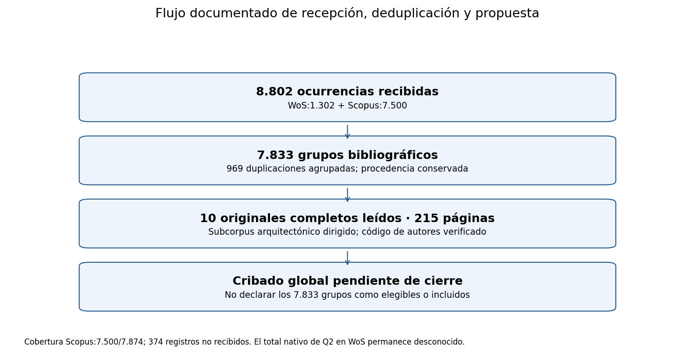
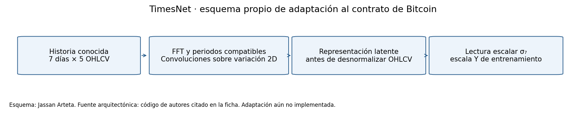
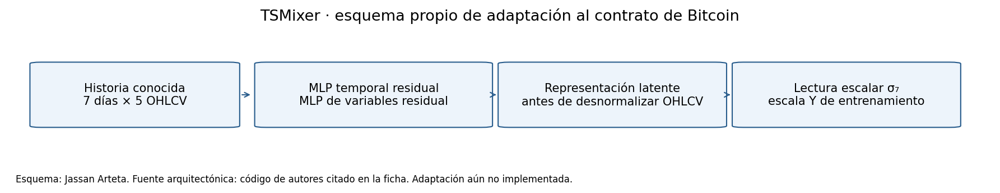
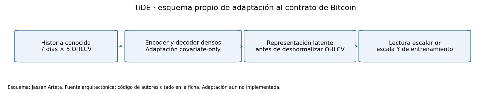
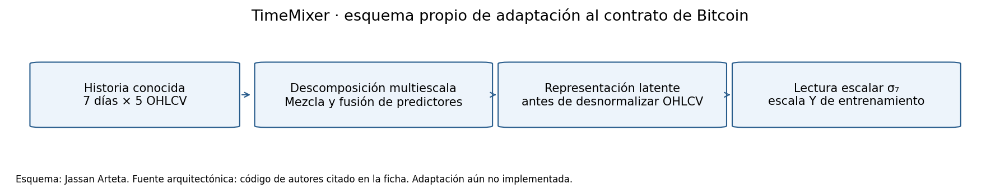
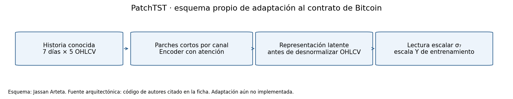
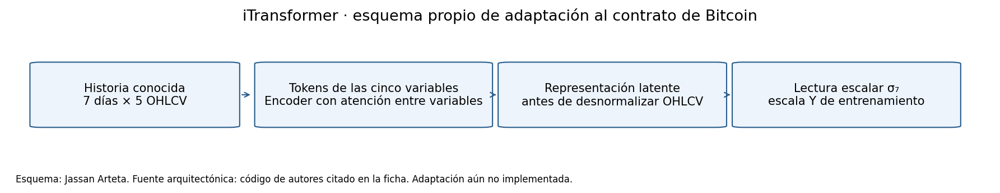

# 3. Revisión Sistemática del Estado del Arte

**Actualización vigente de la auditoría bibliográfica:** [§59: auditoría final de la literatura recibida](59_auditoria_literatura_final.md) concilia las tres rondas: **11.635 ocurrencias − 1.720 duplicados dentro de las rondas − 356 entre rondas = 9.559 grupos bibliográficos recibidos**. No son 9.559 estudios elegibles. El puntaje de apoyo anterior conserva **36/50 componentes observados**; una sensibilidad contextual nueva aporta P descriptivo para seis fuentes ETTh1/H96, sin mezclar clasificación ni PM2.5, y para cinco al separar los lookbacks. No sustituye el puntaje previo ni acredita selección previa por ranking. El PRISMA global, la elegibilidad completa y cuatro componentes C siguen abiertos; los 374 registros Scopus ausentes no son exclusiones. Los apartados y descargables siguientes conservan sus cortes históricos. **Fecha del corte:** el recibo del 14/11/2026 a las 04:14 UTC corresponde al 13/11/2026 a las 23:14 en Bogotá (UTC−5).

**Catálogo vigente (13/11/2026):** [dieciséis sistemas obligatorios (§43)](43_catalogo_obligatorio.md): diez modelos del Top 10, tres referencias E1 y Persistence, SeasonalNaive y ARIMA. El híbrido CNN-1D + LSTM + atención temporal y Ridge son antecedentes opcionales. [§44](44_arquitecturas_publicadas.md) y su actualización de [§48](48_protocolo_reducido.md) documentan los diez cuerpos publicados, incluido **TIDE-D7-PUBLISHED-R0-v2**. Las recetas NAS anteriores conservan su identidad histórica. El [benchmark común](06_benchmark_final.md) ya tiene resultados propios; los conteos bibliográficos siguientes conservan sus cortes y alcances documentales.

**Síntesis vigente del 13/11/2026:** [§52](52_sintesis_literatura.md) reconcilia el Top 10 actual con **nueve estudios primarios**, agrega lectura verificable de las fuentes de FCN/ResNet, Inception y LSTM-SAE, y publica extracción, puntajes de soporte con sensibilidad y una brecha refutable. Distingue esa cohorte de los diez originales históricos completos. Las tres consultas transversales nativas intentadas fallaron y conservan conteos desconocidos; la elegibilidad global sigue sin determinar.

## Actualización del 08/11/2026: búsquedas nativas y evidencia para la revisión

Esta ronda complementa el expediente del 05–06/11 sin reemplazarlo. **Una exportación nueva no corrige automáticamente una búsqueda anterior incompleta.** Los 374 registros no recibidos del universo Scopus histórico de 7.874 siguen siendo una limitación de aquella consulta mientras no se concilien sus identificadores y alcance. Del mismo modo, los resultados de IEEE y arXiv de esta ronda no deben añadirse directamente a los 7.833 grupos históricos: primero se necesita deduplicación entre rondas y adjudicación de versiones de un mismo estudio.

### Recepción, deduplicación y cribado de esta ronda

| Fuente y alcance | Ocurrencias recibidas | Estado verificable |
|---|---:|---|
| WoS, nuevo TXT | 340 | 340 registros PT–ER y cierre EF; años exportados dentro de 2019–2026 |
| Scopus, nuevo CSV | 828 | 808 con año 2019–2026; la cadena exacta y la cobertura nativa no quedan acreditadas por el CSV |
| IEEE Xplore, nuevo CSV | 466 | 457 con año 2019–2026; no equivale a una lectura completa de los artículos |
| Total de las tres exportaciones | **1.634** | **1.078 grupos** tras retirar 556 ocurrencias redundantes |

Se fusionan DOI normalizados exactos y, cuando no hay DOI conflictivos, título normalizado más año exacto. Se conservan **un conflicto de título/año con DOI diferentes**, 50 registros representantes sin DOI (49 grupos sin DOI en ninguna de sus fuentes) y cinco grupos con años discordantes entre fuentes. No se fusionan versiones por similitud difusa ni se han validado todos los DOI con sus editoriales. Los [metadatos por grupo](../_static/literature_native_20261108/native/cribado_metadatos.csv), el [grafo de enlaces](../_static/literature_native_20261108/native/relaciones_duplicados.csv) y el [resumen](../_static/literature_native_20261108/native/resumen.json) permiten auditar el resultado.

De **1.605 ocurrencias con año 2019–2026** resultan **1.054 grupos en ventana**. La clasificación es triaje conservador por título/resumen, con **21 correcciones focalizadas del asistente**, no lectura individual exhaustiva ni doble cribado humano:

| Disposición provisional | Grupos | Qué significa |
|---|---:|---|
| Prioridad principal | 59 | Bitcoin, posible objetivo volatilidad y redes; verificar objetivo, profundidad, papel del modelo y protocolo |
| Secundarios transferibles | 520 | Otros mercados, híbridos o mecanismos; no evidencia directa homogénea de σ₇ |
| Inciertos conservados | 138 | Información insuficiente; también actas agregadas que requieren localizar artículos individuales |
| Exclusiones propuestas por precio | 337 | Propuestas revisables, no exclusiones finales; auditar posibles falsos negativos |
| Fuera de ventana nominal | 24 | Comprobar fecha efectiva o justificar papel fundacional |
| Total | **1.078** | Los **717 conservados en ventana** no son estudios incluidos definitivamente |

Las señales pueden describir antecedentes y no la variable predicha. Las correcciones focalizadas detectaron confusiones entre precio, retorno, VaR/ES y volatilidad. No se convierte una pasada automática en una revisión sistemática cerrada; todas las exclusiones propuestas y los ambiguos requieren adjudicación antes de cerrar el flujo. El {download}`procedimiento y sus límites <../_static/literature_native_20261108/native/LEEME.md>` y las [correcciones](../_static/literature_native_20261108/native/ajustes_revision.json) quedan publicados sin resúmenes completos.

### Primer corte conservado: 59 prioritarios y auditoría de 42 exclusiones propuestas

Después del triaje inicial se revisaron individualmente los títulos y resúmenes de los **59 prioritarios**, mediante lectura asistida por IA. La disposición provisional es **40 candidatos para recuperar/evaluar texto completo, 17 inciertos conservados y dos antecedentes secundarios**. **No son 40 estudios incluidos ni 59 textos completos leídos.** No se verificaron externamente DOI, fechas, editoriales o resultados en esta fase, y no se acredita doble revisión humana ni κ de Cohen.

Se auditaron **42 de las 337 exclusiones propuestas**: una muestra aleatoria sin reemplazo de 30 (semilla `20261108`) más los 15 títulos con `volatility|variance|fluctuation|risk`; tres ya estaban en la muestra, por lo que se añadieron doce. Se mantienen preliminarmente **40 fuera del núcleo directo BTC–volatilidad** y se rescatan **E2-0807 como secundario** y **E2-0993 como incierto**. Algunos registros fuera del núcleo pueden seguir siendo antecedentes metodológicos. No se convierten esos dos rescates en inclusiones definitivas.

En ese primer corte quedaban **295 exclusiones sin revisión individual**, revisadas después en el segundo corte descrito a continuación. La muestra combina azar y selección dirigida: no se extrapola su proporción de rescates como tasa de error global, ni se interpreta como prueba de ausencia de falsos negativos. La categoría automática de precio necesita revisión, no ejecución como descarte definitivo. La auditoría no confirma un nuevo estudio de pronóstico individual de volatilidad BTC; tampoco demuestra que no exista entre los pendientes.

El [registro agregado](../_static/literature_review_progress_20261108/summary.json), el [método de auditoría](../_static/literature_review_progress_20261108/method.json) y el [manifiesto](../_static/literature_review_progress_20261108/manifest.json) conservan conteos, huellas y límites sin publicar resúmenes originales ni evidencias textuales privadas. El ledger del triaje inicial y los denominadores 1.634/1.078 permanecen intactos: este suplemento describe una fase posterior, no una reescritura de sus decisiones.

**Alertas para la siguiente lectura, no hechos confirmados:** distinguir redes que predicen precio de GARCH que estima volatilidad; verificar ecuación del objetivo, BTC individual frente a cartera/índice y profundidad real de ANN/MLP. La posible relación entre E2-0265 y E2-0487 requiere autores, datos y textos completos antes de fusionarlos. Las fechas/copyright discordantes y una fecha narrativa imposible se deben contrastar, sin corregirlas por conjetura ni usarlas como acusación de falsedad. Las [alertas estructuradas](../_static/literature_review_progress_20261108/alerts.json) conservan estas preguntas.

Esta revisión no cambia los **983 registros arXiv pendientes**, no concilia todavía las rondas y no cierra la revisión global. Los [próximos pasos](../_static/literature_review_progress_20261108/next_phases.json) son un plan editorial, no una enmienda experimental registrada.

### Segundo corte: lectura de las 295 exclusiones restantes

Se completó la lectura individual asistida por IA de las **295 exclusiones propuestas que faltaban**: **184 fuera del núcleo directo, 98 secundarios transferibles, 12 inciertos conservados y un candidato directo a texto completo**. La etiqueta técnica de exclusión abarca otros objetivos o dominios, no solo precio. Los 111 conservados para alguna función no son 111 estudios incluidos de volatilidad.

La cobertura de lectura de este conjunto alcanza **337/337** al sumar las 42 auditorías previas. Esto no significa revisar íntegramente los 1.078 grupos ni cerrar la revisión global. Los 42 anteriores se evaluaron frente al núcleo directo; su utilidad secundaria no se reclasificó con el criterio posterior. Por ello, **no se suman las categorías de ambas rondas como una clasificación homogénea ni se estima una tasa general de error**. El [registro agregado de seguimiento](../_static/literature_screening_followup_20261108/summary.json) conserva ambos cortes sin alterar los ledgers históricos.

**E2-0449** ([DOI](https://doi.org/10.1109/GIET65294.2025.11234750)) se rescata porque su resumen declara precio y volatilidad Bitcoin con redes bayesianas. Es un falso negativo de la regla inicial a nivel de título/resumen, **no una inclusión confirmada**: faltan proxy, profundidad, horizonte y evaluación temporal en el original. **E2-0538** ([DOI](https://doi.org/10.1109/DeCon67170.2025.11447794)) queda incierto prioritario: la descripción de precio/volatilidad con Attention-LSTM no confirma Bitcoin individual. No se confunden incertidumbre del precio, clasificación de regímenes o volatilidad de una cartera con el objetivo E2.

### Primer corte de recuperación de los 40 candidatos iniciales

Se examinaron **12 de los 40 candidatos directos del primer corte**: **cinco textos completos revisados en sus secciones metodológicas y empíricas**, **siete con material parcial o no recuperado** y **28 todavía sin búsqueda individual**. La selección fue dirigida, no representativa. El rescate posterior E2-0449 está fuera de esta cohorte de 40 y no se incorpora retroactivamente a su denominador. No se reprodujo código ni se decidió elegibilidad final.

Las [cinco síntesis con fuentes y localizadores](../_static/literature_screening_followup_20261108/source_reviews.json) separan objetivos y resultados:

| Estudio | Evidencia localizada | Consecuencia para E2 |
|---|---|---|
| E2-0012 · [híbridos neuronales Bitcoin](https://doi.org/10.3390/app10144768) | PDF pp. 6, 8–10, 13; tablas 3/9. HONN híbrida RMSE 0,022231812 frente GJR 0,022782066 | Objetivo de cinco días futuros y redes poco profundas; no equivalencia con σ₇ ni elegibilidad DL automática |
| E2-0025 · [redes profundas y volatilidad cripto](https://dergipark.org.tr/en/download/article-file/4132956) | Páginas impresas 550,553–555; tablas 3/4. DBN-DNN tanh RMSE 0,0013300 frente ARMA-GARCH 0,0013604; BPNN sigmoid destaca en MAE | Proxy retorno diario al cuadrado; ganador dependiente de métrica |
| E2-0059 · [GARCH híbrido con redes](https://doi.org/10.3390/risks10120237) | PDF pp. 11–14; tablas 3/6/7. A 21 días, tabla 6: HMAE triple-GRU 0,24004 frente triple-LSTM 2 0,26580 | No copiar una conclusión universal favorable a LSTM; reconciliar inconsistencias de tablas, objetivo y conteo de test |
| E2-0253 · [predicción y conectividad cripto](https://link.springer.com/article/10.1186/s40854-025-00881-x) | Ecuación 1 y texto asociado a tabla 4: HAR 0,876, ARMA 0,896, LSTM 1,153 son promedios de pérdidas heterogéneas | **No son RMSE**; celdas individuales aún no recuperadas. No convertir ese promedio en superioridad universal |
| E2-0867 · [TCN y Twitter](https://arxiv.org/pdf/2110.14317) | PDF pp. 3, 5–6, ecuación 2 y tabla 2: RMSE TCN 2,58±0,07; LSTM 2,37±0,19 | Volatilidad diaria desde 96 retornos intradía de 15 min, 20 ejecuciones y 48 días de test; no equivale a σ₇ D7×5 |

**No comparar errores numéricos entre estas filas:** cambian proxy, escala, horizonte, datos y protocolo. Las discordancias internas detectadas se conservan como preguntas de verificación, sin corregir por inferencia. Las cifras son resultados publicados, no ajustes nuevos de E2.

En los siete accesos incompletos, **NV significa no verificado/no recuperado**, nunca que el artículo no reporta el dato. Un error técnico, una vista previa o un pasaje indexado no cuentan como texto completo ni demuestran que no exista copia legal. Permanecen pendientes su recuperación, la búsqueda de los 28 y la adjudicación metodológica de los candidatos ya leídos. El [plan de próximos pasos actualizado](../_static/literature_screening_followup_20261108/next_phases.json) sigue siendo editorial, no un preregistro. Los originales, resúmenes y evidencias textuales privadas no se publican.

### Segundo corte de recuperación: versiones separadas

Una segunda tanda examinó **diez candidatos adicionales**: **dos textos editoriales completos, un preprint completo cuya versión editorial sigue pendiente y siete accesos parciales/no recuperados**. El acumulado de la cohorte original es **22/40 examinados = seis textos editoriales completos + dos preprints completos + catorce accesos parciales**, con **18 candidatos aún sin búsqueda individual**. Estos son estados de recuperación y lectura dirigida asistida por IA, no inclusión definitiva, doble revisión humana ni reproducción. E2-0449 permanece fuera de esta cohorte. **Corrección de versiones:** E2-0867 también procede de arXiv v2 y su equivalencia editorial sigue pendiente. Por ello se corrige el agregado privado de siete editoriales y un preprint a seis editoriales y dos preprints, conservando ocho textos completos. El [nuevo registro agregado](../_static/literature_recovery_second_20261108/summary.json) conserva los cortes anteriores.

- **E2-0064:** el [PDF editorial en Cardiff](https://orca.cardiff.ac.uk/id/eprint/181110/5/Can%20machine%20learning%20models%20better%20volatility%20forecasting%20%20A%20combined%20method.pdf) estudia **BitVol, volatilidad implícita con tenor de 30 días**, con pronósticos a un día y promedio de cinco días. No es volatilidad realizada ni un pronóstico a 30 días. Tabla 3: LSTM RMSE 3,13 frente TGARCH 5,83 a un día. Tabla 5: la comparación DM a cinco días frente TGARCH tiene **p=0,053, no significativa al 5 %** (pp. impresas 9, 11–13, 15). Quedan por auditar interpolación, construcción temporal y discordancia de conteos de días.
- **E2-0285:** se leyó el [preprint SSRN de 2022 enlazado por la autora](https://www.dorienherremans.com/sites/default/files/SSRN-id4247684.pdf), **no se verificó equivalencia con IEEE 2025** ([DOI editorial](https://doi.org/10.1109/ACCESS.2025.3584243)). Tabla 3 del preprint, p. impresa 26 (página 27 del archivo): Synthesizer FD obtiene F1 0,463 y RMSE 0,101; LSTM F1 0,171 y RMSE 0,095. **Mejor clasificación de picos no implica menor error de pronóstico.** El objetivo usa una transformación de dispersión anualizada y los picos también condicionan al retorno positivo; ventana y discordancia 46/60 picos requieren aclaración. Estas cifras no se atribuyen a la versión editorial.
- **E2-0593:** el [texto editorial abierto](https://link.springer.com/article/10.1007/s42521-026-00229-9) compara redes, GARCH e híbridos por régimen. El HTML editorial sustenta la comparación por regímenes; **no se reproducen cifras exactas de sus tablas**, cuya extracción no pudo contrastarse independientemente. No se presupone superioridad universal ni significación a partir de diferencias numéricas. La descripción del proxy difiere entre las secciones 3.2 y 4.1; su construcción exacta y la inicialización rolling quedan abiertas.

Las [tres síntesis verificables](../_static/literature_recovery_second_20261108/source_reviews.json) registran versión, localizador y límites. No se comparan cifras absolutas entre estudios ni se convierten fragmentos indexados de los siete accesos incompletos en resultados experimentales comprobados. El [plan actualizado](../_static/literature_recovery_second_20261108/next_phases.json) prioriza recuperar catorce parciales, buscar los dieciocho restantes y cotejar ambos preprints con sus versiones editoriales; no altera el protocolo experimental ni inicia entrenamiento.

### Complemento arXiv: extracción completa de consultas explícitas

La recuperación por API del **08/11/2026, 18:45:29 UTC** utilizó campos `all:`, sin filtro de fechas y con orden de envío descendente. El [manifiesto de consultas](../_static/literature_native_20261108/arxiv/query_manifest.json) conserva las cadenas completas, URLs paginadas y hashes de las respuestas privadas.

| Consulta | Resultados API | Recuperados |
|---|---:|---:|
| Bitcoin AND volatility | 181 | 181 |
| Bitcoin/cryptocurrency/cryptocurrencies AND volatility/variance | 391 | 391 |
| Volatility/variance AND diez nombres de familias de la propuesta | 605 | 605 |
| Volatility AND HAR AND neural/residual/hybrid | 22 | 22 |
| Apariciones antes de unir consultas | **1.199** | **1.199** |

La unión contiene **1.004 identificadores arXiv**, con **195 repeticiones entre consultas**; se verificó que la consulta Bitcoin es subconjunto de la consulta cripto. Se publican [metadatos](../_static/literature_native_20261108/arxiv/records.csv), [pertenencia por consulta](../_static/literature_native_20261108/arxiv/query_membership.csv) y [estado de cribado](../_static/literature_native_20261108/arxiv/screening_initial.csv): **21 etiquetas iniciales y 983 pendientes**, sin decisiones finales de inclusión. El término `variance` y las familias generales recuperan falsos positivos no financieros; extraer todo no significa haberlo revisado todo. Las búsquedas HTML auxiliares se excluyen de este denominador por inconsistencias en la interpretación de operadores booleanos.

Estos 1.004 IDs **no se suman** a los 1.078 grupos de las exportaciones ni a los 7.833 históricos. La conciliación DOI/preprint/publicación entre las tres rondas permanece abierta. Los preprints no se presentan automáticamente como artículos revisados por pares o revistas de un cuartil determinado.

La [lista pública cerrada y sus hashes](../_static/literature_native_20261108/manifest.json) fija los derivados de esta ronda. El {download}`expediente reproducible <../_static/literature_native_20261108/README.md>` separa validación de metadatos públicos, recuperación de fuentes y triaje privado; ninguno de esos procedimientos ejecuta modelos.

### Evidencia aplicada que cambia la lectura de los candidatos

[Volatility Forecasting in Global Financial Markets Using TimeMixer (arXiv:2410.09062)](https://arxiv.org/abs/2410.09062) incluye **BTCUSD 2014–2023** en la tabla 4, además de otras criptomonedas y mercados. Su sección de datos define volatilidad como desviación estándar móvil de **21 días** de log-retornos, anualizada por √252. Por tanto, aporta evidencia aplicada a Bitcoin, pero **no evalúa el objetivo σ₇ de E2**, no es volatilidad realizada intradía y sus errores no pueden compararse numéricamente con los del entregable. La identidad de la arquitectura tampoco sustituye comprobar la partición, el horizonte, las entradas y la variante concreta.

[HARNet (arXiv:2205.07719)](https://arxiv.org/abs/2205.07719) documenta una red de convoluciones causales dilatadas inicializada para reproducir un HAR ajustado. El estudio trabaja con volatilidad realizada de índices bursátiles; sirve como antecedente de una estructura neuronal guiada por HAR, no como validación directa de σ₇ en Bitcoin ni como evidencia del nuevo candidato CNN-1D + LSTM + atención temporal.

[Signal Simplification Is Not Predictive Simplification (arXiv:2610.03019)](https://arxiv.org/abs/2610.03019) examina **HAR-style + LSTM residual** en cinco activos estadounidenses. Informa que el híbrido empeora el MSE medio frente a HAR-style (0,3594 frente a 0,3049), mientras la LSTM sola obtiene 0,2649. Estas cifras son resultados del artículo, no de E2. Este antecedente corresponde a la hipótesis HAR residual retirada; se conserva como lectura histórica y no respalda ni refuta el nuevo candidato CNN-1D + LSTM + atención temporal.

### Cuatro altas y una hipótesis adicional, sin transferir evidencia histórica

Las [fichas actualizadas de la propuesta](15_revision_modelos.md) identifican fuentes para **FCN-1D y ResNet-1D** ([Wang et al.](https://arxiv.org/abs/1611.06455)) y **Inception-1D** ([InceptionTime](https://arxiv.org/abs/1909.04939)). Esas fuentes estudian clasificación temporal: justifican mecanismos, no su eficacia en regresión de volatilidad. Adaptar la cabeza, los kernels y el entrenamiento a D7×5 debe quedar registrado y probado.

La arquitectura exacta del **LSTM-autoencoder con predictor** permanece abierta. La [ficha ampliada](16_fichas_nuevas.md) incorpora Sagheer y Kotb (2019): preentrenamiento autoencoder seguido de ajuste supervisado. No acredita una pérdida conjunta ni evidencia Bitcoin; tampoco se equipara un VAE con LSTM o un detector de anomalías con el encoder–decoder propuesto. Tampoco se heredan lecturas, métricas, puntuaciones, licencias o código de los modelos retirados.

### Qué queda cerrado y qué no

La evidencia nueva permite corregir el contexto aplicado de TimeMixer, documentar fuentes arquitectónicas de las cuatro altas con distinto grado de correspondencia y conservar antecedentes de mecanismos híbridos distintos; no constituye verificación bibliográfica de la receta CNN-1D + LSTM + atención temporal exacta. **No cierra el Top 10 por ranking, una revisión PRISMA global, los cuartiles por año, el autoencoder exacto ni la superioridad del modelo 11.** El cribado asistido y la lectura dirigida se presentan con sus denominadores y límites; no se atribuyen a dos revisores humanos independientes.

La integración bibliográfica no entrena modelos, no modifica el registro experimental, no introduce resultados de mercado nuevos y no recupera el cegamiento del test conocido. El catálogo registrado y sus recibos permanecen separados de la propuesta editorial del 08/11.

## Expediente histórico del 05–06/11/2026

Las cifras y estados siguientes corresponden a ese corte. Se conservan para reconstruir sus decisiones; las afirmaciones de acceso pendiente se interpretan a la fecha del corte, no como negación de los materiales recibidos posteriormente.

**Resultado bibliográfico:** selección provisional de **diez modelos de Deep Learning para pronosticar la volatilidad de Bitcoin**, con exportaciones de **WoS y Scopus**, lectura de **diez originales completos —215 páginas físicas—** y código de autores identificado por commit y hash. La ampliación del **06/11/2026** añade un cribado local por reglas de los **7.833 grupos recibidos**, con decisión provisional y motivo por registro; no cierra la elegibilidad global por texto completo.

Las fichas, el flujo inicial y los contadores bibliográficos del **05/11/2026** se conservan como evidencia histórica. La [sección 5](05_paper_guia.md) documenta después la réplica externa de TimeMixer y el piloto de tres modelos en ETTh1. En la etapa actual se implementaron adaptadores D7 para el piloto P0 de desarrollo, cuya ejecución completó 220 trayectorias y 440 ajustes bajo el [protocolo registrado](09_protocolo_registrado.md); esto todavía no acredita el benchmark final, la búsqueda HPO ni la potencia del procedimiento definitivo.

**Estado de la revisión:** recepción, deduplicación, extracción de diez originales y primera pasada por reglas sobre todos los grupos recibidos completadas. Permanecen abiertos la cobertura de las consultas, la validación editorial de las decisiones provisionales, la elegibilidad por texto completo, los siete cuerpos aplicados de apoyo y los cuartiles por año. También se ejecutaron tres consultas **locales** sobre los registros recibidos; siguen pendientes sus búsquedas nativas WoS/Scopus y los originales de los mecanismos de origen. No se presenta un PRISMA global cerrado.

El catálogo de §15 documenta la propuesta de aquel corte. El alcance obligatorio posterior se fija en [§43](43_catalogo_obligatorio.md), las identidades arquitectónicas en [§44](44_arquitecturas_publicadas.md) y el calendario común en la [enmienda registrada de §45](45_enmienda_protocolo.md).

Los protocolos anteriores conservan su valor histórico; sus conteos y recetas no definen la selección vigente.

## 3.1 Estrategia de búsqueda y trazabilidad

### 3.1.1 Cadenas aportadas y procedencia

El usuario ejecutó búsquedas manuales y aportó tres exportaciones nativas WoS de texto plano, con registro completo y referencias citadas. También proporcionó estas dos cadenas:

**Q1 · Aplicación: criptomonedas y volatilidad.**

```text
TS=((bitcoin OR ethereum OR cryptocurrenc* OR cryptoasset*)
AND (volatility OR "realized volatility" OR "realised volatility")
AND ("deep learning" OR "neural network*" OR transformer*
OR LSTM OR GRU OR CNN OR TCN))
```

**Q2 · Familias y mecanismos candidatos.**

```text
TS=(("time series" OR forecasting OR "temporal prediction")
AND (TSMixer OR TiDE OR TimeMixer OR PatchTST OR iTransformer
OR Crossformer OR TimesNet OR MICN OR Mamba
OR "structured state space"))
```

Se conservan como dos consultas, no como una cadena unida mediante una coma. Q2 es la consulta efectivamente aportada: **Informer y Autoformer se identificaron en la evidencia examinada y se ampliaron mediante fuentes de autores; no se atribuye a esa Q2 una búsqueda nominal que no contiene.**

| Archivo recibido | Registros completos PT–ER | Evidencia disponible |
|---|---:|---|
| `savedrecs.txt` | 302 | Cantidad coincidente con la captura WoS de 302 resultados |
| `savedrecs (1).txt` | 500 | Lote exportado; rango global no confirmado |
| `savedrecs (2).txt` | 500 | Lote exportado; rango global no confirmado |
| Total de ocurrencias recibidas | **1.302** | No equivale al universo global desconocido de las dos consultas |

Los TXT no incorporan la cadena ni el rango global de exportación. La asociación archivo–consulta se mantiene como inferencia pendiente de confirmación; no impide analizar los registros como un conjunto recibido. Los originales se preservan fuera de los archivos públicos. Se publican metadatos bibliográficos derivados, identificadores, conteos y hashes, sin reproducir el conjunto de abstracts, referencias, emails o direcciones.

**Fechas:** el campo WoS `DA` indica **2026-11-06**, sin hora ni zona. La recepción administrativa se registra como **2026-11-05, America/Bogota**. No se convierte el campo DA en una fecha/hora de ejecución de la consulta que el archivo no proporciona. El [manifiesto de procedencia](../_static/literature_wos/source_manifest.json) conserva las identidades de los tres archivos.

### 3.1.2 Bases, periodo y cobertura

| Fuente | Estado verificable de esta etapa |
|---|---|
| Web of Science | Tres exportaciones nativas: 1.302 ocurrencias y 1.298 grupos bibliográficos; total global y rangos de Q2 no confirmados |
| Scopus | CSV nativo con **7.500 registros de 7.874 mostrados** en título/resumen/palabras clave: 95,25 % recibido y **374 no recibidos**. Los 2.845 resultados de la captura anterior en Keywords corresponden a otra cobertura y no se suman |
| IEEE Xplore y arXiv | Capturas de páginas de búsqueda sin exportación de resultados. Los PDF recuperados directamente de arXiv/OpenReview son originales leídos, sin acreditarlos como una búsqueda sistemática adicional |
| GitHub de autores | Diez backbones con código, revisiones y hashes verificados; fuente primaria de implementación, sin contarlo como base bibliográfica adicional |

La guía exige al menos dos bases y permite arXiv como complemento. **Se recibieron exportaciones nativas de dos bases: WoS y Scopus.** La cobertura parcial no se convierte en exhaustividad. El [manifiesto Scopus](../_static/literature_scopus/source_manifest.json) conserva hash, nombre y procedencia; el [resumen combinado](../_static/literature_scopus/summary.json) permite comprobar las cuentas. Los intentos del asistente a plataformas académicas fueron bloqueados por la red; las exportaciones nativas proceden del trabajo manual del usuario.

El reenvío de Scopus del **06/11/2026** tiene el mismo SHA-256 que la exportación anterior, `387f673a2146902ce12888ab3d662c095abc33d2cf5b54a168e9e2a12099f7de`. No añade registros ni se suma como otra búsqueda: permanecen los **374 no recibidos**. Los [recibos de la ampliación](../_static/literature_remediation/provenance.json) conservan las huellas de sus entradas y derivados.

El periodo principal propuesto es **2019–2026**, con trabajos fundacionales anteriores justificados por separado. Las exportaciones WoS recibidas contienen años nominales **2006–2027**, por lo que no se afirma que ya estén filtradas a ese intervalo. Sobre los 1.298 grupos bibliográficos WoS deduplicados:

- 1.222 tienen año nominal 2019–2026.
- 26 tienen año nominal fuera del intervalo y *Early Access* 2019–2026: requieren verificar la fecha efectiva, sin descartarlos solo por el volumen de 2027.
- 49 quedan fuera de la ventana y requieren justificación fundacional o exclusión.
- Uno no tiene la ventana de publicación confirmada con los campos disponibles.

Scopus contiene años nominales 1997–2027, incluidos 112 registros de 2027 sin fecha explícita de Early Access: deben verificarse antes de declararlos elegibles. No se traslada automáticamente a Scopus la fecha de publicación anticipada disponible en WoS. La cadena completa y los filtros efectivos del CSV no están embebidos en el archivo; se conserva la consulta aportada y la captura, sin inventar filtros o rangos. No se extrapolan frecuencias de estas exportaciones parciales a toda la literatura.

### 3.1.3 Inclusión, exclusión y evaluación de calidad

Se distinguen **volatilidad de criptomonedas**, **volatilidad financiera de otros activos** y **mecanismos transferibles de otros dominios**. «Volatilidad» como contexto de un artículo de precios, trading o clasificación no acredita una red que pronostique nuestra variable continua σ₇.

| Criterio | Regla de revisión |
|---|---|
| Relevancia | Identificar la variable realmente pronosticada y el papel del modelo; separar aplicación directa y transferencia |
| Deep Learning | Mecanismo profundo identificable; modelos lineales o ajustes de hiperparámetros de una misma base no completan automáticamente los diez cupos |
| Reproducibilidad | Verificar código primario o detalles suficientes; código público y adaptación implementada son estados distintos |
| Métricas | Registrar datos, horizonte, unidades, ubicación de la evidencia y dispersión; no comparar RMSE de escalas distintas |
| Calidad editorial | Conservar revista/congreso e índice WoS del registro. Cuartil e impacto requieren fuente y año específicos; permanecen no verificados |
| Riesgo metodológico | Auditar partición, fuga, repeticiones y equidad del ajuste en el original; si solo se examinó el resumen, usar **no verificado**, no «no reportado» |
| Versiones | Agrupar preprint/publicación cuando su identidad esté verificada y conservar la versión realmente leída; un preprint no se atribuye al cuerpo editorial sin verificar equivalencia |

No se calculó κ de Cohen: no hay dos revisores humanos independientes acreditados. La curación es editorial asistida por agentes, con verificaciones de identificadores y código; no se presenta como doble revisión humana.

### 3.1.4 Flujo de recepción y deduplicación

**8.802 ocurrencias recibidas → 7.833 grupos bibliográficos.** WoS aporta 1.302 ocurrencias, 1.300 UT únicos y 1.298 grupos; Scopus aporta 7.500 EID únicos y 7.499 grupos después de unir un DOI duplicado. Entre bases se enlazan 964 grupos: 960 por DOI y cuatro por título/año/revista cuando falta DOI. Se conservan 334 grupos exclusivos de WoS y 6.535 de Scopus. Las **969 duplicaciones** son cuatro internas WoS, una interna Scopus y 964 enlaces entre bases.

La [tabla de deduplicación](../_static/literature_wos/deduplication.csv) mantiene cada decisión. Los [registros derivados](../_static/literature_wos/records.csv) conservan procedencia por archivo y posición. El [resumen de importación](../_static/literature_wos/summary.json) diferencia ocurrencias, UT, grupos, años y datos ausentes.

Los [enlaces entre bases](../_static/literature_scopus/cross_database_links.csv) y los [7.833 grupos](../_static/literature_scopus/combined_records.csv) mantienen los identificadores originales. Las citas WoS TC y Scopus Cited by permanecen separadas; no se suman.



Este flujo conserva el tramo histórico de identificación y depuración. La recuperación dirigida permitió **leer diez originales arquitectónicos completos**, incluidos apéndices y referencias; sus [recibos PDF](../_static/literature_fulltext/fulltext_manifest.json) fijan versión, tamaño, SHA-256 y páginas físicas. La ampliación siguiente agrega el cribado local, sin acreditar todavía **elegibilidad global por texto completo**. Los diez originales no se presentan como el total de estudios incluidos de una revisión global. Hay además ocho registros WoS de apoyo aplicado; hay fuentes de apoyo compartidas y solapamiento con originales arquitectónicos. No son dieciocho estudios independientes.

La detección automática produjo pistas de cribado, no comparadores independientes acreditados. Por ejemplo, TiDE debe distinguirse del término inglés *tide* —marea—; aparecer en un abstract o una referencia no demuestra que el modelo fuera evaluado como comparador autónomo.

#### Ampliación del 06/11/2026: cribado local de los 7.833 grupos

Se aplicó el [protocolo reproducible de primera pasada](../_static/literature_remediation/protocol.json) al título y a los resúmenes privados asociados a cada grupo. Se priorizan volatilidad cripto, volatilidad financiera y mecanismos transferibles; los originales y apoyos ya identificados se conservan para revisión. El [registro completo](../_static/literature_remediation/screening_ledger.csv) documenta cada identificador, procedencia, términos detectados, huella del resumen, regla, motivo y estado. No publica los resúmenes completos.

| Decisión de primera pasada | Grupos | Interpretación |
|---|---:|---|
| Exclusión provisional por título/resumen | **4.323** | Recomendación automática con motivo; requiere validación editorial |
| Retención para recuperación o evaluación del texto completo | **2.436** | Candidato retenido, todavía no estudio incluido |
| Revisión manual pendiente | **1.074** | Objetivo, mecanismo, homónimo o papel del estudio ambiguos |
| Total procesado | **7.833** | Un registro por grupo recibido, sin omisiones ni duplicaciones |

La [cola priorizada](../_static/literature_remediation/priority_queue.csv) reúne **3.510 grupos**, incluidos los ambiguos; la [cola financiera](../_static/literature_remediation/financial_priority_queue.csv) contiene **602**. El [conteo de motivos](../_static/literature_remediation/reason_counts.csv), el [resumen](../_static/literature_remediation/summary.json) y el [estado PRISMA](../_static/literature_remediation/prisma_status.json) reconcilian estas cantidades. Las recomendaciones automáticas no son exclusiones finales validadas ni el total de estudios elegibles. La cantidad de incluidos de la revisión sistemática permanece **sin determinar**, no se sustituye por cero.

Se realizó además una [lectura editorial asistida de 17 resúmenes prioritarios](../_static/literature_remediation/editorial_title_abstract_checks.json): **diez** declaran pronóstico de volatilidad, **seis** estudian precio, retorno o trading y **uno** presenta una definición ambigua entre retorno y volatilidad. Los seis trabajos cripto de esta comprobación en esta comprobación se conservaron como contexto de otro objetivo; no se suman como respaldo directo de σ₇. Las diez declaraciones de volatilidad también requieren comprobar definición, arquitectura y protocolo en el cuerpo del artículo. No se acredita lectura completa de estos 17 textos, dos revisores humanos independientes ni κ de Cohen.

### 3.1.5 Búsqueda transversal de mecanismos

Se conservan las tres cadenas propuestas para búsquedas nativas. El **06/11/2026** se ejecutaron conjunciones locales de mecanismo, modalidad de origen y transferencia/adaptación sobre los **7.833 grupos ya recibidos**. El [registro de consultas locales](../_static/literature_remediation/local_transversal_searches.json) especifica las expresiones, las variantes regex efectivamente utilizadas y su alcance; no equivale al campo TS ni a una nueva consulta global de la base.

```text
TS=(("vision transformer" OR "self-attention")
AND ("computer vision" OR image*) AND (transfer* OR adapt*))
```

```text
TS=(("MLP-Mixer" OR "token mixing" OR "channel mixing")
AND (vision OR image*) AND (transfer* OR adapt*))
```

```text
TS=(("selective state space" OR Mamba)
AND (language OR speech OR audio) AND (transfer* OR adapt*))
```

| Consulta local | Grupos coincidentes |
|---|---:|
| Atención / visión | **15** |
| Mezcla de tokens o canales / visión | **3** |
| Estado selectivo / lenguaje, voz o audio | **90** |
| Unión sin duplicar grupos | **102** |

Los [resultados locales por identificador](../_static/literature_remediation/local_transversal_hits.csv) permiten seguir cada coincidencia. Hay solapamiento entre consultas; 15 + 3 + 90 no representa 108 estudios independientes. Se ejecutaron **cero nuevas consultas nativas** en esta ampliación. La cobertura heredada, seleccionada por otras consultas, impide interpretar la ausencia de un resultado local como ausencia en WoS/Scopus.

La búsqueda transversal aporta antecedentes, no un catálogo adicional de modelos. Recuperar código o detectar un mecanismo no sustituye leer y verificar sus fuentes.

### 3.1.6 Verificación acotada del material disponible

La [evaluación posterior de admisibilidad](../_static/literature_completion/architectural_originals_eligibility.csv) aplica criterios explícitos a los **diez originales completos** ya extraídos: identidad, ventana de publicación, mecanismo profundo, par de métricas localizable, código primario y límites de transferencia. Los **diez archivos principales de autores se cotejaron nuevamente con sus hashes**. Los estudios resultan admisibles como fuentes de mecanismos de pronóstico de otros dominios, con las limitaciones de calidad ya documentadas. Esto no cierra el universo sistemático, no prueba efectividad en Bitcoin ni certifica las recetas finales D7.

Se [revalidaron las identidades y rutas de los 17 resúmenes](../_static/literature_completion/financial_abstract_routes_17.csv): diez se retienen para verificar volatilidad en texto completo, seis no acreditan el objetivo de volatilidad por describir precio/retorno/trading, y uno requiere resolver su definición matemática. Es una comprobación acotada de los mismos resúmenes, no diecisiete cuerpos nuevos leídos ni revisores humanos independientes.

La [tabla reproducible de intervalos de 29 modelos/familias](../_static/literature_completion/candidate_score_intervals_29.csv) y su [regla de puntuación](../_static/literature_completion/score_protocol.json) conservan nulos/vacíos los componentes desconocidos. Se verifican dos identidades originales adicionales en la exportación recibida: **MICN**, con 597 citas Scopus, y **CryptoMamba-SSM de volatilidad**, con tres. Este último es distinto de CryptoMamba de precio. Identidad y citas no acreditan cuerpo, código o adaptación; no se produce un ranking final ni se sustituyen modelos solo por menciones o antigüedad.

El trazado histórico de mecanismos se conserva en los artefactos de auditoría; no amplía la selección actual ni acredita ejecución del catálogo vigente.

La [cola de fuente de datos](../_static/literature_completion/dataset_source_candidates.csv) distingue ocho coincidencias de Binance: **cinco son Binance Coin** y tres no bastan para identificar el exchange o proveedor. Ninguna se usa como prueba de uso de datos Binance ni de Q1. El cuartil y el año requieren evidencia propia; no se exige que una referencia haya utilizado exactamente nuestro snapshot.

La [recuperación adicional de cuerpos](../_static/literature_completion/recovery_scope.json) revisó **40 PDF privados, 35 documentos únicos**, y [cotejó siete cuerpos heredados de E1](../_static/literature_completion/inherited_E1_body_reverification.json). Esos siete no son los siete apoyos nuevos de E2: [siguen sin recuperarse sus cuerpos y los de once candidatos financieros prioritarios](../_static/literature_completion/applied_fulltext_recovery_status.json). Se recuperó la copia fijada del manuscrito heredado S2 y se verificó su identidad anterior; no se cuenta como un estudio E2 nuevo. Los [README de dos repositorios aplicados](../_static/literature_completion/applied_author_repository_context.json), de 230 y 246 bytes, identifican artículos/código y no sustituyen los manuscritos. Dos coincidencias aparentes de DOI se resolvieron como una referencia en otro artículo y una bibliografía del proyecto. Esta recuperación acotada no acredita indisponibilidad global, exclusiones por texto completo ni nuevos resultados de esos estudios.

El [resumen y alcance de esta ampliación](../_static/literature_completion/summary.json), sus [hashes](../_static/literature_completion/provenance.json) y los [insumos externos pendientes](../_static/literature_completion/manual_inputs_required.json) separan estas verificaciones del PRISMA global aún abierto. Los recibos históricos no se reescriben: la admisibilidad de una subcohorte preseleccionada no cambia automáticamente el contador de elegibilidad formal de toda la revisión.

El [registro de condiciones de cierre](../_static/literature_completion/closure_checklist.json) fija los productos faltantes: completar cobertura Scopus y confirmar historia WoS, adjudicar decisiones y cuerpos con motivos por etapa, ejecutar las búsquedas transversales nativas, cerrar los componentes verificables de selección y documentar calidad por año. Los estudios incluidos y elegibles globales permanecen **sin determinar**, no en cero. El código o los resultados futuros del benchmark no resolverán por sí solos estos pendientes bibliográficos.

## 3.2 Catálogo vigente para Bitcoin

El Top 10 vigente conserva estos diez nombres; la identidad de sus cuerpos y adaptaciones se consulta en [§44](44_arquitecturas_publicadas.md). Esta lista no es un ranking de resultados:

1. **FCN-1D**.
2. **ResNet-1D**.
3. **Inception-1D**.
4. **LSTM-autoencoder con predictor**.
5. **TimesNet**.
6. **TSMixer**.
7. **TiDE**.
8. **TimeMixer**.
9. **PatchTST**.
10. **iTransformer**.

MLP16, LSTM32 y GRU32, más Persistence, SeasonalNaive y ARIMA, completan los **dieciséis sistemas obligatorios**. **CNN-1D + LSTM + atención temporal** conserva su ficha como candidato adicional opcional, sin superioridad demostrada; Ridge también queda fuera del alcance obligatorio. La [sección 15](15_revision_modelos.md) conserva la propuesta histórica. No hay resultados del benchmark completo que permitan ordenar los modelos vigentes por desempeño.

## 3.3 Fuentes y adaptación de los modelos vigentes

Las [fichas de FCN-1D, ResNet-1D, Inception-1D y LSTM-autoencoder con predictor](16_fichas_nuevas.md) separan arquitectura original, evidencia de otras tareas y adaptación a regresión. Las siguientes seis fichas conservan información de las fuentes y decisiones previas útiles. Sus descripciones de implementaciones pertenecen al corte bibliográfico indicado; la restauración posterior de SAE, TimesNet, TimeMixer y PatchTST se documenta en [§44](44_arquitecturas_publicadas.md). **No certifican la ejecución de esas recetas nuevas ni transfieren a ellas resultados del diseño anterior.**

### TimesNet · fuente y adaptación

**Familia:** Convolución multiescala / variación2D.

**Fuente arquitectónica:** [TimesNet: Temporal 2D-Variation Modeling for General Time Series Analysis](https://doi.org/10.48550/arXiv.2210.02186), 2023. Identificador: 10.48550/arXiv.2210.02186. La naturaleza editorial o de preprint se conserva en el registro de fuentes.

**Texto completo leído:** [2210.02186v3](https://arxiv.org/abs/2210.02186v3), 23 páginas PDF; SHA-256 `a45cb3d35c7b4db7091439ee714fd43dd6cd9e8f2fb1867f5463ae0433aebbd1`. Se distingue esta versión del registro editorial.

**Código primario:** [implementación fijada por commit](https://raw.githubusercontent.com/thuml/Time-Series-Library/4e938a1767106324dd753b2a44832bf870a0252e/models/TimesNet.py), SHA-256 `f64c4bed1fd7347090044a0163bd4209c9f9ec1c1b19ceff47842df36b64bba7`. Licencia observada: MIT.



**Síntesis matemática propia, basada en el código examinado:**

$$
p_i=\lfloor L/f_i\rfloor,\quad Z=\sum_i a_i\operatorname{Reshape}_{p_i}^{-1}(\operatorname{Conv2D}_i(\operatorname{Reshape}_{p_i}(X))).
$$

**Resultado publicado rastreable:** ETTh1 multivariante; variante **TimesNet con Inception compartido**; contexto L=96, horizonte H=96; **MSE 0.384 y MAE 0.402**, misma fila de la tabla 13, **página PDF 21**. Escala: Series Stationarization declarada; scaler global y unidades exactas de estas métricas no reportados. Son resultados externos, no una corrida de Bitcoin ni un ranking comparable entre estos diez artículos.

**Calidad y reproducibilidad:** Declara tres repeticiones; la dispersión de esta fila H96 no está reportada. Series Stationarization es una normalización interna y no acredita por sí sola un scaler global ajustado sólo en entrenamiento. Los controles compartidos de entrada/salida no demuestran igual presupuesto HPO.

Estado para la fila seleccionada: repeticiones: reported; semillas: NR; dispersión de esta fila: NR; scaler train-only: NR; prueba formal: NR; igual presupuesto HPO: NR. `NR` significa no reportado en el PDF para ese alcance; `NV` significa no verificado y `partial`, evidencia parcial. El detalle y los localizadores están en la [matriz metodológica](../_static/literature_fulltext/quality_matrix.csv).

**Respaldo aplicado adicional:** [Charting new avenues in financial forecasting with TimesNet: The impact of intraperiod and interperiod variations on realized volatility prediction](https://doi.org/10.1016/j.eswa.2024.124851), `WOS:001283528600001`. Alcance: Volatilidad realizada de acciones. Sus 14 citas corresponden a ese estudio representativo, no automáticamente al original arquitectónico. El registro de apoyo procede de resumen/metadatos.

**Adaptación propuesta:** Transformar la historia a representaciones de variación 2D; limitar frecuencias al soporte D7.

**Complejidad:** Estimación propia O(L d log L) para FFT más O(Σᵢ Aᵢ kᵢ² d_in d_out) para convoluciones 2D sobre rejillas con relleno. No se ha medido el coste numérico. El número de parámetros y FLOPs de la configuración ETTh1 seleccionada no está reportado; los tiempos/memorias de otras condiciones se conservan en la [matriz de eficiencia](../_static/literature_fulltext/efficiency_matrix.csv), sin trasladarlos a D7 ni a Bitcoin.

**Limitación técnica:** El README original deriva la implementación a Time-Series-Library: se conservan ambos repositorios. Periodos inferidos por FFT fuera del soporte observado no prueban memoria de largo plazo.

La ecuación 1 del artículo usa techo para el periodo y el código examinado usa división entera (piso); la fórmula anterior describe ese código. FFT_for_Period promedia amplitudes sobre el batch. Para no compartir información entre orígenes temporales, la adaptación propuesta debe seleccionar periodos por ventana o inferir con batch=1, excluir explícitamente la frecuencia cero y limitar k≤⌊L_eff/2⌋. Son controles propuestos, aún no ejecutados.

**Alcance histórico de ejecución:** la revisión bibliográfica del 2026-11-05 no ajustó modelos ni efectuó reproducciones numéricas. La integración y evaluación de esta adaptación en el catálogo vigente siguen pendientes; la evidencia histórica conserva su alcance propio. La [réplica externa de TimeMixer y el piloto de tres modelos en ETTh1](https://jassan-bit.github.io/DeepLearning_202630/entregable2/sections/05_paper_guia.html) pertenecen a la etapa posterior del capítulo 5.


### TSMixer · fuente y adaptación

**Familia:** MLP / mezcla temporal y de variables.

**Fuente arquitectónica:** [TSMixer: An All-MLP Architecture for Time Series Forecasting](https://doi.org/10.48550/arXiv.2303.06053), 2023. Identificador: 10.48550/arXiv.2303.06053. La naturaleza editorial o de preprint se conserva en el registro de fuentes.

**Texto completo leído:** [2303.06053v5](https://arxiv.org/abs/2303.06053v5), 24 páginas PDF; SHA-256 `864079eb9702bca1f27f540819052af94625b226cd5a652a02638800f95b365e`. Se distingue esta versión del registro editorial.

**Código primario:** [implementación fijada por commit](https://raw.githubusercontent.com/google-research/google-research/d3a4bd8f0eceddda553e47085033b537935b283f/tsmixer/tsmixer_basic/models/tsmixer.py), SHA-256 `84a7451f86b40b989f7ab7aa36368f24f39610ad62d7ce43e474a30a4e006159`. Licencia observada: Apache-2.0.



**Síntesis matemática propia, basada en el código examinado:**

$$
T=X+\mathcal M_t(\mathcal N(X)^\top)^\top,\qquad Z=T+\mathcal M_c(\mathcal N(T)).
$$

**Resultado publicado rastreable:** ETTh1 multivariante; variante **TSMixer básico multivariante**; contexto L=512, horizonte H=96; **MSE 0.361 y MAE 0.392**, misma fila de la tabla 3, **página PDF 10**. Escala: estandarización global por covariable y RevIN; se evalúa sin invertir la escala global, cuyo ajuste train-only no se explicita. Son resultados externos, no una corrida de Bitcoin ni un ranking comparable entre estos diez artículos.

**Calidad y reproducibilidad:** La fila LTSF seleccionada no declara repeticiones ni dispersión. Las cinco semillas y media±DE de M5 pertenecen a otra tarea. El PDF declara estandarización global y RevIN, pero no explicita el ajuste del scaler sólo en entrenamiento; parte de los comparadores se importa de otro artículo.

Estado para la fila seleccionada: repeticiones: NR; semillas: NR; dispersión de esta fila: NR; scaler train-only: NR; prueba formal: NR; igual presupuesto HPO: NR. `NR` significa no reportado en el PDF para ese alcance; `NV` significa no verificado y `partial`, evidencia parcial. El detalle y los localizadores están en la [matriz metodológica](../_static/literature_fulltext/quality_matrix.csv).

**Respaldo aplicado adicional:** [Time-mixing and feature-mixing modelling for realized volatility forecast: Evidence from TSMixer model](https://doi.org/10.1016/j.jfds.2024.100143), `WOS:001491684900001`. Alcance: Volatilidad realizada de acciones. Sus 9 citas corresponden a ese estudio representativo, no automáticamente al original arquitectónico. El registro de apoyo procede de resumen/metadatos.

**Adaptación propuesta:** Mezclar días y variables con MLP residuales; lectura escalar para σ7.

**Complejidad:** Estimación estructural propia por bloque O(C L² + L C F), más la proyección; L=7 y C=5. No es un recuento medido de FLOPs. El número de parámetros y FLOPs de la configuración ETTh1 seleccionada no está reportado; los tiempos/memorias de otras condiciones se conservan en la [matriz de eficiencia](../_static/literature_fulltext/efficiency_matrix.csv), sin trasladarlos a D7 ni a Bitcoin.

**Limitación técnica:** La fuente elegida es Google/Chen All-MLP TSMixer, distinta de variantes IBM con nombre parecido. Las capas y la receta del adaptador aún deben fijarse antes de entrenarlo.

**Alcance histórico de ejecución:** la revisión bibliográfica del 2026-11-05 no ajustó modelos ni efectuó reproducciones numéricas. La integración y evaluación de esta adaptación en el catálogo vigente siguen pendientes; la evidencia histórica conserva su alcance propio. La [réplica externa de TimeMixer y el piloto de tres modelos en ETTh1](https://jassan-bit.github.io/DeepLearning_202630/entregable2/sections/05_paper_guia.html) pertenecen a la etapa posterior del capítulo 5.


### TiDE · fuente y adaptación

**Familia:** MLP / mezcla temporal y de variables.

**Fuente arquitectónica:** [Long-term Forecasting with TiDE: Time-series Dense Encoder](https://doi.org/10.48550/arXiv.2304.08424), 2023. Identificador: 10.48550/arXiv.2304.08424. La naturaleza editorial o de preprint se conserva en el registro de fuentes.

**Texto completo leído:** [2304.08424v5](https://arxiv.org/abs/2304.08424v5), 21 páginas PDF; SHA-256 `eee9d9e3248f262a137e6cf63920137263f3bbbe22cd8608e5eec77882af1999`. Se distingue esta versión del registro editorial.

**Código primario:** [implementación fijada por commit](https://raw.githubusercontent.com/google-research/google-research/d3a4bd8f0eceddda553e47085033b537935b283f/tide/models.py), SHA-256 `ad8fd8d498809deeed9c847a169cada42134cbd0351b03e750706132a5d151c7`. Licencia observada: Apache-2.0.



**Síntesis matemática propia, basada en el código examinado:**

$$
z=\operatorname{Enc}(\operatorname{vec}(X)),\qquad r=\operatorname{Dec}(z),\qquad \widehat y=g_\sigma(r).
$$

**Resultado publicado rastreable:** ETTh1 multivariante; variante **TiDE completo, RevIN activado, todos los residuales; tabla 2 con configuración de tabla 8**; contexto L=720, horizonte H=96; **MSE 0.375 y MAE 0.398**, misma fila de la tabla 2, **página PDF 8**. Escala: estandarización con media/DE del periodo de entrenamiento y RevIN activado para ETTh1. Son resultados externos, no una corrida de Bitcoin ni un ranking comparable entre estos diez artículos.

**Calidad y reproducibilidad:** Declara cinco ejecuciones independientes. La tabla 5 (PDF p.19) proporciona errores estándar para ETTh1/H96: MSE 0.0003 y MAE 0.0002; no son desviaciones estándar. La normalización con media/DE del periodo de entrenamiento está explícita. Los presupuestos HPO de todos los comparadores no se igualan documentalmente.

Estado para la fila seleccionada: repeticiones: reported; semillas: NR; dispersión de esta fila: reported; scaler train-only: reported; prueba formal: NR; igual presupuesto HPO: NR. `NR` significa no reportado en el PDF para ese alcance; `NV` significa no verificado y `partial`, evidencia parcial. El detalle y los localizadores están en la [matriz metodológica](../_static/literature_fulltext/quality_matrix.csv).

**Respaldo aplicado adicional:** [A Deep Learning Method for Photovoltaic Power Generation Forecasting Based on a Time-Series Dense Encoder](https://doi.org/10.3390/en18102434), `WOS:001495953000001`. Alcance: Pronóstico en otro dominio. Sus 13 citas corresponden a ese estudio representativo, no automáticamente al original arquitectónico. El registro de apoyo procede de resumen/metadatos.

**Adaptación propuesta:** Codificar las covariables históricas con bloques densos; decoder escalar sin covariables futuras.

**Complejidad:** Estimación propia Σℓ O(dℓ dℓ₊₁) sobre capas densas, más proyecciones de variables. Los anchos no están fijados; no se infieren parámetros ni FLOPs numéricos. El número de parámetros y FLOPs de la configuración ETTh1 seleccionada no está reportado; los tiempos/memorias de otras condiciones se conservan en la [matriz de eficiencia](../_static/literature_fulltext/efficiency_matrix.csv), sin trasladarlos a D7 ni a Bitcoin.

**Limitación técnica:** La interfaz original no se ejecuta sin cambios bajo el contrato heredado. La cabeza/skip escalar y retirar historia del objetivo deben declararse como adaptaciones.

La formulación original incorpora historia del objetivo y covariables futuras; la versión covariate-only bajo el contrato vigente es una adaptación explícita que necesita validación, no una reproducción idéntica.

**Alcance histórico de ejecución:** la revisión bibliográfica del 2026-11-05 no ajustó modelos ni efectuó reproducciones numéricas. La integración y evaluación de esta adaptación en el catálogo vigente siguen pendientes; la evidencia histórica conserva su alcance propio. La [réplica externa de TimeMixer y el piloto de tres modelos en ETTh1](https://jassan-bit.github.io/DeepLearning_202630/entregable2/sections/05_paper_guia.html) pertenecen a la etapa posterior del capítulo 5.


### TimeMixer · fuente y adaptación

**Familia:** MLP / mezcla temporal y de variables.

**Fuente arquitectónica:** [TimeMixer: Decomposable Multiscale Mixing for Time Series Forecasting](https://doi.org/10.48550/arXiv.2405.14616), 2024. Identificador: 10.48550/arXiv.2405.14616. La naturaleza editorial o de preprint se conserva en el registro de fuentes.

**Texto completo leído:** [2405.14616v1](https://arxiv.org/abs/2405.14616v1), 28 páginas PDF; SHA-256 `a599b338e44af70d8e9c87be3c5417bde7864b2c92074e1346703f3e2b641e3d`. Se distingue esta versión del registro editorial.

**Código primario:** [implementación fijada por commit](https://raw.githubusercontent.com/kwuking/TimeMixer/e24610583b36fdd8c76cc17a8df4e65759a5f460/models/TimeMixer.py), SHA-256 `817d62f4aac54c8566e560f6d3785856e31c8ee51460279ee3d0a4823f11d4be`. Licencia observada: Apache-2.0.



**Síntesis matemática propia, basada en el código examinado:**

$$
X_s=\operatorname{Down}_s(X),\quad (S_s,T_s)=\operatorname{Decomp}(X_s),\quad \widehat y=g_\sigma(\{\operatorname{Mix}_s(S_s,T_s)\}_s).
$$

**Resultado publicado rastreable:** ETTh1 multivariante; variante **TimeMixer unificado, M=3 y cuatro escalas 96/48/24/12**; contexto L=96, horizonte H=96; **MSE 0.375 y MAE 0.400**, misma fila de la tabla 13, **página PDF 17**. Escala: escala/unidades exactas de las métricas no reportadas en el PDF. Son resultados externos, no una corrida de Bitcoin ni un ranking comparable entre estos diez artículos.

**Calidad y reproducibilidad:** Declara tres repeticiones. La media±DE de la tabla 9 corresponde al promedio de cuatro horizontes, no a esta fila H96. Sus afirmaciones de IC/significancia no incluyen prueba identificada, p-valores ni extremos reproducibles. La configuración unificada alinea contexto, batch y épocas, sin demostrar igual presupuesto de búsqueda.

Estado para la fila seleccionada: repeticiones: reported; semillas: NR; dispersión de esta fila: NR; scaler train-only: NR; prueba formal: partial; igual presupuesto HPO: NR. `NR` significa no reportado en el PDF para ese alcance; `NV` significa no verificado y `partial`, evidencia parcial. El detalle y los localizadores están en la [matriz metodológica](../_static/literature_fulltext/quality_matrix.csv).

**Respaldo aplicado adicional:** [Adaptive multi-scale short term wind power forecasting framework based on TimeMixer and Mix-of-Experts](https://doi.org/10.1016/j.epsr.2025.112196), `WOS:001569047800001`. Alcance: Comparador en otro dominio. Sus 11 citas corresponden a ese estudio representativo, no automáticamente al original arquitectónico. El registro de apoyo procede de resumen/metadatos.

**Adaptación propuesta:** Combinar escalas temporales compatibles con siete días; no agregar entradas externas.

**Complejidad:** Estimación propia O(Σₛ C Lₛ² + costes de FFN de variables), sumando las escalas. No es una medición de FLOPs. El número de parámetros y FLOPs de la configuración ETTh1 seleccionada no está reportado; los tiempos/memorias de otras condiciones se conservan en la [matriz de eficiencia](../_static/literature_fulltext/efficiency_matrix.csv), sin trasladarlos a D7 ni a Bitcoin.

**Limitación técnica:** Las escalas y longitudes predeterminadas para historias de 96/336 pasos no sirven automáticamente para D7. No se añaden variables futuras ni se invierte la escala OHLCV como si el objetivo fuera una de sus columnas.

**Alcance histórico de ejecución:** la revisión bibliográfica del 2026-11-05 no ajustó modelos ni efectuó reproducciones numéricas. La integración y evaluación de esta adaptación en el catálogo vigente siguen pendientes; la evidencia histórica conserva su alcance propio. La [réplica externa de TimeMixer y el piloto de tres modelos en ETTh1](https://jassan-bit.github.io/DeepLearning_202630/entregable2/sections/05_paper_guia.html) pertenecen a la etapa posterior del capítulo 5.


### PatchTST · fuente y adaptación

**Familia:** Atención / Transformer.

**Fuente arquitectónica:** [A Time Series is Worth 64 Words: Long-term Forecasting with Transformers](https://doi.org/10.48550/arXiv.2211.14730), 2023. Identificador: 10.48550/arXiv.2211.14730. La naturaleza editorial o de preprint se conserva en el registro de fuentes.

**Texto completo leído:** [2211.14730v2](https://arxiv.org/abs/2211.14730v2), 24 páginas PDF; SHA-256 `ffd4021d25b4959883242f256b0fe4ec42f477f66db78c61bfacf7baa7848b0e`. Se distingue esta versión del registro editorial.

**Código primario:** [implementación fijada por commit](https://raw.githubusercontent.com/yuqinie98/PatchTST/204c21efe0b39603ad6e2ca640ef5896646ab1a9/PatchTST_supervised/models/PatchTST.py), SHA-256 `49d8bb865e1226d6338842f4b33c4bc6992cefb048dc2a4a5a8c410ca708586b`. Licencia observada: Apache-2.0.



**Síntesis matemática propia, basada en el código examinado:**

$$
P_c=\operatorname{Patch}(X_{:,c}),\quad Z_c=\operatorname{Encoder}(P_cW_p+E),\quad \widehat y=g_\sigma(Z_1,\ldots,Z_5).
$$

**Resultado publicado rastreable:** ETTh1 multivariante; variante **PatchTST/64 supervisado, parche 16 y salto 8**; contexto L=512, horizonte H=96; **MSE 0.370 y MAE 0.400**, misma fila de la tabla 3, **página PDF 7**. Escala: normalización de instancia declarada; scaler global y unidades exactas de las métricas no reportados. Son resultados externos, no una corrida de Bitcoin ni un ranking comparable entre estos diez artículos.

**Calidad y reproducibilidad:** La tabla principal usa semilla 2021. La robustez con cinco semillas 2019–2023 y media±DE se estudia para la variante /42; no se atribuye su dispersión a /64. La normalización de instancia está descrita, pero el scaler global y su población de ajuste no quedan explícitos en el PDF.

Estado para la fila seleccionada: repeticiones: reported; semillas: reported; dispersión de esta fila: NR; scaler train-only: NR; prueba formal: NR; igual presupuesto HPO: NR. `NR` significa no reportado en el PDF para ese alcance; `NV` significa no verificado y `partial`, evidencia parcial. El detalle y los localizadores están en la [matriz metodológica](../_static/literature_fulltext/quality_matrix.csv).

**Respaldo aplicado adicional:** [Can transformers transform financial forecasting?](https://doi.org/10.1108/CFRI-01-2024-0032), `WOS:001250609400001`. Alcance: Volatilidad realizada de acciones. Sus 23 citas corresponden a ese estudio representativo, no automáticamente al original arquitectónico. El registro de apoyo procede de resumen/metadatos.

**Adaptación propuesta:** Usar parches cortos y fusionar representaciones de los cinco canales en un objetivo.

**Complejidad:** Estimación propia O(C P² d + C P d²), con P parches. Reducir tokens puede ahorrar atención, pero con L=7 no demuestra una ventaja. El número de parámetros y FLOPs de la configuración ETTh1 seleccionada no está reportado; los tiempos/memorias de otras condiciones se conservan en la [matriz de eficiencia](../_static/literature_fulltext/efficiency_matrix.csv), sin trasladarlos a D7 ni a Bitcoin.

**Limitación técnica:** Los parches predeterminados de 16/32 pasos exceden D7. Una nueva cabeza que combine canales es una adaptación que debe declararse y validarse.

**Alcance histórico de ejecución:** la revisión bibliográfica del 2026-11-05 no ajustó modelos ni efectuó reproducciones numéricas. La integración y evaluación de esta adaptación en el catálogo vigente siguen pendientes; la evidencia histórica conserva su alcance propio. La [réplica externa de TimeMixer y el piloto de tres modelos en ETTh1](https://jassan-bit.github.io/DeepLearning_202630/entregable2/sections/05_paper_guia.html) pertenecen a la etapa posterior del capítulo 5.


### iTransformer · fuente y adaptación

**Familia:** Atención / Transformer.

**Fuente arquitectónica:** [iTransformer: Inverted Transformers Are Effective for Time Series Forecasting](https://doi.org/10.48550/arXiv.2310.06625), 2024. Identificador: 10.48550/arXiv.2310.06625. La naturaleza editorial o de preprint se conserva en el registro de fuentes.

**Texto completo leído:** [2310.06625v4](https://arxiv.org/abs/2310.06625v4), 25 páginas PDF; SHA-256 `83e889795af52c672090255493266e3ea93e7b2a32c528f58074f2f9f757ffc5`. Se distingue esta versión del registro editorial.

**Código primario:** [implementación fijada por commit](https://raw.githubusercontent.com/thuml/iTransformer/c2426e68ca13f74aaec08045c5c724d8ad328124/model/iTransformer.py), SHA-256 `6f34777a5a12c253a293f79e7e1fd5b6f79ac100b443951e051e269e7e2542db`. Licencia observada: MIT.



**Síntesis matemática propia, basada en el código examinado:**

$$
H^{(0)}=X^\top W_e,\qquad H^{(\ell+1)}=\operatorname{Encoder}(H^{(\ell)}),\qquad \widehat y=g_\sigma(H).
$$

**Resultado publicado rastreable:** ETTh1 multivariante; variante **iTransformer completo, columna original Ours**; contexto L=96, horizonte H=96; **MSE 0.386 y MAE 0.405**, misma fila de la tabla 10, **página PDF 23**. Escala: preprocesamiento del benchmark remitido a TimesNet; no son errores de precio bruto ni de Bitcoin. Son resultados externos, no una corrida de Bitcoin ni un ranking comparable entre estos diez artículos.

**Calidad y reproducibilidad:** El análisis de robustez incluye cinco semillas en otros datasets; su tabla 5 no contiene ETTh1 y no acredita incertidumbre de esta fila. La atención entre variables tiene coste cuadrático en el número de variables, no en el número de fechas. Un contexto común no prueba igualdad de presupuesto HPO.

Estado para la fila seleccionada: repeticiones: NV; semillas: NR; dispersión de esta fila: NR; scaler train-only: NR; prueba formal: NR; igual presupuesto HPO: NR. `NR` significa no reportado en el PDF para ese alcance; `NV` significa no verificado y `partial`, evidencia parcial. El detalle y los localizadores están en la [matriz metodológica](../_static/literature_fulltext/quality_matrix.csv).

**Respaldo aplicado adicional:** [Short-term freeway traffic speed multistep prediction using an iTransformer model](https://doi.org/10.1016/j.physa.2024.130185), `WOS:001352915400001`. Alcance: Pronóstico en otro dominio. Sus 35 citas corresponden a ese estudio representativo, no automáticamente al original arquitectónico. El registro de apoyo procede de resumen/metadatos.

**Adaptación propuesta:** Atender entre tokens de variables, cada uno con siete observaciones; lectura escalar de covariables.

**Complejidad:** Estimación propia O(C L d + C² d + C d²) para embedding/bloque: atención entre C variables, no entre L fechas. El número de parámetros y FLOPs de la configuración ETTh1 seleccionada no está reportado; los tiempos/memorias de otras condiciones se conservan en la [matriz de eficiencia](../_static/literature_fulltext/efficiency_matrix.csv), sin trasladarlos a D7 ni a Bitcoin.

**Limitación técnica:** La ventaja asintótica depende del eje de atención y no acredita una mejora para sólo cinco variables. La lectura escalar debe preceder a cualquier desnormalización por canal.

**Alcance histórico de ejecución:** la revisión bibliográfica del 2026-11-05 no ajustó modelos ni efectuó reproducciones numéricas. La integración y evaluación de esta adaptación en el catálogo vigente siguen pendientes; la evidencia histórica conserva su alcance propio. La [réplica externa de TimeMixer y el piloto de tres modelos en ETTh1](https://jassan-bit.github.io/DeepLearning_202630/entregable2/sections/05_paper_guia.html) pertenecen a la etapa posterior del capítulo 5.


## 3.4 Comparación crítica y cierre pendiente

Los errores de fuentes distintas no son comparables sin igualar objetivo, escala, frecuencia, horizonte y partición. Los resultados de clasificación, precios, energía o ETTh1 no acreditan superioridad en volatilidad Bitcoin. La comparación vigente deberá medir calidad predictiva, coste real, incertidumbre, robustez y límites de cada soporte de información.

Los corpus y recibos bibliográficos enlazados en esta sección permanecen intactos. Las puntuaciones históricas de selección no se recalculan ni se presentan como ranking de los modelos actuales. La revisión global permanece abierta: faltan recuperación y adjudicación de textos, conciliación de versiones y búsquedas, verificación de calidad por año y cierre de las recetas experimentales.

La [síntesis de §52](52_sintesis_literatura.md) añade una tabla completa de soporte del catálogo vigente, con cinco criterios declarados después de su autorización, intervalos para evidencia desconocida y cuatro sensibilidades de pesos. No identifica un ranking único ni afirma que los pesos causaran la selección anterior. Su extracción separa resultados externos, cobertura metodológica y evidencia experimental propia de §5; la matriz de brecha permite refutar la afirmación dentro de los nueve estudios examinados.
