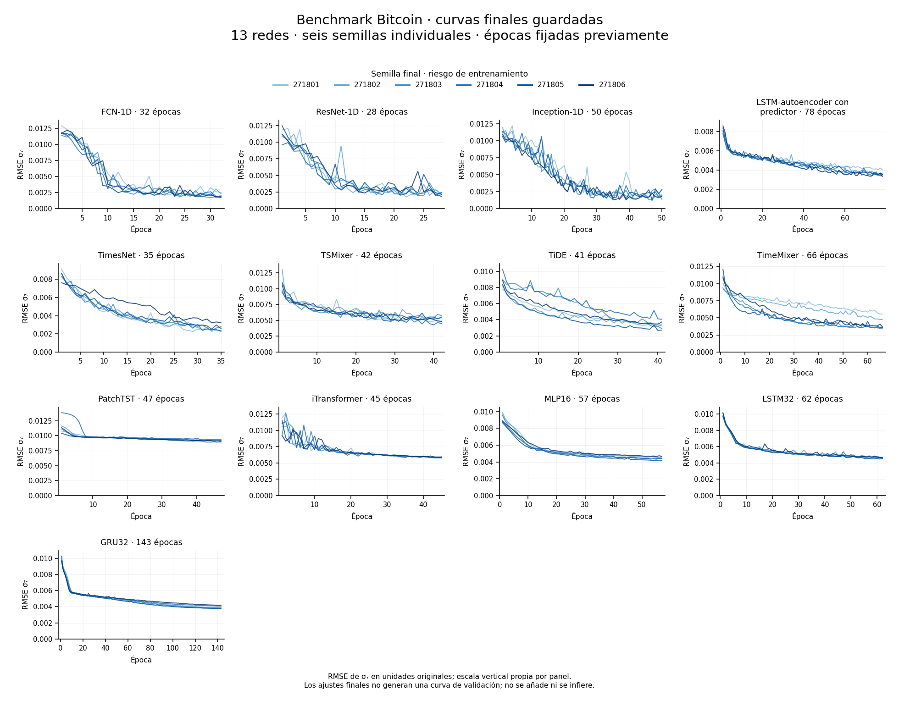
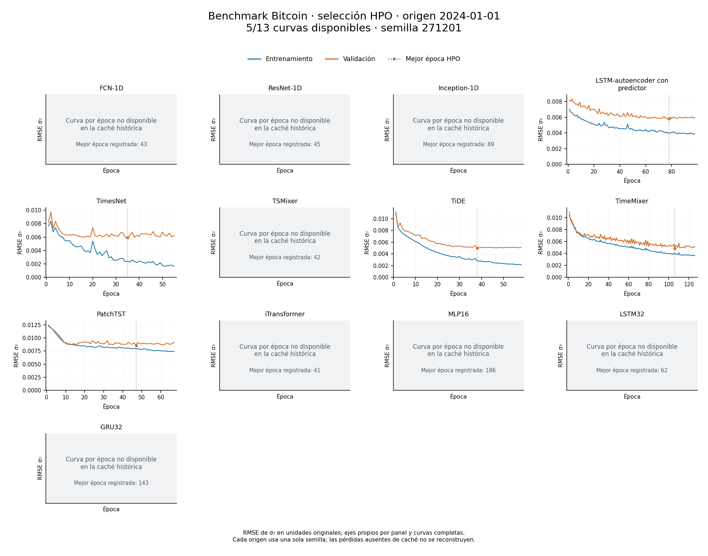
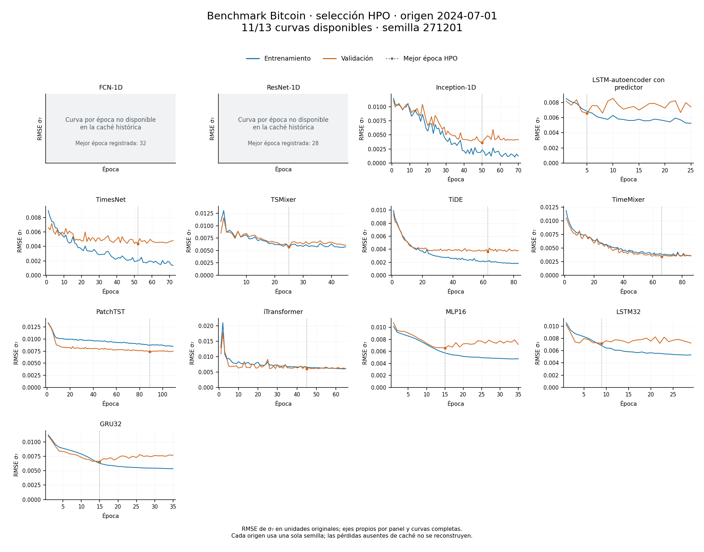
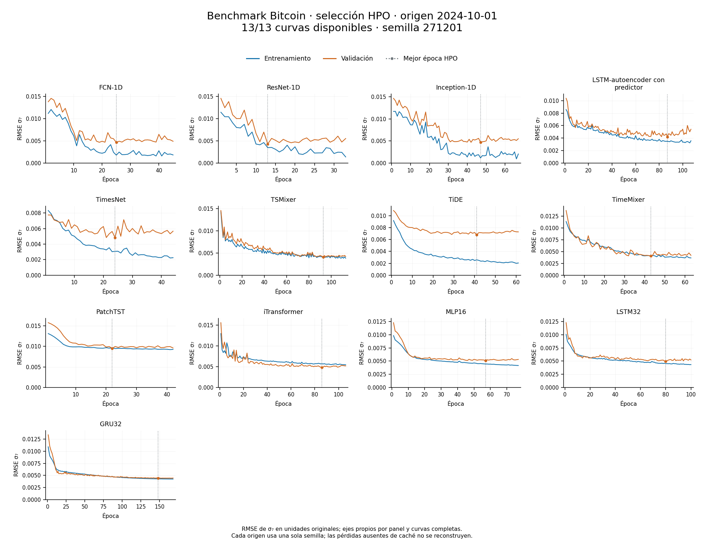
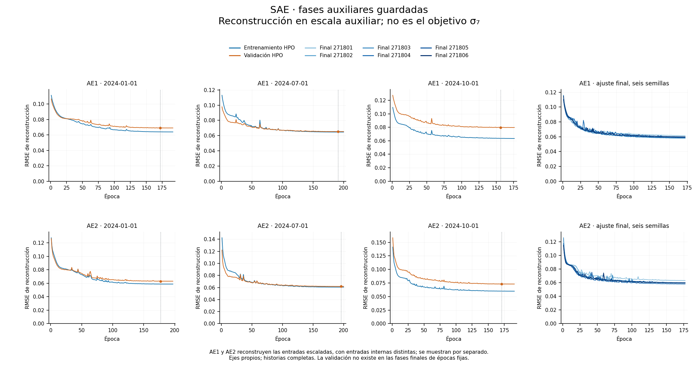
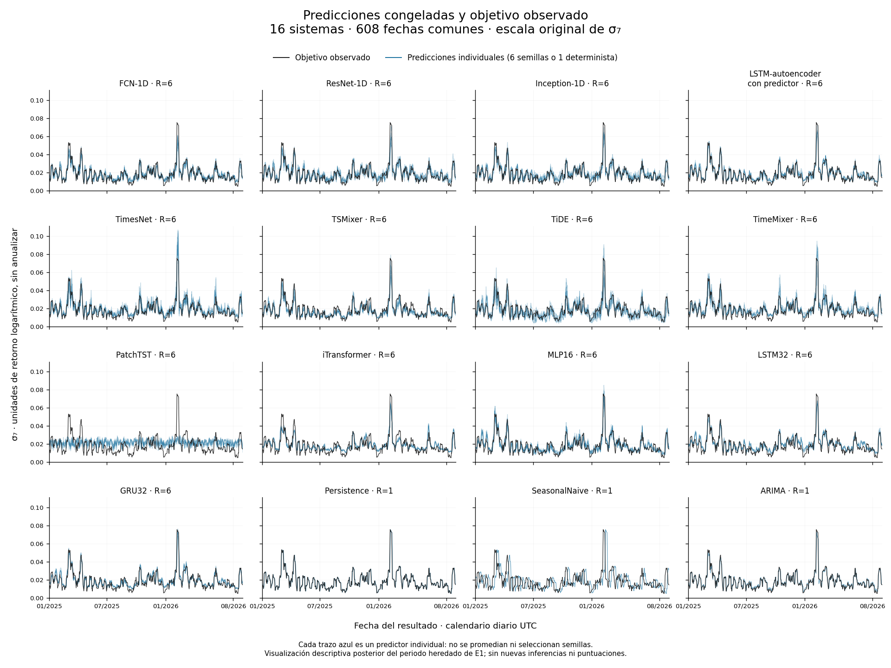

(implementacion-catalogo-obligatorio-y-antecedentes)=
# 4. Implementación de Modelos Benchmark

**Lectura vigente.** Se implementaron y evaluaron **dieciséis sistemas: diez modelos principales, tres referencias neuronales de E1 y tres comparadores deterministas**. Las trece redes tienen **78 ajustes finales, seis semillas por receta**; junto con los clásicos forman **81 predictores congelados sobre 608 fechas comunes**. La reproducción posterior completó otros **81 ajustes y 18 ablaciones, 99/99**. Son fases diferentes: no se suman las reproducciones al número de predictores de A2.

Este capítulo presenta el diseño y la implementación ejecutados conforme a §§4.1–4.6 de la guía. El [protocolo reducido](48_protocolo_reducido.md), los [cuerpos y adaptaciones](44_arquitecturas_publicadas.md), la [A2 medida](06_benchmark_final.md) y la [reproducción](55_reproduccion_ablaciones.md) conservan sus recibos. El {download}`índice de evidencias <../_static/e2_implementation_current_v1/README.md>`, la [lista de requisitos](../_static/e2_implementation_current_v1/guide_checklist.csv), la [trazabilidad](../_static/e2_implementation_current_v1/decision_traceability.csv) y el [manifiesto](../_static/e2_implementation_current_v1/manifest.json) distinguen lo acreditado de sus límites. Los prototipos compactos, Ridge y CNN–LSTM–atención permanecen como antecedentes; no son modelos activos adicionales.

## 4.1 Diseño Experimental

### Entradas, objetivo y pipeline causal

La tarea es pronosticar al inicio del día UTC $t$ la **σ₇ poblacional de los siete retornos logarítmicos de Close que terminan en $t$**, `ddof=0`, sin anualización, horizonte **h=1**. La entrada neural usa exclusivamente los **siete días completos $t-7,\ldots,t-1$ y cinco canales OHLCV**. `relative_window` representa OHLC como logaritmos relativos al último cierre observado y volumen como `log1p(V)`; no son niveles brutos ni un sexto canal con Y rezagada.

```text
Fuentes/hash y calendario UTC → máscara de soportes válidos
  → ventanas causales D7×5 → transformaciones ajustadas sólo con train
  → HPO interno y receta/épocas seleccionadas
  → reinicialización de cada semilla final → entrenamiento hasta 31/10/2024
  → calibración 53 fechas con pesos/escaladores fijos → congelación
  → 608 pronósticos y evaluación común → diagnósticos posteriores separados
```

La estandarización de atributos usa media/DE del entrenamiento admisible de cada fold. La etiqueta se divide por su **media positiva de entrenamiento** y se invierte antes de puntuar. La cabeza neural es escalar con Softplus; ninguna desnormalización de OHLCV se interpreta directamente como escala de σ₇. El autoencoder añade dos preentrenamientos sobre las entradas admisibles, con su propia escala auxiliar aprendida sólo en train. Cada fase conserva pesos, transformaciones, firmas y fechas en sus recibos.

### Partición ejecutada y validación interna

| Origen HPO | Ejemplos train | Última etiqueta train | Validación interna, inclusive | n validación |
|---|---:|---|---|---:|
| 01/01/2024 | 253 | 25/09/2023 | 03/10–24/12/2023 | 83 |
| 01/07/2024 | 435 | 25/03/2024 | 02/04–23/06/2024 | 83 |
| 01/10/2024 | 527 | 25/06/2024 | 03/07–23/09/2024 | 83 |

La selección usa **249 fechas internas concatenadas**. Se minimiza `sqrt(sum(n_fold × RMSE_fold²) / sum(n_fold))`, no la media simple de las tres RMSE. Los tres entrenamientos expansivos se solapan; no son tres mercados independientes. Es validación temporal interna para una receta global aplicada al periodo externo posterior: no una evaluación externa anidada de pronósticos de enero–octubre de 2024.

| Etapa final | Fechas de etiquetas | Ejemplos / regla |
|---|---|---|
| Entrenamiento | 08/01/2023–31/10/2024 | **655** elegibles tras máscara de calidad |
| Embargo | 01–07/11/2024 | Sin etiquetas de ajuste o calibración |
| Calibración/piloto | 08/11–30/12/2024 | **53**, sin reapertura de HPO |
| Puente causal | 31/12/2024 | Historia disponible, sin refit ni recalibración |
| Evaluación heredada de E1 | 01/01/2025–31/08/2026 | **608**, máscara y predictores comunes |

La [auditoría vigente de partición](../_static/e2_eda_current_v1/partition_audit.json) vincula estas fechas, máscaras y firmas. La partición cronológica es determinista, **sin semilla de barajado**. La [admisión](../_static/e2_benchmark_final_20261113/data_admission.json) y la [congelación de 81 predictores](../_static/e2_benchmark_final_20261113/final_freeze.json) identifican el ciclo final de E2. La guía pide heredar la partición de E1: su exposición previa se declara y no se exige otra reserva por esa herencia. Los mismos predictores congelados se utilizaron en el scoring completado; las reproducciones y diagnósticos posteriores no constituyen un test prospectivo nuevo.

### HPO, presupuesto y arquitectura definida

Las trece redes reciben **C01–C06**, una semilla efectiva **271201** y tres folds: **234 oportunidades lógicas**. Las plazas provienen de las posiciones 5/7/8/9/10/15 del dominio original de cada receta, escogidas por cobertura de metadatos sin usar RMSE o tiempos observados. Las tuplas numéricas dependen de la arquitectura; el [CSV registrado completo](../_static/reduced_protocol_20261112/hpo_configurations_registered_bytes_v2.csv) publica los espacios y valores. Sus bytes científicos, incluidos saltos de línea, se preservan.

Se contabilizaron **231 oportunidades exitosas de 234**, dos fallos conocidos y un desenlace desconocido. Las trece recetas ganadoras tienen sus tres folds; un fallo consume su oportunidad y no se reemplaza por otra semilla o configuración. Las listas históricas de dos semillas presentes en algunas tuplas describen su procedencia; el calendario efectivo de esta selección usa sólo 271201.

**Igual número de plazas no demuestra igual coste de optimización.** La caché/HPO incluye T4 y A100 y políticas históricas distintas; SAE añade **36 fases auxiliares al plan**, para **270 etapas optimizadoras lógicas previstas antes de reutilización y fallos**. Los comparadores tienen dominios propios: ARIMA recibió 18 órdenes × tres folds, 51/54 RMSE válidas y 15 órdenes elegibles; ganó **(2,0,1)**. SeasonalNaive completó nueve oportunidades y eligió periodo 7; Persistence conserva lag 1. Sus entradas endógenas causales y estados se declaran aparte del contrato neural D7×5.

La búsqueda de **1.000 arquitecturas en dos fases** aplica cuando el artículo no define el cuerpo usado. Los cuerpos publicados actuales y sus adaptaciones están adjudicados en §44 y §48; **seis plazas HPO no equivalen a la NAS de la guía**. TiDE ejecutado es **TIDE-D7-PUBLISHED-R0-v2**, con grafo fuente y rama r=0 inactiva conservados y paridad funcional registrada. Las variantes propias retiradas mantienen sus identidades y sus obligaciones NAS históricas; esta actualización no declara ejecutadas sus búsquedas ni las transfiere al cuerpo publicado.

## 4.2 Implementación de Modelos

### Cuerpos, versiones y adaptaciones ejecutadas

El motor científico está fijado en [`1e8745497b484518f766b6da5c19be8362d9add7`](https://github.com/jassan-bit/DeepLearning_202630/commit/1e8745497b484518f766b6da5c19be8362d9add7). Los ports y bibliotecas se justifican mediante código de autor fijado, recibos de fuentes y pruebas de correspondencia; no se presenta el cambio de tarea a σ₇ como réplica de los artículos. El [inventario de las arquitecturas seleccionadas](../_static/e2_flops_final_audit_20261114/frozen_architecture_inputs.json) vincula cada cuerpo con su trial y parámetros. Los [fuentes fijados y adaptaciones](44_arquitecturas_publicadas.md) precisan capas, ejes, padding, normalización y cabezas.

| Red | Identidad de receta | Capas / dimensiones conservadas |
|---|---|---|
| FCN-1D | `fcn1d_wang_d7_v1_proposed__hpo_v1` | 3 convoluciones 128/256/128, kernels 8/5/3, BN/ReLU, GAP |
| ResNet-1D | `resnet1d_wang_d7_v1_proposed__hpo_v1` | 3 bloques residuales 64/128/128, 9 convoluciones y atajos |
| Inception-1D | `inception1d_single_d7_v1_proposed__hpo_v1` | 1 red, 6 módulos multirrama; kernels 40/20/10, bottleneck 32 |
| LSTM-autoencoder con predictor | `SAE-D7-PUBLISHED-v1` | 2 encoders LSTM 25/26; AE1 → AE2 → predictor |
| TimesNet | `TN-D7-PUBLISHED-v1` | 2 TimesBlocks, d32/FF32, 6 kernels, top-k 3; longitud FFT 8 |
| TSMixer | `TSM-D7-r1__hpo_v1` | 6 bloques de mezcla; MLP de variables 5→512→5, residuales/BN |
| TiDE | `TIDE-D7-PUBLISHED-R0-v2` | Encoder/decoder densos 256/256; encoder temporal 64/4, decoder final 64; r=0 |
| TimeMixer | `TM-D7-PUBLISHED-v1` | 4 PDM, d32/FF32, 1 descenso medio ×2, escalas 7/3, FMM |
| PatchTST | `PT-D7-PUBLISHED-v1` | 3 capas, d16/FF128, 4 cabezas; patch3/stride2/padding2, 4 parches |
| iTransformer | `IT-D7-r1__hpo_v1` | 2 capas, d256/FF256, 8 cabezas, 5 tokens de variables |
| MLP16 | `MLP16-E1-ref-E2-HPO-v1` | Referencia E1, capa oculta de 16 unidades |
| LSTM32 | `LSTM32-E1-ref-E2-HPO-v1` | Referencia E1, capa recurrente de 32 unidades |
| GRU32 | `GRU32-E1-ref-E2-HPO-v1` | Referencia E1, capa recurrente de 32 unidades |

Todos reciben D7×5. Los kernels mayores que siete usan padding declarado, sin aportar días extra. TimesNet mantiene FFT promediada por batch al entrenar y **una ventana por llamada en evaluación**, evitando que otra ventana altere la selección de periodos. PatchTST normaliza los siete días reales antes del padding final. TSMixer/iTransformer conservan sus interfaces escalares y los momentos de la misma ventana declarados. En SAE, AE2 usa encoder 1 congelado; los pesos se transfieren después al predictor supervisado, sin pérdida conjunta de reconstrucción en esa etapa. Los flags de una comprobación estructural sin mercado no sustituyen los recibos de entrenamiento ya ejecutado.

### Hiperparámetros y estrategia de entrenamiento

| Red | LR inicial | Weight decay | Batch | Dropout supervisado | Warmup / horizonte | Épocas finales |
|---|---:|---:|---:|---:|---:|---:|
| FCN-1D | 0.000569539454 | 0.00100407577 | 16 | 0 | 0 | 32 |
| ResNet-1D | 0.000757944015 | 0 | 16 | 0 | 0 | 28 |
| Inception-1D | 0.000739462065 | 1.81848958e-06 | 32 | 0 | 0 | 50 |
| LSTM-autoencoder con predictor | 0.00172198473 | 0.00259360317 | 16 | 0.3 | 0 | 172 / 177 / 78 |
| TimesNet | 0.00283816847 | 1.19221337e-05 | 16 | 0.1 | 0 | 35 |
| TSMixer | 0.00114173843 | 7.97647962e-06 | 32 | 0.3 | 0 | 42 |
| TiDE | 0.000139612767 | 2.77961589e-05 | 16 | 0.0 | 0 | 41 |
| TimeMixer | 0.000667745995 | 2.09032861e-05 | 16 | 0.1 | 0 | 66 |
| PatchTST | 0.00144585172 | 0 | 16 | 0.3 | 0.1 | 47 |
| iTransformer | 0.00243512182 | 0.000919016591 | 16 | 0.3 | 0 | 45 |
| MLP16 | 0.00150098487 | 0.000744209928 | 32 | 0 | 0 | 57 |
| LSTM32 | 0.00235640615 | 0 | 64 | 0.3 | 0 | 62 |
| GRU32 | 0.000457731355 | 0.00665836725 | 16 | 0.1 | 0 | 143 |

Las cifras se transcriben de las tuplas ganadoras guardadas; la [fuente de precisión completa](../_static/e2_flops_final_audit_20261114/frozen_architecture_inputs.json) preserva todos sus decimales. Las épocas finales proceden de la mediana de las mejores épocas de los tres folds ganadores. **172/177/78 de SAE** corresponden a AE1/AE2/supervisión. Su dropout auxiliar es cero; 0,3 pertenece a los módulos supervisados existentes. Las [curvas y metadatos originales](../_static/e2_f2a_audit_20261113/training_evidence.zip) separan esas fases.

El [backend CUDA](https://github.com/jassan-bit/DeepLearning_202630/blob/1e8745497b484518f766b6da5c19be8362d9add7/scripts/e2_cuda_training.py) conserva la semántica de [`e2_staged_training.py`](https://github.com/jassan-bit/DeepLearning_202630/blob/1e8745497b484518f766b6da5c19be8362d9add7/scripts/e2_staged_training.py):

- **AdamW**, betas (0,9; 0,999), ε=10⁻⁸, con grupos de decay y exenciones registradas para sesgos/normalización; optimizador nuevo por fase.
- **MSE** para el objetivo escalado; reconstrucción MSE de entradas en las fases auxiliares SAE, separada de la selección supervisada.
- LR **coseno** con warmup registrado; horizonte `200 × batches_por_época`, conservado aunque el reajuste final termine antes. No se comprime el scheduler a las épocas finales.
- **Clipping de norma 1**, comprobaciones de finitez, gradientes y límites; no se sustituyen pérdidas no finitas por cero.
- Selección con máximo **200 épocas**, paciencia **20** y mejora estricta de validación; límite nuevo de **1.800 s por fase**. Los resultados históricos conservan sus límites anteriores.
- Ajuste final con **épocas fijas**, sin consultar validación para detenerlo y sin generar otra curva de validación. AE1, AE2 y supervisado conservan sus duraciones seleccionadas.
- **FP32**, determinismo estricto, AMP y TF32 desactivados; batches con redistribución del singleton final cuando procede, sin omitir ejemplos.

(e2-curvas-benchmark)=
### Curvas de las trece redes: selección y ajuste final

La galería muestra las **trece recetas neuronales ganadoras del benchmark Bitcoin**, incluidas las tres referencias de E1. Sus curvas proceden de los registros originales de [training_evidence.zip](../_static/e2_f2a_audit_20261113/training_evidence.zip), con [cobertura por ajuste](../_static/e2_learning_curves_v1/coverage.csv), [procedencia y controles](../_static/e2_learning_curves_v1/learning_curves.json) y [manifiesto](../_static/e2_learning_curves_v1/manifest.json). El {download}`método de reproducción de las figuras <../_static/e2_learning_curves_v1/README.md>` y `scripts/plot_e2_benchmark_learning_curves.py` permiten reconstruir la visualización sin entrenar ni ejecutar inferencia.

**Ajuste final: 78 curvas, seis semillas por red.** Cada trazo es una inicialización individual sobre los mismos 655 ejemplos de entrenamiento, con las épocas fijadas antes del ajuste final. Se representa la **RMSE supervisada en unidades originales de σ₇**, evaluada al terminar cada época con `model.eval()`, sin gradientes y sobre todo train. No es la pérdida de un minibatch ni la MSE estandarizada de la réplica ETTh1. Los paneles conservan las épocas reales y su rango vertical propio, visible en los ejes; no hay promedios entre semillas, suavizado ni bandas de confianza.



{download}`Ampliar las curvas finales en SVG <../_static/e2_learning_curves_v1/final_supervised.svg>`.

El protocolo final usa **épocas fijas**: no consulta validación para detener el ajuste y no genera otra curva de validación o de test por época. Para examinar entrenamiento frente a validación se usan los ajustes HPO siguientes, que tienen otro papel y otros periodos.

**Selección HPO: tres orígenes, una semilla 271201.** Las figuras corresponden a las 39 ejecuciones de las trece recetas finalmente elegidas, con **29 curvas completas y diez registros de caché sin pérdidas por época**. Cada panel disponible muestra el par train–validación y la mejor época registrada. Se mantienen separados los tres orígenes: sus entrenamientos se solapan, sus ventanas de validación cambian y no se promedian como tres semillas. Los paneles de caché identifican la ausencia de curva sin reconstruir valores a partir de la métrica final. Esta galería no representa las 234 oportunidades HPO completas.

:::{dropdown} HPO: origen 01/01/2024


{download}`Ampliar HPO de enero en SVG <../_static/e2_learning_curves_v1/hpo_2024-01-01.svg>`.
:::

:::{dropdown} HPO: origen 01/07/2024


{download}`Ampliar HPO de julio en SVG <../_static/e2_learning_curves_v1/hpo_2024-07-01.svg>`.
:::

**Entrenamiento y validación de las trece redes, origen 01/10/2024.** Este origen conserva todas las curvas y se muestra completo; los otros dos orígenes se consultan en los desplegables anteriores.



{download}`Ampliar HPO de octubre en SVG <../_static/e2_learning_curves_v1/hpo_2024-10-01.svg>`.

:::{dropdown} SAE: fases auxiliares AE1 y AE2, separadas del objetivo σ₇


{download}`Ampliar las fases auxiliares en SVG <../_static/e2_learning_curves_v1/sae_auxiliary.svg>`.

AE1 y AE2 reconstruyen las mismas entradas originales escaladas por una cantidad calculada sólo con train; AE2 recibe la representación del primer encoder, cuyo estado se conserva. Se grafica la **RMSE de reconstrucción auxiliar registrada**, con fases y orígenes separados. No es la RMSE del objetivo σ₇ ni se suma a la pérdida supervisada. Las fases finales tienen 172 y 177 épocas, respectivamente, en cada una de las seis semillas; no tienen validación por época.
:::

Los riesgos por época usan el tamaño de batch configurado; las predicciones persistidas de validación y A2 utilizan batch 1. Esa diferencia importa para las comprobaciones de consistencia, especialmente en TimesNet: una curva no se interpreta como si fuese la misma vía numérica de scoring de A2. La separación visual train–validación es descriptiva y no reemplaza la prueba formal de δg. **Persistence, SeasonalNaive y ARIMA no tienen curvas neuronales de entrenamiento por época**; sus ajustes y resultados se documentan como comparadores deterministas.

### Registros originales, recursos e inferencia

Se recuperaron **6.440 registros de épocas supervisadas** y **3.250 auxiliares SAE** de 78 ajustes finales y 39 ejecuciones HPO seleccionadas. **29/39 HPO** tienen curvas completas; diez reutilizaciones históricas conservan mejor época, predicciones e identidad tensorial, pero carecen de pérdidas por época. Esa ausencia no se rellena con curvas de otro ajuste. Los 78 finales sí conservan curvas de train y no tienen curva de validación por diseño de épocas fijas. [Auditoría de curvas y brechas](49_diagnosticos_f2a.md) · [resumen de 117 ajustes](../_static/e2_f2a_audit_20261113/fit_overfit_summary.csv).

El entorno de ajustes finales fue **NVIDIA A100-SXM4-80GB**, **Python 3.12.12**, **Torch 2.8.0+cu126**, **CUDA 12.6**, dos hilos CPU y un hilo interop. El [entorno limpio de reproducción](../_static/e2_reproduction_ablations_20261113/historical_clean_runtime.json) conserva lock, versiones de paquetes y fuentes; ese entorno no sustituye los recibos originales. El HPO mezcló hardware/caché históricos y no acredita igualdad numérica T4–A100.

Los [costes por modelo](../_static/e2_efficiency_closure_20261113/model_efficiency.csv) y [recursos por fase](../_static/e2_efficiency_closure_20261113/phase_resources.csv) publican parámetros, pasos, tiempo y hardware. Las fases de los **78 ajustes finales sumaron 5.765,09 s**; SAE incluye AE1, AE2 y supervisado. El tiempo de fases incluye evaluación de riesgo y checkpoints, y excluye selección completa y controlador: no son GPU-horas activas ni tiempo puro de optimizador. Los máximos CUDA originales son del proceso desde el último reset, no memoria aislada por predictor.

La [medición posterior A100](54_robustez_interpretabilidad.md) añade **78 perfiles reales de inferencia batch 1**, con entrada residente, calentamiento y eventos CUDA; no mide la latencia completa de adquisición/preprocesamiento/servicio. Los [FLOPs core de las trece redes](58_flops_predictores.md) cuentan matrices y convoluciones con **2 FLOPs/MAC**; excluyen FFT, activaciones, normalización, pooling y movimiento de memoria, sin afirmar coste total de todos los kernels. Los recursos de clásicos no medidos bajo esa convención permanecen desconocidos, no cero. Energía y coste monetario no tienen telemetría/tarifa verificadas.

## 4.3 Requisitos Experimentales

### Semillas, determinismo y tracking

Las trece redes se reajustaron con **271801, 271802, 271803, 271804, 271805 y 271806**, desde inicializaciones nuevas; los clásicos deterministas tienen **una trayectoria** cada uno. No se fabrican seis copias idénticas para simular repeticiones. Las semillas describen variación de optimización sobre una misma cronología, no seis mercados independientes. Python y Torch/CUDA tienen semillas explícitas; los remuestreos NumPy usan generadores y semillas propios registrados. No se atribuye al núcleo un flag global NumPy no verificado ni se mezclan semillas históricas de HPO con finales.

El tracking implementado usa **JSON/JSONL, manifiestos SHA-256, diarios de recursos, recibos por intento y checkpoints versionados**, con GitHub como único destino persistente. [Rama de resultados](https://github.com/jassan-bit/DeepLearning_202630/tree/results/e2-reduced-delivery-v1) · [release de pesos](https://github.com/jassan-bit/DeepLearning_202630/releases/tag/e2-reduced-results-20261112-v1). `/content` fue espacio temporal. Este registro propio permite auditar fases, fallos, reutilizaciones y cargos; no se declara uso de MLflow o W&B.

### Repeticiones, potencia y equidad de cómputo

**R=6** satisface la cantidad mínima de inicializaciones neuronales y permite los diagnósticos por rangos, pero no acredita potencia suficiente. El piloto emparejado de **cinco semillas de iTransformer y GRU32** sobre 53 fechas de desarrollo estimó potencia **0,122953** para la ganancia planificada 2δ, con α=0,0025 y R=6; el objetivo era 0,80. [Piloto/MDE](../_static/e2_benchmark_final_20261113/pilot_power_MDE.json). El tamaño se mantuvo como decisión operativa acotada por recursos; no se amplió tras ver el scoring ni se interpreta un no rechazo como equivalencia.

La equidad conserva espacios/oportunidades y calendario comunes, sin afirmar igualdad integral de coste: distintas épocas, complejidades, fases SAE, hardware HPO y dominios clásicos siguen declarados. El coste total exhaustivo de HPO por modelo no está atribuido en el inventario de las recetas elegidas. Los límites de tiempo se verificaron en fronteras sincronizadas; una reserva es techo de admisión, no duración observada ni cuota física de VRAM.

El límite autorizado final fue **84 horas acumuladas**, sin reiniciar cargos. El cierre complementario conserva **288.922,09 s cargados (80,2561 h)**, **13.477,91 s de saldo** y **cero reservas abiertas**. El antiguo cierre de 74,9530 h frente a 80 h pertenece al benchmark original, no es el saldo vigente después de los complementos. El [diario final](../_static/e2_reproduction_ablations_20261113/budget_final.json) y §48 distinguen cargos históricos, fases instrumentadas, preparación, transporte y análisis. No se convierten esos cargos en consumo eléctrico ni se relanza una campaña cerrada.

### Reproducción independiente en entorno limpio

Se completaron **81/81 reproducciones** y **18/18 ablaciones** en checkout y venv nuevos, con recetas/épocas/semillas congeladas. Las predicciones de calibración y test tuvieron discrepancia máxima observada **0**, dentro de tolerancia 10⁻¹⁰; los recibos verifican igualdad de los 78 estados neuronales y parámetros exactos de tres clásicos. Es reproducción numérica en otro entorno de software limpio con el tipo de GPU A100 y las mismas fechas, no otro mercado ni equipo humano externo. [Resultados por predictor](../_static/e2_reproduction_ablations_20261113/reproduction.csv) · [estado productor](../_static/e2_reproduction_ablations_20261113/producer_summary.json).

La [auditoría CPU de la entrega](61_reproduccion_consolidada.md) reconstruye aritmética y verifica recibos/hashes con un comando. Ese auditor no constituye un replay completo de entrenamiento desde cero; la condición de ejecución integral conserva su alcance propio.

## 4.4 Buenas Prácticas y Prevención de Fuga

| Control | Evidencia actual y límite |
|---|---|
| Separar roles | IDs finales de entrenamiento, calibración y test disjuntos; selección interna anterior a la evaluación externa. No se confunden predicciones HPO con las de pesos finales. |
| Aprender sólo en train | Atributos, escala de σ₇ y escala auxiliar SAE ajustados con el entrenamiento admisible; reinicio por fold/semilla y sin checkpoint del futuro hacia el pasado. |
| Causalidad y embargo | D7 hasta t−1, objetivo en t, embargo de siete fechas entre ajuste y validación/calibración; huecos y soportes completos preservados. |
| Historia compartida | Calibración y test comparten seis cierres pasados, cinco retornos y cinco días OHLCV por las ventanas móviles. Es reutilización causal con parámetros fijos; IDs disjuntos no prueban independencia o soportes disjuntos. |
| Estado de comparadores | ARIMA puede actualizar estado con observaciones pasadas y coeficientes congelados; esa operación no es refit de parámetros. La información endógena adicional se declara. |
| Test y selección | No se usó el scoring final de esta campaña para escoger plazas, épocas, pesos o umbrales. La exposición de E1 sigue declarada; la herencia no equivale a cegamiento nuevo. |
| Igual validación | Tres folds y cohorte final comunes, fallos conservados sin reemplazo favorable; todas las métricas comparan el mismo soporte de 608 fechas. |
| Auditoría integral | [Auditoría de datos](10_auditoria_datos.md) y [Apéndice B](61_reproduccion_consolidada.md): hay controles de calendario, firmas, disponibilidad y fuentes; no está acreditada aprobación de todos los controles negativos del pipeline final. |

La fuga espacial, la partición por paciente/documento y duplicados semánticos de imágenes/texto no aplican a esta única serie OHLCV. Esto no elimina los controles temporales, de adquisición o de ventanas similares. Los [controles EDA vigentes](02_eda.md) se interpretan con sus denominadores. Pasar hashes, pruebas sintéticas o reproducción numérica no certifica ausencia global de fuga.

## 4.5 Evaluación y Análisis de Resultados

### Métricas, incertidumbre y comparación justa

La primaria es **la media de seis RMSE individuales** en unidades originales de σ₇, con **δ=0,00025772842664981106** heredado de E1; no la RMSE de la predicción media. La [A2 original](../_static/e2_benchmark_final_20261113/benchmark_A2.csv) publica RMSE, DE entre semillas, MAE, sMAPE, R², cobertura y anchura; los clásicos tienen R=1. La tabla de [resultados](06_benchmark_final.md) añade IC95 % entre semillas, condicionados a esta cronología. MAPE, MASE u otras métricas no se presentan como calculadas si no constan en este cierre. Las métricas de clasificación, segmentación y ECE/Brier probabilísticos no aplican a esta regresión; intervalos residuales no definen una CDF para PIT.

El LSTM-autoencoder tiene la menor RMSE media observada, **0,00380343**; Persistence obtiene el menor MAE, **0,002353164**, y sMAPE, **13,23 %**. Ese orden no demuestra superioridad universal. Los **20 contrastes primarios**, Top 10 frente a GRU32 y Persistence, no rechazan tras Holm. El cálculo original de 4.999 réplicas permanece inmutable; el [refinamiento posterior de 20.000](56_inferencia_estabilidad_final.md) conserva estimando, margen y familia, sin cambiar la conclusión. DM–HLN, MCS y rangos de [§50](50_comparaciones_f2a.md) tienen hipótesis y familias posteriores propias.

La comparación declara calendario, entradas, transformaciones, receta, esfuerzo y ámbito de recursos; igual soporte de test no borra las diferencias de información endógena, fases o coste. Se reporta DE entre semillas y trayectoria temporal. **Una descomposición formal vigente de componentes de varianza entre modelos/semillas/fechas no está acreditada por estos artefactos**; las ANOVA o análisis del P0 histórico no la sustituyen.

### Ajuste, sobreajuste y calibración

[§49](49_diagnosticos_f2a.md) recupera curvas, riesgos y residuos de los predictores ejecutados. Sus **826 contrastes exploratorios** sobre 81 trayectorias y 16 sistemas producen **707 rechazos tras Holm**; son evidencia adversa conservada, no ausencia de diagnósticos. Los finales tienen train registrado y calibración posterior, pero no una nueva curva de validación ni predicciones de entrenamiento por fecha con lote 1 comparables con los pronósticos guardados.

**δg sí tenía registro previo**, con el mismo valor numérico que δ y linaje documentado. Su reconocimiento no acredita que las brechas actuales lo cumplan: la prueba formal comparable de ausencia de sobreajuste sigue sin establecerse. Las brechas descriptivas train–calibración, sus periodos y tamaños de batch son distintos; una brecha pequeña o negativa no demuestra adecuación, tampoco descarta underfitting. [Linaje δg](../_static/e2_point1_review_v1/margin_lineage.json) · [brechas guardadas](../_static/e2_temporal_final_audit_20261114/saved_training_calibration_gaps.csv).

[§60](60_calibracion_temporal_condicional.md) amplía la calibración temporal sobre los 81 predictores, con políticas original, móvil y ACI, cobertura condicional y 10.000 remuestreos. ACI aproxima el 90 % global, pero persiste infracobertura en rangos altos; no garantiza cobertura condicional ni un PIT uniforme. Estas políticas son diagnósticos posteriores, no calibradores escogidos para sustituir A2 tras ver el test.

### Predicciones, taxonomía y subgrupos



La [procedencia de la visualización](../_static/e2_implementation_current_v1/prediction_trajectories.json) y `scripts/plot_e2_saved_predictions.py` identifican las mismas predicciones guardadas. La [versión SVG descargable](../_static/e2_implementation_current_v1/prediction_trajectories.svg) conserva los dieciséis paneles, escala vertical común y las 49.248 predicciones individuales, sin suavizado. Cada red muestra sus seis trayectorias y cada clásico la suya; no se calculan nuevos scores ni se combinan predicciones para reemplazar la primaria.

La [taxonomía actual](57_errores_techo.md) etiqueta **6.080 casos fecha–modelo**, diez principales ×608. Conserva **100 fechas y 600 errores individuales por modelo** al mostrar sus seis semillas. La selección estratificada por año/régimen usa semilla 272101 y no depende de los errores. Las etiquetas son categorías automáticas de residuos, no adjudicación semántica experta. Se publican además errores por trimestre, ventanas móviles y regímenes, con sus denominadores; el promedio de pronósticos usado en parte del diagnóstico no sustituye A2. Las 112 filas trimestrales y 8.304 ventanas móviles de §49 son descripciones dependientes, no nuevas replicaciones.

## 4.6 Robustez, Interpretabilidad y Ablación

### Perturbaciones y degradación

La [auditoría GPU posterior](54_robustez_interpretabilidad.md) conserva **79 predictores diagnósticos: 78 neuronales y ARIMA**. El CSV de estrés cubre las **trece redes**, incluidos los diez modelos principales y las tres referencias E1; no se atribuye su batería de perturbaciones a los tres clásicos. Cada perturbación tiene tres severidades y parámetros estimados sólo en train:

| Perturbación de las ventanas D7×5 | Severidades registradas |
|---|---|
| Ruido gaussiano | 0,10 / 0,30 / 0,50 DE |
| Extremos de ±5 DE | Probabilidad 0,01 / 0,05 / 0,10 |
| Faltantes, sustitución por mediana train | Probabilidad 0,05 / 0,15 / 0,30 |
| Cambio de nivel desde 01/01/2026 | 0,25 / 0,50 / 1 DE |

La semilla de estrés es **271901**. Se publican curvas, **468 filas =13×4×3 severidades×3 bloques**, **52 áreas de degradación normalizadas** y 2.000 remuestreos circulares con bloques 7/14/28; sus IC individuales no forman una familia inferencial corregida. Las ventanas se alteran independientemente: no se garantiza coherencia OHLC de una serie sintética ni una intervención económica causal. La evaluación de [desplazamiento temporal](02_eda.md) y regímenes usa el calendario disponible; no existe aquí otro mercado externo validado. Los radios q y objetivos permanecen congelados.

### Explicaciones del Top 3 y sus límites

El Top 3 por RMSE global es **SAE, ARIMA y GRU32**, no necesariamente los tres mejores del subconjunto Top 10. Se aplicó **oclusión** en 24 fechas equiespaciadas: 35 coordenadas D7×5 para las redes y siete rezagos históricos de σ₇ para ARIMA. Las [celdas, fidelidad y estabilidad](54_robustez_interpretabilidad.md) distinguen esos soportes. Borrado/inserción comparan el orden de importancia con un orden aleatorio fijo; cuantifican coherencia del predictor bajo esas intervenciones, no validación causal del mercado.

Con seis semillas hay 15 parejas por red: Spearman medio de explicaciones **0,73102 en SAE** y **0,83815 en GRU32**, con mínimos **0,35518** y **0,65882**. La explicación cambia entre inicializaciones y se conserva esa variabilidad. ARIMA tiene R=1: su estabilidad entre semillas **no es estimable**, sin atribuirle estabilidad perfecta. La coherencia del método en estas fechas no equivale a una explicación causal o semántica independiente.

### Tres componentes del mejor modelo: ablaciones reales

Se completaron **18 ajustes de tres variantes SAE: tres ablaciones×seis semillas**: sin preentrenamiento auxiliar, sin segundo encoder y sin dropout supervisado. Conservan las recetas y épocas de las fases restantes y no reabren HPO. [Ajustes por semilla](../_static/e2_reproduction_ablations_20261113/ablation_fits.csv) · [tres contrastes completos](../_static/e2_reproduction_ablations_20261113/ablation_comparisons.csv).

La inferencia usa **10.000 remuestreos pareados de semillas y calendario**, bloques de 14 días y **Holm3**, α=0,05. Retirar dropout aumenta RMSE en **0,000528565, +13,90 %**, con **p Holm=0,00059994**. Retirar preentrenamiento tiene p Holm **0,447655** y retirar el segundo encoder **0,323168**; sus no rechazos no acreditan equivalencia ni inutilidad. Estas son tres diferencias frente al modelo completo, no dieciocho contrastes independientes. La [reproducción y ablaciones finales](55_reproduccion_ablaciones.md) tienen precedencia sobre copias anteriores de cero ajustes completados, sin reescribir sus bytes.

Los complementos son posteriores sobre la cronología conocida y no seleccionan otra receta ganadora de A2. La potencia, la auditoría integral de fuga, la prueba formal de δg, la atribución exhaustiva del coste HPO y la descomposición actual de varianza conservan sus límites en la [matriz general](38_cumplimiento_guia.md) y en el [Apéndice B vigente](61_reproduccion_consolidada.md).

## Antecedentes y reproducción documental

La {download}`versión anterior a esta actualización <../_static/e2_implementation_current_v1/04_implementacion_before_update.md>` conserva los prototipos, recetas retiradas, pruebas y estados originales. La {download}`instantánea histórica ya publicada <../_static/e2_delivery_reproduction_20261114/archived_chapters/04_implementacion.md>` mantiene su URL y bytes. Las diez pruebas sintéticas del prototipo no se presentan como toda la verificación de los cuerpos actuales; los recibos posteriores de ajuste, inferencia y reproducción se consultan en §48/§55.

:::{dropdown} Descargas históricas conservadas
Los archivos siguientes mantienen su alcance anterior; no sustituyen el estado vigente ni instruyen nuevas corridas.

- {download}`completion_download/completion_bundle.zip <../_static/completion_download/completion_bundle.zip>`
- {download}`completion_preflight/execution_progress.json <../_static/completion_preflight/execution_progress.json>`
- {download}`completion_preflight/registration.json <../_static/completion_preflight/registration.json>`
- {download}`completion_protocol/architecture_review.json <../_static/completion_protocol/architecture_review.json>`
- {download}`e2_delivery_reproduction_20261114/chapter_archive_manifest.json <../_static/e2_delivery_reproduction_20261114/chapter_archive_manifest.json>`
- {download}`remediation_preflight/execution_summary.json <../_static/remediation_preflight/execution_summary.json>`
- {download}`remediation_protocol/preregistration.json <../_static/remediation_protocol/preregistration.json>`
:::

<!-- Compatibilidad de los fragmentos de los antecedentes archivados. -->
<span id="antecedentes-de-implementacion-corte-del-0811-11-2026"></span>
<span id="implementacion-preliminar-y-alcance"></span>
<span id="contrato-de-informacion"></span>
<span id="seis-adaptadores-integrados-controles-antes-de-mercado"></span>
<span id="pruebas-sinteticas-historicas-que-acreditan-y-que-no"></span>
<span id="guardas-temporales-antes-de-cualquier-ajuste"></span>
<span id="secuencia-historica-propuesta-para-el-experimento-anterior"></span>
<span id="trazabilidad-sin-reactivar-el-catalogo-retirado"></span>
<span id="archivo-de-la-version-anterior"></span>
