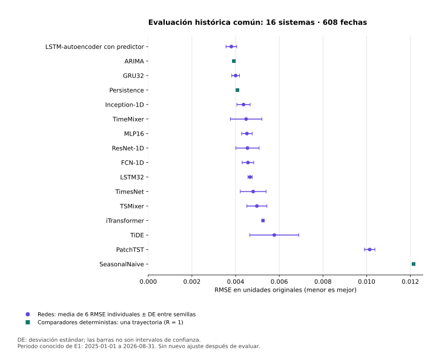
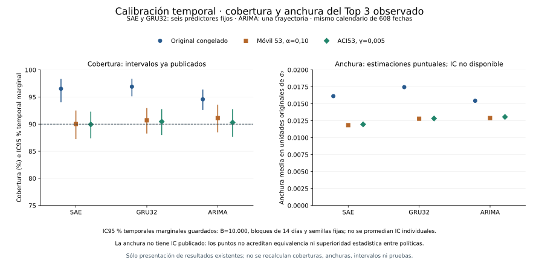
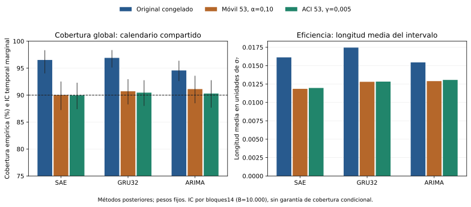
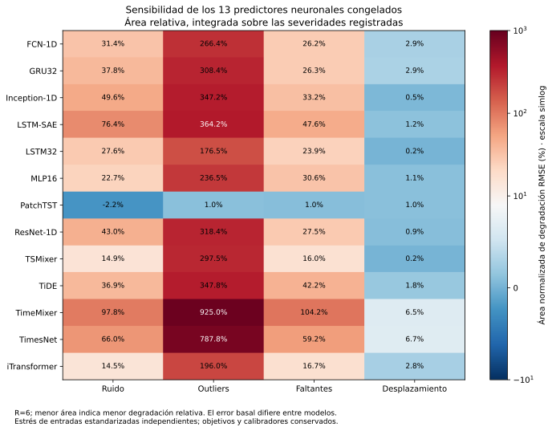
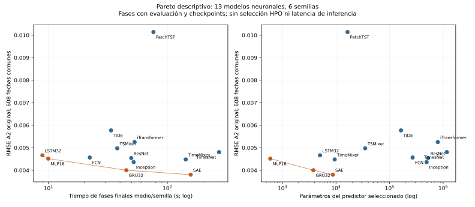
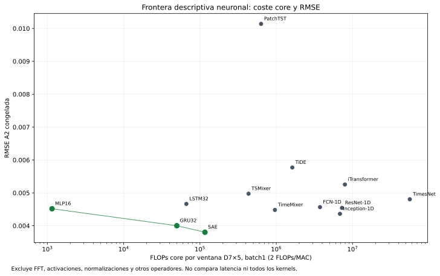
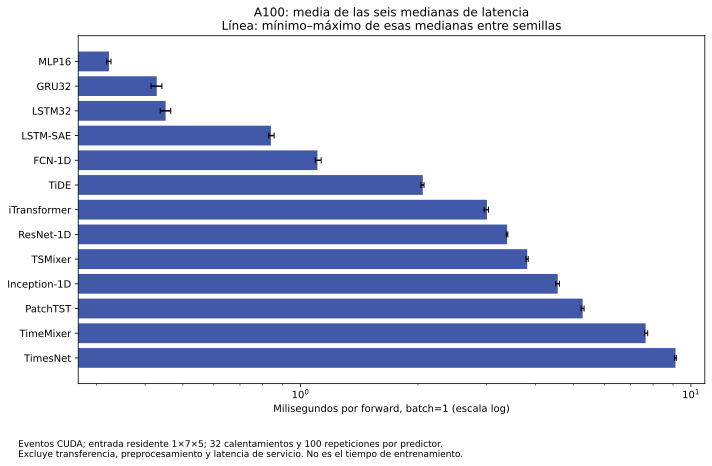
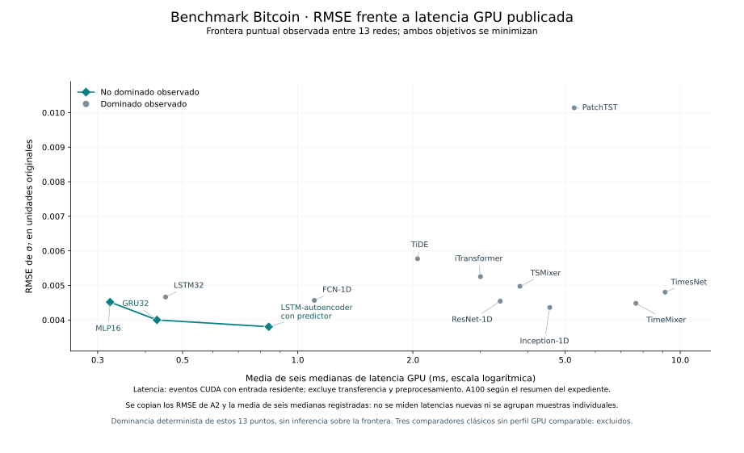
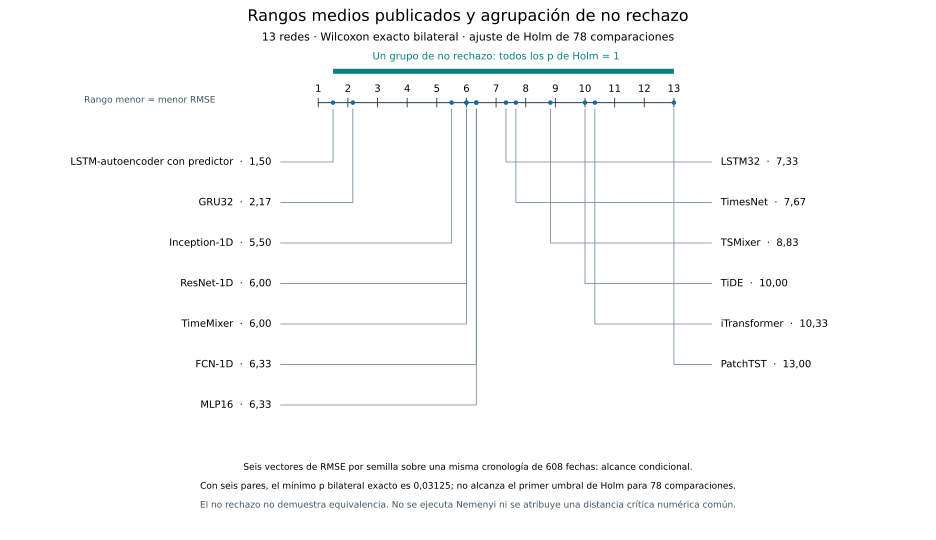

(benchmark-obligatorio-dieciseis-sistemas)=
# 6. Benchmark Final

**Lectura vigente:** el benchmark de **16 sistemas y 81 predictores congelados** está completado sobre las mismas **608 fechas, del 01/01/2025 al 31/08/2026**. El LSTM-autoencoder con predictor (SAE) obtiene la menor RMSE media observada; Persistence obtiene el menor MAE y la menor sMAPE. **Ninguna de las veinte comparaciones primarias demuestra una mejora mayor que δ después de Holm**, tanto en el cálculo original como en el refinamiento posterior de 20.000 remuestreos. Esta sección reúne los resultados y responde a los apartados 6.1–6.4 de la guía, con sus incertidumbres y resultados negativos.

El catálogo vigente reúne diez modelos principales —FCN-1D, ResNet-1D, Inception-1D, SAE, TimesNet, TSMixer, TiDE, TimeMixer, PatchTST e iTransformer—, las referencias E1 MLP16, LSTM32 y GRU32, y Persistence, SeasonalNaive y ARIMA. Son **78 ajustes finales neuronales**, seis por red, y tres comparadores deterministas. El híbrido adicional y Ridge conservan alcance opcional o histórico. La [implementación](04_implementacion.md), el [protocolo ejecutado](48_protocolo_reducido.md) y el [Apéndice B vigente](61_reproduccion_consolidada.md) documentan recetas, selección y reproducción.

La **métrica, δ, unidad temporal y partición heredadas de E1 se aceptan conforme a la continuidad E1–E2–E3 exigida por la guía**. La exposición previa al periodo se declara en la [admisión de datos](../_static/e2_benchmark_final_20261113/data_admission.json): limita el alcance prospectivo de las conclusiones, sin convertir la mera herencia de la partición en una infracción. Los suplementos conservan sus identidades y no se usan para cambiar la selección o el resultado original.

La {download}`comparación consolidada de los 16 sistemas <../_static/e2_benchmark_current_v1/comparison_current.csv>` integra métricas A2, DE, IC entre semillas, rangos y recursos disponibles, manteniendo el origen y alcance de cada columna. El [diccionario de las 38 columnas y sus unidades](../_static/e2_benchmark_current_v1/comparison_schema.json) permite interpretar esa tabla. La [lista de requisitos del punto 6](../_static/e2_benchmark_current_v1/guide_checklist.csv), la [trazabilidad de decisiones](../_static/e2_benchmark_current_v1/decision_traceability.csv), el [índice de fuentes](../_static/e2_benchmark_current_v1/current_evidence_index.json) y el [manifiesto](../_static/e2_benchmark_current_v1/manifest.json) permiten revisar qué está ejecutado y qué sigue limitado. El {download}`índice de esta consolidación <../_static/e2_benchmark_current_v1/README.md>` describe las descargas; la [A2 original](../_static/e2_benchmark_final_20261113/benchmark_A2.csv) conserva sus valores y su identidad.

(benchmark-comparacion-tabular-vigente)=
## 6.1 Comparación tabular

### 6.1.1 Métricas sobre el calendario común

La entrada neuronal común es una ventana D7 de cinco variables OHLCV; se pronostica σ₇ a un día, sin anualización y en unidades originales. La estadística primaria es **la media de las RMSE individuales de las seis semillas**, y no la RMSE de sus predicciones promediadas:

$$
q_{m,s}=\sqrt{\frac{1}{608}\sum_{t\in\mathcal T}(Y_t-\widehat Y_{m,s,t})^2},
\qquad \widehat\mu_m=\frac{1}{R_m}\sum_{s=1}^{R_m}q_{m,s}.
$$

Las trece redes tienen $R_m=6$; cada clásico tiene una trayectoria, $R_m=1$. Todas las filas usan las mismas 608 fechas. Ordenar por RMSE facilita la lectura y no constituye una nueva selección. sMAPE y cobertura se expresan en porcentaje; la anchura se expresa en unidades de σ₇.

| Sistema | RMSE media | DE entre semillas | MAE | sMAPE (%) | R² medio | Cobertura 90 % (%) | Anchura media | R |
|---|---:|---:|---:|---:|---:|---:|---:|---:|
| LSTM-autoencoder con predictor | 0,003803430 | 0,000245424 | 0,002776358 | 16,336 | 0,851816 | 96,519 | 0,016126309 | 6 |
| ARIMA | 0,003921625 | — | 0,002499710 | 14,277 | 0,843008 | 94,572 | 0,015443316 | 1 |
| GRU32 | 0,004001162 | 0,000177508 | 0,003033701 | 17,906 | 0,836307 | 96,902 | 0,017453497 | 6 |
| Persistence | 0,004085596 | — | 0,002353164 | 13,229 | 0,829605 | 93,257 | 0,015117306 | 1 |
| Inception-1D | 0,004362441 | 0,000304390 | 0,003175615 | 18,192 | 0,804942 | 91,365 | 0,014553549 | 6 |
| TimeMixer | 0,004481091 | 0,000722658 | 0,003433893 | 19,636 | 0,790577 | 93,640 | 0,015716682 | 6 |
| MLP16 | 0,004517496 | 0,000242434 | 0,003484249 | 19,799 | 0,791175 | 96,464 | 0,019781805 | 6 |
| ResNet-1D | 0,004543602 | 0,000534018 | 0,003215392 | 17,984 | 0,786834 | 91,036 | 0,013405047 | 6 |
| FCN-1D | 0,004566151 | 0,000264664 | 0,003026539 | 16,743 | 0,786567 | 90,269 | 0,012210834 | 6 |
| LSTM32 | 0,004664330 | 0,000097866 | 0,003713159 | 21,341 | 0,777831 | 97,094 | 0,019656346 | 6 |
| TimesNet | 0,004805500 | 0,000591479 | 0,003501517 | 19,450 | 0,761290 | 92,516 | 0,016313454 | 6 |
| TSMixer | 0,004975357 | 0,000458730 | 0,003541890 | 19,389 | 0,745516 | 92,763 | 0,018125754 | 6 |
| iTransformer | 0,005254319 | 0,000055107 | 0,003973499 | 21,926 | 0,718150 | 85,033 | 0,014448571 | 6 |
| TiDE | 0,005771842 | 0,001119206 | 0,004122466 | 23,440 | 0,649269 | 92,462 | 0,019351808 | 6 |
| PatchTST | 0,010139304 | 0,000239935 | 0,007666813 | 39,020 | -0,049941 | 92,873 | 0,030684902 | 6 |
| SeasonalNaive | 0,012148568 | — | 0,008520579 | 42,129 | -0,506593 | 92,928 | 0,037180183 | 1 |



Las barras representan **±1 DE entre semillas**, no IC95 %. «—» en un clásico significa que no existe dispersión entre entrenamientos repetidos; no significa incertidumbre temporal nula. PatchTST y SeasonalNaive conservan sus R² negativos y no reciben otra configuración tras observar estos resultados. Los datos completos están en [A2](../_static/e2_benchmark_final_20261113/benchmark_A2.csv) y el [análisis original](../_static/e2_benchmark_final_20261113/benchmark_analysis.json).

### 6.1.2 Qué incertidumbre describe cada intervalo

Los **IC t del 95 % ya publicados** describen la media de seis ejecuciones condicionada a esta cronología. Su interpretación requiere independencia de las inicializaciones y una aproximación adecuada para la media; con seis observaciones esa aproximación tiene límites. No representan seis mercados, no incorporan incertidumbre de la selección y no sustituyen los IC temporales pareados de las diferencias de §6.3.

| Sistema neuronal | IC95 % t de la RMSE media entre semillas |
|---|---|
| LSTM-autoencoder con predictor | [0,003545873; 0,004060986] |
| GRU32 | [0,003814880; 0,004187445] |
| Inception-1D | [0,004043004; 0,004681879] |
| TimeMixer | [0,003722708; 0,005239475] |
| MLP16 | [0,004263076; 0,004771915] |
| ResNet-1D | [0,003983184; 0,005104019] |
| FCN-1D | [0,004288403; 0,004843900] |
| LSTM32 | [0,004561626; 0,004767035] |
| TimesNet | [0,004184780; 0,005426219] |
| TSMixer | [0,004493949; 0,005456765] |
| iTransformer | [0,005196487; 0,005312151] |
| TiDE | [0,004597307; 0,006946377] |
| PatchTST | [0,009887508; 0,010391100] |

Para Persistence, SeasonalNaive y ARIMA no se calcula un IC t entre semillas con una sola trayectoria ni se crean repeticiones ficticias. Los trece intervalos anteriores y sus valores completos se conservan en la [comparación consolidada](../_static/e2_benchmark_current_v1/comparison_current.csv). Los IC de ganancia de §6.3 remuestrean calendario y semillas; los IC de cobertura y de estrés tienen sus propios alcances. **Un IC de RMSE no es un intervalo predictivo del próximo σ₇.**

### 6.1.3 Calibración, anchura y robustez

La A2 conserva los intervalos nominales del 90 % cuyo radio se fijó en **53 fechas de calibración, 08/11–30/12/2024**, antes de puntuar la prueba. SAE cubre 96,52 % con anchura 0,016126309; FCN-1D cubre 90,27 % con anchura 0,012210834; iTransformer cubre 85,03 % con anchura 0,014448571. La cercanía al nominal y la anchura deben interpretarse conjuntamente: una sobrecobertura elevada no demuestra mayor precisión ni una garantía condicional.

El [suplemento de calibración temporal](60_calibracion_temporal_condicional.md) compara por separado el radio original, una ventana móvil de 53 residuos y ACI53, usando únicamente residuos anteriores a cada emisión. ACI acerca la cobertura global de SAE a **89,94 %**, GRU32 a **90,46 %** y ARIMA a **90,30 %**, pero en el rango alto del pronóstico quedan **87,21 %, 83,65 % y 86,08 %**, respectivamente. Son resultados retrospectivos; no sustituyen los calibradores de A2 ni acreditan cobertura condicional universal. Sus [métricas por sistema y política](../_static/e2_conditional_calibration_20261114/model_metrics.csv) incluyen longitud, score de intervalo y pinball; no se fabrica una CDF, PIT o CRPS a partir de dos extremos.



La cobertura conserva los IC95 % temporales marginales ya publicados (B=10.000, bloque14 y semillas fijas). La anchura se muestra como estimación puntual: no hay IC publicado para ella. Esta presentación copia los nueve resúmenes del Top3 y sus intervalos de cobertura; no recalcula métricas ni pruebas. [Fuentes y valores exactos](../_static/e2_repro_prereg_current_v1/calibration_plot_readout.json).

:::{dropdown} Figura anterior conservada: cobertura y anchura


Versión anterior preservada con sus valores originales. La presentación vigente distingue explícitamente los IC de cobertura de las anchuras sin IC.
:::

La [robustez ejecutada](54_robustez_interpretabilidad.md) comprende **13 redes × cuatro perturbaciones × tres severidades**. Con extremos en el 10 % de las celdas, la RMSE aumenta **585,40 % en SAE, 513,98 % en GRU32 y 1.552,52 % en TimeMixer**; sus coberturas caen a **22,12 %, 32,07 % y 19,13 %**. El [CSV de estrés](../_static/e2_posthoc_gpu_20261113/robustness.csv) y las [áreas normalizadas de degradación](../_static/e2_posthoc_gpu_20261113/normalized_degradation_areas.csv) conservan las condiciones y sensibilidades. Son entradas alteradas sintéticamente, con objetivos y radios fijos; no son otro mercado ni certifican robustez frente a un quiebre económico real. Los IC de estrés usan 2.000 remuestreos circulares por configuración, con bloques de 7, 14 o 28 días, y no son contrastes primarios ni intervalos simultáneos. La anchura nominal del productor de estrés es 2q sin recorte inferior en cero; se conserva separada de la anchura truncada de A2.



(benchmark-ranking-eficiencia-vigente)=
## 6.2 Ranking y análisis de eficiencia

### 6.2.1 Ranking descriptivo y rangos entre ejecuciones

El orden de las **16 RMSE medias** de §6.1 incluye todos los sistemas. La tabla siguiente añade los **rangos medios dentro de las trece redes**, calculados previamente sobre seis identificadores comunes de semilla. Son dos resúmenes diferentes: ordenar medias no equivale a promediar rangos, y los clásicos no se duplican seis veces para incluirlos artificialmente en el segundo. SAE alcanza rango medio **1,500**, GRU32 **2,167** y PatchTST **13 en cada semilla**. Los [rangos completos](../_static/e2_f2a_s8_20261113/conditional_seed_ranks.csv) incluyen mínimo, máximo y RMSE media.

| Red | Rango medio entre 13 | Tiempo final/semilla, s: media ± DE | Parámetros | FLOPs core/ventana | Latencia forward, ms |
|---|---:|---:|---:|---:|---:|
| LSTM-autoencoder con predictor | 1,500 | 157,08 ± 1,07 | 8 739 | 116 308 | 0,84019 |
| GRU32 | 2,167 | 45,20 ± 0,16 | 3 777 | 49 792 | 0,42854 |
| Inception-1D | 5,500 | 52,09 ± 0,31 | 490 561 | 6 837 632 | 4,55987 |
| ResNet-1D | 6,000 | 49,72 ± 0,55 | 522 955 | 7 265 920 | 3,38347 |
| TimeMixer | 6,000 | 142,72 ± 0,54 | 9 447 | 960 650 | 7,65790 |
| FCN-1D | 6,333 | 22,28 ± 0,18 | 268 929 | 3 741 952 | 1,10541 |
| MLP16 | 6,333 | 9,98 ± 0,13 | 593 | 1 152 | 0,32324 |
| LSTM32 | 7,333 | 8,90 ± 0,14 | 5 025 | 66 368 | 0,45158 |
| TimesNet | 7,667 | 271,95 ± 2,21 | 1 173 099 | 56 242 762 | 9,13152 |
| TSMixer | 8,833 | 37,92 ± 0,28 | 35 044 | 433 110 | 3,80928 |
| TiDE | 10,000 | 33,62 ± 0,20 | 163 384 | 1 622 816 | 2,05747 |
| iTransformer | 10,333 | 53,01 ± 0,23 | 795 403 | 7 936 020 | 3,00425 |
| PatchTST | 13,000 | 76,38 ± 0,36 | 16 388 | 632 330 | 5,28205 |

Los tiempos proceden de [las fases finales instrumentadas](../_static/e2_efficiency_closure_20261113/model_efficiency.csv), los FLOPs del [conteo core](../_static/e2_flops_final_audit_20261114/flops_by_model.csv) y las latencias de los [perfiles A100](../_static/e2_posthoc_gpu_20261113/inference_profiles_by_model.csv). Los espacios en parámetros y FLOPs separan millares; las columnas decimales usan coma. El rango no prueba una diferencia significativa entre dos redes.

### 6.2.2 Pareto y alcance de los costes

Al minimizar RMSE y tiempo final medio por semilla, la frontera observada contiene **LSTM32, MLP16, GRU32 y SAE**. Al minimizar RMSE y parámetros, contiene **MLP16, GRU32 y SAE**. La [auditoría de costes](51_eficiencia_costes.md) conserva los **5.765,09 s** de las 78 ejecuciones finales instrumentadas; el coste SAE incluye sus dos fases auxiliares y la supervisada. Son recetas y épocas congeladas distintas, no una comparación a igual número de actualizaciones ni el coste exhaustivo de HPO.



La frontera RMSE–**FLOPs core** también contiene **MLP16, GRU32 y SAE**. Se cuentan matrices, convoluciones, compuertas recurrentes y productos de atención con **1 MAC = 2 FLOPs**, en batch1 y D7. Se excluyen FFT, activaciones, normalizaciones, pooling, sumas de sesgo y movimientos de memoria. El [inventario de operadores](58_flops_predictores.md) explicita además las rutas sintéticas sondeadas de TimesNet; tres sondas con pesos iniciales no acotan todas sus rutas dependientes de los valores. **La cifra es parcial, no el total de operaciones de todos los kernels.**



La latencia es la **media de las seis medianas por semilla**: 32 pasadas de calentamiento y 100 repeticiones, entrada residente en A100, batch1 y eventos CUDA durante el forward. Excluye carga, transferencia, preprocesamiento y servicio completo. SAE tarda 0,84019 ms, GRU32 0,42854 ms y MLP16 0,32324 ms. Menos parámetros no garantiza menos latencia: TimeMixer tarda más que PatchTST bajo este protocolo.



La frontera **RMSE–latencia** se reconstruye con los trece puntos publicados: RMSE media A2 y media de las seis medianas de forward. La frontera puntual contiene **MLP16, GRU32 y SAE**. El [CSV de puntos y pertenencia](../_static/e2_benchmark_current_v1/latency_pareto.csv) y los [metadatos de las figuras de síntesis](../_static/e2_benchmark_current_v1/summary_plots.json) conservan sus insumos. Esta presentación no incorpora nuevas mediciones y no estima la incertidumbre conjunta de error y coste ni resuelve RQ3.



La dominancia de estas fronteras se calcula sobre estimaciones puntuales, sin incertidumbre conjunta ni nueva selección. Los recursos comparables de los clásicos permanecen **no medidos**, sin asignarles cero. El coste total de búsqueda no está atribuido exhaustivamente; la memoria original de entrenamiento es un máximo del proceso no aislado por modelo, y la memoria de inferencia posterior tiene otro alcance. La energía y el importe monetario siguen sin medirse. Las fronteras orientan el compromiso observado entre precisión y coste; no resuelven la prueba conjunta RQ3.

(benchmark-pruebas-hipotesis-vigente)=
## 6.3 Análisis estadístico y pruebas de hipótesis

### 6.3.1 Familia primaria: mejora relevante de RMSE

Se contrasta, para cada uno de los diez candidatos, una ganancia $g=\mu_{referencia}-\mu_{candidato}$ mayor que el margen heredado **δ = 0,00025772842664981106**, frente a **GRU32 y Persistence**. Son **veinte hipótesis**, con α familiar 0,05 y Holm20. La distribución nula se centra en la frontera $g=\delta$; probar diferencia contra cero responde a otra pregunta.

El análisis original usa **4.999 remuestreos** pareados de semillas y calendario, con bloques de 14 días. El [refinamiento posterior](56_inferencia_estabilidad_final.md) comprobó exactamente los veinte resultados originales y amplió las mismas hipótesis a **20.000 réplicas**, conservando métrica, δ, pares, semillas del generador y Holm. No reentrenó, recalibró ni cambió los pronósticos. El original permanece disponible; el refinamiento satisface el número de sorteos del nuevo cálculo sin atribuir 20.000 a la ejecución inicial.

| SAE frente a | Ganancia RMSE | IC95 % marginal B=20.000 | p unilateral | p Holm20 | Rechazo a 0,05 |
|---|---:|---|---:|---:|:---:|
| GRU32 | 0,000197733 | [−0,000134704; 0,000550757] | 0,646118 | 1,000000 | No |
| Persistence | 0,000282166 | [−0,000169219; 0,000720013] | 0,442778 | 1,000000 | No |

**Los veinte p ajustados siguen siendo 1.** SAE mejora puntualmente un **4,94 %** frente a GRU32, con ganancia menor que δ, y un **6,91 %** frente a Persistence, con ganancia mayor que δ pero IC que incluye cero. Ninguno demuestra superioridad práctica con el control familiar registrado. ARIMA ocupa el segundo lugar puntual; SAE–ARIMA no pertenece a estos veinte contrastes. Los [resultados originales](../_static/e2_benchmark_final_20261113/primary_contrasts.csv), los [veinte cotejos](../_static/e2_temporal_final_audit_20261114/original_4999_exact_checks.csv) y el [refinamiento completo](../_static/e2_temporal_final_audit_20261114/primary_refinement_20000.csv) conservan efectos, IC y p sin ajustar/ajustados.

Los IC son individuales, no simultáneos. El bootstrap supone dependencia temporal suficientemente corta, longitud de bloque adecuada e intercambiabilidad de trayectorias de semillas. La persistencia conserva su única trayectoria determinista al emparejarse; no recibe seis entrenamientos ficticios. **Falta de rechazo no demuestra equivalencia ni ausencia de efectos.** No se ha establecido equivalencia mediante TOST o ROPE.

### 6.3.2 Comparaciones temporales y rangos: hipótesis diferentes

| Procedimiento ejecutado | Unidad, hipótesis y familia | Resultado e interpretación |
|---|---|---|
| t pareada y cambios de signo | Veinte diagnósticos por procedimiento, sobre seis diferencias entre semillas condicionadas al calendario; t con 5 gl y enumeración de 64 signos | Ningún rechazo después de sus ajustes Holm. No sustituyen la incertidumbre temporal; la enumeración no demuestra simetría. |
| Diebold–Mariano con HLN | 120 parejas de 16 sistemas; igualdad bilateral de **MSE diaria media de las trayectorias fijas**, h=1, HAC Bartlett14, HLN y referencia t607 | **35/120 rechazos Holm120**. SAE frente a GRU32, Persistence o ARIMA no rechaza tras Holm. Una diferencia de MSE no acredita el margen δ expresado en RMSE. |
| Model Confidence Set, T_R | Mismas pérdidas; 10.000 bloques circulares de 14 días, procedimiento conjunto al 90 % | Permanecen **FCN-1D, SAE, GRU32, Persistence y ARIMA**. Pertenecer al conjunto no prueba equivalencia ni superioridad universal. |
| Friedman e Iman–Davenport | Seis vectores de semillas × trece redes, condicionados a datos y recetas; independencia entre vectores e intercambiabilidad de rangos bajo la nula | Q=46,98901, pχ²=0,000004682; F(12,60)=9,39367, p=7,02787×10⁻¹⁰. Comprobación de 10.000 permutaciones: p=0,00009999. Son tres evaluaciones del mismo diagnóstico global. |
| Wilcoxon pareado exacto | 78 parejas entre las trece redes, seis pares por comparación; Holm78 | **Cero rechazos, todos los p Holm=1**. El mínimo bilateral posible con seis pares sin empates es 0,03125; esta familia no tiene resolución para declarar una pareja significativa. |
| Giacomini–Rossi y constancia | Veinte pares primarios para cada diagnóstico, sobre diferencias de pérdida; ventanas de 182 días, HAC14 y adaptación bootstrap B=20.000; Holm40 conjunto | Cero rechazos. El estadístico GR no centrado contrasta igualdad predictiva; el diagnóstico separado centrado contrasta constancia. No rechazo no garantiza estabilidad universal. |

La [comparación temporal y de rangos](50_comparaciones_f2a.md) conserva las fórmulas, el [plan](../_static/e2_f2a_s8_20261113/analysis_plan.json), los [120 DM](../_static/e2_f2a_s8_20261113/dm_hln_hac14_all120.csv), la [pertenencia MCS](../_static/e2_f2a_s8_20261113/mcs_membership.csv) y los [78 Wilcoxon](../_static/e2_f2a_s8_20261113/conditional_wilcoxon_holm78.csv). El [suplemento de estabilidad](56_inferencia_estabilidad_final.md) publica los [contrastes GR y de constancia](../_static/e2_temporal_final_audit_20261114/relative_fluctuation_tests.csv). Sus familias son posteriores y exploratorias, separadas de Holm20. No se combinan sus rechazos para declarar confirmación de RQ1.

DM y MCS agregan **errores cuadrados individuales**, sin promediar antes los pronósticos. La pérdida media temporal es la media de RMSE² de las semillas y difiere de la media primaria de RMSE. HLN con HAC14 es una aproximación declarada ante el solapamiento de σ₇, no una prueba exacta de muestra finita. La interpretación temporal requiere dependencia débil o estacionariedad local y una longitud de bloque adecuada.

En Friedman/Wilcoxon las seis semillas no son seis mercados. Compartir identificador numérico tampoco demuestra un efecto aleatorio común entre arquitecturas; el emparejamiento y, para Wilcoxon, la simetría de diferencias son supuestos. No se presenta un Friedman poblacional entre series u orígenes independientes; trimestres y ventanas solapadas no se convierten en réplicas iid. El post-hoc usa Wilcoxon–Holm como alternativa de la guía; no se ejecutó Nemenyi. La heterogeneidad global no permite señalar una pareja sin superar su post-hoc.



**Diagrama de rangos medios con conexiones de no rechazo, en estilo de diferencia crítica.** Se representan los rangos y los 78 resultados Wilcoxon–Holm ya publicados: las trece redes quedan conectadas porque ningún par rechaza después de Holm. No se calcula otra prueba ni una distancia crítica única de Nemenyi. La conexión **no demuestra equivalencia**, y debe leerse junto con la resolución limitada de seis pares y los supuestos de emparejamiento; no significa que las trece redes tengan igual desempeño. Los [metadatos de la figura](../_static/e2_benchmark_current_v1/summary_plots.json) identifican las tablas originales utilizadas.

### 6.3.3 Supuestos, adecuación residual y potencia

La [auditoría de residuos](49_diagnosticos_f2a.md) ejecutó una familia separada de **826 hipótesis**, con **707 rechazos Holm** sobre 81 trayectorias:

| Diagnóstico | Rechazos después de Holm826 |
|---|---:|
| Ljung–Box, residuos, rezago 7 y 14 | 81/81 en cada rezago |
| Ljung–Box, residuos cuadrados, rezago 7 y 14 | 80/81 en cada rezago |
| ARCH-LM, rezago 7 | 78/81 |
| BDS, dimensiones 2 y 3 | 79/81 en cada dimensión |
| Jarque–Bera, normalidad residual | 81/81 |

Los [p-valores completos](../_static/e2_f2a_audit_20261113/tests.csv) incluyen las decisiones no rechazadas. Los resultados impiden tratar los días como iid; BDS por sí solo no prueba señal no lineal aprovechable. No se confunde normalidad residual con normalidad de las seis diferencias usadas por una t pareada.

La ruta principal usa bootstrap por bloques, HAC y rangos para representar esas dependencias; no depende de asumir días normales e independientes. **No se documentan Shapiro–Wilk, Levene ni una ANOVA de medidas repetidas ejecutadas para esta comparación actual.** Tampoco se publicaron d de Cohen o δ de Cliff con IC: se conservan los efectos en unidades originales —ganancia de RMSE y diferencia MSE con IC— y el indicador estandarizado descriptivo de DM, que no sustituye esos tamaños estandarizados con intervalo. Estas omisiones no se presentan como comprobaciones superadas. Ejecutar todas las alternativas paramétricas del catálogo no es necesario para justificar la elección temporal; sí lo es hacer explícitos sus supuestos y límites.

Los tres folds HPO tienen entrenamiento solapado y no se usan como tres replicaciones independientes del benchmark final. No se aplicó una corrección Nadeau–Bengio: no se efectuó aquí una t sobre puntuaciones de esos folds ni se atribuye a las semillas la independencia entre particiones. La inferencia actual combina una sola cronología con repeticiones de optimización, bajo los supuestos declarados, sin eliminar todas las fuentes de dependencia.

El [piloto de potencia y MDE](../_static/e2_benchmark_final_20261113/pilot_power_MDE.json) estimó potencia condicional aproximada de **12,3 %** en su alternativa, inferior al objetivo del 80 %. R=6 fue una decisión documentada por recursos, no una garantía de potencia suficiente, y no se aumentó tras consultar los contrastes. Los p-valores sin ajustar y ajustados, efectos y cantidades de comparaciones permanecen disponibles; un resultado negativo no demuestra equivalencia. Los p numéricos cero del auditor residual se conservan como salidas de biblioteca por precisión, no como probabilidades matemáticamente nulas.

(benchmark-discusion-critica-vigente)=
## 6.4 Discusión crítica y decisiones

| Pregunta de la guía | Respuesta sustentada y límite |
|---|---|
| ¿Qué modelo funciona mejor y por qué? | **SAE obtiene la menor RMSE puntual**, mientras Persistence gana MAE y sMAPE. Las tres ablaciones SAE usan seis semillas y 10.000 remuestreos pareados: retirar dropout supervisado aumenta RMSE 13,90 %, diferencia 0,000528565, IC95 % [0,000299895;0,000771366], p Holm3=0,00059994. Retirar preentrenamiento o segundo encoder no rechaza; no demuestra contribución nula. La evidencia respalda un componente de esa receta, no superioridad confirmada sobre todas las alternativas. |
| ¿Qué generaliza y calibra mejor? | La evaluación común permite comparar este calendario heredado. La cobertura global y la anchura difieren; ACI las modifica favorablemente en varios sistemas, pero persisten déficits por grupo y no existe garantía condicional universal. No hay otro activo o periodo independiente para ordenar generalización externa. |
| ¿Qué resiste mejor las perturbaciones? | La degradación depende del modelo, tipo y severidad. El estrés de extremos deteriora fuertemente SAE, GRU32 y TimeMixer; ninguna menor RMSE original garantiza robustez. Las áreas de escalas de estrés distintas no son intercambiables ni definen un ganador universal. |
| ¿Las diferencias son significativas y relevantes? | Holm20 no confirma ninguna ganancia mayor que δ; los 35 rechazos DM responden a igualdad de MSE en otra familia. Un efecto puntual o un IC marginal favorable no sustituye el ajuste familiar ni una prueba de equivalencia. |
| ¿Qué compromiso entre precisión, coste y explicabilidad es relevante? | MLP16 minimiza parámetros y coste core; GRU32 ofrece menor error que las otras referencias E1 con baja latencia; SAE reduce puntualmente RMSE con más tiempo de ajuste y forward. Los Pareto son descriptivos y parciales. La oclusión para SAE, ARIMA y GRU32 aporta respuesta del predictor, no causalidad económica. |
| ¿Qué tan cerca está el mejor modelo del techo? | El ensemble ajustado sólo en calibración alcanza RMSE puntual 0,003689532; γ empírico=0,287574, IC algebraico [−1,49210;2,37128]. Ninguna ganancia frente a SAE o Persistence rechaza Holm2. Es una referencia alcanzable condicionada, no riesgo Bayes ni techo óptimo identificado; no se afirma que quede exactamente 28,8 % de margen real. |
| ¿Qué errores sistemáticos quedan? | La taxonomía automática etiqueta 6.080 casos fecha-modelo y conserva **100 fechas distintas/600 residuos individuales por cada modelo principal**. Se distinguen magnitud y signo, con IC temporales; no sustituye una taxonomía semántica revisada por expertos. |

Las [ablaciones y su reproducción](55_reproduccion_ablaciones.md), la [interpretabilidad](54_robustez_interpretabilidad.md), la [taxonomía](57_errores_techo.md) y la [referencia de ensemble calibrado](63_ensamble_calibracion.md) permiten revisar estas afirmaciones. Los **81 recibos de reproducción** en checkout y entorno limpios conservan diferencia máxima cero en calibración y prueba; las **18 ejecuciones de ablación corresponden a tres variantes × seis semillas**, no a dieciocho contrastes. Es reproducción numérica con mismo código, recetas y entorno tecnológico, no validación externa por otro equipo o mercado.

La oclusión se aplicó al **Top 3 observado SAE, ARIMA y GRU32**, en 24 fechas equiespaciadas. SAE y GRU32 muestran correlación media de Spearman entre semillas de 0,73102 y 0,83815; para ARIMA, R=1, no es estimable. La fidelidad reutiliza esas fechas y compara con un único orden aleatorio fijado: informa sobre respuesta y coherencia de esos predictores, con independencia limitada. Los residuos serialmente dependientes y la infracobertura observada se conservan entre los resultados negativos.

### 6.4.1 Respuesta a las preguntas de investigación

Las [preguntas e hipótesis de §1](01_punto_partida.md) mantienen sus identidades:

| Pregunta | Decisión con la evidencia actual |
|---|---|
| **RQ1: mejora predictiva relevante** | Ejecutada en los veinte contrastes primarios. No se rechaza ninguna nula de ganancia ≤δ tras Holm20; SAE es el mejor valor observado, sin superioridad práctica confirmada. |
| **RQ2: deterioro de ventaja en alta volatilidad** | [Ejecutada posteriormente el 15/11/2026](64_correcciones_metodologicas.md): diez contrastes de erosión frente a GRU32, régimen causal, 20.000 remuestreos temporales y Holm10. Siete candidatos presentan deterioro relativo mayor que δ; para SAE, Inception y TimeMixer no se establece. Es evidencia exploratoria, sin afirmar robustez a partir del no rechazo. |
| **RQ3: mejora conjunta de error y coste** | [§64](64_correcciones_metodologicas.md) añade tiempos CPU crudos y diez contrastes de coste, sin ahorros confirmados. **No se ejecutó la IUT original**: el suplemento CPU conserva un alcance diferente y no se mezcla su coste con la precisión GPU para anunciar mejora conjunta. |

### 6.4.2 Amenazas a la validez y trabajo pendiente

**Validez interna y temporal.** La selección se hizo por validación y las [81 identidades finales se congelaron](../_static/e2_benchmark_final_20261113/final_freeze.json) antes de puntuar. La partición heredada se mantiene como exige la guía y su conocimiento previo limita la confirmación prospectiva. El **δg previo sí está documentado**, con valor 0,00025772842664981106 y [linaje verificable](../_static/e2_point1_review_v1/margin_lineage.json); no se le atribuye ausencia de definición. [§64](64_correcciones_metodologicas.md) añade un diagnóstico CPU completo con riesgos train/cal en batch1 y trece contrastes: dos tolerancias condicionales y once no establecidas. Las brechas históricas usaban lotes distintos; los nuevos cálculos son posteriores, con diez alertas de proyección frente a CUDA, y no certifican ausencia general de sobreajuste. Una curva favorable o falta de rechazo no subsana esa inferencia.

**Validez externa y de constructo.** Se observa una sola cronología BTCUSDT, con objetivo σ₇ y ventanas solapadas. La volatilidad definida a partir de precios no equivale a utilidad de inversión, rentabilidad ni ausencia de riesgos operativos. Las perturbaciones no reconstruyen trayectorias OHLCV económicamente coherentes; la taxonomía y las explicaciones son diagnósticas. Los suplementos de calibración y ensemble se planificaron antes de sus cálculos respectivos, después de conocer el test original; no se convierten en comparaciones confirmatorias retrospectivamente.

**Validez estadística y de coste.** La potencia es limitada; las aproximaciones HAC, bootstrap y rangos tienen los supuestos expuestos. El MCS, un no rechazo o una cobertura global cercana al nominal no demuestran equivalencia. El coste de selección completo, los FLOPs excluidos y la energía no se han identificado. El cociente γ conserva su intervalo amplio, incluidos cambios de orden y denominador; no se trunca para aparentar un techo preciso.

El cierre del punto 6 distingue los resultados acreditados de los requisitos pendientes en la [lista verificable](../_static/e2_benchmark_current_v1/guide_checklist.csv). Quedan como trabajo concreto la inferencia comparable respecto a δg, la ejecución específica RQ2/RQ3 con sus entradas requeridas, los tamaños estandarizados con IC aún no publicados, la atribución exhaustiva del coste de selección y la validación externa del techo y la calibración. La síntesis utiliza resultados ya existentes; no añade entrenamientos ni nuevas pruebas para completar casillas. Los registros históricos, enlaces y estados anteriores se preservan a continuación.

````{admonition} Archivo documental: versiones y estados anteriores del capítulo 6
:class: dropdown

Este bloque conserva íntegramente el contenido previo y sus encabezados para mantener los enlaces históricos. Sus fechas y estados corresponden a sus cortes originales; los apartados 6.1–6.4 de lectura vigente se presentan arriba. Las cifras y descargas científicas originales no se modifican.

**Resultados finales verificados al 13/11/2026, 11:58:36 de Bogotá.** Se completaron los **78 ajustes finales** de las trece redes, los **10 pilotos**, los tres comparadores y la congelación de **81 predictores**. La evaluación común ya aporta resultados de los **16 sistemas sobre las mismas 608 fechas elegibles**, del 01/01/2025 al 31/08/2026. [Tabla A2 original, CSV](../_static/e2_benchmark_final_20261113/benchmark_A2.csv) · [Análisis completo](../_static/e2_benchmark_final_20261113/benchmark_analysis.json) · [Admisión de datos](../_static/e2_benchmark_final_20261113/data_admission.json).

**Cierre complementario verificado al 13/11/2026, 22:42:55 de Bogotá.** Se completaron los **99 ajustes adicionales del plan: 81 reproducciones en entorno limpio y 18 ablaciones entrenadas del autoencoder**. Los 81 recibos de reproducción aprobaron sus comprobaciones numéricas registradas, con diferencia absoluta máxima **0** en las 53 fechas de calibración y las 608 de prueba; el [informe y las comparaciones de las tres ablaciones (§55)](55_reproduccion_ablaciones.md) conservan sus resultados y límites. Esta etapa reutiliza recetas, épocas y semillas fijadas y no sustituye la A2 ni sus veinte contrastes primarios. El límite autorizado vigente es de **84 horas acumuladas**, con todos los cargos anteriores conservados.

El **LSTM-autoencoder con predictor tiene la menor RMSE media observada**, seguido de ARIMA y GRU32. La persistencia presenta el menor MAE y la menor sMAPE. Este orden descriptivo no demuestra superioridad universal: **ninguno de los 20 contrastes primarios de mejora práctica rechazó su hipótesis nula tras Holm**. La discusión, los resultados negativos y las limitaciones forman parte de la entrega.

**Alcance:** diez candidatos, tres referencias E1 y tres comparadores: **16 sistemas**. El híbrido adicional y Ridge conservan alcance opcional/histórico. Las reglas y decisiones previas siguen en [§48](48_protocolo_reducido.md); el [informe consolidado y su actualización final](47_entrega_consolidada.md) separan estos resultados de los antecedentes de selección y de E1.

**Verificación numérica posterior:** [§56](56_inferencia_estabilidad_final.md) reproduce exactamente los veinte resultados originales de 4.999 remuestreos y recalcula las mismas hipótesis, δ, semillas y Holm con **20.000 réplicas**. Los veinte p ajustados siguen siendo 1,0. Es un refinamiento posterior de precisión, separado del archivo primario original y sin nueva selección.

## Tabla A2: métricas finales medidas

**Auditoría complementaria del 13/11/2026:** [§49](49_diagnosticos_f2a.md) añade curvas de ajuste y diagnósticos de residuos, calibración y estabilidad temporal usando las predicciones congeladas. Es un análisis exploratorio posterior, con su propia familia Holm de 826 hipótesis. No altera esta A2, sus veinte contrastes primarios ni la selección de modelos; tampoco acredita adecuación por falta de rechazo.

La métrica primaria es la **media de las RMSE individuales de las seis semillas**, en unidades originales de σ₇; **no es la RMSE de un ensamble**. Las redes tienen R=6 y cada comparador determinista una trayectoria, R=1. La tabla se ordena por RMSE ascendente para facilitar la lectura, sin una nueva selección ni ajuste tras observar la evaluación. Todas las filas utilizan **n=608**; sMAPE y cobertura se muestran en porcentaje.

| Sistema | RMSE media | DE entre semillas | MAE | sMAPE (%) | R² medio | Cobertura 90 % (%) | Anchura media | R |
|---|---:|---:|---:|---:|---:|---:|---:|---:|
| LSTM-autoencoder con predictor | 0,003803430 | 0,000245424 | 0,002776358 | 16,336 | 0,851816 | 96,519 | 0,016126309 | 6 |
| ARIMA | 0,003921625 | — | 0,002499710 | 14,277 | 0,843008 | 94,572 | 0,015443316 | 1 |
| GRU32 | 0,004001162 | 0,000177508 | 0,003033701 | 17,906 | 0,836307 | 96,902 | 0,017453497 | 6 |
| Persistence | 0,004085596 | — | 0,002353164 | 13,229 | 0,829605 | 93,257 | 0,015117306 | 1 |
| Inception-1D | 0,004362441 | 0,000304390 | 0,003175615 | 18,192 | 0,804942 | 91,365 | 0,014553549 | 6 |
| TimeMixer | 0,004481091 | 0,000722658 | 0,003433893 | 19,636 | 0,790577 | 93,640 | 0,015716682 | 6 |
| MLP16 | 0,004517496 | 0,000242434 | 0,003484249 | 19,799 | 0,791175 | 96,464 | 0,019781805 | 6 |
| ResNet-1D | 0,004543602 | 0,000534018 | 0,003215392 | 17,984 | 0,786834 | 91,036 | 0,013405047 | 6 |
| FCN-1D | 0,004566151 | 0,000264664 | 0,003026539 | 16,743 | 0,786567 | 90,269 | 0,012210834 | 6 |
| LSTM32 | 0,004664330 | 0,000097866 | 0,003713159 | 21,341 | 0,777831 | 97,094 | 0,019656346 | 6 |
| TimesNet | 0,004805500 | 0,000591479 | 0,003501517 | 19,450 | 0,761290 | 92,516 | 0,016313454 | 6 |
| TSMixer | 0,004975357 | 0,000458730 | 0,003541890 | 19,389 | 0,745516 | 92,763 | 0,018125754 | 6 |
| iTransformer | 0,005254319 | 0,000055107 | 0,003973499 | 21,926 | 0,718150 | 85,033 | 0,014448571 | 6 |
| TiDE | 0,005771842 | 0,001119206 | 0,004122466 | 23,440 | 0,649269 | 92,462 | 0,019351808 | 6 |
| PatchTST | 0,010139304 | 0,000239935 | 0,007666813 | 39,020 | -0,049941 | 92,873 | 0,030684902 | 6 |
| SeasonalNaive | 0,012148568 | — | 0,008520579 | 42,129 | -0,506593 | 92,928 | 0,037180183 | 1 |


**Figura.** RMSE media observada; las barras representan **±1 DE entre semillas**, no intervalos de confianza. Los comparadores deterministas se distinguen con otra marca y no reciben barras artificiales de variación entre semillas. La tabla y el CSV conservan la precisión y el alcance de cada métrica.

La DE describe variación entre inicializaciones. «—» indica que no existe una DE entre semillas para R=1; no significa incertidumbre temporal nula. El CSV conserva toda la precisión numérica y los nombres originales de los sistemas.

Los IC t del 95 % de la RMSE media de las redes describen **variación de optimización condicionada a esta cronología**. No representan nuevos mercados ni sustituyen el remuestreo temporal de los contrastes. Como referencia:

| Sistema | IC95 % t entre semillas de la RMSE media |
|---|---|
| LSTM-autoencoder con predictor | [0,003545873; 0,004060986] |
| GRU32 | [0,003814880; 0,004187445] |
| ARIMA | No aplica: una trayectoria determinista |

Los otros intervalos entre semillas están en el [análisis completo](../_static/e2_benchmark_final_20261113/benchmark_analysis.json).

## Diferencias prácticas, incertidumbre y multiplicidad

La familia primaria contiene **20 comparaciones**: cada uno de los diez candidatos frente a **GRU32** y frente a **Persistence**. La ganancia se define como RMSE del comparador menos RMSE del candidato; se contrasta una mejora mayor que **δ=0,00025772842664981106**. El procedimiento principal usa **bootstrap móvil pareado de semillas y posiciones del calendario**, bloques de **14 días**, **4.999 réplicas** y corrección **Holm** sobre la familia. Conserva los supuestos de dependencia local y trayectorias de semillas intercambiables; no se presenta como una prueba exacta de tamaño finito.

**Los veinte p ajustados son 1,0000: no se rechaza la ausencia de mejora práctica en ninguna comparación primaria.** El mejor valor puntual de RMSE no basta para una afirmación confirmatoria. Para el LSTM-autoencoder:

| Comparador | Ganancia puntual de RMSE | IC95 % bootstrap de la ganancia | p unilateral | p Holm | Rechazo FWER 0,05 |
|---|---:|---|---:|---:|---|
| GRU32 | 0,000197733 | [-0,000137309; 0,000547141] | 0,6480 | 1,0000 | No |
| Persistence | 0,000282166 | [-0,000168947; 0,000724185] | 0,4426 | 1,0000 | No |

Frente a persistencia, la mejora puntual es de aproximadamente **6,91 %**, y la ganancia supera δ; sin embargo, su intervalo incluye cero y no queda respaldada tras la corrección de multiplicidad. Frente a GRU32, la mejora puntual es aproximadamente **4,94 %**, pero la diferencia es menor que δ y su intervalo también incluye cero. **Ausencia de rechazo no demuestra equivalencia ni ausencia de efectos.** ARIMA ocupa el segundo lugar descriptivo, pero SAE frente a ARIMA no pertenece a estos veinte contrastes primarios.

La batería registrada también publica una t pareada entre semillas y una enumeración de cambios de signo como **diagnósticos condicionados al calendario**, además de sensibilidades temporales con bloques de 7 y 28 días. Los dos diagnósticos entre semillas tampoco producen rechazos tras sus correcciones reportadas. La enumeración no demuestra por sí misma el supuesto de simetría; las sensibilidades temporales de 7 y 28 días se presentan sin ajuste y no sustituyen la inferencia primaria. [Veinte contrastes primarios, CSV](../_static/e2_benchmark_final_20261113/primary_contrasts.csv) · [Batería y sensibilidades completas](../_static/e2_benchmark_final_20261113/benchmark_analysis.json).

## Calibración y resultados negativos

Los intervalos predictivos nominales del 90 % se calibraron en desarrollo y permanecieron congelados durante la evaluación. La cobertura media de **iTransformer es 85,03 %**, inferior al nominal; la de **LSTM32 es 97,09 %** y la de SAE **96,52 %**. La sobrecobertura no implica automáticamente una mejor predicción: debe leerse junto con la anchura de los intervalos. FCN-1D queda cerca del nominal, con 90,27 %.

**Persistence obtiene el menor MAE, 0,002353164, y la menor sMAPE, 13,23 %.** SAE mejora el orden por RMSE, no todas las métricas. PatchTST y SeasonalNaive tienen R² medios negativos en este soporte; se conservan como resultados del protocolo, sin elegir otra configuración o recalibrar a partir del periodo evaluado.

## Ejecución, calendario y desviaciones documentadas

| Etapa | Evidencia final | Alcance y límites |
|---|---|---|
| Selección interna | Trece recetas cerradas; 231 oportunidades HPO exitosas de 234 | Dos fallos conocidos y un desenlace desconocido conservados; ninguna sustitución de oportunidad |
| Ajustes neuronales finales | **78/78**: seis por red | Configuraciones fijadas por validación; entrenamiento y transformaciones finales hasta el 31/10/2024 |
| Piloto de potencia y variabilidad | **10/10**, cinco semillas de iTransformer y cinco de GRU32 | R=6 permanece una decisión por recursos; [piloto y MDE](../_static/e2_benchmark_final_20261113/pilot_power_MDE.json) documentan su alcance, sin una garantía universal de potencia |
| Comparadores | Persistence, SeasonalNaive y ARIMA evaluados | La selección ARIMA conserva una incidencia de implementación, descrita abajo |
| Congelación | **81 predictores**, con pesos, escaladores y calibradores fijados antes de puntuar | [Recibo de congelación](../_static/e2_benchmark_final_20261113/final_freeze.json) |
| Evaluación común | **16/16 sistemas**, 608 de 608 fechas elegibles | Métricas, cobertura y contrastes publicados; evaluación histórica conocida |

La búsqueda ARIMA programó **18 órdenes × 3 folds = 54 oportunidades**: 51 aportaron una validación válida, dos no convergieron y una falló por implementación. **ARIMA(0,0,0) en el fold de enero de 2024 consumió esa oportunidad y no se repitió**. Quedaron **15 de 18 órdenes con los tres folds válidos**; la receta seleccionada fue **ARIMA(2,0,1)**. No se presenta el dominio completo como exitoso ni se borra la incidencia. SeasonalNaive seleccionó periodo **7** entre tres periodos, con sus nueve validaciones válidas. La [procedencia final](../_static/e2_benchmark_final_20261113/source_evidence.json) conserva los recibos y decisiones.

La evaluación hereda las **608 fechas ya conocidas de E1**, del 01/01/2025 al 31/08/2026. La [admisión](../_static/e2_benchmark_final_20261113/data_admission.json) declara exposición previa, puente causal del 31/12/2024, ausencia de refit o retuning tras acceder al periodo evaluado y congelación previa. **No es una prueba ciega recuperada ni una confirmación prospectiva independiente.** El análisis sigue siendo retrospectivo, aunque la selección y la calibración actuales permanezcan separadas de estas fechas.

El benchmark y sus suplementos no certifican todos los requisitos de E2. [§§49–54](54_robustez_interpretabilidad.md) documentan los diagnósticos, comparaciones, costes y literatura; [§55](55_reproduccion_ablaciones.md) añade la reproducción en entorno limpio y las tres ablaciones entrenadas. La [matriz de la guía](38_cumplimiento_guia.md) conserva los requisitos y límites que siguen abiertos, sin convertir métricas no medidas en ceros ni atribuir cumplimiento integral a la existencia de A2.

## Archivos actuales y cortes históricos

[Tabla A2, CSV](../_static/e2_benchmark_final_20261113/benchmark_A2.csv) · [Análisis JSON](../_static/e2_benchmark_final_20261113/benchmark_analysis.json) · [Admisión de datos](../_static/e2_benchmark_final_20261113/data_admission.json) · [Congelación](../_static/e2_benchmark_final_20261113/final_freeze.json) · [Piloto y MDE](../_static/e2_benchmark_final_20261113/pilot_power_MDE.json) · [Fuentes](../_static/e2_benchmark_final_20261113/source_evidence.json) · [Manifiesto de descargas](../_static/e2_benchmark_final_20261113/manifest.json).

Se conservan la [plantilla histórica de A2](../_static/required_catalogue_20261112/benchmark_A2_template.csv), vacía en su corte original, y las descargas de avance de las [trece redes a las 09:40](../_static/e2_progress_final_20261113_v2/neural_progress.csv) con sus [fuentes congeladas](../_static/e2_progress_final_20261113_v2/source_evidence.json). Sus estados pendientes describen aquellas fechas y no reemplazan la tabla medida de esta actualización.

## Antecedentes documentales del diseño de dieciocho sistemas

Los párrafos y tablas siguientes conservan la evolución del diseño anterior. Sus once candidatos, el estudio del híbrido y las obligaciones asociadas no amplían el catálogo obligatorio vigente de dieciséis sistemas.

**Corte anterior a la enmienda de alcance (12/11/2026):** existe selección HPO/NAS registrada para el catálogo anterior, con ejecución parcial documentada; las afirmaciones de ausencia de HPO o de falta de registro de selección corresponden a cortes anteriores. En aquel corte, el benchmark final, R y su cierre inferencial seguían pendientes. [Registro y alcance actuales (§9)](09_protocolo_registrado.md) · [Calendario (§40)](40_calendario_original.md) · [Corte de resultados (§41)](41_avance_optimizacion_11_origenes.md) · [Auditoría y trabajo paralelo (§42)](42_auditoria_y_trabajo_paralelo.md).

**Corte histórico anterior del 12/11/2026:** hay selección CUDA parcial documentada en [§36](36_avance_campana_cuda.md) y un corte con 1.484 ajustes HPO nuevos completados en [§41](41_avance_optimizacion_11_origenes.md). El corte de entrega posterior se resume en §47. La campaña quedó pausada por límite de sesión en ese corte; el benchmark final, R y el ranking seguían pendientes en aquel corte. Los estados «sin HPO» de abajo pertenecen al corte del 08/11/2026, no al estado actual. [Matriz de exigencias y evidencia](38_cumplimiento_guia.md) · [Calendario histórico de once orígenes](40_calendario_original.md).


**Actualización de planificación:** [§19: auditoría real de desarrollo y plan propuesto](19_plan_auditoria.md). Sin entrenamiento de mercado, HPO ni preregistro nuevo.

**Avance de software:** fábrica de los once candidatos, híbrido y flujo sintético implementados y verificados; recetas provisionales, sin datos de mercado. Véase [§18: integración y pruebas sintéticas](18_integracion_sintetica.md). En ese corte sintético todavía no se había ejecutado la selección parcial posterior de §41; el benchmark seguía pendiente en aquel corte.

**Estado al 08/11/2026: sin resultados de mercado del nuevo catálogo.** La presentación de E2 considera únicamente los diez modelos indicados abajo y CNN-1D + LSTM + atención temporal como candidato 11. La expresión «modelo superior» representa la mejora que se desea investigar; no es una conclusión respaldada por evidencia.

Se conservan cuatro prototipos compactos y un corrector con HAR externo, ahora histórico inactivo, con diez pruebas sintéticas documentadas. El nuevo híbrido tiene receta provisional: está implementado provisionalmente y probado con datos sintéticos, sin entrenamiento de mercado. Las diez pruebas anteriores no lo validan; sus nuevos controles están en §18. Los seis adaptadores existentes se integraron sin reducir sus mecanismos y pasaron el smoke sintético; la auditoría del flujo de mercado seguía pendiente en aquel corte. En ese corte del 08/11 no se habían ejecutado el HPO, el dimensionamiento ni la evaluación de ese conjunto. La selección histórica posterior se documenta en §41. Las métricas de E1, P0 o ETTh1 y las de artículos externos no rellenan sus resultados.

## 6.1 Tabla histórica de los once candidatos

| N.º | Modelo | Estado de implementación para este diseño | RMSE y coste de mercado |
|---|---|---|---|
| 1 | FCN-1D | Prototipo integrado y comprobado sintéticamente; receta definitiva pendiente | No medidos |
| 2 | ResNet-1D | Prototipo integrado y comprobado sintéticamente; receta definitiva pendiente | No medidos |
| 3 | Inception-1D | Prototipo integrado de una red; receta definitiva pendiente | No medidos |
| 4 | LSTM-autoencoder con predictor | Pretrain y ajuste supervisado sintéticos; entrenamiento de mercado por definir | No medidos |
| 5 | TimesNet | Adaptador integrado y smoke sintético aprobado; receta definitiva pendiente | No medidos |
| 6 | TSMixer | Adaptador integrado y smoke sintético aprobado; receta definitiva pendiente | No medidos |
| 7 | TiDE | Adaptador integrado y smoke sintético aprobado; receta definitiva pendiente | No medidos |
| 8 | TimeMixer | Adaptador integrado y smoke sintético aprobado; receta definitiva pendiente | No medidos |
| 9 | PatchTST | Adaptador integrado y smoke sintético aprobado; receta definitiva pendiente | No medidos |
| 10 | iTransformer | Adaptador integrado y smoke sintético aprobado; receta definitiva pendiente | No medidos |
| 11 | CNN-1D + LSTM + atención temporal | Prototipo integrado y pruebas sintéticas; receta definitiva pendiente | No medidos; superioridad no demostrada |

**No medido no significa cero ni un empate.** Esta tabla es el catálogo y su estado, no un ranking. Los controles CNN sola, LSTM sola y CNN–LSTM sin atención se reportarán dentro del estudio del candidato 11 cuando se definan; no reintroducen el catálogo descartado ni acreditan ensayos ya realizados.

## 6.2 Qué debe medir una comparación válida

La tarea común conserva D7×5 derivado de OHLCV mediante `relative_window` y predicción a un día de σ₇ poblacional, sin anualización, en unidades originales, según el [contrato sincronizado E1–E2–E3](17_contrato_sincronizado.md). El híbrido no recibe historia adicional ni rezagos del objetivo. Las fechas comunes y las exclusiones se fijan antes de comparar; no se eliminan fechas a conveniencia según el modelo o el error observado.

La métrica primaria es la **media de las RMSE de cada trayectoria/semilla**, calculadas sobre el mismo calendario elegible:

$$
q_{m,s}=\sqrt{|\mathcal T|^{-1}\sum_{t\in\mathcal T}(Y_t-\widehat Y_{m,s,t})^2},
\qquad \widehat\mu_m=R^{-1}\sum_s q_{m,s}.
$$

La expresión define la agregación, **no fija R**. No se reemplaza por la RMSE de predicciones promediadas, una raíz de errores mezclados entre semillas ni una media no ponderada de RMSE mensuales. Si una receta usa un ensemble, deben definirse de antemano sus miembros y qué constituye una réplica de esa receta.

Las métricas secundarias y diagnósticos se fijarán en el nuevo preregistro. Al informar MAE, MSE, R², MAPE o MASE, se declararán denominadores, cobertura y valores no estimables. MAPE no oculta objetivos cero; MASE usa únicamente pares temporales elegibles del entrenamiento, sin comprimir huecos. Si se evalúan varianza o QLIKE, debe registrarse la transformación de σ₇ y cualquier suelo numérico antes de puntuar.

Cada resultado debe acompañarse de receta, origen, semilla, número de fechas, escala, fallos y procedencia de los pesos. Repetir una predicción determinista para una resta pareada no crea entrenamientos independientes.

## 6.3 Estudio opcional del candidato 11

CNN-1D + LSTM + atención temporal sólo podrá presentarse como mejor bajo una comparación definida y respaldada por datos. El diseño enlaza convoluciones 1D causales que conservan siete posiciones, LSTM unidireccional con `return_sequences=True`, atención temporal sobre esos siete estados observados, vector de contexto y cabeza escalar de σ₇. Este estudio queda fuera del alcance obligatorio. Si se retoma, antes de entrenar se necesitan:

1. **Receta y salida:** definir dimensiones, kernels, profundidad, función de atención, enlace y pérdida sin presentarlos como hiperparámetros ya elegidos. Es una adaptación propuesta, no una reproducción exacta verificada del curso o de una publicación.
2. **Validación causal:** comprobar la ventana y sus transformaciones, padding exclusivamente izquierdo, estado recurrente reiniciado y ausencia de información futura. La atención no añade observaciones fuera de D7.
3. **Controles:** CNN sola, LSTM sola y CNN–LSTM sin atención, con entradas, calendario y evaluación comunes. Son ablaciones, no ampliaciones del catálogo ni resultados ya obtenidos.
4. **Equidad:** contabilizar la búsqueda, entrenamiento de todos los bloques, reajustes y ablaciones. No conceder búsquedas extra hasta lograr ventaja.
5. **Decisión previa:** comparador, mejora mínima relevante, familia de contrastes, multiplicidad, incertidumbre y criterio de coste definidos antes de resultados.

Combinar mecanismos no acredita novedad ni mejora garantizada. Se aceptarán resultados nulos o peores; no se seleccionará retrospectivamente la métrica o cohorte que favorezca al candidato. HAR + red residual y sus exigencias de soporte adicional/cross-fitting quedan como antecedente inactivo, no como obligaciones del nuevo diseño.

## 6.4 Incertidumbre, eficiencia y límites

**Calendario y semillas representan incertidumbres distintas.** Los remuestreos temporales deben usar bloques comunes de fechas y recalcular cada RMSE antes de agregar. La variación entre semillas describe el entrenamiento condicionado a un calendario; no equivale a observar más mercados. Longitudes de bloque, sensibilidades, número de remuestreos y familias requieren especificación propia, no copia automática del diseño retirado.

Los intervalos del score no son intervalos predictivos de σ₇. Una rama de calibración exige separación del ajuste y de la selección, un predictor congelado y reglas anteriores al ranking. Su diseño y ejecución para aquellos once candidatos estaban pendientes en ese registro histórico.

Los costes se medirán con hardware, precisión y protocolo comunes: búsqueda, preentrenamiento, ajuste final, preprocesamiento e inferencia separados. Parámetros, memoria, latencia y FLOPs/MACs deben indicar método y operaciones omitidas. Una magnitud no medida es ausente, no cero. Las fronteras de Pareto y la dominancia puntual tampoco demuestran superioridad con incertidumbre.

La comparación temporal puede requerir DM y Model Confidence Set conforme a la guía, con pérdidas y unidades apropiadas. DM sobre pérdidas cuadráticas no prueba por sí mismo una ganancia práctica de RMSE. El MCS no establece equivalencia. No se fabricarán datasets independientes usando semillas o meses solapados para pruebas globales entre datasets.

La reserva ya consultada en etapas anteriores conserva carácter **exploratorio**. Registrar nuevos ajustes no elimina esa exposición. No hay evidencia actual para afirmar generalización a otros activos o regímenes.

## 6.5 Condiciones de cierre: tabla histórica del 08/11

Los estados de implementación/HPO de esta tabla son antecedentes. Para selección ejecutada consultar [§41](41_avance_optimizacion_11_origenes.md); el benchmark y los análisis finales seguían pendientes en aquel corte. La tabla medida actual se presenta al inicio de esta sección.

| Etapa del catálogo anterior, corte 08/11 | Evidencia necesaria | Estado histórico |
|---|---|---|
| Recetas y fuentes | Arquitecturas, adaptaciones, objetivos y controles del híbrido identificados | Pendiente de congelación |
| Pipeline | Integración de los once candidatos y controles, causalidad, escalado y fallos comprobados | Once candidatos implementados provisionalmente y smoke sintético verificado (§18); desarrollo real auditado (§19), ejecutor de mercado aún sin integrar |
| Preregistro | Fuente ejecutable, calendario, presupuesto, hipótesis y análisis publicados antes de ajustes | Pendiente |
| Selección y dimensionamiento | HPO propio, recetas congeladas y planificación de repeticiones que contemple tiempo y entrenamiento | No ejecutados |
| Evaluación | Pesos y calibradores cerrados, predicciones comparables, costes y auditorías | No ejecutada |
| Conclusiones | Efectos, incertidumbre, multiplicidad, resultados negativos y límites | Sin ganador demostrado |

La [implementación](04_implementacion.md), el [preregistro histórico](09_protocolo_registrado.md), la [equidad de HPO](11_hpo_equidad.md) y las [arquitecturas](14_arquitecturas.md) desarrollan estas condiciones. El [plan editorial de fases](../_static/literature_recovery_second_20261108/next_phases.json) es una ayuda de trabajo, no un preregistro ni un recibo de ejecución.

## 6.6 Evidencia histórica separada

El [recibo P0/OOF](../_static/remediation_preflight/execution_summary.json) conserva 220 trayectorias y 440 ajustes de desarrollo anteriores; sus [métricas](../_static/remediation_pilot_results/aggregate_metrics.csv) y [análisis](../_static/remediation_pilot_results/summary.json) no son la tabla de este benchmark. El [recibo HPO del 06/11/2026](../_static/completion_preflight/execution_progress.json) acredita un inicio parcial histórico, no una búsqueda actual del catálogo vigente. Se preservan protocolos y resultados originales sin reproducir aquí el catálogo retirado ni comprometer su continuación.


````
