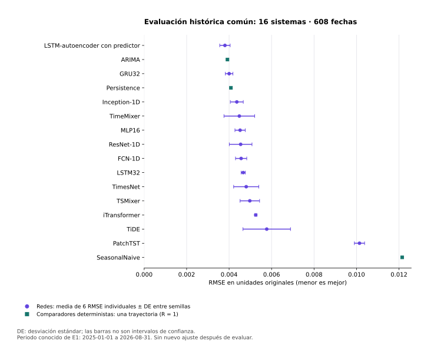

# 6. Benchmark obligatorio: dieciséis sistemas

**Resultados finales verificados al 13/11/2026, 11:58:36 de Bogotá.** Se completaron los **78 ajustes finales** de las trece redes, los **10 pilotos**, los tres comparadores y la congelación de **81 predictores**. La evaluación común ya aporta resultados de los **16 sistemas sobre las mismas 608 fechas elegibles**, del 01/01/2025 al 31/08/2026. [Tabla A2 original, CSV](../_static/e2_benchmark_final_20261113/benchmark_A2.csv) · [Análisis completo](../_static/e2_benchmark_final_20261113/benchmark_analysis.json) · [Admisión de datos](../_static/e2_benchmark_final_20261113/data_admission.json).

**Cierre complementario verificado al 13/11/2026, 22:42:55 de Bogotá.** Se completaron los **99 ajustes adicionales del plan: 81 reproducciones en entorno limpio y 18 ablaciones entrenadas del autoencoder**. Los 81 recibos de reproducción aprobaron sus comprobaciones numéricas registradas, con diferencia absoluta máxima **0** en las 53 fechas de calibración y las 608 de prueba; el [informe y las comparaciones de las tres ablaciones (§55)](55_reproduccion_ablaciones.md) conservan sus resultados y límites. Esta etapa reutiliza recetas, épocas y semillas fijadas y no sustituye la A2 ni sus veinte contrastes primarios. El límite autorizado vigente es de **84 horas acumuladas**, con todos los cargos anteriores conservados.

El **LSTM-autoencoder con predictor tiene la menor RMSE media observada**, seguido de ARIMA y GRU32. La persistencia presenta el menor MAE y la menor sMAPE. Este orden descriptivo no demuestra superioridad universal: **ninguno de los 20 contrastes primarios de mejora práctica rechazó su hipótesis nula tras Holm**. La discusión, los resultados negativos y las limitaciones forman parte de la entrega.

**Alcance:** diez candidatos, tres referencias E1 y tres comparadores: **16 sistemas**. El híbrido adicional y Ridge conservan alcance opcional/histórico. Las reglas y decisiones previas siguen en [§48](48_protocolo_reducido.md); el [informe consolidado y su actualización final](47_entrega_consolidada.md) separan estos resultados de los antecedentes de selección y de E1.

**Verificación numérica posterior:** [§56](56_inferencia_estabilidad_final.md) reproduce exactamente los veinte resultados originales de 4.999 remuestreos y recalcula las mismas hipótesis, δ, semillas y Holm con **20.000 réplicas**. Los veinte p ajustados siguen siendo 1,0. Es un refinamiento posterior de precisión, separado del archivo primario original y sin nueva selección.

## Tabla A2: métricas finales medidas

**Auditoría complementaria del 13/11/2026:** [§49](49_diagnosticos_f2a.md) añade curvas de ajuste y diagnósticos de residuos, calibración y estabilidad temporal usando las predicciones congeladas. Es un análisis exploratorio posterior, con su propia familia Holm de 826 hipótesis. No altera esta A2, sus veinte contrastes primarios ni la selección de modelos; tampoco acredita adecuación por falta de rechazo.

La métrica primaria es la **media de las RMSE individuales de las seis semillas**, en unidades originales de σ₇; **no es la RMSE de un ensamble**. Las redes tienen R=6 y cada comparador determinista una trayectoria, R=1. La tabla se ordena por RMSE ascendente para facilitar la lectura, sin una nueva selección ni ajuste tras observar la evaluación. Todas las filas utilizan **n=608**; sMAPE y cobertura se muestran en porcentaje.

| Sistema | RMSE media | DE entre semillas | MAE | sMAPE (%) | R² medio | Cobertura 90 % (%) | Anchura media | R |
|---|---:|---:|---:|---:|---:|---:|---:|---:|
| LSTM-autoencoder con predictor | 0,003803430 | 0,000245424 | 0,002776358 | 16,336 | 0,851816 | 96,519 | 0,016126309 | 6 |
| ARIMA | 0,003921625 | — | 0,002499710 | 14,277 | 0,843008 | 94,572 | 0,015443316 | 1 |
| GRU32 | 0,004001162 | 0,000177508 | 0,003033701 | 17,906 | 0,836307 | 96,902 | 0,017453497 | 6 |
| Persistence | 0,004085596 | — | 0,002353164 | 13,229 | 0,829605 | 93,257 | 0,015117306 | 1 |
| Inception-1D | 0,004362441 | 0,000304390 | 0,003175615 | 18,192 | 0,804942 | 91,365 | 0,014553549 | 6 |
| TimeMixer | 0,004481091 | 0,000722658 | 0,003433893 | 19,636 | 0,790577 | 93,640 | 0,015716682 | 6 |
| MLP16 | 0,004517496 | 0,000242434 | 0,003484249 | 19,799 | 0,791175 | 96,464 | 0,019781805 | 6 |
| ResNet-1D | 0,004543602 | 0,000534018 | 0,003215392 | 17,984 | 0,786834 | 91,036 | 0,013405047 | 6 |
| FCN-1D | 0,004566151 | 0,000264664 | 0,003026539 | 16,743 | 0,786567 | 90,269 | 0,012210834 | 6 |
| LSTM32 | 0,004664330 | 0,000097866 | 0,003713159 | 21,341 | 0,777831 | 97,094 | 0,019656346 | 6 |
| TimesNet | 0,004805500 | 0,000591479 | 0,003501517 | 19,450 | 0,761290 | 92,516 | 0,016313454 | 6 |
| TSMixer | 0,004975357 | 0,000458730 | 0,003541890 | 19,389 | 0,745516 | 92,763 | 0,018125754 | 6 |
| iTransformer | 0,005254319 | 0,000055107 | 0,003973499 | 21,926 | 0,718150 | 85,033 | 0,014448571 | 6 |
| TiDE | 0,005771842 | 0,001119206 | 0,004122466 | 23,440 | 0,649269 | 92,462 | 0,019351808 | 6 |
| PatchTST | 0,010139304 | 0,000239935 | 0,007666813 | 39,020 | -0,049941 | 92,873 | 0,030684902 | 6 |
| SeasonalNaive | 0,012148568 | — | 0,008520579 | 42,129 | -0,506593 | 92,928 | 0,037180183 | 1 |

**Figura.** RMSE media observada; las barras representan **±1 DE entre semillas**, no intervalos de confianza. Los comparadores deterministas se distinguen con otra marca y no reciben barras artificiales de variación entre semillas. La tabla y el CSV conservan la precisión y el alcance de cada métrica.

La DE describe variación entre inicializaciones. «—» indica que no existe una DE entre semillas para R=1; no significa incertidumbre temporal nula. El CSV conserva toda la precisión numérica y los nombres originales de los sistemas.

Los IC t del 95 % de la RMSE media de las redes describen **variación de optimización condicionada a esta cronología**. No representan nuevos mercados ni sustituyen el remuestreo temporal de los contrastes. Como referencia:

| Sistema | IC95 % t entre semillas de la RMSE media |
|---|---|
| LSTM-autoencoder con predictor | [0,003545873; 0,004060986] |
| GRU32 | [0,003814880; 0,004187445] |
| ARIMA | No aplica: una trayectoria determinista |

Los otros intervalos entre semillas están en el [análisis completo](../_static/e2_benchmark_final_20261113/benchmark_analysis.json).

## Diferencias prácticas, incertidumbre y multiplicidad

La familia primaria contiene **20 comparaciones**: cada uno de los diez candidatos frente a **GRU32** y frente a **Persistence**. La ganancia se define como RMSE del comparador menos RMSE del candidato; se contrasta una mejora mayor que **δ=0,00025772842664981106**. El procedimiento principal usa **bootstrap móvil pareado de semillas y posiciones del calendario**, bloques de **14 días**, **4.999 réplicas** y corrección **Holm** sobre la familia. Conserva los supuestos de dependencia local y trayectorias de semillas intercambiables; no se presenta como una prueba exacta de tamaño finito.

**Los veinte p ajustados son 1,0000: no se rechaza la ausencia de mejora práctica en ninguna comparación primaria.** El mejor valor puntual de RMSE no basta para una afirmación confirmatoria. Para el LSTM-autoencoder:

| Comparador | Ganancia puntual de RMSE | IC95 % bootstrap de la ganancia | p unilateral | p Holm | Rechazo FWER 0,05 |
|---|---:|---|---:|---:|---|
| GRU32 | 0,000197733 | [-0,000137309; 0,000547141] | 0,6480 | 1,0000 | No |
| Persistence | 0,000282166 | [-0,000168947; 0,000724185] | 0,4426 | 1,0000 | No |

Frente a persistencia, la mejora puntual es de aproximadamente **6,91 %**, y la ganancia supera δ; sin embargo, su intervalo incluye cero y no queda respaldada tras la corrección de multiplicidad. Frente a GRU32, la mejora puntual es aproximadamente **4,94 %**, pero la diferencia es menor que δ y su intervalo también incluye cero. **Ausencia de rechazo no demuestra equivalencia ni ausencia de efectos.** ARIMA ocupa el segundo lugar descriptivo, pero SAE frente a ARIMA no pertenece a estos veinte contrastes primarios.

La batería registrada también publica una t pareada entre semillas y una enumeración de cambios de signo como **diagnósticos condicionados al calendario**, además de sensibilidades temporales con bloques de 7 y 28 días. Los dos diagnósticos entre semillas tampoco producen rechazos tras sus correcciones reportadas. La enumeración no demuestra por sí misma el supuesto de simetría; las sensibilidades temporales de 7 y 28 días se presentan sin ajuste y no sustituyen la inferencia primaria. [Veinte contrastes primarios, CSV](../_static/e2_benchmark_final_20261113/primary_contrasts.csv) · [Batería y sensibilidades completas](../_static/e2_benchmark_final_20261113/benchmark_analysis.json).

## Calibración y resultados negativos

Los intervalos predictivos nominales del 90 % se calibraron en desarrollo y permanecieron congelados durante la evaluación. La cobertura media de **iTransformer es 85,03 %**, inferior al nominal; la de **LSTM32 es 97,09 %** y la de SAE **96,52 %**. La sobrecobertura no implica automáticamente una mejor predicción: debe leerse junto con la anchura de los intervalos. FCN-1D queda cerca del nominal, con 90,27 %.

**Persistence obtiene el menor MAE, 0,002353164, y la menor sMAPE, 13,23 %.** SAE mejora el orden por RMSE, no todas las métricas. PatchTST y SeasonalNaive tienen R² medios negativos en este soporte; se conservan como resultados del protocolo, sin elegir otra configuración o recalibrar a partir del periodo evaluado.

## Ejecución, calendario y desviaciones documentadas

| Etapa | Evidencia final | Alcance y límites |
|---|---|---|
| Selección interna | Trece recetas cerradas; 231 oportunidades HPO exitosas de 234 | Dos fallos conocidos y un desenlace desconocido conservados; ninguna sustitución de oportunidad |
| Ajustes neuronales finales | **78/78**: seis por red | Configuraciones fijadas por validación; entrenamiento y transformaciones finales hasta el 31/10/2024 |
| Piloto de potencia y variabilidad | **10/10**, cinco semillas de iTransformer y cinco de GRU32 | R=6 permanece una decisión por recursos; [piloto y MDE](../_static/e2_benchmark_final_20261113/pilot_power_MDE.json) documentan su alcance, sin una garantía universal de potencia |
| Comparadores | Persistence, SeasonalNaive y ARIMA evaluados | La selección ARIMA conserva una incidencia de implementación, descrita abajo |
| Congelación | **81 predictores**, con pesos, escaladores y calibradores fijados antes de puntuar | [Recibo de congelación](../_static/e2_benchmark_final_20261113/final_freeze.json) |
| Evaluación común | **16/16 sistemas**, 608 de 608 fechas elegibles | Métricas, cobertura y contrastes publicados; evaluación histórica conocida |

La búsqueda ARIMA programó **18 órdenes × 3 folds = 54 oportunidades**: 51 aportaron una validación válida, dos no convergieron y una falló por implementación. **ARIMA(0,0,0) en el fold de enero de 2024 consumió esa oportunidad y no se repitió**. Quedaron **15 de 18 órdenes con los tres folds válidos**; la receta seleccionada fue **ARIMA(2,0,1)**. No se presenta el dominio completo como exitoso ni se borra la incidencia. SeasonalNaive seleccionó periodo **7** entre tres periodos, con sus nueve validaciones válidas. La [procedencia final](../_static/e2_benchmark_final_20261113/source_evidence.json) conserva los recibos y decisiones.

La evaluación hereda las **608 fechas ya conocidas de E1**, del 01/01/2025 al 31/08/2026. La [admisión](../_static/e2_benchmark_final_20261113/data_admission.json) declara exposición previa, puente causal del 31/12/2024, ausencia de refit o retuning tras acceder al periodo evaluado y congelación previa. **No es una prueba ciega recuperada ni una confirmación prospectiva independiente.** El análisis sigue siendo retrospectivo, aunque la selección y la calibración actuales permanezcan separadas de estas fechas.

El benchmark y sus suplementos no certifican todos los requisitos de E2. [§§49–54](54_robustez_interpretabilidad.md) documentan los diagnósticos, comparaciones, costes y literatura; [§55](55_reproduccion_ablaciones.md) añade la reproducción en entorno limpio y las tres ablaciones entrenadas. La [matriz de la guía](38_cumplimiento_guia.md) conserva los requisitos y límites que siguen abiertos, sin convertir métricas no medidas en ceros ni atribuir cumplimiento integral a la existencia de A2.

## Archivos actuales y cortes históricos

[Tabla A2, CSV](../_static/e2_benchmark_final_20261113/benchmark_A2.csv) · [Análisis JSON](../_static/e2_benchmark_final_20261113/benchmark_analysis.json) · [Admisión de datos](../_static/e2_benchmark_final_20261113/data_admission.json) · [Congelación](../_static/e2_benchmark_final_20261113/final_freeze.json) · [Piloto y MDE](../_static/e2_benchmark_final_20261113/pilot_power_MDE.json) · [Fuentes](../_static/e2_benchmark_final_20261113/source_evidence.json) · [Manifiesto de descargas](../_static/e2_benchmark_final_20261113/manifest.json).

Se conservan la [plantilla histórica de A2](../_static/required_catalogue_20261112/benchmark_A2_template.csv), vacía en su corte original, y las descargas de avance de las [trece redes a las 09:40](../_static/e2_progress_final_20261113_v2/neural_progress.csv) con sus [fuentes congeladas](../_static/e2_progress_final_20261113_v2/source_evidence.json). Sus estados pendientes describen aquellas fechas y no reemplazan la tabla medida de esta actualización.

## Antecedentes documentales del diseño de dieciocho sistemas

Los párrafos y tablas siguientes conservan la evolución del diseño anterior. Sus once candidatos, el estudio del híbrido y las obligaciones asociadas no amplían el catálogo obligatorio vigente de dieciséis sistemas.

**Corte anterior a la enmienda de alcance (12/11/2026):** existe selección HPO/NAS registrada para el catálogo anterior, con ejecución parcial documentada; las afirmaciones de ausencia de HPO o de falta de registro de selección corresponden a cortes anteriores. En aquel corte, el benchmark final, R y su cierre inferencial seguían pendientes. [Registro y alcance actuales (§9)](09_protocolo_registrado.md) · [Calendario (§40)](40_calendario_original.md) · [Corte de resultados (§41)](41_avance_optimizacion_11_origenes.md) · [Auditoría y trabajo paralelo (§42)](42_auditoria_y_trabajo_paralelo.md).

**Corte histórico anterior del 12/11/2026:** hay selección CUDA parcial documentada en [§36](36_avance_campana_cuda.md) y un corte con 1.484 ajustes HPO nuevos completados en [§41](41_avance_optimizacion_11_origenes.md). El corte de entrega posterior se resume en §47. La campaña quedó pausada por límite de sesión en ese corte; el benchmark final, R y el ranking seguían pendientes en aquel corte. Los estados «sin HPO» de abajo pertenecen al corte del 08/11/2026, no al estado actual. [Matriz de exigencias y evidencia](38_cumplimiento_guia.md) · [Calendario histórico de once orígenes](40_calendario_original.md).

**Actualización de planificación:** [§19: auditoría real de desarrollo y plan propuesto](19_plan_auditoria.md). Sin entrenamiento de mercado, HPO ni preregistro nuevo.

**Avance de software:** fábrica de los once candidatos, híbrido y flujo sintético implementados y verificados; recetas provisionales, sin datos de mercado. Véase [§18: integración y pruebas sintéticas](18_integracion_sintetica.md). En ese corte sintético todavía no se había ejecutado la selección parcial posterior de §41; el benchmark seguía pendiente en aquel corte.

**Estado al 08/11/2026: sin resultados de mercado del nuevo catálogo.** La presentación de E2 considera únicamente los diez modelos indicados abajo y CNN-1D + LSTM + atención temporal como candidato 11. La expresión «modelo superior» representa la mejora que se desea investigar; no es una conclusión respaldada por evidencia.

Se conservan cuatro prototipos compactos y un corrector con HAR externo, ahora histórico inactivo, con diez pruebas sintéticas documentadas. El nuevo híbrido tiene receta provisional: está implementado provisionalmente y probado con datos sintéticos, sin entrenamiento de mercado. Las diez pruebas anteriores no lo validan; sus nuevos controles están en §18. Los seis adaptadores existentes se integraron sin reducir sus mecanismos y pasaron el smoke sintético; la auditoría del flujo de mercado seguía pendiente en aquel corte. En ese corte del 08/11 no se habían ejecutado el HPO, el dimensionamiento ni la evaluación de ese conjunto. La selección histórica posterior se documenta en §41. Las métricas de E1, P0 o ETTh1 y las de artículos externos no rellenan sus resultados.

## 6.1 Tabla histórica de los once candidatos

| N.º | Modelo | Estado de implementación para este diseño | RMSE y coste de mercado |
|---|---|---|---|
| 1 | FCN-1D | Prototipo integrado y comprobado sintéticamente; receta definitiva pendiente | No medidos |
| 2 | ResNet-1D | Prototipo integrado y comprobado sintéticamente; receta definitiva pendiente | No medidos |
| 3 | Inception-1D | Prototipo integrado de una red; receta definitiva pendiente | No medidos |
| 4 | LSTM-autoencoder con predictor | Pretrain y ajuste supervisado sintéticos; entrenamiento de mercado por definir | No medidos |
| 5 | TimesNet | Adaptador integrado y smoke sintético aprobado; receta definitiva pendiente | No medidos |
| 6 | TSMixer | Adaptador integrado y smoke sintético aprobado; receta definitiva pendiente | No medidos |
| 7 | TiDE | Adaptador integrado y smoke sintético aprobado; receta definitiva pendiente | No medidos |
| 8 | TimeMixer | Adaptador integrado y smoke sintético aprobado; receta definitiva pendiente | No medidos |
| 9 | PatchTST | Adaptador integrado y smoke sintético aprobado; receta definitiva pendiente | No medidos |
| 10 | iTransformer | Adaptador integrado y smoke sintético aprobado; receta definitiva pendiente | No medidos |
| 11 | CNN-1D + LSTM + atención temporal | Prototipo integrado y pruebas sintéticas; receta definitiva pendiente | No medidos; superioridad no demostrada |

**No medido no significa cero ni un empate.** Esta tabla es el catálogo y su estado, no un ranking. Los controles CNN sola, LSTM sola y CNN–LSTM sin atención se reportarán dentro del estudio del candidato 11 cuando se definan; no reintroducen el catálogo descartado ni acreditan ensayos ya realizados.

## 6.2 Qué debe medir una comparación válida

La tarea común conserva D7×5 derivado de OHLCV mediante `relative_window` y predicción a un día de σ₇ poblacional, sin anualización, en unidades originales, según el [contrato sincronizado E1–E2–E3](17_contrato_sincronizado.md). El híbrido no recibe historia adicional ni rezagos del objetivo. Las fechas comunes y las exclusiones se fijan antes de comparar; no se eliminan fechas a conveniencia según el modelo o el error observado.

La métrica primaria es la **media de las RMSE de cada trayectoria/semilla**, calculadas sobre el mismo calendario elegible:

$$
q_{m,s}=\sqrt{|\mathcal T|^{-1}\sum_{t\in\mathcal T}(Y_t-\widehat Y_{m,s,t})^2},
\qquad \widehat\mu_m=R^{-1}\sum_s q_{m,s}.
$$

La expresión define la agregación, **no fija R**. No se reemplaza por la RMSE de predicciones promediadas, una raíz de errores mezclados entre semillas ni una media no ponderada de RMSE mensuales. Si una receta usa un ensemble, deben definirse de antemano sus miembros y qué constituye una réplica de esa receta.

Las métricas secundarias y diagnósticos se fijarán en el nuevo preregistro. Al informar MAE, MSE, R², MAPE o MASE, se declararán denominadores, cobertura y valores no estimables. MAPE no oculta objetivos cero; MASE usa únicamente pares temporales elegibles del entrenamiento, sin comprimir huecos. Si se evalúan varianza o QLIKE, debe registrarse la transformación de σ₇ y cualquier suelo numérico antes de puntuar.

Cada resultado debe acompañarse de receta, origen, semilla, número de fechas, escala, fallos y procedencia de los pesos. Repetir una predicción determinista para una resta pareada no crea entrenamientos independientes.

## 6.3 Estudio opcional del candidato 11

CNN-1D + LSTM + atención temporal sólo podrá presentarse como mejor bajo una comparación definida y respaldada por datos. El diseño enlaza convoluciones 1D causales que conservan siete posiciones, LSTM unidireccional con `return_sequences=True`, atención temporal sobre esos siete estados observados, vector de contexto y cabeza escalar de σ₇. Este estudio queda fuera del alcance obligatorio. Si se retoma, antes de entrenar se necesitan:

1. **Receta y salida:** definir dimensiones, kernels, profundidad, función de atención, enlace y pérdida sin presentarlos como hiperparámetros ya elegidos. Es una adaptación propuesta, no una reproducción exacta verificada del curso o de una publicación.
2. **Validación causal:** comprobar la ventana y sus transformaciones, padding exclusivamente izquierdo, estado recurrente reiniciado y ausencia de información futura. La atención no añade observaciones fuera de D7.
3. **Controles:** CNN sola, LSTM sola y CNN–LSTM sin atención, con entradas, calendario y evaluación comunes. Son ablaciones, no ampliaciones del catálogo ni resultados ya obtenidos.
4. **Equidad:** contabilizar la búsqueda, entrenamiento de todos los bloques, reajustes y ablaciones. No conceder búsquedas extra hasta lograr ventaja.
5. **Decisión previa:** comparador, mejora mínima relevante, familia de contrastes, multiplicidad, incertidumbre y criterio de coste definidos antes de resultados.

Combinar mecanismos no acredita novedad ni mejora garantizada. Se aceptarán resultados nulos o peores; no se seleccionará retrospectivamente la métrica o cohorte que favorezca al candidato. HAR + red residual y sus exigencias de soporte adicional/cross-fitting quedan como antecedente inactivo, no como obligaciones del nuevo diseño.

## 6.4 Incertidumbre, eficiencia y límites

**Calendario y semillas representan incertidumbres distintas.** Los remuestreos temporales deben usar bloques comunes de fechas y recalcular cada RMSE antes de agregar. La variación entre semillas describe el entrenamiento condicionado a un calendario; no equivale a observar más mercados. Longitudes de bloque, sensibilidades, número de remuestreos y familias requieren especificación propia, no copia automática del diseño retirado.

Los intervalos del score no son intervalos predictivos de σ₇. Una rama de calibración exige separación del ajuste y de la selección, un predictor congelado y reglas anteriores al ranking. Su diseño y ejecución para aquellos once candidatos estaban pendientes en ese registro histórico.

Los costes se medirán con hardware, precisión y protocolo comunes: búsqueda, preentrenamiento, ajuste final, preprocesamiento e inferencia separados. Parámetros, memoria, latencia y FLOPs/MACs deben indicar método y operaciones omitidas. Una magnitud no medida es ausente, no cero. Las fronteras de Pareto y la dominancia puntual tampoco demuestran superioridad con incertidumbre.

La comparación temporal puede requerir DM y Model Confidence Set conforme a la guía, con pérdidas y unidades apropiadas. DM sobre pérdidas cuadráticas no prueba por sí mismo una ganancia práctica de RMSE. El MCS no establece equivalencia. No se fabricarán datasets independientes usando semillas o meses solapados para pruebas globales entre datasets.

La reserva ya consultada en etapas anteriores conserva carácter **exploratorio**. Registrar nuevos ajustes no elimina esa exposición. No hay evidencia actual para afirmar generalización a otros activos o regímenes.

## 6.5 Condiciones de cierre: tabla histórica del 08/11

Los estados de implementación/HPO de esta tabla son antecedentes. Para selección ejecutada consultar [§41](41_avance_optimizacion_11_origenes.md); el benchmark y los análisis finales seguían pendientes en aquel corte. La tabla medida actual se presenta al inicio de esta sección.

| Etapa del catálogo anterior, corte 08/11 | Evidencia necesaria | Estado histórico |
|---|---|---|
| Recetas y fuentes | Arquitecturas, adaptaciones, objetivos y controles del híbrido identificados | Pendiente de congelación |
| Pipeline | Integración de los once candidatos y controles, causalidad, escalado y fallos comprobados | Once candidatos implementados provisionalmente y smoke sintético verificado (§18); desarrollo real auditado (§19), ejecutor de mercado aún sin integrar |
| Preregistro | Fuente ejecutable, calendario, presupuesto, hipótesis y análisis publicados antes de ajustes | Pendiente |
| Selección y dimensionamiento | HPO propio, recetas congeladas y planificación de repeticiones que contemple tiempo y entrenamiento | No ejecutados |
| Evaluación | Pesos y calibradores cerrados, predicciones comparables, costes y auditorías | No ejecutada |
| Conclusiones | Efectos, incertidumbre, multiplicidad, resultados negativos y límites | Sin ganador demostrado |

La [implementación](04_implementacion.md), el [preregistro histórico](09_protocolo_registrado.md), la [equidad de HPO](11_hpo_equidad.md) y las [arquitecturas](14_arquitecturas.md) desarrollan estas condiciones. El [plan editorial de fases](../_static/literature_recovery_second_20261108/next_phases.json) es una ayuda de trabajo, no un preregistro ni un recibo de ejecución.

## 6.6 Evidencia histórica separada

El [recibo P0/OOF](../_static/remediation_preflight/execution_summary.json) conserva 220 trayectorias y 440 ajustes de desarrollo anteriores; sus [métricas](../_static/remediation_pilot_results/aggregate_metrics.csv) y [análisis](../_static/remediation_pilot_results/summary.json) no son la tabla de este benchmark. El [recibo HPO del 06/11/2026](../_static/completion_preflight/execution_progress.json) acredita un inicio parcial histórico, no una búsqueda actual del catálogo vigente. Se preservan protocolos y resultados originales sin reproducir aquí el catálogo retirado ni comprometer su continuación.
