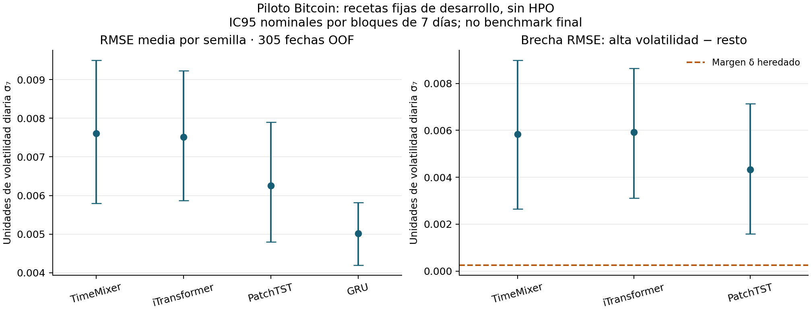

# 9. Preregistro, potencia y piloto

**Estado al 06/11/2026:** protocolo versionado antes de iniciar el piloto Bitcoin de esta etapa; P0 y su evaluación fuera de muestra en desarrollo están **ejecutados y analizados**, con 220 trayectorias y 440 ajustes cerrados. El recibo publicado del 06/11/2026 a las 19:00 UTC acredita inicio de HPO, sin cierre; no confirma actividad actual. El piloto P1, los ajustes definitivos y el benchmark final no tienen cierre publicado. La guía completa de **65 páginas** ya fue recibida y revisada: los pendientes actuales corresponden a implementación y evidencia experimental.

El registro público es el commit [`599a29f87f8ebb1d67cd925ec09bf6bdbc732fa0`](https://github.com/jassan-bit/DeepLearning_202630/commit/599a29f87f8ebb1d67cd925ec09bf6bdbc732fa0), con recibo de registro del **06/11/2026 a las 14:52:32 UTC**. El inicio de P0/OOF se condicionó a ese registro y a sus verificaciones previas. Registrar decisiones ahora mejora el procedimiento prospectivo; **no devuelve el cegamiento al test histórico conocido ni convierte E2 en una confirmación independiente**.

## 9.0 Enmienda registrada para la implementación final

El registro `599a29f` y sus JSON se conservan intactos. La nueva [enmienda](../_static/completion_protocol/analysis_additions.json) se publicó en [`dbb193a`](https://github.com/jassan-bit/DeepLearning_202630/commit/dbb193a72897c80cbd34b452ba3cfe9d82ce6ce0) y se [registró](../_static/completion_preflight/registration.json) el **06/11/2026 a las 18:59:10 UTC (13:59:10 en Colombia)**, con cero ajustes previos de mercado de esta implementación. No se atribuye al registro P0 una decisión posterior. Resuelve presets y adaptaciones de los diez backbones, conserva once candidatos aleatorios y añade un c12 fuente por red, manteniendo T12 y los límites comunes.

La selección histórica de recetas E1 llega al **31/10/2024**. Por ello, P1 y la calibración A pasan al **08/11–30/12/2024, 53 fechas**, con ajuste/selección hasta 31/10 y embargo 01–07/11. Se mantienen las sesenta fechas históricas P0 como evidencia ya ejecutada y las sesenta fechas de test de 2026; ningún calendario se presenta como desconocido de nuevo.

La rama A se declara para **los veinte modelos antes del ranking**. Sus cinco miembros neurales `680101`–`680105`, de pesos 0,2, se fijan antes de P1 y no dependen del R que P1 elija usando las mismas 53 etiquetas. Las cuatro referencias deterministas usan una trayectoria. Todos los pesos primarios, A y de controles negativos cierran antes de puntuar calibración; todos los calibradores cierran antes de la única fase de scoring del test E2. El predictor A evaluado es el mismo que se calibró, sin reajuste.

El primer arranque, registrado con la fuente `ef2be28`, falló al invocar los workers antes de crear ajustes. Se conserva su [incidencia](../_static/completion_preflight/execution_incident.json). La corrección se publicó y registró con salida nueva antes del primer ajuste; no modifica candidatos, arquitectura, hipótesis ni presupuestos. El [avance observado](../_static/completion_preflight/execution_progress.json) distingue ajustes cerrados de trabajo planificado.

### Separación de la propuesta del 08/11 y el registro histórico

La revisión de modelos y los prototipos nuevos de [§4.0](04_implementacion.md) no están registrados por `599a29f` ni `dbb193a`. Esos commits acreditan las decisiones históricas que efectivamente contienen; **no se retrofecha una arquitectura, un soporte HAR o una pérdida nueva usando sus recibos**. La revisión posterior de títulos/resúmenes modifica la evidencia bibliográfica disponible, no las hipótesis experimentales ya registradas.

Antes de entrenar la nueva propuesta se necesita una enmienda propia con catálogo completo, entradas y soportes por comparador, recetas, cronología, tuning, presupuesto, potencia, incertidumbre y análisis. El [plan editorial de fases](../_static/literature_recovery_second_20261108/next_phases.json) enumera salidas necesarias, pero no sustituye ese registro ni fija R. Las reglas NAS o exenciones, las veinte configuraciones y las familias 30+30+199 de abajo no se transfieren automáticamente a un catálogo distinto.

No se iniciaron ajustes de mercado en esta actualización. P0/OOF conserva sus 220 trayectorias y 440 ajustes históricos; los tests sintéticos de prototipos no incrementan esas cifras. El estado experimental se comunica con la fecha del último recibo, sin afirmar que una ejecución siga activa por el mero transcurso del tiempo.

## 9.1 Diecinueve decisiones documentadas

La matriz organiza diecinueve decisiones operativas. Las filas de arquitectura, candidatos, calendario y orden incorporan la enmienda registrada de §9.0; no se afirma que esos cambios estuvieran en `599a29f`. El registro de una regla no acredita que sus experimentos o verificaciones finales estén terminados. El R definitivo y las recetas finales se obtendrán mediante las reglas registradas, sin completar esos campos con resultados imaginados.

| N.º | Decisión | Regla y alcance, con enmiendas indicadas |
|---|---|---|
| 1 | Tarea y unidad | Ruta F2a de series de tiempo, horizonte diario h=1 y una única serie BTCUSDT. Semillas, fechas y meses no se cuentan como nuevos mercados independientes. |
| 2 | Entradas y objetivo | Se conserva D7×5 OHLCV y σ₇ como DE poblacional, `ddof=0`, de siete retornos logarítmicos diarios. No se añaden rezagos de σ₇ a las redes. |
| 3 | Identidad de datos | Mantener la partición y el contrato E1; exigir índices, versiones, hashes y auditoría del pipeline real antes de ejecutar cada fase correspondiente. Un hash identifica datos, no demuestra ausencia de fuga. |
| 4 | Métrica | Media entre semillas de la RMSE por trayectoria en escala original y sobre fechas elegibles comunes. Las métricas secundarias de §4/§6 conservan su cobertura y papel complementario. |
| 5 | Mejora mínima | δ=**0,00025772842664981106** unidades de volatilidad diaria. No se recalcula con el resultado del nuevo benchmark. |
| 6 | Sobreajuste | δg=δ como tolerancia operativa previa para la brecha RMSE validación−train, calculada con la misma regla de inferencia. Es una elección prospectiva, no una aprobación retrospectiva de E1. |
| 7 | Catálogo | **20 configuraciones:** Top 10, GRU-E2/LSTM-E2/TCN-E2, tres anclas E1, Ridge, ARIMA, persistencia y referencia ingenua semanal. |
| 8 | Equidad del ajuste | **15 recetas ajustables**, doce candidatos: **180**. Enmienda: once aleatorios originales + c12 fuente en las trece redes; clásicos sin cambios. **172.800 CPU-s por receta**, consumo y fallos trazables. Recibo del 06/11 a las 19:00 UTC: HPO iniciado e incompleto; sin cierre publicado ni telemetría actual. |
| 9 | Arquitectura final | Diez estructuras/adaptaciones D7 implementadas y revisadas individualmente con pruebas sintéticas. Enmienda y preflight registrados el 06/11; ejecución completa pendiente. Las recetas pequeñas P0 no sustituyen las finales. |
| 10 | NAS condicional | Aplicar §14 solamente cuando corresponda: espacio completo de 1.000 arquitecturas, control, piloto de ruido, fases y selección previamente especificados. **No se ha ejecutado NAS.** |
| 11 | Partición temporal | Desarrollo forward enero–octubre de 2024; P0 histórico de sesenta fechas; nuevo P1/A de **53 fechas 08/11–30/12**, selección/ajuste hasta 31/10 y embargo 01–07/11; reserva heredada sin cambios. No se comprimen fechas. |
| 12 | Aleatoriedad | Semillas P0 nuevas **660101–660105**, emparejadas entre modelos. Los conjuntos de semillas P0, HPO, P1 y finales se mantienen separados. |
| 13 | Familias | Treinta hipótesis frente a GRU/D7-c03 con α=0,02; treinta frente a GRU-E2 con α=0,02; 199 diagnósticos con α=0,01. Holm dentro de cada familia y asignación global total de 0,05. |
| 14 | Contrastes e intervalos | Comparaciones temporales pareadas, nula centrada en δ, bloques de siete días y sensibilidades de catorce/veintiocho; justificación de la longitud exigida en desarrollo. RQ3 usa la intersección-unión de mejora y menor latencia. |
| 15 | Función de P0 | Factibilidad, gap entre regímenes registrado y variabilidad de recetas fijas. La familia de tres contrastes del deterioro por régimen usa exclusivamente OOF; noviembre–diciembre aporta descripción y variabilidad. |
| 16 | Dimensionamiento | P1 posterior al HPO y al congelamiento de recetas; potencia objetivo 0,80, alternativas de ganancia/erosión 2δ y límite **R=200**. R se elegirá con simulación registrada y su incertidumbre Monte Carlo. |
| 17 | Coste | CPU común, un thread y latencia batch 1; calentamiento, bloques de temporización e intercalado de modelos fijados. El cronómetro tiene una unidad distinta de la evaluación predictiva. |
| 18 | Exclusiones y parada | Conservar fallos, NaN, divergencias, límites de recursos e interrupciones documentadas. Máximo de cien épocas y paciencia doce; sin reponer selectivamente candidatos o semillas por su resultado. |
| 19 | Orden y cambios | Registro de la enmienda → verificaciones → HPO → recetas congeladas → P1 → dimensionamiento → todos los pesos primarios, A y de controles negativos cerrados → calibración → calibradores cerrados → única fase de test E2 → análisis. P0 previo se conserva; los cambios exigen enmienda. |

Persistencia, referencia semanal y ARIMA usan información endógena causal con un soporte diferente del D7×5 de las redes. Esa excepción se identifica al interpretar la comparación. Las tres anclas E1 conservan su receta; las variantes E2 permiten estudiar el ajuste comparable sin reescribirlas.

## 9.2 Ejecución completada: P0 y evaluación OOF

P0 comprende **TimeMixer, iTransformer, PatchTST y GRU/D7-c03**, con las cinco semillas nuevas indicadas. Las recetas se fijaron antes de sus ajustes y no se seleccionarán arquitecturas a partir de este piloto.

| Componente registrado y ejecutado | Calendario | Trayectorias | Ajustes de optimizador |
|---|---|---:|---:|
| Piloto con pesos congelados | 01/11–30/12/2024; sesenta fechas potenciales | 4×5=20 | 40 |
| OOF con las mismas recetas | Diez orígenes mensuales enero–octubre de 2024; **305 fechas potenciales** | 4×5×10=200 | 400 |
| Total de esta etapa | Desarrollo histórico identificado | **220** | **440** |

Cada trayectoria requiere selección de épocas y un reajuste desde inicialización nueva, de ahí los dos ajustes de optimizador. El [recibo de ejecución](../_static/remediation_preflight/execution_summary.json) verifica que se completaron las cifras registradas y que fueron elegibles las 305 fechas OOF y sesenta del piloto. Los meses comparten historia de entrenamiento y no son diez datasets independientes.

La inferencia principal de limitación en P0 usa la cohorte **OOF de enero–octubre**, con los tres modelos del Top 10 y Holm a **α=0,01**. Contrasta si RMSE en alta volatilidad menos RMSE en régimen normal supera δ. El régimen se define con σ₇(t−1) y el cuantil 0,75 de entrenamiento 2023, sin añadirlo como entrada de la red. Esta pregunta es distinta de la brecha train–validación respecto a δg.

Los sesenta días de noviembre–diciembre quedan como análisis **descriptivo** de factibilidad y variabilidad de esas recetas. No generan otra familia de rechazo por régimen ni se elegirá después el calendario con el resultado más favorable. La familia P0 es un diagnóstico de desarrollo separado del presupuesto de error del benchmark final; no se afirma un FWER conjunto entre ambas etapas.

Los resultados siguientes proceden de los ajustes cerrados y del análisis registrado; se mantienen separados de los del benchmark final.

### 9.2.1 Resultados observados de Bitcoin

Se cerraron **las 220 trayectorias y 440 ajustes previstos**, sin fallos registrados. El registro de las 14:52:32 UTC precedió al primer ajuste; todos los pesos cerraron antes del primer scoring. El [recibo de ejecución](../_static/remediation_preflight/execution_summary.json) conserva los tiempos reales, recuentos y hashes. Se puntuaron **1.200 filas semilla×fecha de piloto** y **6.100 de OOF**: son sesenta y 305 fechas únicas, respectivamente, para cada receta; no 7.300 observaciones de mercado independientes. No se accedió a datos de prueba de 2025–2026.

| Receta fija P0 | RMSE OOF, media ± DE entre semillas | IC temporal nominal 95 % | RMSE noviembre–diciembre, media ± DE |
|---|---:|---:|---:|
| TimeMixer | 0,00760339 ± 0,00032045 | [0,00579635; 0,00949957] | 0,00572273 ± 0,00054997 |
| iTransformer | 0,00751167 ± 0,00047332 | [0,00586802; 0,00923716] | 0,00564681 ± 0,00033395 |
| PatchTST | 0,00625683 ± 0,00027579 | [0,00479305; 0,00789627] | 0,00532612 ± 0,00029717 |
| GRU | 0,00501423 ± 0,00015372 | [0,00419800; 0,00582205] | 0,00464975 ± 0,00023966 |

Estas RMSE son medias de cinco RMSE por trayectoria, no la RMSE de un ensamble. Los IC se obtuvieron sobre el calendario con bloques de siete días y 4.999 réplicas; son nominales y condicionados a las redes ajustadas. La DE entre semillas no sustituye la incertidumbre temporal. GRU tiene menor RMSE descriptiva en este piloto; **no hay evidencia aquí de superioridad global de los tres prototipos sobre esa referencia**. Tampoco constituye el ranking de veinte configuraciones con HPO.

### 9.2.2 Limitación por régimen: resultado registrado

Los **115 orígenes de alta volatilidad conocida** y 190 restantes se definieron con el umbral de entrenamiento fijado antes de puntuar. Los tres contrastes principales OOF/bloque7 rechazan H₀: gap≤δ con Holm a α=0,01:

| Modelo | RMSE alta−resto | IC95 nominal | p unilateral | p Holm, tres hipótesis | Decisión registrada |
|---|---:|---:|---:|---:|---|
| TimeMixer | 0,00584116 | [0,00264550; 0,00898261] | 0,0004 | 0,0008 | Gap > δ respaldado en P0/OOF |
| iTransformer | 0,00591431 | [0,00310376; 0,00863974] | 0,0002 | 0,0006 | Gap > δ respaldado en P0/OOF |
| PatchTST | 0,00432492 | [0,00158748; 0,00713583] | 0,0020 | 0,0020 | Gap > δ respaldado en P0/OOF |

Las sensibilidades registradas de catorce y veintiocho días conservan la dirección positiva y p Holm inferiores a 0,01; se publican como sensibilidades, no como nuevas oportunidades de decisión. La brecha descriptiva de GRU en OOF es **0,00318119**, sin añadirlo posteriormente a la familia de tres contrastes.

**Brecha acotada por la evidencia:** bajo el contrato D7×5, estos tres prototipos fijos presentan deterioro de RMSE en episodios de alta volatilidad de desarrollo de Bitcoin superior a δ. La limitación observada ya tiene evidencia en Bitcoin además de ETTh1. Su presencia también en GRU apunta a dificultad compartida del régimen; la diferencia absoluta puede reflejar escala/heterocedasticidad y no identifica un defecto causal exclusivo del mecanismo. No demuestra que sobreviva al HPO, que sea mayor que la de todas las referencias, ni que una modificación transferida la corrija. El **gap corregible del modelo original E3 sigue por demostrar** mediante adaptación, ablaciones y comparación justa.

La cohorte de noviembre–diciembre permanece descriptiva y **la dirección del gap se invierte en las cuatro recetas**: TimeMixer −0,00199168, iTransformer −0,00075023, PatchTST −0,00100891 y GRU −0,00160510. La fragilidad no es universal en todos los calendarios. No se eligió después por producir un resultado más favorable. El desarrollo de 2024 y la selección histórica de GRU ya eran conocidos en E1: los cortes OOF verifican los ajustes de pesos de esta etapa, sin recuperar cegamiento ni eliminar toda selección histórica.

### 9.2.3 Qué dicen estos datos sobre las semillas

La siguiente proyección usa únicamente noviembre–diciembre y la alternativa previamente fijada 2δ, α=0,02/30 y cuatro grados de libertad para la DE. **No utiliza el efecto observado como alternativa de planificación.**

| Modelo frente a GRU | DE de diferencias entre cinco semillas | Potencia condicional proyectada con R=5 | R con DE puntual | R usando cota superior de DE | Potencia condicional con R=200 y esa cota |
|---|---:|---:|---:|---:|---:|
| TimeMixer | 0,00041370 | 0,0075 | 48 | >200 | 0,4277 |
| iTransformer | 0,00025710 | 0,0223 | 22 | 140 | 0,9516 |
| PatchTST | 0,00050627 | 0,0052 | 69 | >200 | 0,2310 |

La incertidumbre de la DE cambia mucho el R proyectado. Con su cota superior, TimeMixer y PatchTST no alcanzan 0,80 ni con R=200 bajo esta aproximación condicional. Por tanto, no se acredita suficiencia por usar cinco o diez semillas. Estos números **no fijan R final**: falta HPO, congelamiento de recetas, P1 y simulación que incluya la dependencia temporal y las familias previstas.

### 9.2.4 Evidencia publicada y análisis adicional

- [Métricas agregadas](../_static/remediation_pilot_results/aggregate_metrics.csv) y [métricas por trayectoria/semilla](../_static/remediation_pilot_results/seed_metrics.csv).
- [Gap, contrastes y sensibilidades](../_static/remediation_pilot_results/gap.csv), [ganancias descriptivas frente a GRU](../_static/remediation_pilot_results/comparative_gains.csv) y [proyección de potencia](../_static/remediation_pilot_results/power.json).
- [Resumen del experimento](../_static/remediation_pilot_results/summary.json) y [procedencia por hashes](../_static/remediation_pilot_results/provenance.json).
- [Análisis de errores](12_incertidumbre_errores.md): 305 fechas clasificadas por receta y cien casos únicos por modelo en una muestra privada estratificada. Las predicciones individuales y los checkpoints no se publican.

## 9.3 Qué queda por ejecutar y cómo se dimensionará

P0 no estima la potencia de las recetas finales ni determina el ganador. La nueva [revisión arquitectónica](../_static/completion_protocol/architecture_review.json) ya resuelve individualmente los diez adaptadores y documenta `nas_required=false` en esos casos, con fuente, preset y modificaciones D7. Las pruebas sintéticas verifican implementaciones, no el pipeline completo ni el rendimiento de mercado. El registro y el preflight integrado ya están cerrados. El último recibo del 06/11 a las 19:00 UTC acredita HPO iniciado e incompleto; no permite afirmar actividad actual. P1 y ajustes finales siguen sujetos a los recibos de las fases anteriores.

La selección final de hiperparámetros se separa de su evaluación OOF. Las tres anclas E1 conservan selección histórica hasta octubre: su OOF enero–septiembre **no se presenta como selección anidada libre de exposición**. El corte mensual de ajuste, épocas y escaladores sigue siendo obligatorio para todos. Las otras diecisiete configuraciones respetan selección de configuración anterior al origen externo; la excepción histórica no autoriza nueva selección con meses futuros.

El [HPO](11_hpo_equidad.md) y la [revisión de arquitecturas](14_arquitecturas.md) especifican las condiciones de la implementación final.

Cuando corresponda NAS, el registro conserva tres bloques, anchos {16,32,64,128,256}, los ocho patrones de dropout 0,2 y las 1.000 combinaciones. Un piloto de ruido fija k=20 o 40 con una regla previa, se añade el control 64–64–64/dropout010 y se confirman los finalistas con al menos cinco semillas distintas de la fase 1. Esta especificación no acredita que la búsqueda se haya ejecutado.

P1 se realizará **después del HPO y del congelamiento de sus recetas**, sobre las 53 fechas 08/11–30/12/2024, con los cinco modelos y diez semillas `660201`–`660210` predefinidos. El dimensionamiento distinguirá variabilidad entre semillas y dependencia del calendario, conservará las familias completas y reproducirá la decisión conjunta de RQ3. La alternativa de planificación es 2δ: detectar exactamente el valor de la frontera nula δ no permite prometer potencia del 80 %. La alternativa de coste es una reducción relativa del 20 % de latencia, medida por separado.

La cuadrícula es **R∈{5,6,8,10,15,20,30,40,60,80,100,150,200}**. Cada R usa 10.000 simulaciones de nula y 10.000 de alternativa independientes, con familias completas/Holm e intersección-unión de RQ3. Se evalúan variación entre semillas, calendario y remuestreo conjunto. Proyectar de 53 días P1 a sesenta de test es un supuesto de transferencia, no siete nuevas observaciones. Se elegirá el menor R cuyo límite inferior unilateral de Wilson al 95 % alcance 0,80 en todas las celdas previstas. Si ninguna opción lo consigue, se registrará R=200 con **objetivo de potencia no alcanzado**, efecto mínimo detectable y limitaciones. Las siete arquitecturas Top10 sin piloto propio usan la mayor DE representativa, con cota superior del 95 % e inflación 1,5: es un proxy identificado, no certificación empírica de potencia. Las cotas chi-cuadrado con nueve grados de libertad entre diez semillas y sesenta grados entre 61 bloques de tiempo suponen normalidad aproximada. Wilson cuantifica sólo incertidumbre Monte Carlo; no elimina la incertidumbre del pequeño piloto ni demuestra transferencia de su ley empírica. Aumentar semillas no crea nuevas fechas independientes.

Los contrastes finales usarán el α de su familia, incluidos los límites simultáneos, en vez de conservar automáticamente 0,05/30. Se mantienen los límites del test histórico conocido y la necesidad de verificar supuestos, auditoría de fuga, calibración y pipeline final.

## 9.4 Documentos y descarga

- [Diseño de la implementación final](../_static/completion_protocol/design.json), [enmienda preparada](../_static/completion_protocol/analysis_additions.json), [HPO](../_static/completion_protocol/hpo.json) y [candidatos](../_static/completion_protocol/candidate_registry.json).
- [Implementación y evidencia descargables](../_static/completion_download/completion_bundle.zip).
- [Espacios HPO originales P0, conservados](../_static/remediation_protocol/hpo.json).
- [Preregistro: hipótesis, familias, pilotos, potencia y reglas](../_static/remediation_protocol/preregistration.json).
- [Decisiones arquitectónicas y NAS condicional](../_static/remediation_protocol/architecture_decisions.json).
- [Validación documental del protocolo](../_static/remediation_protocol/validation.json) y [registro de 180 candidatos sin evaluar](../_static/remediation_protocol/candidate_registry.json).
- [Descargar protocolo, código y evidencias de esta etapa](../_static/remediation_download/Remediacion_E2_protocolo_codigo_evidencias.zip).

Los JSON conservan el estado que tenían al registrarse, anterior a los ajustes de esta etapa. Sus contadores iniciales de ejecución no se modifican para aparentar un registro posterior. La validación comprueba contratos, identidades y reglas; los resultados y recibos de ejecución demuestran por separado qué se completó y con qué alcance.
