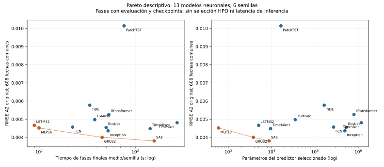
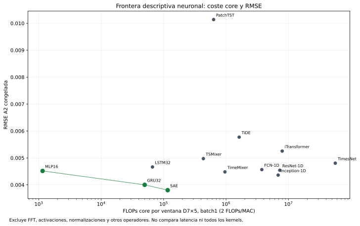
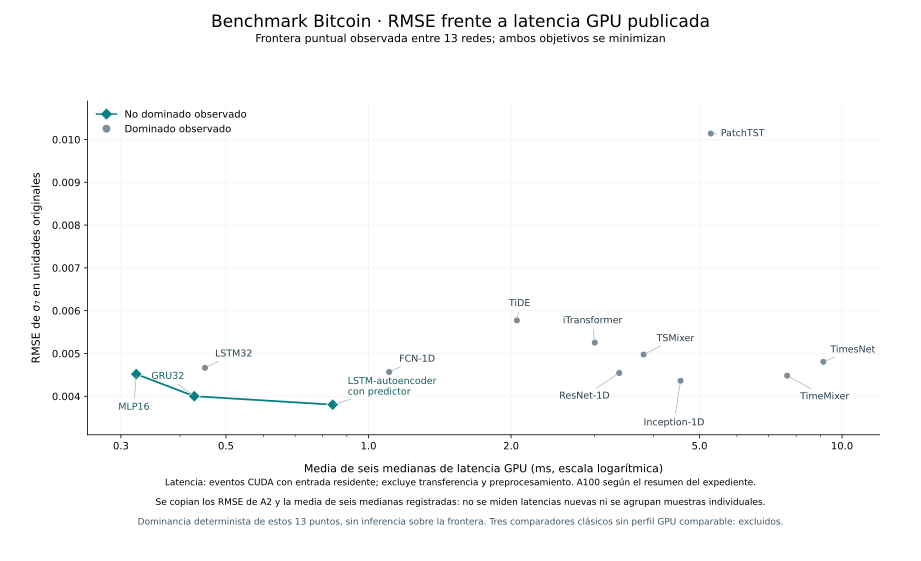

(seleccion-hpo-ejecutada-y-equidad)=
# 11. Protocolo de Entrenamiento, Ajuste y Costo Computacional

**Lectura vigente:** la selección reducida y el benchmark están ejecutados para **dieciséis sistemas**: diez candidatos, las referencias E1 MLP16/LSTM32/GRU32 y Persistence, SeasonalNaive y ARIMA. Las trece redes aportan **78 ajustes finales, seis semillas por receta**; los tres clásicos completan **81 predictores sobre 608 fechas comunes**. Las reproducciones y ablaciones posteriores conservan sus propias identidades y no aumentan el número de predictores originales de A2.

Este capítulo sigue **11.1–11.4 de la guía, pp. 46–48**. El [protocolo ejecutado](48_protocolo_reducido.md), la [implementación](04_implementacion.md), el [benchmark](06_benchmark_final.md), la [lista verificable](../_static/e2_data_training_uncertainty_current_v1/guide_checklist.csv), la [trazabilidad](../_static/e2_data_training_uncertainty_current_v1/decision_traceability.csv) y el [índice de evidencias](../_static/e2_data_training_uncertainty_current_v1/current_evidence_index.json) permiten revisar los datos, recetas, oportunidades, fallos y costes. El {download}`índice de esta consolidación <../_static/e2_data_training_uncertainty_current_v1/README.md>` y el [manifiesto](../_static/e2_data_training_uncertainty_current_v1/manifest.json) mantienen separados los resultados comprobados de los requisitos parciales.

(e2-equidad-modelos-vigente)=
## 11.1 Reglas de equidad para los modelos

### 11.1.1 Qué se mantuvo común y qué difiere

| Regla de la guía | Evidencia de la ejecución actual | Alcance o límite |
|---|---|---|
| **Datos y preprocesamiento base** | Las trece redes reciben **D7×5 OHLCV**, objetivo σ₇ poblacional sin anualización y h=1. Ventanas relativas, normalización de atributos y escala del objetivo se ajustan sólo con el train admisible. Todas las métricas finales usan las mismas 608 fechas. | La adaptación de cada cuerpo y su cabeza escalar están documentadas en [§44](44_arquitecturas_publicadas.md). Las referencias temporales usan objetivos pasados y, en ARIMA, una historia endógena más larga; ser causal no significa tener información idéntica a D7×5. |
| **Presupuesto de ajuste** | **Seis plazas C01–C06 por red, los mismos tres folds y semilla HPO 271201:** 234 oportunidades. | Igual número de plazas no acredita igual coste total. SAE tiene tres fases; los registros de selección incluyen T4/A100 y reutilizaciones con políticas históricas. Los clásicos tienen dominios distintos. |
| **Parada y validación** | Mismos tres orígenes de selección; máximo 200 épocas, paciencia 20 y mejora estricta de validación bajo la política aplicable a fases nuevas. La receta y sus épocas finales se fijan desde la validación. | Los resultados reutilizados conservan las políticas con que se obtuvieron. La regla común no significa el mismo número final de épocas o actualizaciones para arquitecturas distintas. |
| **Esfuerzo arquitectónico** | Los cuerpos publicados y sus adaptaciones están adjudicados, incluida **TIDE-D7-PUBLISHED-R0-v2**. | La NAS de 1.000 diseños y dos fases es condicional a un cuerpo no definido. Seis plazas HPO no constituyen NAS; las variantes propias históricas conservan sus obligaciones y no reciben una exención retroactiva. |
| **Preentrenamiento** | No se importaron pesos preentrenados ajenos en el benchmark. SAE realiza AE1 y AE2 con las entradas de su propio train antes de la fase supervisada. | Se incluye el coste de esas dos fases. Las tres ablaciones entrenadas de [§55](55_reproduccion_ablaciones.md), incluida retirar preentrenamiento, tienen seis semillas y familias posteriores propias; un no rechazo no demuestra contribución nula. |
| **Implementación de referencia** | Código de autores fijado y desviaciones D7 identificadas en §44; TiDE tiene paridad funcional documentada. [§5](05_paper_guia.md) conserva una réplica parcial de TimeMixer/ETTh1. | La réplica externa y una comprobación estructural no acreditan una reproducción numérica de todos los artículos. La repetición de los 81 predictores verifica el pipeline congelado, con su propio propósito. |
| **Línea base fuerte** | ARIMA recibió 18 órdenes × 3 folds: 51 resultados válidos, dos no convergencias y un fallo de implementación; 15 órdenes fueron elegibles y ganó (2,0,1). SeasonalNaive evaluó tres periodos y eligió 7; Persistence tiene lag 1 fijo. | R=1 en un clásico determinista no significa un baseline sin ajustar. Tampoco se presenta su dominio como idéntico en coste al neuronal ni se asigna cero a los recursos no medidos. |

Los folds usan **253/435/527 ejemplos de entrenamiento y 83 de validación cada uno**. El ajuste final usa **655 ejemplos** hasta el 31/10/2024, después embargo del 01–07/11, calibración de 53 fechas del 08/11–30/12 y evaluación de 608 fechas del 01/01/2025–31/08/2026. El 31/12 aporta historia causal con parámetros fijos. La [auditoría de soportes](../_static/e2_eda_current_v1/partition_audit.json) distingue IDs y la historia compartida legítima de calibración/test; no se afirma independencia entre ventanas o particiones expansivas solapadas.

La métrica, δ y partición se heredan de E1 conforme a la guía. La [congelación](../_static/e2_benchmark_final_20261113/final_freeze.json) y la [admisión](../_static/e2_benchmark_final_20261113/data_admission.json) documentan el orden del scoring actual, con periodo histórico ya conocido. Ese orden no se convierte en una evaluación prospectiva nueva ni autoriza elegir otra receta a partir del ranking final.

### 11.1.2 Oportunidades, resultados y fallos conservados

**Recuperación adicional del 15/11/2026:** [§64](64_correcciones_metodologicas.md) publica los recibos de las 234 oportunidades, 78 configuraciones, cobertura por parámetro y trece ganadores reproducidos. Distingue 61 reutilizaciones, 170 duraciones medidas y 173 cargos de campaña, con ámbitos que no se suman entre sí. La [tabla por oportunidad](../_static/e2_corrections_20261115/hpo/opportunities_234.csv) mejora la atribución anterior sin inventar el desenlace perdido de TSMixer ni presentar el subtotal como coste integral.

Se conservan **231 resultados válidos de 234 oportunidades**, dos fallos conocidos y un desenlace desconocido. Cada una de las trece recetas ganadoras tiene tres folds completos. Las reutilizaciones admitidas no se cuentan como entrenamientos nuevos, y un fallo no se sustituye por una oportunidad adicional favorable. El intento TSMixer C02 del origen julio de 2024 perdido con la sesión T4 conserva desenlace desconocido y cargo conservador, sin inventar métricas o pasos del optimizador.

Este cotejo verifica los resultados y disposiciones publicados, **sin reconstruir la atribución exhaustiva caché/nuevo del diario**. Los contadores históricos y candidatos de caché conservan su corte; no se transforman en una medición independiente de todos los entrenamientos nuevos. Los 39 ajustes HPO de recetas finalmente elegidas son una selección del dominio completo, no los 234 intentos. Hay curvas recuperadas para 29/39 y diez ausencias explícitas; los 78 finales sí conservan sus curvas. [Galería de curvas](04_implementacion.md) · [Auditoría de entrenamiento](49_diagnosticos_f2a.md).

(e2-hpo-vigente)=
## 11.2 Búsqueda de hiperparámetros y reajuste final

### 11.2.1 Dominio finito registrado y cobertura real

La continuación reducida evalúa seis tuplas por red, con procedencia en las posiciones padre **5/7/8/9/10/15**. Se eligieron por cobertura de metadatos: batches 16/32/64, presencia de weight decay cero/positivo y separación en logLR, con desempate determinista, **sin usar RMSE o tiempos observados para escoger esas plazas**. No se presenta esta reducción como exploración exhaustiva ni como búsqueda bayesiana nueva. La guía admite cuadrícula en espacios pequeños; la amplitud y cobertura efectiva de este dominio reducido siguen declaradas.

El [CSV completo de configuración](../_static/reduced_protocol_20261112/hpo_configurations_registered_bytes_v2.csv) conserva las seis plazas por modelo y todos sus valores originales. **TiDE requiere su extensión específica:** [configuraciones publicadas R0-v2](https://github.com/jassan-bit/DeepLearning_202630/blob/5c78f32b763450df583693547e59784cc23ebe7a/experiments/e2_tide_published_r0_20261112/configurations.json), con dropout 0, sin reutilizar resultados de la antigua variante NAS. Las filas TiDE antiguas son procedencia; su dropout vacío no se interpreta como una búsqueda ejecutada de ese parámetro. Los flags `pending` de un registro inicial describen aquel corte, no el cierre posterior de la selección.

| Dimensión indicada por la guía | Cobertura efectivamente registrada |
|---|---|
| **Learning rate, weight decay y batch** | Valores por arquitectura en las seis tuplas. LR conserva la procedencia logarítmica; batch recorre 16/32/64 y existe WD cero/positivo. Las tuplas numéricas no son idénticas entre cuerpos. |
| **Dropout** | Varía en TSMixer, iTransformer y MLP16/LSTM32/GRU32. Se mantiene fijo en FCN/ResNet/Inception (0), SAE (0,3 supervisado), TimesNet/TimeMixer (0,1), PatchTST (0,3) y TiDE R0-v2 (0). No se afirma que todo el catálogo exploró dropout ni que todo quedó fijo. |
| **Profundidad, ancho y parámetros familiares** | Las dimensiones de los cuerpos, cabezas, kernels y normalizaciones conservan la adjudicación de fuente. No se acredita exploración uniforme de esas dimensiones en estas seis plazas. Un cuerpo definido evita NAS condicional, pero no demuestra por sí solo toda la cobertura mínima HPO de §11.2. |
| **Warmup y contexto Transformer** | PatchTST varía warmup 0/0,1; iTransformer 0/0,05/0,1. Contexto D7 y cabezas/dimensiones están fijados por el contrato y el cuerpo seleccionado. No se registra aquí una búsqueda completa de todos los mínimos familiares. |
| **Opciones condicionadas por la tarea** | No hay fine-tuning de un Transformer externo ni decodificación multi-paso con teacher forcing. Esas opciones se distinguen de las dimensiones aplicables que sí permanecieron fijas. |

Los mejores valores y su identidad discreta se publican en §11.3; el dominio completo permite localizar cada ganador entre sus seis plazas. **No hay curvas actuales de importancia de hiperparámetros ni una estimación completa de la varianza de selección** acreditadas por este inventario. Tener una tabla de ganadores no subsana esas condiciones ni una amplitud insuficiente del espacio.

### 11.2.2 Validación, épocas y política final

Se minimiza el RMSE de los **249 pronósticos internos concatenados**:

$$
q_{\mathrm{HPO}}=\sqrt{\frac{\sum_f n_f\,q_f^2}{\sum_f n_f}},
\qquad n_f=83.
$$

No es una media simple de tres RMSE. El desempate registrado usa la identidad de configuración. Las mejores épocas son las primeras que mejoran estrictamente la validación; después se fija **ceil(mediana de las tres mejores épocas ganadoras)**, por separado para AE1/AE2/supervisión en SAE. El [protocolo reducido](../_static/reduced_protocol_20261112/protocol.json) conserva esos criterios y [§48](48_protocolo_reducido.md) enlaza los cierres y enmiendas aplicados.

Cada semilla final reinicia pesos y optimizador con su receta elegida. **El ajuste final usa train hasta el 31/10/2024 y épocas fijas**: no se incorpora las 53 fechas de calibración al train ni se hace early stopping con calibración o test. Los datos usados para la selección HPO ya anteriores al corte final quedan incluidos sólo cuando cumplen la máscara del entrenamiento final. La política es común y no equivale a afirmar que se concatenaron todos los conjuntos denominados «validación» en registros históricos.

El entrenamiento conserva AdamW, betas (0,9; 0,999), ε=10⁻⁸, MSE del objetivo normalizado, clipping de norma 1 y coseno con warmup registrado. El horizonte del scheduler es **200×batches_por_época**, aunque las épocas finales sean menores; no se comprime retrospectivamente. La [implementación](04_implementacion.md) detalla grupos de decay y fases. Las pérdidas por época usan el batch configurado; scoring y predicciones guardadas usan batch 1. Esa diferencia, relevante en TimesNet, impide tratar una curva como si fuese exactamente la vía numérica de A2 o una prueba formal de δg.

Las fases nuevas tuvieron tope de 1.800 s, máximo 200 épocas y paciencia 20; las reservas ordinarias fueron 1.860 s y SAE 5.460 s por sus tres fases. Son techos de admisión y no duraciones consumidas. Las reutilizaciones conservan sus límites y procedencia; igualar ahora el relato no cambia la política histórica con la que se obtuvieron.

(e2-registro-modelo-vigente)=
## 11.3 Registro por modelo y receta seleccionada

### 11.3.1 Ganadores, valores y épocas

La tabla transcribe los valores de las [recetas efectivamente reproducidas](../_static/e2_flops_final_audit_20261114/frozen_architecture_inputs.json). C01–C06 se corresponden con los índices padre 5/7/8/9/10/15; no son posiciones de un ranking de test. Los decimales completos, receta y `trial_id` permanecen en el JSON. El {download}`registro descargable de las trece redes <../_static/e2_data_training_uncertainty_current_v1/model_training_register.csv>` reúne las tuplas ganadoras, épocas por fase, parámetros, recursos y RMSE por semilla; su [procedencia y ámbitos](../_static/e2_data_training_uncertainty_current_v1/model_training_register_provenance.json) fijan fuentes y hashes. **SAE** abrevia LSTM-autoencoder con predictor; 172/177/78 son sus épocas AE1/AE2/supervisadas.

| Red | Plaza / índice padre | LR inicial | Weight decay | Batch | Dropout / warmup | Épocas finales |
|---|---|---:|---:|---:|---:|---:|
| FCN-1D | C02 / 7 | 0,000569539454 | 0,00100407577 | 16 | 0 / 0 | 32 |
| ResNet-1D | C05 / 10 | 0,000757944015 | 0 | 16 | 0 / 0 | 28 |
| Inception-1D | C05 / 10 | 0,000739462065 | 1,81848958e-06 | 32 | 0 / 0 | 50 |
| SAE | C06 / 15 | 0,00172198473 | 0,00259360317 | 16 | 0,3 / 0 | 172 / 177 / 78 |
| TimesNet | C05 / 10 | 0,00283816847 | 1,19221337e-05 | 16 | 0,1 / 0 | 35 |
| TSMixer | C03 / 8 | 0,00114173843 | 7,97647962e-06 | 32 | 0,3 / 0 | 42 |
| TiDE | C01 / 5 | 0,000139612767 | 2,77961589e-05 | 16 | 0 / 0 | 41 |
| TimeMixer | C01 / 5 | 0,000667745995 | 2,09032861e-05 | 16 | 0,1 / 0 | 66 |
| PatchTST | C02 / 7 | 0,00144585172 | 0 | 16 | 0,3 / 0,1 | 47 |
| iTransformer | C02 / 7 | 0,00243512182 | 0,000919016591 | 16 | 0,3 / 0 | 45 |
| MLP16 | C05 / 10 | 0,00150098487 | 0,000744209928 | 32 | 0 / 0 | 57 |
| LSTM32 | C01 / 5 | 0,00235640615 | 0 | 64 | 0,3 / 0 | 62 |
| GRU32 | C03 / 8 | 0,000457731355 | 0,00665836725 | 16 | 0,1 / 0 | 143 |

Las listas históricas `[271201,271202]` presentes en algunas tuplas describen el origen del dominio, no dos semillas HPO ejecutadas en la continuación: la semilla efectiva fue **271201**. El registro final guarda **271801–271806** para cada red. Los tres clásicos aportan una trayectoria determinista cada uno.

### 11.3.2 Cómo se cubren los campos de la plantilla

| Campo de §11.3 | Registro vigente y alcance |
|---|---|
| **Identificación** | [Fichas y referencias con DOI](03_literatura.md), [arquitecturas/ports y commits](44_arquitecturas_publicadas.md), motor científico [`1e8745497b484518f766b6da5c19be8362d9add7`](https://github.com/jassan-bit/DeepLearning_202630/tree/1e8745497b484518f766b6da5c19be8362d9add7). Las fuentes distinguen DOI editorial de preprint y código propio de autor. |
| **Preentrenamiento** | Ningún checkpoint preentrenado ajeno; SAE preentrena sus dos encoders con train. [§8](08_reproducibilidad.md) identifica licencias y su cobertura parcial por componente; un repositorio público no es licencia uniforme. |
| **Arquitectura y operaciones** | Dimensiones, enlaces, parámetros y trial en [frozen_architecture_inputs.json](../_static/e2_flops_final_audit_20261114/frozen_architecture_inputs.json); matrices/convoluciones y exclusiones en [§58](58_flops_predictores.md). FLOPs core no se renombran como FLOPs totales. |
| **Hiperparámetros finales y T** | Tabla de ganadores anterior, seis tuplas por red, tres folds y dominio original conservado. TiDE usa la extensión publicada indicada. Los fallos siguen formando parte de sus oportunidades. |
| **Arquitectura seleccionada por NAS** | Campo condicional: los cuerpos actuales están definidos. No se inventan tripletas de anchos, conjuntos de finalistas indistinguibles, correlación entre fases o corrección del sesgo del ganador no ejecutados. La incertidumbre de seleccionar hiperparámetros sigue sin quedar completamente cuantificada. |
| **Entrenamiento** | Optimizador/scheduler/pérdida/épocas y precisión en §11.2 y [§4](04_implementacion.md); [117 resúmenes de ajustes](../_static/e2_f2a_audit_20261113/fit_overfit_summary.csv) y [curvas originales](../_static/e2_f2a_audit_20261113/training_evidence.zip). Las diez historias HPO ausentes se conservan como tales. |
| **Cómputo** | [Tiempos y parámetros por modelo](../_static/e2_efficiency_closure_20261113/model_efficiency.csv), [recursos por fase](../_static/e2_efficiency_closure_20261113/phase_resources.csv), perfiles [por predictor](../_static/e2_posthoc_gpu_20261113/inference_profiles_per_predictor.csv) y [por modelo](../_static/e2_posthoc_gpu_20261113/inference_profiles_by_model.csv). El CSV de fases contiene 135 filas: 90 con `stage=final` y 45 de HPO seleccionado; las primeras corresponden a los 78 ajustes finales, con las fases auxiliares SAE incluidas. Los ámbitos de tiempo y memoria están declarados en §11.4. |
| **Resultados por ejecución** | [Análisis A2](../_static/e2_benchmark_final_20261113/benchmark_analysis.json), RMSE individuales por semilla y métricas sobre 608 fechas; validación interna por fold en los recibos de selección. No se reemplazan todas las ejecuciones por el promedio. |
| **Incidencias y decisiones** | Dos fallos neuronales conocidos, un desconocido conservado y tres incidencias ARIMA; [§48](48_protocolo_reducido.md) registra fallos de adquisición, pausas y correcciones de transporte, sin convertirlos en nuevos resultados científicos. |

El tracking utiliza **configuraciones versionadas, JSON/JSONL, manifiestos, hashes, checkpoints y diarios aditivos en GitHub**. Permite seguir intentos y estados sin atribuir el registro a MLflow o W&B. La [reproducción en entorno limpio](55_reproduccion_ablaciones.md) aprobó 81/81 comprobaciones con discrepancia máxima de pronóstico 0; no acredita por sí sola equidad integral, adecuación o generalización externa.

(e2-eficiencia-vigente)=
## 11.4 Eficiencia, coste y sostenibilidad

### 11.4.1 Medidas por red y qué significan

Los 78 ajustes finales se ejecutaron en **NVIDIA A100-SXM4-80GB, Python 3.12.12, Torch 2.8.0+cu126 y CUDA 12.6**, FP32, dos hilos CPU, determinismo solicitado y AMP/TF32 desactivados. La tabla combina únicamente las magnitudes publicadas de las mismas recetas congeladas; los otros entornos de selección o análisis no se presentan como idénticos.

| Red | Parámetros del predictor | Tiempo final/semilla, s: media ± DE | FLOPs core observados/ventana | Latencia forward, ms |
|---|---:|---:|---:|---:|
| FCN-1D | 268 929 | 22,28 ± 0,18 | 3 741 952 | 1,10541 |
| ResNet-1D | 522 955 | 49,72 ± 0,55 | 7 265 920 | 3,38347 |
| Inception-1D | 490 561 | 52,09 ± 0,31 | 6 837 632 | 4,55987 |
| SAE | 8 739 | 157,08 ± 1,07 | 116 308 | 0,84019 |
| TimesNet | 1 173 099 | 271,95 ± 2,21 | 56 242 762 | 9,13152 |
| TSMixer | 35 044 | 37,92 ± 0,28 | 433 110 | 3,80928 |
| TiDE | 163 384 | 33,62 ± 0,20 | 1 622 816 | 2,05747 |
| TimeMixer | 9 447 | 142,72 ± 0,54 | 960 650 | 7,65790 |
| PatchTST | 16 388 | 76,38 ± 0,36 | 632 330 | 5,28205 |
| iTransformer | 795 403 | 53,01 ± 0,23 | 7 936 020 | 3,00425 |
| MLP16 | 593 | 9,98 ± 0,13 | 1 152 | 0,32324 |
| LSTM32 | 5 025 | 8,90 ± 0,14 | 66 368 | 0,45158 |
| GRU32 | 3 777 | 45,20 ± 0,16 | 49 792 | 0,42854 |

El tiempo es **reloj de pared de las fases finales**: incluye actualización, evaluación de riesgo y checkpoints; excluye HPO completo, controlador y scoring persistido. SAE incluye AE1, AE2 y supervisión, mientras el recuento de parámetros cuenta sólo el predictor desplegado y excluye decodificadores auxiliares. La DE de los tiempos en la tabla describe seis tiempos de entrenamiento, **no dispersión entre fechas de mercado**. Las 78 ejecuciones suman **5.765,09 s**. Los 39 ajustes de las recetas HPO finalmente elegidas suman **3.007,84 s** y mezclan T4/A100/caché; ese subtotal no es el coste completo de seleccionar cada arquitectura. `full_selection_seconds` permanece desconocido.

La latencia es la **media de seis medianas registradas por semilla**, con **32 calentamientos y 100 repeticiones**, eventos CUDA, batch 1 y entrada D7 residente. Excluye transferencia, preprocesamiento, carga y servicio. El throughput serial guardado promedia las métricas registradas por predictor; no se deduce como 1.000 dividido por la media de medianas ni equivale a rendimiento de un sistema por lotes. La [figura original de latencia](../_static/e2_posthoc_gpu_20261113/inference_latency.svg) muestra el rango mínimo–máximo de aquellas medianas, no un IC del 95 %.

Los **FLOPs core** usan 2 FLOPs/MAC y cuentan productos matriciales y convoluciones, incluidas compuertas recurrentes y atención. Excluyen FFT, activaciones, normalizaciones, pooling, sesgos y movimiento de memoria. En TimesNet las tres sondas con pesos iniciales coinciden, pero **no acotan todas las rutas dependientes de los valores**; la tabla no afirma coste total de todos los kernels o de los pesos entrenados sobre cualquier ventana. [Conteo y alcance](58_flops_predictores.md).

La memoria de entrenamiento original es un máximo del proceso desde el último reset del llamador (`since_callers_last_reset`), **no un pico aislado por modelo**. Los perfiles posteriores de inferencia registran memoria asignada/reservada tras calentamiento y sus incrementos, con otro alcance. No se equiparan ambos campos ni se confunde el límite del allocator con memoria medida. Los recursos comparables de **Persistence, SeasonalNaive y ARIMA no se midieron** en estos inventarios; permanecen ausentes y no se les asigna cero.

### 11.4.2 Fronteras de Pareto observadas

| Dos objetivos que se minimizan | Sistemas no dominados bajo las magnitudes publicadas |
|---|---|
| RMSE–tiempo final medio por semilla | **LSTM32, MLP16, GRU32 y SAE** |
| RMSE–parámetros del predictor | **MLP16, GRU32 y SAE** |
| RMSE–FLOPs core observados | **MLP16, GRU32 y SAE** |
| RMSE–latencia media de medianas | **MLP16, GRU32 y SAE** |







Las fronteras usan **estimaciones puntuales**, épocas y recetas distintas, sin incertidumbre conjunta ni nueva selección. Los clásicos quedan fuera de las fronteras de recursos por falta de medidas comparables, no por coste cero. No hay una frontera completa de coste de selección ni un pico de memoria comparable que permita extender esas conclusiones; el throughput conserva sus datos, sin atribuirle aquí una frontera no publicada. Menor número de parámetros no garantiza menor latencia ni robustez.

### 11.4.3 Coste por mejora y equivalencia práctica

Con pérdida menor=mejor, una orientación explícita del cociente de la guía sería

$$
\eta_k=\frac{\mathrm{RMSE}_{\mathrm{base}}-\mathrm{RMSE}_k}
{c_k-c_{\mathrm{base}}}.
$$

**No está ejecutado un análisis de η con incertidumbre bootstrap propagada.** ARIMA es la mejor referencia puntual por RMSE, pero carece de coste comparable; Persistence también carece de esas medidas. GRU32 sí tiene coste final por semilla, por lo que no se declara una imposibilidad matemática para cualquier comparación: un eventual análisis debe definir coste, comparador, orientación, unidad de remuestreo y distribución conjunta sin confundir fases finales con selección completa. Interpretar η como ganancia por coste adicional requiere un incremento de coste positivo; su signo no ordena de forma universal las combinaciones de mejora y ahorro. Si el incremento es nulo o incierto cerca de cero, el cociente no se interpreta como una eficiencia estable.

**TOST/ROPE no están ejecutados para demostrar equivalencia práctica entre un modelo más barato y el mejor.** El no rechazo de los contrastes primarios, permanecer en MCS o compartir una frontera no acredita equivalencia dentro de ±δ. [§6](06_benchmark_final.md) conserva los efectos e IC de las comparaciones realmente realizadas; el piloto de [§9](09_protocolo_registrado.md) no convierte su potencia en una prueba de equivalencia ni resuelve RQ3 de error y coste conjunto.

### 11.4.4 Balance y sostenibilidad

El cierre complementario conserva **84 h autorizadas acumuladas, 80,2561 h contabilizadas, 13.477,91 s de saldo y cero reservas abiertas**. El [balance final](../_static/e2_reproduction_ablations_20261113/budget_final.json) incluye los cargos previos y no reinicia el presupuesto. El cierre original de 74,9530 h frente a 80 h pertenece a otro corte; las reservas sucesivas son techos de admisión, no horas consumidas.

Los cargos son tiempo de campaña, **no GPU-horas activas, energía o importe monetario**. No hay telemetría energética, factores de emisión o tarifa verificados para convertirlos en kWh, CO₂ o dinero. La huella energética es una recomendación condicionada a disponibilidad; esta entrega no fabrica esos valores ni hace una afirmación de sostenibilidad desde el menor número de parámetros. La incertidumbre del coste y los compromisos con precisión, robustez e interpretabilidad permanecen explícitos.

El estado es **selección y entrenamiento completados con recursos medidos y límites de equidad declarados**. Quedan parciales la amplitud e importancia del espacio HPO, la atribución completa de selección, ciertos recursos comparables y los análisis η/equivalencia. Ninguna de esas ausencias se rellena repitiendo resultados históricos o llamando entrenamiento a la recuperación de archivos. Los antecedentes se preservan a continuación.

````{admonition} Archivo documental: contenido anterior del capítulo 11
:class: dropdown

Este bloque conserva íntegramente el texto anterior y sus encabezados. Sus fechas, estados y enlaces corresponden a sus cortes originales; la lectura vigente sigue 11.1–11.4 presentados arriba.


**Lectura vigente:** la selección reducida de las **trece redes obligatorias** está cerrada. La comparación final utiliza los diez candidatos, las tres referencias E1 y los comparadores Persistence, SeasonalNaive y ARIMA. No hay un candidato 11 adicional activo dentro de la obligación de E2. Las recetas y recibos se consultan en [§48](48_protocolo_reducido.md). La [implementación vigente](04_implementacion.md) y la [lista del punto 4](../_static/e2_implementation_current_v1/guide_checklist.csv) relacionan diseño, entrenamiento, recursos y evidencia de evaluación con la guía.

## 11.1 Dominio y oportunidades conservadas

Cada red recibió **seis configuraciones y los mismos tres orígenes internos**: enero, julio y octubre de 2024, con semilla HPO 271201. Son **234 oportunidades**: 231 resultados válidos, dos fallos conocidos y un desenlace desconocido. Cada ganador dispone de tres folds completos. Se mantuvieron las incidencias sin sustituirlas para favorecer un modelo. Las 231 oportunidades válidas incluyen reutilizaciones admitidas; no equivalen a 231 entrenamientos nuevos. El plan identificó 61 candidatos de caché sujetos a sus controles de identidad; este cotejo verifica el total de resultados y disposiciones, sin reconstruir una atribución exhaustiva caché/nuevo del diario. El dominio original no se sustituye por un supuesto de cobertura exhaustiva.

La selección usa exclusivamente las métricas de validación de los folds admitidos. Los dominios de seis plazas proceden de una reducción explícita de la búsqueda histórica, no de una afirmación de exploración exhaustiva. Cada reutilización requiere identidad de receta, configuración, firma de datos y trabajador compatible; no se convierte en un nuevo ajuste. La cobertura de curvas HPO seleccionadas permanece incompleta: se recuperaron 29 de 39 registros, mientras los 78 ajustes finales sí conservan sus curvas en [§49](49_diagnosticos_f2a.md).

La [auditoría del calendario ejecutado](../_static/e2_eda_current_v1/partition_audit.json) identifica **253/435/527 ejemplos de entrenamiento y 83 de validación en cada fold**. Los 249 resultados de selección preceden a la evaluación externa. Después se usan **655 ejemplos de entrenamiento final, 53 fechas de calibración y 608 de evaluación**; los entrenamientos expansivos se solapan y los folds no son réplicas independientes.

## 11.2 Presupuesto común y diferencias estructurales

El número de plazas y folds es común para las redes. SAE conserva sus fases de preentrenamiento y supervisión propias; igualdad de oportunidades no implica igual número de parámetros, pasos o segundos. Los límites de admisión y la transición T4–A100 se registraron por separado. La política de recursos para fases nuevas fijó **1.800 segundos, máximo 200 épocas y paciencia 20**; las reservas fueron 1.860 segundos por ajuste ordinario y 5.460 para las tres fases SAE. Los resultados reutilizados conservan la política con la que se obtuvieron. Estos límites y un número común de plazas no demuestran igual coste acumulado de optimización. Los [costes medidos](51_eficiencia_costes.md), el [perfil A100](54_robustez_interpretabilidad.md) y los [FLOPs core](58_flops_predictores.md) describen magnitudes diferentes.

ARIMA evaluó **18 órdenes × tres folds**, con 51 resultados válidos, dos no convergencias y un fallo de implementación que consumió su oportunidad. Quince órdenes tuvieron tres folds válidos y ganó (2,0,1). SeasonalNaive eligió periodo 7 entre tres periodos. Los comparadores deterministas aportan una trayectoria cada uno, sin duplicarlos como seis entrenamientos independientes. El ajuste clásico y el neuronal tienen dominios diferentes; no se certifica igualdad de coste global únicamente por compartir la cohorte final.

## 11.3 Arquitectura definida y NAS condicional

Los cuerpos actuales están adjudicados en [§44](44_arquitecturas_publicadas.md) y la actualización TiDE r=0 de [§48](48_protocolo_reducido.md). Sus identidades y adaptaciones D7 se preservan. La exigencia de **1.000 arquitecturas y dos fases NAS** corresponde a cuerpos no definidos por sus fuentes. Las seis plazas HPO no se presentan como cumplimiento de NAS. Introducir una arquitectura indefinida nueva exigiría su protocolo propio; no se hace en este cierre.

## 11.4 Ajustes finales y alcance de las comparaciones

Cada red se reinicializó con **seis semillas, 271801–271806**, después de elegir su configuración por validación. La A2 promedia las seis RMSE individuales sobre las mismas 608 fechas; la fase de selección no se mezcla con las ejecuciones finales. El piloto de cinco pares iTransformer/GRU32 sobre 53 fechas estimó potencia condicional **0,122953** con R=6 y α=0,0025 para una ganancia de 2δ; el objetivo de 0,80 no se alcanzó. Su MDE fue **0,000878674**, con los supuestos y límites del [recibo del piloto](../_static/e2_benchmark_final_20261113/pilot_power_MDE.json). La ausencia de rechazo se interpreta como resultado no concluyente y no como equivalencia; no se aumenta R después de observar la prueba.

El periodo evaluado ya se conocía en E1. Se declara su alcance retrospectivo y no se elige una receta distinta usando el ranking final. La [matriz de cumplimiento](38_cumplimiento_guia.md) mantiene las condiciones metodológicas parciales, incluida la auditoría integral de fuga y la cobertura del dominio reducido.


## 11.5 Registro, entorno y cierre de recursos

Los 78 ajustes finales y los diez pilotos se ejecutaron en **NVIDIA A100-SXM4-80GB, Python 3.12.12, Torch 2.8.0+cu126 y CUDA 12.6**, con FP32 determinista, AMP y TF32 desactivados y dos hilos CPU. El historial T4 pertenece a selección/caché; no se atribuye igualdad numérica entre GPU distintas. Los máximos de memoria de entrenamiento y los perfiles de inferencia posteriores tienen ámbitos distintos, declarados en §§51/54.

El seguimiento usa **configuraciones versionadas, eventos, manifiestos, hashes, checkpoints y diarios aditivos respaldados en GitHub**, como herramienta de tracking del proyecto. Se registran semillas, intentos/fallos, curvas, costes y estados terminales; no se exige atribuir el seguimiento a MLflow o W&B. La reproducción posterior cerró **81 predictores y 18 ablaciones**, conservando recetas y cargos. El límite final fue **84 horas totales**, con **80,2561 horas contabilizadas**, **3 h 44 min 38 s de saldo** y cero reservas abiertas. Son horas contables de campaña, no GPU-horas activas ni dinero. [Cierre verificado](55_reproduccion_ablaciones.md).

## Archivo de la versión anterior

La {download}`versión exacta anterior a esta consolidación <../_static/e2_delivery_reproduction_20261114/archived_chapters/11_hpo_equidad.md>` se conserva con sus estados y fechas históricos. El [manifiesto de archivo](../_static/e2_delivery_reproduction_20261114/chapter_archive_manifest.json) fija su commit y SHA256. Esos antecedentes no sustituyen el protocolo ejecutado de [§48](48_protocolo_reducido.md) ni su Apéndice B actual de [§61](61_reproduccion_consolidada.md).

````
