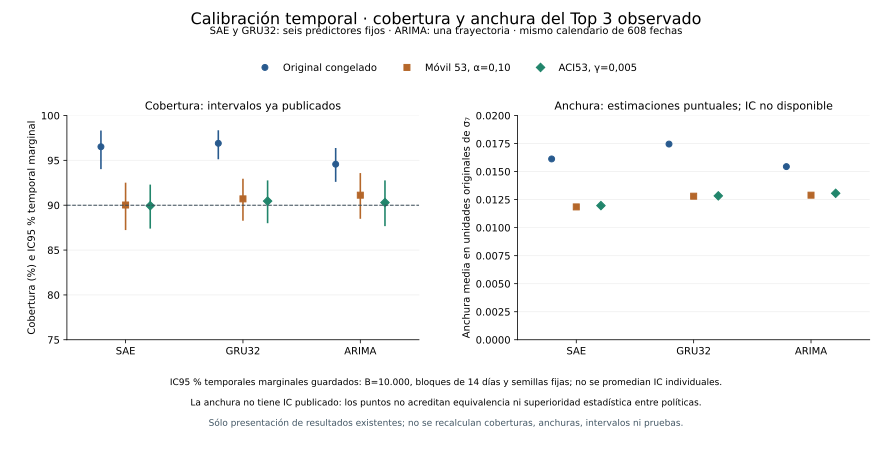

(incertidumbre-errores-y-referencias-de-dificultad)=
# 12. Techo de Desempeño, Incertidumbre y Análisis de Errores

**Lectura vigente:** el benchmark compara **16 sistemas y 81 predictores sobre las mismas 608 fechas**. Hay referencias de predictibilidad, intervalos originales y adaptados al tiempo, cobertura por grupos y una taxonomía automática de los diez modelos principales. Esta sección sigue **12.1–12.3 de la guía** y distingue resultados medidos de garantías no acreditadas: el proxy de techo no identifica riesgo Bayes, la cobertura global no garantiza cobertura condicional y las etiquetas de errores no son una revisión experta.

La [lista verificable](../_static/e2_data_training_uncertainty_current_v1/guide_checklist.csv), la [trazabilidad](../_static/e2_data_training_uncertainty_current_v1/decision_traceability.csv), el [índice de evidencias](../_static/e2_data_training_uncertainty_current_v1/current_evidence_index.json) y el [manifiesto](../_static/e2_data_training_uncertainty_current_v1/manifest.json) identifican fuentes y límites. El {download}`índice de esta consolidación <../_static/e2_data_training_uncertainty_current_v1/README.md>` acompaña la lectura. La {download}`versión anterior del capítulo <../_static/e2_data_training_uncertainty_current_v1/12_incertidumbre_errores_before_update.md>` y el bloque documental final conservan sus encabezados, enlaces y resultados.

(e2-techo-margen-vigente)=
## 12.1 Techo de desempeño y margen de mejora real

### 12.1.1 Referencia empírica y orientación de γ

SAE tiene la menor **media de las seis RMSE individuales** del catálogo original. Las RMSE siguientes usan las unidades originales de σ₇, sin anualización. El [ensemble de §63](63_ensamble_calibracion.md) proporciona otra referencia: una combinación convexa de los dieciséis sistemas cuyos pesos se aprendieron **sólo con los 53 pronósticos de calibración**. Los pesos son comunes a las seis trayectorias emparejadas; los clásicos conservan una trayectoria determinista. Se efectuó un ajuste estadístico de combinación, sin reentrenar los predictores ni generar inferencias nuevas con sus pesos. Su plan precede a ese ajuste, después de conocer el test y A2; es una referencia retrospectiva, no un nuevo candidato incorporado al ranking original.

| Referencia guardada | RMSE en las 608 fechas | Papel y alcance |
| --- | ---: | --- |
| SAE original | **0,003803430** | Mejor valor individual observado; media de seis RMSE, no RMSE del pronóstico medio. |
| Ensemble ajustado en calibración | **0,003689532** | Proxy alcanzable mediante esa combinación concreta, con pesos fijos durante la evaluación. |
| Persistence | **0,004085596** | Baseline de una trayectoria, usado como referencia del margen. |
| Ensemble uniforme de los diez principales | **0,004120056** | Resultado previo negativo: queda por encima de SAE y Persistence; no es un techo empírico válido. |

Para una métrica de pérdida menor = mejor, sea Q la RMSE agregada anterior. La fórmula de la guía para scores mayores = mejores se aplica tomando s=−Q:

$$
\gamma_{emp}=\frac{Q_{SAE}-Q_{proxy}}{Q_{Persistence}-Q_{proxy}}=0,287574.
$$

El valor puntual expresa qué fracción del margen Persistence–proxy separa todavía al SAE de **esa referencia**. Su IC95 % algebraico, con bloques de 14 días, es **[−1,49210; 2,37128]**. Sólo **6.588 de 10.000** réplicas conservan el orden proxy<SAE<Persistence. Se mantienen las réplicas definidas que cambian el orden o el signo del denominador; el intervalo no se trunca a [0,1]. Por tanto, **no se concluye que quede exactamente un 28,8 % de mejora real** ni que el proxy sea un techo óptimo.

Los [dos contrastes del ensemble](../_static/e2_calibration_ensemble_20261114/contrasts.csv) evalúan ganancia mayor que cero frente a SAE y Persistence: p Holm2 **0,243776** y **0,063794**, respectivamente; ninguno rechaza a 0,05. No contrastan superar δ ni sustituyen Holm20. Los IC y γ condicionan en los pesos ya aprendidos: no incluyen la incertidumbre de volver a estimarlos en otra calibración. [Resumen y sensibilidad](../_static/e2_calibration_ensemble_20261114/summary.json).

### 12.1.2 Predictibilidad, ruido y referencias que no están identificadas

La [entropía de permutación](../_static/e2_error_ceiling_final_audit_20261114/permutation_entropy.csv) describe complejidad ordinal con órdenes 3/4/5, retardo 1 y sin atravesar huecos. En desarrollo sus valores normalizados son 0,971268/0,934492/0,897266; en el test conocido, 0,954079/0,918404/0,875382. No se convierten en porcentaje de predictibilidad, error Bayes o RMSE mínimo. El ensemble uniforme aporta evidencia negativa sobre una combinación sencilla; una correlación de errores o una entropía alta tampoco identifica el ruido irreducible.

La cota matemática ideal Q=0 produce **γ_ideal=0,930936**, IC temporal **[0,844480; 1,029743]**. Es una comparación con predicción perfecta, no un desempeño humano, experto o alcanzable demostrado. El cociente del ensemble uniforme, 9,188146, tiene denominador negativo y no se interpreta como fracción pendiente. Ambas referencias se conservan en [§57](57_errores_techo.md) y en [sus valores originales](../_static/e2_error_ceiling_final_audit_20261114/ceiling_gamma_references.json).

σ₇ es una etiqueta determinista construida con siete retornos de ocho cierres, con denominador 7 y sin anualización. **Acuerdo entre anotadores humanos no aplica a esta construcción**; no existe una anotación humana que deba sustituirse por kappa o Dice. Las comprobaciones de reconstrucción y calidad verifican el contrato, pero no estiman el error de medición del proveedor ni un piso de ruido del mercado. No se ha identificado una cota Bayes o de ruido irreducible independiente, ni una reevaluación con etiquetas corregidas que establezca un cambio de ranking. Estos límites impiden afirmar que se identificó un techo óptimo. La referencia empírica de la combinación, su distancia γ y sus IC **sí están estimados y reportados**, junto con la entropía ordinal como referencia de predictibilidad. Su incertidumbre y los contrastes no concluyentes delimitan las estimaciones; no se convierten en ausencia de cálculo ni añaden una exigencia de identificar riesgo Bayes para reportarlas.

(e2-incertidumbre-vigente)=
## 12.2 Cuantificación de incertidumbre

### 12.2.1 Incertidumbre del score y de las diferencias

| Resultado publicado | Unidad y método | Interpretación |
| --- | --- | --- |
| Ganancias primarias de RMSE | Veinte pares; bootstrap pareado de semillas y calendario, bloques de 14 días. Original B=4.999; refinamiento posterior B=20.000, con la misma métrica, δ y Holm20. [§56](56_inferencia_estabilidad_final.md). | Los veinte p ajustados siguen en 1. Los IC de las ganancias son marginales, no simultáneos; no equivalen al IC de cada modelo por separado. |
| RMSE media de las trece redes | IC t95 % sobre seis RMSE por red, condicionados al calendario y a los supuestos entre inicializaciones. [Análisis original](../_static/e2_benchmark_final_20261113/benchmark_analysis.json). | Describen variación de optimización. No son incertidumbre de nuevos mercados; R=1 no permite inventar DE o IC entre semillas para los clásicos. |
| Ensemble y distancia γ | 10.000 remuestreos de semillas y bloques del calendario, con los pesos de combinación aprendidos conservados. [§63](63_ensamble_calibracion.md). | La incertidumbre es condicional a esa calibración; un IC algebraico fuera de [0,1] no se recorta para aparentar un margen estable. |
| Cobertura y frecuencias de errores | 10.000 remuestreos circulares; bloque principal de 14 días y sensibilidades de 7/28 días, con sus unidades y predictores fijos. [§60](60_calibracion_temporal_condicional.md) · [§57](57_errores_techo.md). | Los calendarios se mantienen, sin comprimir huecos o convertir ventanas solapadas en muestras independientes. Son sensibilidades temporales bajo dependencia corta y estacionariedad aproximada. |

Un IC de RMSE o de ganancia no es un intervalo para el próximo σ₇. La incertidumbre por semillas, la dependencia de fechas y la incertidumbre de selección tampoco son intercambiables. Los métodos, niveles y familias de cada suplemento permanecen separados; el refinamiento de 20.000 no se atribuye al cálculo original de 4.999.

### 12.2.2 Intervalos predictivos originales y adaptación temporal

Los **81 predictores**, incluidos los tres sistemas mejor situados SAE, ARIMA y GRU32, conservan un calibrador original por trayectoria. Se fijó con los residuos absolutos de **53 fechas, 08/11–30/12/2024**, disjuntas de los objetivos de entrenamiento y prueba. El radio q es el estadístico de orden 49, según ceil((53+1)×0,90), y el intervalo es:

$$
C_t=[\max(0,\widehat Y_t-q),\widehat Y_t+q].
$$

La separación de etiquetas no crea intercambiabilidad: σ₇ y las ventanas comparten historia, y el mercado puede cambiar. Los pesos y escaladores se mantienen entre calibración y prueba. El método original informa cobertura empírica y anchura de intervalos con nivel nominal del 90 %, sin garantía exacta distribucional en esta cronología. **La cuantificación de incertidumbre en SAE, ARIMA y GRU32 y el reporte de su cobertura empírica están ejecutados.** Las infracoberturas de algunos grupos y las limitaciones de intercambiabilidad se conservan como resultados adversos; no se confunden con ausencia del estudio ni con una garantía universal ya acreditada.

El [suplemento temporal](60_calibracion_temporal_condicional.md) ejecutó dos variantes sobre los pronósticos guardados: **móvil de 53 con α=0,10** y **ACI53 con tasa de adaptación γ=0,005**, distinta del cociente de margen de §12.1. Ambas utilizan sólo residuos disponibles antes de emitir; ACI actualiza α después de observar el resultado, para el día siguiente. El primer pronóstico de enero usa los 53 residuos originales: no se inventa un residuo o pronóstico del 31/12. Estas políticas tienen identidad posterior y no reemplazan los calibradores A2 ni prueban cobertura exacta por cualquier régimen.



La figura copia nueve resúmenes y sus IC95 % de cobertura ya publicados: B=10.000, bloques de 14 días y semillas fijas. **La anchura se muestra como punto, sin IC disponible**; no se añade incertidumbre inventada ni se promedian IC individuales. [Valores y procedencia de la presentación](../_static/e2_repro_prereg_current_v1/calibration_plot_readout.json).

### 12.2.3 Cobertura condicional y calibración por grupos

La cobertura global ACI se aproxima al 90 % en SAE **89,94 %**, GRU32 **90,46 %** y ARIMA **90,30 %**. En el rango alto de sus pronósticos persiste infracobertura observada:

| Sistema | Cobertura ACI en pronósticos altos | IC95 % temporal marginal, bloques de 14 días |
| --- | ---: | --- |
| SAE | 87,21 % | [76,92 %; 94,88 %] |
| GRU32 | 83,65 % | [74,04 %; 92,09 %] |
| ARIMA | 86,08 % | [76,74 %; 94,44 %] |

Los grupos predictivos se definen con **rangos del pronóstico** y **volatilidad del día anterior**, usando umbrales de calibración/desarrollo fijados antes del cálculo. Están disponibles al origen. Los grupos por el objetivo realizado se publican aparte como descripciones retrospectivas; no eran información disponible para adaptar el intervalo del mismo día. Las frecuencias condicionales son razones de emisiones cubiertas y pertenecientes al grupo, agregando semillas fijas, no medias sin ponderación de sus coberturas.

El análisis conserva **672 celdas = 16 sistemas × tres políticas × 14 grupos** y dos hipótesis por celda: igualdad al 90 % y cobertura mínima al 90 %. La familia **Holm1344**, con influencia de la razón y HAC Bartlett de 14 rezagos, mantiene 1.336 contrastes estimables y ocho no estimables con estado propio. Es distinta de los IC bootstrap y de Holm20; la falta de rechazo no acredita calibración universal. Los IC guardados usan B=10.000 y bloques de 7/14/28 días, sin volver a simular la retroalimentación ACI en cada réplica. [Familia completa](../_static/e2_conditional_calibration_20261114/coverage_HAC_Holm1344.csv) · [IC por grupo](../_static/e2_conditional_calibration_20261114/conditional_coverage_CI.csv).

Se reportan anchura, **score de intervalo** y pérdidas **pinball** de los extremos 0,05/0,95. Acercar cobertura al 90 % no mejora automáticamente el score: en ARIMA, ACI obtiene 0,019918 frente a 0,019900 original. La [comparación posterior de periodos y la nueva IUT CPU (§65)](65_cierre_cientifico_real.md) conservan preguntas distintas y no sustituyen estas coberturas ni convierten la calibración en validación HPO independiente. La calibración puntual Mincer–Zarnowitz se conserva en [§49](49_diagnosticos_f2a.md); no se acredita aquí una pendiente de calibración ejecutada para cada subgrupo. **ECE y Brier de clasificación no corresponden al pronóstico continuo de σ₇.** Dos extremos de intervalo no definen una CDF: PIT y CRPS no se fabrican con ellos, y su evaluación no está disponible para estos predictores sin especificar una distribución pertinente.

(e2-errores-segmentos-vigente)=
## 12.3 Análisis de errores y evaluación por segmentos

### 12.3.1 Categorías exclusivas, muestra y frecuencia

La [taxonomía operativa](../_static/e2_error_ceiling_final_audit_20261114/taxonomy_protocol.json) usa e=media de los seis pronósticos−observado por modelo-fecha. Ese predictor medio es diagnóstico: **no sustituye la media de RMSE individuales de A2**. Los cortes L=**0,00130577631562305** y H=**0,00728725980318611** son Q50/Q90 de 714 cambios absolutos consecutivos de σ₇ en desarrollo 2023–2024, sin atravesar huecos. Son escalas descriptivas; no se interpretan como δ, δg o ruido irreducible.

| Categoría mutuamente exclusiva | Regla | SAE: frecuencia e IC95 % temporal |
| --- | --- | --- |
| Banda pequeña | abs(e)≤L | 31,1 % [26,0 %;36,2 %] |
| Subestimación moderada | L<abs(e)≤H y e<0 | 17,9 % [13,7 %;22,4 %] |
| Sobreestimación moderada | L<abs(e)≤H y e≥0 | 46,9 % [40,1 %;53,8 %] |
| Subestimación grande | abs(e)>H y e<0 | 3,9 % [1,8 %;6,7 %] |
| Sobreestimación grande | abs(e)>H y e≥0 | 0,2 % [0,0 %;0,5 %] |

Las reglas se fijaron **antes del etiquetado automático**, después de conocer A2, en el [plan 4361275](https://github.com/jassan-bit/DeepLearning_202630/blob/4361275cbc52e2f6362349557b471cda110bbefc/experiments/e2_error_ceiling_final_audit_20261114/analysis_plan.json). No es una taxonomía semántica experta ni un preregistro anterior al benchmark. El propio plan declara una inspección preliminar ya hecha del ensemble uniforme; no se atribuye anterioridad a todos sus resultados.

Se etiquetaron **6.080 claves modelo-fecha = 10 principales × 608 fechas**. La muestra estratificada contiene **100 fechas únicas comunes a los diez modelos**, con seis residuos por fecha: **600 casos individuales por principal**. No son 100 fallos graves por modelo ni 6.000 fechas independientes. Los estratos combinan año y régimen realizado del objetivo; Q25/Q75 se obtuvieron sólo de desarrollo y la selección no usa errores. Se conservan probabilidades y pesos N_h/n_h, por lo que una frecuencia muestral sin ponderar no sustituye la frecuencia del calendario completo. [Diseño](../_static/e2_error_ceiling_final_audit_20261114/sampling_design.json) · [100 fechas por modelo](../_static/e2_error_ceiling_final_audit_20261114/audit_100_dates_per_main_model.csv) · [600 residuos por modelo](../_static/e2_error_ceiling_final_audit_20261114/audit_600_seed_cases_per_main_model.csv).

Las frecuencias completas son recuentos exactos de este calendario. Sus IC marginales usan 10.000 remuestreos circulares, bloque de 14 días y sensibilidad de 7/28 días; describen variación temporal bajo sus supuestos, no incertidumbre de contar esos casos ni cobertura simultánea de todas las categorías. Una categoría ausente puede producir IC empírico [0,0], sin demostrar probabilidad poblacional cero. Las [frecuencias de los diez principales](../_static/e2_error_ceiling_final_audit_20261114/error_category_frequencies.csv) y la [concordancia entre semillas](../_static/e2_error_ceiling_final_audit_20261114/model_annotation_coverage.csv) mantienen las diferencias que puede ocultar la media de pronósticos.

### 12.3.2 Errores compartidos y diversidad

El [CSV de diversidad](../_static/e2_error_ceiling_final_audit_20261114/shared_error_diversity.csv) conserva los **45 pares** de los diez pronósticos medios, cada uno sobre 608 fechas. Mide Pearson de residuos firmados, intersección de errores grandes abs(e)>H y Jaccard de sus conjuntos. Son descripciones de los mismos casos, sin IC o contraste de correlación publicado.

| Par | Correlación de residuos | Fechas con error grande compartido | Jaccard de errores grandes |
| --- | ---: | ---: | ---: |
| FCN–ResNet | 0,954761 | 26 de 608 | 0,764706 |
| SAE–TimeMixer | 0,710466 | 13 de 608 | 0,382353 |

Jaccard divide la intersección por la unión de fechas con errores grandes, no por 608; los conteos compartidos tienen otro denominador. La coincidencia puede reflejar dificultad común, especificación o datos compartidos, sin identificar su causa como ruido de etiqueta. Tampoco una correlación menor demuestra por sí sola un ensemble útil: la combinación uniforme de §57 conserva su RMSE peor que SAE y Persistence. El ensemble ajustado en calibración de §63 tiene otra identidad y sus dos ganancias no superan Holm2. No se elige entre ambas combinaciones usando el test para declarar un techo confirmado.

### 12.3.3 Segmentos, casos de frontera y diagnóstico de atajos

| Componente de la guía | Evidencia y límite actuales |
| --- | --- |
| **Segmentación temporal y de dominio** | Existen 112 filas sistema-trimestre, ventanas móviles descriptivas de 90 días y grupos de pronóstico/volatilidad previa con IC y familia propia. Los regímenes del objetivo realizado son retrospectivos. Una serie y h=1 no generan clases, regiones, grupos demográficos ni varios horizontes que no existen en los datos. |
| **Casos de mayor pérdida y fronteras** | Los [6.080 registros completos](../_static/e2_error_ceiling_final_audit_20261114/all_6080_date_model_labels.csv) guardan fecha, residuo, categoría y estrato. La revisión descriptiva siguiente presenta tres extremos por modelo, con criterio explícito y valores existentes. Seleccionar errores extremos no equivale a seleccionar cercanía a L/H ni a explicar su causa. |
| **Confianza en regresión** | Los intervalos y aciertos de cobertura permiten estudiar errores del pronóstico continuo. No hay una probabilidad de «clase correcta» que permita trasladar literalmente la selección de menor confianza correcta de clasificación. La DE entre semillas, la anchura y la cobertura no se renombran como probabilidades calibradas de corrección; el criterio de menor confianza queda sin definir para esta selección. |
| **Señales espurias y controles negativos** | [§66](66_seguimiento_pendientes.md) ejecuta un diagnóstico específico de dependencia de volumen, candidato señalado por la deriva del EDA, y un control OHLC: 142.272 forwards sobre 78 predictores y 608 fechas, con donantes sólo de train, originales CPU exactos y 26 comparaciones con IC temporales. La sustitución puede romper el soporte conjunto: no identifica que el volumen sea espurio, fuga o causalidad y no sustituye una ablación reentrenada sin volumen. [§54](54_robustez_interpretabilidad.md) conserva oclusión, fidelidad y estrés con otro alcance. |

Los [30 extremos guardados](../_static/e2_data_training_uncertainty_current_v1/border_cases.csv) seleccionan los **tres mayores errores absolutos medios entre semillas por cada uno de los diez principales**. El orden usa el campo ya publicado `mean_absolute_individual_seed_error`, descendente y con fecha ascendente para desempatar; se copian sus valores, sin recalcular pronósticos o scores. Es una inspección dirigida posterior al benchmark, distinta de la muestra estratificada de 100 fechas. Sus 30 filas corresponden a **nueve fechas distintas** y no heredan las probabilidades ni los pesos de aquella muestra. El [registro de selección y alcance](../_static/e2_data_training_uncertainty_current_v1/border_case_readout.json) conserva el criterio y las filas de origen.

| Modelo | Fecha del máximo según ese criterio | Error absoluto medio entre semillas | Categoría del pronóstico medio |
| --- | --- | ---: | --- |
| FCN-1D | 2026-02-06 | 0,029631638 | Subestimación grande |
| ResNet-1D | 2026-02-06 | 0,029910370 | Subestimación grande |
| Inception-1D | 2026-02-05 | 0,022324874 | Subestimación grande |
| SAE | 2026-02-06 | 0,024996688 | Subestimación grande |
| TimesNet | 2026-02-09 | 0,029015165 | Sobreestimación grande |
| TSMixer | 2026-02-06 | 0,027798253 | Subestimación grande |
| TiDE | 2026-02-06 | 0,030231168 | Subestimación grande |
| TimeMixer | 2026-02-05 | 0,019210912 | Subestimación grande |
| PatchTST | 2026-02-11 | 0,050406359 | Subestimación grande |
| iTransformer | 2026-02-11 | 0,025426704 | Subestimación grande |

En estos máximos, el régimen realizado del objetivo es alto y predominan las subestimaciones; TimesNet conserva una sobreestimación. Esa coincidencia es una descripción retrospectiva de casos seleccionados, sin atribución a un evento económico o señal espuria. El criterio medio de error absoluto individual difiere del residuo del pronóstico medio usado para la categoría y de la contribución a la RMSE primaria: **no cambia A2**. No se infieren frecuencias poblacionales o IC a partir de estos extremos ni se presenta la concordancia entre semillas como confianza predictiva calibrada.

La oclusión del Top 3 utiliza 24 fechas y la misma muestra para ordenar y evaluar su fidelidad; ARIMA usa rezagos de σ₇ y las redes coordenadas OHLCV diferentes. Las tres ablaciones SAE de [§55](55_reproduccion_ablaciones.md) sí reentrenaron variantes: retirar dropout empeora RMSE con Holm3; las otras dos comparaciones no son concluyentes. Estas evidencias tienen funciones distintas y no prueban ausencia de atajos, causalidad económica o validez universal de una explicación.

El estado actual reúne incertidumbre y errores medidos, con sus resultados adversos, una inspección descriptiva de extremos y el diagnóstico específico de dependencia de entradas de [§66](66_seguimiento_pendientes.md). Permanecen sin identificar un piso de ruido o techo óptimo, una confianza calibrada para seleccionar casos y una señal espuria demostrada causalmente. Sin una CDF predictiva pertinente, PIT y CRPS conservan el límite de definición indicado en §12.2. Los cálculos posteriores de §66 tienen planes y recibos propios; A2, los modelos y calibradores originales permanecen intactos.

````{admonition} Archivo documental: contenido anterior del capítulo 12
:class: dropdown

Este bloque conserva íntegramente el contenido anterior y sus encabezados. Sus fechas, estados y enlaces corresponden a aquellos cortes; la lectura vigente sigue los apartados 12.1–12.3 anteriores.

**Estado vigente del 14/11/2026:** existen intervalos y cobertura empírica para los 16 sistemas, diagnósticos F2a, robustez, explicaciones, tres ablaciones entrenadas y una taxonomía de residuos de los diez modelos principales. Los artefactos actuales están en [§§49–59](53_cierre_requisitos.md). Esta página distingue los resultados existentes de las garantías que no están acreditadas.

## 12.1 Intervalos y calibración originales

Los predictores neuronales conservan seis trayectorias y los comparadores una. Antes del scoring se fijó por predictor un cuantil de residuos absolutos sobre **53 fechas de calibración**. Se reportan cobertura nominal del 90 % y anchura de intervalos. El [benchmark](06_benchmark_final.md) y la [auditoría de calibración](49_diagnosticos_f2a.md) mantienen los calibradores y sus resultados adversos.

El uso de una cronología dependiente limita la garantía de un calibrador basado en intercambiabilidad. Cuantificar cobertura observada no demuestra cobertura condicional ni validez para cualquier régimen futuro. Los intervalos de cobertura por bloques reflejan sensibilidad temporal bajo sus propios supuestos; no convierten el procedimiento de calibración original en uno adaptado por bloques. Tampoco se inventa PIT sin una CDF predictiva completa. El suplemento de [§60](60_calibracion_temporal_condicional.md) añade cobertura por condiciones y variantes temporales causales sin modificar los calibradores originales; conserva las infracoberturas observadas y no selecciona una variante usando el test.

## 12.2 Robustez y explicaciones

[§54](54_robustez_interpretabilidad.md) publica cuatro tipos de perturbación, cada uno con tres severidades, sobre los predictores congelados. Se conservan objetivos, pesos y calibradores. Las alteraciones de ventanas independientes son escenarios de estrés de entrada; pueden romper la coherencia de una trayectoria OHLCV y no se describen como intervenciones económicas reales.

SAE, GRU32 y ARIMA, el Top 3 observado por RMSE, tienen diagnósticos de oclusión, borrado/inserción y un orden aleatorio de referencia en 24 fechas. Las redes disponen de seis semillas; ARIMA determinista no tiene variación de optimización por semilla. La fidelidad medida sobre esas fechas no se interpreta como causalidad ni validación independiente del explicador.

Las [18 ablaciones de §55](55_reproduccion_ablaciones.md) retiran tres componentes de SAE, con seis semillas por variante. Retirar el dropout empeora la RMSE con evidencia ajustada; las otras dos comparaciones son no concluyentes. No se vuelve a elegir el modelo a partir de estas pruebas posteriores.

## 12.3 Taxonomía operativa y muestra auditable

[§57](57_errores_techo.md) etiqueta **6.080 fechas-modelo** y publica **100 fechas distintas por modelo**, con sus seis residuos individuales: 600 casos por modelo. Las categorías de magnitud/signo usan umbrales de desarrollo y reglas registradas antes del etiquetado automático, después de conocer el test. No se presentan como anotaciones humanas o causas semánticas.

Las frecuencias y sus IC temporales se calculan con 10.000 remuestreos y bloques de 7/14/28 días. Las categorías no observadas pueden producir IC empíricos [0,0], que no implican probabilidad poblacional cero. Se conservan los pesos de muestreo y la concordancia entre semillas.

## 12.4 Techo y distancia γ

Se calculó entropía ordinal como referencia de complejidad. El ensemble uniforme de los diez modelos resultó peor que SAE y Persistence, por lo que no aporta un techo empírico válido. Frente a la cota matemática de RMSE cero, γ ideal es **0,93094**, con IC temporal **[0,84448; 1,02974]**. Ese cociente no identifica ruido irreducible ni un error mínimo alcanzable; se conserva el resultado negativo sin buscar otra combinación favorable sobre el test.

El nuevo [proxy empírico de §63](63_ensamble_calibracion.md) ajusta una combinación convexa sólo con los 53 pronósticos de calibración guardados, sin reentrenar las redes. Su RMSE puntual es 0,00368953 y γ del proxy 0,28757; el IC algebraico [−1,49210; 2,37128] y el orden favorable en 6.588/10.000 remuestreos muestran que no es una referencia estable. No se estima riesgo Bayes ni se cambia A2.

El alcance de las referencias anteriores está documentado en [§57](57_errores_techo.md). El [Apéndice B actual](61_reproduccion_consolidada.md) mantiene este requisito parcial, junto con la aplicación formal pendiente del margen δg previamente registrado y las limitaciones de calibración temporal.


## Archivo de la versión anterior

La {download}`versión exacta anterior a esta consolidación <../_static/e2_delivery_reproduction_20261114/archived_chapters/12_incertidumbre_errores.md>` se conserva con sus estados y fechas históricos. El [manifiesto de archivo](../_static/e2_delivery_reproduction_20261114/chapter_archive_manifest.json) fija su commit y SHA256. Esos antecedentes no sustituyen el protocolo ejecutado de [§48](48_protocolo_reducido.md) ni su Apéndice B actual de [§61](61_reproduccion_consolidada.md).

````
