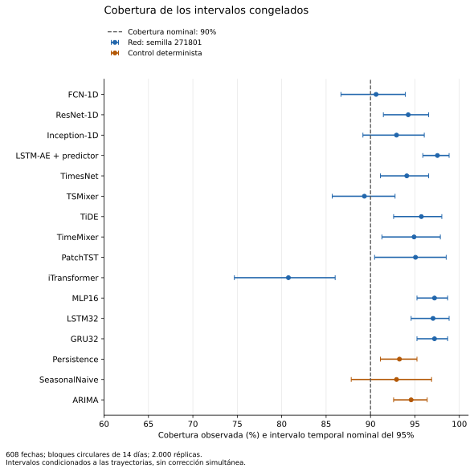
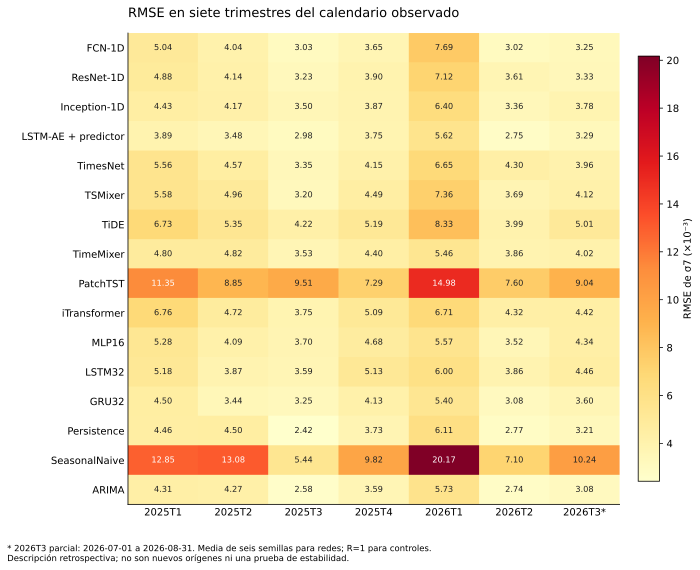
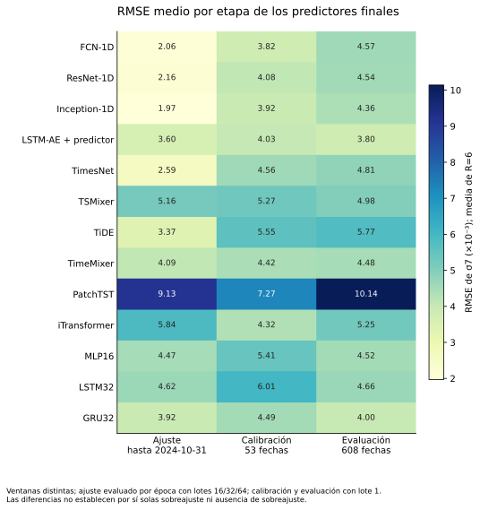

# 49. Diagnósticos F2a posteriores al benchmark

**Auditoría ejecutada el 13/11/2026, después de conocer el periodo de prueba.** Los residuos de los 81 predictores congelados presentan dependencia temporal y desviaciones de normalidad. La nueva familia exploratoria produce **707 rechazos de 826 contrastes**, después del ajuste Holm a α=0,05. Estos resultados cuestionan la adecuación residual; no justifican declarar buen ajuste, estabilidad o ausencia de sobreajuste.

La auditoría utiliza las predicciones ya guardadas para **16 sistemas y 608 fechas**, del **01/01/2025 al 31/08/2026**. Las trece redes aportan seis semillas cada una y los tres comparadores clásicos una trayectoria cada uno: **78 + 3 = 81 predictores**. Las semillas comparten la misma cronología de mercado. Ni los 81 predictores ni los 826 contrastes representan otras tantas muestras independientes.

La [A2 original y sus veinte contrastes primarios](06_benchmark_final.md) conservan sus resultados y su familia Holm propia; esta auditoría no los repite, sustituye ni amplía. Tampoco reabre HPO, ajusta pesos, ejecuta inferencia de modelos o modifica escaladores y calibradores. La congelación descrita en [§48](48_protocolo_reducido.md) conserva su alcance retrospectivo: estas 608 fechas ya eran conocidas y el trabajo posterior no recupera cegamiento prospectivo.

## Datos, procedencia y familia estadística

El exportador `e2-f2a-cached-input-export-v1` leyó la caché diaria y los artefactos originales, comprobó las identidades de datos y predictores y exportó objetivos derivados, pronósticos existentes y vectores de calibración. El archivo de entrada, de **1.371.654 bytes**, tiene SHA256:

```text
65ae74b547a6073b2c286dea8039a2e7a1b1f6063b1d9ac0eb760c9ce727d187
```

Se conserva en un [commit inmutable de resultados](https://github.com/jassan-bit/DeepLearning_202630/blob/2121b048d3b379c2c28dfe366cba35a1c08a3617/runs/f2a-65ae74b547a6073b2c286dea-posthoc/artifacts/e2_f2a_input.json). Su Git blob es `aa8bf25e368fa5b48983664ae8b647d573bcf88e`. El motor científico de origen es `1e8745497b484518f766b6da5c19be8362d9add7`; el exportador publicado en el corte `3d525` valida sus fuentes antes de leer la caché. La [procedencia de esta auditoría](../_static/e2_f2a_audit_20261113/source_evidence.json) y el [manifiesto](../_static/e2_f2a_audit_20261113/manifest.json) permiten distinguir fuentes, entrada, código y productos nuevos. No se incluyen OHLCV brutos ni pesos en la entrada.

Se comprobaron las RMSE de las **81 trayectorias** frente a los resultados originales: todas pasan la tolerancia absoluta de `1e-10`; la diferencia máxima observada es **5,204170427930421×10⁻¹⁸**. Esta comprobación aritmética sobre pronósticos guardados no constituye una nueva inferencia ni otro benchmark.

La familia nueva contiene **10 contrastes por predictor × 81 + 16 contrastes de estabilidad por sistema = 826 hipótesis**. Todas fueron estimables en esta ejecución. El ajuste Holm se aplica una sola vez a esa familia completa y separada de los veinte contrastes originales. Los resultados detallados conservan estadístico, parámetros, p sin ajustar, p ajustado, decisión y checkpoint en [tests.csv](../_static/e2_f2a_audit_20261113/tests.csv).

Se utilizó **statsmodels 0.14.5**. Mincer–Zarnowitz, cobertura y estabilidad trimestral emplean covarianza **HAC con 14 rezagos y corrección de muestra pequeña**. Los p-valores son aproximaciones asintóticas exploratorias. Los objetivos σ₇ se solapan y los errores tienen dependencia temporal; HAC requiere que su ancho de banda y las condiciones de dependencia sean adecuados. Holm corrige multiplicidad, pero no corrige p-valores marginales mal calibrados. Hay **35 valores `p_raw=0.0`** por precisión o subdesbordamiento numérico: se conservan los valores de la biblioteca, sin interpretarlos como probabilidades matemáticas exactamente nulas.

## Adecuación de los residuos y calibración puntual

Definimos el residuo como objetivo menos predicción, en unidades originales de σ₇. La tabla resume decisiones dentro de la familia Holm de 826; los recuentos describen trayectorias evaluadas, no replicaciones independientes.

| Diagnóstico | Hipótesis nula y configuración | Rechazos / oportunidades |
|---|---|---:|
| Ljung–Box de residuos, lag 7 | Autocorrelaciones conjuntas nulas hasta el rezago 7; `model_df=0` | 81 / 81 |
| Ljung–Box de residuos, lag 14 | Autocorrelaciones conjuntas nulas hasta el rezago 14; `model_df=0` | 81 / 81 |
| Ljung–Box de residuos cuadrados, lag 7 | Autocorrelaciones conjuntas nulas de los errores cuadrados | 80 / 81 |
| Ljung–Box de residuos cuadrados, lag 14 | Igual diagnóstico hasta el rezago 14 | 80 / 81 |
| ARCH-LM | Ausencia de efectos ARCH hasta lag 7; `ddof=0` | 78 / 81 |
| BDS, dimensión 2 | Residuos iid; radio de 1,5 DE muestrales | 79 / 81 |
| BDS, dimensión 3 | Misma hipótesis y radio, dimensión 3 | 79 / 81 |
| Jarque–Bera | Normalidad residual | 81 / 81 |
| Mincer–Zarnowitz | Intercepto 0 y pendiente 1, contraste conjunto HAC14 | 37 / 81 |
| Cobertura 90 % | Cobertura marginal **igual a 0,90**, contraste HAC14 | 31 / 81 |
| Estabilidad por trimestre | Igualdad de pérdida cuadrática media entre siete trimestres, HAC14 | 0 / 16 |
| **Total de la familia nueva** | **Holm, α=0,05** | **707 / 826** |

Los rechazos de Ljung–Box, ARCH y BDS muestran que el comportamiento residual no se aproxima a una secuencia iid en esta cronología. La desviación de iid puede reflejar autocorrelación, volatilidad variable u otras dependencias; BDS por sí solo no acredita una señal no lineal aprovechable. Jarque–Bera rechaza normalidad en todas las trayectorias. Una RMSE baja y un resultado favorable frente a un comparador no eliminan estos problemas de adecuación.

Mincer–Zarnowitz rechaza la restricción conjunta de calibración puntual en 37 trayectorias. El siguiente desglose mantiene la unidad predictor-semilla y deja visibles los resultados desfavorables. Una celda `0/6` significa que el contraste no rechazó después de Holm; no prueba calibración correcta.

| Sistema | R | Rechazos Mincer–Zarnowitz | Rechazos de cobertura | Cobertura observada media (%) |
|---|---:|---:|---:|---:|
| FCN-1D | 6 | 4/6 | 0/6 | 90,269 |
| ResNet-1D | 6 | 3/6 | 0/6 | 91,036 |
| Inception-1D | 6 | 4/6 | 1/6 | 91,365 |
| LSTM-autoencoder con predictor | 6 | 3/6 | 6/6 | 96,519 |
| TimesNet | 6 | 2/6 | 3/6 | 92,516 |
| TSMixer | 6 | 6/6 | 1/6 | 92,763 |
| TiDE | 6 | 4/6 | 1/6 | 92,462 |
| TimeMixer | 6 | 2/6 | 1/6 | 93,640 |
| PatchTST | 6 | 0/6 | 0/6 | 92,873 |
| iTransformer | 6 | 0/6 | 0/6 | 85,033 |
| MLP16 | 6 | 0/6 | 5/6 | 96,464 |
| LSTM32 | 6 | 6/6 | 6/6 | 97,094 |
| GRU32 | 6 | 1/6 | 6/6 | 96,902 |
| Persistence | 1 | 1/1 | 0/1 | 93,257 |
| SeasonalNaive | 1 | 1/1 | 0/1 | 92,928 |
| ARIMA | 1 | 0/1 | 1/1 | 94,572 |

La cobertura de la tabla es la media de las coberturas individuales de las semillas, con R=1 para los clásicos. Las decisiones no se calculan sobre ese promedio. [Desglose por diagnóstico](../_static/e2_f2a_audit_20261113/diagnostics_by_test.csv) · [Desglose por sistema](../_static/e2_f2a_audit_20261113/diagnostics_by_model.csv).

## Cobertura e incertidumbre temporal

Los intervalos utilizan el mismo radio absoluto residual congelado antes del periodo final, con extremo inferior truncado en cero. **Los 31 rechazos de igualdad a 90 % corresponden a sobrecobertura**, con coberturas individuales entre **94,572 % y 97,862 %**. No son rechazos de una garantía unilateral de cobertura mínima: un intervalo conservador puede cubrir más del 90 %, aunque no esté calibrado a la igualdad exacta contrastada aquí. Su anchura también debe considerarse, como en la [A2](06_benchmark_final.md).

iTransformer presenta cobertura media de **85,033 %** y ningún rechazo individual tras Holm. Ese no rechazo no elimina la infracobertura observada ni establece una garantía. En las 81 trayectorias, las coberturas puntuales abarcan desde **80,757 % hasta 97,862 %**.



Se añadieron IC nominales del 95 % mediante **2.000 remuestreos circulares por bloques de 14 días**, condicionados a las trayectorias congeladas. Son intervalos temporales por predictor, no intervalos simultáneos ni variación entre mercados independientes. Por ejemplo, FCN-1D, semilla 271801, tiene cobertura **90,625 %** e IC **[86,674 %; 93,914 %]**. Los 81 intervalos y su configuración se conservan en [coverage_intervals.csv](../_static/e2_f2a_audit_20261113/coverage_intervals.csv).

## Evolución temporal de la pérdida

El contraste por sistema usa como pérdida diaria la **media de los errores cuadrados individuales de las semillas**; no evalúa la pérdida de un ensamble. Compara siete bloques de calendario con un contraste conjunto HAC14. Los primeros seis trimestres tienen 90, 91, 92, 92, 90 y 91 fechas; **2026Q3 es parcial, con 62 fechas**, porque la evaluación termina el 31 de agosto.

No se rechaza la igualdad de pérdida media en ninguno de los 16 sistemas después de Holm826. Esto no demuestra estabilidad ni equivalencia: la corrección múltiple, la dependencia y el tamaño de los bloques limitan la capacidad para detectar cambios. Las métricas observadas sí varían de forma apreciable:

| Sistema | Menor RMSE trimestral | Mayor RMSE trimestral |
|---|---:|---:|
| FCN-1D | 0,003016634 | 0,007693020 |
| ResNet-1D | 0,003233287 | 0,007116114 |
| Inception-1D | 0,003361188 | 0,006404589 |
| LSTM-autoencoder con predictor | 0,002752464 | 0,005615985 |
| TimesNet | 0,003354381 | 0,006652273 |
| TSMixer | 0,003201095 | 0,007364922 |
| TiDE | 0,003985323 | 0,008329111 |
| TimeMixer | 0,003529980 | 0,005463084 |
| PatchTST | 0,007290509 | 0,014981634 |
| iTransformer | 0,003747541 | 0,006762275 |
| MLP16 | 0,003519167 | 0,005567547 |
| LSTM32 | 0,003588893 | 0,005998071 |
| GRU32 | 0,003076960 | 0,005396637 |
| Persistence | 0,002418198 | 0,006111559 |
| SeasonalNaive | 0,005439106 | 0,020171503 |
| ARIMA | 0,002578286 | 0,005728510 |

Cada RMSE trimestral de una red es la media de las RMSE individuales, igual que en A2. El [CSV trimestral](../_static/e2_f2a_audit_20261113/quarterly_metrics.csv) conserva las **112 filas sistema-trimestre**, fechas, MAE, sesgo, cobertura y anchura. También se calcularon **8.304 filas de ventanas móviles de 90 días**: son descripciones fuertemente solapadas, no nuevas réplicas ni contrastes independientes.



Este contraste de calendario y estas curvas **no implementan el test de Giacomini–Rossi**. El suplemento posterior de [§56](56_inferencia_estabilidad_final.md) calcula su estadístico de fluctuación, conserva la referencia asintótica original y documenta una calibración bootstrap de 20.000 réplicas. No rechazo tras corrección no demuestra estabilidad.

## Curvas originales de ajuste y alcance de la brecha

Una recuperación de metadatos verificó los **78 ajustes finales** y las **39 ejecuciones HPO de las trece recetas seleccionadas, tres orígenes por receta**. Se recuperaron **6.440 registros de épocas supervisadas** y **3.250 registros de las fases auxiliares SAE**, que se conservan por separado. De las 39 ejecuciones HPO, **29 tienen curvas completas**; las otras **10 reutilizan caché histórica que conserva predicciones, mejor época e identidad tensorial, pero no las pérdidas por época**. Sus riesgos de entrenamiento y brechas permanecen ausentes.

Las diez curvas no disponibles corresponden a FCN-1D y ResNet-1D en enero y julio de 2024, y a GRU32, Inception-1D, LSTM32, MLP16, TSMixer e iTransformer en enero de 2024. Esa falta de registro no se resuelve copiando pérdidas de otro ajuste ni infiriéndolas de la puntuación final. El [resumen de 117 ajustes](../_static/e2_f2a_audit_20261113/fit_overfit_summary.csv) mantiene la disponibilidad de cada caso; las curvas y fuentes originales están en [training_evidence.zip](../_static/e2_f2a_audit_20261113/training_evidence.zip).

La RMSE de entrenamiento registrada se calcula **al terminar la época, con `model.eval()`, sin gradientes y sobre todos los datos de entrenamiento**. No es el promedio de pérdidas de minibatches durante las actualizaciones. Para HPO, la brecha descriptiva usa la fila de la **mejor época seleccionada**, junto a la validación de esos mismos pesos, y conserva por separado la última época ejecutada. Los riesgos de época usan el tamaño de lote configurado; las predicciones persistidas emplean lote 1, por lo que se documentan pequeñas diferencias de redondeo entre ambas vías.

Las pérdidas `train_mse_scaled` son MSE escaladas. Para las fases supervisadas se usa la RMSE en unidades originales de σ₇ al comparar entrenamiento y validación. Las fases SAE `ae1` y `ae2` reconstruyen entradas en una escala auxiliar: sus campos históricos de RMSE **no representan el objetivo σ₇** y no entran en la brecha supervisada.

Entre los 29 ajustes HPO con curva, **23 presentan RMSE de validación mayor que la de entrenamiento**. La mediana de esa diferencia es **0,000640836**, y el intervalo observado va de **−0,001391200 a 0,004211877**. Son descripciones de recetas seleccionadas, con una semilla de optimización y tres orígenes cuyo entrenamiento se solapa. Las épocas y los folds no se tratan como replicaciones independientes.

Los ajustes finales emplearon épocas fijadas previamente y **no generaron una curva de validación**: sus campos de validación nulos son coherentes con ese protocolo. Para cada uno de los 78 predictores sí se vincularon el riesgo terminal de entrenamiento, las predicciones de calibración y el pronóstico final con la identidad del checkpoint seleccionado. La tabla muestra medias entre las seis semillas, sin convertirlas en un contraste de sobreajuste:

| Red | RMSE train terminal | RMSE calibración | RMSE prueba final | Final − calibración |
|---|---:|---:|---:|---:|
| FCN-1D | 0,002062661 | 0,003815384 | 0,004566151 | +0,000750768 |
| ResNet-1D | 0,002157011 | 0,004077305 | 0,004543602 | +0,000466297 |
| Inception-1D | 0,001967822 | 0,003915119 | 0,004362441 | +0,000447323 |
| LSTM-autoencoder con predictor | 0,003601878 | 0,004029144 | 0,003803430 | −0,000225714 |
| TimesNet | 0,002587580 | 0,004555866 | 0,004805500 | +0,000249633 |
| TSMixer | 0,005160974 | 0,005268709 | 0,004975357 | −0,000293353 |
| TiDE | 0,003365996 | 0,005550803 | 0,005771842 | +0,000221039 |
| TimeMixer | 0,004090526 | 0,004424364 | 0,004481091 | +0,000056727 |
| PatchTST | 0,009127133 | 0,007269348 | 0,010139304 | +0,002869956 |
| iTransformer | 0,005837650 | 0,004321703 | 0,005254319 | +0,000932615 |
| MLP16 | 0,004473368 | 0,005408170 | 0,004517496 | −0,000890674 |
| LSTM32 | 0,004618974 | 0,006009831 | 0,004664330 | −0,001345500 |
| GRU32 | 0,003920230 | 0,004492848 | 0,004001162 | −0,000491685 |



La calibración abarca **53 fechas, del 08/11/2024 al 30/12/2024**; la prueba abarca las 608 fechas posteriores. La comparación de calibración frente a prueba incluye también los tres clásicos: [81 filas por predictor](../_static/e2_f2a_audit_20261113/calibration_final_comparison.csv), con diferencias, razones de RMSE e IC nominales. Para esos IC se remuestrea **cada calendario por separado**, en bloques de 14 días y con 2.000 repeticiones; no se emparejan fechas de periodos distintos. Las etiquetas de calibración fijaron el radio de los intervalos, pero no seleccionaron estas predicciones puntuales.

El mayor aumento medio final frente a calibración entre las redes aparece en PatchTST, **+0,002869956**; LSTM32 muestra una disminución media de **−0,001345500**. Ambos cambios pueden reflejar diferencias de distribución o dificultad entre periodos. Compartir predictor permite atribuir cada puntuación a los mismos pesos, pero no identifica por sí solo sobreajuste ni su ausencia.

**El margen de sobreajuste δg no fue definido originalmente y permanece nulo.** El margen δ de los veinte contrastes primarios no se reutiliza como δg. Para errores, una brecha orientada al deterioro sería `g = RMSE_validación − RMSE_train`. Esta auditoría no inventa un margen a posteriori ni declara superada la prueba de no inferioridad de la Tabla B. Los registros de época aportan riesgos agregados, pero no predicciones de entrenamiento por fecha y lote 1 para construir otra inferencia temporal comparable. Tampoco se equipara la validación HPO de otros ajustes con la evaluación de los pesos finales.

Los hashes se mantienen en dominios distintos: el archivo `selected_model.pt`, el estado tensorial de una fase y el checkpoint que incluye optimizador/RNG no tienen por qué compartir SHA. Se verificaron vínculos e integridad de **metadatos**; esta recuperación no descargó ni volvió a calcular hashes de los bytes de los pesos.

## Requisitos ejecutados y pendientes

| Requisito de la ruta temporal | Evidencia actual y límite |
|---|---|
| Ljung–Box, ARCH-LM, BDS y Jarque–Bera | Ejecutados sobre las 81 trayectorias; predominan rechazos y se conservan los p-valores completos. |
| Mincer–Zarnowitz | Ejecutado con contraste conjunto e inferencia HAC14; 37/81 rechazos Holm. |
| Cobertura de intervalos | Cobertura empírica, IC por bloques y contraste de igualdad HAC ejecutados. No equivalen a PIT ni a pruebas Kupiec/Christoffersen no implementadas aquí. |
| Curvas de ajuste y validación | Recuperadas para 78 ajustes finales y 29 HPO; 10 HPO sin pérdidas originales, declarados explícitamente. Fases SAE separadas. |
| Estabilidad temporal | Métricas por trimestre y ventanas de 90 días, más contraste HAC de pérdidas trimestrales. Giacomini–Rossi se añade posteriormente en [§56](56_inferencia_estabilidad_final.md), con sus supuestos y límites. |
| Ausencia de sobreajuste con margen, Tabla B | **No establecida**: δg originalmente indefinido y comparaciones temporales descriptivas. No rechazo no equivale a ausencia. |
| PIT uniforme | **No estimable con estos artefactos**: un intervalo residual del 90 % no define una CDF predictiva completa. La variación entre semillas tampoco es una distribución predictiva. |
| Comparaciones específicas F2a/S8 | Ejecutadas posteriormente en [§50](50_comparaciones_f2a.md): DM–HLN, MCS y rangos condicionados. Tienen hipótesis y familias propias; no sustituyen los diagnósticos residuales ni las comparaciones primarias. |
| Robustez, ablaciones e interpretabilidad | Continúan en la [matriz de cumplimiento](38_cumplimiento_guia.md); no se ejecutaron mediante esta auditoría. |

La ejecución cierra los diagnósticos indicados, con sus resultados desfavorables y sus supuestos. **No cierra toda la ruta F2a ni acredita adecuación global o confirmación prospectiva.**

## Reproducción en CPU y descargas

Desde el repositorio, con la entrada verificada en la ruta mostrada, la ejecución utilizada es:

```bash
python -m pip install -r requirements-e2-f2a-audit.lock.txt
python scripts/e2_f2a_posthoc_audit.py \
  --input /workspace/outputs/e2-f2a-audit-20261113/e2_f2a_input.json \
  --output-dir /workspace/outputs/e2-f2a-audit-20261113/statistical_results \
  --bootstrap-draws 2000
```

El entorno de diagnóstico fija NumPy 2.3.5, pandas 2.2.3, SciPy 1.16.3 y statsmodels 0.14.5; no sustituye el entorno de entrenamiento original. El script opera en CPU sobre objetivos y pronósticos guardados y produce siete CSV más el JSON detallado. Los archivos completos permiten revisar también los resultados no rechazados y los IC, sin reducir la evidencia a recuentos.

| Descarga | Contenido |
|---|---|
| [Resumen de auditoría](../_static/e2_f2a_audit_20261113/audit_summary.json) | Alcance, 826 oportunidades, decisiones y comprobación de RMSE. |
| [Contrastes completos](../_static/e2_f2a_audit_20261113/tests.csv) | Las 826 filas con parámetros, identidades y ambos p-valores. |
| [Resultados estadísticos completos](../_static/e2_f2a_audit_20261113/statistical_results.zip) | JSON y siete CSV: contrastes, métricas globales, trimestres, ventanas móviles, cobertura, calibración/prueba y comprobaciones de RMSE. |
| [Evidencia de entrenamiento](../_static/e2_f2a_audit_20261113/training_evidence.zip) | Metadatos originales, curvas supervisadas y auxiliares separadas, 117 resúmenes e inventario de los registros ausentes. |
| [Procedencia](../_static/e2_f2a_audit_20261113/source_evidence.json) · [Manifiesto](../_static/e2_f2a_audit_20261113/manifest.json) | Fuentes inmutables, hashes y delimitación entre resultados originales y productos posteriores. |
