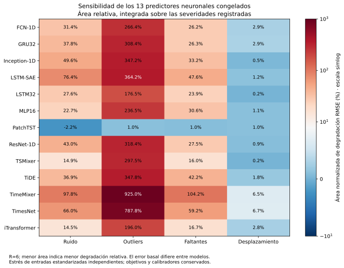
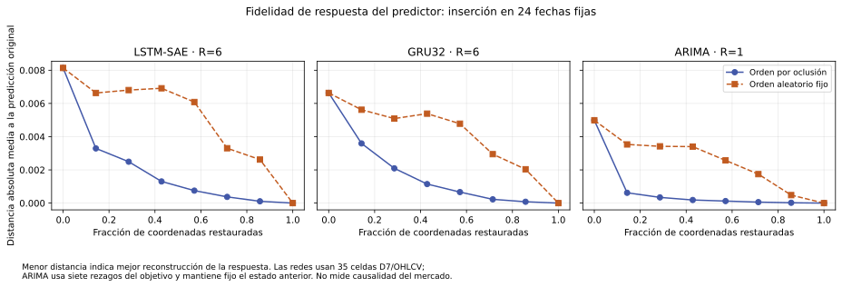
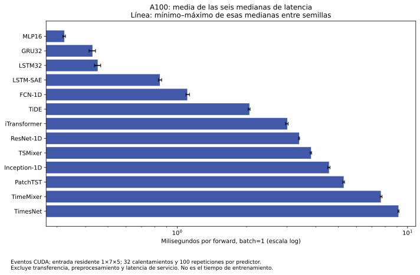

# 54. Robustez e interpretabilidad: resultados reales de los predictores congelados

**La ejecución A100 completó los diagnósticos de 79 predictores y su agregado.** Las perturbaciones muestran fragilidad: con un 10 % de celdas alteradas por valores extremos, la RMSE del autoencoder aumenta **585,40 %**, la de GRU32 **513,98 %** y la de TimeMixer **1.552,52 %**. La cobertura de sus intervalos congelados cae al **22,12 %, 32,07 % y 19,13 %**, respectivamente. Una posición favorable en la evaluación original no garantiza resistencia a estas perturbaciones.

Los resultados son posteriores a conocer la prueba y condicionados a una sola cronología. Utilizan predictores existentes, objetivos y calibradores congelados; **la [A2 original](06_benchmark_final.md) y sus veinte contrastes no cambian**. Tampoco constituyen evidencia causal sobre el mercado ni acreditan estabilidad prospectiva.

## Evidencia ejecutada y procedencia

El agregado contiene **78 predictores neurales —trece sistemas por seis semillas— y un ARIMA determinista**. Los 79 reprodujeron sus proyecciones originales antes de admitir los diagnósticos. Se obtuvieron **78 perfiles de inferencia GPU**, **468 filas de robustez** y explicaciones de **tres sistemas: autoencoder, GRU32 y ARIMA**. Persistence y SeasonalNaive no forman parte de esta ejecución de diagnósticos; no se contabilizan como pruebas de estrés completadas.

El registro fija las 608 fechas del 01/01/2025 al 31/08/2026 y la configuración publicada `ae1a2d4f96807a20ea92c313297a5c09512a4817`. La ejecución se identifica como `posthoc-8295dc64b34339856f7f3dfd`. El [commit de resultados](https://github.com/jassan-bit/DeepLearning_202630/tree/12cccdec2c454fd1510c1ac940edb61c115f0b39/runs/posthoc-8295dc64b34339856f7f3dfd) conserva sus artefactos. El resumen restaurado y verificado tiene SHA256:

```text
e9df7b0f89370f807d6387574d8195161353b8d5fe4da40e99b60d9a2c1587bd
```

La [procedencia y verificación de fuentes](../_static/e2_posthoc_gpu_20261113/source_evidence.json) y el [estado de ejecución](../_static/e2_posthoc_gpu_20261113/status.json) conservan el corte en que terminaron los diagnósticos; el cierre posterior del entrenamiento complementario está en [§55](55_reproduccion_ablaciones.md). El entorno medido fue **NVIDIA A100-SXM4-80GB, Python 3.12.12 y Torch 2.8.0+cu126**, en FP32, sin AMP ni TF32. Los tiempos individuales suman **2.358,53 segundos** y el agregado informa **3.441,86 segundos** de invocación; son alcances distintos que incluyen gestión y respaldos entre predictores. Ninguno sustituye el diario presupuestario acumulado.

## Qué se perturbó

Para cada red se modifica su tensor de entrada D7, de **7 rezagos × 5 variables OHLCV**, después del escalado original. La mediana y la desviación estándar por coordenada se obtienen exclusivamente de las ventanas de entrenamiento. No se ajustan nuevos parámetros a partir de la prueba.

| Perturbación | Operación registrada | Tres severidades |
|---|---|---|
| Ruido | Ruido gaussiano por celda, multiplicado por su desviación estándar de entrenamiento | 0,10; 0,30; 0,50 |
| Valores extremos | Selección aleatoria de celdas y desplazamiento de ±5 desviaciones estándar | Probabilidades 0,01; 0,05; 0,10 |
| Faltantes simulados | Sustitución de las celdas seleccionadas por su mediana de entrenamiento | Probabilidades 0,05; 0,15; 0,30 |
| Cambio de nivel | Desplazamiento positivo de las entradas desde el índice 365, correspondiente al 01/01/2026 | 0,25; 0,50; 1,00 desviaciones estándar |

La semilla de perturbación es `271901`. Los cambios de las ventanas son **independientes por pronóstico**: no reconstruyen una trayectoria OHLCV coherente, pueden romper relaciones entre apertura, máximo, mínimo y cierre y no representan intervenciones económicas. La condición denominada cambio estructural es un desplazamiento sintético de entradas con fecha fijada; no demuestra resistencia a un quiebre real del proceso generador. La imputación por mediana es una regla de estrés ya fijada, no una política validada para faltantes operativos.

Los **objetivos permanecen intactos** y cada predictor conserva su radio residual **q**. Se evalúan cambios en la RMSE media de las seis semillas, cobertura y anchura nominal **2q**. La cobertura se calcula con el criterio \(|\hat y-y|\leq q\); no se recalibra el intervalo tras la perturbación. La anchura nominal que informa este productor no incorpora el recorte del extremo inferior en cero usado en otras tablas, por lo que no debe confundirse con esa anchura truncada.

## Degradación, incertidumbre y resultados adversos

Las **468 filas** corresponden a **13 redes × 12 condiciones de estrés × 3 longitudes de bloque**. Cada combinación usa **2.000 remuestreos circulares** de fechas, con bloques de **7, 14 o 28 días**. Se preserva el emparejamiento de fechas y las seis trayectorias fijas; las semillas no se convierten en mercados independientes. El cambio evaluado es la RMSE media por semilla perturbada menos su referencia original.

Los IC son descriptivos y condicionados a estas semillas y esta cronología; no son intervalos simultáneos ni contrastes ajustados de las 468 filas. Las tres longitudes reutilizan los mismos efectos puntuales y constituyen sensibilidad del remuestreo, no tres replicaciones independientes. Su interpretación requiere que los bloques representen adecuadamente la dependencia temporal. La [tabla completa de robustez](../_static/e2_posthoc_gpu_20261113/robustness.csv) conserva las tres longitudes.

En la severidad máxima de cada condición, los resultados siguientes utilizan **bloques de 14 días**. La cobertura es la observada con q congelado; los porcentajes de degradación se expresan respecto a la RMSE original de cada sistema.

| Sistema y condición | RMSE perturbada | Aumento de RMSE | Cobertura |
|---|---:|---:|---:|
| Autoencoder, ruido 0,50 | 0,0114691 | 201,55 % | 49,18 % |
| GRU32, ruido 0,50 | 0,0081564 | 103,85 % | 72,67 % |
| TimeMixer, ruido 0,50 | 0,0164706 | 267,56 % | 28,92 % |
| Autoencoder, extremos 0,10 | 0,0260687 | 585,40 % | 22,12 % |
| GRU32, extremos 0,10 | 0,0245663 | 513,98 % | 32,07 % |
| TimeMixer, extremos 0,10 | 0,0740510 | 1.552,52 % | 19,13 % |
| Autoencoder, faltantes 0,30 | 0,0069458 | 82,62 % | 81,61 % |
| GRU32, faltantes 0,30 | 0,0060639 | 51,55 % | 88,35 % |
| TimeMixer, faltantes 0,30 | 0,0125695 | 180,50 % | 72,51 % |
| Autoencoder, cambio de nivel 1,00 | 0,0040731 | 7,09 % | 95,61 % |
| GRU32, cambio de nivel 1,00 | 0,0043831 | 9,55 % | 95,31 % |
| TimeMixer, cambio de nivel 1,00 | 0,0052910 | 18,07 % | 87,64 % |

Por ejemplo, ante extremos al 10 %, el aumento absoluto del autoencoder es **0,0222653**, con IC nominal de bloque14 **[0,0206109; 0,0239833]**. Para TimeMixer es **0,0695700 [0,0657042; 0,0732189]**. Son deterioros importantes dentro del estrés simulado. La conservación de q deja visible que los intervalos originales no mantienen su cobertura en esas condiciones.

Se resume también la curva mediante el área trapezoidal de la degradación relativa, comenzando en severidad cero y dividida por la severidad máxima. Un área menor describe menos degradación en esa escala concreta. No equivale a la degradación en la severidad máxima ni a una probabilidad de fallo; las escalas de condiciones distintas no son intercambiables.



En la escala porcentual del gráfico, el área del autoencoder es **76,43 % para ruido y 364,15 % para extremos**; GRU32 obtiene **37,82 % y 308,44 %**. TimeMixer alcanza **97,84 % y 925,01 %**, y TimesNet **66,00 % y 787,75 %**. Estos resultados impiden presentar a los modelos mejor situados en la referencia como uniformemente resistentes. Las [52 áreas —13 sistemas por cuatro condiciones—](../_static/e2_posthoc_gpu_20261113/normalized_degradation_areas.csv) permiten revisar todos los sistemas.

**PatchTST exige una interpretación especialmente cauta.** Su área de ruido es negativa, pero parte de una RMSE original alta, **0,0101393**. Con ruido 0,50 el cambio observado es **−0,0002431**, cuyo IC de bloque14 **[−0,0008074; 0,0001990]** incluye cero. Una respuesta poco sensible, o una reducción puntual del error tras añadir ruido, no acredita una buena predicción ni autoriza declararlo ganador de robustez.

## Oclusión, fidelidad y estabilidad de las explicaciones

Se seleccionaron **24 fechas equiespaciadas**, desde el índice 7 hasta el 607, sin selección por pérdidas u objetivos. En las dos redes se sustituye una coordenada D7 cada vez por su mediana de entrenamiento. El cambio absoluto de la predicción determina el orden de importancia para cada observación. Las curvas de eliminación sustituyen progresivamente las coordenadas; las de inserción las restituyen desde la referencia. Se compara ese orden con un orden aleatorio de semilla fija.

ARIMA se explica por separado mediante sus **siete rezagos del objetivo σ₇**, preservando el estado anterior del filtro y sus coeficientes. Sus explicaciones no son importancias OHLCV y sus siete coordenadas no se comparan directamente con las 35 de las redes. El índice inicial 7 permite disponer de todos los rezagos posteriores al estado original congelado.



Las curvas medias muestran que eliminar primero las coordenadas ordenadas cambia más la predicción, y que insertarlas recupera antes la respuesta original que el orden aleatorio. Por ejemplo, al eliminar aproximadamente **un séptimo de las coordenadas**, el cambio absoluto medio del autoencoder es **0,007675**, frente a **0,002565** con el orden aleatorio; para GRU32 es **0,005216**, frente a **0,001484**. Son promedios entre semillas sobre las mismas 24 fechas, en unidades de la predicción.

La ventaja no es uniforme: entre los seis puntos interiores de eliminación y las seis semillas, hay **2 de 36 combinaciones del autoencoder y 7 de 36 de GRU32** en las que el cambio ordenado es menor que el aleatorio. La eliminación tampoco tiene por qué ser monótona cuando interactúan las entradas. La [tabla de fidelidad por productor](../_static/e2_posthoc_gpu_20261113/fidelity_producer_summary.csv) conserva los resultados que sustentan estas observaciones.

El orden se obtiene mediante oclusión y su fidelidad se mide con perturbaciones relacionadas sobre **las mismas fechas**. Por tanto, se evalúa coherencia con la respuesta de ese predictor, no una validación independiente de la explicación. El orden aleatorio es una referencia de una semilla fijada, no una distribución extensa de controles aleatorios. Ninguna de estas curvas identifica causas de volatilidad, utilidad económica de intervenir una variable o validez de una explicación en futuros periodos.

La estabilidad se calcula como correlación de Spearman entre los vectores de magnitud media de las explicaciones de cada semilla. Cada red produce **15 parejas de semillas**, no quince muestras independientes de mercado:

| Productor | Semillas | Parejas | Spearman medio | Spearman mínimo |
|---|---:|---:|---:|---:|
| Autoencoder | 6 | 15 | 0,73102 | 0,35518 |
| GRU32 | 6 | 15 | 0,83815 | 0,65882 |
| ARIMA | 1 | 0 | No estimable | No estimable |

GRU32 presenta mayor concordancia descriptiva entre semillas en esta muestra; el mínimo del autoencoder muestra que algunas parejas discrepan de forma apreciable. ARIMA tiene **R=1** y su estabilidad entre semillas **no está definida (`null`)**; ese valor no representa una correlación cero ni estabilidad perfecta. Estos resúmenes no acreditan estabilidad temporal fuera de las 24 fechas.

## Perfil de inferencia y límites del cierre

Cada perfil utiliza **32 pasadas de calentamiento y 100 repeticiones**, con **batch=1** y entrada residente en GPU. El tiempo se mide mediante eventos CUDA durante el forward del modelo. Excluye transferencia de datos, preprocesamiento, carga del modelo y latencia de un servicio completo. El cuadro y el gráfico muestran la **media de las seis medianas por semilla** y su rango mínimo–máximo; no son la mediana conjunta de todas las repeticiones ni un IC poblacional.

| Sistema | Parámetros | Media de medianas, ms | Rango de medianas, ms |
|---|---:|---:|---:|
| MLP16 | 593 | 0,32324 | 0,31898–0,32717 |
| GRU32 | 3.777 | 0,42854 | 0,41421–0,44186 |
| Autoencoder | 8.739 | 0,84019 | 0,82944–0,85606 |
| PatchTST | 16.388 | 5,28205 | 5,23366–5,32634 |
| TimeMixer | 9.447 | 7,65790 | 7,60934–7,75168 |
| TimesNet | 1.173.099 | 9,13152 | 9,07674–9,17709 |



El [perfil completo por sistema](../_static/e2_posthoc_gpu_20261113/inference_profiles_by_model.csv) conserva los trece modelos. La cantidad de parámetros no determina por sí sola la latencia: TimeMixer tiene menos parámetros que PatchTST, pero tarda más en esta medición. Los picos de memoria informados corresponden al forward después del calentamiento; incluyen espacios de trabajo y distinguen memoria asignada de reservada por el allocator. No son el pico de entrenamiento ni el consumo completo del proceso. El conteo posterior de **FLOPs core** para las trece recetas está en [§58](58_flops_predictores.md): matrices y convoluciones con 2 FLOPs/MAC; FFT, activaciones y otras operaciones están excluidas e inventariadas. La energía permanece sin medir. ARIMA no tiene un perfil GPU comparable en este agregado.

Este capítulo documenta los 79 diagnósticos completados sobre predictores congelados. **El cierre del 13/11/2026 a las 22:42:55 de Bogotá, documentado en [§55](55_reproduccion_ablaciones.md), ya acredita 81/81 reproducciones y 18/18 ablaciones entrenadas**, con criterio de reproducción aprobado y las tres comparaciones del autoencoder. Los 99 ajustes son el plan complementario del proyecto, no un número exigido literalmente por la guía.

El fallo inicial de preparación de aproximadamente trece segundos y sus cargos se conservan como antecedentes en [§53](53_cierre_requisitos.md); ese corte fue superado mediante la recuperación registrada. Las oclusiones aquí descritas siguen siendo pruebas de respuesta de pesos existentes. Las ablaciones de §55 vuelven a entrenar las variantes y constituyen una evidencia experimental distinta. Ninguna de las dos etapas modifica la A2 original o recupera una prueba prospectiva desconocida.
