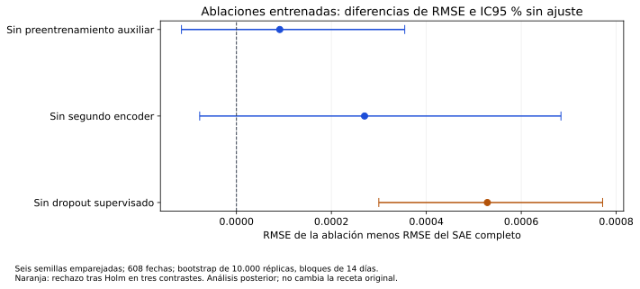

# 55. Reproducción numérica y ablaciones completadas

**Cierre verificado: 13/11/2026, 22:42:55 de Bogotá.** El plan complementario terminó con **99/99 ajustes: 81 reproducciones y 18 ablaciones**, sin trabajos pendientes ni reservas abiertas. El informe del productor declara `reproduction_passed=true`, con cero discrepancia máxima de predicciones en los soportes comparados. [Estado y presupuesto final](../_static/e2_reproduction_ablations_20261113/status.json) · [Informe original del productor](../_static/e2_reproduction_ablations_20261113/producer_summary.json) · [Fuentes y verificaciones](../_static/e2_reproduction_ablations_20261113/source_evidence.json).

Estos 99 ajustes corresponden al plan de reproducción y ablación de este proyecto; **la guía no exige literalmente 99 ajustes adicionales**. La [tabla A2 original](06_benchmark_final.md), sus veinte contrastes primarios y las recetas seleccionadas se conservan. La repetición numérica utiliza el mismo calendario conocido de E1: no constituye una nueva evaluación prospectiva ni recupera cegamiento.

## 55.1 Qué se reprodujo y con qué criterio

Se repitieron los **78 ajustes neuronales congelados —trece redes por seis semillas—** y se reconstruyeron los tres comparadores deterministas. El entorno Python y el checkout científico están separados de los utilizados para producir la A2, con el mismo commit, versiones, datos, recetas, épocas y semillas. Se mantuvo **Python 3.12.12, Torch 2.8.0+cu126 y NVIDIA A100-SXM4-80GB**, sin reajustar hiperparámetros ni seleccionar otro ganador. El [recibo histórico del entorno limpio](../_static/e2_reproduction_ablations_20261113/historical_clean_runtime.json) conserva su alcance y fecha originales.

Cada recibo compara **53 pronósticos de calibración y 608 de evaluación** con sus correspondientes originales. El criterio registrado de igualdad numérica usa tolerancia absoluta de **10⁻¹⁰**; los máximos efectivamente reportados son **0**. Para las redes, el productor informa igualdad bit a bit de los tensores del estado, sin exigir igualdad binaria del archivo serializado de PyTorch. Para los clásicos compara los parámetros.

| Sistema | Reproducciones | Comprobaciones aprobadas | Máx. diferencia en calibración | Máx. diferencia en prueba |
|---|---:|---:|---:|---:|
| FCN-1D | 6 | 6 | 0 | 0 |
| ResNet-1D | 6 | 6 | 0 | 0 |
| Inception-1D | 6 | 6 | 0 | 0 |
| LSTM-autoencoder con predictor | 6 | 6 | 0 | 0 |
| TimesNet | 6 | 6 | 0 | 0 |
| TSMixer | 6 | 6 | 0 | 0 |
| TiDE | 6 | 6 | 0 | 0 |
| TimeMixer | 6 | 6 | 0 | 0 |
| PatchTST | 6 | 6 | 0 | 0 |
| iTransformer | 6 | 6 | 0 | 0 |
| MLP16 | 6 | 6 | 0 | 0 |
| LSTM32 | 6 | 6 | 0 | 0 |
| GRU32 | 6 | 6 | 0 | 0 |
| Persistence | 1 | 1 | 0 | 0 |
| SeasonalNaive | 1 | 1 | 0 | 0 |
| ARIMA | 1 | 1 | 0 | 0 |
| **Total** | **81** | **81** | **0** | **0** |

[Resultados por ejecución, CSV](../_static/e2_reproduction_ablations_20261113/reproduction.csv) · [Agregado por sistema, CSV](../_static/e2_reproduction_ablations_20261113/reproduction_by_model.csv).

Las 78 comparaciones neuronales reportan estados tensoriales idénticos y los tres comparadores parámetros exactos. Esto acredita reproducibilidad numérica bajo estas condiciones. No equivale a una repetición por un equipo externo, otra GPU, otro mercado o nuevas fechas; tampoco elimina la exposición previa al periodo de prueba.

## 55.2 Tres ablaciones entrenadas del SAE

Se retiraron, por separado, **el preentrenamiento auxiliar**, **el segundo encoder** y **el dropout supervisado**. Cada variante se entrenó con las mismas seis semillas, los hiperparámetros congelados y las épocas fijadas de las fases que conserva. No hubo HPO adicional. La referencia es el SAE completo reproducido con la misma semilla. Se guardaron pesos, curvas y recibos propios; estas ejecuciones son distintas de las oclusiones de entradas de [§54](54_robustez_interpretabilidad.md).

La métrica es la media de las seis RMSE individuales, en unidades originales de σ₇, sobre las 608 fechas comunes. La diferencia se define como **RMSE de la ablación menos RMSE del modelo completo**: valores positivos indican empeoramiento.

| Condición | R | RMSE media | Diferencia respecto al completo | IC95 % de la diferencia, sin ajuste | p ajustado por Holm |
|---|---:|---:|---:|---|---:|
| SAE completo | 6 | 0,003803430 | — | — | — |
| Sin preentrenamiento auxiliar | 6 | 0,003894703 | +0,000091273 | [−0,000115815; 0,000354533] | 0,447655 |
| Sin segundo encoder | 6 | 0,004073294 | +0,000269865 | [−0,000077452; 0,000683653] | 0,323168 |
| Sin dropout supervisado | 6 | 0,004331995 | +0,000528565 | [0,000299895; 0,000771366] | **0,00059994** |



Las comparaciones emplean **10.000 remuestreos pareados de semillas y calendario**, con bloques circulares de **14 días** y seis pares de semillas. Los tres contrastes bilaterales centrados forman una familia corregida mediante Holm a α=0,05. Los IC percentiles del 95 % son **individuales, sin ajuste simultáneo**; no deben confundirse con los p ajustados. Son análisis posteriores sobre el periodo ya conocido, condicionados a estas semillas y a la representación de la dependencia temporal mediante bloques.

Retirar el dropout supervisado incrementó la RMSE un **13,90 %** y produjo el único rechazo tras Holm. Los efectos puntuales de retirar preentrenamiento o el segundo encoder también son positivos, pero sus intervalos incluyen cero y no se rechazan tras la corrección. **Estos dos resultados no establecen equivalencia ni ausencia de contribución**. Ninguna ablación se usa para modificar retrospectivamente la receta principal o el ranking de A2.

[Los 18 ajustes de ablación, CSV](../_static/e2_reproduction_ablations_20261113/ablation_fits.csv) · [Tres comparaciones con precisión completa](../_static/e2_reproduction_ablations_20261113/ablation_comparisons.csv) · [Procedencia de la figura](../_static/e2_reproduction_ablations_20261113/figure_manifest.json).

## 55.3 Presupuesto y cierre del controlador

La ampliación autorizada fijó el límite en **84 horas totales**, conservando el ancla anterior de 80 horas y todos sus cargos. El diario aditivo contiene **351 eventos**, una única ampliación de cuatro horas y **cero reservas abiertas**. El cierre final suma **288.922,09 segundos —80,2561 horas contabilizadas—**, con **13.477,91 segundos de saldo —3 h 44 min 38 s—**.

Estas son horas de presupuesto acumulado, que incluyen historia, gestión, fallos y respaldos; no son una medición de GPU activa, energía ni dinero. El presupuesto incluido dentro del resumen del productor precede a los últimos cargos de publicación: el [balance final verificado](../_static/e2_reproduction_ablations_20261113/budget_final.json) utiliza la última fila del diario cerrado.

Los fallos de preparación y transporte, la reserva local que no llegó a publicarse y las conciliaciones anteriores conservan sus evidencias y cargos. El controlador finaliza sin reiniciar el presupuesto ni repetir un ajuste de desenlace desconocido. Los cortes que anunciaban cero reproducciones describen el estado anterior al cierre documentado aquí.

## 55.4 Cómo se verificó esta actualización

La fuente queda fijada al [commit de resultados `d604ede6`](https://github.com/jassan-bit/DeepLearning_202630/tree/d604ede6bf0978e14a1b1d7bafaae6250fb8ed07), con estado de control `a4dc792a…23c03`. La actualización comprobó la identidad del estado, los SHA y bytes de 99 recibos, los vínculos con sus especificaciones y cargos, los 99 manifiestos de artefactos, el informe completo y la cadena del diario. La [procedencia por ajuste](../_static/e2_reproduction_ablations_20261113/source_evidence.json) permite localizar los originales.

La igualdad de predicciones y estados la comprobaron los workers productores en A100. Esta publicación audita sus recibos y registros: **no vuelve a entrenar, ejecutar inferencias, remuestrear ni deserializar pesos**. Los pesos y curvas siguen en sus respaldos originales de GitHub. El [manifiesto de descargas](../_static/e2_reproduction_ablations_20261113/manifest.json) identifica las tablas y copias documentales publicadas.

```bash
python scripts/export_e2_reproduction_ablation_report.py \
  --source /ruta/al/espejo_verificado_del_commit_d604ede6 \
  --destination /ruta/nueva/al/reporte
python scripts/plot_e2_reproduction_ablations.py --folder /ruta/nueva/al/reporte
```

## 55.5 Alcance frente a la guía

Quedan acreditadas la reproducción numérica del benchmark y las tres ablaciones entrenadas del mejor modelo observado, con seis semillas e inferencia de sus diferencias. Esto no convierte automáticamente el entregable en cumplimiento integral. Los suplementos posteriores añaden [inferencia con 20.000 remuestreos y Giacomini–Rossi (§56)](56_inferencia_estabilidad_final.md), [taxonomía automática de errores y referencias de dificultad (§57)](57_errores_techo.md), [FLOPs core (§58)](58_flops_predictores.md) y [conciliación bibliográfica (§59)](59_auditoria_literatura_final.md). Permanecen el margen δg previo ausente, el calendario conocido, la elegibilidad global y componentes del puntaje desconocidos, y la falta de un techo empírico validado. El conteo de operaciones excluye FFT, activaciones y otros kernels. Su estado se conserva en [§38](38_cumplimiento_guia.md).
