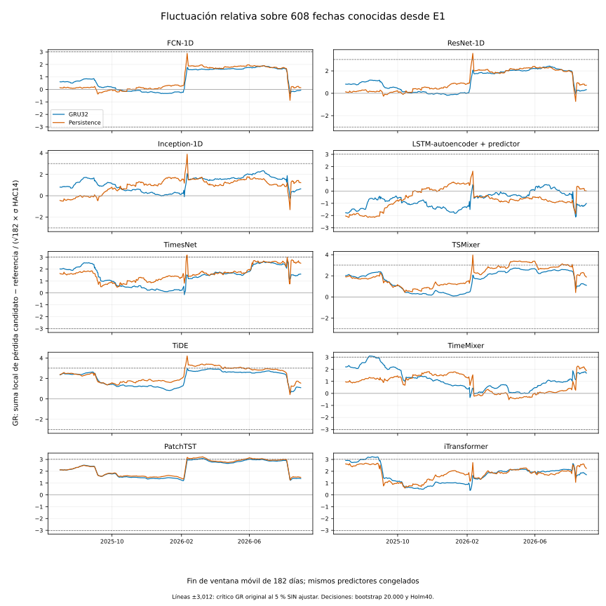

# 56. Inferencia refinada y estabilidad temporal

El refinamiento de los **20 contrastes primarios con 20.000 remuestreos** conserva las conclusiones: **ningún modelo principal demuestra una mejora mayor que δ frente a GRU32 o Persistence tras Holm20**. Se verificaron exactamente los 20 resultados originales de 4.999 sorteos antes de ampliar la resolución Monte Carlo. Se conservan ambos análisis y sus fechas; no se reentrenó, recalibró ni generó una predicción nueva.

El [plan de este análisis](../_static/e2_temporal_final_audit_20261114/analysis_plan.json) se registró antes del cálculo en el [commit `60cd2bb`](https://github.com/jassan-bit/DeepLearning_202630/commit/60cd2bb23f6da22797e2c3a7bf8225250753f903), el 14 de noviembre de 2026 a las 04:17:23 UTC, equivalente al 13 de noviembre a las 23:17:23 en Bogotá. Este registro ordena la ampliación computacional y los diagnósticos posteriores; no convierte en previo al conocimiento de E1 un análisis realizado después.

## La familia primaria completa, ahora con 20.000 sorteos

Se mantuvieron la métrica **media del RMSE individual de las seis semillas**, las 608 fechas, el margen práctico **δ = 0,00025772842664981106**, los mismos pares, semillas del generador y bloques circulares de 14 días sobre el calendario. Se reutilizó literalmente `bootstrap_contrast` del motor de análisis original. Cada réplica remuestrea conjuntamente las semillas emparejadas y las posiciones temporales; Persistence conserva su única trayectoria determinista. No se cambió por RMSE del ensamble ni por MSE.

Los [20 cotejos exactos con B = 4.999](../_static/e2_temporal_final_audit_20261114/original_4999_exact_checks.csv) coinciden en ganancia, δ, IC95, p bruto y p ajustado. El [refinamiento completo B = 20.000](../_static/e2_temporal_final_audit_20261114/primary_refinement_20000.csv) mantiene **p ajustado = 1 en los 20 contrastes**. El menor p bruto es 0,44278, correspondiente al LSTM-autoencoder frente a Persistence: ganancia de RMSE 0,00028217 e IC95 [−0,00016922; 0,00072001]. Por tanto, aumentar los sorteos subsana la resolución computacional insuficiente; no cambia la falta de evidencia de superioridad práctica.

La ganancia positiva significa menor RMSE del candidato. Los intervalos siguientes son los percentiles bootstrap marginales, no intervalos simultáneos de la familia.

| Candidato | Referencia | Ganancia RMSE | IC95 de la ganancia | p bruto B20.000 |
|---|---|---:|---|---:|
| FCN-1D | GRU32 | -0.000565 | [-0.001483; 0.000257] | 0.9618 |
| FCN-1D | Persistence | -0.000481 | [-0.001204; 0.000156] | 0.9772 |
| ResNet-1D | GRU32 | -0.000542 | [-0.001308; 0.000078] | 0.9789 |
| ResNet-1D | Persistence | -0.000458 | [-0.001138; 0.000131] | 0.9790 |
| Inception-1D | GRU32 | -0.000361 | [-0.000819; 0.000069] | 0.9945 |
| Inception-1D | Persistence | -0.000277 | [-0.000747; 0.000170] | 0.9871 |
| LSTM-autoencoder con predictor | GRU32 | 0.000198 | [-0.000135; 0.000551] | 0.6461 |
| LSTM-autoencoder con predictor | Persistence | 0.000282 | [-0.000169; 0.000720] | 0.4428 |
| TimesNet | GRU32 | -0.000804 | [-0.001534; -0.000075] | 0.9968 |
| TimesNet | Persistence | -0.000720 | [-0.001343; -0.000097] | 0.9989 |
| TSMixer | GRU32 | -0.000974 | [-0.001723; -0.000291] | 0.9987 |
| TSMixer | Persistence | -0.000890 | [-0.001445; -0.000373] | 0.9999 |
| TiDE | GRU32 | -0.001771 | [-0.002836; -0.000836] | 0.9998 |
| TiDE | Persistence | -0.001686 | [-0.002722; -0.000767] | 0.9996 |
| TimeMixer | GRU32 | -0.000480 | [-0.001233; 0.000190] | 0.9732 |
| TimeMixer | Persistence | -0.000395 | [-0.001141; 0.000326] | 0.9575 |
| PatchTST | GRU32 | -0.006138 | [-0.008075; -0.004337] | 1.0000 |
| PatchTST | Persistence | -0.006054 | [-0.007789; -0.004397] | 1.0000 |
| iTransformer | GRU32 | -0.001253 | [-0.001883; -0.000681] | 1.0000 |
| iTransformer | Persistence | -0.001169 | [-0.001751; -0.000628] | 1.0000 |

## Giacomini–Rossi y un diagnóstico distinto de constancia

Se implementó el estadístico de fluctuación de **Giacomini y Rossi (2010)** siguiendo la ecuación 3 de [Rossi y Soupre (2017), pp. 3–5](https://www.crei.cat/wp-content/uploads/2016/07/Rossi_Soupre_Revised-1.pdf). La nota 3 admite estimación fija o mediante ventanas móviles; la sección 3.2 exige únicamente realizaciones y pronósticos. Los pesos congelados son, por ello, compatibles con este contraste. Las ventanas móviles aquí recorren **las pérdidas de los pronósticos existentes** y no representan nuevos ajustes de parámetros.

Para cada par se calculó la diferencia diaria entre las pérdidas cuadráticas individuales medias de sus semillas. Esta pérdida aditiva no es la diferencia entre los RMSE primarios. Con $d_t=L_{candidato,t}-L_{referencia,t}$, se calculó:

$$
F_{t,m}=\frac{\sum_{j=t-m+1}^{t}d_j}{\widehat\sigma\sqrt{m}},
\qquad GR=\max_t |F_{t,m}|.
$$

Se fijaron **m = 182 días**, $\mu$ nominal = 0,3 y efectivo = 182/608 = 0,299342; se obtienen 427 ventanas superpuestas. $\widehat\sigma^2$ es la varianza de largo plazo global, con HAC Bartlett y 14 rezagos. El estadístico observado de GR **no se centra**: su nulo es igualdad de capacidad predictiva en cada fecha, $E[d_t]=0$. Un rechazo también puede surgir de una ventaja o desventaja constante; no acredita por sí solo un quiebre.

La calibración principal de estos diagnósticos es una **adaptación bootstrap** declarada: 20.000 bloques circulares de 14 días de $d_t-\bar d$, reestimando HAC en cada réplica. Se añadió, con nombre separado, un contraste de **constancia de la diferencia media**, cuyo estadístico sí centra cada trayectoria por su propia media. Los 20 contrastes de igualdad predictiva y los 20 de constancia se ajustaron conjuntamente mediante **Holm40**. La dependencia corta y una aproximación adecuada mediante HAC global son supuestos; el procedimiento no garantiza validez ante cambios arbitrarios de la varianza.

**Resultado: cero rechazos tras Holm40 en ambos tipos de contraste.** El menor p ajustado de igualdad predictiva es 0,25999, para TSMixer frente a Persistence (GR = 3,96318). Todos los p ajustados de constancia son 1. Estos resultados no demuestran equivalencia, estabilidad universal ni ausencia de sobreajuste.

Como referencia separada, la [tabla A.2 de Rossi (2013), p. 93](https://crei.cat/wp-content/uploads/2016/07/AFUM.pdf) da el crítico GR bilateral 3,012 para $\mu=0,3$. **Nueve de los veinte pares lo superan sin corrección**. Esa inspección no equivale a las decisiones bootstrap ajustadas ni permite declarar que todos los modelos son estables.

| Candidato | Referencia | GR máximo | p EPA bruto | p EPA Holm40 | p constancia Holm40 |
|---|---|---:|---:|---:|---:|
| FCN-1D | GRU32 | 1.903 | 0.5340 | 1.0000 | 1.0000 |
| FCN-1D | Persistence | 2.888 | 0.2028 | 1.0000 | 1.0000 |
| ResNet-1D | GRU32 | 2.428 | 0.3087 | 1.0000 | 1.0000 |
| ResNet-1D | Persistence | 3.563 | 0.0286 | 1.0000 | 1.0000 |
| Inception-1D | GRU32 | 2.340 | 0.3304 | 1.0000 | 1.0000 |
| Inception-1D | Persistence | 3.889 | 0.0077 | 0.3022 | 1.0000 |
| LSTM-autoencoder con predictor | GRU32 | 2.124 | 0.4334 | 1.0000 | 1.0000 |
| LSTM-autoencoder con predictor | Persistence | 2.153 | 0.4229 | 1.0000 | 1.0000 |
| TimesNet | GRU32 | 2.786 | 0.1290 | 1.0000 | 1.0000 |
| TimesNet | Persistence | 3.184 | 0.0507 | 1.0000 | 1.0000 |
| TSMixer | GRU32 | 2.737 | 0.1435 | 1.0000 | 1.0000 |
| TSMixer | Persistence | 3.963 | 0.0065 | 0.2600 | 1.0000 |
| TiDE | GRU32 | 2.963 | 0.1122 | 1.0000 | 1.0000 |
| TiDE | Persistence | 4.211 | 0.0119 | 0.4522 | 1.0000 |
| TimeMixer | GRU32 | 3.111 | 0.0606 | 1.0000 | 1.0000 |
| TimeMixer | Persistence | 2.272 | 0.3420 | 1.0000 | 1.0000 |
| PatchTST | GRU32 | 3.092 | 0.1152 | 1.0000 | 1.0000 |
| PatchTST | Persistence | 3.224 | 0.0993 | 1.0000 | 1.0000 |
| iTransformer | GRU32 | 3.226 | 0.0522 | 1.0000 | 1.0000 |
| iTransformer | Persistence | 2.737 | 0.1668 | 1.0000 | 1.0000 |



Las líneas discontinuas son el crítico original sin ajuste; las decisiones válidas para la familia se reportan en la tabla. Se publican los [estadísticos, críticos bootstrap y p completos](../_static/e2_temporal_final_audit_20261114/relative_fluctuation_tests.csv), las [8.540 ventanas](../_static/e2_temporal_final_audit_20261114/relative_fluctuation_paths.csv) y la [evidencia metodológica de las fuentes primarias](../_static/e2_temporal_final_audit_20261114/source_evidence.json).

## Qué permiten las brechas guardadas y qué sigue sin acreditarse

**No existió un margen δg de sobreajuste definido antes del análisis.** Este requisito no puede cumplirse retrospectivamente cambiando el nombre de un umbral. Se publican únicamente las brechas descriptivas entre el riesgo de entrenamiento guardado y las 53 fechas de calibración de cada predictor final: $g=RMSE_{calibración}-RMSE_{train}$. El entrenamiento se evaluó al finalizar la época con su tamaño de lote configurado; las predicciones de calibración se guardaron con lote 1. Además de esa diferencia numérica posible, los periodos son distintos. La calibración no se presenta como una nueva validación independiente.

La [sensibilidad de tolerancias](../_static/e2_temporal_final_audit_20261114/gap_tolerance_sensitivity_descriptive.csv) muestra los márgenes ilustrativos δ, 2δ, 5δ y 10δ sin seleccionar uno como criterio confirmatorio. La tabla muestra cómo cambia el número de semillas con brecha inferior al margen; no es una prueba de no inferioridad ni permite declarar la ausencia de sobreajuste.

| Modelo | Brecha media | Semillas g < δ | g < 2δ | g < 5δ | g < 10δ |
|---|---:|---:|---:|---:|---:|
| FCN-1D | 0.001753 | 0/6 | 0/6 | 1/6 | 6/6 |
| ResNet-1D | 0.001920 | 0/6 | 0/6 | 0/6 | 5/6 |
| Inception-1D | 0.001947 | 0/6 | 0/6 | 1/6 | 5/6 |
| LSTM-autoencoder con predictor | 0.000427 | 1/6 | 5/6 | 6/6 | 6/6 |
| TimesNet | 0.001968 | 0/6 | 0/6 | 1/6 | 4/6 |
| TSMixer | 0.000108 | 5/6 | 5/6 | 6/6 | 6/6 |
| TiDE | 0.002185 | 0/6 | 0/6 | 0/6 | 4/6 |
| TimeMixer | 0.000334 | 3/6 | 5/6 | 6/6 | 6/6 |
| PatchTST | -0.001858 | 6/6 | 6/6 | 6/6 | 6/6 |
| iTransformer | -0.001516 | 6/6 | 6/6 | 6/6 | 6/6 |
| MLP16 | 0.000935 | 0/6 | 1/6 | 5/6 | 6/6 |
| LSTM32 | 0.001391 | 0/6 | 0/6 | 2/6 | 6/6 |
| GRU32 | 0.000573 | 0/6 | 4/6 | 6/6 | 6/6 |

Las [78 brechas por semilla y sus tamaños de lote](../_static/e2_temporal_final_audit_20261114/saved_training_calibration_gaps.csv) permiten auditar el cálculo. Una brecha negativa puede reflejar distinta dificultad de los periodos; no prueba una ausencia general de sobreajuste.

## Alcance final de la evidencia

Este cierre corrige el número de remuestreos y añade una implementación auditada de fluctuación relativa, además de sensibilidad explícita de las brechas. **El calendario de prueba seguía siendo conocido desde E1 y δg seguía sin definición previa.** La reproducción exacta, las correcciones múltiples y estos diagnósticos fortalecen la trazabilidad del resultado retrospectivo; no crean un nuevo periodo ciego ni satisfacen por sí solos las cuatro condiciones conjuntas de adecuación de la guía.

Los [resultados resumidos](../_static/e2_temporal_final_audit_20261114/summary.json) y el [manifiesto SHA256](../_static/e2_temporal_final_audit_20261114/manifest.json) documentan los insumos y las fuentes. La publicación original de 4.999 sorteos permanece disponible como registro histórico; este capítulo es su refinamiento computacional separado y fechado.


## Insumos para repetir los cálculos

Los [pronósticos congelados exactos](../_static/e2_final_audit_inputs_20261114/e2_f2a_input.json), el [objetivo de desarrollo](../_static/e2_final_audit_inputs_20261114/daily_volatility_development.csv) y el [manifiesto de procedencia](../_static/e2_final_audit_inputs_20261114/manifest.json) permiten repetir el análisis sin cargar pesos ni volver a entrenar. Las brechas usan el [resumen de ajustes ya publicado](../_static/e2_f2a_audit_20261113/fit_overfit_summary.csv).

Desde la raíz del repositorio, con los insumos incluidos en `book_e2/_static/e2_final_audit_inputs_20261114`:

```bash
python scripts/e2_temporal_final_audit.py \
  --input book_e2/_static/e2_final_audit_inputs_20261114/e2_f2a_input.json \
  --training-summary book_e2/_static/e2_f2a_audit_20261113/fit_overfit_summary.csv \
  --plan experiments/e2_temporal_final_audit_20261114/analysis_plan.json \
  --plan-registration-commit 60cd2bb23f6da22797e2c3a7bf8225250753f903 \
  --output work/temporal_audit_repeat
```
