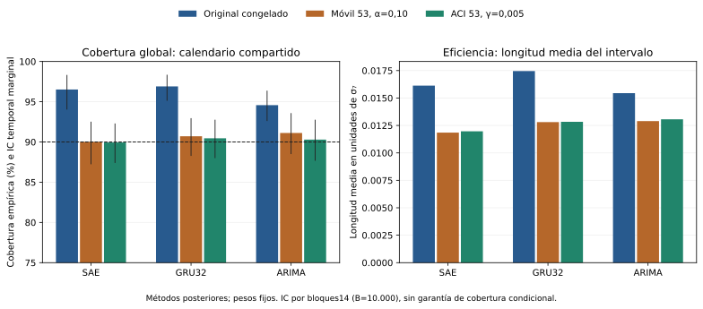
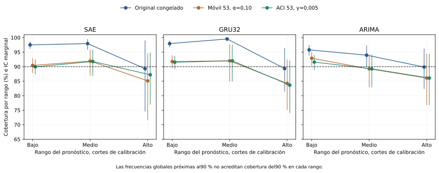

# 60. Calibración temporal y cobertura condicional

Este suplemento ejecuta **dos políticas de intervalos adaptadas al paso del tiempo** sobre los 81 predictores ya guardados. No se reentrenan ni se vuelven a ejecutar los modelos. La A2, sus pronósticos puntuales y los calibradores originales permanecen intactos. El plan se publicó antes del cálculo en el [commit `8d9cc8c`](https://github.com/jassan-bit/DeepLearning_202630/commit/8d9cc8c3397242a07378fb1a678196dab36744da). Es un análisis posterior sobre el test ya conocido desde E1; no recupera un periodo ciego ni el margen δg previo ausente.

**Resultado principal:** las políticas móviles acercan las coberturas globales al 90 % nominal y modifican la longitud de los intervalos. La cobertura por rango sigue siendo desigual. Una frecuencia global cercana al 90 % no certifica calibración condicional ni ausencia de sobreajuste. No se elige una política ganadora con estos resultados.

## Qué calibración había y qué se añade

El intervalo original usa el residuo absoluto de **53 fechas de calibración, 08/11–30/12/2024**, separado del entrenamiento final y de la prueba. El radio es el estadístico de orden **49**, obtenido con $\lceil(53+1)0,9\rceil$, y el extremo inferior se trunca en cero. Se verificó ese radio en los **81 predictores** antes del nuevo cálculo.

La separación temporal evita ajustar ese radio con las etiquetas futuras, pero no crea intercambiabilidad. Las ventanas y el objetivo σ₇ se solapan y el mercado cambia. El calibrador congelado no incorporaba adaptación a esos cambios. En los 53 residuos la mediana entre predictores de la correlación descriptiva a lag1 es 0,200; no es una prueba de independencia ni una estimación del ruido Bayes. Dividir 53 residuos en bloques completos de siete deja sólo siete bloques: el rango corregido para 90 % sería 8, superior a 7. Ese ejercicio no produce un radio finito con garantía distribucional; tampoco demuestra independencia entre bloques. La escasez de calibración y estos supuestos permanecen explícitos. [Diagnóstico de soporte de calibración](../_static/e2_conditional_calibration_20261114/calibration_support_diagnostics.csv).

Las tres políticas comparadas se fijaron antes de calcular sus resultados:

| Política | Información utilizada para emitir el intervalo del día $t$ |
|---|---|
| Original congelado | El mismo radio de 53 residuos de 2024, durante todo el test. |
| Móvil 53, α fijo | Los 53 residuos disponibles más recientes, todos con fecha anterior a $t$; α=0,10. |
| ACI53 | La misma ventana de residuos y una actualización secuencial de α, con γ=0,005 fijado de la fuente primaria. |

## ACI: actualización después de observar, nunca antes de pronosticar

La política ACI sigue la retroalimentación de [Gibbs y Candès (2021), sección 2, ecuación 2](https://arxiv.org/html/2106.00170v3). La sección 2.1 utiliza γ=0,005; se adopta ese valor sin buscar el mejor γ en la prueba. Se comienza con $\alpha_1=0,10$ y, una vez emitido el intervalo y conocido el resultado del día, se actualiza:

$$\alpha_{t+1}=\alpha_t+0,005\left(0,10-\mathbf 1\{Y_t\notin C_t\}\right).$$

El objetivo del día $t$ entra únicamente en la historia usada a partir de $t+1$. El primer día de prueba usa los 53 residuos originales hasta el 30/12/2024. **No hay residuo ni pronóstico del 31/12/2024 en ese conjunto y no se inventa.** La volatilidad observada real del 31/12/2024 sí está en el CSV de desarrollo y puede utilizarse para describir el régimen conocido al origen del 01/01/2025.

En cada política móvil se toma el rango $k_t=\lceil(n+1)(1-\alpha_t)\rceil$ de los 53 residuos anteriores. Esta corrección conserva el rango49 inicial del protocolo E2; es una adaptación explícita del cuantil empírico de la fuente, no una réplica completa de su experimento GARCH. Se mantienen los pronósticos E2 existentes.

**No se recorta α a [0,1].** Cuando el rango excede los residuos disponibles o α≤0, el conjunto es [0,+∞); cuando α≥1, es vacío. Sus anchuras o pérdidas no finitas se conservan como tales; no se omiten para mejorar promedios. En las 147.744 emisiones de esta ejecución no aparecieron conjuntos completos ni vacíos. Las pruebas sintéticas verifican ambos extremos y la identidad de actualización.

La proposición 4.1 del artículo controla la frecuencia agregada a largo plazo mediante esa retroalimentación. Su cota genérica para 608 días y estos parámetros es aproximadamente 0,298: no establece cobertura exacta del 90 % en este horizonte ni en cada subgrupo. ACI puede acercar frecuencias sin garantizar intervalos útiles para cualquier secuencia. Se reportan también anchura, score de intervalo y pérdidas pinball.

## Cobertura y eficiencia de los 16 sistemas

Las cifras son medias sobre las emisiones individuales de las semillas, en el mismo calendario de 608 días; los clásicos aportan una trayectoria. No se forman intervalos de un ensamble ni se cambia la métrica primaria de A2.

| Sistema | Original: cobertura | Móvil 53: cobertura | ACI53: cobertura | Longitud media ACI53 |
|---|---:|---:|---:|---:|
| FCN-1D | 90.27 % | 89.72 % | 89.69 % | 0.014863 |
| ResNet-1D | 91.04 % | 89.80 % | 89.94 % | 0.015221 |
| Inception-1D | 91.37 % | 89.64 % | 89.56 % | 0.014444 |
| LSTM-autoencoder con predictor | 96.52 % | 90.02 % | 89.94 % | 0.011965 |
| TimesNet | 92.52 % | 90.68 % | 89.78 % | 0.015201 |
| TSMixer | 92.76 % | 90.54 % | 90.16 % | 0.016794 |
| TiDE | 92.46 % | 90.32 % | 89.94 % | 0.018917 |
| TimeMixer | 93.64 % | 90.21 % | 89.75 % | 0.014576 |
| PatchTST | 92.87 % | 89.36 % | 89.36 % | 0.031769 |
| iTransformer | 85.03 % | 89.86 % | 89.97 % | 0.017743 |
| MLP16 | 96.46 % | 90.84 % | 90.32 % | 0.015178 |
| LSTM32 | 97.09 % | 90.65 % | 90.41 % | 0.015031 |
| GRU32 | 96.90 % | 90.71 % | 90.46 % | 0.012834 |
| Persistence | 93.26 % | 91.45 % | 90.79 % | 0.013784 |
| SeasonalNaive | 92.93 % | 87.83 % | 88.82 % | 0.036050 |
| ARIMA | 94.57 % | 91.12 % | 90.30 % | 0.013062 |

[Métricas por modelo](../_static/e2_conditional_calibration_20261114/model_metrics.csv) · [243 filas predictor-política](../_static/e2_conditional_calibration_20261114/predictor_metrics.csv).

En el Top 3 observado, SAE pasa de 96,52 % de cobertura a 89,94 % con ACI; GRU32 de 96,90 % a 90,46 %; ARIMA de 94,57 % a 90,30 %. iTransformer pasa de 85,03 % a 89,97 %. Son descripciones retrospectivas, no una comparación confirmatoria de superioridad entre políticas.



El score de intervalo al 90 % penaliza tanto anchura como errores fuera del intervalo:

$$IS_{0,10}(l,u;y)=(u-l)+20(l-y)\mathbf 1\{y<l\}+20(y-u)\mathbf 1\{y>u\}.$$

| Modelo | Original: score | Móvil 53: score | ACI53: score |
|---|---:|---:|---:|
| SAE | 0.019030 | 0.016998 | 0.017072 |
| GRU32 | 0.019734 | 0.017262 | 0.017337 |
| ARIMA | 0.019900 | 0.019385 | 0.019918 |

SAE y GRU32 muestran menor score observado con ambas políticas móviles que con el radio congelado. En ARIMA, el score ACI es 0,019918 frente a 0,019900 original: acercar la cobertura al 90 % **no implica mejorar todo criterio de eficiencia**. No se retoca el método para corregir esa diferencia. Los CSV conservan además pinball en los extremos nominales 0,05 y 0,95. Estos dos extremos no definen una CDF completa; no se fabrica CRPS o PIT a partir de ellos.

## Cobertura por grupos disponibles al origen

Se fijaron dos segmentaciones antes del cálculo: **rango del pronóstico** bajo/medio/alto mediante Q25/Q75 de los 53 pronósticos de calibración de cada predictor; y **régimen de volatilidad del día anterior**, mediante Q25/Q75 de σ₇ de desarrollo 2023–2024. Ambas variables están disponibles al emitir el pronóstico. Los cortes de calibración no se redefinen para obtener grupos del mismo tamaño en la prueba: las diferencias de distribución quedan visibles. Se añaden los siete trimestres de evaluación; 2026Q3 comprende sólo julio y agosto. [Umbrales por predictor](../_static/e2_conditional_calibration_20261114/group_thresholds.csv).

La unidad inferencial sigue siendo el calendario de una única serie. Para un grupo, se divide el número de emisiones cubiertas por el número de emisiones que pertenecen al grupo, agregando las semillas fijas. Los cortes de rango del pronóstico son propios de cada predictor-semilla; por ello la cobertura de grupo es una razón de emisiones individuales agrupadas, no el promedio sin ponderación de las seis coberturas condicionales. Las fechas sin membresía permanecen en el calendario con peso cero. No se tratan las seis semillas como seis mercados ni se comprimen los huecos del grupo.

| Modelo | Rango alto del pronóstico: original | Móvil 53 | ACI53 | IC95 temporal de ACI53 |
|---|---:|---:|---:|---|
| SAE | 89.31 % | 85.12 % | 87.21 % | [76.92 %; 94.88 %] |
| GRU32 | 89.35 % | 84.22 % | 83.65 % | [74.04 %; 92.09 %] |
| ARIMA | 89.87 % | 86.08 % | 86.08 % | [76.74 %; 94.44 %] |

**La cobertura de los pronósticos altos permanece por debajo del 90 % en los tres casos.** La falta de rechazo de algunos contrastes no elimina esa infracobertura observada. La segmentación por el objetivo realizado se publica aparte como descripción retrospectiva: ese objetivo no era conocido al origen y no se utiliza para adaptar intervalos ni declarar cobertura condicional predictiva. [Rangos del objetivo realizado](../_static/e2_conditional_calibration_20261114/realized_target_regimes_descriptive.csv).



## Incertidumbre temporal, contrastes y multiplicidad

Los IC marginales del 95 % usan **10.000 remuestreos circulares**, bloque principal 14 días y sensibilidad predefinida a 7/28. Para los grupos de pronóstico y volatilidad rezagada se remuestrea conjuntamente el calendario completo; para cada trimestre, sus días consecutivos. Se conservan las correspondencias entre políticas, predictores, membresías y aciertos. Los caminos adaptativos realizados permanecen fijos: **el bootstrap no simula una nueva ejecución ACI bajo otra secuencia de retroalimentación**. Sus intervalos describen sensibilidad temporal de estas emisiones, no la distribución completa del algoritmo online en mercados nuevos.

Se calcularon **672 celdas**:16 sistemas × 3 políticas×14 grupos(global, tres rangos de pronóstico, tres regímenes rezagados y siete trimestres). Cada celda considera dos hipótesis distintas: igualdad a 90 % y cobertura mínima de90 %. La aproximación normal utiliza influencia de la razón de cobertura y covarianza HAC Bartlett con14 rezagos, conservando el calendario. Se requieren al menos20 fechas con membresía y varianza no degenerada.

La familia conjunta tiene **1.344 oportunidades de contraste, no 1.344 modelos**, ajustadas una sola vez con Holm. Son estimables1.336; las ocho no estimables se conservan con estado propio y contribuyen con p=1 al tamaño de la familia, sin atribuirles una decisión científica. Holm no corrige una mala aproximación marginal: los p requieren dependencia suficientemente corta y soporte adecuado.

| Política | Rechazos de igualdad a 90 % | Rechazos de cobertura mínima |
|---|---:|---:|
| Original congelado |70|2|
| Móvil 53, α fijo |4|0|
| ACI53, γ=0,005 |2|0|

Los dos rechazos de infracobertura del método original corresponden a iTransformer en rango alto de pronóstico y régimen alto de volatilidad previa. Los dos rechazos ACI son de **sobrecobertura**, en PatchTST/régimen medio e iTransformer/2025Q2. Ninguno acredita igualdad, equivalencia o calibración universal en las otras celdas.

No hubo réplicas bootstrap sin miembros de grupo en este conjunto. El código registra y etiqueta esos casos cuando ocurren; no los sustituye por cero. Un IC degenerado de una categoría con todos los casos cubiertos tampoco demuestra probabilidad poblacional uno. [Los2.016 IC de cobertura](../_static/e2_conditional_calibration_20261114/conditional_coverage_CI.csv) · [Familia de1.344 contrastes](../_static/e2_conditional_calibration_20261114/coverage_HAC_Holm1344.csv).

## Reproducción, controles y alcance

Se verificaron81 radios originales, la cronología y147.744 pasos de calibración causal. Ocho pruebas sintéticas comprueban el rango49, conjuntos infinitos/vacíos, identidad ACI, rezagos de calendario, remuestreo de razones sin comprimir fechas, Holm y el control de futuro: alterar objetivos actuales/futuros no puede modificar el intervalo ya emitido. La ejecución usa aritmética CPU sobre datos guardados, sin acceso a pesos ni creación de optimizadores.

```bash
python scripts/e2_conditional_calibration.py \
  --input book_e2/_static/e2_final_audit_inputs_20261114/e2_f2a_input.json \
  --development book_e2/_static/e2_final_audit_inputs_20261114/daily_volatility_development.csv \
  --plan experiments/e2_conditional_calibration_20261114/analysis_plan.json \
  --output work/conditional_calibration_repeat
python scripts/plot_e2_conditional_calibration.py \
  --folder work/conditional_calibration_repeat
```

La evidencia permite acreditar **una adaptación temporal realmente ejecutada y evaluación por rangos/subgrupos**, con resultados adversos conservados. No demuestra cobertura condicional garantizada, ruido irreducible identificado, ausencia de sobreajuste o validez prospectiva. Los requisitos de δg previo y test desconocido mantienen los límites documentados en [§56](56_inferencia_estabilidad_final.md).

| Archivo | Contenido |
|---|---|
| [analysis_plan.json](../_static/e2_conditional_calibration_20261114/analysis_plan.json) | Reglas publicadas antes de este cálculo posterior. |
| [model_metrics.csv](../_static/e2_conditional_calibration_20261114/model_metrics.csv) | 48 filas de cobertura, anchura, pinball y score por sistema/política. |
| [conditional_metrics.csv](../_static/e2_conditional_calibration_20261114/conditional_metrics.csv) | 672 celdas; tamaños, métricas e hipótesis. |
| [conditional_coverage_CI.csv](../_static/e2_conditional_calibration_20261114/conditional_coverage_CI.csv) | 2.016 IC temporales con B=10.000 y bloques7/14/28. |
| [coverage_HAC_Holm1344.csv](../_static/e2_conditional_calibration_20261114/coverage_HAC_Holm1344.csv) | p brutos/ajustados, estimabilidad y decisiones. |
| [predictor_group_coverage.csv](../_static/e2_conditional_calibration_20261114/predictor_group_coverage.csv) | Cobertura individual de cada predictor por grupo. |
| [daily_interval_trace.csv.gz](../_static/e2_conditional_calibration_20261114/daily_interval_trace.csv.gz) | 147.744 emisiones: fecha, última información, α, radio, estado y acierto; y/p se conservan en el input inmutable. |
| [calibration_support_diagnostics.csv](../_static/e2_conditional_calibration_20261114/calibration_support_diagnostics.csv) | Soporte, rango49 y dependencia descriptiva de los 53 residuos. |
| [source_evidence.json](../_static/e2_conditional_calibration_20261114/source_evidence.json) | Fuente primaria, adaptaciones y alcance de las garantías. |
| [summary.json](../_static/e2_conditional_calibration_20261114/summary.json) | Resumen, supuestos y recursosCPU observados. |
| [manifest.json](../_static/e2_conditional_calibration_20261114/manifest.json) | Hashes de insumos, código y productos. |
