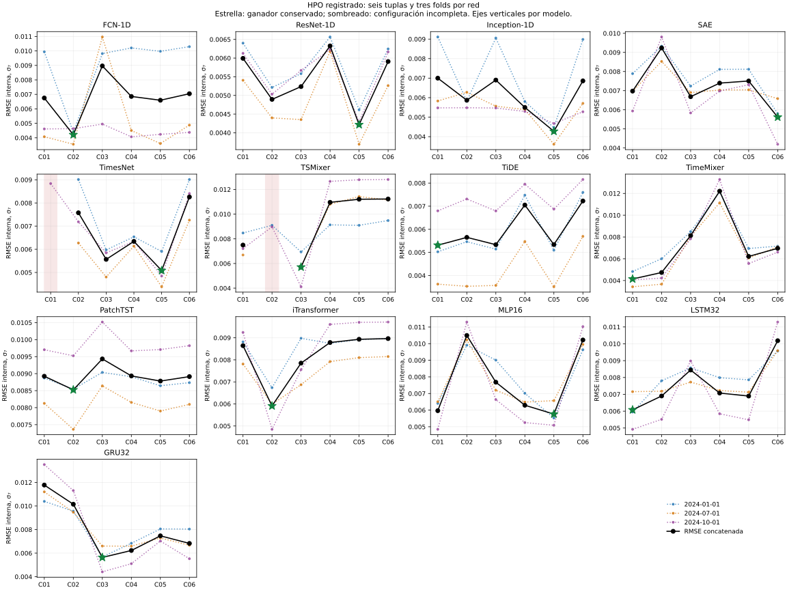

(e2-correcciones-metodologicas)=
# Correcciones metodológicas posteriores al benchmark

**Fecha de esta ampliación: 15/11/2026.** Se ejecutan comprobaciones adicionales de datos, efectos, regímenes y predictores congelados. La ruta continúa siendo **F2a, series de tiempo**. El catálogo conserva arquitecturas definidas: **NAS no aplica**.

La ampliación parte de la versión `0bdbc42b`. Los planes se registran antes de sus respectivos cálculos, después de conocer el benchmark. Es evidencia **posterior y exploratoria**, no una recuperación de cegamiento o de preregistro histórico. Se conserva la A2 original, SHA-256 `879e2ce52709657a06bc6c009f0cd553423f2eaa0bbdf16dc7f5844dfec9fcc1`, y la decisión primaria: ningún contraste de mejora mayor que δ rechaza después de Holm20.

## Efectos estandarizados: veinte contrastes completados

El [plan fechado](../_static/e2_corrections_20261115/statistics/analysis_plan.json) precede al nuevo cálculo. Para cada candidato y referencia se calculan seis ganancias brutas de RMSE, referencia menos candidato, y

$$
d_z=\frac{\overline{\mathrm{ganancia}}}{s_{\mathrm{ganancia}}}.
$$

Se ejecutan **20.000 remuestreos de pares de semillas**, sin remuestrear fechas, para un IC percentil marginal del 95 %. Los veinte efectos y sus IC son estimables; el archivo informa las réplicas de varianza nula. Persistence conserva una trayectoria determinista reutilizada en las restas; no se inventan seis ajustes clásicos.

| Candidato | Referencia | d de Cohen pareado | IC95 % entre semillas |
|---|---|---:|---|
| SAE | GRU32 | 0,5477 | [−0,2403; 1,9032] |
| SAE | Persistence | 1,1497 | [0,4361; 3,7164] |

Esta incertidumbre describe **optimización condicionada al calendario conocido**, con sólo seis pares. No sustituye los IC temporales de la ganancia original, no contrasta por sí sola una mejora mayor que δ y no cambia RQ1. Un IC positivo de d_z frente a Persistence y el no rechazo temporal primario responden a fuentes de variación distintas.

{download}`Veinte efectos con IC <../_static/e2_corrections_20261115/statistics/standardized_effects_20.csv>` · {download}`120 ganancias por semilla <../_static/e2_corrections_20261115/statistics/paired_seed_gains_120.csv>`.

## RQ2: deterioro relativo en alta volatilidad

Se ejecuta la especificación secundaria de [§1](01_punto_partida.md). El régimen es conocido al emitir: **σ₇(t−1)>0,024247163097617024**, cuantil fijado con 350 etiquetas de 2023. El primer origen utiliza σ₇ del 31/12/2024; no se agrupa por la volatilidad contemporánea desconocida. Hay **121 fechas altas y 487 normales**.

Para cada régimen se calcula la RMSE de cada trayectoria y después su promedio. La erosión es la ventaja normal frente a GRU32 menos la ventaja en régimen alto. Se contrasta **H₀: erosión≤δ**, con δ=0,00025772842664981106. El bootstrap mantiene las seis trayectorias fijas y remuestrea conjuntamente fechas y etiquetas de régimen en bloques móviles de 14 días: **20.000 réplicas**, diez contrastes estimables y Holm10. Los bloques 7/28 son sensibilidad descriptiva; no se elige el resultado más favorable.

| Candidato | Erosión de ventaja RMSE | IC95 % marginal | p Holm10 | Erosión mayor que δ |
|---|---:|---|---:|---|
| FCN-1D | 0,002896508 | [0,000541703; 0,004697754] | 0,011699 | Sí |
| ResNet-1D | 0,001783271 | [0,000015223; 0,003058097] | 0,039598 | Sí |
| Inception-1D | 0,001107331 | [−0,000081565; 0,001960329] | 0,076496 | No establecida |
| SAE | 0,000359544 | [−0,000331453; 0,000856260] | 0,335083 | No establecida |
| TimesNet | 0,002228064 | [0,001045407; 0,003298656] | 0,001600 | Sí |
| TSMixer | 0,002888930 | [0,001834438; 0,003869355] | 0,000500 | Sí |
| TiDE | 0,003293397 | [0,001840420; 0,004391267] | 0,000500 | Sí |
| TimeMixer | 0,001440858 | [0,000283023; 0,002746583] | 0,081196 | No establecida |
| PatchTST | 0,006695856 | [0,000767463; 0,011439517] | 0,014999 | Sí |
| iTransformer | 0,002607280 | [0,001158197; 0,004099091] | 0,004200 | Sí |

**Siete candidatos presentan deterioro relativo mayor que δ**, con el ajuste declarado. Esto no supone que todos tuvieran ventaja positiva en régimen normal: el CSV conserva las dos ganancias. Para SAE, Inception y TimeMixer no se establece ese deterioro tras Holm10; **no equivale a demostrar robustez o equivalencia**. Los IC son marginales y no se convierten en simultáneos por acompañarlos de p ajustados.

La inferencia depende de la adecuación del remuestreo temporal a esta cronología. No hay potencia específica de RQ2 demostrada ni extrapolación a otros mercados. La asociación entre régimen y deterioro tampoco identifica un efecto causal de la volatilidad.

{download}`RQ2, diez contrastes y Holm10 <../_static/e2_corrections_20261115/statistics/rq2_primary_Holm10.csv>` · {download}`Sensibilidad 7/14/28 <../_static/e2_corrections_20261115/statistics/rq2_block_sensitivity.csv>` · {download}`608 etiquetas causales <../_static/e2_corrections_20261115/statistics/causal_regime_labels_608.csv>` · [Soporte por régimen](../_static/e2_corrections_20261115/statistics/rq2_support.json).

## Auditoría de los datos y transformaciones disponibles

Se ejecuta una [auditoría adicional sobre datos reales](../_static/e2_corrections_20261115/data_audit/audit_result.json), con [especificación fechada](../_static/e2_corrections_20261115/data_audit/audit_specification.json). Los **655 ejemplos train y 53 de calibración** se reconstruyen a partir de los CSV originales. La reconstrucción directa de σ₇ con ocho cierres coincide con las etiquetas guardadas y conserva el día incompleto del 24/03/2023, sin imputar ni comprimir el calendario.

Se verifican **ocho controles**, siete quedan parciales y uno no aplica. Son controles definidos por esta ampliación, no una puntuación o porcentaje de aprobación de la guía.

| Alcance | Evidencia ejecutada | Límite que permanece |
|---|---|---|
| IDs, embargo y disponibilidad | Calendarios, cortes y soportes causales cotejados; la historia pasada compartida se distingue de etiquetas futuras. | Los metadatos no sustituyen la lectura del contenido de prueba. |
| Preparación común | Ventanas D7, escalado y firmas de train/cal coinciden con los 78 ajustes neuronales documentados. Modificar datos posteriores a octubre de 2024 no cambia el train ni su escalador. | La prueba común no certifica todas las operaciones aprendidas dentro de cada port. |
| Escaladores físicos | 81 registros recuperados y verificados; los neuronales conservan los parámetros e IDs de las 655 observaciones de ajuste. | Son artefactos de la reproducción documentada, con identidad propia. |
| Contenido y vecinos | Huellas y vecinos del desarrollo realmente disponible, con umbral fijo y sin alertas bajo esa regla. | Las ventanas OHLCV de las 608 fechas de prueba no están disponibles en este entorno. |
| Controles con ajustes | Se mantienen separados de la auditoría sin entrenamiento. | El adversarial train/test y las etiquetas permutadas requieren los insumos reales y ejecución registrada. |

**No hay fallos de datos demostrados en los controles ejecutados; la auditoría integral sigue parcial.** Los respaldos públicos conservan objetivos y pronósticos de prueba, pero excluyen su OHLCV crudo. La recuperación oficial de los veinte ZIP está bloqueada por el transporte de red. No se fabrican entradas a partir de predicciones ni se sustituye el mercado o periodo. El resultado incluye un indicador de disponibilidad que impide presentar controles train/test no ejecutados como aprobados.

## Inferencia congelada: comprobación numérica y límite de ejecución

Se recuperan y verifican **81 predictores desplegables y 324 JSON asociados**, incluidos 78 pesos neuronales, escaladores y trayectorias. Los pesos recuperados proceden de la reproducción limpia documentada; conservan sus propias huellas y no se renombran como archivos serializados del freeze original.

El [plan estadístico posterior](../_static/e2_corrections_20261115/inference_statistics/statistical_plan.json) fija, antes de las nuevas pasadas, el contraste de δg entre seis semillas, su familia Holm13 y el diseño de RQ3. La primera [especificación CPU](../_static/e2_corrections_20261115/frozen_inference/inference_spec.json) exige predicciones train/cal en evaluación, batch1 y pesos inmutables, y comprueba la calibración contra el registro A100 con tolerancia absoluta **10⁻⁷ en σ₇**.

La ejecución se detiene en **SAE, semilla 271804**, con diferencia máxima **1,1920928955078125×10⁻⁷**, después de completar 21 predictores. Se conserva el [fallo](../_static/e2_corrections_20261115/frozen_inference/predictions/failure_report.json). Una [alternativa numérica CPU con MKLDNN desactivado](../_static/e2_corrections_20261115/frozen_inference/eager_spec.json), registrada antes de sus llamadas y manteniendo el mismo umbral, reproduce ese límite y también se detiene; su [recibo](../_static/e2_corrections_20261115/frozen_inference/eager_predictions/failure_report.json) y las fuentes anteriores permanecen disponibles.

**Estas pasadas parciales no acreditan la puerta de validación de los 78 predictores.** No se usan sus 21 riesgos para anunciar un contraste de todo el catálogo, no se ejecutan latencias bajo ese plan y no se informa una IUT de RQ3 como completada. Es un límite de la validación numérica CPU frente a la referencia CUDA, distinto de una fuga demostrada o del resultado de la reproducción histórica A100. La tolerancia original no se amplía después de observar el fallo.

## Suplemento CPU: riesgos comparables y costes medidos

Se registra un **suplemento diferente**, con [plan de inferencia](../_static/e2_corrections_20261115/cpu_diagnostic/plan_v3.json) y [plan estadístico propio](../_static/e2_corrections_20261115/cpu_diagnostic/statistics/statistical_plan_v3.json). Mantiene CPU eager, FP32, batch1, dos hilos y las identidades exactas de pesos y escaladores. **10⁻⁷ continúa como alerta publicada**, sin excluir modelos o declarar aprobadas las puertas fallidas anteriores. Las correcciones de cableado y sus intentos se preservan; los métodos, márgenes y familias no se eligen según sus resultados.

Se completan **78/78 predictores**, con **51.090 predicciones de train y 4.134 de calibración**, estados intactos y diez alertas. La mayor desviación frente a las referencias GPU es **2,1606683731079102×10⁻⁷ en σ₇**. Los [recibos de inferencia](../_static/e2_corrections_20261115/cpu_diagnostic/predictions_complete/inference_report.json) y [latencia](../_static/e2_corrections_20261115/cpu_diagnostic/latency/latency_report.json) identifican esos resultados como diagnóstico CPU, sin afirmar equivalencia numérica a CUDA.

### Brecha respecto de δg en el diagnóstico CPU

Para cada red se contrasta **H₀: media(g)≥δg** frente a **H₁: media(g)<δg**, con **g=RMSE_calibración−RMSE_train**, seis pares de inicialización, t con cinco grados de libertad y Holm13. Los riesgos se evalúan en el mismo CPU, modo, lote y unidades. Los IC del 95 % son marginales entre semillas. La aproximación describe optimización condicionada a train655/cal53; no supone fechas iid ni vuelve independiente una calibración ya usada para piloto e intervalos.

| Modelo | Brecha media CPU | IC95 % entre semillas | p Holm13 | Tolerancia condicional |
|---|---:|---|---:|---|
| SAE | 0,000427265 | [0,000194211; 0,000660319] | 1,000000 | No establecida |
| GRU32 | 0,000572616 | [0,000409073; 0,000736158] | 1,000000 | No establecida |
| PatchTST | −0,001857784 | [−0,002327136; −0,001388433] | 0,000504 | Establecida para este diagnóstico |
| iTransformer | −0,001515946 | [−0,001724220; −0,001307673] | 0,000024 | Establecida para este diagnóstico |

**Dos de trece redes establecen esa tolerancia condicional; en las otras once no queda establecida.** Una brecha negativa también puede reflejar que calibración sea un periodo más sencillo. PatchTST e iTransformer no se convierten por ello en los mejores modelos ni se acredita adecuación conjunta; sus resultados de prueba y los restantes criterios se conservan. Para SAE, el nuevo análisis no permite afirmar que la brecha sea inferior a δg.

{download}`Trece contrastes CPU, magnitudes, IC y Holm13 <../_static/e2_corrections_20261115/cpu_diagnostic/statistics/results/CPU_delta_g_Holm13.csv>`.

### Coste del mismo backend CPU

Se registran **12.000 operaciones, 6.000 pares y 100 bloques de medición**, conservando seis semillas por bloque, entradas de desarrollo comunes, calentamiento y orden candidato–GRU intercalado. El contraste de coste remuestrea **20.000 veces bloques completos**, con familia Holm10 propia. No se confirma reducción de latencia para ninguno de los diez candidatos; sus diferencias puntuales medidas frente a GRU son positivas.

Estos tiempos describen forwards CPU residentes, excluyendo carga y preparación. No reemplazan los perfiles históricos A100 ni se mezclan con predicciones GPU para declarar una mejora conjunta de despliegue CPU. **La IUT de RQ3 del plan anterior sigue sin ejecutarse**; reducción de coste, equivalencia y mejora predictiva son afirmaciones distintas.

{download}`Diez comparaciones de coste CPU <../_static/e2_corrections_20261115/cpu_diagnostic/statistics/results/CPU_cost_only_Holm10.csv>` · {download}`1.000 medias de bloques pareados <../_static/e2_corrections_20261115/cpu_diagnostic/statistics/results/CPU_latency_block_means_1000.csv>` · [Resumen y límites del suplemento](../_static/e2_corrections_20261115/cpu_diagnostic/statistics/results/summary.json) · [Recibo estadístico](../_static/e2_corrections_20261115/cpu_diagnostic/statistics/results/execution_receipt.json).

## Controles pendientes de los insumos de prueba

El [recibo de preparación](../_static/e2_corrections_20261115/controls/readiness_report.json) conserva **BLOCKED_INPUTS**. Hay un ejecutor específico del catálogo actual, con catorce pruebas puras aprobadas, para el adversarial train/test y los trece controles neuronales con etiquetas permutadas. **No se han ejecutado esos ajustes ni sus contrastes reales.** Las pruebas unitarias no se cuentan como controles científicos superados.

E1 documenta que recibió y verificó los veinte ZIP mensuales, **42.542.826 bytes**, y que los brutos permanecieron privados: [§8.3 de E1](https://jassan-bit.github.io/DeepLearning_202630/sections/08_entregables.html#dataset-instrucciones-y-scripts-de-obtencion). Su paquete público contiene instrucciones y manifiestos. Para reanudar se necesita el derivado diario original o esos mismos veinte ZIP, comprobados contra sus huellas; publicar instrucciones de obtención no implica que todos los entornos tengan permitido acceder a la fuente.

## Cobertura HPO y costes recuperados

La {download}`recuperación documental <../_static/e2_corrections_20261115/hpo/README.md>` concilia **234 oportunidades: 231 resultados válidos, dos fallos y un desenlace desconocido**. Se conservan los resultados parciales de las configuraciones incompletas. De 78 configuraciones, 76 son elegibles y se reproducen **los trece ganadores originales** a partir de la RMSE concatenada de sus tres folds.

Se recuperan 61 reutilizaciones con recibos de coste original, 170 recibos de duración medida y 173 cargos de campaña. Las duraciones conocidas de fases suman **20.526,76 s**; los cargos del ámbito recuperado suman **25.976,94 s**. Son magnitudes de ámbitos distintos: **no se suman entre sí ni se presentan como coste integral del HPO**. Los 1.860 s asociados a la sesión perdida son un cargo conservador, no una duración de entrenamiento medida. Los costes desconocidos siguen sin rellenarse con cero.

La [tabla de cobertura](../_static/e2_corrections_20261115/hpo/parameter_coverage_65.csv) identifica valores explorados, parámetros fijos y posición del ganador. Las seis tuplas cambian varias dimensiones simultáneamente; no identifican la importancia aislada o causal de cada hiperparámetro. Se publica esa limitación en lugar de asignar una importancia ficticia. La recuperación no amplía el espacio, no reentrena y no constituye NAS.

{download}`234 oportunidades <../_static/e2_corrections_20261115/hpo/opportunities_234.csv>` · {download}`78 configuraciones <../_static/e2_corrections_20261115/hpo/configurations_78.csv>` · {download}`Conciliación por modelo <../_static/e2_corrections_20261115/hpo/model_reconciliation_13.csv>` · [Plan y procedencia](../_static/e2_corrections_20261115/hpo/analysis_plan.json).

## Trazabilidad y presupuesto

El [recibo de ejecución](../_static/e2_corrections_20261115/statistics/execution_receipt.json) conserva fechas, software y hashes del programa y entradas, comprobados nuevamente al terminar. El [manifiesto estadístico](../_static/e2_corrections_20261115/statistics/manifest.json) y las {download}`instrucciones de repetición <../_static/e2_corrections_20261115/statistics/README.md>` permiten revisar los resultados. Se aprobaron siete pruebas analíticas y de invariancia del cálculo.

El [diario complementario](../_static/e2_corrections_20261115/compute_ledger.jsonl) continúa el cierre histórico de **84 horas autorizadas**, sin reiniciar el contador. Reserva antes de cada comando científico y carga su tiempo real, incluidos fallos; libera el saldo no usado. La unidad es tiempo de pared acumulado de comandos científicos, no GPU activa ni coste monetario. Las comprobaciones documentales, descargas y empaquetado se distinguen de esas ejecuciones.

La potencia piloto de RQ1, **12,3 %**, y su diferencia mínima detectable ya estaban declaradas conforme a la excepción presupuestaria de §9.2 de la guía. Esta ampliación no aumenta retrospectivamente esa potencia ni la transfiere a RQ2/RQ3.

## Seguimiento del 16/11/2026: respuestas y reproducción

Este seguimiento conserva los resultados y planes anteriores. Corrige las menciones vigentes que todavía describían RQ2, los veinte efectos con IC y las pruebas de brecha CPU como no ejecutados. Los bloques históricos conservan su fecha y contenido.

### Respuesta condicionada de RQ3

**No se establece una mejora conjunta de error y coste en el entorno CPU medido.** Los diez p-valores sin ajustar del componente de reducción de latencia son 1. Para cualquier componente predictivo compatible y válido, con p-valor $u\in[0,1]$, la regla registrada implicaría

$$
p_{\mathrm{IUT}}=\max(u,p_{\mathrm{coste}})\ge p_{\mathrm{coste}}=1.
$$

La condición necesaria de coste basta para deducir que una IUT compatible con este componente no rechazaría, tampoco tras Holm10. La [tabla de diez límites](../_static/e2_pending_closure_20261116/rq3_necessary_component/v2/necessary_component_bounds_10.csv), la [derivación y fuentes](../_static/e2_pending_closure_20261116/rq3_necessary_component/v2/necessary_component_proof.json) y el [alcance del argumento](../_static/e2_pending_closure_20261116/rq3_necessary_component/v2/README.md) permiten comprobarlo sin nuevas predicciones ni remuestreos.

Es una **deducción exploratoria posterior por componente necesario**, no diez IUT ejecutadas. No se estima el componente predictivo CPU, no se mezclan precisión GPU y latencia CPU y no se transforma el límite en un p-valor conjunto observado. Se mantiene sin ejecutar la IUT integral del plan original. La conclusión no demuestra equivalencia, ausencia de ventajas predictivas ni imposibilidad de mejora en otro hardware.

### Datos de prueba y alcance del cierre

El [recibo de acceso a los datos](../_static/e2_pending_closure_20261116/data_status.json) registra un intento por URL para el ZIP oficial de enero de 2025 y su CHECKSUM: ambos quedaron bloqueados por el túnel HTTPS con **CONNECT 403 y cero bytes**. No es una respuesta de Binance que pruebe inexistencia del archivo. No se repitieron búsquedas masivas ni se cambiaron proxies. El estado continúa siendo **BLOCKED_INPUTS**.

Para ejecutar la auditoría del contenido de las 608 fechas y los controles preparados se necesita `known_E1_daily.csv` con su identidad original, o los veinte ZIP mensuales de enero de 2025 a agosto de 2026 verificados contra el manifiesto. Los objetivos y pronósticos públicos no sustituyen esas entradas. Continúan parciales la auditoría integral, los controles adversariales y de etiquetas permutadas, la consistencia validación–prueba del plan original y la reproducción de toda la campaña desde sus datos originales.

### Un comando de reproducción analítica ejecutado

El orquestador completó **18/18 etapas disponibles**, en 323,26 segundos contabilizados: los doce paquetes v2, una nueva auditoría de desarrollo, efectos/RQ2 y estadísticas CPU, conciliación HPO, inferencia primaria con 20.000 remuestreos, calibración/errores y reconstrucción del libro desde su ZIP. D02 ejecuta forwards de implementación con pesos iniciales, no entrenamientos de mercado. El [recibo de ejecución](../_static/e2_pending_closure_20261116/replay_receipts/v1/reproduction_status.json) identifica los comandos y sus fuentes exactas.

Se verifican **diferencia cero en los veinte contrastes primarios y ocho tablas de correcciones**, y cuatro tablas HPO idénticas byte a byte. El [resumen de comprobación](../_static/e2_pending_closure_20261116/replay_receipts/v1/verification_summary.json) y su [manifiesto](../_static/e2_pending_closure_20261116/replay_receipts/v1/manifest.json) conservan esa evidencia. La fuente y el catálogo usados realmente en la ejecución se archivan; la versión actual añade correcciones de CLI y comprobación de dependencias, verificadas con nueve pruebas.

**El resultado global sigue siendo parcial**, con salida deliberada 2: este comando no repite los 78 ajustes neuronales originales, los tres clásicos, las 18 ablaciones o todos los análisis que requieren sus entradas y modelos. Tampoco convierte el argumento de RQ3 en la IUT original ejecutada. Los informes guardados, los cálculos repetidos y los controles no ejecutados mantienen estados separados.

Las [instrucciones del orquestador](../_static/e2_pending_closure_20261116/reproduction_README.md) y el [catálogo de insumos](../_static/e2_pending_closure_20261116/reproduction_inputs.json) permiten repetirlo. El modo de comprobación usa Python estándar, no descarga datos y escribe en una salida nueva:

~~~sh
python scripts/reproduce_e2_campaign.py --check
~~~

El [suplemento independiente descargable](../_static/e2_pending_closure_20261116/suplemento_cierre_20261116.zip) contiene su propio run.py, fuentes, huellas, recibos y la deducción RQ3. Su comando predeterminado funciona sin los otros paquetes y genera un informe local de comprobación y disponibilidad. El replay analítico opcional requiere descargar los doce ZIP v2 y disponer de los entornos especificados; el suplemento no contiene los datos de prueba ausentes.

La [conciliación por modelo](../_static/e2_corrections_20261115/hpo/model_reconciliation_13.csv) y el catálogo mantienen por separado duraciones de fases y cargos de campaña. No se suman ámbitos solapados, no se imputan costes desconocidos y no se reabre HPO o NAS. El coste histórico integral continúa sin identificar. **NAS sigue sin aplicar.**
