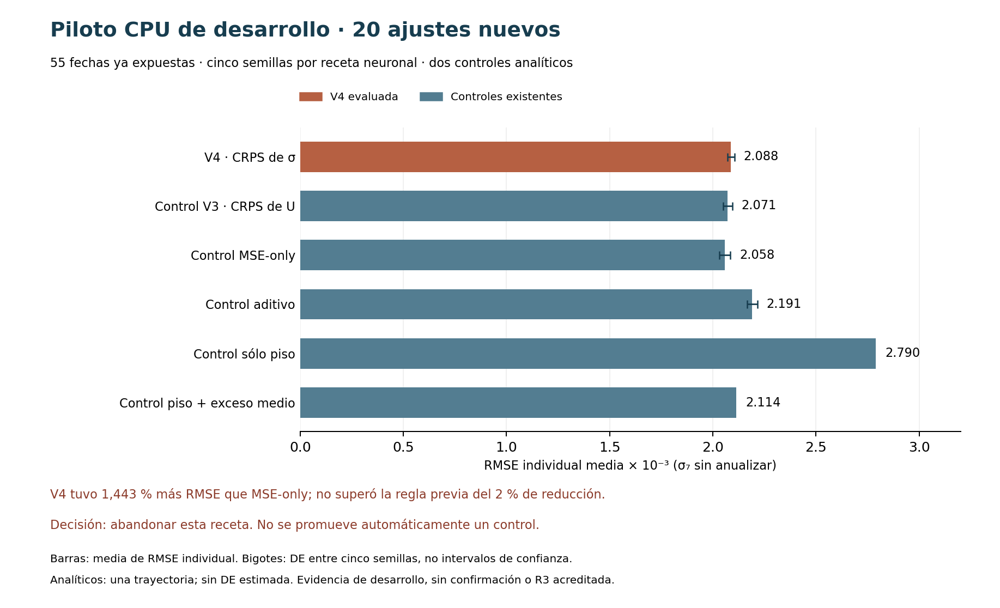

# Desarrollo nuevo: V4 implementada, evaluada y abandonada por su regla previa

**Resultado actual:** V4 no superó el criterio de continuación. Su media RMSE
fue **0,002087524306**, frente a **0,002057824526** del control MSE-only:
**1,443261 % más RMSE**. La decisión registrada es
`ABANDON_CURRENT_V4_RECIPE`. No se promueve otro control ni se abre otra variante
o confirmación automáticamente. Preparado y revisado con asistencia de IA.

Se conservaron la referencia aditiva de 796 trabajos, los 30 ajustes V3 y las
51 trayectorias/20.400 filas retrospectivas. La receta V3 original mantiene su
2,7043119888 % adverso y su NO-GO. El ensayo nuevo no reescribe aquel resultado.

## Qué se implementó y comprobó

1. [Pérdida V4 y controles](outcome_crps_v4.py): mismo forward, inicialización y
   1262 parámetros que la ley atómica V3; cambia la coordenada del CRPS de U a
   sigma y su normalización de sU a sY. Ambas modificaciones se declaran.
2. [Plan sintético](plan_before_results.json) y
   [enmienda matemática previa](tie_amendment_before_results.json), anclados en
   [`f7def09`](https://github.com/jassan-bit/DeepLearning_202630/commit/f7def09fc4283cc2d5429c58a372d7cf636bc1b5)
   antes de la cuadrícula de 144 casos. Los 72 casos sensibles a empates y sus
   gradientes crudos se conservan; 72 diferenciables aportaron 49 alineaciones
   auxiliares mejores, 11 peores y 12 iguales. Es geometría local de leyes finitas,
   no utilidad predictiva. [Resultados y límites](RESULTS_AND_DECISION.md).
3. [Controlador CPU nuevo](cpu_pilot_driver.py) con fuentes históricas fijadas,
   datos de desarrollo admitidos, veinte trabajos, oportunidades/deadlines
   inmutables, checkpoint/RNG y recuperación de trabajos completos. El control
   U reproduce exactamente pérdida y gradientes originales en sus guardas.
4. [Plan CPU completo](cpu_pilot_public/cpu_pilot_plan.json), fuentes y QA
   anclados en [`5ee5572`](https://github.com/jassan-bit/DeepLearning_202630/commit/5ee55723e7d1ce63dbe4a94dca8941cb85a45fee)
   antes de entrenar. SHA canónico del plan:
   `2e6b71b53683d376ff24990b39bc591458816a3001cd62c432fdc1c7c8d8d819`;
   SHA de sus bytes:
   `ee4c07c3613ba8f71a3adf1992e6f9439c54db6602958f2a931300ceb7148297`.
   El manifiesto de veinte fuentes/especificaciones tiene SHA256
   `87ff742443a9e7d353663390ec54ec1c44b902c3d9fcded4ccf3c3af797df205`.

El primer intento de doce guardas de geometría tuvo un fallo de precisión de
una fixture float32. Sus fuentes y log permanecen en `before_tie_amendment/`;
la corrección fijó float64 sin relajar tolerancias. Después aprobaron catorce
guardas de geometría/modelo, dieciséis del controlador y cuatro del exportador.
Los fixtures, el diagnóstico y los ajustes reales tienen recibos separados.

## Piloto CPU efectivamente terminado

Se ejecutaron **20 ajustes nuevos**: cuatro recetas neuronales por cinco seeds
pareados 20261121–20261125. Se añadieron dos controles analíticos con una trayectoria
cada uno. Son **seis recetas, 22 trayectorias y 1210 predicciones** sobre las mismas
**55 fechas de desarrollo ya expuestas**, no 1210 observaciones independientes.

| Receta | Seeds | Media RMSE individual | DE entre seeds |
|---|---:|---:|---:|
| V4 sigma-CRPS | 5 | 0,002087524306 | 0,000017087831 |
| Control V3 U-CRPS | 5 | 0,002071168327 | 0,000022601117 |
| Control MSE-only | 5 | 0,002057824526 | 0,000026740769 |
| Control aditivo | 5 | 0,002190798772 | 0,000024041513 |
| Sólo piso | No aplica | 0,002790340619 | No estimada |
| Piso + exceso medio de ajuste | No aplica | 0,002114230941 | No estimada |

La regla nueva y previa exigía al menos **2 % de reducción** de media RMSE frente
al mejor control neuronal **y al mejor de los cinco controles totales**. No es
un margen confirmatorio ni una prueba de hipótesis. El resultado la incumple.
Se fijó LR común 0,003 como elección transferida, sin afirmar que estuviera
optimizada para V4, y no hubo HPO nuevo. Los tres modelos atómicos tienen idéntica
capacidad/inicialización; el aditivo tiene 1210 parámetros. Los analíticos tienen
cero parámetros o un exceso medio estimado del ajuste, sin optimizador.

El loader abrió sólo tres miembros `training_*` del NPZ existente, verificado
por hash: 532 ejemplos de ajuste, 54 fechas de parada, siete de purga y 55 de
evaluación de desarrollo. No abrió matrices de calibración o evaluación de las
608 fechas. La evaluación de desarrollo se inició después de verificar los
veinte checkpoints entrenados. Datos, fuentes y cortes constan en la
[admisión](cpu_pilot_public/admission.json) y la [especificación previa](CPU_PILOT_PRIOR_SPEC.md).

La cohorte nueva fue Python 3.12.14, Torch 2.8.0+cpu, NumPy 2.3.5, CPU con dos
hilos e interop uno. Los veinte ajustes comparten esta cohorte; no se mezclan
pesos/resultados GPU anteriores como si fueran una comparación común. El tiempo
total fue **90,096 s**, y la suma de paredes de las fases, **54,926 s**, frente
a 2400 s de oportunidades nominales. Se completaron 12.427 pasos de optimizador
y no hubo sobrepasos de los deadlines de fase. Energía, FLOPs y capacidad de
Render no se midieron aquí.

El [recibo final](cpu_pilot_results/pilot_result.json),
la [tabla de seis recetas](cpu_pilot_results/recipe_summary.csv),
las [22 métricas de trayectorias](cpu_pilot_results/per_trajectory_metrics.csv)
y las [1210 salidas](cpu_pilot_results/assessment_predictions.csv) preservan
el resultado completo, los controles fuertes y las discrepancias. Se aplicó
la regla fijada; no se eligió otra métrica para rescatar la receta.

## Información descriptiva disponible para planificación

`cpu_pilot_descriptive/` recalcula las medias con diferencia máxima de
4,34e-19 y entrega la covarianza de RMSE entre los cuatro modelos y las diferencias
pareadas frente a los controles neuronales. Es un análisis **posterior, descriptivo
y condicional al calendario expuesto**. No calcula p-valores, intervalos, potencia,
MDE o remuestreos. La DE de la diferencia V4−MSE-only fue 0,000023402719 entre
cinco seeds; no establece inferioridad universal o significancia.

Las cinco referencias pareadas D00 y su matriz de covarianza preparadas por QA
incluyen también los controles analíticos constantes. No representan cinco seeds
nuevos del control determinista ni llenan las celdas futuras de cuatro paneles.
La familia futura completa y su suficiencia conservan sus requisitos propios.

## Qué se puede descargar y qué permanece local

`cpu_pilot_results/EXPORT_MANIFEST.json` enumera **151 payloads de metadatos y
salidas derivadas**: plan, admisión, recibos, curvas, solicitudes y logs de los
veinte trabajos y CSV finales. El exportador comprueba hashes y el inventario
de veinte trabajos; no abre modelos ni vuelve a inferir.

El NPZ y los `.pt` **no están incluidos**. Los checkpoints nuevos permanecen en
el caso privado local; `LOCAL_CHECKPOINT_HASHES_ONLY.json` conserva sus identidades
y tamaños. Incluir un hash no los convierte en pesos depositados ni concede una
licencia de publicación. No se concede una licencia global sobre datos o fuentes;
se conservan sus términos y procedencia. Las versiones CPU observadas no son una
instalación limpia o un lock de hashes de wheels verificado.

## Decisión de cierre de esta línea

La geometría diferente es una propiedad comprobada de este cambio; no produjo
la mejora de desarrollo exigida en el ensayo de mercado. Se **abandona esta receta
V4**. No se inicia V5, no se promueve MSE-only y no se abre confirmación. El dictamen
R1 de V3 no se hereda a V4: puntuar la distribución de la etiqueta con CRPS es
conocido y necesitaría una diferenciación propia. **R3 sigue no acreditada.**

Estos ajustes son ejecución automática de desarrollo, no el concepto de una
persona externa ni la sustentación del autor. Los procedimientos estadísticos
propuestos requieren su validación propia; el piloto no completa una batería
confirmatoria o la admisión de nuevos datos independientes.
