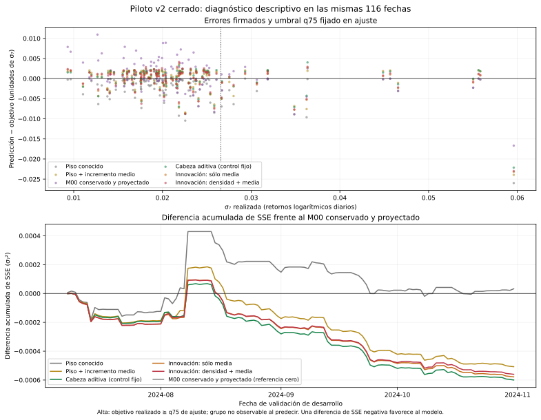

# Anexo E. Cierre de v2: regímenes, originalidad y selección

El análisis detallado de este anexo respalda el estado del modelo en el [capítulo 6](06_modelo_original.md) y la comparación de pilotos del [capítulo 7](07_diseno_riguroso.md).

**Piloto completo; criterio de continuación no superado.** La arquitectura
continúa siendo **CNN causal → LSTM unidireccional → atención temporal**.
El control aditivo queda como referencia de desarrollo por su menor RMSE
global. Su resultado no acredita originalidad ni superioridad frente al Top 10.

El [informe completo y su auditoría reproducible](https://github.com/jassan-bit/DeepLearning_202630/tree/main/experiments/e3_cierre_v2_20261116)
conservan el snapshot de resultados
[`1ca029e`](https://github.com/jassan-bit/DeepLearning_202630/tree/1ca029e869a517cb8de704e573c78ca1e0cbad3c/runs/innovacion_v2),
las predicciones y una revisión focal de novedad. Este cierre no ejecuta
entrenamientos, nuevas inferencias o pruebas de hipótesis.

## Ejecución y criterio fijado

Las tres redes completaron 40 épocas en A100, con 532 ejemplos de ajuste,
siete purgados, 116 fechas de validación interna y una semilla. Las mejores
épocas fueron 38 para la cabeza aditiva y 39 para las otras dos. La validación
se reutilizó para seleccionar época y guiar desarrollo; sus objetivos de siete
días se solapan.

El candidato `innovation_density_mean` obtuvo RMSE **0,00319830**, frente a
**0,00314461** del control aditivo: quedó **1,707 % peor**. Debía mejorar al
menos un 2 % frente al mejor de cinco controles. La heurística no se supera;
la métrica primaria no se cambia por una secundaria que favorezca otra opción.

## Comparación por régimen

Se conserva el percentil 75 del objetivo en ajuste, **0,026577276251655846**.
Hay 98 fechas bajo ese umbral y 18 con volatilidad realizada mayor o igual.
Todas las cifras están en unidades de σ₇ poblacional de retornos logarítmicos
diarios, sin anualización.

| Variante o control | RMSE global | RMSE bajo q75 | RMSE alto |
|---|---:|---:|---:|
| Piso solo | 0,00391683 | 0,00286320 | 0,00736443 |
| Piso + incremento medio | 0,00326861 | **0,00222290** | 0,00647677 |
| M00 conservado y proyectado | 0,00388067 | 0,00367842 | **0,00483565** |
| Cabeza positiva aditiva | **0,00314461** | 0,00229335 | 0,00592383 |
| Innovación: sólo media | 0,00317393 | 0,00223427 | 0,00614341 |
| Innovación: densidad + media | 0,00319830 | 0,00230460 | 0,00608312 |

El control aditivo mejora 18,97 % la RMSE global frente a M00 proyectado, pero
empeora 22,50 % en las 18 fechas altas. Tampoco es el mejor bajo q75: allí la
referencia de incremento constante supera a las tres redes nuevas.
El contraste con el checkpoint v1 conservado compara recetas completas,
incluyendo cabeza, inicialización y precisión; no aísla el efecto de cada cambio.

**Estos grupos utilizan el objetivo realizado, desconocido al predecir.**
Sirven para diagnóstico; no autorizan un selector que escoja modelo usando esa
etiqueta futura. No se crea otro modelo ni se inicia otra campaña en este cierre.

## Dispersión, colas y casos de error

La diferencia de SSE aditiva menos M00 es **−0,0008105880** bajo q75 y
**+0,0002107487** en el grupo alto: total **−0,0005998393**. La mejora global
compensa una pérdida en alta volatilidad. Ese grupo representa 55,07 % de la
SSE aditiva con sólo 15,52 % de las fechas.

El sesgo medio alto de la aditiva es menos negativo que el de M00, pero su
dispersión residual es mayor. Se verifica `MSE = sesgo² + varianza residual`
con `ddof=0`; el peor RMSE alto no se explica por un peor sesgo medio.



La figura muestra todos los puntos. La línea vertical fija q75 y los valores
acumulados negativos favorecen al modelo frente a M00. La cola del 8 de agosto
de 2024 aporta un caso desfavorable relevante: objetivo 0,05959837, predicción
aditiva 0,03745723 y M00 0,04292196. El informe conserva las 696 combinaciones
fecha/modelo y muestra los diez mayores errores aditivos, sin eliminar fechas.
El piso del objetivo no se interpreta como error irreducible.

Las coberturas nominales del candidato son **104/116 = 89,66 %** en total,
**90/98 = 91,84 %** bajo q75 y **14/18 = 77,78 %** en el grupo alto. La
proximidad global al 90 % no certifica calibración ni oculta el subgrupo.

## Revisión de novedad y recomendación

La [matriz de antecedentes y límites de lectura](https://github.com/jassan-bit/DeepLearning_202630/blob/main/experiments/e3_cierre_v2_20261116/literature/review.md)
documenta nueve antecedentes y nueve consultas generales reales. Distingue
fuentes recién verificadas y lecturas heredadas. No sustituye una revisión
nativa en tres bases ni una verificación humana externa.

Las salidas positivas con piso por muestra, las identidades de varianza, la
folded-t y la idea general de mezclar error puntual y Student-NLL tienen
antecedentes. La adaptación exacta permanece bajo revisión. Una menor RMSE
del control no basta para acreditar R1.

La recomendación es **conservar la cabeza aditiva de época 38 como referencia
de desarrollo y cerrar la receta actual del candidato con su criterio
exploratorio no superado**. Se preservan las demás variantes y sus errores.
La elección de un modelo original para E3 sigue pendiente, junto a la defensa
académica de R2 y la evaluación confirmatoria de R3.

El registro de los pilotos conserva **369,477959639 s** de v1 y
**186,734699723 s** de v2: acumulado **556,212659362 s**, con límites 600 s
adicionales y 1200 s acumulados. No hay reserva activa ni exceso registrado.
No son segundos puros de GPU; el registro incluye sus cargos de ejecución y
reserva. El saldo no se reinicia para extender la receta completada.

## Descargas y reproducción

- [Métricas y decisión reproducidas](../_static/e3_cierre_v2_20261116/metrics.json).
- [Métricas por régimen](../_static/e3_cierre_v2_20261116/metrics_by_regime.csv).
- [Errores de las 696 combinaciones fecha/modelo](../_static/e3_cierre_v2_20261116/per_date_errors.csv).
- [Casos diagnósticos](../_static/e3_cierre_v2_20261116/error_cases.csv).
- [Descomposición de SSE](../_static/e3_cierre_v2_20261116/sse_decomposition.csv).
- [Figura SVG](../_static/e3_cierre_v2_20261116/regime_errors.svg).
- [Inventario y hashes de estas descargas](../_static/e3_cierre_v2_20261116/manifest.json).

```bash
python -m pip install -r requirements-e3-close-cpu.lock.txt
python scripts/e3_audit_innovation.py --check
python -m pytest tests/test_innovation_audit.py -q
```

Se declara asistencia de IA. Las pruebas y la revisión entre agentes no
sustituyen comprensión del código, autoría o verificación humana independiente.
