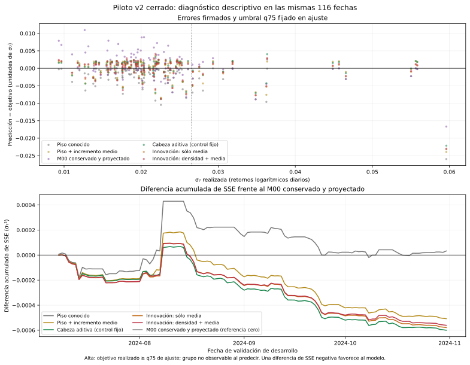

# Cierre del piloto v2: resultados, errores por régimen y selección

**16 de noviembre de 2026. Piloto completo; criterio de continuación no superado.**
Se conserva **CNN causal → LSTM unidireccional → atención temporal**. El control
`additive_positive_head` queda como **referencia predictiva de desarrollo** por
su menor RMSE global. No se acredita como modelo original ni ganador frente al
Top 10. La selección de un aporte original para E3 sigue pendiente.

## 1. Fuente, ejecución y alcance del cierre

La fuente es el [snapshot inmutable de resultados](https://github.com/jassan-bit/DeepLearning_202630/tree/1ca029e869a517cb8de704e573c78ca1e0cbad3c/runs/innovacion_v2),
con run `6cc32b1a91224c4f9144a1c831394746`. Se conservan el plan, las métricas y
las predicciones originales. Las tres redes completaron **40 épocas** en una
A100-SXM4-40GB, con Python 3.12.12, Torch 2.8.0+cu126 y NumPy 2.3.5.
Las mejores épocas fueron **38 / 39 / 39** para aditiva / media / densidad+media.

Se mantuvieron **532 ejemplos de ajuste, siete purgados y 116 de validación**
del 8 de julio al 31 de octubre de 2024. Es una semilla; la validación se usó
para seleccionar época y ya había orientado el desarrollo. Los objetivos de
siete días se solapan. Este cierre es descriptivo, sin inferencia estadística.

[source_provenance.json](audit/source_provenance.json) registra el origen y la
verificación de los 29 archivos del snapshot, incluidos los seis checkpoints,
durante su materialización. La reproducción del cierre usa únicamente **24
archivos de texto**: 23 miembros y el manifiesto fijado por SHA-256. No carga
pesos ni el NPZ; tampoco ejecuta nuevas inferencias, ajustes, bootstrap o
pruebas de hipótesis. Los hashes de las ocho fuentes científicas se comprueban
contra los del entrenamiento.

## 2. Comparación global y decisión fijada antes del piloto

Las unidades son las de **σ₇ poblacional de retornos logarítmicos diarios, sin
anualizar**. Menor RMSE es mejor. Todos los valores proceden de los mismos
CSV y se reproducen en [metrics.json](audit/metrics.json).

| Variante o control | RMSE global | MAE global | Papel |
|---|---:|---:|---|
| Cabeza positiva aditiva | **0,00314461** | 0,00203234 | Mejor control por la métrica primaria. |
| Innovación: sólo media | 0,00317393 | **0,00194324** | Ablación sin NLL auxiliar. |
| Innovación: densidad + media | 0,00319830 | 0,00196582 | Candidato que debía superar la heurística. |
| Piso + incremento medio de ajuste | 0,00326861 | 0,00206393 | Referencia de un parámetro. |
| M00 v1 conservado y proyectado | 0,00388067 | 0,00275399 | Control con pesos anteriores conservados. |
| Piso solo | 0,00391683 | 0,00216223 | Referencia analítica. |

El candidato debía reducir la RMSE al menos **2 % frente al mejor de los cinco
controles**. Quedó **1,707 % peor** que la cabeza aditiva: la heurística es
**falsa**. La mejor MAE de otra variante es secundaria y no cambia esta decisión.
El umbral de continuación es exploratorio; no reemplaza el margen confirmatorio
heredado, un análisis de potencia o una prueba de significancia.

La cabeza aditiva reduce la RMSE global **18,97 % frente a M00 proyectado** y
**3,79 % frente al piso más incremento medio**. Es un hallazgo aplicado de esta
validación; no certifica superioridad estadística ni novedad.

El contraste con M00 compara recetas completas: checkpoint v1 conservado frente
a entrenamiento v2 fresco, nueva cabeza, ajuste inicial del bias y lectura FP64.
No aísla por sí solo la contribución causal de imponer el piso o de cada cambio.

## 3. Regímenes: umbral anterior al piloto y muestras completas

Se conserva el umbral **q75 del objetivo en ajuste = 0,026577276251655846**.
El grupo alto contiene los días con objetivo realizado mayor o igual al umbral:
**18 fechas**; las otras **98** forman el grupo bajo ese umbral, llamado
`normal` en los CSV. La auditoría no busca otro corte favorable.

| Variante o control | RMSE: 98 fechas bajo q75 | RMSE: 18 fechas altas |
|---|---:|---:|
| Piso solo | 0,00286320 | 0,00736443 |
| Piso + incremento medio | **0,00222290** | 0,00647677 |
| M00 conservado y proyectado | 0,00367842 | **0,00483565** |
| Cabeza positiva aditiva | 0,00229335 | 0,00592383 |
| Innovación: sólo media | 0,00223427 | 0,00614341 |
| Innovación: densidad + media | 0,00230460 | 0,00608312 |

La cabeza aditiva mejora **37,65 %** frente a M00 bajo q75, pero su RMSE es
**22,50 % mayor** en alta volatilidad. Además, la referencia de incremento
constante supera a las tres redes nuevas en el grupo bajo q75. Por tanto,
la menor RMSE global no implica dominar cada régimen ni superar siempre las
referencias simples. [metrics_by_regime.csv](audit/metrics_by_regime.csv)
conserva también sesgo, dispersión, SSE, subestimación y excesos sobre el piso.

**La pertenencia a estos grupos utiliza el objetivo realizado**, desconocido
al emitir el pronóstico. Es válida para diagnóstico retrospectivo; no permite
crear un selector operativo que use el modelo ganador de cada grupo. Un
indicador disponible al origen requeriría otra hipótesis y su propio diseño,
sin presentar esta validación expuesta como confirmación independiente.

## 4. Qué explica la compensación global

Para el residuo `e = predicción − objetivo`, se comprueba exactamente

$$
\operatorname{MSE}=\operatorname{sesgo}^{2}
  +\operatorname{Var}_{ddof=0}(e).
$$

La [descomposición de SSE](audit/sse_decomposition.csv) usa el signo
**SSE del modelo menos SSE de M00**. Para la cabeza aditiva:

| Grupo | Diferencia de SSE frente a M00 |
|---|---:|
| 98 fechas bajo q75 | −0,0008105880 |
| 18 fechas altas | +0,0002107487 |
| Las 116 fechas | **−0,0005998393** |

La ganancia en el grupo de 98 fechas compensa la pérdida en el de 18. Los
errores altos constituyen **55,07 % de la SSE aditiva**, aunque son sólo
15,52 % de las fechas; en M00 representan 24,09 % de su SSE.

En el grupo alto, el sesgo aditivo (**−0,00145324**) es menos negativo que el
de M00 (**−0,00165511**), pero su varianza residual es mayor:
**0,0000329799 frente a 0,0000206441**. La peor RMSE aditiva allí no se explica
por un peor sesgo medio; pesa la mayor dispersión y los errores extremos.
Estas identidades describen los resultados y no identifican una causa económica
o un efecto causal de la arquitectura.

La figura reproducible muestra todos los puntos y la acumulación temporal de
la diferencia de SSE. Un valor acumulado negativo favorece al modelo frente a
M00; la línea vertical del panel superior conserva el umbral de ajuste.



## 5. Casos de error y parte desconocida del objetivo

[per_date_errors.csv](audit/per_date_errors.csv) retiene **las 696 combinaciones
de fecha y modelo**. [error_cases.csv](audit/error_cases.csv) muestra los diez
mayores errores absolutos del control aditivo, con desempate por fecha y las
seis variantes en esos mismos días. Es una selección diagnóstica posterior,
no una exclusión de observaciones ni otra regla para elegir modelo.

El **8 de agosto de 2024** ilustra el riesgo de cola: objetivo **0,05959837**,
piso conocido **0,03362074**, predicción aditiva **0,03745723** y M00 proyectado
**0,04292196**. El exceso realizado sobre el piso fue **0,02597763**, frente a
incrementos predichos de aproximadamente **0,00383649** y **0,00930122**.
Ambos subestimaron esa fecha; M00 incurrió en menor error.

Se comprueba `predicción − objetivo = exceso predicho − exceso realizado`.
El piso es una cota algebraica del objetivo, **no un límite irreducible del
error predictivo**. Mantenerlo evita predicciones incoherentes, pero no resuelve
la innovación desconocida. No se atribuye este caso a un evento de mercado
sin evidencia adicional ni se lo elimina para mejorar la conclusión.

## 6. Incertidumbre: cobertura nominal por grupo

| Cabeza probabilística | Global | Bajo q75 | Alta volatilidad |
|---|---:|---:|---:|
| Innovación: densidad + media | 104/116 = 89,66 % | 90/98 = 91,84 % | 14/18 = **77,78 %** |
| Innovación: sólo media | 105/116 = 90,52 % | 92/98 = 93,88 % | 13/18 = **72,22 %** |

La cobertura global próxima al 90 % oculta una menor cobertura en el grupo
alto. Son coberturas empíricas descriptivas de intervalos nominales bajo la
familia asumida, no calibración acreditada. No se realiza aquí una nueva prueba
binomial o bootstrap sobre fechas dependientes.

## 7. Procedencia y originalidad

La [revisión focal de novedad](literature/review.md) conserva nueve antecedentes
y nueve consultas web generales realmente realizadas, con alcance de lectura
en [sources.json](literature/sources.json). No sustituye la búsqueda nativa en
tres bases ni la verificación humana externa.

[ConstraintNet](https://cdn.aaai.org/ojs/16841/16841-13-20335-1-2-20210518.pdf)
ya describe restricciones por muestra y una salida escalar positiva desplazada.
La identidad de varianza, Softplus, la folded-t y los cambios de variable
también tienen antecedentes. Además,
[Acevedo-Prins y Velásquez (2026)](https://www.mdpi.com/1911-8074/19/9/688),
sección 2.3, ecuaciones 6–8, combinan error puntual y Student-NLL para otro
objetivo; no es nuestra pérdida exacta de σ₇ y magnitud U, pero la idea genérica
de mezclar ambos términos ya tiene un antecedente cercano.

La adaptación específica de v2 sigue bajo revisión. No se demuestra que exista
un antecedente idéntico, ni su ausencia. **La menor RMSE del control aditivo no
lo convierte en un aporte original acreditado**. Las propiedades matemáticas
del operador y las pruebas de software tampoco prueban por sí solas R1.

## 8. Recomendación de selección

- **Conservar la cabeza positiva aditiva como referencia de desarrollo**, con
  su checkpoint seleccionado en época 38, 1210 parámetros y el preprocesamiento
  registrado. Su [artefacto inmutable](https://github.com/jassan-bit/DeepLearning_202630/blob/1ca029e869a517cb8de704e573c78ca1e0cbad3c/runs/innovacion_v2/additive_positive_head/best.pt)
  tiene SHA-256 `65641a377ab3e6051081d8a8d15f55e7eece3765b305a0029b032418c8095916`.
- **Cerrar esta receta del candidato con resultado adverso para su criterio
  exploratorio.** Se conservan también la ablación, los controles y los casos
  desfavorables. No se cambia la métrica primaria por MAE ni se amplían épocas
  o semillas para buscar una victoria.
- **Mantener pendiente la selección del modelo original de E3.** Para R1 se
  requiere evidencia de mecanismo, adaptación sustantiva y revisión exigida;
  R2 incluye comprensión y defensa académica por el autor; R3 todavía necesita
  la comparación confirmatoria con la familia completa y evaluación ampliada.

Antes de una campaña confirmatoria deberán quedar fijados estándar, mecanismo,
familia completa, márgenes, presupuestos, particiones, semillas derivadas de
potencia y conjuntos adicionales. Este cierre no crea otra campaña ni
prerregistra retrospectivamente los pilotos.

## 9. Presupuesto y reproducción

| Contador de los pilotos de desarrollo | Segundos registrados |
|---|---:|
| v1 conservado | 369,477959639 |
| v2 adicional | 186,734699723 |
| Acumulado v1 + v2 | **556,212659362** |
| Límite adicional / acumulado | 600 / 1200 |

El snapshot está cerrado, sin reserva ACTIVE pendiente y sin exceso registrado.
Estos cargos incluyen la contabilidad de reservas y arranques prevista; no se
presentan como segundos puros de GPU. Un evento denominado recuperación en el
registro no prueba por sí solo que hubiera una desconexión: también contabiliza
el inicio normal de un bloque con reserva activa. El saldo no se reinicia ni se
usa automáticamente para extender una receta ya completada.

Desde el repositorio:

```bash
python -m pip install -r requirements-e3-close-cpu.lock.txt
python scripts/e3_audit_innovation.py --check
python -m pytest tests/test_innovation_audit.py -q
```

La auditoría reproduce JSON, cuatro CSV y SVG; verifica identidades, fechas,
regímenes, costes y decisión. Tolera hasta ocho pasos representables para
valores numéricos, mantiene estrictas las identidades y compara el SVG
determinista por bytes. La [bibliografía focal](literature/references.bib) y el
[registro de consultas](literature/search_log.json) documentan la revisión.
Se declara asistencia de IA en implementación, análisis y redacción. La
revisión entre agentes no se presenta como verificación humana independiente.
