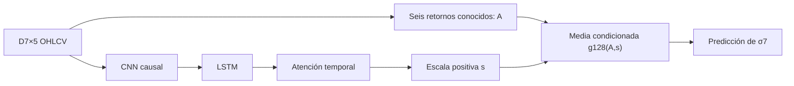

# Ficha de diseño: CNN-LSTM-atención con innovación condicionada, variante v2

**Estado: propuesta experimental, sin entrenamiento de mercado de v2.**
La arquitectura base sigue siendo **CNN causal → LSTM unidireccional → atención
temporal por contenido**, como en `M00`. La modificación propuesta está en la
interpretación de su lectura escalar, el operador final y la función de pérdida.
La selección definitiva y R1/R3 permanecen abiertas.

## 1. Problema concreto que se busca resolver

El [primer piloto](https://github.com/jassan-bit/DeepLearning_202630/tree/f7826d120f3a6eb8e9a0952dd9842cd77f152f34/runs/desarrollo_v1)
mostró menor RMSE para M00 que para full. La
[auditoría posterior](../e3_revision_post_piloto_20261116/README.md) encontró
predicciones inferiores al mínimo permitido por la historia en 32 de 116 fechas
por modelo. La proyección común redujo RMSE a 0.00448068 para full y 0.00388067
para M00. El piso solo obtuvo 0.00391683. Son diagnósticos posteriores sobre
validación de desarrollo, sin valor confirmatorio.

La nueva variante busca separar la parte del objetivo que ya está observada de
la innovación desconocida. **Imponer el piso por sí solo es un control conocido**;
el componente neuronal debe justificar una mejora frente a referencias que
también respetan esa restricción.

## 2. Arquitectura que se conserva

| Componente | Especificación |
|---|---|
| Entrada | Siete barras OHLCV anteriores al objetivo, D7×5. |
| Representación | Log-precios relativos al último cierre conocido y log1p(volumen); escalas calculadas sólo en ajuste. |
| CNN | Conv1d causal, cinco canales de entrada, ocho de salida, kernel 3 y Tanh. |
| LSTM | Unidireccional, dimensión oculta 12. |
| Atención | Consulta aprendida, softmax temporal y valores del LSTM; conserva los límites de consulta, lectura y temperatura de M00. |
| Lectura y escala | Se conserva la lectura lineal de M00 antes de Softplus; una sola aplicación de Softplus produce la escala positiva. |
| Capacidad | 1210 parámetros entrenables por variante neuronal nueva; constantes de cuadratura y ν no entrenables. |

M00 conserva la atención. Sus dos intervenciones respecto del primer full son
retirar la penalización de discordancia y la saturación radial de valores.
Las variantes nuevas comparten inicialización fresca de codificador, atención y
lectura; los pesos seleccionados del piloto v1 se conservan como referencia fija.

Para la entrada transformada $\widetilde X$, la base común se expresa como

$$
H=\operatorname{LSTM}_{12}\!\left(\tanh\left(
\operatorname{ConvCausal}_{5\to8,\,k=3}(\widetilde X)\right)\right),
\quad
\alpha_j=\frac{\exp(q^\top h_j/\tau)}{\sum_{k=1}^{7}\exp(q^\top h_k/\tau)},
\quad \mathrm{contexto}=\sum_{j=1}^{7}\alpha_jh_j.
$$

La consulta $q$, la lectura $w,b$ y la temperatura $\tau$ se aprenden con los
mismos límites de M00. El conteo es 128 parámetros de CNN, 1056 de LSTM y 26 de
consulta, lectura y temperatura. El operador probabilístico añade constantes,
sin nuevos parámetros entrenables.



## 3. Formulación del objetivo y de la innovación

Para predecir $y_t=\sigma_7(t)$, la entrada contiene cierres de $t-7$ a $t-1$.
Se conocen los seis retornos de $t-6$ a $t-1$. Definimos

$$
m_t=\frac16\sum_{i=t-6}^{t-1}r_i,\qquad
A_t=\frac17\sum_{i=t-6}^{t-1}(r_i-m_t)^2,\qquad c=\frac6{49}.
$$

La identidad de actualización de varianza da

$$
y_t^2=A_t+c(r_t-m_t)^2,\qquad
\ell_t=\sqrt{A_t},\qquad
U_t=|r_t-m_t|=\sqrt{(y_t^2-A_t)/c}.
$$

$A_t$ se calcula exclusivamente desde la entrada. $U_t$ se utiliza como
**etiqueta transformada**, nunca como predictor. No se necesita recuperar el
cierre futuro para construirla. La etiqueta no identifica el signo de la
innovación y la propuesta no lo pronostica.

Antes de usar etiquetas se detiene la corrida si algún margen
$y_t^2-A_t<-10^{-12}$; no se descartan filas para continuar. Sólo los pequeños
márgenes negativos dentro de esa tolerancia numérica se llevan a cero.
La transformación presupone el objetivo centrado con `ddof=0`, horizonte uno y
sin anualización.

## 4. Cabeza probabilística propuesta

Se postula una distribución **half-Student-t** para la magnitud, con ν=5 fijo:

$$
q_\theta(u\mid X_t)=\frac{2}{s_\theta(X_t)}
 t_5\!\left(\frac{u}{s_\theta(X_t)}\right),\quad u\ge0,
\qquad
s_\theta=u_{\mathrm{scale}}\left[10^{-4}+\operatorname{softplus}(a_\theta(X_t))\right].
$$

$a_\theta=w^\top\mathrm{contexto}_\theta+b$ es la preactivación lineal de la misma
CNN-LSTM-atención, anterior a Softplus. Softplus se aplica una sola vez. La escala
$u_{\mathrm{scale}}=\operatorname{media}_{\mathrm{ajuste}}U$ debe ser positiva.
También se conserva $y_{\mathrm{scale}}=\operatorname{media}_{\mathrm{ajuste}}y$.
Ambas se calculan sólo con los 532 ejemplos de ajuste. $s$ es escala Student,
no desviación estándar: $E[U^2]=5s^2/3$.

En el interior $y>\sqrt A$, la densidad inducida es

$$
p_\theta(y\mid X)=q_\theta(u\mid X)\frac{y}{cu},
\qquad u=\sqrt{(y^2-A)/c}.
$$

El factor dos ya está en $q$. El jacobiano depende de datos y $A$ fijos, por lo
que se puede optimizar la NLL de $U$ sin ese término constante en θ. Esa pérdida
no se reporta como el logscore completo de σ. Para $A>0$ existe una singularidad
integrable en el borde; para $A=0$, $Y=\sqrt c\,U$ y el borde tiene otro límite.
El suelo estricto de escala evita el colapso de la NLL cuando $U=0$.

La forma half-t es una **hipótesis distributiva** sobre magnitudes. No se deduce
de la identidad y puede estar mal especificada. Sólo se aprende su escala: una
forma de la distribución que cambie con la tendencia o el régimen, o unos grados
de libertad distintos, pueden limitarla. Esta ficha no estima esos parámetros.

## 5. Predicción puntual y pérdida

Para RMSE sobre σ interesa la media condicional de σ. La raíz de la varianza
esperada representa otro estimando. Se propone aproximar

$$
g(A,s)=E_{Z\sim t_5}\sqrt{A+cs^2Z^2},\qquad
\widehat y=g_{128}(A,s)=\sum_{j=1}^{128}a_j\sqrt{A+cs^2z_j^2},
$$

con pesos positivos de suma uno y nodos fijos. Se usa la cuadratura de
Gauss-Jacobi con α=1, β=−1/2 y normalización de razón, detallada en
[theory.md](theory.md). La regla numérica se fija por pruebas sintéticas,
independientemente de las métricas de mercado.

La pérdida propuesta es

$$
\mathcal L=\operatorname{media}\!\left[
 \left(\frac{g_{128}(A,s)-y}{y_{\mathrm{scale}}}\right)^2
 +0.1\left(-\log q_{\widetilde U}(U/u_{\mathrm{scale}}\mid s/u_{\mathrm{scale}})\right)
\right].
$$

Se estandariza la variable de la NLL; no se divide su valor por una escala
física. ν=5, λ=0.1 y el mínimo normalizado $10^{-4}$ son decisiones de diseño
previas al nuevo piloto, no valores prescritos por un artículo ni seleccionados
por sus resultados. La pérdida mixta no es MLE puro y no garantiza calibración
ni mejor RMSE. La cuadratura finita tampoco se presenta como media continua exacta.

Los cuantiles nominales se obtienen de
$Q_p(Y)=\sqrt{A+cs^2[t_5^{-1}((1+p)/2)]^2}$, $0<p<1$.
El intervalo de niveles 0.05–0.95 es un diagnóstico bajo la familia asumida;
su cobertura empírica y una calibración posterior siguen pendientes.

## 6. Propiedades que se demostrarán y verificarán

Para $A\ge0$, $s\ge0$, pesos $a_j>0$ de suma uno y nodos $z_j>0$:

1. **Coherencia:** $g_{128}(A,s)\ge\sqrt A$ y $g_{128}(A,0)=\sqrt A$.
2. **Homogeneidad del operador:** $g_{128}(k^2A,ks)=k\,g_{128}(A,s)$ para $k>0$.
3. **Regularidad en la escala aprendida:**
   $|g_{128}(A,s)-g_{128}(A,s')|\le L_{128}|s-s'|$,
   donde $L_{128}=\sqrt c\sum_j a_jz_j\approx0.332094915$.
4. **Score auxiliar acotado:** la derivada de la NLL half-t respecto de log(s)
   está en $[-5,1]$. Esto no acota automáticamente el término MSE.

Las demostraciones están en [theory.md](theory.md). No se trasladan a una cota
global de sensibilidad respecto de $A$, OHLCV o el codificador completo.
Tampoco acreditan novedad: son propiedades de una construcción con ingredientes
matemáticos conocidos.

La comprobación sintética observó error relativo máximo aproximado de
**2.48×10⁻⁵** para N=128 en 241 razones entre $10^{-6}$ y $10^6$, frente a una
integración independiente. Es una verificación sobre esa grilla, no una cota
uniforme certificada para todas las entradas. La regla y sus verificaciones
quedan en [verification/](verification/).

## 7. Hipótesis falsables y controles

| Hipótesis | Evidencia requerida | Qué la refuta o limita |
|---|---|---|
| H1: la implementación respeta el piso y las propiedades del operador. | Pruebas sintéticas antes del piloto y cero violaciones de soporte en entradas válidas. | Una violación numérica fuera de tolerancia bloquea la corrida. |
| H2: la cabeza con pérdida mixta mejora el RMSE de desarrollo más allá de controles coherentes. | Al menos 2 % menos RMSE que el mejor de los cinco controles fijos. | No alcanzar el umbral impide declarar que el piloto supera el criterio de continuación. |
| H3: la NLL auxiliar aporta frente a la misma cabeza con λ=0. | Comparación con inicialización y receta idénticas; RMSE, MAE, NLL de U y cobertura nominal reportados. | Una mejora explicada sólo por el piso o un resultado peor que λ=0 no respalda atribuir el efecto a la NLL. |

El 2 % es una **heurística exploratoria de continuación definida ahora**, no el
margen δ confirmatorio de E3. No se calculan p-valores ni se declara R3.

| Control | Ajuste previsto |
|---|---|
| Piso $\sqrt A$ | Referencia analítica, sin ajuste. |
| Piso + `d_fit` | `d_fit` es la media de $y-\sqrt A$ sólo en ajuste; referencia de un parámetro. |
| M00 v1 proyectado | Pesos originales y mejores predicciones conservados; sin reentrenamiento. |
| Misma CNN-LSTM-atención con $\sqrt A+y_{\mathrm{scale}}(10^{-4}+\mathrm{softplus}(a_\theta))$ | Control de cabeza positiva estándar, MSE sobre σ. |
| Misma cabeza $g_{128}$ con λ=0 | Ablación de la NLL; aísla su contribución. |

Las tres redes nuevas conservan 1210 parámetros. Las dos probabilísticas parten
de pesos idénticos. Para comparar las cabezas nuevas, su bias final se inicializa
mediante bisección usando únicamente ajuste, para igualar la media inicial del
incremento a `d_fit`. El resto de pesos de codificador, atención y lectura es
compartido. Las dos cabezas probabilísticas conservan también el mismo bias
resuelto; sólo el bias del control aditivo puede diferir. Igualar la media no
iguala las predicciones por muestra. La lectura final, su bias y la suma previa
a Softplus se evalúan y almacenan en FP64 para las tres redes. Se comprueba que
el objetivo esté dentro del intervalo de bisección antes de iterar.
Si `d_fit` o la escala U son degenerados, o la bisección falla, se detiene y documenta
el caso, sin ajustar la inicialización con validación.

## 8. Protocolo del próximo piloto

La especificación ejecutable como datos está en [pilot_plan.json](pilot_plan.json).

- Mismo NPZ fijado por SHA-256 y sólo sus tres arreglos originales de entrenamiento.
  Ajuste hasta 2024-06-30; purga de siete días; validación 2024-07-08–2024-10-31.
  Estas 116 fechas siguen siendo desarrollo ya expuesto.
- Semilla 20261116; AdamW, lr=0.001, weight decay=0, batch=32, clip=1,
  máximo 40 épocas por red y paciencia 8. Selección por RMSE, empate a época anterior.
- Una época por variante neuronal activa en rotación. Codificador y atención FP32;
  lectura final, bias y operadores de las tres cabezas FP64. AMP y TF32 desactivados; algoritmos deterministas.
- **Tope adicional conjunto propuesto: 600 segundos registrados**, incluidos ajustes,
  inicialización de bias, entrenamiento, validación y guardado local. Sumado a
  los 369.47796 segundos del primer piloto, el máximo sería 969.47796 de 1200.
  Se conserva el límite global de 1200 segundos registrados. Cualquier cargo por
  reserva activa o recuperación consume los topes. Estas cifras no representan
  el tiempo total de pared: las descargas y la publicación fuera del contador
  activo pueden añadir tiempo. El coordinador debe reservar presupuesto global
  antes de cualquier ajuste; no se reinicia el registro previo.
- Si el tope interrumpe una receta, el piloto se declara incompleto. No se
  amplían épocas, presupuesto o semillas para obtener una victoria.
- Se publicarán todos los controles, MAE, sesgo y errores de alta volatilidad
  definida con el percentil 75 del objetivo de ajuste. Los modelos probabilísticos
  añadirán NLL de U y cobertura nominal; no se elige otra métrica tras ver resultados.
- La futura ejecución usará una rama de resultados v2 separada y conservará
  completos los pesos, métricas y saldo de v1. Requiere implementar el coordinador
  de esa variante; el notebook v1 no la ejecuta por leer esta ficha.

## 9. Procedencia, modificación propuesta y R1

La combinación exacta de esta ficha es una **adaptación propuesta en esta
colaboración con asistencia de IA**, no una arquitectura final tomada de un
artículo. La [procedencia estructurada](literature/sources.json) distingue:

- [SurVAE Flows, Nielsen et al. (2020)](https://proceedings.neurips.cc/paper_files/paper/2020/file/9578a63fbe545bd82cc5bbe749636af1-Paper.pdf):
  antecedentes de cambios de variables y plegado de signos, utilizados para
  justificar el transporte probabilístico, conservando nuestro backbone.
- [La distribución folded-t, Psarakis y Panaretos (1990)](https://mpra.ub.uni-muenchen.de/6257/):
  antecedente de la familia; se verificaron metadatos del original, no su cuerpo íntegro.
- [GARCH-NN (2024)](https://arxiv.org/html/2402.06642) y
  [DeepAR](https://arxiv.org/html/1704.04110): antecedentes de densidades neuronales.
  Student-t financiero se atribuye al primero; el original DeepAR examina otras familias.
- ConstraintNet y la actualización de varianza de Chan et al. ya documentan
  restricciones por muestra e identidades utilizadas aquí.

La modificación que se someterá a revisión es el aprendizaje de la magnitud
recuperable U, su transporte condicionado por A y el ajuste conjunto de la
media de σ y de la densidad de U. Cambian la etiqueta, el operador de salida y
la pérdida del mismo codificador. **No están verificadas la novedad de esa
combinación, R1 ni su superioridad.** Las ocho consultas focales nuevas no
sustituyen la búsqueda sistemática ni la verificación humana externa.

## 10. Estado de implementación y reproducción

Esta entrega contiene la ficha, el protocolo y un **verificador matemático con
datos sintéticos**. La nueva red y el coordinador del piloto no se han implementado
ni entrenado. Se mantiene el recuento de dos variantes evaluadas en mercado;
las tres recetas neuronales de esta ficha quedan como propuestas, no resultados.

```bash
python -m pip install -r requirements-e3-design-cpu.lock.txt
python scripts/e3_verify_innovation_design.py --check
python -m pytest tests/test_innovation_design.py -q
```

La asistencia de IA y las lecturas focales se declaran. La revisión interna no
se presenta como verificación humana independiente de novedad ni como dominio
del código demostrado por el autor del proyecto.
